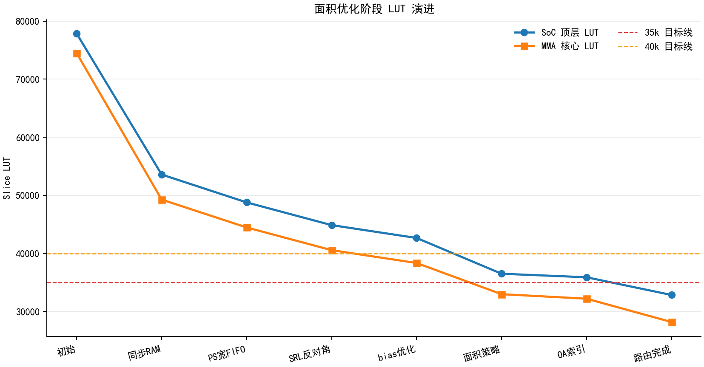
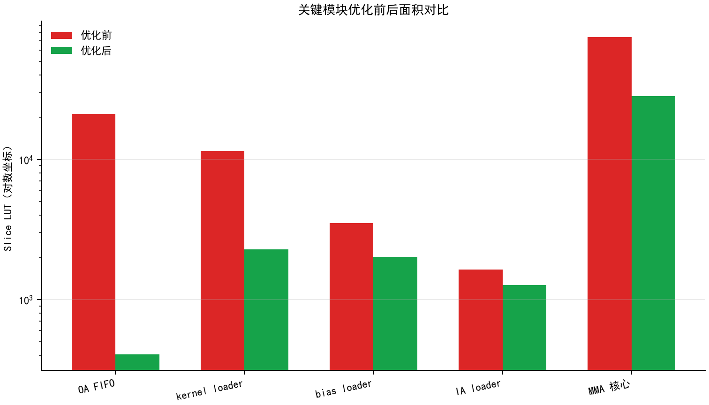
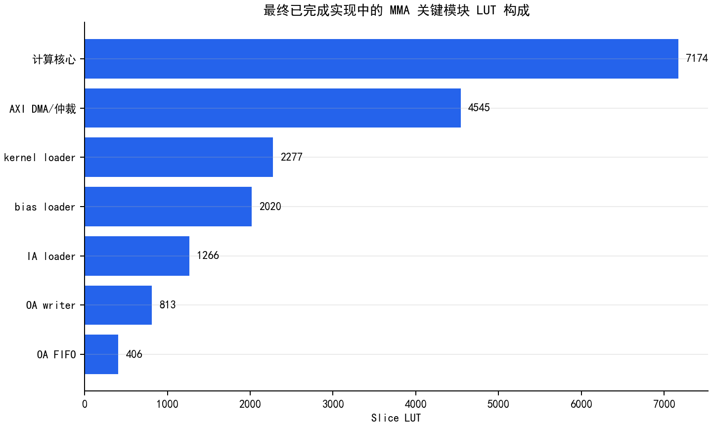

# FPGA 面积优化报告

本文记录 `SIZE=16, IA_CACHE_BLOCKS=4, PS_FRAME_COUNT=16` SoC/MMA 配置在 Artix-7 `xc7a200tfbg484-3` 上的面积压缩过程。目标是先把 MMA 相关逻辑压到 `40000 LUT` 以下，再进一步压到 `35000 LUT` 以下，同时保持随机回归功能正确，并为后续时序收敛保留可流水化空间。

数据来源为 `/home/etc/FPGA/tflm_ai_dsa` 下的 Vivado batch/implementation 报告。最新完整实现点使用 Vivado 2024.2.1，`Flow_AreaOptimized_high` 综合策略，导出工程位于：

```text
/home/etc/FPGA/tflm_ai_dsa/vivado_export/tflm_ai_dsa_soc_s16_c4_paramfifo_v1
```

说明：`paramfifo_v1` 是本文落表时最新已完成报告；其面积已经满足目标，但路由后 WNS 为 `-0.069ns`，后续 `biaspipe_prphys_v1` 正在重新实现，用于验证新增 bias 写入流水和 post-route phys-opt 后的时序。

## 总体结果



| 指标 | 优化前 | 最新已完成实现 | 变化 |
|---|---:|---:|---:|
| SoC 顶层 Slice LUT | 77,837 | 32,844 | -44,993，下降 57.8% |
| `u_mma_axil_top` Slice LUT | 75,150 | 28,918 | -46,232，下降 61.5% |
| `u_mma_top` Slice LUT | 74,469 | 28,183 | -46,286，下降 62.2% |
| `u_mma_top` FF | 109,843 | 28,548 | -81,295，下降 74.0% |
| `u_mma_top` BRAM36/BRAM18 | 32 / 16 | 100 / 17 | 使用 BRAM 替代寄存器阵列 |
| `u_mma_top` DSP | 320 | 320 | 保持 16x16 计算阵列不变 |

最终已完成实现中，MMA 核心 `28183 LUT`，低于 `35000 LUT` 目标；SoC 顶层 `32844 LUT`，也低于 `35000 LUT`。面积压缩的核心不是减少计算单元，而是把大规模缓冲、FIFO 和 loader 暂存从寄存器/组合 for 展开迁移到同步 RAM/BRAM，并缩短控制状态的组合扇出。

## 阶段演进

| 阶段 | Top LUT | MMA AXIL LUT | MMA LUT | OA FIFO LUT/FF | kernel LUT/FF | bias LUT/FF | IA LUT | OA LUT | BRAM36/18 |
|---|---:|---:|---:|---:|---:|---:|---:|---:|---:|
| 初始批处理导出 | 77,837 | 75,150 | 74,469 | 20,964 / 65,845 | 11,432 / 10,129 | 3,491 / 2,763 | 1,637 | 749 | 96 / 16 |
| 同步 RAM 缓存 | 53,573 | 50,223 | 49,262 | 693 / 50 | 2,730 / 1,874 | 4,071 / 2,774 | 1,911 | 932 | 168 / 16 |
| PS 宽 FIFO | 48,780 | 45,430 | 44,469 | 693 / 50 | 2,730 / 1,874 | 4,071 / 2,774 | 1,879 | 932 | 164 / 17 |
| SRL 反对角化 | 44,867 | 41,517 | 40,556 | 693 / 50 | 2,731 / 1,874 | 4,071 / 2,774 | 1,875 | 932 | 164 / 17 |
| bias 控制优化 | 42,655 | 39,305 | 38,346 | 449 / 51 | 2,687 / 1,872 | 3,668 / 2,364 | 1,872 | 895 | 164 / 17 |
| 面积策略与控制清理 | 36,499 | 33,728 | 32,980 | 393 / 49 | 2,259 / 1,877 | 2,654 / 2,372 | 1,501 | 735 | 164 / 17 |
| OA 索引/向量路径整理 | 35,889 | 32,949 | 32,201 | 393 / 49 | 2,293 / 1,877 | 2,167 / 2,452 | 2,023 | 808 | 164 / 17 |
| 最新已完成实现 | 32,844 | 28,918 | 28,183 | 406 / 52 | 2,277 / 1,879 | 2,020 / 2,440 | 1,266 | 813 | 164 / 17 |

综合前的 batch 报告通常比 routed 报告更悲观，最后一行的下降一部分来自真实 RTL 优化，一部分来自 Vivado 在实现阶段的跨层优化、SRL/BRAM 推断和等价逻辑合并。因此报告中同时保留阶段趋势和最新 routed 数据，不把中间 batch 数字当作最终板上资源。

## 关键模块对比



| 模块 | 优化前 LUT | 最新 LUT | 主要变化 |
|---|---:|---:|---|
| OA FIFO / `vec_s8_to_fifo` | 20,964 | 406 | 多 bank 行缓存从寄存器阵列改为同步 RAM；bank ready 计数从组合遍历改为计数寄存器；默认 bank 数由 IA cache 深度派生 |
| kernel loader | 11,432 | 2,277 | 权重缓存使用 BRAM；列展开读取与转置写入分离；减少 nested for 的大规模选择逻辑 |
| bias loader | 3,491 | 2,020 | synthesis 下不清零整块 data array，只复位 valid/tag；压缩 block 控制；近期新增写入侧一拍流水用于截断 DMA 到 buffer 的长线 |
| IA loader | 1,637 | 1,266 | 控制状态和 reuse 上限收敛，减少跨 tile 比较/计数扇出；cache manager 维持 BRAM 化数据面 |
| `u_mma_top` | 74,469 | 28,183 | 总体下降来自 FIFO/kernel/bias/PS buffer/控制路径共同作用 |



最新已完成实现中，面积占比最高的模块变成：

| 模块 | LUT | 说明 |
|---|---:|---|
| `u_compute_core` | 7,174 | 包含 16x16 脉动阵列、PS buffer、de-diagonalizer 和累加输出路径 |
| `u_block_dma_arbiter` | 4,545 | 统一 AXI dual block DMA、读写 outstanding、各 loader/OA writer 客户端仲裁 |
| `u_kernel_loader` | 2,277 | 64 个 BRAM36 保存权重块，LUT 主要在地址/转置/valid 控制 |
| `u_bias_loader` | 2,020 | bias 分组缓存和双 bank valid/tag 控制 |
| `u_ia_loader` | 1,266 | IA cache 控制、slot 调度和输出流控制 |
| `u_oa_writer` | 813 | DMA 写回地址、tile 顺序和非对齐写回控制 |
| `u_vec_s8_to_fifo` | 406 | 8 个 BRAM36 的 OA 行缓存，LUT 只剩 bank 控制和输出打包 |

这个结构说明面积热点已经从“明显错误的寄存器海”转移到真正的计算核心和统一 DMA 控制。后续如果要继续压到 `30000 LUT` 以下，优先级应从旧的 FIFO/register 修复转向 DMA 地址发生器、compute_core 输出通路和量化/写回控制的局部化。

## 主要优化方法

### 1. 用同步 RAM/BRAM 替代寄存器阵列

早期版本的 OA FIFO 和部分 loader buffer 用多维 `reg` 数组保存完整 tile，综合器在复杂索引、复位、for-loop 写入下倾向展开为大量寄存器和 LUT mux。典型结果是 `vec_s8_to_fifo` 单模块达到 `20964 LUT / 65845 FF`，几乎单独吃掉一个中等设计的面积。

修复方法：

- 将按 row/bank 访问的缓存改为同步读取 RAM；
- 写口只接收当前 beat/当前 row，避免全 tile 同周期选择；
- 读口按固定 row 顺序输出，输出侧打包逻辑与存储逻辑分离；
- synthesis 下不对大数组做全量复位，复位只作用于 valid、ptr、tag。

结果是 OA FIFO 降到 `406 LUT / 52 FF / 8 BRAM36`。BRAM 使用增加是有意的，因为目标是把高扇出寄存器阵列迁移到 FPGA 原生存储资源。

### 2. kernel loader BRAM 化与转置路径局部化

kernel loader 曾是 LUT 爆炸的第二大来源，初始为 `11432 LUT / 10129 FF`。根因是 W 数据需要“DMA 连续读取、计算侧转置输出”，旧写法容易把列/行/有效 lane 的判断展开成大规模组合选择。

修复方法：

- DMA 保持连续 burst 读，硬件内部完成列展平到计算行/列的映射；
- 权重 buffer 使用同步 RAM，按计算输出方向读出；
- tail valid 只在边界 beat 做局部 mask，不在整块矩阵上做全局组合筛选；
- 删除不再使用的旧握手/标志，减少控制 fanout。

最终 kernel loader 约 `2277 LUT / 1879 FF / 64 BRAM36`，面积降幅约 `80.1%`。这也是面积报告中最重要的结论之一：为了保持 DMA 连续访问，不需要牺牲面积去做全矩阵组合转置，正确做法是把转置变成 RAM 地址映射问题。

### 3. PS buffer 与 de-diagonalizer 改写

PS buffer 需要缓存 reuse partial sum，早期每 lane 独立 FIFO/移位结构在 SIZE 增大后会复制控制逻辑。改写后把 SIZE 个 lane 合并为一个 wide word，使用单个 pseudo dual-port RAM 保存一整行 partial sum。这样把一组 lane 的地址、frame_len、read/write pointer 合并成一份。

de-diagonalizer 的延迟线使用 `(* shreg_extract = "yes" *)`，让 Vivado 推断 SRL，而不是把所有对角延迟都作为普通 FF。该阶段 SoC LUT 从 `48780` 降到 `44867`，FF 从 `33686` 降到 `30249`，SRL 从 `195` 增加到 `643`。这属于典型 FPGA 面积优化：把规则延迟交给 SRL，把随机访问交给 BRAM。

### 4. bias loader 控制与写入流水

bias loader 同时支持 per-block bias 预取和分组输出。面积优化重点是：

- synthesis 下取消对 `bank_words` 的整块清零，避免复位网络和写 mux 爆炸；
- 只复位 `bank_loaded`、`bank_block_idx` 等 tag/valid；
- 压缩 group_blocks_needed、load_block_valid 等控制比较；
- 在 DMA 写入侧打一拍 `load_word_valid/load_word_row/load_word_col_base/load_word_data/load_done`，截断 `axi_dual_block_dma` 到 bias buffer 的长线。

该模块从阶段中的 `4071 LUT / 2774 FF` 降到最新实现的 `2020 LUT / 2440 FF`。新增写入流水对面积影响很小，但有利于修复当前最差路径：`rd_rsp_col_base_r` 到 `bias_loader_buffer.bank_words_reg[].CE`。

### 5. FIFO bank 数参数化

为保证不同 `IA_CACHE_BLOCKS` 下功能正确，OA FIFO 的 bank 数不再固定大窗口，而是：

```systemverilog
parameter int unsigned OA_FIFO_BANKS_MAX =
    (IA_CACHE_BLOCKS < 4) ? 4 : IA_CACHE_BLOCKS;
```

同时引入 `reserve_banks`，由顶层 effective IA reuse 给出，输出侧只保留必要的 bank 水位。这样 C4 工程不会为了 C16/C32 的复用窗口实例化过多行缓存，C16/C32 又不会因为 bank 不足导致覆盖未读数据。

### 6. 统一 DMA 的面积与性能折中

统一 `axi_dual_block_dma + axi_block_dma_arbiter` 后，`u_block_dma_arbiter` 自身约 `4545 LUT`，看起来不小，但它替代了多个 loader/OA writer 分散 DMA 和总线仲裁逻辑，并提供读写 outstanding、非对齐处理、AXI read/write 双向并行。面积上它不是最小实现，但综合收益是：

- 减少每个模块各自维护 burst/unaligned/row stride 状态；
- 把 AXI 协议复杂度集中在一个地方；
- 为总线利用率优化保留统一调度入口；
- 读写通道可独立推进，避免 ICB 旧桥接造成的串行化。

若后续继续压面积，DMA 是第二优先级目标：可以把部分 32bit 乘加地址发生器改成递增累加器、对各 client command 做更窄的本地字段，并拆分 bias/quant 的轻量 1D read command。

## 验证情况

面积优化后的 RTL 已在 SoC 仿真中做过 smoke 验证：

| 配置 | 结果 | 备注 |
|---|---|---|
| `SIZE=16,CACHE=4,K=N=M=64,WS,s8,per-tensor` | PASS | bias 写入流水后 `dsa_execute_cycles=5752` |
| `SIZE=16,CACHE=16,K=128,N=64,M=64,WS,s8,per-tensor` | PASS | 深复用场景 `dsa_execute_cycles=8188` |
| `SIZE=16,CACHE=4,paramfifo_v1` Vivado routed | 面积 PASS，时序未 PASS | Top `32844 LUT`，MMA `28183 LUT`，WNS `-0.069ns` |

需要注意，面积目标已经达成，但 timing 仍需以最新 `biaspipe_prphys_v1` 实现结果为准。若该工程 WNS 转正，则本报告的最终面积行需要追加新的 routed 数据；若仍有负 slack，应继续按 timing path 修复，而不是为了面积回退到寄存器展开写法。

## 后续面积优化方向

1. `u_block_dma_arbiter`：当前约 `4545 LUT`。重点检查地址乘法/比较器是否可改成 row_addr 累加、beat 计数局部化，以及 bias/quant 轻量模式是否能绕开完整 SIZE 数据解包。
2. `u_compute_core`：当前约 `7174 LUT`。重点看 PS buffer 输出 mux、de-diagonalizer 有效标志、vec requant 前的数据选择是否还有可 SRL/BRAM 化空间。
3. `u_kernel_loader`：当前约 `2277 LUT`。已从 11k 降到 2.3k，后续优化应谨慎，避免破坏 W 连续读和硬件转置语义。
4. `u_bias_loader`：当前约 `2020 LUT`。如果 timing 已经转正，可以暂不继续压；如果仍是最差路径，应优先做物理局部化/寄存器切分，而不是恢复大组合清零。
5. 顶层约束策略：继续使用 `Flow_AreaOptimized_high` 作为面积基线；如果时序紧张，可在 impl 使用 post-route phys-opt，但要记录 LUT/FF 是否反弹。

阶段性结论：本轮面积优化已经把 MMA 从 `74469 LUT` 压到 `28183 LUT`，达成 `35000 LUT` 目标，并把最大错误源从寄存器 FIFO/kernel buffer 转成可解释的 compute/DMA/loader 结构。下一步工作的重心应回到时序闭合和吞吐不劣化验证。
