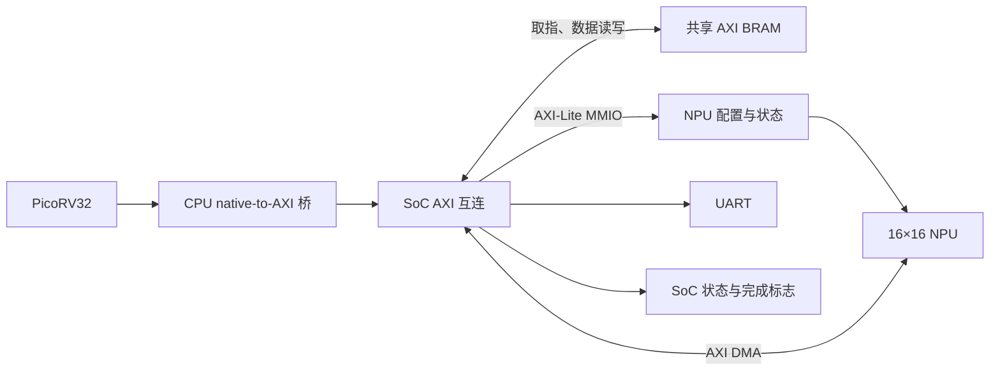

# Artix-7 XC7A200T FPGA 项目说明与运行指南

这个原型把 `aiEngine_integrated` 的 PicoRV32、GEMPACT NPU、共享存储和 UART 集成到 XC7A200T，用同一份裸机固件检查 RTL、综合网表和布线网表。首次运行使用 `xc7a200tfbg484-3`、100 MHz、512 KiB 共享 RAM。现有脚本采用 Vivado 非工程模式，运行后可在 GUI 中打开 DCP 检查实现结果。

- [项目介绍](#项目介绍)
- [Windows 快速开始](#windows-快速开始)
- [检查结果与定位失败](#检查结果与定位失败)
- [ASIC RTL 迁移到 FPGA](#asic-rtl-迁移到-fpga)
- [主存容量与固件配套](#主存容量与固件配套)

## 项目介绍

`a7_soc` 是脚本生成的 FPGA 封装，例化已有的 `soc_top`。PicoRV32 从片上 RAM 的零地址取指，通过 AXI 互连访问主存和 MMIO。软件通过 AXI-Lite 设置 NPU 的矩阵尺寸、数据地址和量化参数，NPU 的 AXI DMA 从同一片主存取输入、权重和 bias，并写回结果。CPU 轮询 NPU 完成状态，读取并检查输出，再向 SoC 控制寄存器写入退出码。



### 基线参数

| 项目 | FPGA 默认配置 |
|---|---|
| 器件与时钟 | `xc7a200tfbg484-3`，`soc_clk=100 MHz`，周期 `10.000 ns` |
| CPU 固件 | RV32IM / ILP32，复位向量 `0x00000000`，栈从 RAM 顶部向低地址增长 |
| NPU | `SIZE=16`，`IA_CACHE_BLOCKS=4`，`PS_FRAME_COUNT=16`，门控时钟走 `BUFGCE` |
| 共享主存 | `CPU_MEM_DP=131072` 个 32 位字，即 512 KiB，使用 4 路字节写使能 |
| 初始化 | `CPU_MEM_INIT_EN=1`，综合时将 `cpu.mem` 固化为 BRAM 初始化内容，封装将 `mem_reload_req` 接低 |
| 板级状态 | `soc_finish`、`soc_status[31:0]`、`cpu_trap`、`npu_busy`、`npu_irq`，另有 `uart_tx`、`uart_rx` |

### 软件地址图

| 地址 | 用途 |
|---|---|
| `0x00000000–0x0007FFFF` | 默认共享 RAM，包含指令、模型或权重、NPU 数据、堆和栈。上限随 `--ram-kib` 修改 |
| `0x02000004` / `0x02000008` | UART 分频寄存器 / 数据寄存器 |
| `0x10000000` | NPU MMIO 基址，`+0x004` 为状态，`+0x0FC` 为 ID `0x4E505531` |
| `0x20000000` / `0x20000004` | 写 `+0x000` 更新状态并置完成，读 `+0x004` 可取得完成标志 |
| `0x20000008` / `0x2000000C` | CPU trap 状态 / 软件阶段进度寄存器 |

NPU 的矩阵分组和尾块字段由软件驱动按配置 ABI 2 写入。更换固件时，驱动和 RTL 的 NPU 参数需要一致。[NPU 寄存器与配置 ABI](../drivers/registers_v2.md)

### 源码入口

| 文件 | 职责 |
|---|---|
| [`run_a7_flow.py`](../scripts/fpga/run_a7_flow.py) | 解析运行参数，构建或导入固件，生成顶层与 XDC，调度 Vivado 和 XSim |
| [`a7_flow.tcl`](../scripts/fpga/a7_flow.tcl) | 读入 RTL，执行 `synth_design` 或 `opt_design → place_design → phys_opt_design → route_design`，导出报告、DCP 和功能网表 |
| [`dut_axi_soc.f`](../veri/flist/dut_axi_soc.f) | 现有 SoC RTL 文件表，脚本递归展开 `-f` 项，统一供前仿和综合使用 |
| [`soc_top.sv`](../rtl/axi_accelerator/soc_top.sv) | CPU、互连、NPU、UART、控制寄存器和共享 AXI RAM 的集成 |
| [`soc_axi_ram.sv`](../rtl/axi_accelerator/soc/soc_axi_ram.sv) | AXI 主存应答、读写边界、同步读和字节写，Vivado 从数组推断 BRAM |
| [`a7_smoke.c`](../scripts/fpga/a7_smoke.c) / [`a7_smoke_tb.sv`](../scripts/fpga/a7_smoke_tb.sv) | 裸机自检和 XSim 通过判据，三种仿真共用 |
| [`start.S`](../veri/soc_csrc/start.S) / [`link.ld`](../veri/soc_csrc/link.ld) | 初始化栈、清 `.bss`、调用 `main`，将返回值写入 SoC 状态寄存器 |

## Windows 快速开始

从 PowerShell 进入仓库根目录。本机验证环境为 Vivado/XSim 2019.2、Python 3.9 及以上，以及支持 `rv32im/ilp32` 的裸机 GCC 和同工具链的 `objcopy`。冒烟用例使用仓库里的 C 固件，直接走 Vivado/XSim。

```powershell
Set-Location 'D:/courseware/mst4/aiEngine_integrated'
$vivadoBin = 'D:/Xilinx/Vivado/2019.2/bin'
& "$vivadoBin/vivado.bat" -version
python --version
Test-Path ./picorv32/picorv32.v
Test-Path ./picorv32/picosoc/simpleuart.v
```

如果新克隆后 `picorv32` 的文件检查返回 `False`，在根目录执行 `git submodule update --init`。脚本依次查找 `build/riscv14/bin` 中的 `riscv-none-elf-gcc`、`PATH` 中的 `riscv-none-elf-gcc` 和 `riscv64-unknown-elf-gcc`。也可通过 `--riscv-gcc` 指定编译器的完整路径，脚本从其所在目录查找对应的 `objcopy`。Vivado 已配置到 `PATH` 时可以省略 `--vivado-bin`，脚本同样识别 `XILINX_VIVADO` 安装根目录。

### 先跑快速 RTL 前仿

```powershell
$tag = Get-Date -Format 'yyyyMMdd_HHmmss'
python scripts/fpga/run_a7_flow.py --vivado-bin $vivadoBin --ram-kib 512 --stage rtl --out "build/a7_rtl_$tag"
```

正常情况下控制台打印 `[rtl] A7_SOC_PASS cycle=8970 status=00000001`，详细输出见该次构建目录的 `rtl/simulate.log`。先用这个命令检查工具、固件和源文件，确认通过后再跑综合或布线。

### 选择综合、后仿和布线

下列命令按本次要验证的阶段选用。每次运行使用新的或空的输出目录。`--implement` 本身包含前仿、综合和综合后仿，然后继续执行布局布线、路由后静态时序分析和功能仿真。

```powershell
# 前仿、综合、综合后功能仿真
python scripts/fpga/run_a7_flow.py --vivado-bin $vivadoBin --ram-kib 512 --out build/a7_baseline

# 额外运行布局布线、路由后 STA 和功能仿真
python scripts/fpga/run_a7_flow.py --vivado-bin $vivadoBin --ram-kib 512 --implement --out build/a7_route

# 容量对照
python scripts/fpga/run_a7_flow.py --vivado-bin $vivadoBin --ram-kib 768 --out build/a7_768k
python scripts/fpga/run_a7_flow.py --vivado-bin $vivadoBin --ram-kib 1024 --stage synth --out build/a7_1024k
```

### 常用参数

| 参数 | 默认值 | 作用 |
|---|---|---|
| `--stage` | `all` | `rtl` 仅前仿，`synth` 仅综合并导出综合网表，`all` 依次执行前仿、综合、综合后仿 |
| `--implement` | 关闭 | 与 `--stage all` 一起使用，增加布线、路由后报告和 XSim 功能仿真 |
| `--ram-kib` | `512` | 可选 `128 / 256 / 512 / 768 / 1024`，单位 KiB，脚本自动换算 RTL 位宽为 32 位的 RAM 字数 |
| `--part` | `xc7a200tfbg484-3` | 指定 Vivado 中对应的 XC7A200T 封装及速度等级 |
| `--clock-mhz` | `100` | 同时配置 XDC 核心时钟约束与测试平台时钟。应用固件的 UART 分频单独按实际时钟编译 |
| `--timeout-cycles` | `100000` | XSim 等待完成的 SoC 时钟周期数，长固件应按实际执行周期增加 |
| `--threads` | `4` | Vivado 综合和实现线程上限，可选 1 至 8 |
| `--out` | `build/fpga_a7_<容量>k` | 独立构建目录，保存固件镜像、生成的顶层与约束、网表和日志 |
| `--firmware-bin` | 使用冒烟固件源码 | 导入以零地址链接的裸机 `.bin`，脚本生成相应的 `cpu.mem` |

## 检查结果与定位失败

| 阶段 | 产物与判据 |
|---|---|
| 固件 | 默认生成 `smoke.elf`、`smoke.bin`、`smoke.map`。两种固件来源均由 [`elf_to_mem.py`](../veri/tb/elf_to_mem.py) 转为 `cpu.mem`。检查 `firmware_build.log` 和 `mem_conversion.log`。 |
| 硬件输入 | `a7_soc.sv` 固定 NPU 参数并配置 RAM，`rtl_sources.txt` 列出源文件位置，`clock.xdc` 给出核心时钟约束。 |
| RTL 前仿 | `rtl/simulate.log`。检查 CPU 启动、主存高地址的字节写、NPU ID 和 NPU DMA 回写值 `16`。 |
| 综合 | `synth_utilization.rpt`、`synth_utilization_hier.rpt`、`synth_timing_summary.rpt`、`a7_synth.dcp` 和 `a7_synth_func.v`。 |
| 综合后功能仿真 | `post_synth/simulate.log`。用综合网表中的 BRAM 初始化内容启动同一份程序，检查相同结果。 |
| 可选实现 | `route_status.rpt`、`route_drc.rpt`、`route_timing_summary.rpt`、`a7_route.dcp`、`a7_route_func.v` 和 `post_route/simulate.log`。 |

### 仿真通过判据

冒烟固件先在距 RAM 顶端 4 KiB 的地址进行字写与单字节覆盖，再读 NPU ID。随后通过已有的 MMIO 驱动运行一个 `[1, 2, 3, 4] × [2, -1, 3, 1]ᵀ + 3` 的 int8 用例，CPU 读回结果并比对期望值 `16`。XSim 检测到 `soc_finish=1`、`soc_status=1`、`cpu_trap=0` 后打印 `A7_SOC_PASS`。固件校验失败、CPU trap 或超时会使批处理返回失败。

RTL 前仿从 `rtl/cpu.mem` 加载程序。综合网表和布线网表使用保存在 BRAM 实例中的初始化内容，因此可以检查固件是否在综合和实现后正确进入网表。两级后仿使用 UNISIM 功能模型。路由延时在 `route_timing_summary.rpt` 中检查。需要单独做 SDF 时序后仿时，可从路由 DCP 导出时序网表和 SDF，使用 Vivado 的时序仿真库运行同一测试平台。[AMD UG900](https://docs.amd.com/r/2024.1-English/ug900-vivado-logic-simulation/Running-Post-Synthesis-and-Post-Implementation-Simulations)

### 按阶段看日志

| 现象 | 先查哪里 | 核对事项 |
|---|---|---|
| `Tool not found` 或固件编译失败 | 控制台、`firmware_build.log` | `--vivado-bin` 指向 `bin`，裸机 `gcc` 和 `objcopy` 同目录，再检查 Vivado 与 Python 版本 |
| `Choose an empty build directory` | 命令中的 `--out` | 新建不同名称的运行目录，保留原来的日志和 DCP |
| XSim 编译或 elaboration 失败 | 对应阶段的 `compile.log`、`elaborate.log` | 检查源文件与 PicoRV32 子模块是否齐全，确认 XSim、器件库和 Vivado 来自同一安装目录 |
| `CPU trap` 或 `Timeout` | `simulate.log`、固件 `.map`、`a7_soc.sv` | 首先检查 `cpu.mem` 的生成、复位向量、栈顶、内存窗口和应用退出约定，再按应用实际执行周期设置超时 |
| `status=0000a701` / `0000a702` | `simulate.log`、`a7_smoke.c` | 分别对应高地址 RAM 字节写校验失败、NPU ID 读回失败 |
| `status=a710xxxx` / `a72000xx` | `simulate.log`、MMIO 驱动 | 前者低 16 位为驱动状态，后者低 8 位为实际计算结果 |
| 综合或布线失败 | `synth_console.log` / `route_console.log` | 查首条报错，核对器件、内存容量、层级 BRAM 使用和约束 |

### 查看资源和时序

1. 从 `synth_utilization.rpt` 查看整机 LUT、FF、BRAM 和 DSP。跨 RAM 容量比较时使用同一综合阶段的报告。
2. 在 `synth_utilization_hier.rpt` 查看 `u_axi_sim_ram` 和 `u_npu_axil_top`。前者是 CPU 与 NPU DMA 共用的主存，后者包含 NPU 内部的缓存及 FIFO。
3. 从 `route_status.rpt` 核对所有 routable nets 均已布线且没有 routing errors。在 `route_timing_summary.rpt` 查看 setup 的 WNS/TNS、hold 的 WHS/THS，以及 `Check Timing` 中的未约束项。
4. 需要看布局或关键路径时，在 Vivado 的 Tcl Console 执行 `open_checkpoint D:/courseware/mst4/aiEngine_integrated/build/fpga_a7_512k/a7_route.dcp`，再打开 Device 视图或运行 `report_timing_summary`。

### 本机实测

本机运行结果位于 `build/fpga_a7_512k`、`build/fpga_a7_768k` 和 `build/fpga_a7_1024k`。512 KiB 和 768 KiB 的前仿与综合后功能仿真均在第 8,970 周期通过。1 MiB 档运行了综合资源对照。非二次幂 RAM 的独立定向仿真确认最后一个字可读写，紧接其后的越界读写返回 `SLVERR`，越界读数据为零。日志位于 `build/fpga_a7_bounds/xsim.log`。

512 KiB 的 80,887 条可布线网络全部完成，路由错误为零，路由后功能仿真也在第 8,970 周期通过。核心时钟 100 MHz 下，路由后 WNS 为 `+0.229 ns`，WHS 为 `+0.009 ns`，TNS 和 THS 均为零。路由后使用 29,543 LUT、28,778 FF、226.5 BRAM tile 和 432 DSP。

## ASIC RTL 迁移到 FPGA

| 对象 | 当前原型做法 | 扩展到板上工程时的工作 |
|---|---|---|
| 顶层与约束 | 脚本生成 `a7_soc.sv` 和 `clock.xdc`，把仿真专用 `mem_reload_req` 接低，保留 UART、NPU 状态和测试完成输出。 | 根据板卡原理图补充时钟管脚、输入频率、复位同步释放、UART 管脚、`IOSTANDARD` 和板级 I/O 时序。需要变频时用 MMCM 或 Clocking Wizard。 |
| 门控时钟 | `XILINX_FPGA` 选择项目已有的 7 Series `BUFGCE`。 | 核对门控域复位、启动与停止时序。静态时序保留 SoC 与同源门控时钟的交互路径。 |
| SRAM 与 FIFO | 共享主存使用同步读、字节写使能的 `soc_axi_ram`，NPU local RAM 继续用原有 BRAM 推断。 | ASIC SRAM 宏可在 wrapper 中替换成 FPGA BRAM 推断或 BMG。保持读延迟、字节使能、同地址读写语义与 AXI 反压，再用前后仿验证。 |
| RAM 初始化 | 配置镜像由 `$readmemh` 装入 BRAM。真机重新上电或重新配置时加载镜像。 | 根据应用决定固件随 bitstream 固化、经启动加载器装入或放到外部存储。 |
| 算术与存储资源 | 乘加映射到 DSP48E1，按层级报告检查 NPU 和主存的 BRAM 分配。 | 放置布线后结合 WNS、TNS、WHS、时钟交互与 DRC 检查结果收敛，再生成板卡 bitstream。 |

当前原型只约束了核心时钟。板级 XDC 需补齐管脚、I/O 标准和配置电压，以处理 `UCIO-1`、`NSTD-1` 和 `CFGBVS-1`。实现报告还有 `REQP-1839`，即异步复位控制链驱动 BRAM 地址或使能。上板前应检查复位期间 RAM 读写是否被隔离，并用实际板级约束重新检查 DRC 与时序。

### 接入具体板卡

1. 根据板卡 BOM 或芯片丝印确认器件、封装和速度等级。使用板卡原理图确定时钟输入、复位极性、USB-UART 和 I/O Bank 电压。
2. 用生成的 `a7_soc.sv` 作为参考编写板级封装。保留 UART、复位和必要的状态输出，`soc_status` 等多位调试信号可接 ILA。若板上输入时钟与 SoC 频率不同，按实际输入时钟约束端口，并用 MMCM 或 Clocking Wizard 产生内部时钟。复位按板级时钟与门控域设计，检查上电及运行中复位行为。
3. 从相同的 RTL 文件表和 `cpu.mem` 搭建板级工程，加入板级 XDC，保留 BRAM、DSP 和门控映射。更换固件后重新生成初始化文件并构建带有该固件的配置镜像。板上普通复位会重启 CPU，FPGA 重新配置时才会加载镜像里的 BRAM 初始化内容。
4. 在目标板约束下重新综合和实现。核对实际时钟、setup/hold、I/O 约束、复位相关告警及 `report_drc`，通过后生成 bitstream。当前 `--implement` 的产物到 DCP 和后仿网表。
5. 在 Hardware Manager 下载板级 bitstream，先观察 `soc_finish`、`soc_status` 和 `cpu_trap`。自检固件通过这些信号给出结果。使用包含 UART 日志的应用时，再按应用波特率打开串口并检查板上输出。

## 主存容量与固件配套

XC7A200T 有 365 个 36 Kb BRAM tile。按 32 位数据、4 路字节使能、典型 `1024 × 36` 映射，每个 tile 承载 4 KiB 用户数据。整片按该组织方式计算的主存原始上限为 1460 KiB，SoC 实际预算还应扣除 NPU 缓存、FIFO、其他 BRAM 及给布局留下的空间。Vivado 层级报告中的 RAMB36 与 RAMB18 用 `RAMB36 + RAMB18/2` 换算成等效 tile。 [AMD DS180](https://docs.amd.com/api/khub/documents/2LByHkO~nSZXcei2D55fTg/content) · [AMD UG473](https://docs.amd.com/api/khub/documents/9gZGbqBxtlKXxBfkBt~lAg/content)

下表使用本机 Vivado 2019.2 的 `synth_utilization*.rpt`。三档中 NPU 均占用 `90 RAMB36 + 17 RAMB18`，合计 98.5 等效 tile，另占 432 DSP。综合器在深主存上选择了按字节拆分写使能的映射，实际每 4 KiB 仍消耗一个等效 tile。

NPU 的 98.5 个等效 tile 分别用于权重缓存 64、部分和 FIFO 14.5、输入激活缓存 8、8/16 位输出 FIFO 共 12。若要增加片上主存，权重缓存是占用最大的可评估项，调整缓存容量时需一起检查分块策略和 DMA 流量。

| 共享主存 | `CPU_MEM_DP`（32 位字） | 软件地址范围 | 主存 RAMB36 | 整机 BRAM tile | 剩余等效 tile | 整机 LUT / FF |
|---|---:|---|---:|---:|---:|---:|
| 256 KiB | 65,536 | `0x00000000–0x0003FFFF` | 64（估算） | 162.5（估算） | 202.5（估算） | — |
| 512 KiB | 131,072 | `0x00000000–0x0007FFFF` | 128 | 226.5 / 365（62.05%） | 138.5 | 30,478 / 28,749 |
| 768 KiB | 196,608 | `0x00000000–0x000BFFFF` | 192 | 290.5 / 365（79.59%） | 74.5 | 30,588 / 28,793 |
| 1 MiB | 262,144 | `0x00000000–0x000FFFFF` | 256 | 354.5 / 365（97.12%） | 10.5 | 30,716 / 28,852 |

按等效 tile 数量计算，扣除现有 NPU 后理论上最多可给主存 266 个完整 RAMB36，即 1064 KiB。该算式只反映容量，RAMB18 的实际配对、BRAM 列分布和时序会影响布线结果。512 KiB 适合作为调试基线。需要更大的纯片上内存时可先用 768 KiB；1 MiB 综合只剩 10.5 等效 tile，须用目标板约束实测布线与时序。

`soc_axi_ram` 的读写边界按 `DP` 的实际值比较，覆盖 768 KiB 等非二次幂深度。原有顶层默认的 524,288 字对应 2 MiB，即使只分配共享主存也需要约 512 tile。

### 替换固件

`--firmware-bin` 读取已链接到零地址的原始 `.bin`，脚本检查镜像字节数并生成 `cpu.mem`。固件仍需与 FPGA 的 `SIZE=16 / IA_CACHE_BLOCKS=4 / PS_FRAME_COUNT=16` 一致。若应用沿用本仓库的 `start.S`，让 `main` 成功时返回 `1`，启动代码会把返回值写到 `0x20000000`，供 XSim 或板级状态信号读取。把权重、测试输入等一并编入镜像，或设计明确的运行期加载路径。UVM 流程中的 `SOC_DATA_MEM` 通过仿真专用的覆盖路径加载数据。

换 RAM 容量时，令链接器的 `__ram_length = CPU_MEM_DP × 4`。用 Makefile 构建时给 `SOC_CPU_MEM_DP` 传 32 位字数，链接长度会由它计算。检查 `cpu.map` 中的 `.bss`、`.noinit`、`__heap_start`、`_stack_top`，为栈、堆和 NPU DMA 工作区留空间。`.bin` 的文件大小只反映装载镜像，很小的 `.bin` 也可能有较大的 `.bss` 或运行期 arena。

以 512 KiB、100 MHz、UART 115200 bps 的 MNIST MLP 为例，在 Windows Git Bash 从 `veri/sim` 只构建固件。首次准备 TFLM 源码、模型数据和 GNU make 的方法见 [Windows 工具配置](../veri/sim/WINDOWS_MODELSIM.md#工具配置)。

```bash
cd /d/courseware/mst4/aiEngine_integrated/veri/sim
make tflm_mnist_mlp_soc_c simtool=modelsim \
  SOC_CASE=axi_soc_tflm_mnist_mlp_a7_doc \
  MMA_SIZE=16 MMA_IA_CACHE_BLOCKS=4 MMA_PS_FRAME_COUNT=16 \
  SOC_CPU_MEM_DP=131072 SOC_UART_CLKDIV=866 \
  TFLM_SOC_MMA_ENABLE=1 TFLM_NMSIS_NN_ENABLE=1
```

检查输出目录 `veri/tb/axi_soc_tflm_mnist_mlp_a7_doc` 的 `cpu.elf`、`cpu.map`、`cpu.bin` 和 `cpu.mem`。切回 PowerShell，在仓库根目录先用 `--stage rtl` 验证应用是否写出成功状态。UART 分频由固件配置，`866` 对应当前这版 `simpleuart` 在 100 MHz 下的约 115200 bps。

```powershell
Set-Location 'D:/courseware/mst4/aiEngine_integrated'
$vivadoBin = 'D:/Xilinx/Vivado/2019.2/bin'
$tag = Get-Date -Format 'yyyyMMdd_HHmmss'
python scripts/fpga/run_a7_flow.py --vivado-bin $vivadoBin --ram-kib 512 --stage rtl `
  --firmware-bin veri/tb/axi_soc_tflm_mnist_mlp_a7_doc/cpu.bin `
  --timeout-cycles 320000000 --out "build/a7_mnist_mlp_rtl_$tag"
```

本机按此例生成的 `cpu.bin` 为 275,904 B，`cpu.map` 中 `__heap_start=0x00047AE0`、`_stack_top=0x00080000`。512 KiB 的 XSim RTL 前仿在第 4,543,608 周期通过，日志为 `build/a7_mnist_mlp_rtl_20261126_132211/rtl/simulate.log`。这是该应用固件的 RTL 验证记录。前面的两级后仿记录对应默认冒烟固件。

准备继续检查该应用的综合网表时，移除 `--stage rtl`，保留相同的 RAM、时钟、固件和超时参数，并选一个新的 `--out`。此时脚本会用应用固件的 `cpu.mem` 作为综合初始化输入。

现有 MNIST CNN 验证镜像的 `cpu.bin` 为 504,440 B，链接图中 `__heap_start=0xBB810`，静态区已占约 750 KiB，原镜像的栈顶为 `0x00100000`。因此该程序需要重链接后才能试用 768 KiB，且静态区之后仅剩约 18 KiB 供栈和运行期数据使用。容量评估还应核实真实运行的栈峰值和 NPU 工作区。
