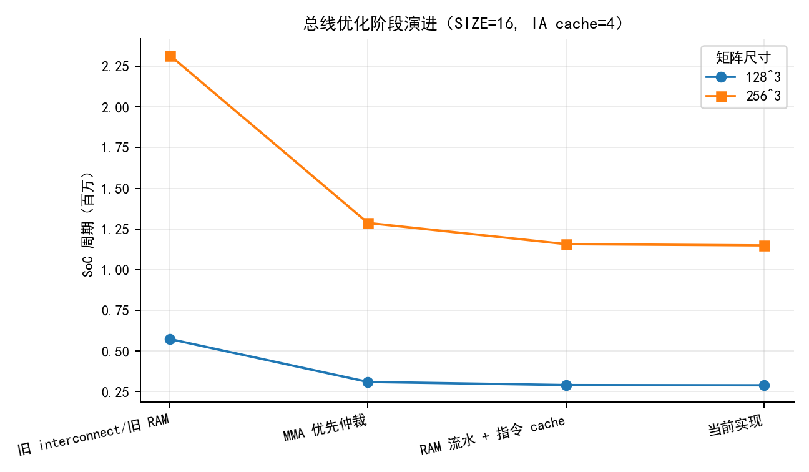
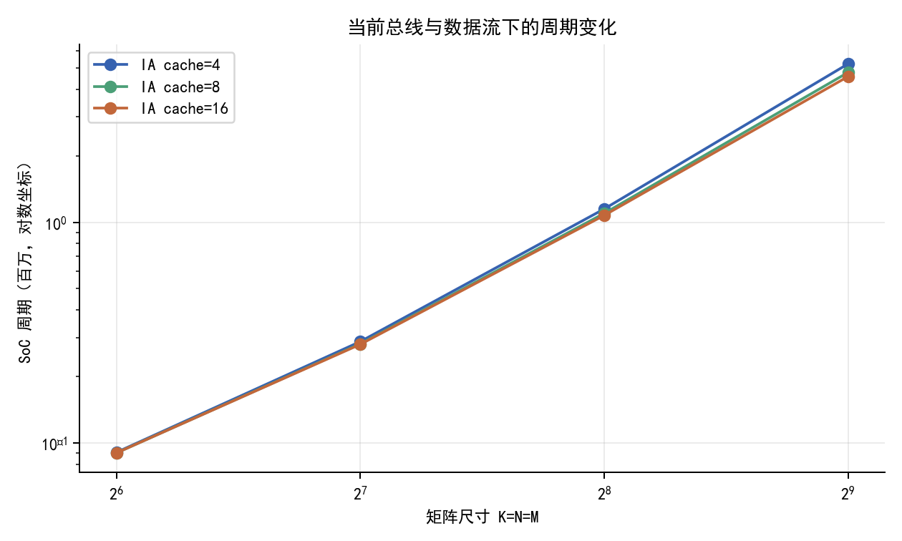
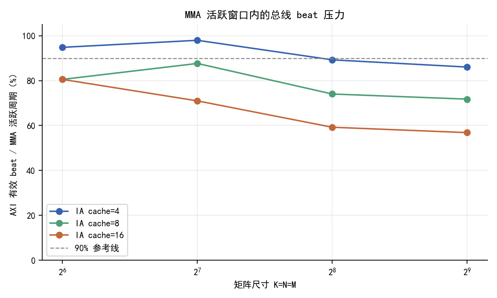
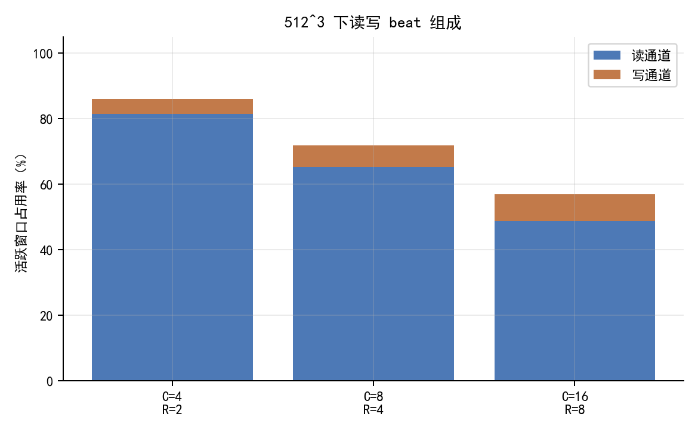
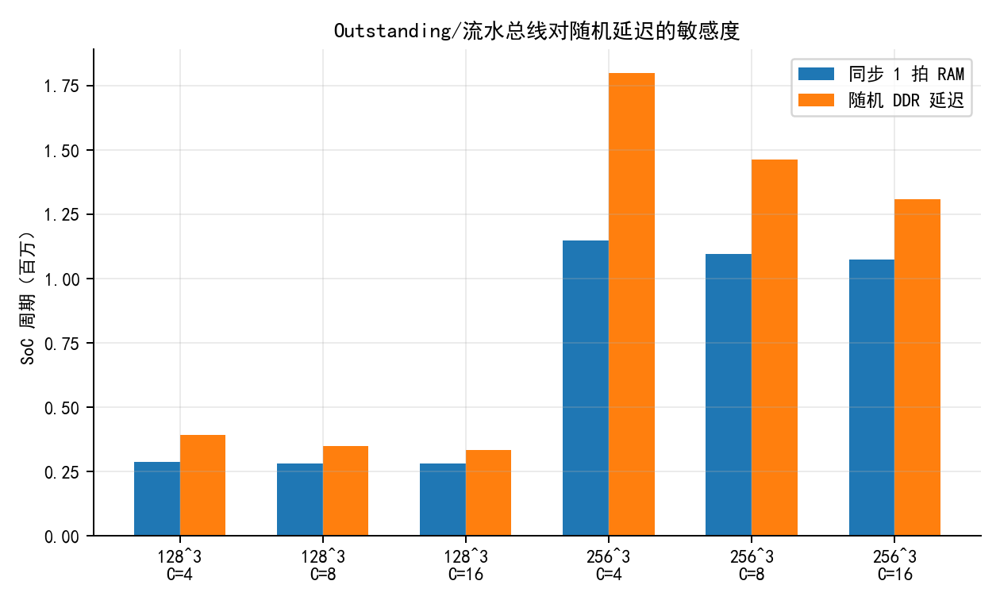
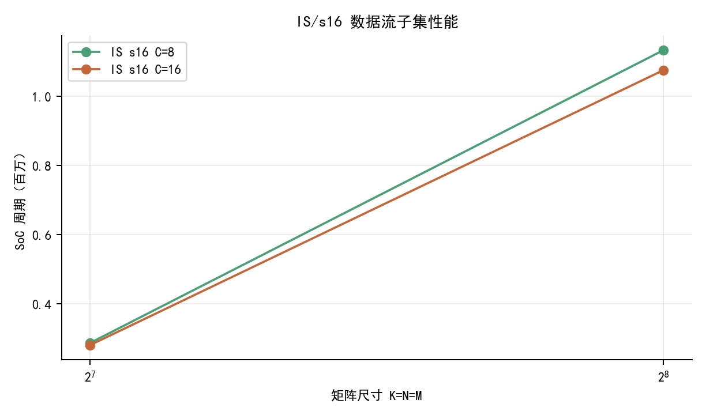
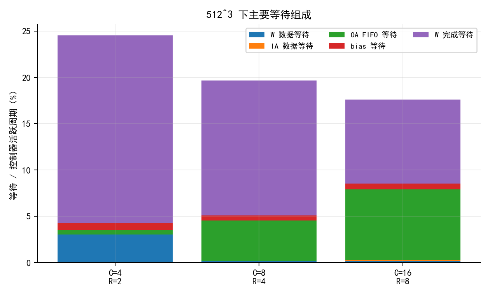

# SoC 总线优化与利用率分析报告

- 生成时间：2026-07-02
- 仓库路径：`/media/proj_tmp/aiEngine_integrated`
- 仿真环境：VCS SoC 仿真，RISC-V runtime 使用 `-O3`；功能边界随机回归同时覆盖 VCS/Verilator 兼容的统一 testbench 生成流程。
- 统计口径：cycle 为 SoC 中 `soc_finish asserted` 的总周期；MMA 活跃窗口、AXI beat、FIFO stall 来自 `+MMA_UTIL_TRACE +MMA_CTRL_UTIL_SUMMARY +SOC_AXI_STATS +SOC_CPU_AXI_STATS`。
- 当前重点配置：`MMA_SIZE=16`，`MMA_PS_FRAME_COUNT=16`，`lhs_dtype=s8/s16`，`quant_mode=per-tensor`，`dataflow=WS/IS`。
- 数据日志：`veri/sim/runs/bus_report_fifo_watermark_current_trace`、`bus_report_fifo_watermark_randlat_trace`、`bus_report_fifo_watermark_is_trace`。

## 结论摘要

1. 总线优化后，`SIZE=16/CACHE_BLOCKS=4` 在 128/256 方阵上相对旧 SoC interconnect/RAM 基线分别达到 `1.99x/2.02x` 加速；256 点 MMA 活跃窗口内有效 AXI beat 占比从 MMA 优先仲裁阶段的 `51.3%` 提升到当前的 `89.3%`。
2. 当前 `CACHE_BLOCKS=4` 是最接近“总线吃满”的 memory-bound 配置：128 点达到 `98.0%`，256 点 `89.3%`，512 点 `86.1%`。继续追求 90% 以上时，重点不是再放宽 CPU 仲裁，而是减少 W/IA loader 与 OA writer 之间的阶段性气泡。
3. `CACHE_BLOCKS=8/16` 的有效 beat 占比低于 C4，不代表总线优化失败：它通过 IA cache/reuse 显著减少 kernel 侧读流量，512 点读 beat 从 C4 的 `1,187,840` 降到 C16 的 `395,264`，SoC 周期从 `5,221,137` 降到 `4,575,126`。
4. 随机 DDR 延迟下，大 cache 的抗延迟能力明显更强。256 点 C4 从 1 拍 RAM 到随机延迟慢 `1.57x`，C16 只慢 `1.22x`；C16 相对 C4 在随机延迟下达到 `1.38x` 加速。
5. 深 reuse 下曾出现 OA FIFO 覆盖风险，已通过 `OA_FIFO_BANKS_MAX=16` 和按 `ia_reuse_num_eff` 预留 bank 的水位控制修复；这保证 C8/C16 在连续 IA 分块输出时不会因为 OA writer 写回速率不足而丢行。
6. 本轮功能覆盖包括：确定性性能 sweep `12/12 PASS`，随机 DDR 延迟性能 sweep `6/6 PASS`，IS/s16 性能子集 `4/4 PASS`，带非对齐/随机尺寸/随机 DDR 延迟的边界回归 `16/16 PASS`。

## 架构优化说明

### 1. 统一 DMA 与去总线仲裁

旧结构中 IA loader、kernel loader、bias/quant loader、OA writer 各自携带较重的 DMA/仲裁语义，模块之间容易出现两类问题：

- 多个读源同时争抢总线，请求级仲裁和模块级 backpressure 叠加，导致 AR/R 通道有空拍。
- 写回侧和读侧耦合，OA writer 不能在读侧保持 outstanding 时独立推进，结果是“读完一段、算一段、再写一段”的阶段边界过重。

当前结构把 IA/kernel/bias/quant 的读请求合并到统一 `block_dma` 仲裁入口，OA writer 使用兼容 AXI DMA 的写回路径。这样做的收益是：

- 读命令、读数据、写命令、写数据/响应分通道统计和限流，减少跨模块状态机互相等待。
- MMA 侧只暴露清晰的 DMA client 语义，loader 不再各自实现一套复杂总线仲裁。
- 写回路径可以按 OA tile/row burst 组织，避免旧版单 beat 或过短 burst 造成的命令开销。

### 2. Outstanding 与 RAM full-pipe

SoC interconnect 和 RAM 模型都改为支持 DMA 读写 outstanding：

- MMA 读侧可以在前一笔 R channel 返回前继续投递后续 AR，隐藏 RAM/DDR 响应延迟。
- 写侧 AW/W/B 与读侧独立，OA writer 不会因为读侧 command 正在等待而停止组织写回。
- `soc_axi_ram` 保持同步读 1 拍延迟，但支持 response full-pipe：当 `rvalid && rready` 时，下一个 read response 可以在下一拍连续送出。
- CPU/Pico 侧通过 I-cache 降低取指压力；interconnect 在 MMA 等待时允许 MMA 从 CPU 访问中抢占，避免 CPU 顺序取指把 RAM 端口长期占住。

这部分优化直接体现在演进数据中：MMA 优先仲裁只能把 256 点 beat 占比推到 `51.3%`；RAM full-pipe + I-cache 后提升到 `85.7%`，当前实现进一步到 `89.3%`。

### 3. 写回侧 FIFO 水位与连续 IA 分块

IA cache 缓存完整后会连续输出多个分块。reuse 越深，计算结果产生越集中，如果 OA writer 的写回节奏略慢，旧的 4 bank OA FIFO 会在 writer 仍在读旧 bank 时把新 bank 写回同一位置，表现为输出行数不完整或 writer 等待不存在的行。

修复策略：

- `OA_FIFO_BANKS_MAX` 从 `4` 扩展到 `16`，给 deep reuse 留出 bank 周转空间。
- `vec_s8_to_fifo` 增加 `reserve_banks` 水位输入，当前连接 `ia_reuse_num_eff`。
- FIFO 不再等到“下一写 bank 已经被读侧占用”才报满，而是在 free bank 数不足以容纳当前 reuse group 时提前 backpressure 控制器。

这不是为了增加吞吐瓶颈，而是把不可恢复的数据覆盖转换成可控 backpressure。修复后：

- `CACHE_BLOCKS=16/K=128,N=64,M=64` 默认 `IA_REUSE=8`：PASS，`dsa_execute_cycles=8188`。
- `CACHE_BLOCKS=8/K=65,N=63,M=33` 尾块/非对齐：PASS，`dsa_execute_cycles=9654`。
- 随机尺寸/DF0+DF1/s8+s16/per-tensor+per-channel/随机 DDR 延迟边界回归：`16/16 PASS`。

## 指标定义

报告里的“beat util”不是 AXI full-duplex 理论利用率，而是更贴近当前单 RAM/DDR 压力的指标：

```text
beat util = (mma_axi_r + mma_axi_w) / mma_active
read util = mma_axi_r / mma_active
write util = mma_axi_w / mma_active
```

其中 `mma_active` 是 MMA 从启动到本次 op 完成的活跃窗口。这个指标回答的是“在 MMA 工作窗口里，DDR/RAM 有多少周期在搬有效数据”。当 cache/reuse 减少了必须搬运的数据量后，beat util 可能下降，但总周期仍然更好；因此本报告同时看 cycles、read/write beat、随机延迟敏感度和 stall 分解。

## 总线优化演进



| 阶段 | 128^3 cycles | 256^3 cycles | 128 加速比 | 256 加速比 | 256 beat util |
|---|---:|---:|---:|---:|---:|
| 旧 interconnect/旧 RAM | 572,676 | 2,317,690 | 1.00x | 1.00x | 未采集 |
| MMA 优先仲裁 | 308,531 | 1,286,863 | 1.86x | 1.80x | 51.3% |
| RAM full-pipe + I-cache | 289,221 | 1,156,429 | 1.98x | 2.00x | 85.7% |
| 当前实现 | 287,739 | 1,148,629 | 1.99x | 2.02x | 89.3% |

分析：

- 旧 interconnect 阶段的主要问题是 CPU 与 MMA 访问 RAM 时互相阻塞。`SOC_AXI_STATS` 中 CPU/MMA 等待周期都很高，MMA 侧无法稳定保持 outstanding。
- MMA 优先仲裁后，CPU 对 MMA 的阻塞显著下降，cycles 减少接近一半，但 RAM response 仍然不能 full-pipe，读数据中间存在大量空拍。
- RAM full-pipe + I-cache 后，取指压力下降，read response 可以连续吐 beat，256 点有效 beat 占比提升到 `85.7%`。
- 当前实现的 C4 继续微调写回和 cache 控制后，256 点达到 `89.3%`。距离 90% 很近，剩余瓶颈主要是 loader 切 tile、tail 处理和 OA FIFO 水位导致的阶段性停顿。

## 当前 SIZE=16 不同 IA cache 配置





| SIZE | CACHE_BLOCKS | R/W reuse | K=N=M | cycles | GOPS@200M | beat util | read util | write util | FIFO full |
|---:|---:|:---:|---:|---:|---:|---:|---:|---:|---:|
| 16 | 4 | 2/4 | 64 | 90,566 | 1.16 | 94.8% | 71.8% | 23.0% | 0 |
| 16 | 8 | 4/4 | 64 | 90,025 | 1.16 | 80.6% | 54.3% | 26.3% | 0 |
| 16 | 16 | 4/4 | 64 | 90,025 | 1.16 | 80.6% | 54.3% | 26.3% | 0 |
| 16 | 4 | 2/8 | 128 | 287,739 | 2.92 | 98.0% | 82.0% | 16.0% | 0 |
| 16 | 8 | 4/8 | 128 | 281,122 | 2.98 | 87.7% | 66.1% | 21.6% | 2,478 |
| 16 | 16 | 8/8 | 128 | 279,645 | 3.00 | 71.0% | 47.6% | 23.4% | 4,715 |
| 16 | 4 | 2/16 | 256 | 1,148,629 | 5.84 | 89.3% | 80.4% | 8.8% | 3,648 |
| 16 | 8 | 4/16 | 256 | 1,096,928 | 6.12 | 74.0% | 61.8% | 12.2% | 15,324 |
| 16 | 16 | 8/16 | 256 | 1,074,295 | 6.25 | 59.2% | 44.5% | 14.7% | 20,566 |
| 16 | 4 | 2/16 | 512 | 5,221,137 | 10.28 | 86.1% | 81.6% | 4.5% | 14,472 |
| 16 | 8 | 4/16 | 512 | 4,774,964 | 11.24 | 71.8% | 65.3% | 6.5% | 61,296 |
| 16 | 16 | 8/16 | 512 | 4,575,126 | 11.73 | 56.8% | 48.8% | 8.1% | 82,264 |

### 为什么 C16 更快但 beat util 更低

512 点下，C4/C8/C16 的读写组成如下：



| CACHE_BLOCKS | IA reuse | read beats | write beats | total beats | cycles | 相对 C4 周期 |
|---:|---:|---:|---:|---:|---:|---:|
| 4 | 2 | 1,187,840 | 65,536 | 1,253,376 | 5,221,137 | 1.00x |
| 8 | 4 | 659,456 | 65,536 | 724,992 | 4,774,964 | 1.09x |
| 16 | 8 | 395,264 | 65,536 | 460,800 | 4,575,126 | 1.14x |

C16 的 total beats 比 C4 少 `63.2%`，但 cycles 只降 `12.4%`。这说明当前在大 cache 下已经不完全 memory-bound，而是转向以下瓶颈：

- OA FIFO 水位保护让 deep reuse 在写回跟不上时主动停顿，避免覆盖，但会制造 `fifo_full` 周期。
- W 侧加载次数减少后，单位 active window 内可统计的 AXI beat 自然减少，beat util 下降。
- 计算阵列的 IA/W feed 仍然按 tile 边界切换，`tail_pending` 和 loader 切换开销在大矩阵中累计明显。

因此，对当前设计来说，“更高 bus util”和“更短 cycles”不是同一个目标。C4 更像总线压力测试，C16 才是当前 SoC 下更好的推理/大矩阵配置。

## 随机 DDR 延迟敏感度



| K=N=M | CACHE_BLOCKS | 1-cycle cycles | rand-lat cycles | slowdown | rand beat util | mma_ar_wait |
|---:|---:|---:|---:|---:|---:|---:|
| 128 | 4 | 287,739 | 391,611 | 1.36x | 23.1% | 982 |
| 128 | 8 | 281,122 | 349,781 | 1.24x | 24.8% | 608 |
| 128 | 16 | 279,645 | 332,545 | 1.19x | 24.9% | 412 |
| 256 | 4 | 1,148,629 | 1,801,189 | 1.57x | 21.6% | 7,303 |
| 256 | 8 | 1,096,928 | 1,464,504 | 1.34x | 23.0% | 4,006 |
| 256 | 16 | 1,074,295 | 1,309,288 | 1.22x | 23.8% | 2,416 |

随机延迟会把 RAM 的连续 response 打断，所以 beat util 会明显下降。更重要的是趋势：

- C4 在 256 点随机延迟下慢 `57%`，说明它仍高度依赖 kernel 侧持续读带宽。
- C16 在同尺寸下只慢 `22%`，因为 IA cache/reuse 将重复读 W/IA 的压力提前消掉了。
- `mma_ar_wait` 随 C4 -> C16 从 `7303` 降到 `2416`，说明 outstanding 仍有价值，但更大的收益来自减少必须发出的读请求。

这也是为什么实际 DDR 环境下不能只看 1 拍 RAM 的 peak beat util。cache 越大，峰值 bus util 越低，但对真实内存延迟越不敏感。

## IS/s16 子集验证



| dataflow | dtype | CACHE_BLOCKS | K=N=M | cycles | beat util | FIFO full |
|---|---|---:|---:|---:|---:|---:|
| IS | s16 LHS | 8 | 128 | 286,907 | 100.0% | 1,908 |
| IS | s16 LHS | 16 | 128 | 280,786 | 88.8% | 4,715 |
| IS | s16 LHS | 8 | 256 | 1,132,977 | 96.5% | 13,810 |
| IS | s16 LHS | 16 | 256 | 1,075,218 | 87.7% | 20,566 |

IS/s16 的结果说明：

- IS 路径的总线访问和写回转置路径没有出现明显性能崩塌；C16/256 点为 `1,075,218` cycles，与 WS/s8 C16/256 点 `1,074,295` cycles 同一量级。
- IS 下 C8 的 beat util 更高，说明该配置更接近内存受限；C16 通过减少重复读进一步降低总周期。
- FIFO full 在 deep reuse 下仍然是关键观察项。当前水位修复保证正确性，但后续要提升阵列利用率，需要继续优化 OA writer 与 FIFO drain 的重叠。

## Stall 分解



512 点当前配置中，主要 stall 有两类：

- C4：`weight_data_stall` 和 `weight_done_wait` 较高，说明 kernel 侧读流量仍然是主瓶颈。它的 beat util 高，但 cycles 不是最优。
- C8/C16：`fifo_stall/fifo_full` 变高，说明 deep reuse 后计算结果集中到达，写回侧成为新的局部瓶颈。C16 的 `fifo_full=82,264`，但总 read beat 大幅下降，所以总周期仍然最低。

下一步要从 C16 继续提升，应优先做这些方向：

1. OA writer write-combine：尽量把连续输出行合并成更长 burst，减少 AW/B 命令和 FIFO bank 占用时间。
2. W loader 预取：在当前 IA reuse group 计算后半段预取下一组 kernel tile，降低 tile 边界的 `weight_start/weight_done_wait`。
3. FIFO drain 水位更精细化：当前按 `ia_reuse_num_eff` 预留 bank 是保守安全策略；可以按实际 output row tiles 和 writer outstanding 动态计算 reserve。
4. 对 C16/CACHE16 增加“写回优先小窗口”：当 FIFO 水位接近阈值时，提高写通道优先级，避免计算侧被迫长时间停顿。

## 测试命令记录

确定性总线性能 sweep：

```bash
SOC_CPU_ENABLE_ICACHE=1 python3 ./run_axi_soc_perf_sweep.py \
  --log-root runs/bus_report_fifo_watermark_current_trace \
  --size-cache-pairs '16:4 16:8 16:16' \
  --ps-frame-counts '16' \
  --dims '64x64x64 128x128x128 256x256x256 512x512x512' \
  --dataflow-modes '0' \
  --lhs-dtypes '1' \
  --quant-modes '0' \
  --ia-reuse-list '0' \
  --w-reuse-list '0' \
  --jobs 4 \
  --timeout 1200 \
  --soc-timeout-cycles 120000000 \
  --sim-args '+MMA_UTIL_TRACE +MMA_CTRL_UTIL_SUMMARY +SOC_AXI_STATS +SOC_CPU_AXI_STATS'
```

随机 DDR 延迟 sweep：

```bash
SOC_CPU_ENABLE_ICACHE=1 python3 ./run_axi_soc_perf_sweep.py \
  --log-root runs/bus_report_fifo_watermark_randlat_trace \
  --size-cache-pairs '16:4 16:8 16:16' \
  --ps-frame-counts '16' \
  --dims '128x128x128 256x256x256' \
  --dataflow-modes '0' \
  --lhs-dtypes '1' \
  --quant-modes '0' \
  --ia-reuse-list '0' \
  --w-reuse-list '0' \
  --jobs 3 \
  --timeout 1200 \
  --soc-timeout-cycles 120000000 \
  --ddr-rand-lat \
  --sim-args '+MMA_UTIL_TRACE +MMA_CTRL_UTIL_SUMMARY +SOC_AXI_STATS +SOC_CPU_AXI_STATS'
```

IS/s16 子集：

```bash
SOC_CPU_ENABLE_ICACHE=1 python3 ./run_axi_soc_perf_sweep.py \
  --log-root runs/bus_report_fifo_watermark_is_trace \
  --size-cache-pairs '16:8 16:16' \
  --ps-frame-counts '16' \
  --dims '128x128x128 256x256x256' \
  --dataflow-modes '1' \
  --lhs-dtypes '2' \
  --quant-modes '0' \
  --ia-reuse-list '0' \
  --w-reuse-list '0' \
  --jobs 4 \
  --timeout 1200 \
  --soc-timeout-cycles 120000000 \
  --sim-args '+MMA_UTIL_TRACE +MMA_CTRL_UTIL_SUMMARY +SOC_AXI_STATS +SOC_CPU_AXI_STATS'
```

边界随机回归：

```bash
make soc_regress \
  SOC_REGRESS_ITERS=1 \
  SOC_REGRESS_START_SEED=86000 \
  SOC_REGRESS_TIMEOUT=900 \
  SOC_REGRESS_SOC_TIMEOUT_CYCLES=12000000 \
  SOC_MIN_DIM=1 \
  SOC_MAX_DIM=130 \
  SOC_SIZE_LIST='16' \
  SOC_CACHE_BLOCKS_LIST='8 16' \
  SOC_DATAFLOW_MODE_LIST='0 1' \
  SOC_REGRESS_LHS_DTYPE_LIST='1 2' \
  SOC_REGRESS_QUANT_MODE_LIST='0 1' \
  SOC_REGRESS_UNALIGNED_LAYOUT=1 \
  SOC_REGRESS_DDR_RAND_LAT=1 \
  SOC_REGRESS_JOBS=4 \
  SOC_REGRESS_LOG_ROOT=runs/fix_fifo_watermark_randlat_regress
```

## 当前判断与后续建议

当前总线方向已经把“CPU/interconnect/RAM response 造成的大气泡”基本压下去了，C4/256 的 `89.3%` 说明总线通路本身接近满载。后续继续优化时，不建议只追求更高 beat util，因为 C8/C16 的主要价值正是减少 DDR 流量。更合理的目标是：

- memory-bound 配置保持 `85%~90%` 左右有效 beat 压力；
- cache/reuse 配置以更低 beat util 换更低 cycles；
- 在 C16/CACHE16 下重点削减 FIFO stall 和 tile 边界等待，让阵列利用率继续上升。

换句话说，下一轮优化应从“让总线更忙”转向“让必须经过总线的数据更少，并让写回不阻塞连续计算”。
