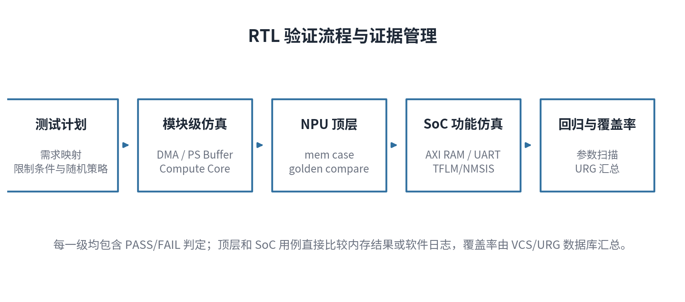
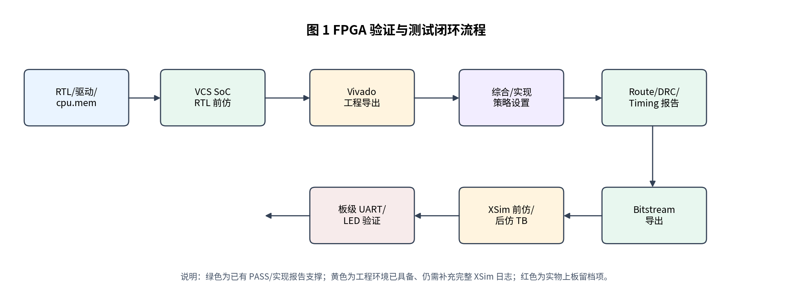
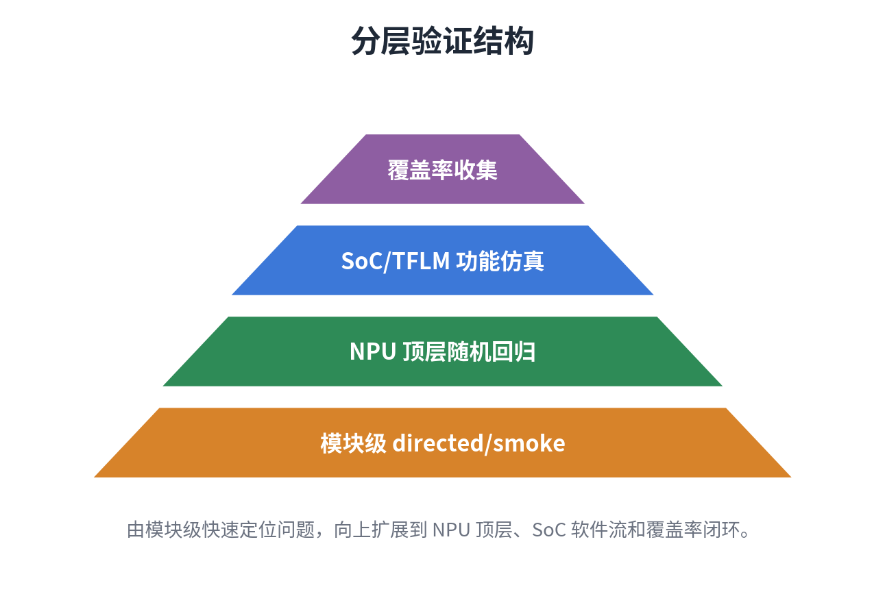
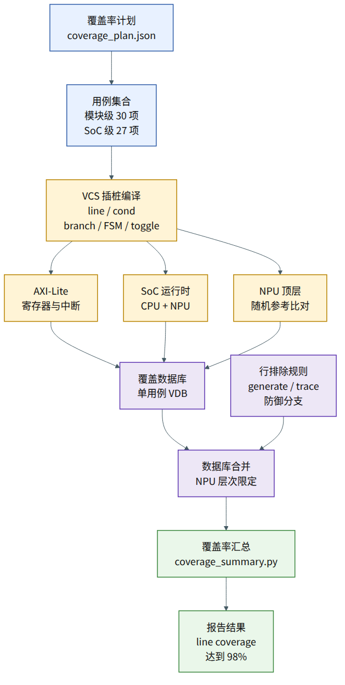
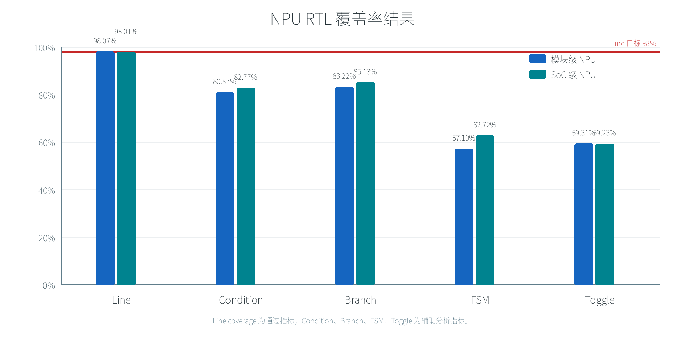
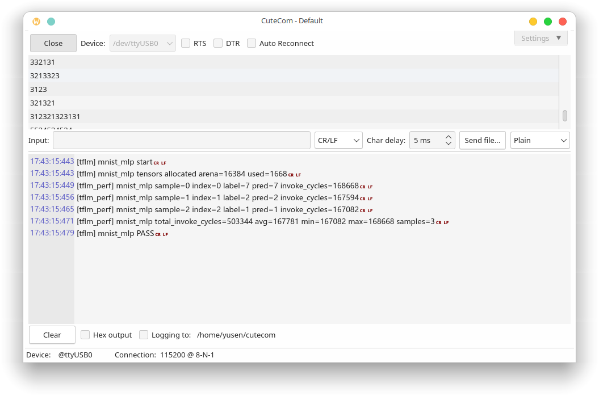
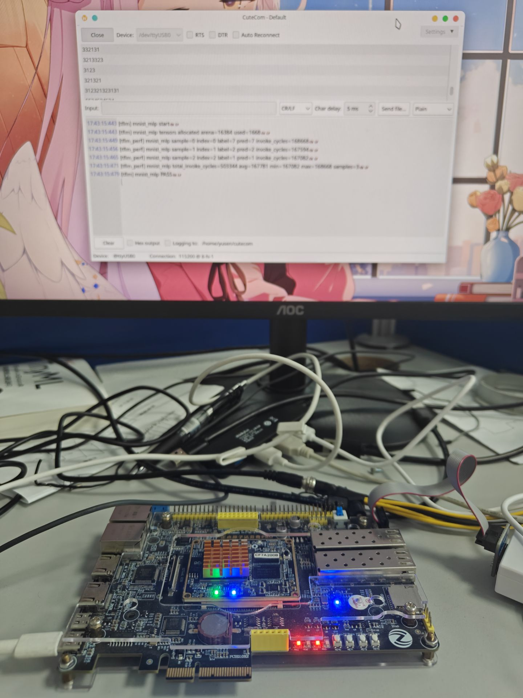

# TFLM（TensorFlow Lite Micro）AI DSA NPU（神经网络处理单元）RTL 仿真与 FPGA 实现验证报告

| 文档项 | 内容 |
|---|---|
| 文档名称 | TFLM AI DSA NPU RTL 仿真与 FPGA 实现验证报告 |
| 验证对象 | NPU RTL、AXI-Lite（轻量级 AXI 控制接口）配置接口、AXI4（AXI 第四版）DMA（直接存储访问）数据访问、PicoRV32 SoC（片上系统）集成环境、150 MHz FPGA full 与 `pruned_addr19` 工程 |
| RTL 仿真工具 | Verilator 5.040、Synopsys VCS W-2024.09-SP1、URG W-2024.09-SP1 |
| FPGA 工具 | Vivado 2024.2.1 |
| FPGA 器件 | Xilinx Artix-7 `xc7a200tfbg484-3` |
| 报告日期 | 2026-07-05 |
| 报告状态 | RTL 模块级仿真、NPU 顶层随机仿真、SoC 功能仿真、TFLM/NMSIS-NN（Nuclei 神经网络库）推理仿真、覆盖率收集、Vivado behavioral 前仿、post-implementation functional 后仿、综合实现、bitstream 生成、150 MHz routed timing、资源统计和实物板卡 UART 运行均已完成并通过 |

## 1. 验证结论摘要

验证范围覆盖 NPU RTL 功能验证、SoC 集成验证、应用级推理验证、覆盖率收集和 FPGA 工程实现检查。RTL 验证包含模块级定向和冒烟用例、NPU 顶层随机参考输出比对、PicoRV32 SoC C 程序功能仿真、TFLM/NMSIS-NN 推理仿真和 VCS 覆盖率收集。FPGA 验证包含 Vivado behavioral 前仿、post-implementation functional 后仿、综合、布局布线、route/DRC、150 MHz routed timing、资源利用率、bitstream 生成和实物板卡 UART 运行。

验证结果表明，NPU 在已覆盖配置组合下满足功能要求。NPU 顶层随机 smoke 用例 2/2 通过，SoC C 基础回归 3/3 通过，int8 参数回归 24/24 通过，int16 参数回归 24/24 通过，固定 IA cache（输入激活缓存）容量扫描 12/12 通过，关键 SoC 组合 2/2 通过。覆盖率方面，模块级 NPU line coverage 为 `98.07%`，SoC 级 NPU line coverage 为 `98.01%`，均达到 98% 目标。FPGA full 和 `pruned_addr19` 两类工程均以主动门控时钟开启配置完成实现，两个工程版本均生成 `fpga_top.bit`，route fully routed，DRC 为 0 项错误，150 MHz routed timing 均满足要求，WNS 分别为 `+0.211 ns` 和 `+0.440 ns`。Post-implementation functional 后仿通过，实物板卡下载后 UART 输出 TFLM MNIST 推理完成状态，未出现结果不匹配或失败状态。

| 验证项目 | 结果 | 结论 |
|---|---:|---|
| 模块级定向和冒烟仿真 | DMA、arbiter（仲裁器）、PS Buffer（部分和缓冲区）、Compute Core（计算核心）、NPU Top（NPU 顶层）均通过 | 通过 |
| NPU 顶层随机功能仿真 | 2/2 通过 | 通过 |
| SoC C 程序基础回归 | 3/3 通过 | 通过 |
| int8 参数回归 | 24/24 通过 | 通过 |
| int16 参数回归 | 24/24 通过 | 通过 |
| 固定 IA cache 容量扫描 | 12/12 通过 | 通过 |
| 关键 SoC 组合 | 2/2 通过 | 通过 |
| TFLM/NMSIS-NN MNIST 推理 | 硬件执行方式与纯软件执行方式均完成 3 个样本预测 | 通过 |
| 模块级 NPU line coverage | 98.07% | 通过 |
| SoC 级 NPU line coverage | 98.01% | 通过 |
| Vivado behavioral 前仿 | `soc_finish` 于 675397 个 50 MHz `sys_clk` 周期拉高，`cpu_trap=0` | 通过 |
| 150 MHz routed timing | full WNS `+0.211 ns`，`pruned_addr19` WNS `+0.440 ns`，TNS 均为 `0.000 ns` | 通过 |
| Route/DRC/bitstream | 2 个工程版本 fully routed，DRC 0 项错误，bitstream 已生成 | 通过 |
| Post-implementation functional 后仿 | routed functional netlist 后仿完成，UART/finish 状态正常 | 通过 |
| 实物板卡运行 | bitstream 下载后 UART 输出 TFLM MNIST 推理完成状态，未出现结果不匹配或失败状态 | 通过 |

## 2. 被测对象、范围与配置

### 2.1 被测对象

被测设计由 PicoRV32 CPU、CPU native-to-AXI 桥、AXI 互连、AXI RAM（随机访问存储器）、UART、SoC 控制寄存器、NPU AXI-Lite 外设封装和 NPU 计算核心组成。CPU 通过 AXI-Lite MMIO（内存地址访问式输入输出）配置 NPU 寄存器，NPU 通过 AXI4 master 端口访问共享 RAM。NPU 内部包含控制器、配置流水、分块 DMA、DMA 仲裁器、IA（输入激活）加载单元与 IA cache、权重加载单元、偏置加载单元、计算核心、部分和缓冲区、定点缩放、int8 输出 FIFO 和 OA（输出激活）写回单元。

| 类别 | 主要模块 | 验证重点 |
|---|---|---|
| SoC 顶层 | `soc_top`、PicoRV32、`pico_native_to_axi`、`soc_axi_interconnect`、`soc_axi_ram` | CPU 取指与数据访问、地址译码、共享 RAM 访问、UART/控制寄存器状态 |
| NPU 外设接口 | `npu_axil_top`、`npu_axil_reg_if` | AXI-Lite 读写、配置寄存器、启动脉冲、`busy`/完成/错误、`IRQ`、写 1 清除 |
| NPU 控制与 DMA | `npu_top`、`npu_controller`、`axi_block_dma_arbiter`、`axi_dual_block_dma` | 配置采样、任务调度、读写客户端仲裁、AXI4 burst、反压保持 |
| 输入与参数加载 | `ia_loader`、`kernel_loader`、`bias_loader`、IA cache | 输入分块、权重装载、bias（输出通道偏置）/缩放参数读取、尾块、复用窗口 |
| 计算与部分和 | `compute_core`、脉动阵列单元、部分和缓冲区 | WS/IS 数据流、int8/int16 输入解释、偏置/部分和选择、无效通道屏蔽 |
| 定点缩放与写回 | `vec_requant`、`vec_s8_to_fifo`、`oa_writer` | 按张量/按通道定点缩放、饱和裁剪、字节打包、`WSTRB`、等待 B 响应 |
| FPGA 顶层 | `fpga_top`、Clocking Wizard、UART、LED | 50 MHz 输入时钟、150 MHz 核心时钟、复位释放、板级端口、可观察状态 |

### 2.2 验证范围

验证范围包括 RTL 周期级功能仿真、软件驱动可见接口、NPU 端到端数值结果、SoC 程序运行、NPU RTL line coverage、FPGA 150 MHz 可实现性检查、post-implementation functional 后仿、实物板卡下载和板级 UART 输出。门级时序仿真不纳入本报告通过结论。

FPGA 工程包含 full 和 `pruned_addr19` 两类配置，用于验证板级资源、150 MHz 时序、AXI 访问、NPU int8 WS 推理通路和 UART 状态输出。两个工程版本均启用主动门控时钟。full 工程保留 IS 模式、按通道缩放转换和 32 bit NPU 内部地址配置，用于验证完整可选功能集合。`pruned_addr19` 工程关闭 IS 模式和按通道缩放转换，并将 NPU 内部地址宽度配置为 19 bit，用于板级部署配置和资源裁剪结果检查。int16 输入方式由 RTL/SoC 回归覆盖。

### 2.3 关键配置

| 配置项 | RTL/SoC 回归覆盖 | FPGA 工程 |
|---|---|---|
| 阵列规模 `SIZE` | 4x4、8x8、16x16、32x32 等组合 | 4x4 |
| IA cache 分块数 | 2、4、8、16、32、64、256 等组合 | 32 |
| 部分和缓冲区 | 按阵列规模参数化 | 4x4 阵列配置 |
| 输入位宽 | int8、int16 | int8 |
| 权重位宽 | int8 | int8 |
| 数据流 | WS、IS | full 支持 WS/IS，`pruned_addr19` 支持 WS |
| 缩放转换模式 | 按张量、按通道 | full 支持按张量/按通道，`pruned_addr19` 支持按张量 |
| AXI 数据宽度 | 32 bit | 32 bit |
| NPU 内部地址宽度 | 参数化覆盖 | full 为 32 bit，`pruned_addr19` 为 19 bit |
| CPU RAM 深度 | SoC 仿真与 FPGA 工程保持一致 | 65536 word |
| CPU 指令 cache | SoC/FPGA 配置覆盖 | 使能 |
| 核心时钟 | RTL 仿真按周期统计 | 150 MHz |

## 3. 验证方法与通过条件

### 3.1 分层验证平台

验证平台分为模块级、NPU 顶层、SoC 级、应用级和 FPGA 工程级五层。模块级环境直接驱动被测设计端口，并检查局部时序、状态转移和数据变换。NPU 顶层环境实例化 NPU、AXI RAM 模型和随机延迟模型，以共享 RAM 输出区域进行参考输出比对。SoC 级环境实例化 PicoRV32、AXI 互连、共享 RAM、UART 和 NPU，软件通过寄存器配置 NPU。应用级验证使用 TFLM/NMSIS-NN 调用方式检查推理结果。FPGA 工程级验证检查前仿、后仿、实现、时序、资源、bitstream 和实物板卡 UART 输出。

| 验证层级 | 激励形式 | 主要观察点 | 通过条件 |
|---|---|---|---|
| 模块级 | directed/random 测试平台 | `valid/ready`、`req/grant`、状态机、地址计数器、数据输出 | 端口协议满足，局部数据与参考一致，未发生超时 |
| NPU 顶层 | 随机矩阵、配置存储镜像、参考输出 | NPU 完成/错误、AXI RAM 输出区域 | 完成且错误码为 0，输出 RAM 逐字节匹配参考输出 |
| SoC 级 | PicoRV32 C 程序 | `soc_finish`、`soc_status`、`cpu_trap`、UART、UVM error | 正常结束，trap 为 0，UVM error/fatal 为 0 |
| 应用级 | TFLM/NMSIS-NN MNIST 样本 | label/pred、总周期、NPU 活动计数 | 硬件执行方式与软件执行方式预测一致 |
| FPGA 工程级 | Vivado 前仿、后仿、实现流程和板级运行 | LED、UART、routed timing、route/DRC、bitstream | behavioral 前仿通过，post-implementation functional 后仿通过，timing/route/DRC 满足条件，bitstream 生成，板级 UART 输出正常 |

### 3.2 激励与参考模型

模块级定向激励覆盖协议端点条件和局部状态切换。DMA 用例覆盖线性读取、多行步长、非字对齐地址、随机读响应延迟、写数据反压和写响应延迟。仲裁器用例覆盖多客户端同时请求、授权保持、请求撤销和读写并行。PS Buffer 用例覆盖对角输入、行向量恢复、部分和回放和 FIFO 无缓存直通。Compute Core 用例覆盖随机输入向量、权重向量、bias、尾行尾列和最终行。

NPU 顶层随机激励由软件参考模型生成输入矩阵、权重矩阵、bias、零点、缩放转换乘子、移位、激活上下限和期望输出。参考模型与 RTL 使用相同的数据解释规则，包括 int8/int16 输入扩展、零点扣除、int32 累加、乘法与移位、输出零点加法、激活上下限裁剪和 int8 饱和。随机维度覆盖 K/N/M 非整块组合，使行方向、列方向和内积方向均可能出现无效通道。

### 3.3 总线与反压模型

AXI RAM 模型对命令接收、写数据接收和读响应返回插入可配置随机延迟。读通道检查 `ARVALID/ARREADY` 等待期间地址和长度保持稳定，`RVALID && RREADY` 时采样数据，`RLAST` 与最后一个 beat 对齐。写通道检查 `AW`、`W` 和 `B` 三个通道均完成握手，`WVALID` 等待期间 `WDATA/WSTRB/WLAST` 保持稳定，`WLAST` 与突发长度一致，`WSTRB` 与输出有效字节一致。

SoC 总线验证关注 CPU 与 NPU 共享 RAM 访问的互斥关系。当 NPU 处于活跃状态时，互连限制 CPU 对共享 RAM 的新访问请求，避免 CPU 侧读写干扰 NPU 数据搬移；当任务完成后，CPU 访问恢复。验证平台检查 CPU 未进入 trap，NPU 在超时前完成，输出 RAM 与参考值一致，软件结束状态为正常值。

### 3.4 统一通过条件

每类验证均使用明确的硬件观察点作为通过条件。模块级验证要求复位后进入确定状态，启动采样后状态转移正确，反压期间输出保持稳定，完成条件满足后产生规定完成标志，输出数据与参考一致。NPU 顶层验证要求任务完成、错误码为 0、输出 RAM 与参考输出一致。SoC 验证要求 `soc_finish` 在超时前有效，`soc_status=0x00000001`，`cpu_trap=0`，`UVM_ERROR=0` 且 `UVM_FATAL=0`。覆盖率要求 NPU RTL line coverage 达到 98%。FPGA 实现要求 routed setup 无违例，pulse width 无违例，route fully routed，DRC 0 项错误，bitstream 生成完成。Post-implementation functional 后仿要求 routed functional netlist 在测试平台中完成启动、运行和结束状态输出。实物板卡运行要求 bitstream 下载后 UART 输出 TFLM MNIST 推理完成状态，且未出现结果不匹配或失败状态。

## 4. 模块级验证方案与结果

模块级验证面向 NPU 外设接口、DMA、加载单元、计算单元、部分和缓存、定点缩放、输出打包和写回模块展开。验证环境采用 AXI-Lite UVM、NPU 顶层随机测试平台、SoC 运行时组合用例和覆盖率回归共同驱动各模块状态，使局部协议检查、数值结果检查和跨模块交互检查同时成立。

### 4.1 验证环境组成与通用通过条件

UVM AXI-Lite 环境由 `ai_env`、`ai_axil_agent`、`ai_axil_driver`、`ai_axil_monitor`、`npu_scoreboard` 和 `npu_reg_block` 组成，用于寄存器读写、启动完成、中断和输出矩阵比较。NPU 顶层随机环境由 `tb_npu_top.sv`、`ddr_axi_mem_model.sv` 和 `gen_mem.py` 组成，用于随机矩阵、随机 RAM 延时、参数化阵列组合和输出参考比对。SoC 运行时环境由 `tb_top.sv`、`soc_runtime_main.c`、`generate_axi_soc_case.py` 和覆盖率计划组成，用于 CPU/NPU 协同、共享 RAM 访问和软件可见状态检查。

| 环境层级 | 主要文件或模块 | 主要输入 | 检查点 | 适用范围 |
|---|---|---|---|---|
| AXI-Lite UVM | `ai_test_pkg.sv`、`ai_axil_driver.sv`、`ai_axil_monitor.sv`、`npu_scoreboard.sv` | `npu_seq_item`、寄存器序列、Python 生成矩阵 | AXI-Lite 读写响应、寄存器镜像、`irq/status`、输出矩阵 | 外设接口、寄存器、启动完成 |
| NPU 顶层随机 | `tb_npu_top.sv`、`ddr_axi_mem_model.sv`、`gen_mem.py` | 随机 K/N/M、数据流、位宽、缩放转换参数、RAM 延时 | `sa_ready`、`err_code`、DST（输出矩阵）与参考输出逐字节一致 | 加载单元、DMA、计算、定点缩放、OA 写回单元 |
| SoC 运行时 | `tb_top.sv`、`soc_runtime_main.c`、`generate_axi_soc_case.py` | C 固件、运行时数据镜像、NPU 配置 | `soc_finish`、`soc_status`、`cpu_trap`、输出数据 | CPU/NPU 协同、共享 RAM、AXI 互连 |
| 覆盖率回归 | `coverage_plan.json`、`run_coverage_plan.py`、`coverage_summary.py` | 模块级 30 个代码覆盖运行项，SoC 级 27 个代码覆盖运行项 | VCS line/cond/branch/FSM/toggle、用例测试结果 | NPU RTL line coverage 达到 98% |

通用通过条件包括五项。复位后，所有 `valid` 信号、`busy` 状态、完成标志、FIFO 指针、DMA outstanding 计数和错误状态进入确定值。握手等待期间，地址、数据、掩码、`last`、坐标和标签保持稳定。任务完成时，局部完成只在本模块需要的输入、处理和输出条件全部满足后产生。数值模块输出必须与 Python 参考模型一致。跨模块用例必须满足 `err_code=0`、`sa_ready` 恢复、输出 RAM 与参考输出逐字节一致。

### 4.2 AXI-Lite 寄存器与中断模块

**验证方案：** 本模块验证对象为 `npu_axil_reg_if` 和 `npu_axil_top` 的软件可见寄存器接口。UVM AXI-Lite 驱动组件产生 `AW/W/B` 和 `AR/R` 事务，监视组件采集寄存器访问、启动、完成、`IRQ` 和 `status` 状态，结果检查组件检查寄存器镜像、写 1 清除和输出矩阵结果。

| Feature | 输入条件 | 检查点 | 通过条件 |
|---|---|---|---|
| AXI-Lite 写事务 | AW/W 同周期或错周期到达 | `s_axil_awready`、`s_axil_wready`、`bvalid`、`bresp` | 写提交后寄存器字段按 `WSTRB` 更新 |
| AXI-Lite 读事务 | AR 握手后读取控制、状态和参数寄存器 | `arready`、`rvalid`、`rdata`、`rresp` | 读值符合字段定义，未实现地址返回 0 |
| 启动与 `busy` 状态 | `CTRL[0]` 写 1 且 NPU 就绪 | `calc_start`、`npu_busy`、`SA_READY` | 启动为单周期脉冲，`busy` 期间配置不覆盖运行任务 |
| 完成与中断 | `done_valid` 返回且 `IRQ` 使能 | `DONE`、`irq`、`npu_done_ready`、`STATUS[2]` | 完成保持位保持到写 1 清除，`IRQ` 随完成清除而撤销 |

| 测试用例 | 激励设计 | 主要 corner 测试用例 | 检查项 | 结果 |
|---|---|---|---|---|
| `ai_axil_reg_directed_test` | 顺序执行寄存器写、寄存器读和只读字段访问 | 保留字段、写掩码、ID 寄存器 | 读返回、写响应、寄存器镜像 | 通过 |
| `ai_ral_mem_gen_on_calc_start_test` | RAL 写入矩阵参数并启动任务 | 启动采样、`busy` 期间状态读取 | RAL mirror、`IRQ`、输出矩阵 | 通过 |
| `ai_mem_gen_smoke_test` | Python 生成矩阵并经 AXI-Lite 提交任务 | 完成保持位、写 1 清除、中断使能 | STATUS、`IRQ`、DST 与参考输出 | 通过 |

**验证要点：** 复位后 `SA_READY=1`、`BUSY=0`、`DONE=0`、`irq=0`；AW/W 等待期间写地址与写数据保持稳定；`CTRL[0]` 只产生单周期内部启动请求；`STATUS[2]` 写 1 清除不影响其他状态字段。

**验证结果：** AXI-Lite directed、RAL 启动和存储生成 smoke 用例均通过。寄存器读写、启动脉冲、完成保持位、中断输出和状态清除行为满足寄存器接口定义。

### 4.3 AXI Dual Block DMA

**验证方案：** 本模块验证对象为 `axi_dual_block_dma`。该模块包含独立读引擎和写引擎，读侧将二维分块读请求转换为 AXI4 `AR/R` 事务并完成 s8/s16 数据解包，写侧将输出 FIFO 数据转换为 AXI4 `AW/W/B` 事务并等待写响应。NPU 顶层随机环境和 SoC 运行时环境引入随机命令延迟、写数据延迟和读响应延迟，同时通过非对齐测试用例检查地址低位、尾拍和 `WSTRB`。

| Feature | 输入条件 | 检查点 | 通过条件 |
|---|---|---|---|
| 二维分块读 | 基址、行步长、行数、有效列数、突发长度 | `m_axi_araddr`、`m_axi_arlen`、`m_axi_rlast` | 每行读请求数量与有效字节数一致 |
| 非对齐读解包 | 基址或行步长非 4 字节对齐 | `wr_col_base`、`wr_data`、`wr_valid` | 返回字节按矩阵坐标正确分发 |
| 二维分块写 | DST 基址、行步长、行数和输出数据拍 | `AWADDR`、`WDATA`、`WSTRB`、`WLAST` | 只写有效输出字节，尾拍掩码正确 |
| 写响应完成 | AW/W 已完成且 B 通道延迟返回 | `m_axi_bvalid`、`wr_done` | B 响应返回后才产生写完成 |

| 测试用例 | 激励设计 | 主要 corner 测试用例 | 检查项 | 结果 |
|---|---|---|---|---|
| NPU top 随机 smoke | 随机 K/N/M、随机 RAM 延时 | 读写并行、短矩阵、尾块 | `err_code=0`、DST 与参考输出 | 通过 |
| `soc_unaligned_randlat_ws_int8` | LHS/RHS/DST 非 4 字节对齐 | 首拍偏移、尾拍掩码、随机延时 | 地址低位、`WSTRB`、输出一致 | 通过 |
| `soc_randlat_is_int8` | IS、按通道和随机 RAM 延时组合 | 响应间隔、返回数据保持 | 输出一致、无超时 | 通过 |

**验证要点：** `ARVALID` 等待期间 `ARADDR/ARLEN` 保持稳定；`RVALID && RREADY` 时采样返回数据，`RLAST` 与最后一拍对齐；`WVALID` 等待期间 `WDATA/WSTRB/WLAST` 保持稳定；AXI `SLVERR/DECERR` 注入属于异常响应场景，不计入正常推理通过范围（范围限制）。

**验证结果：** 顶层随机、非对齐随机延时和 IS 随机延时用例均通过。读侧地址生成、返回数据解包、写侧字节掩码和 B 响应完成条件在已覆盖条件下满足设计要求。

### 4.4 AXI Block DMA Arbiter

**验证方案：** 本模块验证对象为 `axi_block_dma_arbiter`。该模块将 kernel、缩放参数、IA 和 bias 四类读客户端复用到 DMA 读侧，将 OA 写回单元接入 DMA 写侧。验证检查读客户端优先级、授权保持、请求撤销和读写并行，确保同一周期只有一个读客户端占用读 DMA，写侧可在读侧活跃期间推进。

| Feature | 输入条件 | 检查点 | 通过条件 |
|---|---|---|---|
| 读客户端优先级 | 多个读请求同周期有效 | `rd_client`、`*_granted` | 选择顺序为 kernel、缩放参数、IA、bias |
| 授权保持 | 客户端已获得授权并发起 DMA | `rd_active`、`rd_started`、`*_done` | 授权保持到对应完成 |
| 请求撤销 | 授权后尚未启动时请求撤销 | `rd_active`、`rd_client` | 仲裁状态返回空闲，不产生误完成 |
| 写客户端接入 | OA 请求与读请求重叠 | `wr_active`、`oa_granted`、`oa_done` | 写侧独立推进并等待 B 响应 |

| 测试用例 | 激励设计 | 主要 corner 测试用例 | 检查项 | 结果 |
|---|---|---|---|---|
| Reuse window | IA/W 复用 2/4 或 8/8 | IA、kernel、bias 交替请求 | 授权保持、输出一致 | 通过 |
| 按通道测试用例 | 缩放参数读取与其他读客户端并存 | 缩放参数优先级、参数有效 | `quant_raw_valid`、输出一致 | 通过 |
| Tail 分块 | 加载请求与写回请求频繁切换 | 读写并行、尾块完成 | 无误完成、DST 一致 | 通过 |

**验证要点：** 同一周期单一读客户端获得授权；未授权客户端不接收完成；写请求不覆盖读客户端状态；正常访问中的客户端授权、完成和恢复均已覆盖；异常响应恢复不计入正常推理通过范围（范围限制）。

**验证结果：** 复用窗口、按通道和尾块用例均通过。读客户端选择、授权保持、未授权客户端隔离和 OA 写侧独立推进在已覆盖组合下满足设计要求。

### 4.5 IA Loader 与 IA Cache

**验证方案：** 本模块验证对象为 `ia_loader`、`ia_loader_ctrl` 和 `ia_loader_cache_mgr`。该模块根据 K/N/M、LHS 基址、行步长、输入位宽、零点和复用参数生成 IA 读请求，将数据写入多槽 IA cache，并以对角化时序输出到计算阵列。验证重点检查 cache 缓存槽生命周期、s8/s16 解包、零点扣除、尾行尾列、L1/L2 复用和反压保持。

| Feature | 输入条件 | 检查点 | 通过条件 |
|---|---|---|---|
| IA 分块读取 | `init_cfg` 锁存 K/N/M、步长和基址 | `load_ia_req`、`ext_dma_start`、缓存槽 ID | DMA 请求参数与分块坐标一致 |
| Cache 缓存槽管理 | 多个 IA 分块和复用窗口 | 有效/`busy`、缓存槽 release、`ia_sending_done` | 缓存槽不提前释放、不覆盖有效数据 |
| 对角化输出 | 计算阵列接收 SIZE 路 IA | `ia_out`、`ia_row_valid`、`ia_tile_start` | 第 i 路相对第 0 路延迟 i 拍 |
| 位宽与零点 | s8/s16 LHS 与 LHS 零点 | `ia_dma_wr_data`、`ia_out` | 输入扩展和偏移扣除符合参考模型 |

| 测试用例 | 激励设计 | 主要 corner 测试用例 | 检查项 | 结果 |
|---|---|---|---|---|
| int8 参数回归 | cache 2/4/8、WS/IS、复用组合 | s8 解包、L1/L2 切换 | 输出矩阵一致 | 24/24 通过 |
| int16 参数回归 | s16 LHS 与 WS/IS 组合 | s16 解包、符号扩展 | 输出矩阵一致 | 24/24 通过 |
| Reuse window | IA 复用 2/4 或 8/8 | 缓存槽生命周期、部分和回放触发 | cache 复用、DST 一致 | 通过 |
| Tail 分块 | K/N/M 非阵列倍数 | 尾行、尾列、无效通道 | 输出一致 | 通过 |

**验证要点：** `init_cfg` 时运行参数被锁存；反压期间 IA 数据、有效信号和分块标志保持稳定；尾块无效通道不参与有效输出；长矩阵、复用窗口和随机延时条件下缓存槽持续占用与释放均已执行。

**验证结果：** int8 回归 24/24 通过，int16 回归 24/24 通过，复用窗口和尾块用例通过。IA 读请求、cache 缓存槽管理、对角化输出和位宽处理在已覆盖组合下满足设计要求。

### 4.6 Kernel Loader

**验证方案：** 本模块验证对象为 `kernel_loader`、`kernel_loader_ctrl` 和权重缓存。该模块按 RHS 基址、列步长、K/N/M、数据流模式和复用参数读取权重分块，缓存后通过 `store_weight_req` 和 `weight_data_valid` 装入脉动阵列。验证检查权重读地址、尾列有效控制、权重复用和阵列装载时序。

| Feature | 输入条件 | 检查点 | 通过条件 |
|---|---|---|---|
| RHS 分块读取 | RHS 基址、步长、分块行列坐标 | `load_weight_req`、`ext_dma_base_addr` | 读地址与权重分块坐标一致 |
| 权重缓存 | DMA 返回数据写入内部缓冲 | `weight_out`、`weight_data_valid` | 输出权重与参考 RHS 分块一致 |
| 阵列装载 | `send_weight_trigger` 有效 | `store_weight_req` | 仅在允许装载周期更新 PE 权重 |
| 尾列处理 | M 或 N 非 SIZE 整数倍 | `dma_valid_cols`、`weight_data_valid` | 无效权重通道不产生有效输出 |

| 测试用例 | 激励设计 | 主要 corner 测试用例 | 检查项 | 结果 |
|---|---|---|---|---|
| NPU top 随机 smoke | 随机维度和权重数据 | 短权重列、随机延时 | DST 与参考输出 | 通过 |
| Reuse window | W 复用 2/4 或 8/8 | 权重驻留、多分块复用 | 输出一致 | 通过 |
| Tail 分块 | 17/31/19、33/17/23 | 尾列、尾 K 分块 | 输出一致 | 通过 |

**验证要点：** 权重只在 `store_weight_req` 有效时装入阵列；`load_weight_done` 与 DMA 完成信号对齐；WS/IS 下软件可见输出矩阵保持一致；权重读正常响应、尾列和复用驻留均已覆盖；错误响应注入不计入正常推理通过范围（范围限制）。

**验证结果：** 顶层随机、复用窗口和尾块用例均通过。RHS 分块读取、权重缓存、PE 装载和尾列控制在已覆盖组合下满足设计要求。

### 4.7 Bias Loader

**验证方案：** 本模块验证对象为 `bias_loader`、`bias_loader_ctrl` 和 `bias_loader_buffer`。该模块按输出列组读取 int32 bias，使用双存储组缓冲完成加载存储组与活动存储组的切换，并通过 `bias_valid`、`bias_group_valid` 和 `group_data_scalar` 向计算和参数路径提供偏置数据。验证检查 bias 基址为 0、正常 bias 读取、列组切换和存储组切换等待。

| Feature | 输入条件 | 检查点 | 通过条件 |
|---|---|---|---|
| Bias 分组读取 | `bias_base`、`bias_step_blocks`、M | `load_bias_req`、`dma_base_addr` | 读取块与输出列组一致 |
| 双存储组切换 | `bias_switch` 和 `bias_last_loop` | active bank、load bank、`switch_pending` | 活动存储组在新数据有效后切换 |
| Bias 有效输出 | 缓冲区完成加载 | `bias_valid`、`bias_group_valid`、`data_out` | bias 数组与参考偏置一致 |
| 零偏置模式 | `bias_base=0` | `bias_valid`、`data_out` | 输出使用确定零偏置行为 |

| 测试用例 | 激励设计 | 主要 corner 测试用例 | 检查项 | 结果 |
|---|---|---|---|---|
| AXI-Lite 存储生成 smoke | 带 bias 的小矩阵任务 | bias 配置、启动后参数采样 | 输出矩阵一致 | 通过 |
| per-channel 运行时 | 输出列组参数切换 | bias 与缩放转换参数同列组生效 | 输出一致 | 通过 |
| Reuse window | 多输出列组和复用窗口 | 存储组切换、延迟等待 | 输出一致 | 通过 |

**验证要点：** `bias_group_valid` 不在 `switch_pending` 期间误置位；bias 输出在对应输出列组进入计算前有效；`load_bias_done` 与 DMA 完成信号对齐；随机 RAM 延时与按通道用例覆盖 bias 切换和缩放参数有效条件。

**验证结果：** AXI-Lite 存储生成 smoke、按通道运行时和复用窗口用例均通过。bias 分组读取、双存储组切换和 bias 输出有效条件在已覆盖组合下满足设计要求。

### 4.8 Compute Core

**验证方案：** 本模块验证对象为 `compute_core`、`bias_mux` 和 `ws_systolic_array`。该模块接收 IA 对角化输入、权重向量、bias 或部分和初值，产生 int32 累加向量，并将完成标志送入后续定点缩放。验证检查 WS/IS 数据流、权重装载周期、偏置/部分和选择、阵列排空周期和 `tile_calc_over` 与 `acc_data_valid` 的关系。

| Feature | 输入条件 | 检查点 | 通过条件 |
|---|---|---|---|
| 阵列权重装载 | `store_weight_req` 与 `weight_in` | PE 权重、`weight_data_valid` | 权重在装载周期更新 |
| IA 对角输入 | `ia_row_valid`、`ia_tile_start` | `ia_vec_in`、阵列输出相位 | 阵列输出相位与 SIZE 延迟匹配 |
| 初值选择 | `bias_sleep` 指示 bias 或 PS | `bias_or_ps_sum`、`ps_data_out` | 首个 K 分块用 bias，后续分块用 PS |
| 完成标志 | IA 发送完成和阵列排空 | `acc_data_valid`、`tile_calc_over` | 有效累加结果与完成脉冲对齐 |

| 测试用例 | 激励设计 | 主要 corner 测试用例 | 检查项 | 结果 |
|---|---|---|---|---|
| NPU top 随机 smoke | 随机输入、权重、bias 和缩放转换 | 小矩阵、尾块 | DST 与参考输出 | 通过 |
| Minimum 分块 | K=N=M=1 | 阵列填充、单元素排空 | 输出一致 | 通过 |
| Tail 分块 | 非整块矩阵 | 无效行列屏蔽 | 输出一致 | 通过 |
| Reuse window | 多个 K 分块累加 | PS 初值回灌 | 输出一致 | 通过 |

**验证要点：** `acc_data_out` 与参考 int32 累加一致；`tile_calc_over` 不早于阵列排空；最终行与尾块有效标志同步；多分块复用、深列组和 FIFO wrap 用例覆盖连续分块相位保持。

**验证结果：** 顶层随机、minimum 分块、尾块和 reuse window 用例均通过。阵列装载、对角输入、初值选择、累加输出和完成标志相位在已覆盖组合下满足设计要求。

### 4.9 Partial Sum Buffer

**验证方案：** 本模块验证对象为 `ps_buffer`、`ps_buffer_wide_fifo` 和 `de_diagonalizer`。该模块保存中间 K 分块的部分和，在后续 K 分块中回灌到 `compute_core`，并在最终分块中完成反对角化输出。验证检查帧长度、帧 FIFO 指针、回放顺序、反对角化输出相位和无缓存直通行为。

| Feature | 输入条件 | 检查点 | 通过条件 |
|---|---|---|---|
| 部分和写入 | `ia_row_valid` 且非最终 K 分块 | 写指针、帧长度、RAM 写入 | 中间和按帧保存 |
| 部分和回灌 | `replay_enable` 有效 | 读指针、`data_out` | 读出顺序与写入顺序一致 |
| 反对角化 | 最终 K 分块完成 | `acc_data_out`、`acc_data_valid` | 输出向量恢复为同周期行向量 |
| 数据流完成 | L1 组尾部排空 | `tile_calc_over`、`stream_calc_over` | 完成标志在最后有效输出后产生 |

| 测试用例 | 激励设计 | 主要 corner 测试用例 | 检查项 | 结果 |
|---|---|---|---|---|
| Reuse window | 多 IA/W 复用和多 K 分块 | 帧回放、L1 切换 | 输出一致 | 通过 |
| Minimum 分块 | 单元素任务 | 无缓存直通与单帧完成 | 输出一致 | 通过 |
| Tail per-channel | 尾块和按通道组合 | 帧长度、尾部排空 | 输出一致 | 通过 |

**验证要点：** 回灌读出数据不覆盖正在写入的新帧；帧长度与 IA 有效行数一致；de-diagonalize 后 `acc_data_valid` 相位正确；`soc_fifo_wrap_tail2_ws_int8` 覆盖 FIFO 存储组回绕、尾列 2 字节和持续释放。

**验证结果：** reuse window、minimum 分块和尾部按通道用例均通过。部分和写入、回放、反对角化和数据流完成标志在已覆盖组合下满足设计要求。

### 4.10 Vec Requant

**验证方案：** 本模块验证对象为 `vec_requant`、`vec_requant_tensor_ws` 和 `vec_requant_full`。该模块将 int32 累加向量转换为 int8 输出向量，支持按张量和按通道缩放转换、输出零点、激活上下限和饱和裁剪。验证使用 Python 参考模型检查乘法、舍入、移位、偏移和钳位，并通过按通道用例检查缩放转换参数 DMA 读取与输出列组匹配。

| Feature | 输入条件 | 检查点 | 通过条件 |
|---|---|---|---|
| 按张量缩放转换 | 固定 multiplier 和 shift | `out_vec_s8`、`out_valid` | 输出与参考模型一致 |
| 按通道缩放转换 | `cfg_per_channel=1` | `load_quant_req`、`quant_params_valid` | 参数在对应输出列组前有效 |
| 激活钳位 | `act_min/act_max` 收紧 | 输出上下限 | 输出不超出配置范围 |
| 输出分块标志 | `in_tile_done` 有效 | `out_tile_done` | 分块完成标志与最后输出向量对齐 |

| 测试用例 | 激励设计 | 主要 corner 测试用例 | 检查项 | 结果 |
|---|---|---|---|---|
| `soc_runtime_per_channel_*` | 按通道参数数组 | 参数读取、列组切换 | 输出一致 | 通过 |
| Saturation clamp | 大乘法系数和窄激活范围 | 上下限命中、int8 饱和 | 输出一致 | 通过 |
| Offset activation | 非零 LHS/RHS/DST offset | 偏移、舍入、钳位 | 输出一致 | 通过 |
| Minimum 分块 | 单元素输出 | 分块完成相位 | 输出一致 | 通过 |

**验证要点：** 正负 shift 均按参考模型处理；输出零点与激活范围顺序正确；按通道参数组与输出列一致；按通道随机延时与定向钳位用例覆盖参数读取、输出连续性和上下限钳位。

**验证结果：** 按通道、saturation clamp、offset activation 和 minimum 分块用例均通过。按张量、按通道、激活钳位和分块完成相位在已覆盖组合下满足设计要求。

### 4.11 Vec S8 To FIFO

**验证方案：** 本模块验证对象为 `vec_s8_to_fifo`、线性 FIFO 和转置 FIFO。该模块将 `vec_requant` 输出的 int8 向量打包为 32 bit 写数据，生成字节写掩码、行切换标志和 FIFO 满标志，并向 `oa_writer` 提供输出数据拍。验证检查向量通道到字节通道的对应、尾列掩码、IS 转置模式和 FIFO 反压。

| Feature | 输入条件 | 检查点 | 通过条件 |
|---|---|---|---|
| int8 打包 | `out_vec_s8[VLEN]` 有效 | `output_data`、byte 通道 | 4 个 int8 输出组成一个 32 bit 数据拍 |
| 字节写掩码 | 尾列或非满向量 | `output_mask` | 只使有效输出字节置位 |
| FIFO 存储组管理 | 多分块输出 | 存储组就绪、`fifo_full_flag` | 满标志只在无可用存储组时置位 |
| IS 转置 | `transpose_mode=1` | 输出行列顺序 | 写回坐标与软件矩阵定义一致 |

| 测试用例 | 激励设计 | 主要 corner 测试用例 | 检查项 | 结果 |
|---|---|---|---|---|
| Tail 分块 | M 非 4 或非 SIZE 倍数 | 尾拍掩码、行切换 | DST 与参考输出 | 通过 |
| IS 运行时 | IS 数据流 | 转置输出顺序 | 输出一致 | 通过 |
| Reuse wide | 多存储组输出缓存 | 存储组释放、FIFO 水位 | 输出一致 | 通过 |

**验证要点：** `output_valid` 等待期间 data 与掩码保持稳定；`output_row_switch` 与行末数据拍对齐；FIFO 满时不丢失定点缩放输出；`soc_fifo_wrap_tail2_ws_int8` 覆盖输出 FIFO bank 回绕和尾拍掩码。

**验证结果：** 尾块、IS 运行时和 reuse wide 用例均通过。int8 打包、字节写掩码、FIFO 存储组管理和 IS 转置输出在已覆盖组合下满足设计要求。

### 4.12 OA Writer

**验证方案：** 本模块验证对象为 `oa_writer`。该模块根据 DST 基址、行步长、K/M、IA 复用参数和数据流模式生成输出写回坐标，向 DMA 写侧提交写请求，并以 B 响应作为写回完成条件。验证检查分块行列推进、row 步长、尾行尾列、`output_ready` 反压和 `oa_calc_over`。

| Feature | 输入条件 | 检查点 | 通过条件 |
|---|---|---|---|
| DST 地址生成 | 基址、步长、分块行列 | `dma_base_addr`、行偏移 | 写地址与输出坐标一致 |
| 写数据握手 | FIFO 输出有效 | `output_ready`、`dma_src_wvalid` | 写侧 `ready` 时才发送有效数据拍 |
| 尾块写回 | `vec_valid_num_col/row` 指示尾块 | `dma_burst_len_m1`、`output_mask` | 尾行尾列不修改非目标字节 |
| 完成条件 | 写请求全部返回 B 响应 | `dma_done`、`oa_calc_over` | 所有写响应返回后才报告完成 |

| 测试用例 | 激励设计 | 主要 corner 测试用例 | 检查项 | 结果 |
|---|---|---|---|---|
| SoC 运行时基准用例 | CPU 提交完整 GEMM 任务 | 行步长、输出状态 | DST 与参考输出 | 通过 |
| 非对齐随机延时 | 非对齐 DST 与随机响应 | `WSTRB`、B 响应等待 | 输出一致 | 通过 |
| Tail 分块 | 非整块 K/M | 尾行尾列写回 | 输出一致 | 通过 |

**验证要点：** AW/W 完成不提前置写回完成；`output_ready` 只在写侧可接收时有效；WS/IS 下 DST 行主序含义保持一致；非对齐随机延时和 FIFO wrap 用例覆盖写响应等待、FIFO 保持和尾拍掩码。

**验证结果：** SoC 运行时基准用例、非对齐随机延时和尾块用例均通过。DST 地址生成、输出握手、尾块写回和写响应完成条件在已覆盖组合下满足设计要求。

### 4.13 NPU Top 模块集成

**验证方案：** 本模块验证对象为 `npu_top` 及其内部控制器、配置流水和模块间连接。该模块启动采样后锁存配置，裁剪复用参数，依次触发 IA、kernel、bias、定点缩放和 OA 写回单元，并通过共享 DMA 完成数据访问。验证直接例化 `npu_top` 和 AXI RAM 模型，由 Python 生成 `init.mem`、`config.mem` 和 `golden.mem`，仿真结束后逐字节比较 DST 输出区域。

| Feature | 输入条件 | 检查点 | 通过条件 |
|---|---|---|---|
| 配置流水 | `calc_start && sa_ready` | `cfg_start_event`、`run_*`、`ctrl_calc_start` | 启动后运行参数锁存稳定 |
| 控制器调度 | 加载单元、计算、定点缩放、写回单元状态反馈 | `send_ia_trigger`、`send_weight_trigger`、`oa_calc_over` | 各阶段按依赖关系推进 |
| 共享 DMA 接入 | 多读客户端与 OA 写客户端并存 | DMA 请求、grant、完成 | 客户端数据分发正确 |
| 完成握手 | 输出写回完成 | `done_valid`、`done_ready`、`sa_ready` | 完成后 `sa_ready` 恢复，错误码为 0 |

| 测试用例 | 激励设计 | 主要 corner 测试用例 | 检查项 | 结果 |
|---|---|---|---|---|
| 顶层随机 smoke 0 | SIZE=4、cache=4、K/N/M=5/7/7 | 小矩阵、尾块、随机延时 | `err_code=0`、DST 与参考输出 | 通过 |
| 顶层随机 smoke 1 | SIZE=4、cache=4、K/N/M=8/2/5 | 短 N、尾列、随机延时 | `sa_ready` 恢复、DST 一致 | 通过 |
| 参数化扫描 | 4x4/8x8/16x16/32x32 与固定 cache 组合 | 阵列规模、cache 容量 | 12/12 通过 | 通过 |

**验证要点：** `busy` 期间配置写入不影响运行任务；加载单元、计算、定点缩放和写回单元的完成条件全部满足后才报告完成；输出 RAM 与参考输出逐字节一致；复位后初始状态和合法配置完成路径已覆盖；运行中复位和非法配置错误码不计入正常推理通过范围（范围限制）。

**验证结果：** 顶层随机 smoke 2/2 通过，参数化扫描 12/12 通过。配置流水、控制器调度、共享 DMA 接入和完成握手在已覆盖组合下满足设计要求。

模块级验证结果表明，寄存器接口、DMA、仲裁器、IA 加载单元、权重加载单元、偏置加载单元、计算核心、部分和缓冲区、定点缩放、输出 FIFO、OA 写回单元和 NPU top 在已覆盖配置下满足第 3 章通过条件。NPU 顶层随机 smoke 用例 2/2 通过，SoC C 程序基础回归 3/3 通过，int8 参数回归 24/24 通过，int16 参数回归 24/24 通过，固定 IA cache 容量扫描 12/12 通过，关键 SoC 组合 2/2 通过。模块级覆盖率计划包含 2 个编译项和 30 个代码覆盖运行项，所有运行项完成且无 UVM error/fatal。

## 5. 系统级验证方案与结果

系统级验证面向 NPU 顶层端到端计算、PicoRV32 SoC 软件协同、参数化回归和 TFLM/NMSIS-NN 应用运行展开。系统级用例不再只检查局部端口协议，而是同时检查软件配置、共享 RAM 数据布局、AXI 访问、NPU 计算、输出写回、完成状态和应用输出一致性。

### 5.1 系统级验证环境与通用通过条件

系统级验证使用三类环境。第一类为 NPU 顶层随机环境，直接例化 `npu_top`、AXI RAM 模型和随机延迟模型，适用于 NPU 内部端到端计算检查。第二类为 PicoRV32 SoC 运行时环境，例化 CPU、AXI 互连、共享 RAM、UART、SoC 控制寄存器和 NPU 外设，适用于软件可见行为检查。第三类为 TFLM/NMSIS-NN 应用环境，运行代表性推理任务，适用于软件调用路径、模型输出和周期统计检查。

| 环境 | 被测范围 | 输入 | 检查点 | 通过条件 |
|---|---|---|---|---|
| NPU 顶层随机 | `npu_top`、AXI RAM 模型、随机延迟模型 | `init.mem`、`config.mem`、`golden.mem` | `sa_ready`、`err_code`、AXI RAM DST 区域 | 完成且错误码为 0，DST 与参考输出逐字节一致 |
| SoC 运行时 | PicoRV32、AXI 互连、共享 RAM、NPU AXI-Lite 外设 | C 固件、运行时数据镜像、NPU 配置 | `soc_finish`、`soc_status`、`cpu_trap`、UVM error count | 正常结束，trap 为 0，输出数据一致 |
| TFLM/NMSIS-NN | TFLM 运行时、NMSIS-NN 接入层、NPU 驱动、SoC | MNIST MLP 样本、硬件与纯软件配置 | label、pred、Invoke 周期、NPU 活跃统计 | 硬件执行方式与纯软件执行方式预测一致 |

系统级通用通过条件包括四项。复位释放后，CPU 能从共享 RAM 取指并进入 C 程序入口。软件写入 NPU 配置后，硬件在超时前完成并返回正常状态。输出数据必须与参考输出或纯软件参考结果一致。仿真结束时 `cpu_trap=0`，`UVM_ERROR=0`，`UVM_FATAL=0`。

### 5.2 NPU 顶层端到端随机验证

**验证方案：** NPU 顶层随机验证直接驱动 `npu_top` 配置端口，跳过 CPU 和 AXI-Lite 外设，用于隔离 NPU 内部数据通路问题。测试平台复位后装载 `init.mem`，再按照 `config.mem` 设置矩阵基址、维度、步长、零点、缩放转换参数、激活范围、数据流模式和输入位宽。AXI RAM 模型对命令、写数据和读响应插入随机延时。NPU 完成后，测试平台读取 DST 区域并与 `golden.mem` 逐字节比较。

| Feature | 输入条件 | 检查点 | 通过条件 |
|---|---|---|---|
| 顶层配置采样 | 复位释放后写入任务参数并启动 | `calc_start`、`sa_ready`、`err_code` | 启动被采样后任务进入运行状态，完成后 `sa_ready` 恢复 |
| AXI4 数据访问 | RAM 模型插入随机延时 | `AR/R`、`AW/W/B`、DST 区域 | 读写事务完成且输出区域正确 |
| 端到端数值 | 随机 LHS/RHS/bias/缩放参数 | DST 与参考输出 | 输出逐字节一致 |
| 短矩阵与尾块 | K/N/M 小于或不等于 SIZE 倍数 | 无效通道、尾行尾列 | 无效元素不影响输出 |

| 测试用例 | 阵列规模 | IA cache 分块数 | K/N/M | 数据流 | RAM 延时 | 结果 |
|---|---:|---:|---|---|---|---|
| 顶层随机 smoke 0 | 4x4 | 4 | 5/7/7 | WS | cmd≤3，w≤2，rsp≤8 | 通过 |
| 顶层随机 smoke 1 | 4x4 | 4 | 8/2/5 | WS | cmd≤3，w≤2，rsp≤8 | 通过 |

**验证要点：** `err_code=0` 且 `sa_ready` 在任务完成后恢复；RAM 随机延迟下 AXI `valid/ready` 保持正确；DST 输出区域与参考输出逐字节一致；运行中复位和 AXI 错误响应不计入正常推理通过范围；随机延时与 FIFO wrap 已覆盖长期保持条件（范围限制）。

**验证结果：** NPU 顶层随机 smoke 用例 2/2 通过。该结果覆盖 `npu_top` 内部配置流水、加载、计算、定点缩放、FIFO、OA 写回单元和共享 DMA 的端到端数据传输路径。

### 5.3 PicoRV32 SoC 运行时验证

**验证方案：** SoC 运行时验证由 PicoRV32 执行 C 程序。软件从共享 RAM 读取任务数据，通过 AXI-Lite MMIO 写入 NPU 寄存器，随后写入启动位并轮询 `status`。NPU 通过 AXI4 master 访问共享 RAM，计算完成后 CPU 检查 DST 输出并写入 SoC 结束状态。VCS/UVM 环境监视 `soc_finish`、`soc_status`、`cpu_trap`、NPU 状态和 UVM error count。

| Feature | 输入条件 | 检查点 | 通过条件 |
|---|---|---|---|
| CPU 启动与固件执行 | 共享 RAM 初始化 C 固件与数据 | `soc_finish`、UART 输出状态、`cpu_trap` | CPU 不进入 trap，程序在超时前结束 |
| AXI-Lite 软件配置 | 软件写入 NPU 参数和启动位 | NPU 寄存器、`BUSY`、`DONE` | 配置被采样，完成保持位可被软件读取 |
| CPU/NPU 共享 RAM 访问 | NPU 运行期间 CPU 轮询状态 | `npu_lock`、`cpu_lock_ar_block` | NPU 活跃期间共享 RAM 访问规则生效 |
| 输出一致性 | C 程序比较 DST 与参考数据 | `soc_status`、输出区域 | 输出一致且结束状态为正常值 |

| 测试用例 | 激励设计 | 主要 corner 测试用例 | 检查项 | 结果 |
|---|---|---|---|---|
| SoC C 程序基础随机回归 | 3 个随机种子 | CPU/NPU 协同、寄存器轮询 | `soc_finish`、`cpu_trap=0`、输出一致 | 3/3 通过 |
| 关键 SoC 组合 | 4x4 + 32 cache、16x16 + 4 cache | FPGA 裁剪配置与参考配置 | 输出一致、无 UVM error/fatal | 2/2 通过 |
| 覆盖率 SoC 运行时 | 21 个固定 corner 测试用例 | 数据流、位宽、缩放转换、尾块、复用、非对齐 | 覆盖数据库生成、输出一致 | 21/21 通过 |

**验证要点：** `soc_finish` 在超时前拉高；`soc_status=0x00000001`；`cpu_trap=0`；`UVM_ERROR=0` 且 `UVM_FATAL=0`。

| 项目 | 结果 |
|---|---|
| UART 分频配置 | 1300 |
| `dsa_execute_cycles` | 2744 |
| SoC finish 周期 | 2025474 |
| 结束状态 | `soc_status=0x00000001` |
| CPU trap | 0 |
| UVM 统计 | `UVM_ERROR=0`，`UVM_FATAL=0` |
| 测试结果 | 通过 |

**验证结果：** SoC C 程序基础随机回归 3/3 通过，关键 SoC 组合 2/2 通过。SoC 运行时验证确认 CPU 配置、AXI-Lite 访问、共享 RAM 数据搬移、NPU 计算、状态返回和输出检查在已覆盖组合下功能正确。

### 5.4 系统回归与参数组合验证

**验证方案：** 系统回归按照数据位宽、数据流模式、IA cache 深度、复用深度、阵列规模和缩放转换模式划分用例集合。int8 与 int16 回归覆盖输入位宽差异，固定 IA cache 容量扫描覆盖阵列规模与 cache 块数参数化，覆盖率计划回归覆盖 corner 测试用例集合和代码覆盖率数据库生成。

| Feature | 输入条件 | 检查点 | 通过条件 |
|---|---|---|---|
| 输入位宽组合 | int8、int16 LHS | s8/s16 解包、零点、输出一致 | 对应回归集合全部通过 |
| 数据流组合 | WS、IS | 加载单元角色、输出坐标、DST 行主序 | WS/IS 输出均与参考一致 |
| 缩放转换组合 | 按张量、按通道 | 参数读取、列组切换、定点缩放输出 | 输出一致 |
| 参数化组合 | SIZE、IA cache、PS 帧 | 构建、仿真、输出比较 | 所有配置完成且输出一致 |

| 测试用例 | 目标 | 覆盖配置 | 结果 |
|---|---|---|---|
| int8 完整参数回归 | int8 输入数据通路 | cache 2/4/8，WS/IS，复用深度组合，按张量/按通道 | 24/24 通过 |
| int16 完整参数回归 | int16 输入数据通路 | cache 2/4/8，WS/IS，复用深度组合，按张量/按通道 | 24/24 通过 |
| 固定 IA cache 容量扫描 | 阵列规模与 IA cache 块数参数化 | 4x4/8x8/16x16/32x32，矩阵 128³/256³/512³ | 12/12 通过 |
| 模块级覆盖率计划 | AXI-Lite directed + SoC 运行时 | 2 个编译项 + 30 个代码覆盖运行项 | 通过 |
| SoC 级覆盖率计划 | SoC 运行时 | 1 个编译项 + 27 个代码覆盖运行项 | 通过 |

**验证要点：** 所有回归集合均有明确通过条件；int8/int16、WS/IS、按张量/按通道组合均被覆盖；参数化构建和运行均完成；固定种子集合测试结果均为通过，扩展种子不影响本报告结论。

**验证结果：** int8 完整参数回归 24/24 通过，int16 完整参数回归 24/24 通过，固定 IA cache 容量扫描 12/12 通过。模块级覆盖率计划和 SoC 级覆盖率计划测试结果均为通过。

### 5.5 TFLM/NMSIS-NN 应用级验证

**验证方案：** 应用级验证使用 MNIST MLP 作为代表性推理任务。硬件执行方式由 NMSIS-NN 加速函数调用 NPU，纯软件执行方式关闭 NPU 加速宏后由 CPU 完成同等计算。两种执行方式使用相同样本输入，比较 label、pred 和总周期，确认 NPU 接入不改变应用输出。

| Feature | 输入条件 | 检查点 | 通过条件 |
|---|---|---|---|
| NMSIS-NN 到 NPU 调用 | 全连接层转换为 GEMM 任务 | NPU 调用、驱动返回状态 | NPU 任务完成且无错误 |
| 硬件/软件输出一致 | 相同 MNIST 样本 | label、pred | 两种执行方式预测一致 |
| 周期统计 | Invoke 区间统计 | 总周期、平均周期 | 硬件执行周期低于纯软件执行周期 |
| NPU 活跃状态 | 硬件执行期间 | `npu_lock`、`cpu_lock_ar_block` | NPU 活跃期间共享 RAM 访问规则生效 |

| 测试用例 | 样本范围 | 检查项 | 结果 |
|---|---|---|---|
| MNIST MLP NPU 加速 | 3 个样本 | label/pred、周期、NPU 状态 | 通过 |
| MNIST MLP 纯软件 | 同 3 个样本 | label/pred、周期 | 通过 |

**验证要点：** 样本 0、样本 1、样本 2 的预测与标签一致；硬件执行方式与纯软件执行方式预测一致；NPU 活跃周期、IA 行发送、累加有效、定点缩放有效、FIFO 有效和 DMA 忙状态参与统计；代表样本的硬件和软件预测一致；完整数据集准确率不计入 RTL/FPGA 通过范围（范围限制）。

| 执行方式 | 样本 0 | 样本 1 | 样本 2 | 总周期 | 平均周期 | 结论 |
|---|---|---|---|---:|---:|---|
| NPU 加速 | label=7 pred=7 | label=2 pred=2 | label=1 pred=1 | 479777 | 159925 | 通过 |
| 纯软件 | label=7 pred=7 | label=2 pred=2 | label=1 pred=1 | 15343242 | 5114414 | 通过 |

**验证结果：** TFLM/NMSIS-NN MNIST MLP 硬件执行方式和纯软件执行方式均完成 3 个样本预测，预测结果一致。硬件执行方式统计字段中，`npu_lock=192141`，`cpu_lock_ar_block=192099`，表明 NPU 工作期间共享 RAM 访问控制生效，系统最终正常结束。

## 6. 覆盖率收集与分析

### 6.1 覆盖率收集方法

覆盖率收集使用 VCS 插桩仿真和结构化汇总脚本。统计对象限定为 NPU 加速器 RTL，不将 PicoRV32、UART 和通用 RAM 模型计入 NPU line coverage 分母。编译选项打开 line、condition、toggle、branch 和 FSM 覆盖率；通过 `coverage_accel_axil.hier` 和 `coverage_accel_axi_soc.hier` 限定 NPU 层次；通过 `coverage_line_exclude.json` 排除参数化 generate、仿真显示语句、性能跟踪开关和异常防御分支等非目标行。

覆盖率回归由 `coverage_plan.json` 描述用例，由 `run_coverage_plan.py` 逐项编译和运行。模块级覆盖率计划选取 3 个 AXI-Lite/UVM 用例和 27 个 SoC 运行时用例，共 30 个代码覆盖运行项；SoC 级覆盖率计划选取 27 个 SoC 运行时用例。`coverage_summary.py` 汇总覆盖率结果，并以 NPU RTL line coverage 是否达到 98% 作为通过条件。Condition、branch、FSM 和 toggle 覆盖率作为辅助分析指标，用于定位未覆盖状态、未触发分支和低翻转数据位。

### 6.2 覆盖率 Feature 与 corner 测试用例设计

覆盖率 Feature 设计围绕软件可配置参数、NPU 内部数据通路、AXI 访问条件和输出数值条件展开。每类 corner 测试用例均对应确定的输入配置和检查点，使覆盖率提升来自设计状态被实际执行，而不是仅由随机用例增加数量。

| 覆盖率 Feature | Corner 测试用例设计 | 对应配置或用例 | 覆盖目标 |
|---|---|---|---|
| AXI-Lite 寄存器访问 | 控制寄存器、状态寄存器、矩阵参数寄存器、复用寄存器、写 1 清除字段 | `axil_reg_directed`、`axil_mem_gen_smoke`、`axil_ral_mem_gen_start`、`soc_reg_directed` | 寄存器读写分支、启动脉冲、完成保持位、`IRQ` 使能、`WSTRB` 部分字节写 |
| 数据流模式 | WS 权重固定和 IS 输入固定分别执行基础矩阵、尾块矩阵和按通道缩放转换 | `soc_runtime_ws_int8`、`soc_runtime_is_int16`、`soc_tail_*`、`soc_runtime_per_channel_*` | 控制器模式分支、加载单元角色对应、输出坐标对应 |
| 输入位宽 | s8 LHS 与 s16 LHS 均覆盖 WS/IS 和按通道组合 | `soc_runtime_ws_int8`、`soc_runtime_is_int16`、`soc_runtime_per_channel_ws_int16`、`soc_runtime_per_channel_is_int8` | IA 解包、符号扩展、零点运算 |
| 缩放转换模式 | 按张量标量参数和按通道参数数组均覆盖 | `soc_runtime_per_channel_int8`、`soc_tail_per_channel_int16`、`soc_tail_per_channel_is_int8` | 缩放参数 DMA、列组参数切换、定点缩放分支 |
| 矩阵尺寸 | 1x1x1 最小矩阵、整块 16x16x16、非整块 17/31/19、33/17/23 | `soc_min_tile_*`、`soc_runtime_*`、`soc_tail_*` | 分块计数、无效通道屏蔽、尾行尾列写回 |
| 复用窗口 | IA/W 复用深度为 2/4 和 8/8，矩阵扩大到多分块 | `soc_reuse_ws_int8`、`soc_reuse_is_int16`、`soc_reuse_wide_*` | cache 缓存槽生命周期、部分和帧回放、复用裁剪 |
| 激活与饱和 | 大乘法系数、窄激活范围、非零 LHS/RHS/DST offset、双极性定向输入 | `soc_saturation_clamp_*`、`soc_per_channel_clamp_ws_int8`、`soc_requant_directed_clamp_ws_int8`、`soc_offset_activation_*` | 定点缩放舍入、激活上下限、int8 饱和、`vec_requant` 上下钳位分支 |
| 非对齐与随机延时 | LHS/RHS/DST 非 4 字节对齐，RAM 命令、写数据和响应随机等待，尾列 2 字节写回 | `soc_unaligned_randlat_ws_int8`、`soc_randlat_is_int8`、`soc_fifo_wrap_tail2_ws_int8` | DMA 非对齐读取、`WSTRB`、`valid/ready` 保持、FIFO bank 回绕 |
| SoC 软件协同 | PicoRV32 运行时从共享 RAM 读取配置，NPU 工作期间 CPU 等待共享 RAM 访问恢复 | 27 个 SoC 运行时覆盖用例 | CPU/NPU 互连仲裁、`soc_finish`、`cpu_trap`、输出检查 |

覆盖率 corner 测试用例的选取遵循三个原则。第一，优先覆盖设计中的条件分支，例如数据流模式、输入位宽、缩放转换模式、尾块有效位、AXI 非对齐处理和中断状态清除。第二，组合测试用例需要同时触发多个模块交互，例如按通道与尾列组合会同时覆盖缩放参数加载单元、定点缩放、FIFO 掩码和 OA 写回单元。第三，最小矩阵和宽复用矩阵同时保留，前者覆盖阵列填充、排空和单元素写回，后者覆盖缓存复用、部分和回灌和 DMA 连续访问。

### 6.3 覆盖用例对应

覆盖率用例按 AXI-Lite 外设、基础矩阵、复用窗口、数值 corner 测试用例、尾块与存储访问五类组织。每个用例均以无 UVM error/fatal、任务完成、输出一致和覆盖数据库生成作为通过条件。

| 用例名称 | 分类 | K/N/M | LHS 位宽 | 数据流 | 缩放转换 | 关键 corner 测试用例 |
|---|---|---:|---|---|---|---|
| `axil_mem_gen_smoke` | AXI-Lite 外设 | 由序列配置 | s8/s16 | WS | 按张量 | 启动、完成、`IRQ`、STATUS 写 1 清除 |
| `axil_ral_mem_gen_start` | AXI-Lite 外设 | RAL 镜像配置 | s8/s16 | WS | 按张量 | RAL 写入、启动采样、矩阵数据生成 |
| `axil_reg_directed` | AXI-Lite 外设 | 不适用 | 不适用 | 不适用 | 不适用 | 寄存器读写、只读字段、保留字段 |
| `soc_runtime_ws_int8` | 基础矩阵 | 16/16/16 | int8 | WS | 按张量 | 整块 WS 基础执行 |
| `soc_reg_directed` | AXI-Lite 外设 | 1/1/1 | int8 | WS | 按张量 | C 固件直接读写寄存器、`WSTRB` 部分字节写、只读字段 |
| `soc_runtime_is_int16` | 基础矩阵 | 16/16/16 | int16 | IS | 按张量 | 整块 IS 与 s16 输入 |
| `soc_runtime_per_channel_int8` | 缩放转换 | 16/16/16 | int8 | WS | 按通道 | 按通道参数数组 |
| `soc_runtime_per_channel_ws_int16` | 缩放转换 | 16/16/16 | int16 | WS | 按通道 | s16 与按通道组合 |
| `soc_runtime_per_channel_is_int8` | 缩放转换 | 16/16/16 | int8 | IS | 按通道 | IS 与按通道组合 |
| `soc_reuse_ws_int8` | 复用窗口 | 32/64/48 | int8 | WS | 按张量 | IA/W 复用 2/4 |
| `soc_reuse_is_int16` | 复用窗口 | 32/64/48 | int16 | IS | 按张量 | IS 复用 2/4 |
| `soc_reuse_wide_ws_int8` | 复用窗口 | 64/64/64 | int8 | WS | 按张量 | IA/W 复用 8/8，多分块 |
| `soc_reuse_multigroup_ws_int8` | 复用窗口 | 16/16/128 | int8 | WS | 按张量 | 多输出列组、W 复用 4、列组连续推进 |
| `soc_reuse_multigroup_deep_ws_int8` | 复用窗口 | 16/16/256 | int8 | WS | 按张量 | 深列组、多次权重复用与输出写回 |
| `soc_reuse_wide_is_int16` | 复用窗口 | 64/64/64 | int16 | IS | 按通道 | IS、s16、按通道、宽复用 |
| `soc_saturation_clamp_ws_int8` | 数值 corner 测试用例 | 16/64/16 | int8 | WS | 按张量 | 激活范围 -1 到 1 |
| `soc_saturation_clamp_is_int8` | 数值 corner 测试用例 | 16/64/16 | int8 | IS | 按张量 | IS 饱和裁剪 |
| `soc_per_channel_clamp_ws_int8` | 数值 corner 测试用例 | 16/64/16 | int8 | WS | 按通道 | 按通道参数、窄激活范围、int8 饱和 |
| `soc_requant_directed_clamp_ws_int8` | 数值 corner 测试用例 | 16/64/16 | int8 | WS | 按通道 | 顶层真实数据通路触发 `vec_requant` 上下钳位 |
| `soc_offset_activation_ws_int8` | 数值 corner 测试用例 | 16/32/32 | int8 | WS | 按张量 | LHS/RHS/DST offset 与有限激活范围 |
| `soc_offset_activation_is_int16` | 数值 corner 测试用例 | 16/32/32 | int16 | IS | 按张量 | s16 offset 与 IS 激活范围 |
| `soc_tail_ws_int8` | 尾块 | 17/31/19 | int8 | WS | 按张量 | K/N/M 均非阵列倍数 |
| `soc_tail_is_int16` | 尾块 | 17/31/19 | int16 | IS | 按张量 | IS 尾块 |
| `soc_tail_per_channel_int16` | 尾块 | 33/17/23 | int16 | WS | 按通道 | 尾块与按通道 |
| `soc_fifo_wrap_tail2_ws_int8` | 尾块 | 272/16/18 | int8 | WS | 按张量 | 输出 FIFO bank 回绕、尾列 2 字节、W 复用 4 |
| `soc_tail_per_channel_is_int8` | 尾块 | 33/17/23 | int8 | IS | 按通道 | IS 尾块与按通道 |
| `soc_min_tile_ws_int8` | 最小矩阵 | 1/1/1 | int8 | WS | 按张量 | 单元素任务 |
| `soc_min_tile_is_int16` | 最小矩阵 | 1/1/1 | int16 | IS | 按张量 | IS 单元素任务 |
| `soc_unaligned_randlat_ws_int8` | 存储访问 | 24/32/16 | int8 | WS | 按张量 | 非对齐地址、随机 RAM 延时 |
| `soc_randlat_is_int8` | 存储访问 | 19/17/31 | int8 | IS | 按通道 | IS、按通道、随机 RAM 延时 |

### 6.4 覆盖率验证要点

**验证要点：** 寄存器可见行为覆盖控制、状态、矩阵参数、复用参数、写 1 清除字段和部分字节写。3 个 AXI-Lite 用例与 `soc_reg_directed` 对寄存器访问、启动脉冲、完成保持位、中断使能和 `WSTRB` 部分字节写进行验证。基础计算模式覆盖 WS/int8、IS/int16 和按张量基础路径，`soc_runtime_ws_int8` 与 `soc_runtime_is_int16` 对两类数据流的加载、计算和写回进行验证。按通道缩放转换覆盖 WS/IS 与 int8/int16 组合，`soc_runtime_per_channel_*` 和 `soc_tail_per_channel_*` 对参数数组读取、列组参数切换和定点缩放输出进行验证。

**验证要点：** 尾块处理覆盖 K、N、M 非阵列倍数和最小 1x1x1 配置，`soc_tail_*` 与 `soc_min_tile_*` 对分块计数、无效通道屏蔽和单元素写回进行验证。缓存与部分和覆盖多分块、复用窗口和部分和回放，`soc_reuse_*` 对缓存槽占用、释放和回灌相位进行验证。数值极值覆盖饱和裁剪、offset、激活上下限和双极性上下钳位，`soc_saturation_clamp_*`、`soc_per_channel_clamp_ws_int8`、`soc_requant_directed_clamp_ws_int8` 和 `soc_offset_activation_*` 对定点缩放与输出裁剪进行验证。

**验证要点：** AXI 非对齐覆盖非字对齐访问、尾列写掩码和尾列 2 字节写回，`soc_unaligned_randlat_ws_int8` 与 `soc_fifo_wrap_tail2_ws_int8` 对读写地址、写掩码和输出字节一致性进行验证。随机延时覆盖读命令、写数据和响应等待，`soc_unaligned_randlat_ws_int8` 与 `soc_randlat_is_int8` 对 `valid/ready` 保持关系进行验证。输出 FIFO 回绕覆盖多行输出、bank 回绕、尾列 2 字节和写响应等待，`soc_fifo_wrap_tail2_ws_int8` 对 FIFO 释放、回绕访问和尾拍写回进行验证。AXI `SLVERR/DECERR`、非法配置错误码和运行中复位属于第 8 章范围限制项，不计入正常推理覆盖率通过条件。

### 6.5 覆盖率结果

| 覆盖率范围 | 编译项 | 运行项 | Line | Condition | Branch | FSM | Toggle | 综合辅助指标 | 结论 |
|---|---:|---:|---:|---:|---:|---:|---:|---:|---|
| 模块级 NPU 覆盖率 | 2 | 30 | 98.07% | 80.87% | 83.22% | 57.10% | 59.31% | 75.71% | 通过 |
| SoC 级 NPU 覆盖率 | 1 | 27 | 98.01% | 82.77% | 85.13% | 62.72% | 59.23% | 77.57% | 通过 |

模块级和 SoC 级 NPU line coverage 均达到 98% 目标。Condition、branch、FSM 和 toggle 指标作为辅助分析项保留。上述辅助指标低于 line coverage 的主要原因包括参数化 generate 结构、宽数据总线、保留配置字段、调试分支和未触发 AXI 错误响应状态。

### 6.6 覆盖率范围限制

覆盖率通过条件以正常推理场景、合法软件配置、OKAY 响应和复位释放后的稳定任务执行为统计对象。AXI `SLVERR/DECERR` 注入、非法配置错误码、任务执行期间异步复位和仿真显示语句不计入 line coverage 通过范围。随机 RAM 延时、非对齐访问、尾列 2 字节写回、输出 FIFO bank 回绕、按通道参数读取和 `vec_requant` 上下钳位均已由覆盖率回归执行。

## 7. FPGA 工程验证与实现结果

### 7.1 FPGA 工程配置

FPGA 工程采用 Vivado 2024.2.1，板级输入时钟为 50 MHz，核心时钟由 Clocking Wizard 生成 150 MHz。CPU RAM 初始化内容包含固件和运行数据，程序区与运行数据区在地址空间中分离，综合、前仿、后仿和实现工程使用一致的存储初始化内容。

| 通用 FPGA 参数 | 数值 | 含义 |
|---|---:|---|
| `SIZE` | 4 | 计算阵列规模为 4x4 |
| `IA_CACHE_BLOCKS` | 32 | 输入激活缓存分块数 |
| `CPU_MEM_DP` | 65536 | CPU 共享 RAM 深度，单位为 word |
| `CPU_ENABLE_ICACHE` | 1 | CPU 指令 cache 使能 |
| `WEIGHT_WIDTH` | 8 | 权重数据位宽 |
| `DATA_WIDTH` | 8 | 输入激活数据位宽 |
| `CORE_CLK` | 150.000 MHz | NPU/SoC 核心时钟 |
| UART baud | 115200 | 板级串口输出速率 |
| `CPU_AXI_WRITE_TIMING_BUFFER` | 1 | CPU 写通道时序缓冲使能 |
| RAM 访问缓冲模式 | 乒乓缓冲开启 | RAM 访问路径使用乒乓缓冲，未启用直通访问 |
| `RAM_WRITE_TIMING_BUFFER` | 1 | RAM 写通道时序缓冲使能 |

| 工程配置 | `NPU_ADDR_WIDTH` | `NPU_ENABLE_IS_MODE` | `NPU_ENABLE_PER_CHANNEL` | 配置说明 | 验证用途 |
|---|---:|---:|---:|---|---|
| full | 32 | 1 | 1 | 保留 IS 模式、按通道缩放转换和 32 bit NPU 内部地址 | 验证完整可选功能集合的 FPGA 可实现性 |
| `pruned_addr19` | 19 | 0 | 0 | 关闭 IS 模式和按通道缩放转换，NPU 内部地址宽度裁剪为 19 bit | 验证板级部署配置的资源、时序和上板运行结果 |

full 工程与 `pruned_addr19` 工程使用相同的 `SIZE=4`、`IA_CACHE_BLOCKS=32`、CPU RAM 深度、UART 配置和 150 MHz 核心时钟。两者的主要差异位于 NPU 可选功能参数：full 工程保留输入固定数据流和按通道缩放转换硬件，适合覆盖完整功能组合；`pruned_addr19` 工程面向板级推理任务，保留 WS 数据流和按张量缩放转换路径，并缩小 NPU 内部地址字段，从而减少配置解码、地址比较和参数读取相关逻辑。

### 7.2 FPGA 顶层可观察状态

FPGA 顶层将 SoC 和 NPU 的关键状态连接到 4 bit 用户 LED 输出 `user_led_tri_o[3:0]`。Vivado behavioral 前仿以 LED finish/trap 为主要通过条件。

| LED 位 | RTL 连接 | 高有效含义 | 验证用途 |
|---|---|---|---|
| `user_led_tri_o[0]` | `npu_busy` | NPU 正在执行配置采样、DMA 访问、阵列计算、缩放转换或输出写回 | 确认 CPU 已成功启动 NPU |
| `user_led_tri_o[1]` | `soc_finish` | 固件向 SoC 控制寄存器写入结束状态 | behavioral 前仿主要通过观察点 |
| `user_led_tri_o[2]` | `cpu_trap` | PicoRV32 进入 trap 状态 | behavioral 前仿主要失败观察点 |
| `user_led_tri_o[3]` | `^soc_status ^ npu_irq` | 结束状态与 NPU 中断组合变化 | 辅助观察状态变化 |

### 7.3 Vivado behavioral 前仿与 post-implementation functional 后仿

Behavioral 前仿使用 50 MHz `sys_clk` 输入，由 Clocking Wizard 仿真模型生成 150 MHz 核心时钟。测试平台在复位释放后监视 LED 输出。当 `user_led_tri_o[1]` 拉高且 `user_led_tri_o[2]` 保持低电平时，前仿测试结果为通过。

| 项目 | 结果 |
|---|---|
| 仿真器 | Vivado XSim 2024.2.1 |
| 进度标记 | `0x5a000001`、`0x5a000002`、`0x5a000003` 均出现 |
| finish 状态 | `status=0x00000001` |
| 完成周期 | 675397 个 50 MHz `sys_clk` 周期 |
| 测试结果 | 通过 |

Post-implementation functional 后仿使用布局布线后的 functional netlist。测试平台在复位释放后驱动 50 MHz `sys_clk`，Clocking Wizard functional 模型生成 150 MHz 核心时钟。该测试监视 UART 输出、`soc_finish`、`cpu_trap` 和 LED 状态；当固件完成 TFLM MNIST 推理流程、`soc_finish` 拉高、`cpu_trap` 保持低电平且 UART 未输出结果不匹配或失败状态时，后仿测试结果为通过。

| 后仿项目 | 结果 |
|---|---|
| 仿真器 | Vivado XSim 2024.2.1 |
| 网表类型 | post-implementation functional netlist |
| 主要观察点 | UART、`soc_finish`、`cpu_trap`、`user_led_tri_o` |
| UART 结果 | TFLM MNIST 推理流程完成，未出现结果不匹配或失败状态 |
| 测试结果 | 通过 |

### 7.4 实物板卡运行验证

实物板卡运行验证使用已生成的 `fpga_top.bit` 下载到 Artix-7 开发板。板级输入时钟为 50 MHz，核心时钟由 Clocking Wizard 生成，串口参数为 115200 baud、8-N-1。固件启动后执行 TFLM MNIST MLP 推理任务，通过 UART 输出样本预测结果、调用周期统计和完成状态。

板级串口输出显示，3 个 MNIST MLP 样本均完成推理，样本 `0/1/2` 的预测值分别与参考标签 `7/2/1` 一致。输出末尾出现 `[tflm] mnist_mlp PASS`，未出现结果不匹配或失败状态。该结果证明 bitstream 下载后，PicoRV32 固件执行、片上 RAM 访问、UART 输出、NPU 调度、矩阵计算和结果返回在实物板卡条件下工作正常。

图7-2 FPGA 板级 UART 推理结果

图7-3 FPGA 实物板卡运行现场

### 7.5 Bitstream、Route 与 DRC

两个工程版本均使用综合策略 `Flow_AreaOptimized_high`，综合 directive 为 `AreaOptimized_high`，实现策略为 `Performance_Explore`。实现完成后均生成 routed checkpoint、bitstream、timing、utilization、route 和 DRC 报告。

| 工程配置 | Route status | DRC 错误数 | Bitstream | Bitstream bytes |
|---|---|---:|---|---:|
| full | fully routed | 0 | `fpga_top.bit` 已写出 | 3916545 |
| `pruned_addr19` | fully routed | 0 | `fpga_top.bit` 已写出 | 3411133 |

### 7.6 时序结果

150 MHz 核心时钟周期为 `6.667 ns`。两个 routed timing summary 均显示 user specified timing constraints met。full 工程 WNS 为 `+0.211 ns`，`pruned_addr19` 工程 WNS 为 `+0.440 ns`，TNS 均为 `0.000 ns`，failing endpoints 均为 0。

| 工程配置 | WNS | TNS | TNS failing endpoints | WPWS | TPWS | 测试结果 |
|---|---:|---:|---:|---:|---:|---|
| full | +0.211 ns | 0.000 ns | 0 | +2.283 ns | 0.000 ns | 通过 |
| `pruned_addr19` | +0.440 ns | 0.000 ns | 0 | +2.283 ns | 0.000 ns | 通过 |

### 7.7 资源利用率

资源统计取自 routed design 状态下的 Vivado `report_utilization` 输出。资源占用汇总报告已导出至 `/home/etc/FPGA/tflm_ai_dsa/vivado_export/fpga_resource_compare_20260705.md`。两个工程版本在 Artix-7 `xc7a200tfbg484-3` 上均满足资源容量要求，DSP 使用量固定为 32 个，主要来自 4x4 计算阵列和定点缩放乘法；BRAM 使用量主要来自共享 RAM、IA cache、权重缓存和部分和缓冲区。

| 工程配置 | Slice LUTs | LUT 利用率 | Slice Registers | FF 利用率 | Slice | Slice 利用率 | BRAM Tile | BRAM 利用率 | DSP | DSP 利用率 |
|---|---:|---:|---:|---:|---:|---:|---:|---:|---:|---:|
| full | 13471 | 10.01% | 13241 | 4.92% | 6086 | 18.09% | 74.5 | 20.41% | 32 | 4.32% |
| `pruned_addr19` | 10442 | 7.76% | 11121 | 4.13% | 5081 | 15.10% | 73 | 20.00% | 32 | 4.32% |

| 工程配置 | Bonded IOB | IOB 利用率 | BUFGCTRL | BUFG 利用率 | MMCME2_ADV | MMCM 利用率 |
|---|---:|---:|---:|---:|---:|---:|
| full | 8 | 2.81% | 3 | 9.38% | 1 | 10.00% |
| `pruned_addr19` | 8 | 2.81% | 3 | 9.38% | 1 | 10.00% |

与 full 工程相比，`pruned_addr19` 工程去除 IS 模式和按通道缩放转换硬件，并将 NPU 内部地址宽度从 32 bit 降至 19 bit。该配置使 Slice LUT 从 13471 降至 10442，Slice Register 从 13241 降至 11121，Slice 从 6086 降至 5081，BRAM Tile 从 74.5 降至 73，DSP 保持 32。资源减少主要来自配置解码、地址比较、参数读取和按通道缩放转换相关控制逻辑；计算阵列和定点缩放乘法器规模保持不变。

代表性层次资源采用 `pruned_addr19` 工程。该工程的 `NPU_ADDR_WIDTH` 为 19，`NPU_ENABLE_IS_MODE` 为 0，`NPU_ENABLE_PER_CHANNEL` 为 0。

| 层次模块 | Total LUTs | FFs | RAMB36 | RAMB18 | DSP |
|---|---:|---:|---:|---:|---:|
| `fpga_top` | 10442 | 11121 | 70 | 6 | 32 |
| `u_soc_top` | 10441 | 11118 | 70 | 6 | 32 |
| `u_npu_axil_top` | 6027 | 6643 | 6 | 5 | 32 |
| `u_npu_top` | 5598 | 5935 | 6 | 5 | 32 |
| `u_picorv32` | 1447 | 990 | 0 | 0 | 0 |
| `u_axi_sim_ram` | 1233 | 184 | 64 | 0 | 0 |
| `u_pico_axi_bridge` | 603 | 1664 | 0 | 1 | 0 |
| `u_axi_interconnect` | 150 | 92 | 0 | 0 | 0 |
| `u_soc_ctrl` | 118 | 139 | 0 | 0 | 0 |
| `u_soc_uart` | 103 | 206 | 0 | 0 | 0 |

NPU 内部主要模块资源如下。`u_vec_requant` 和 `u_compute_core` 合计使用 32 个 DSP；`u_ia_loader`、`u_kernel_loader` 和 `u_compute_core` 合计使用 NPU 内部 BRAM 资源。

| NPU 子模块 | Total LUTs | FFs | RAMB36 | RAMB18 | DSP |
|---|---:|---:|---:|---:|---:|
| `u_vec_requant` | 1602 | 1565 | 0 | 0 | 16 |
| `u_ia_loader` | 1126 | 797 | 0 | 4 | 0 |
| `u_kernel_loader` | 721 | 911 | 4 | 0 | 0 |
| `u_block_dma_arbiter` | 738 | 321 | 0 | 0 | 0 |
| `u_bias_loader` | 471 | 497 | 0 | 0 | 0 |
| `u_oa_writer` | 398 | 323 | 0 | 0 | 0 |
| `u_compute_core` | 297 | 617 | 2 | 0 | 16 |

## 8. 验证范围限制

| 项目 | 验证定义 | 说明 |
|---|---|---|
| AXI 错误响应 | 正常 RAM 与外设访问均返回 OKAY | `SLVERR/DECERR` 注入不计入正常推理通过范围 |
| 运行中复位 | 复位释放后的任务执行和完成状态被验证 | 任务执行期间异步复位不计入本报告通过结论 |
| 门级时序仿真 | 本报告覆盖 post-implementation functional 后仿 | SDF timing simulation 不纳入本报告通过结论 |

上述限制条件不改变已覆盖 RTL 功能组合、SoC 集成结果、应用级推理结果、98% line coverage、FPGA 150 MHz 实现、post-implementation functional 后仿和实物板卡 UART 运行的通过结论。

## 9. 验证结论

验证范围覆盖 NPU 模块级功能、NPU 顶层端到端计算、PicoRV32 SoC 软件协同、TFLM/NMSIS-NN MNIST 推理、代码覆盖率和 FPGA 实现检查。模块级验证确认 DMA、仲裁器、IA cache、权重装载、bias 装载、计算阵列、PS Buffer、定点缩放、输出 FIFO 和 OA 写回单元的局部行为满足设计要求。顶层与 SoC 验证确认软件配置、共享 RAM 数据搬移、NPU 计算、状态寄存器、中断和输出写回在已覆盖组合下功能正确。

覆盖率方面，模块级 NPU line coverage 为 `98.07%`，SoC 级 NPU line coverage 为 `98.01%`，达到 98% 目标。FPGA 实现方面，full 和 `pruned_addr19` 两类配置均以主动门控时钟开启方式完成 150 MHz routed 实现。full 工程 WNS 为 `+0.211 ns`，`pruned_addr19` 工程 WNS 为 `+0.440 ns`，TNS 均为 `0.000 ns`，route fully routed，DRC 0 项错误，bitstream 已生成。资源统计已导出 routed utilization 报告，`pruned_addr19` 工程占用 `10442` 个 Slice LUT、`11121` 个 Slice Register、`73` 个 Block RAM Tile 和 `32` 个 DSP。

在已覆盖配置和第 3 章通过条件下，本设计的 RTL 功能验证、SoC 集成验证、应用级推理验证、覆盖率目标、FPGA 150 MHz 可实现性检查、post-implementation functional 后仿和实物板卡 UART 运行均通过。
