# PicoRV32 与矩阵乘 NPU（神经网络处理单元）异构处理器设计报告

日期：2026-07-05

本设计面向 PicoRV32 SoC（片上系统）中的端侧矩阵推理加速场景。系统集成 PicoRV32、AXI/AXI-Lite（高级可扩展接口及其轻量级控制接口）互连、共享 AXI RAM（随机访问存储器）、NPU AXI-Lite 控制寄存器、参数化矩阵乘 NPU、IA cache（输入激活缓存）、权重缓存、部分和缓冲区、分块 DMA（直接存储访问）、定点缩放输出单元、主动门控时钟以及 TFLite Micro（轻量级 TensorFlow 推理运行时）/NMSIS-NN（Nuclei 神经网络库）软件接入层。

## 目录

1. 设计概述

2. 系统架构设计

3. 软硬件接口设计

4. 硬件模块设计

5. 资源与时序实现约束

6. 设计特色与性能优化

7. 性能分析

8. 实现结果总结

附录


# 正文


## 1. 设计概述

### 1.1 设计场景及应用背景

本设计面向端侧智能推理场景。PicoRV32 负责软件调度、寄存器配置、地址管理和状态读取，NPU 负责矩阵乘、全连接和卷积 im2col 后端中的高密度整数乘加。系统以共享 AXI RAM 为数据存储，以 AXI-Lite 作为控制接口，以 AXI4 突发传输作为 NPU 数据搬移接口，使 CPU（中央处理器）与 NPU 在同一地址空间内协同执行任务。

计算对象为整数 GEMM（通用矩阵乘）：`C[K, M] = A[K, N] x B[N, M]`。其中 LHS 表示左输入矩阵，RHS 表示右输入矩阵或权重矩阵，DST 表示输出矩阵，步长表示相邻行或相邻列在内存中的字节间隔，bias 表示输出通道偏置。软件提交 LHS、RHS、DST、bias、维度、步长、零点、定点缩放参数和数据流模式；硬件完成矩阵分块读取、片上缓存复用、脉动阵列计算、部分和保存、定点缩放、输出打包和写回。非矩阵乘类算子、不适合提交的小算子以及未覆盖的数据类型保留软件执行路径。

### 1.2 设计目标

本设计目标是在 PicoRV32 SoC 内集成可由软件直接调用的矩阵乘 NPU，形成面向整数神经网络推理的 CPU/NPU 异构处理器。CPU 负责 C 程序执行、TFLite Micro 运行时调度、寄存器配置、地址管理和任务状态读取；NPU 负责矩阵乘、全连接和卷积 im2col 后端中的高密度乘加、部分和保存、定点缩放和输出写回。硬件功能应覆盖整数 GEMM 的任务级执行过程，使软件能够以一次任务提交完成一个矩阵乘分块序列，而不需要逐元素参与数据搬移。

软硬件接口目标是采用标准 AXI-Lite MMIO（内存地址访问式输入输出）寄存器完成控制和状态访问，采用独立 AXI4 主设备接口完成矩阵数据搬移。软件可配置 LHS、RHS、DST、bias、矩阵维度、行列步长、零点、定点缩放参数、激活范围、复用参数和数据流模式；硬件在 `start` 被采样后锁存配置，在 `busy` 期间自主执行 DMA 读取、阵列计算、FIFO 缓冲和写回事务，并通过 `ready`、`busy`、`done` 和 error 状态向软件反馈任务结果。该接口不依赖专用 CPU 指令，驱动层通过普通 32 bit 访存操作即可完成任务提交。

NPU 数据通路目标是支持权重固定和输入固定两类数据流模式，并支持 signed 8 bit 输入激活与 signed 16 bit 输入激活两种位宽配置。权重固定模式用于全连接、常规 GEMM 和卷积 im2col 后端中的主要计算路径；输入固定模式用于在输入复用占优的任务中减少重复搬移。输入激活进入阵列前统一扩展为 signed 16 bit，权重按 signed 16 bit 参与乘法，累加结果以 signed int32 保存，并在输出阶段按按张量或 per-channel（按输出通道）参数完成定点缩放、偏移、裁剪和 signed 8 bit 写回。

TFLite Micro 接入目标是使 NMSIS-NN 加速函数能够把全连接和卷积 im2col 后端转换为 NPU GEMM 任务，同时保留小尺寸算子、未覆盖数据类型和非矩阵乘算子的 CPU 执行路径。驱动层需要提供寄存器配置、任务启动、状态轮询、错误返回和超时处理接口，使上层 TFLM（TensorFlow Lite Micro）算子不依赖 NPU 内部缓存槽位、PE（处理单元）坐标、DMA 客户端编号或部分和帧编号。

综上，本设计的功能目标是构建一套软硬件职责清晰、寄存器接口稳定、数据搬移由硬件自主完成的矩阵推理加速结构。该结构以 PicoRV32 执行通用控制和模型调度，以 NPU 执行规则矩阵计算，并通过 AXI-Lite、AXI4、分块DMA、片上缓存、双数据流模式和双输入位宽配置支撑 TFLite Micro 推理中的主要整数矩阵运算。

### 1.3 设计快速概览

本设计的系统组成、计算结构、数据搬移、软件接口和实现结果可归纳如下。

- **CPU/NPU 异构组织**：系统由 PicoRV32、AXI/AXI-Lite 互连、共享 RAM、NPU AXI-Lite 寄存器组、参数化矩阵乘 NPU、分块DMA 和 TFLite Micro/NMSIS-NN 软件接入层组成。CPU 通过普通 32 bit 访存操作配置矩阵任务，NPU 根据寄存器组锁存的基址、维度、步长、定点缩放参数和数据流模式自主完成 LHS、RHS、bias、per-channel 参数读取、阵列计算、定点缩放、输出打包和 DST 写回。

- **分块矩阵外积式调度**：NPU 以矩阵分块为基本调度粒度，IA cache 保存可复用的输入激活分块，权重缓存保存当前输出列组的 RHS 分块，部分和缓冲区保存跨 N 方向分块的 int32 中间结果。该结构使输入分块和权重分块能够在多个输出分块之间复用，减少重复外存读取。

- **分块DMA与总线优化**：分块DMA把 IA、权重、bias、per-channel 参数和输出写回请求汇聚到一个 AXI4 主设备接口，并通过客户端编号、读写未完成事务计数、突发传输、非对齐访问处理和写响应等待保证事务完整性。仲裁器按加载单元、参数读取和输出写回的需求调度 DMA 请求，使 32 bit AXI 数据通路集中服务于必要的数据搬移。

- **可配置计算数据通路**：NPU 支持权重固定和输入固定两类数据流模式，支持 signed 8 bit 输入激活与 signed 16 bit 输入激活两种位宽配置，支持按张量和 per-channel 定点缩放。阵列规模、IA cache 块数和部分和帧数为综合期参数，矩阵维度、步长、零点、定点缩放参数、激活范围、复用参数和数据流模式为运行期寄存器配置。

- **TFLite Micro 软件接入**：驱动层把全连接和卷积 im2col 后端转换为 NPU GEMM 任务，并通过标准 AXI-Lite MMIO 寄存器完成配置、启动、轮询、错误读取和状态清除。小尺寸任务、未覆盖数据类型和非矩阵乘算子保留 CPU 执行路径，使软件运行时能够按算子特征选择硬件或软件执行。

- **中断与低功耗控制**：NPU 中断输出为单 bit `irq`，由任务完成 sticky 状态和 `NPU_REG_CTRL[4]` 中断使能位共同决定；`STATUS[2]` 支持写 1 清除，软件在启动前和完成后清除历史完成状态。NPU 计算核心采用主动门控时钟，AXI-Lite 寄存器组保持系统时钟工作，空闲阶段关闭 `npu_top` 时钟以减少无效翻转。门控时钟用于满足低功耗设计指标。

- **实现结果概况**：NPU 可以在完整 SoC 中执行 TFLM 模型推理并减少 CPU 标量计算周期。在 4x4 阵列、32 个 IA cache 分块和 16 个部分和帧的配置下，MNIST MLP、`hello_world`、`micro_speech` 和 MNIST CNN 的推理周期加速比分别为 31.98 倍、2.34 倍、22.61 倍和 14.56 倍。SoC 总线压力用例采用 16x16 阵列、4 个 IA cache 分块和 256x256x256 矩阵乘任务，AXI 有效数据拍占比达到 88.49%；ASIC 等效评估采用 32x32 阵列、16 个 IA cache 分块的模块级实测吞吐，在 2.82GHz 等效工作频率下达到 1TOPS。

## 2. 系统架构设计

本章说明处理器、总线、存储和 NPU 的系统级组织方式。PicoRV32 负责任务调度和寄存器访问，NPU 负责矩阵乘数据搬移、片上复用、阵列计算、定点缩放和输出写回；AXI/AXI-Lite 互连在两者之间提供共享地址空间和确定的访问规则。

### 2.1 CPU 与 NPU 异构 SoC 总体架构

SoC 顶层以 PicoRV32 作为控制处理器，以参数化 NPU 作为矩阵计算后端。CPU 负责运行 C 软件、模型调度、寄存器配置、状态读取和异常返回；NPU 负责根据寄存器组配置完成矩阵分块读取、片上复用、脉动阵列乘加、部分和保存、定点缩放和输出写回。二者通过 AXI-Lite 控制接口和 AXI4 数据访问接口连接到共享地址空间。该架构把复杂控制保留在软件侧，把规则高密度运算放入硬件侧，避免 CPU 逐元素搬移造成的指令开销。

顶层参数以 32 位数据通路为基础。CPU 原生地址宽度为 32 bit，AXI-Lite 控制访问使用 32 bit 数据宽度，NPU AXI 数据总线默认 32 bit，寄存器宽度为 32 bit。NPU 相关综合参数包括阵列边长 `SIZE`、输入数据位宽 `DATA_WIDTH`、权重位宽 `WEIGHT_WIDTH`、总线位宽 `BUS_WIDTH`、IA cache 块数 `IA_CACHE_BLOCKS`、部分和帧数 `PS_FRAME_COUNT` 和 AXI 未完成事务深度。软件运行期只能改变矩阵维度、地址、步长、定点缩放参数和模式位，不能改变阵列物理规模或缓存实际容量。

系统结构如下：

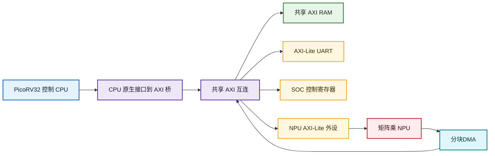

<p align="center">图2-1 PicoRV32 与 NPU 异构 SoC 总体结构</p>

<p align="center">
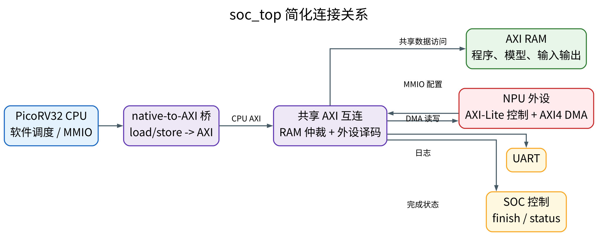
</p>
<p align="center">图2-2 `soc_top` 关键连接关系</p>

控制数据通路从 CPU 发起。PicoRV32 的 `mem_valid`、`mem_addr`、`mem_wdata` 和 `mem_wstrb` 原生接口进入 `pico_native_to_axi`，桥接模块将 CPU load/store 转换为 AXI 请求。互连根据地址选择 RAM、NPU 外设、UART 或 SOC 控制寄存器。NPU 外设窗口保存控制、状态、写回、复用和矩阵参数寄存器，软件按固定顺序写入配置寄存器后，再写控制寄存器中的 `start` 位。

NPU 数据通路由 `npu_top` 发起。任务启动后，NPU 不要求 CPU 参与每一个元素的读取和写入，而是根据锁存的基址、K/N/M、步长、数据宽度和定点缩放模式向 DMA 仲裁器提交块读写请求。DMA 将二维分块请求转换为 AXI 突发传输，读取 LHS、RHS、bias 和 per-channel 定点缩放参数，并把最终 int8 输出写回 DST。由于 CPU 与 NPU 共用 RAM，互连需要维护访问归属、活跃标志、未完成事务数量和等待条件，防止任一主设备长时间占用共享资源。

任务状态在系统层按 `ready`、`busy`、`done` 和 error 表示。`start` 被 NPU 外设采样后，控制器锁存寄存器组配置并置 `busy`；当加载、计算、定点缩放、先进先出队列、写回和 DMA 响应均完成后，`done` sticky 置位并释放 `busy`。该状态传播规则使 CPU 不需要观察内部流水级，只需要在任务完成点读取 `status`、完成数据和错误字段。NPU 中断输出 `irq` 为单 bit 信号，由 `done` sticky 状态和 `NPU_REG_CTRL[4]` 中断使能位共同驱动；软件通过向 `NPU_REG_STATUS[2]` 写 1 清除 `done` sticky。

SoC 地址空间采用固定分区。RAM 位于低地址区，UART、NPU 和 SOC 控制寄存器位于独立外设窗口。互连在地址译码时把请求归入 RAM、NPU、UART、CTRL 或错误区域。CPU 只能通过 AXI-Lite 访问外设，NPU DMA 只应访问共享 RAM 数据区。非法地址访问需要返回确定响应，避免 CPU 或 NPU 在无响应目标上永久等待。

PicoRV32 的任务粒度与 NPU 的分块粒度相互分离。CPU 只提交一次矩阵乘任务并轮询任务级状态，不向每个 PE 写入输入，也不直接控制 DMA 数据拍。NPU 在任务内部生成行分块、列分块和 N 方向分块序列，并根据缓存与先进先出队列状态调度加载、计算和写回。该分层降低软件控制开销，也使硬件内部微结构可在不改变软件 API 的条件下优化。

NPU 外设不暴露内部队列和物理坐标。软件可见字段包括控制位、状态位、完成数据、输入激活与权重复用参数、矩阵基址、维度、步长、偏移、定点缩放参数和激活范围。缓存槽位、部分和帧、先进先出队列存储体、DMA 客户端编号和 PE 坐标都属于内部实现。该封装使软件只需要遵守 GEMM 任务定义和寄存器访问规则，不依赖内部调度顺序。

中断能力作为外设接口保留。基础软件可以采用轮询方式读取 `done` 和 error；若系统层启用中断，软件在 `NPU_REG_CTRL[4]` 写 1 后启动任务，`irq` 在 `done` sticky 置位后保持为高，并在软件写 `NPU_REG_STATUS[2]` 清除后拉低。由于 CPU 侧中断配置会影响软件入口和异常处理，NPU 的中断输出需要与系统中断控制策略配合使用。无论使用轮询还是中断，任务完成点和状态清除规则保持一致。

### 2.2 AXI 总线与存储子系统设计

AXI 子系统负责连接 CPU、NPU、RAM 和外设。控制侧采用 AXI-Lite 单拍访问，适用于配置寄存器和状态寄存器；数据侧采用 AXI4 突发传输，适用于矩阵分块的连续或带步长读写。两类事务在互连中分开处理：CPU 可以访问 RAM 与外设，NPU DMA 只发起面向 RAM 的数据搬移。该组织方式减少外设侧协议复杂度，并使大数据搬移集中在分块DMA 中处理。

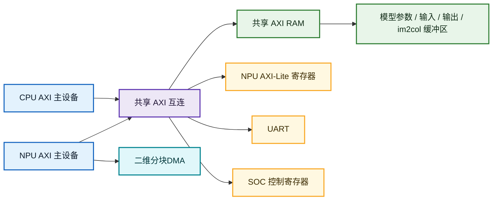

<p align="center">图2-3 AXI 总线与存储子系统结构</p>

`pico_native_to_axi` 是 CPU 原生接口与 AXI 的转换层。写访问转换为单数据拍 AXI 写事务，读访问转换为 AXI 读事务，`mem_ready` 只在读数据返回或写响应完成后对 CPU 有效。对于指令取值路径，若启用指令缓存，桥接层可以按缓存行组织突发传输；未启用时，每次取指按普通读访问处理。桥接层必须保持 CPU 请求的顺序可见性，避免软件 MMIO 写 `start` 早于前序配置写生效。

`soc_axi_interconnect` 是共享拓扑的仲裁中心。它接收 CPU 主设备和 NPU 主设备请求，向 RAM 发起共享读写，同时将 CPU 外设访问转发到 NPU、UART 或 SOC 控制模块。互连维护读访问归属、写访问归属、活跃标志、未完成事务计数和等待状态。RAM 读写允许 CPU 与 NPU 竞争，外设访问只允许 CPU 发起。该规则避免 NPU DMA 意外修改控制寄存器，也保证 CPU 可以通过固定地址读取外设状态。

<p align="center">
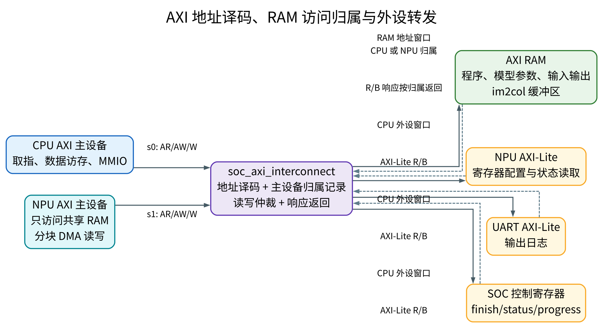
</p>
<p align="center">图2-4 AXI 地址译码、RAM 访问归属与外设转发关系</p>

`soc_axi_ram` 提供 AXI RAM 行为，支持读写突发传输、`wstrb` 字节写、`rlast`、`wlast` 和未完成事务。读通道在接受 AR 后按 `arlen` 返回多个数据拍，并在最后一个数据拍拉高 `rlast`。写通道在接受 AW 和全部 W 数据拍后返回 B 响应，`wstrb` 控制每个字节是否写入。RAM 可以配置响应延迟，用于描述非零等待的存储访问行为；无论延迟取值如何，读写顺序、`last` 标志和响应对应关系都必须保持。

AXI-Lite 控制访问采用地址、数据和响应分离的规则。写事务只有在 AW 和 W 通道都完成握手后才更新目标寄存器，随后通过 B 通道返回响应；读事务在 AR 握手后由 R 通道返回寄存器值。CPU 配置 NPU 时，矩阵参数、复用参数和 control 写入均按该规则进入 `npu_axil_top`，`start` 被采样前相关配置字段保持稳定。该规则同时用于 `status`、writeback 和错误字段读取，保证软件观察到的是寄存器边沿更新后的状态。

NPU 侧的块访问由 `axi_dual_block_dma` 执行。读引擎接收基址、行步长、行数、每行字节数、元素宽度、客户端编号和突发传输参数，将二维分块拆分为 AXI 读请求，并把返回数据送给 IA、权重、bias 或定点缩放参数客户端。写引擎接收输出写回单元的地址、数据、字节写掩码和行信息，生成 AW/W，并跟踪 B 响应。读写引擎独立工作，但共享 NPU 主设备端口与互连仲裁资源。

DMA 读写事务通过响应计数保持完整性。读请求发出后，客户端只在 R 通道返回并完成内部握手后获得数据；写请求发出后，写回单元必须等待对应 B 响应返回，才能把该输出范围计入完成条件。若 RAM 或互连暂时不能接收请求，DMA 保持地址、长度、客户端编号、写数据和字节写掩码，直到握手完成。该处理把可变存储延迟限制在 DMA 与客户端之间，不改变上层矩阵任务的数学定义。

非对齐访问由 DMA 和写回单元共同处理。输入读取时，DMA 可能从非 4 字节对齐地址开始取数，加载单元根据元素宽度和地址低位抽取有效 s8 或 s16 元素。输出写回时，`vec_s8_to_fifo` 生成 32 位数据和 4 bit 字节写掩码，`oa_writer` 按 DST 地址低位选择有效字节。尾列和尾数据拍只使目标输出字节有效，不修改同一 32 位字内的其他字节。

突发传输长度需要兼顾效率和仲裁公平。较长突发传输可减少地址通道握手开销，但会延长共享 RAM 被单一主设备占用的时间；较短突发传输有利于 CPU 插入外设访问和取指，但会提高地址开销。DMA 的突发传输长度应与总线宽度、RAM 响应延迟、分块行长度和 CPU 访问需求匹配。互连的让出条件用于在必要时释放通道，防止 CPU 控制访问被长期阻塞。

存储层次由外部共享 RAM、NPU 内部缓存或缓冲区和 PE 寄存器组成。共享 RAM 保存模型参数、输入、输出、im2col 缓冲区和软件栈数据；IA cache 保存输入分块；权重缓存保存权重分块；bias 缓存保存输出通道偏置；部分和缓冲区保存跨 N 方向分块的中间累加结果；输出先进先出队列缓冲 int8 写回数据拍。该层次把大容量持久数据放在 RAM，把短期高复用数据放在 NPU 内部，把最紧密计算数据放在 PE 寄存器。

总线性能设计使用统一公式描述。总线传输上限为 `bus_width_bytes × bus_freq_hz`，任务时间为 `task_cycles / npu_freq_hz`，实际字节带宽为 `(read_bytes + write_bytes) / task_time_s`。计算有效吞吐按 `2 × K × N × M / task_time_s` 计算，尾块无效计算通道不计入有效 MAC。若计数器扩展到读字节数、写字节数、活跃周期和停顿原因，软件可以在任务完成后分析瓶颈属于读、写、计算还是控制。

存储子系统的设计重点不是把所有数据永久留在片上，而是在分块生命周期内保持高复用数据。LHS 在多个输出列组之间复用，权重在一个或多个输入行组之间复用，部分和在多个 N 方向分块之间复用，输出仅在最终定点缩放后写回。DMA、缓存、缓冲区和阵列之间的速率匹配决定了实际吞吐，单独增加某一级容量并不能保证整体性能提高。

### 2.3 NPU 总体架构

NPU 由 AXI-Lite 外设接口层和 NPU 计算数据通路两部分组成。`npu_axil_top` 连接 SoC 控制接口，处理 AXI-Lite 读写、标准寄存器组保存、`start` 脉冲、状态寄存器、完成数据和 `irq`。`npu_top` 连接矩阵计算通路，处理配置检查、分块调度、DMA 请求、加载单元、计算、定点缩放、FIFO 和写回单元。两者之间通过配置字段、启动脉冲、`busy`/`done`/error 状态和完成数据连接。

<p align="center">
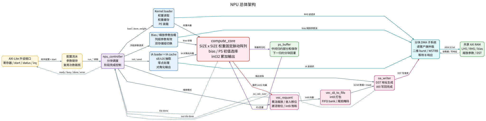
</p>
<p align="center">图2-5 NPU 内部功能结构</p>

<p align="center">
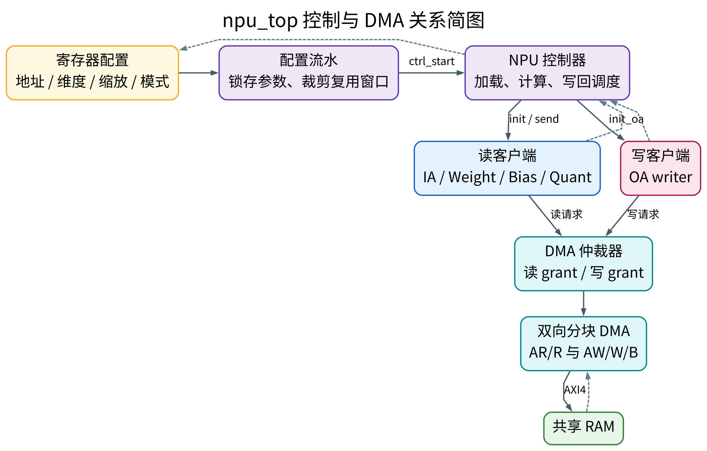
</p>
<p align="center">图2-6 `npu_top` 配置控制与 DMA 访问关键关系</p>

<p align="center">
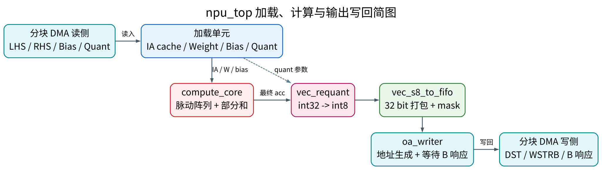
</p>
<p align="center">图2-7 `npu_top` 加载、计算与输出写回关键关系</p>

`npu_axil_top` 的寄存器组包括控制、状态、完成数据、IA 复用、权重复用和矩阵参数字段。控制寄存器 bit0 为 `start`，bit1 选择输入激活数据宽度，bit2 选择 per-channel 定点缩放，bit3 选择输入固定数据流。状态寄存器包含 `ready`、`busy`、`done` sticky、error code 和寄存器访问 `ready`，其中 `STATUS[2]` 支持写 1 清除，错误码位于 `STATUS[4:3]`，寄存器访问 `ready` 位于 `STATUS[5]`。所有字段按 32 位访问，保留位写入不应改变有效状态。

`npu_axil_reg_if` 保存矩阵乘任务的参数。地址字段包括 `NPU_REG_LHS_BASE`、`NPU_REG_RHS_BASE`、`NPU_REG_DST_BASE` 和 `NPU_REG_BIAS_BASE`；尺寸字段包括 `NPU_REG_K`、`NPU_REG_N` 和 `NPU_REG_M`；布局字段包括 `NPU_REG_LHS_STRIDE_B`、`NPU_REG_RHS_STRIDE_B` 和 `NPU_REG_DST_STRIDE_B`；数值字段包括零点、定点缩放乘法系数、移位参数、激活下限和激活上限。按张量定点缩放模式下，乘法系数与移位参数作为标量；per-channel 定点缩放模式下，相关字段作为参数数组地址。

`npu_top` 在 `start` 后先经过三级配置流水。stage0 锁存软件可见参数，stage1 根据 `IA_CACHE_BLOCKS`、`PS_FRAME_COUNT`、输出行列 tile 数和软件复用请求裁剪 `ia_reuse_num`、`w_reuse_num`，stage2 在控制器空闲时提交运行参数。WS 模式下 IA 侧读取 LHS、权重侧读取 RHS；IS 模式下两侧角色交换，内部 `stream_k` 与 `stream_m` 计算坐标按输入固定模式重新组织，但软件可见的 LHS、RHS、DST 和输出矩阵布局保持不变。

`npu_controller` 是 NPU 内部调度核心。控制器在 IDLE 状态等待 `start`，随后检查配置、计算分块数量、尾块有效计算通道、复用窗口和数据流模式。合法配置进入加载与计算状态，非法配置进入 ERROR 并更新错误码。控制器向 IA 加载单元、权重加载单元、bias 加载单元、定点缩放参数加载单元、计算核心和输出写回单元发出初始化或触发信号，并等待各阶段 `done` 或 `ready` 条件。

控制器推进任务时只以已寄存的握手结果、计数器终止条件和子模块状态作为判断输入。IA 数据、权重数据、bias、定点缩放参数、部分和、输出坐标和有效计算通道标志在各流水级中同步传递；当下游不能接收时，相关数据负载和附带控制字段保持稳定。该组织方式使加载、计算、定点缩放和写回单元可以分别插入局部寄存器或先进先出队列，而不会改变输出元素对应的 LHS 行、RHS 列、bias、定点缩放参数和 DST 地址。

IA 加载单元包括地址发生器、DMA 请求控制、输入元素抽取、符号扩展、零点加法和 IA cache 管理。它按照行组和 N 方向分块读取 LHS，把 s8 或 s16 输入转换为 signed 16 bit，并保存到缓存槽位。缓存管理单元再按阵列对角化时序输出 IA 向量，使不同行和不同 k 项在正确周期进入 PE。IA cache 槽位的释放由复用计数和发送完成共同决定。

权重加载单元负责 RHS/权重读取与 PE 装载。它根据输出列组、N 方向分块、RHS 基址和 RHS 步长读取权重，组织为列向量，并通过 `store_weight` 控制送入脉动阵列。权重在 PE 内保持，直到对应输出列组的输入激活计算窗口结束。尾列不足 `SIZE` 时，权重加载单元输出有效列掩码，无效列不参与输出。

bias 加载单元和定点缩放参数加载单元负责输出通道相关参数。bias 加载单元在输出列组粒度读取 int32 bias；per-channel 定点缩放时，定点缩放流水需要读取每个输出通道的乘法系数和移位参数。控制器保证这些参数在对应输出向量进入计算或定点缩放前有效。无 bias 场景下，累加初值为 0；按张量定点缩放场景下，所有并行输出通道共享同一缩放参数。

计算核心由权重固定脉动阵列、输入/权重对齐逻辑、部分和输入选择和部分和缓冲区接口组成。首次 N 方向分块使用 bias 或 0 作为初值，中间 N 方向分块使用部分和缓冲区回灌值，最终 N 方向分块输出到定点缩放流水。阵列内部 PE 在每个时钟边沿执行乘加并传递数据，底行在固定延迟后产生输出向量。控制器需要等待阵列填充和排空周期，不能以输入最后一拍作为输出完成条件。

定点缩放与输出子系统将 int32 向量转换为内存中的 int8 矩阵。`vec_requant` 执行乘法缩放、舍入、移位、加输出偏移、激活值上下限钳位和 int8 饱和；`vec_s8_to_fifo` 把 int8 并行输出通道打包成 32 位数据拍并生成字节写掩码；`oa_writer` 根据 DST 基址、行步长、输出坐标和有效列数发起 AXI 写请求。写响应全部返回后，写回单元才向控制器报告完成。

NPU 的工作状态按任务粒度对软件可见。`ready` 表示可接受新任务，`busy` 表示任务正在执行，`done` 表示任务完成，`error code` 表示配置或资源异常，`response error` 表示 AXI 或内部响应异常。内部的加载状态、缓存状态、部分和帧状态、先进先出队列状态和 DMA 等待状态不直接暴露，但它们共同决定 `busy` 与 `done` 的更新时刻。

## 3. 软硬件接口设计

本章集中说明 CPU 与 NPU 之间的软件可见接口、任务提交规则、驱动接入方式、应用算子接入和系统规格。硬件通过 AXI-Lite 寄存器接受配置，通过 AXI4 数据主接口访问共享 RAM；软件通过固定 MMIO 访问顺序提交矩阵乘任务，并在 TFLite Micro/NMSIS-NN 后端中选择硬件或软件执行路径。

### 3.1 寄存器与软件接口

本设计采用标准 AXI-Lite MMIO 寄存器访问方式。PicoRV32 发出的普通访存操作经 `pico_native_to_axi` 转换为 AXI 请求，`soc_axi_interconnect` 将 NPU 外设窗口转发到 `npu_axil_top` 的 AXI-Lite 从接口。NPU 外设基址为 `0x1000_0000`，软件驱动使用字节偏移访问寄存器，寄存器前端按 `s_axil_*` 五通道协议接收读写事务。大块矩阵数据不经过 AXI-Lite 寄存器口搬移，而是由 `npu_top` 内部的分块DMA 通过独立 AXI4 主设备接口访问共享 RAM。

`npu_axil_top` 内部由 `npu_axil_reg_if` 和 `npu_top` 组成。`npu_axil_reg_if` 保存控制、状态、地址、维度、步长、零点、定点缩放、复用和数据流模式寄存器，并把寄存器字段直接输出给 `npu_top`。矩阵任务参数以连续 AXI-Lite 寄存器组形式保存，软件可见配置字段在该寄存器组内统一展开。`npu_top` 接收 `calc_start` 单周期脉冲后锁存运行参数，矩阵数据读取、计算、定点缩放和写回均由 NPU 内部控制器和 DMA 完成。

AXI-Lite 写事务中，AW 与 W 通道可以先后到达。`npu_axil_reg_if` 分别锁存写地址和写数据，在两者均有效且写响应通道空闲时提交一次寄存器写入；写入时按 `WSTRB` 对 32 bit 字段进行逐字节更新。读事务在 AR 握手后返回地址译码对应的寄存器值，未实现地址读返回 0。AXI-Lite 读写响应均返回 OKAY。`NPU_REG_CTRL` 的 `start` 位在写提交周期形成 `calc_start` 脉冲，`NPU_REG_STATUS[2]` 采用写 1 清除规则，用于清除 `done` sticky 状态。

<p align="center">
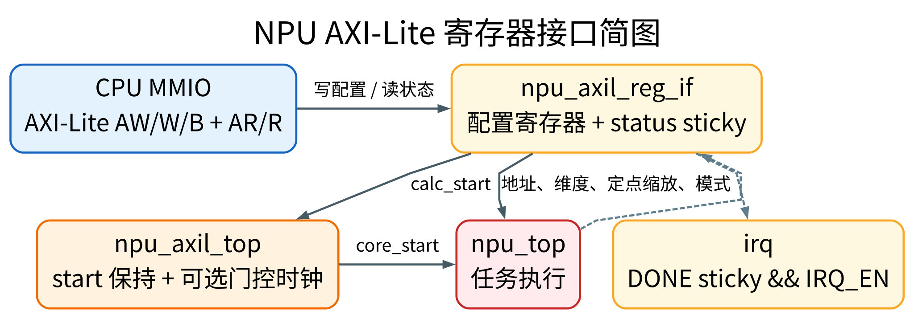
</p>
<p align="center">图3-1 NPU AXI-Lite 寄存器接口关键关系</p>

<p align="center">表3-1 NPU AXI-Lite 寄存器窗口</p>

| 字节偏移 | Word 偏移 | 名称 | 访问属性 | 功能说明 |
|---:|---:|---|---|---|
| `0x000` | `0x000` | `NPU_REG_CTRL` | RW | 启动、数据位宽、定点缩放模式、数据流和中断使能控制 |
| `0x004` | `0x001` | `NPU_REG_STATUS` | RO/WC | `ready`、`busy`、`done` 和错误状态，`done` 支持写 1 清除 |
| `0x008` | `0x002` | `NPU_REG_WB_DATA` | RO | 最近一次完成状态写回 |
| `0x010` | `0x004` | `NPU_REG_LHS_BASE` | RW | LHS/输入激活基地址 |
| `0x014` | `0x005` | `NPU_REG_RHS_BASE` | RW | RHS/权重基地址 |
| `0x018` | `0x006` | `NPU_REG_DST_BASE` | RW | 输出基地址 |
| `0x01c` | `0x007` | `NPU_REG_BIAS_BASE` | RW | 偏置基地址，写 0 表示无偏置 |
| `0x020` | `0x008` | `NPU_REG_K` | RW | 输出行数 |
| `0x024` | `0x009` | `NPU_REG_N` | RW | 公共累加维度 |
| `0x028` | `0x00a` | `NPU_REG_M` | RW | 输出列数 |
| `0x02c` | `0x00b` | `NPU_REG_LHS_STRIDE_B` | RW | LHS 行跨度，单位字节 |
| `0x030` | `0x00c` | `NPU_REG_RHS_STRIDE_B` | RW | RHS 列跨度，单位字节 |
| `0x034` | `0x00d` | `NPU_REG_DST_STRIDE_B` | RW | 输出行跨度，单位字节 |
| `0x038` | `0x00e` | `NPU_REG_LHS_ZP` | RW | LHS 零点 |
| `0x03c` | `0x00f` | `NPU_REG_RHS_ZP` | RW | RHS 零点 |
| `0x040` | `0x010` | `NPU_REG_DST_ZP` | RW | 输出零点 |
| `0x044` | `0x011` | `NPU_REG_Q_MULT` | RW | 按张量乘法系数或按通道乘法系数数组地址 |
| `0x048` | `0x012` | `NPU_REG_Q_SHIFT` | RW | 按张量移位参数或按通道移位参数数组地址 |
| `0x04c` | `0x013` | `NPU_REG_ACT_MIN` | RW | 输出激活下限 |
| `0x050` | `0x014` | `NPU_REG_ACT_MAX` | RW | 输出激活上限 |
| `0x054` | `0x015` | `NPU_REG_IA_REUSE` | RW | 输入激活复用深度 |
| `0x058` | `0x016` | `NPU_REG_W_REUSE` | RW | 权重复用窗口 |
| `0x05c` | `0x017` | `NPU_REG_DATAFLOW` | RW | bit0 表示数据流模式，0 为 WS，1 为 IS |
| `0x0fc` | `0x03f` | `NPU_REG_ID` | RO | 固定返回 `0x4e50_5531` |

`NPU_REG_CTRL` 是任务启动、模式配置和中断使能入口。写 bit0 为 1 时，`calc_start` 产生一个时钟周期启动脉冲，`npu_busy` 置位。bit1 写入 `cfg_16bits_ia`，用于选择输入激活 s16 模式；bit2 写入 `use_per_channel`，用于选择按通道定点缩放；bit3 写入 `cfg_dataflow_mode`，用于选择 IS 数据流；bit4 写入中断使能位，用于控制 `done` sticky 置位后是否拉高 `irq`。控制寄存器不承载状态清除功能，`done` sticky 由 `NPU_REG_STATUS[2]` 写 1 清除。软件应使用 32 bit 写访问更新控制寄存器，使低字节写使能有效并保证模式位、启动位和中断使能位在同一次控制写中被 RTL 采样。


`NPU_REG_STATUS` 返回低位状态，并对 `done` sticky 支持写 1 清除。bit0 为 `SA_READY`，表示 `npu_top` 可接受新启动；bit1 为 `BUSY`，表示任务已经启动且尚未完成；bit2 为 `NPU_STATUS_DONE`，在 NPU 完成写回后置位并保持到软件写 1 清除；bit4:3 为 `NPU_STATUS_ERR_MASK` 对应的错误码；bit5 为 `REG_READY`，表示 AXI-Lite 寄存器通路可访问。软件通常在写 `start` 后轮询 `done`，并在 `done` 置位后读取错误码和完成数据。


配置寄存器按任务字段直接展开。软件提交任务时先写 `NPU_REG_LHS_BASE`、`NPU_REG_RHS_BASE`、`NPU_REG_DST_BASE`、`NPU_REG_BIAS_BASE`、`NPU_REG_K`、`NPU_REG_N`、`NPU_REG_M`、步长、零点、定点缩放参数、激活范围、复用参数和数据流模式，再写 `NPU_REG_STATUS[2]` 清除历史 `done`，最后写 `NPU_REG_CTRL`。写 `start` 后，NPU 在配置锁存级保存地址、维度、步长、定点缩放、复用和模式字段；`busy` 有效期间，新的寄存器写入不改变正在运行的任务，只对下一次 `start` 生效。任务完成后，`npu_done_valid` 更新 `NPU_REG_WB_DATA`，`done_sticky` 置位，`npu_busy` 清零；若 `NPU_REG_CTRL[4]` 为 1，`irq` 同步拉高。软件读取完成信息后再次写 `NPU_REG_STATUS[2]` 清除对应 sticky 状态。

<p align="center">
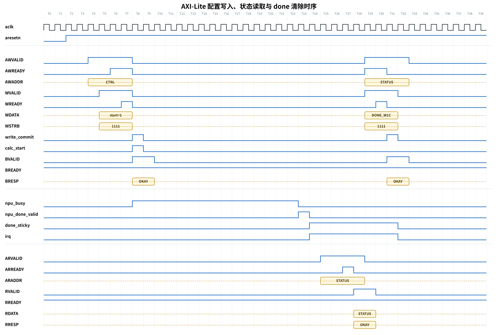
</p>
<p align="center">图3-2 AXI-Lite 寄存器写读时序</p>

软件通过普通 32 bit 访存操作完成配置和状态读取。极小矩阵任务会受到多次寄存器写和轮询开销影响，因此软件适配层需要按算子尺寸选择硬件执行或软件执行。固定寄存器组使一个任务的配置步骤保持确定；`NPU_REG_ID` 用于软件确认外设身份。软件侧硬件参数宏需要与 RTL 综合参数一致，阵列规模、缓存数量、部分和帧数和支持的数据类型在驱动构建时确定。

### 3.2 CPU/NPU 协同执行流程

一次协同执行从软件算子入口开始。TFLite Micro 或 NMSIS-NN 调用矩阵乘、全连接或卷积函数，适配层判断矩阵形状、数据类型、定点缩放参数和内存布局是否满足 NPU 任务条件。满足条件时，软件构造 `dsa_matmul_config_t`；不满足条件时，软件选择软件执行路径。配置结构包含 LHS、RHS、DST、BIAS、K、N、M、步长、零点、输出偏移、乘法系数、移位参数、activation min/max、按通道标志和数据流模式。

<p align="center">
</p>
<p align="center">图3-3 CPU 与 NPU 协同执行流程</p>

CPU 写寄存器时先写矩阵基址和维度，再写步长与定点缩放字段，然后写复用参数和控制字。这个顺序保证 `start` 被采样时所有必要配置已经稳定。若输入矩阵或 im2col 缓冲区刚由 CPU 写入共享 RAM，软件需要在 `start` 前保证内存写与 MMIO 写的顺序。该 SoC 不包含复杂数据缓存一致性硬件，因此软件访问顺序是 CPU 与 NPU 共享 RAM 的主要一致性机制。

NPU 收到 `start` 后，`npu_controller` 进入初始化状态，检查指针、维度、步长和模式字段。配置合法时，控制器计算分块数、尾块有效行列、IA/W 复用窗口和 N 方向分块顺序，并触发加载单元与 DMA 仲裁器。配置非法时，控制器设置错误码并结束任务，不发起新的数据读写。该处理使错误状态通过 `status` 暴露给软件，而不会把无效配置转换为不确定的外部访问。

计算阶段中，权重加载单元读取 RHS 并装入 PE，输入激活加载单元读取 LHS 并通过缓存管理单元输出对角化输入，偏置加载单元在输出列组粒度上提供 int32 初值。计算核心驱动权重固定阵列执行乘加，并根据 N 方向分块次序选择偏置、部分和缓冲区回灌或 0 作为 sum 初值。对于中间 N 方向分块，结果写入部分和缓冲区；对于最终 N 方向分块，结果进入定点缩放。

输出阶段由定点缩放、FIFO、写回单元和写 DMA 组成。定点缩放根据按张量或按通道参数完成缩放、舍入、偏移、激活值上下限钳位和 int8 饱和。FIFO 将 int8 并行输出通道打包为 32 位数据拍，并保存输出坐标和字节写掩码。写回单元根据 DST 基址、行步长、输出行列和有效列数生成 AXI 写请求。写响应全部返回后，对应输出区域才算完成。

任务完成条件覆盖所有内部流水和外部响应。控制器需要确认加载单元不再有未完成读请求，阵列拖尾已经排空，部分和缓冲区不再有待处理中间和，定点缩放输出已经进入 FIFO，FIFO 数据已由写回单元消费，写 DMA 的 B 响应已经返回。满足这些条件后，`done` sticky 置位，`busy` 清零，`ready` 可重新拉高。CPU 轮询到 `done` 后读取 `status` 与完成数据，再通过 `NPU_REG_STATUS[2]` 写 1 清除完成状态并进入下一算子。

### 3.3 软件驱动与 TFLM 接入

软件栈由 NPU MMIO 驱动、NMSIS-NN 加速封装和 TFLM 算子入口组成。驱动层以 `DSA_MMIO_BASE` 下的 AXI-Lite 寄存器窗口访问硬件，向上提供 `dsa_matmul_config_t` 任务结构。该结构封装 `LHS`、`RHS`、`DST`、`BIAS` 基址，`K`、`N`、`M` 维度，行步长，`lhs_dtype`、`rhs_dtype`、`bias_dtype`、`out_dtype` 数据类型，`dataflow_mode` 数据流模式，输入、权重和输出零点，定点缩放参数，`act_min`、`act_max` 激活范围以及 `ia_reuse_num`、`w_reuse_num` 复用参数。上层算子提交的是矩阵任务描述，不需要感知缓存槽位、PE 坐标、DMA 客户端编号和部分和帧等硬件内部资源。

配置初始化后，驱动设置与 int8 推理一致的默认属性：输入和权重采用 s8，偏置采用 s32，输出采用 s8，数据流采用 WS，定点缩放采用按张量模式，激活范围为 -128 至 127。任务提交时，驱动先检查配置指针、`lhs_ptr`、`rhs_ptr` 和 `dst_ptr`；当任务使用按通道定点缩放时，还检查 `dst_mult_ptr` 和 `dst_shift_ptr`。`bias_ptr` 独立写入偏置基址寄存器，用于提供 int32 初值；该字段不参与输入、权重和输出指针的有效性检查。

寄存器配置按确定顺序执行。驱动先写入 `NPU_REG_LHS_BASE`、`NPU_REG_RHS_BASE`、`NPU_REG_DST_BASE` 和 `NPU_REG_BIAS_BASE`，再写入 `NPU_REG_K`、`NPU_REG_N`、`NPU_REG_M`、三组行步长寄存器、零点寄存器、定点缩放寄存器、激活范围寄存器和复用寄存器。按张量模式下，`NPU_REG_Q_MULT` 和 `NPU_REG_Q_SHIFT` 保存单组乘法系数和移位值；按通道模式下，这两个寄存器保存参数数组基址。`start` 写入前，驱动通过内存栅栏保证共享 RAM 写入和 MMIO 配置写入的顺序。

启动控制由 `NPU_REG_CTRL` 完成。驱动在启动前向 `NPU_REG_STATUS` 写入 `NPU_STATUS_DONE` 清除历史完成状态，随后构造包含 `start`、中断使能、16 bit IA、按通道模式和 IS 数据流选择的控制字。`start` 被写入后，软件轮询 `NPU_REG_STATUS`；当 `done` 置位时读取 `NPU_REG_WB_DATA` 作为任务返回数据，并再次清除 `done`。当状态寄存器错误位有效时，驱动返回硬件错误码；当轮询次数达到软件阈值时，驱动返回超时状态码。超时处理属于软件恢复机制，不改变硬件任务完成条件。

复用参数由矩阵尺寸、数据流模式和综合参数共同决定。`dsa_matmul_select_reuse` 按 `DSA_TILE_SIZE` 计算输出行列分块数，按 `DSA_IA_CACHE_BLOCKS` 限制 IA 可复用行组数，按 `DSA_PS_FRAME_COUNT` 限制权重复用列组数，并把非零复用值裁剪为硬件支持的 2 的幂。在 IS 数据流条件下，软件按照转置后的流式行列关系计算限制条件，并保证 IA 复用设置不会超过可配合的权重复用设置。当复用字段为 0 时，软件执行自动选择；当上层显式传入非零值时，执行入口在写寄存器前完成合法化处理。

NMSIS-NN 加速封装把矩阵乘接口转换为 NPU 任务。普通 s8 矩阵乘以输入行数作为 `K`，以累加深度作为 `N`，以输出通道数作为 `M`；s16 LHS 与 s8 RHS 的矩阵内核把 `lhs_dtype` 设置为 s16，并按 16 bit 输入元素计算 `lhs_row_stride`。带输出行步长的矩阵内核把 `dst_row_stride` 设置为调用方给出的输出行间距，用于组卷积和深度卷积等交错输出场景。向量-矩阵乘被表示为 `K=1` 的矩阵任务，其输出步长沿用调用方给出的地址间距。

全连接层使用 NPU 矩阵任务。TFLM 入口把输入批次数作为 `K`，把输入通道数作为 `N`，把输出通道数作为 `M`，并把输入、权重和输出行步长分别设置为 `N`、`N` 和 `M` 个 int8 元素。按张量定点缩放时，封装函数写入单组乘法系数和移位值；按通道定点缩放时，封装函数写入乘法系数数组和移位数组基址。对于输出张量维数大于 2 且累加深度满足 1x1 卷积快速路径条件的全连接形态，TFLM 接入层使用 1x1 卷积封装提交同等矩阵任务；当原算子采用按张量定点缩放时，软件在临时缓冲区中展开为逐输出通道参数。

普通 s8 卷积接入由软件完成 im2col 展开，硬件仅接收展开后的矩阵乘任务。软件按照填充、步长、膨胀和分组参数从 NHWC 输入张量生成 `DSA_CONV_IM2COL_BATCH_ROWS` 行一批的 LHS 缓冲区，卷积核展开深度为 `kernel_x * kernel_y * kernel_ch`，并按 4 字节对齐后的行步长保存。批次行数达到上限或处理到尾部时，封装函数提交矩阵任务；分组卷积通过 `dst_row_stride` 保持组间输出在 NHWC 布局中的位置。1x1 卷积在无填充且膨胀为 1 时不需要 im2col 缓冲区，软件直接把输出空间位置组成矩阵行，权重矩阵列数为输入通道数，输出列数为输出通道数。

深度卷积接入同样复用矩阵任务。软件先检查 `output_ch` 等于 `input_ch * depth_multiplier`，再按输入通道逐一组织卷积窗口和卷积核。每个输入通道的 im2col 行包含 `kernel_x * kernel_y` 个元素，软件为 `depth_multiplier` 个输出通道重新排列卷积核，并把矩阵任务的 `M` 设置为 `depth_multiplier`。输出行步长设置为完整输出通道数，使同一输入通道派生的多个输出通道写入 NHWC 输出张量的对应位置。

TFLM 接入保持原有张量生命周期和错误返回方式。Prepare 阶段根据卷积或深度卷积形态申请临时缓冲区；1x1 直接路径不申请 im2col 缓冲区。Eval 阶段把 TFLM 张量指针、NMSIS-NN 维度结构、激活上下限和定点缩放参数组织为 NPU 任务；若数据类型或算子形态不属于硬件支持范围，相关算子仍走既有 NMSIS-NN 软件执行路径。NPU 访问共享 RAM 时只解释基址、行步长和尺寸字段，不解析 TFLM 张量对象；输入、权重、偏置、定点缩放参数和临时 im2col 缓冲区在 `done` 置位前必须保持稳定，输出缓冲区在任务完成前不能被其他软件任务覆盖。

<p align="center">
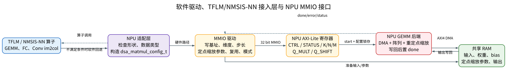
</p>
<p align="center">图3-4 软件驱动、TFLM/NMSIS-NN 接入层与 NPU MMIO 接口关系</p>

### 3.4 应用层算子接入

应用层算子接入以 TFLM int8 推理中的密集矩阵计算为主要对象。硬件提交对象包括 GEMM、全连接、普通卷积 im2col 后端、1x1 卷积后端和部分深度卷积场景；逐元素算子、控制类算子、池化类算子以及不满足矩阵任务条件的算子继续由软件执行。该划分使 NPU 只处理规则二维矩阵、定点缩放参数和有限数据流模式，避免为不规则访问引入额外控制硬件。

应用层使用同一矩阵任务描述连接不同算子。软件将上层张量、NMSIS-NN 维度结构、激活范围和定点缩放参数转换为 `dsa_matmul_config_t`，再由驱动写入 NPU 寄存器。硬件接收的任务始终为输出矩阵 `C[K, M]`，其中 `K` 为输出行数或批次行数，`N` 为公共累加维度，`M` 为输出列数或输出通道数。WS 和 IS 只改变硬件内部数据驻留方式，不改变软件可见的输出矩阵含义。

#### 3.4.1 全连接算子接入

全连接层可直接表示为 `C[K, M] = A[K, N] x B[N, M]`。`K` 对应输入批次数或输入向量组数，`N` 对应输入通道数，`M` 对应输出通道数。`LHS` 基址指向输入矩阵，`RHS` 基址指向按输出通道组织的权重矩阵，`DST` 基址指向输出缓冲区，`BIAS` 基址指向 int32 偏置数组。`NPU_REG_LHS_STRIDE_B` 表示相邻输入行的字节距离，`NPU_REG_RHS_STRIDE_B` 表示相邻输出通道权重段的字节距离，`NPU_REG_DST_STRIDE_B` 表示相邻输出行的字节距离。

全连接算子在 TFLM Eval 阶段构造 NMSIS-NN 全连接参数。输入零点写入 `lhs_offset`，权重零点写入 `rhs_offset`，输出零点写入 `dst_offset`，激活上下限写入 `act_min` 和 `act_max`。按张量定点缩放时，软件写入单组乘法系数和移位值；per-channel 定点缩放时，软件写入乘法系数数组和移位数组基址。硬件按照输出列索引读取偏置和 per-channel 参数，因此尾列不足 `SIZE` 时只对有效输出通道读取参数并写回结果。

对于单批次全连接，`K` 可以等于 1。此时阵列行方向有效利用率较低，软件可在模型调度或上层批处理允许的条件下合并多个输入行，以减少任务启动开销和尾行空转。若输出张量维数大于 2 且累加深度满足 1x1 卷积快速路径条件，TFLM 接入层可使用 1x1 卷积封装提交等价矩阵任务；输出顺序仍保持 TFLM 张量布局。

#### 3.4.2 卷积 im2col 接入

普通卷积的滑窗访问由软件展开为 im2col 矩阵。每个输出空间位置对应 `LHS` 的一行，卷积核展开后的输入通道和空间位置共同构成 `N`，输出通道构成 `M`。硬件仍执行矩阵乘，不直接处理填充、步长、膨胀和输入窗口越界；这些卷积访问规则在软件展开阶段完成。越界位置按输入零点对应值填充，使后续矩阵乘仍按统一的 int8 输入解释。

通用 s8 卷积按 `DSA_CONV_IM2COL_BATCH_ROWS` 分批生成 im2col 缓冲区。每批最多保存 32 个输出空间位置，单行长度为 `kernel_x * kernel_y * kernel_ch`，并按 4 字节对齐后的行步长写入临时缓冲区。批次行数达到上限或处理到尾部时，软件提交一次 NPU 矩阵任务。该方式降低了单次任务启动开销，但会占用临时 RAM；批次过小时任务次数增加，批次过大时 im2col 缓冲区占用增加。

分组卷积通过输出行步长保持 NHWC 输出布局。每个组独立提交对应的权重、偏置和 per-channel 参数，`M` 为该组的输出通道数，`dst_row_stride` 为完整输出通道数对应的字节距离。1x1 卷积在无填充且膨胀为 1 时不需要 im2col 展开，软件直接把输出空间位置作为 `K` 行提交；当步长为 1 时可把整个输入空间合并为一个矩阵任务，当步长不为 1 时按输出高度逐行提交。

#### 3.4.3 深度卷积接入

深度卷积按照输入通道逐通道组织矩阵任务。软件先检查 `output_ch` 等于 `input_ch * depth_multiplier`，再为每个输入通道生成 im2col 行。此时单行长度为 `kernel_x * kernel_y`，`M` 等于 `depth_multiplier`，输出行步长为完整输出通道数。该设置使同一输入通道派生的多个输出通道写入 NHWC 张量中对应位置。

深度卷积的权重在软件侧重新排列为适合矩阵乘的连续权重段。对于某个输入通道，软件把 `depth_multiplier` 个输出通道的卷积核依次放入临时权重缓冲区，并为对应输出通道选择偏置、乘法系数和移位参数。im2col 行数达到批次上限或到达输出空间尾部时，软件提交 NPU 任务；若临时缓冲区不可用或参数关系不满足上述条件，则该算子由软件函数执行。

#### 3.4.4 小算子与软件执行路径

并非所有算子都适合硬件提交。当 `K`、`N` 或 `M` 很小时，寄存器写入、DMA 启动、加载单元初始化和写回响应所占周期可能超过阵列计算收益。当数据类型不是 s8/s16 输入与 s8 权重组合，或输出类型不是 s8，硬件没有直接运算路径。当输入、权重或输出布局无法用基址、行步长和二维尺寸表达时，地址发生器不能生成对应访问序列。上述条件下，软件选择 NMSIS-NN 或 TFLM 既有软件函数。

软件执行路径不改变算子数值定义。硬件路径和软件路径均按照相同规则解释输入零点、权重零点、偏置、乘法系数、移位参数、输出零点和激活上下限。硬件路径只改变执行单元和数据搬移方式，不改变上层张量形状、输出顺序和错误返回规则。该设计使应用层可以按算子形态和任务规模选择执行单元，而不会影响后续网络层的数据解释。

#### 3.4.5 任务粒度设计

任务粒度以一个矩阵乘配置为单位。一个任务包含固定的 `LHS`、`RHS`、`DST`、`BIAS`、`K`、`N`、`M`、步长、定点缩放参数和数据流模式。任务内部分解为行分块、列分块和 N 方向分块，分块次序由 `npu_controller` 生成。软件不需要逐分块写寄存器，也不需要为每个 PE 提供控制位。该粒度降低 MMIO 访问次数，并允许硬件在任务内部安排缓存复用和 DMA 顺序。

任务粒度也决定错误处理点。任务启动后，硬件在 `busy` 期间拥有输出缓冲区写权限；若配置错误在启动阶段发现，任务结束时不会写入输出；若运行中出现 AXI 响应错误，硬件在已发事务完成后设置 `error` 状态。软件以任务为单位处理 `done` 和 `error`，不以内部分块为单位插入控制。

#### 3.4.6 数据布局与对齐约束

`LHS`、`RHS` 和 `DST` 的地址字段均为字节地址。`NPU_REG_LHS_STRIDE_B`、`NPU_REG_RHS_STRIDE_B` 和 `NPU_REG_DST_STRIDE_B` 也以字节为单位，使同一寄存器定义可以覆盖 s8 与 s16 输入。DMA 支持非 4 字节对齐基址，非对齐访问由读写数据拼接和字节写掩码处理；非对齐任务可能增加数据拍数量。输出写回使用字节写掩码保证只修改有效 int8 字节，输入读取由加载单元对返回数据拍进行元素抽取和符号扩展。

应用侧张量采用 Channel last（NHWC）布局，通道维位于最内层。全连接和 GEMM 的 `LHS` 行内元素按公共累加维度连续或等效连续排列；卷积 im2col 后的 `LHS` 每行对应一个输出空间位置，行内按卷积窗口展开顺序连续保存输入通道数据。`RHS` 按输出通道组织，每个输出通道对应一段连续的 `N` 维权重，`rhs_col_stride_b` 表示相邻输出通道权重段的字节距离；`DST` 按输出行主序写回，并保持 Channel last 输出顺序。若上层张量采用分块化、稀疏或压缩布局，软件需要先转换为硬件可访问布局，或继续由软件执行。

#### 3.4.7 定点缩放参数组织

按张量定点缩放将乘法系数和移位参数作为标量配置，适合所有输出通道共享同一缩放参数的算子。per-channel 定点缩放将乘法系数和移位参数作为数组，硬件按输出列索引读取。偏置同样以输出通道为索引；当 `bias_base` 为 0 时，累加初值为 0。硬件需要保证偏置、乘法系数和移位参数的读取顺序与输出列组一致，且尾列只对有效通道执行参数读取和输出写回。

定点缩放流水的输入为已合入偏置的 int32 累加向量，输出为 int8 向量。流水阶段包括乘以乘法系数、按移位参数舍入移位、加输出零点、激活值上下限钳位和 int8 饱和。各阶段的 `valid`、通道索引、行列坐标和有效通道标志同步移动。当 per-channel 参数尚未返回时，定点缩放输入需要保持等待，不能使用上一输出列的参数继续计算。

<p align="center">
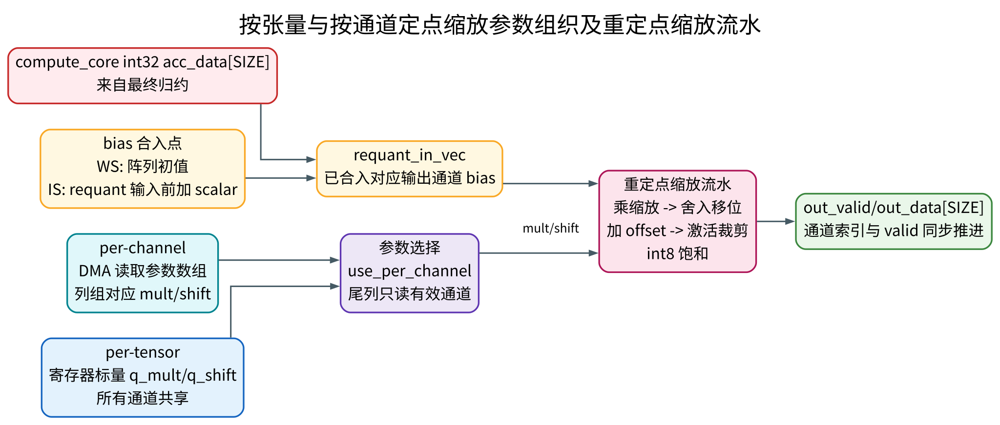
</p>
<p align="center">图3-5 按张量与按通道定点缩放参数组织及定点缩放流水对应关系</p>

### 3.5 设计规格汇总

| 类别 | 设计规格 | 说明 |
|---|---|---|
| 处理器与系统 | PicoRV32 + AXI/AXI-Lite SoC | CPU 执行程序、配置 NPU、启动任务并读取状态。 |
| 控制接口 | 32 bit AXI-Lite MMIO | NPU 寄存器窗口按 32 bit 单拍读写访问。 |
| 数据接口 | 32 bit AXI4 主设备 | NPU 通过分块 DMA 访问共享 AXI RAM。 |
| 矩阵任务 | `C[K, M] = A[K, N] x B[N, M]` | 软件提交基址、维度、步长、零点、定点缩放参数和模式位。 |
| 阵列规模 | 基准配置 `SIZE=4`，RTL 支持综合期参数化 | 4x4 为基础实现配置，压力和等效算力评估可使用更大 `SIZE`。 |
| 数据类型 | s8/s16 输入、s8 权重、int32 偏置和累加、s8 输出 | IA 和权重进入 PE 前扩展到 signed 16 bit，累加为 signed 32 bit。 |
| 定点缩放 | 按张量与 per-channel | 支持乘法系数、移位参数、输出零点、激活上下限和 int8 饱和。 |
| 数据流 | WS 与 IS | 运行期模式位选择权重固定或输入固定，输出矩阵含义保持一致。 |
| 片上存储 | IA cache、权重缓存、部分和缓冲区、输出 FIFO | 支撑分块复用、部分和回灌、参数对齐和写回速率匹配。 |
| DMA 功能 | 二维分块读写、地址递增 burst、非对齐访问、字节写掩码 | 统一服务 IA、权重、bias、定点缩放参数和输出写回。 |
| 任务状态 | `ready`、`busy`、`done`、`error`、`irq` | `done` 为 sticky 状态，软件写 `NPU_REG_STATUS[2]` 清除。 |
| 软件接入 | 驱动、NMSIS-NN 加速封装、TFLM 算子入口 | 全连接、GEMM、普通卷积、1x1 卷积和部分深度卷积可提交 NPU。 |
| 复位策略 | 控制状态、有效标志、FIFO 指针和标签复位 | 数据 RAM 通过有效位约束使用，复位后软件重新提交任务配置。 |
| 低功耗控制 | `ENABLE_CLOCK_GATING` 控制 NPU 计算核心时钟 | 空闲阶段关闭 `npu_top` 计算核心时钟，AXI-Lite 寄存器保持可访问。 |

规格表描述系统级可见能力和主要实现约束。CPU、互连、NPU、DMA 和软件驱动共同完成任务提交与执行；模块之间通过 AXI、AXI-Lite、`valid/ready`、`req/done` 和状态寄存器连接。`SIZE`、`IA_CACHE_BLOCKS`、`PS_FRAME_COUNT`、AXI 未完成事务深度和门控时钟开关为综合期参数；`K`、`N`、`M`、基址、步长、定点缩放参数、复用参数和数据流模式为运行时的配置。

数值计算规则固定为整数推理。输入和权重在进入 PE 前转换为 signed 16 bit，乘法结果累加到 signed int32，最终通过定点缩放输出 signed int8。PE 内不执行浮点运算，也不在每次 MAC 后执行饱和；饱和与激活上下限钳位集中在定点缩放输出阶段完成。偏置、零点、乘法系数、移位参数、输出零点和钳位的处理位置与 TFLM/NMSIS-NN 算子定义保持一致。

接口访问保持 32 bit 访问粒度。AXI-Lite 控制寄存器按 32 bit 读写，AXI 数据主接口按 32 bit 数据拍搬移，int8 输出通过字节写掩码写入目标缓冲区。该选择与 PicoRV32 普通 load/store 访问匹配，并简化 DMA、输出打包和写回单元的宽度控制。若后续扩展 AXI 数据位宽，软件可见寄存器定义保持不变，DMA 数据拍拆分、输出打包和字节写掩码生成需要随数据位宽同步调整。

## 4. 硬件模块设计

### 4.1 `soc_top`模块设计

本模块位于SoC 顶层中，完成 PicoRV32、AXI 桥、共享 AXI 互连、NPU 外设、AXI RAM、UART 与系统控制寄存器的顶层集成。该模块处于系统最上层，向下实例化 CPU、存储、互连和 NPU，向上连接板级顶层约束或外部封装接口。

#### 4.1.1 功能说明

本模块接收的主要输入包括 `clk`、`resetn`、`uart_rx` 等信号，输出的主要结果包括 `uart_tx`、`soc_finish`、`soc_status` 等信号。完成 PicoRV32、AXI 桥、共享 AXI 互连、NPU 外设、AXI RAM、UART 与系统控制寄存器的顶层集成。在系统运行过程中，该模块通过时钟边沿采样输入条件，更新内部寄存器或状态标志，并在满足握手、完成或错误条件后驱动下游接口。

#### 4.1.2 结构组成

内部由 PicoRV32 实例、`pico_native_to_axi`、`soc_axi_interconnect`、`soc_axi_ram`、`npu_axil_top`、`soc_axil_simpleuart`、`soc_axil_ctrl` 和可选乒乓缓冲组成。顶层参数给出 `CPU_RAM_BASE`、`NPU_AXIL_BASE`、`UART_BASE`、`SOC_CTRL_BASE`、`SIZE`、`BUS_WIDTH`、`IA_CACHE_BLOCKS` 和 AXI 未完成事务深度。这些子单元在同一时钟域内通过寄存器和握手信号协同工作。单一系统时钟域，复位信号为低有效同步或异步进入各子模块，具体复位分支由被实例化模块实现。

#### 4.1.3 接口定义

本模块接口包括时钟复位接口、配置或控制接口、数据输入接口、数据输出接口以及状态反馈接口。下表列出主要信号，位宽按照 RTL 参数化表达；当位宽由参数决定时，表中保留参数名。

| 信号名 | 位宽 | 方向 | 时钟域 | 功能描述 | 备注 |
|---|---:|---|---|---|---|
| `clk` | 1 | 输入 | 系统时钟域 | SoC 同步逻辑采样时钟 | 所有子模块使用该时钟或由顶层派生 |
| `resetn` | 1 | 输入 | 系统时钟域 | 低有效复位 | 复位后 CPU 从 RAM 基址取指 |
| `uart_rx` | 1 | 输入 | 系统时钟域 | UART 接收 | 调试串口输入 |
| `uart_tx` | 1 | 输出 | 系统时钟域 | UART 发送 | 用于软件运行状态输出 |
| `soc_finish` | 1 | 输出 | 系统时钟域 | 程序完成标志 | 由软件写 SOC 控制寄存器产生 |
| `soc_status` | 32 | 输出 | 系统时钟域 | 程序状态码 | 用于顶层状态读取 |

接口时序上，输入控制信号在时钟有效边沿采样，输出控制信号在寄存器更新后保持到下游完成握手或被状态机清除。`valid/ready` 类接口以双方同周期为高作为一次传输完成条件；`req/done` 类接口以请求保持和完成反馈作为一次多周期操作的完成条件。地址、数据和掩码信号在对应 `valid` 或 `req` 有效期间保持稳定。

#### 4.1.4 工作流程与状态机

复位后，单一系统时钟域，复位信号为低有效同步或异步进入各子模块，具体复位分支由被实例化模块实现。启动或运行条件由上游控制信号给出，模块在配置字段稳定后进入正常工作。本模块不设置独立状态机，控制状态由 CPU、互连、NPU 控制器和 AXI RAM 分别维护。

复位释放后，PicoRV32 从 `CPU_RAM_BASE` 对应地址取指。CPU 原生访问先被转换为 AXI 请求，再由互连分发到 RAM 或外设。NPU 在软件写入 `start` 后通过 AXI 主设备访问 RAM。SoC 完成标志由软件写控制寄存器产生，并在顶层输出端口保持到复位或下一次状态更新。未完成握手时，相关计数器不推进。

#### 4.1.5 时序行为

复位释放后，PicoRV32 从 `CPU_RAM_BASE` 对应地址取指。CPU 原生访问先由 `pico_native_to_axi` 转换为 AXI 请求，再由互连按照地址译码结果发送到 RAM 或外设窗口。NPU 在软件写入 `start` 后通过 AXI 主设备访问共享 RAM，读写完成条件由 AXI R 通道数据返回和 B 通道写响应返回决定。`soc_finish` 和 `soc_status` 由 SoC 控制寄存器写入更新，复位后为确定值，并保持到软件再次写入或复位。


#### 4.1.6 参数配置说明

`soc_top` 的结构参数在综合或仿真编译时确定，用于定义地址窗口、总线位宽、NPU 阵列规模、IA cache 物理深度、部分和帧数、共享 RAM 容量和可选时序缓冲。

| 参数 | 功能含义 |
|---|---|
| `AXIL_DATA_WIDTH` | AXI-Lite 配置接口数据宽度，默认 32 bit |
| `AXIL_ADDR_WIDTH` | NPU AXI-Lite 局部地址宽度，默认 16 bit |
| `WEIGHT_WIDTH` | PE 权重内部数据宽度，默认 16 bit，int8 权重在进入阵列前扩展到该宽度 |
| `DATA_WIDTH` | PE 输入激活内部数据宽度，默认 16 bit，int8 输入在进入阵列前扩展到该宽度 |
| `SIZE` | 阵列边长，默认 16，对应 16x16 阵列 |
| `BUS_WIDTH` | NPU AXI 数据主接口宽度，默认 32 bit |
| `REG_WIDTH` | NPU 运行参数和内部计数位宽，默认 32 bit |
| `AXI_ADDR_WIDTH` | CPU 与 NPU AXI 地址宽度，默认 32 bit |
| `NPU_ADDR_WIDTH` | NPU 内部 AXI 地址宽度，默认等于 `AXI_ADDR_WIDTH` |
| `IA_CACHE_BLOCKS` | IA cache 分块数，默认 4 |
| `PS_FRAME_COUNT` | 部分和帧数，默认等于 `SIZE` |
| `AXI_READ_OUTSTANDING` | AXI 读侧未完成事务深度，默认 4 |
| `AXI_WRITE_OUTSTANDING` | AXI 写侧未完成事务深度，默认等于 `AXI_READ_OUTSTANDING` |
| `NPU_ENABLE_IS_MODE` | 使能 IS 数据流模式 |
| `NPU_ENABLE_PER_CHANNEL` | 使能 per-channel 定点缩放参数读取 |
| `NPU_ENABLE_CLOCK_GATING` | 使能 NPU 计算核心主动门控时钟 |
| `CPU_MEM_DP` | 共享 RAM 深度，默认 524288 word，对应 2 MiB |
| `CPU_MEM_PATH` | 共享 RAM 初始化文件路径 |
| `CPU_MEM_INIT_EN` | 共享 RAM 初始化使能 |
| `CPU_ENABLE_ICACHE` | CPU 指令缓存开关，默认关闭 |
| `CPU_AXI_READ_TIMING_BUFFER` | CPU 读方向 AXI 时序缓冲开关 |
| `NPU_AXI_TIMING_BUFFER` | NPU AXI 主设备时序缓冲开关 |
| `CPU_AXI_WRITE_TIMING_BUFFER` | CPU 写方向 AXI 时序缓冲开关 |
| `RAM_WRITE_TIMING_BUFFER` | RAM 写方向时序缓冲开关 |
| `CPU_RAM_BASE` | CPU 复位与 RAM 基址，默认地址为 0x00000000 |
| `NPU_AXIL_BASE` | NPU AXI-Lite 外设窗口基址，默认地址为 0x10000000 |
| `UART_BASE` | UART 外设窗口基址，默认地址为 0x02000000 |
| `SOC_CTRL_BASE` | SoC 控制外设窗口基址，默认地址为 0x20000000 |

IA cache 物理容量由 `SIZE`、`IA_CACHE_BLOCKS` 和单个缓存元素宽度共同决定，按 `SIZE x SIZE x IA_CACHE_BLOCKS x 4Byte` 计算。复用窗口上限受物理缓存容量和部分和帧数限制。

### 4.2 `pico_native_to_axi`模块设计

本模块位于`soc_top`中，将 PicoRV32 原生存储接口转换为 AXI 主设备读写事务。上级模块为 PicoRV32，下级模块为 `soc_axi_interconnect` 的 CPU 主设备端口。

#### 4.2.1 功能说明

本模块接收的主要输入包括 `mem_valid`、`mem_instr`、`mem_addr`、`mem_wdata`、`mem_wstrb`、`m_axi_arready` 等信号，输出的主要结果包括 `mem_ready`、`mem_rdata`、`m_axi_arvalid`、`m_axi_awvalid`、`m_axi_wvalid`、`m_axi_rready` 等信号。将 PicoRV32 原生存储接口转换为 AXI 主设备读写事务。在系统运行过程中，该模块通过时钟边沿采样输入条件，更新内部寄存器或状态标志，并在满足握手、完成或错误条件后驱动下游接口。

#### 4.2.2 结构组成

内部包含请求保持单元、读通道控制单元、写地址/写数据控制单元、写响应等待单元和可选指令缓存。写请求被组织为 `awlen`=0 的单拍传输；指令缓存打开时，取指 miss 可形成多数据拍 INCR 读。这些子单元在同一时钟域内通过寄存器和握手信号协同工作。与 CPU 使用同一 SoC 时钟。复位后内部请求保持寄存器、响应寄存器和可选指令缓存 `valid` 位被清零。

#### 4.2.3 接口定义

本模块接口包括时钟复位接口、配置或控制接口、数据输入接口、数据输出接口以及状态反馈接口。下表列出主要信号，位宽按照 RTL 参数化表达；当位宽由参数决定时，表中保留参数名。

| 信号名 | 位宽 | 方向 | 时钟域 | 功能描述 | 备注 |
|---|---:|---|---|---|---|
| `mem_valid` | 1 | 输入 | CPU 时钟域 | CPU 请求有效 | 保持到 `mem_ready` |
| `mem_instr` | 1 | 输入 | CPU 时钟域 | 指令访问标志 | 用于可选指令缓存判断 |
| `mem_addr` | 32 | 输入 | CPU 时钟域 | 访问地址 | 字节地址 |
| `mem_wdata` | 32 | 输入 | CPU 时钟域 | 写数据 | 与 `mem_wstrb` 同周期有效 |
| `mem_wstrb` | 4 | 输入 | CPU 时钟域 | 字节写使能 | 全 0 表示读访问 |
| `m_axi_arready` | 1 | 输入 | AXI 时钟域 | 读地址接受 | 与 arvalid 握手 |
| `m_axi_rvalid` | 1 | 输入 | AXI 时钟域 | 读数据有效 | 与 rready 握手 |
| `m_axi_bvalid` | 1 | 输入 | AXI 时钟域 | 写响应有效 | 与 bready 握手 |
| `mem_ready` | 1 | 输出 | CPU 时钟域 | CPU 请求完成 | 读数据或写响应完成后置位 |
| `mem_rdata` | 32 | 输出 | CPU 时钟域 | CPU 读数据 | `mem_ready` 周期有效 |
| `m_axi_arvalid` | 1 | 输出 | AXI 时钟域 | AXI 读地址有效 | 保持到 arready |
| `m_axi_awvalid` | 1 | 输出 | AXI 时钟域 | AXI 写地址有效 | 单拍写请求 |
| `m_axi_wvalid` | 1 | 输出 | AXI 时钟域 | AXI 写数据有效 | 与 `wlast` 同步 |
| `m_axi_rready` | 1 | 输出 | AXI 时钟域 | 读数据接受 | 桥接模块可接收读数据时置位 |

接口时序上，输入控制信号在时钟有效边沿采样，输出控制信号在寄存器更新后保持到下游完成握手或被状态机清除。`valid/ready` 类接口以双方同周期为高作为一次传输完成条件；`req/done` 类接口以请求保持和完成反馈作为一次多周期操作的完成条件。地址、数据和掩码信号在对应 `valid` 或 `req` 有效期间保持稳定。

#### 4.2.4 工作流程与状态机

复位后，与 CPU 使用同一 SoC 时钟。复位后内部请求保持寄存器、响应寄存器和可选指令缓存 `valid` 位被清零。启动或运行条件由上游控制信号给出，模块在配置字段稳定后进入正常工作。实现以请求保持和 AXI 五通道握手为主，未暴露命名状态表。读访问等待 AR 握手和 R 数据返回；写访问等待 AW/W 握手和 B 响应。

当 `mem_valid` 被采样为高时，模块锁存地址、写数据和写使能。读访问在 AR 握手后等待 RVALID，最后一个读数据被采样后更新 `mem_rdata` 并拉高 `mem_ready`。写访问在 AW、W 和 B 响应完成后拉高 `mem_ready`。若下游 `ready` 拉低，地址和数据保持不变。未完成握手时，相关计数器不推进。

#### 4.2.5 时序行为

当 `mem_valid` 为高且模块空闲时，模块锁存 `mem_addr`、`mem_wdata` 和 `mem_wstrb`。读访问发起 AXI AR 请求；未启用 I-cache 时，目标 R 数据拍返回后更新 `mem_rdata` 并产生 `mem_ready`。启用 I-cache 且取指 miss 时，模块按缓存行发起突发读，填充完成后返回目标 word。写访问发起单拍 AW/W 请求，AW、W 和 B 响应均完成后产生 `mem_ready`。AXI 通道等待期间，对应 `valid`、地址、写数据和写选通保持稳定，PicoRV32 侧只在当前请求完成时看到 `mem_ready`。


#### 4.2.6 参数配置说明

| 参数 | 功能含义 |
|---|---|
| `ADDR_WIDTH` | CPU 原生访问地址宽度，默认 32 bit |
| `DATA_WIDTH` | CPU 原生访问和 AXI 数据宽度，默认 32 bit |
| `ICACHE_LINES` | 指令缓存行数 |
| `ICACHE_LINE_WORDS` | 每行取指字数 |
| `ENABLE_ICACHE` | 指令缓存使能参数 |

### 4.3 `soc_axi_interconnect`模块设计

本模块位于`soc_top`中，仲裁 CPU 与 NPU 对共享 RAM 的 AXI 访问，并将 CPU 外设地址译码到 NPU、UART 和 SOC 控制寄存器。上游为 CPU AXI 主设备与 NPU AXI 主设备，下游为 AXI RAM 和多个 AXI-Lite 外设。

#### 4.3.1 功能说明

本模块接收的主要输入包括 `s0_axi_arvalid`、`s1_axi_arvalid`、`s0_axi_awvalid`、`s1_axi_awvalid`、`m_ram_rvalid`、`m_ram_bvalid` 等信号，输出的主要结果包括 `m_ram_arvalid`、`m_ram_awvalid`、`m_npu_awvalid`、`s0_axi_rvalid`、`s1_axi_rvalid`、`cpu_ar_wait` 等信号。仲裁 CPU 与 NPU 对共享 RAM 的 AXI 访问，并将 CPU 外设地址译码到 NPU、UART 和 SOC 控制寄存器。在系统运行过程中，该模块通过时钟边沿采样输入条件，更新内部寄存器或状态标志，并在满足握手、完成或错误条件后驱动下游接口。

#### 4.3.2 结构组成

内部包含地址译码单元、读通道仲裁单元、写通道仲裁单元、RAM 归属保持寄存器、CPU 外设转接单元、错误响应生成单元和等待统计计数器。读写通道分别维护归属，防止多数据拍传输中的响应返回给错误主设备。这些子单元在同一时钟域内通过寄存器和握手信号协同工作。单一 AXI 时钟域。复位后归属、active、未完成事务计数和等待统计清零。

#### 4.3.3 接口定义

本模块接口包括时钟复位接口、配置或控制接口、数据输入接口、数据输出接口以及状态反馈接口。下表列出主要信号，位宽按照 RTL 参数化表达；当位宽由参数决定时，表中保留参数名。

| 信号名 | 位宽 | 方向 | 时钟域 | 功能描述 | 备注 |
|---|---:|---|---|---|---|
| `s0_axi_arvalid` | 1 | 输入 | AXI 时钟域 | CPU 读地址有效 | CPU 主设备读请求 |
| `s1_axi_arvalid` | 1 | 输入 | AXI 时钟域 | NPU 读地址有效 | NPU DMA 读请求 |
| `s0_axi_awvalid` | 1 | 输入 | AXI 时钟域 | CPU 写地址有效 | CPU 写请求 |
| `s1_axi_awvalid` | 1 | 输入 | AXI 时钟域 | NPU 写地址有效 | NPU DMA 写请求 |
| `m_ram_rvalid` | 1 | 输入 | AXI 时钟域 | RAM 读数据有效 | 返回给当前读归属 |
| `m_ram_bvalid` | 1 | 输入 | AXI 时钟域 | RAM 写响应有效 | 返回给当前写访问归属 |
| `m_ram_arvalid` | 1 | 输出 | AXI 时钟域 | RAM 读地址有效 | 由仲裁结果产生 |
| `m_ram_awvalid` | 1 | 输出 | AXI 时钟域 | RAM 写地址有效 | 由仲裁结果产生 |
| `m_npu_awvalid` | 1 | 输出 | AXI-Lite 时钟域 | NPU 外设写地址有效 | 仅 CPU 可访问 |
| `s0_axi_rvalid` | 1 | 输出 | AXI 时钟域 | CPU 读数据有效 | CPU 读响应 |
| `s1_axi_rvalid` | 1 | 输出 | AXI 时钟域 | NPU 读数据有效 | NPU 读响应 |
| `cpu_ar_wait` | 32 | 输出 | AXI 时钟域 | CPU 读等待统计 | 等待计数输出 |

接口时序上，输入控制信号在时钟有效边沿采样，输出控制信号在寄存器更新后保持到下游完成握手或被状态机清除。`valid/ready` 类接口以双方同周期为高作为一次传输完成条件；`req/done` 类接口以请求保持和完成反馈作为一次多周期操作的完成条件。地址、数据和掩码信号在对应 `valid` 或 `req` 有效期间保持稳定。

#### 4.3.4 工作流程与状态机

复位后，单一 AXI 时钟域。复位后归属、active、未完成事务计数和等待统计清零。启动或运行条件由上游控制信号给出，模块在配置字段稳定后进入正常工作。读写访问归属有 OWNER_CPU 与 OWNER_NPU 两类，地址目标包含 D_RAM、D_NPU、D_UART、D_CTRL、D_ERR。事务接受后 active 位置位，直到相应突发传输或响应结束后清除。

当 CPU 与 NPU 同时请求 RAM 时，仲裁器在时钟边沿选择一个主设备，并将地址通道保持到下游 `ready`。读突发传输的 R 数据根据 `ram_rd_owner_q` 返回给 CPU 或 NPU。写事务在 AW/W 和 B 完成后释放写访问归属。外设访问不进入 RAM 归属流程。未完成握手时，相关计数器不推进。

#### 4.3.5 时序行为

读通道和写通道分别仲裁 CPU 与 NPU 对 RAM 的访问。当两个主设备同周期请求 RAM 时，仲裁器在时钟边沿选择一个主设备，未获选主设备的 `ready` 保持为低。被选中的地址负载保持到 RAM 侧完成握手；读响应根据 `ram_rd_owner_q` 返回给对应主设备，写响应根据 `ram_wr_owner_q` 返回给对应主设备。读写归属在突发传输结束和响应返回后释放。外设访问由地址译码送往 NPU、UART 或 SoC 控制窗口，不进入 RAM 归属保持流程。


#### 4.3.6 参数配置说明

| 参数 | 功能含义 |
|---|---|
| `ADDR_WIDTH` | AXI 地址宽度，默认 32 bit |
| `DATA_WIDTH` | AXI 数据宽度，默认 32 bit |
| `CPU_MEM_DP` | 共享 RAM 深度，默认 524288 word |
| `READ_OUTSTANDING` | 读侧未完成事务数量上限 |
| `WRITE_OUTSTANDING` | 写侧未完成事务数量上限，默认等于 `READ_OUTSTANDING` |
| `CPU_RAM_BASE` | RAM 地址窗口基址，默认地址为 0x00000000 |
| `NPU_AXIL_BASE` | NPU 外设译码基址，默认地址为 0x10000000 |
| `UART_BASE` | UART 外设译码基址，默认地址为 0x02000000 |
| `SOC_CTRL_BASE` | SoC 控制外设译码基址，默认地址为 0x20000000 |

### 4.4 `soc_axi_ram`模块设计

本模块位于`soc_top`中，提供 AXI RAM 行为，从协议上支持读写突发传输、字节写使能和可配置延迟。上级模块为 `soc_axi_interconnect`，下级对象为存储数组。

#### 4.4.1 功能说明

本模块接收的主要输入包括 `s_axi_arvalid`、`s_axi_arlen`、`s_axi_awvalid`、`s_axi_wvalid`、`s_axi_wstrb`、`s_axi_bready` 等信号，输出的主要结果包括 `s_axi_arready`、`s_axi_rvalid`、`s_axi_rlast`、`s_axi_awready`、`s_axi_wready`、`s_axi_bvalid` 等信号。提供 AXI RAM 行为，从协议上支持读写突发传输、字节写使能和可配置延迟。在系统运行过程中，该模块通过时钟边沿采样输入条件，更新内部寄存器或状态标志，并在满足握手、完成或错误条件后驱动下游接口。

#### 4.4.2 结构组成

内部包含 memory array、读命令寄存器、写命令寄存器、读数据拍计数器、写数据拍计数器、WSTRB 字节写控制和可配置延迟计数逻辑。这些子单元在同一时钟域内通过寄存器和握手信号协同工作。单一 AXI 时钟域。复位后读写命令队列、响应状态、延迟计数器和在途计数清零。

#### 4.4.3 接口定义

本模块接口包括时钟复位接口、配置或控制接口、数据输入接口、数据输出接口以及状态反馈接口。下表列出主要信号，位宽按照 RTL 参数化表达；当位宽由参数决定时，表中保留参数名。

| 信号名 | 位宽 | 方向 | 时钟域 | 功能描述 | 备注 |
|---|---:|---|---|---|---|
| `s_axi_arvalid` | 1 | 输入 | AXI 时钟域 | 读地址有效 | 保持到 arready |
| `s_axi_arlen` | 8 | 输入 | AXI 时钟域 | 读突发长度 | 表示数据拍数减一 |
| `s_axi_awvalid` | 1 | 输入 | AXI 时钟域 | 写地址有效 | 保持到 awready |
| `s_axi_wvalid` | 1 | 输入 | AXI 时钟域 | 写数据有效 | 与 `wstrb` 同周期 |
| `s_axi_wstrb` | 4 | 输入 | AXI 时钟域 | 字节写使能 | 控制每个字节位置 |
| `s_axi_bready` | 1 | 输入 | AXI 时钟域 | 写响应接受 | 主设备准备接收 B 响应 |
| `s_axi_arready` | 1 | 输出 | AXI 时钟域 | 读地址接受 | 命令队列可接收时置位 |
| `s_axi_rvalid` | 1 | 输出 | AXI 时钟域 | 读数据有效 | 保持到 rready |
| `s_axi_rlast` | 1 | 输出 | AXI 时钟域 | 读突发最后数据拍 | 最后一个读数据周期置位 |
| `s_axi_awready` | 1 | 输出 | AXI 时钟域 | 写地址接受 | 写命令可接收 |
| `s_axi_wready` | 1 | 输出 | AXI 时钟域 | 写数据接受 | 写数据队列可接收 |
| `s_axi_bvalid` | 1 | 输出 | AXI 时钟域 | 写响应有效 | 写事务完成 |

接口时序上，输入控制信号在时钟有效边沿采样，输出控制信号在寄存器更新后保持到下游完成握手或被状态机清除。`valid/ready` 类接口以双方同周期为高作为一次传输完成条件；`req/done` 类接口以请求保持和完成反馈作为一次多周期操作的完成条件。地址、数据和掩码信号在对应 `valid` 或 `req` 有效期间保持稳定。

#### 4.4.4 工作流程与状态机

复位后，单一 AXI 时钟域。复位后读写命令队列、响应状态、延迟计数器和在途计数清零。启动或运行条件由上游控制信号给出，模块在配置字段稳定后进入正常工作。模块不使用高层业务状态机，使用命令有效、数据有效、响应有效和计数器组合描述读写状态。

读命令握手后，模块按 `arlen` 逐数据拍返回 `rdata`，并在最后一个数据拍拉高 `rlast`。写命令和写数据被采样后，`wstrb` 控制对应字节更新；写突发传输的最后数据拍被接收后，模块产生 `bvalid`。可配置延迟参数可推迟 `ready` 或 `valid`，但不得改变顺序。未完成握手时，相关计数器不推进。

#### 4.4.5 时序行为

读地址握手后，模块锁存读地址和 `arlen`，随后按突发长度逐拍返回 `rdata`，并在最后一个读数据拍拉高 `rlast`。当主设备未拉高 `rready` 时，`rvalid`、`rdata` 和 `rlast` 保持不变。写地址和写数据被采样后，`wstrb` 控制对应字节更新；写突发传输的最后数据拍被接收后，模块产生 `bvalid`，并保持到主设备拉高 `bready`。可配置延迟只改变 `ready` 或 `valid` 出现的周期，不改变读写数据顺序。


#### 4.4.6 参数配置说明

| 参数 | 功能含义 |
|---|---|
| `DP` | RAM 存储深度，单位为 32 bit word |
| `DW` | RAM 数据宽度，默认 32 bit |
| `AW` | AXI 地址宽度，默认 32 bit |
| `MEM_PATH` | RAM 初始化文件路径 |
| `INIT_EN` | RAM 初始化使能 |
| `READ_OUTSTANDING` | 读侧未完成事务数量上限 |
| `WRITE_OUTSTANDING` | 写侧未完成事务数量上限，默认等于 `READ_OUTSTANDING` |

### 4.5 `npu_axil_top`模块设计

本模块位于 `soc_top` 的 NPU 外设位置，是 CPU 侧 AXI-Lite 控制访问与 NPU 计算核心之间的顶层封装。该模块接收来自 `soc_axi_interconnect` 的 AXI-Lite 读写事务，向下实例化 `npu_axil_reg_if` 和 `npu_top`，并把寄存器组输出的地址、维度、步长、零点、定点缩放参数、复用参数和模式位连接到 NPU 计算核心。该模块同时向 SoC 暴露 NPU AXI4 主设备端口、单 bit 中断请求和忙状态，并在寄存器组与计算核心之间实现主动门控时钟，使 CPU 可以通过固定 MMIO 窗口启动任务、读取状态并在 NPU 空闲时降低计算核心无效翻转。

#### 4.5.1 功能说明

本模块接收 AXI-Lite 写地址、写数据、读地址和响应握手信号，将这些事务交给 `npu_axil_reg_if` 完成寄存器访问。寄存器组产生的 `calc_start`、`cfg_16bits_ia`、`cfg_dataflow_mode`、`use_per_channel`、`cfg_ia_reuse_num`、`cfg_w_reuse_num` 以及矩阵参数进入封装层内部控制逻辑，其中启动请求先被 `npu_start_pending_q` 保持，门控时钟打开并经过预热后，再在 `npu_sa_ready` 有效时送入 `npu_top`。`npu_top` 通过 `sa_ready`、`done_valid`、`err_code` 向寄存器组返回执行状态，寄存器组据此更新 `busy`、`done` 和错误码。该模块还把 `npu_top` 的 AXI4 读写端口引出到 SoC 互连，用于共享 RAM 中的矩阵数据搬移。

#### 4.5.2 结构组成

内部结构由寄存器实例、门控时钟控制逻辑和计算核心实例组成。`u_npu_axil_reg_if` 负责 AXI-Lite 协议接收、寄存器组读写、启动脉冲产生、sticky 状态维护和单 bit 中断请求产生；门控时钟控制逻辑负责保存待启动请求、产生 `npu_clk_gate_en`、完成复位后预热和启动预热，并根据 NPU 忙状态、AXI 主设备活动状态和计算核心完成握手状态控制计算核心时钟；`u_npu_top` 负责配置锁存、分块调度、DMA 访问、加载、计算、定点缩放和输出写回。封装层还固定 AXI4 `arcache`、`arprot`、`arlock`、`awcache`、`awprot` 和 `awlock` 属性，并把读写突发控制信号透传给 SoC 互连。AXI-Lite 寄存器组始终使用系统 `clk`，计算核心使用 `npu_core_clk`；当 `ENABLE_CLOCK_GATING` 为 0 时，`npu_core_clk` 直接等于系统 `clk`。`rst_n` 为低有效复位，复位后 AXI-Lite 响应寄存器、配置寄存器、sticky 状态、启动保持寄存器、门控请求寄存器和 NPU 内部状态均进入确定初值。

#### 4.5.3 接口定义

本模块接口包括时钟复位接口、配置或控制接口、数据输入接口、数据输出接口以及状态反馈接口。下表列出主要信号，位宽按照 RTL 参数化表达；当位宽由参数决定时，表中保留参数名。

| 信号名 | 位宽 | 方向 | 时钟域 | 功能描述 | 备注 |
|---|---:|---|---|---|---|
| `clk` | 1 | 输入 | SoC 时钟域 | AXI-Lite、寄存器组和门控控制逻辑使用的同步时钟 | NPU 计算核心可由该时钟派生 |
| `rst_n` | 1 | 输入 | SoC 时钟域 | 低有效复位 | 复位 AXI-Lite 状态、门控控制状态与 NPU 状态 |
| `s_axil_awvalid` | 1 | 输入 | AXI-Lite 时钟域 | 写地址有效 | 地址保持到 `s_axil_awready` |
| `s_axil_awready` | 1 | 输出 | AXI-Lite 时钟域 | 写地址接受 | 与 `s_axil_awvalid` 完成握手 |
| `s_axil_wvalid` | 1 | 输入 | AXI-Lite 时钟域 | 写数据有效 | 数据和写选通保持到 `s_axil_wready` |
| `s_axil_wready` | 1 | 输出 | AXI-Lite 时钟域 | 写数据接受 | 与 `s_axil_wvalid` 完成握手 |
| `s_axil_bvalid` | 1 | 输出 | AXI-Lite 时钟域 | 写响应有效 | 响应值为 OKAY |
| `s_axil_bready` | 1 | 输入 | AXI-Lite 时钟域 | 写响应接受 | 与 `s_axil_bvalid` 完成握手 |
| `s_axil_arvalid` | 1 | 输入 | AXI-Lite 时钟域 | 读地址有效 | 地址保持到 `s_axil_arready` |
| `s_axil_arready` | 1 | 输出 | AXI-Lite 时钟域 | 读地址接受 | AR 握手后返回寄存器值 |
| `s_axil_rvalid` | 1 | 输出 | AXI-Lite 时钟域 | 读数据有效 | 响应值为 OKAY |
| `s_axil_rready` | 1 | 输入 | AXI-Lite 时钟域 | 读数据接受 | 与 `s_axil_rvalid` 完成握手 |
| `m_axi_arvalid` | 1 | 输出 | AXI 时钟域 | NPU AXI4 读地址有效 | 由内部 DMA 产生 |
| `m_axi_arready` | 1 | 输入 | AXI 时钟域 | NPU AXI4 读地址接受 | 与 `m_axi_arvalid` 完成握手 |
| `m_axi_rvalid` | 1 | 输入 | AXI 时钟域 | NPU AXI4 读数据有效 | 返回输入、权重、偏置或定点缩放参数 |
| `m_axi_rready` | 1 | 输出 | AXI 时钟域 | NPU AXI4 读数据接受 | 与 `m_axi_rvalid` 完成握手 |
| `m_axi_awvalid` | 1 | 输出 | AXI 时钟域 | NPU AXI4 写地址有效 | 输出矩阵写回 |
| `m_axi_awready` | 1 | 输入 | AXI 时钟域 | NPU AXI4 写地址接受 | 与 `m_axi_awvalid` 完成握手 |
| `m_axi_wvalid` | 1 | 输出 | AXI 时钟域 | NPU AXI4 写数据有效 | 携带输出数据和字节写选通 |
| `m_axi_wready` | 1 | 输入 | AXI 时钟域 | NPU AXI4 写数据接受 | 与 `m_axi_wvalid` 完成握手 |
| `m_axi_bvalid` | 1 | 输入 | AXI 时钟域 | NPU AXI4 写响应有效 | 写回完成条件之一 |
| `m_axi_bready` | 1 | 输出 | AXI 时钟域 | NPU AXI4 写响应接受 | 与 `m_axi_bvalid` 完成握手 |
| `irq` | 1 | 输出 | SoC 时钟域 | NPU 完成中断请求 | 由 `done` sticky 与 `NPU_REG_CTRL[4]` 共同驱动，写 `STATUS[2]` 清除 |
| `npu_busy` | 1 | 输出 | SoC 时钟域 | NPU 任务忙状态 | 写 `start` 后置位，完成写回后清零 |

接口时序上，输入控制信号在时钟有效边沿采样，输出控制信号在寄存器更新后保持到下游完成握手或被状态机清除。`valid/ready` 类接口以双方同周期为高作为一次传输完成条件；`req/done` 类接口以请求保持和完成反馈作为一次多周期操作的完成条件。地址、数据和掩码信号在对应 `valid` 或 `req` 有效期间保持稳定。

#### 4.5.4 工作流程与状态机

复位后，AXI-Lite 接口处于可接收状态，配置寄存器和 sticky 状态清零，`npu_top` 内部控制器处于空闲状态，门控控制逻辑保持固定复位预热周期以保证计算核心获得有效时钟。CPU 通过 AXI-Lite 写入 NPU 寄存器组后，最后写 `NPU_REG_CTRL` 的 `start` 位。`npu_axil_reg_if` 在写提交周期产生 `calc_start` 单周期脉冲，封装层将该事件保存到 `npu_start_pending_q`，打开计算核心时钟并等待启动预热；当 `npu_start_warmup_q` 清零且 `npu_sa_ready` 为 1 时，封装层产生 `npu_core_calc_start` 送入 `npu_top`。任务状态由寄存器组的 `busy`/`done` sticky、门控保持寄存器和 `npu_top` 内部控制器共同表达。

NPU 运行期间，`npu_top` 通过 AXI4 主设备端口发起读写事务。读写地址、数据、突发长度和写选通信号在 AXI `valid` 有效期间保持稳定，直到对应 `ready` 有效。输出写回完成后，`npu_top` 拉高 `done_valid` 并给出 `err_code`，寄存器组置位 `done` sticky、更新完成数据并清除 `npu_busy`。软件通过 `NPU_REG_STATUS[2]` 的写 1 清除规则释放完成状态；当计算核心 `ready`、完成握手已结束且 AXI 主设备读写通道空闲时，门控控制逻辑关闭 `npu_top` 时钟。若配置非法或必要指针缺失，`npu_controller` 返回错误码，寄存器组同样通过 `status` 暴露该结果。

#### 4.5.5 时序行为

AXI-Lite 写事务只有在 AW 和 W 通道均被接受后才更新目标寄存器，随后 B 通道返回 OKAY。读事务在 AR 握手后锁存读数据，并在 R 通道保持到软件接受。`calc_start` 只在控制寄存器写提交周期有效一个系统时钟，封装层在同一时钟域内采样该脉冲并保持启动请求；计算核心时钟打开并完成预热后，`npu_core_calc_start` 在核心时钟可用且 `npu_sa_ready` 为 1 的周期送入 `npu_top`。AXI4 数据侧遵循 `valid/ready` 规则，读数据以 R 通道握手为准，写回完成以 B 响应返回为准。下游反压时，封装层不改变 NPU 请求内容，相关保持行为由 `npu_top` 内部 DMA 与各客户端维持。


#### 4.5.6 参数配置说明

顶层封装参数决定 AXI-Lite 宽度、AXI4 数据宽度、阵列规模、输入激活缓存块数、部分和帧数、AXI 未完成事务深度和 NPU 计算核心门控时钟使能。

| 参数 | 功能含义 |
|---|---|
| `AXIL_DATA_WIDTH` | AXI-Lite 数据宽度，默认 32 bit |
| `AXIL_ADDR_WIDTH` | NPU 外设局部地址宽度，默认 16 bit |
| `WEIGHT_WIDTH` | 权重内部数据宽度，默认 16 bit |
| `DATA_WIDTH` | 输入激活内部数据宽度，默认 16 bit |
| `SIZE` | 脉动阵列行列规模，默认 16 |
| `BUS_WIDTH` | NPU AXI4 数据宽度，默认 32 bit |
| `REG_WIDTH` | NPU 运行参数和内部计数位宽，默认 32 bit |
| `AXI_ADDR_WIDTH` | SoC AXI 地址宽度，默认 32 bit |
| `NPU_ADDR_WIDTH` | NPU 内部 AXI 地址宽度，默认等于 `AXI_ADDR_WIDTH` |
| `IA_CACHE_BLOCKS` | 输入激活缓存块数，默认 4 |
| `PS_FRAME_COUNT` | 部分和帧数，默认等于 `SIZE` |
| `AXI_READ_OUTSTANDING` | AXI 读侧未完成事务深度，默认 4 |
| `AXI_WRITE_OUTSTANDING` | AXI 写侧未完成事务深度，默认等于 `AXI_READ_OUTSTANDING` |
| `ENABLE_IS_MODE` | IS 数据流模式综合使能 |
| `ENABLE_PER_CHANNEL` | per-channel 定点缩放参数读取综合使能 |
| `ENABLE_CLOCK_GATING` | NPU 计算核心主动门控时钟综合使能 |

### 4.6 `npu_axil_reg_if`模块设计

本模块位于 `npu_axil_top` 内部，是 NPU 的标准 AXI-Lite 寄存器组实现。上级接口为 SoC 互连转发的 AXI-Lite 从设备端口，下级接口为 `npu_top` 的配置输入和状态返回信号。该模块负责保存软件可见配置字段，产生任务启动脉冲，维护 `busy`、`done` sticky、错误码和中断请求，使软件只需要通过连续 MMIO 寄存器完成 NPU 任务提交和状态读取。

#### 4.6.1 功能说明

本模块接收 AXI-Lite AW、W、B、AR、R 五通道信号，并根据写地址和写选通更新控制、地址、维度、步长、零点、定点缩放、激活范围、复用和数据流模式寄存器。输出侧向 `npu_top` 提供 `calc_start`、`cfg_16bits_ia`、`cfg_dataflow_mode`、`use_per_channel`、复用参数和矩阵配置字段。输入侧接收 `npu_sa_ready`、`npu_done_valid` 和 `npu_err_code`，据此更新 `status_bits`、`npu_busy`、`last_done_data`、`done_sticky` 和单 bit 中断请求。`NPU_REG_STATUS[2]` 支持写 1 清除，用于清除任务完成 sticky。

#### 4.6.2 结构组成

内部包含写地址保持寄存器、写数据保持寄存器、写响应寄存器、读数据寄存器、地址译码单元、逐字节写选通更新函数、任务配置寄存器组、sticky 状态寄存器、中断使能寄存器和中断输出组合逻辑。写地址通道和写数据通道可独立先后到达，模块在两者均有效且写响应通道空闲时提交一次写入。读通道在 AR 握手周期根据 word 地址选择返回数据，并在 R 通道保持到软件接受。所有逻辑处于同一 `clk` 时钟域，`rst_n` 复位后配置字段、中断使能、`busy`、`done` sticky 和完成数据均清零，`irq` 随 `done` sticky 或中断使能清零而为低。

#### 4.6.3 接口定义

本模块接口包括时钟复位接口、配置或控制接口、数据输入接口、数据输出接口以及状态反馈接口。下表列出主要信号，位宽按照 RTL 参数化表达；当位宽由参数决定时，表中保留参数名。

| 信号名 | 位宽 | 方向 | 时钟域 | 功能描述 | 备注 |
|---|---:|---|---|---|---|
| `s_axil_awaddr` | `AXIL_ADDR_WIDTH` | 输入 | AXI-Lite 时钟域 | 写地址 | 取 `addr[13:2]` 作为 word 偏移 |
| `s_axil_awvalid` | 1 | 输入 | AXI-Lite 时钟域 | 写地址有效 | 可先于写数据到达 |
| `s_axil_awready` | 1 | 输出 | AXI-Lite 时钟域 | 写地址接受 | 地址保持到握手完成 |
| `s_axil_wdata` | 32 | 输入 | AXI-Lite 时钟域 | 写数据 | 与 `s_axil_wstrb` 一起锁存 |
| `s_axil_wstrb` | 4 | 输入 | AXI-Lite 时钟域 | 字节写选通 | 对 32 bit 字段逐字节更新 |
| `s_axil_wvalid` | 1 | 输入 | AXI-Lite 时钟域 | 写数据有效 | 可先于写地址到达 |
| `s_axil_wready` | 1 | 输出 | AXI-Lite 时钟域 | 写数据接受 | 数据保持到握手完成 |
| `s_axil_bvalid` | 1 | 输出 | AXI-Lite 时钟域 | 写响应有效 | 写提交后返回 OKAY |
| `s_axil_bready` | 1 | 输入 | AXI-Lite 时钟域 | 写响应接受 | 与 `s_axil_bvalid` 完成握手 |
| `s_axil_araddr` | `AXIL_ADDR_WIDTH` | 输入 | AXI-Lite 时钟域 | 读地址 | 取 `addr[13:2]` 作为 word 偏移 |
| `s_axil_arvalid` | 1 | 输入 | AXI-Lite 时钟域 | 读地址有效 | R 通道空闲时可接受 |
| `s_axil_arready` | 1 | 输出 | AXI-Lite 时钟域 | 读地址接受 | 与 `s_axil_arvalid` 完成握手 |
| `s_axil_rdata` | 32 | 输出 | AXI-Lite 时钟域 | 读数据 | 返回译码寄存器值或 0 |
| `s_axil_rvalid` | 1 | 输出 | AXI-Lite 时钟域 | 读数据有效 | 保持到 `s_axil_rready` |
| `s_axil_rready` | 1 | 输入 | AXI-Lite 时钟域 | 读数据接受 | 与 `s_axil_rvalid` 完成握手 |
| `calc_start` | 1 | 输出 | NPU 时钟域 | 启动脉冲 | 写 `NPU_REG_CTRL[0]` 后单周期有效 |
| `lhs_base` | 32 | 输出 | NPU 时钟域 | LHS 矩阵基地址 | 供 `npu_top` 锁存 |
| `rhs_base` | 32 | 输出 | NPU 时钟域 | RHS 矩阵基地址 | 供 `npu_top` 锁存 |
| `dst_base` | 32 | 输出 | NPU 时钟域 | 输出矩阵基地址 | 供 `npu_top` 锁存 |
| `bias_base` | 32 | 输出 | NPU 时钟域 | 偏置数组基地址 | 供 `npu_top` 锁存 |
| `k` | 32 | 输出 | NPU 时钟域 | LHS 矩阵行数 | 供控制器检查和分块调度 |
| `n` | 32 | 输出 | NPU 时钟域 | RHS 矩阵行数 | 供控制器检查和分块调度 |
| `m` | 32 | 输出 | NPU 时钟域 | RHS 矩阵列数 | 供控制器检查和分块调度 |
| `npu_sa_ready` | 1 | 输入 | NPU 时钟域 | NPU 可接受新任务 | `status` bit0 |
| `npu_done_valid` | 1 | 输入 | NPU 时钟域 | NPU 任务完成状态有效 | 完成或错误时由 `npu_top` 置位 |
| `npu_done_ready` | 1 | 输出 | NPU 时钟域 | NPU 任务完成状态接受 | 固定为 1 |
| `npu_err_code` | 2 | 输入 | NPU 时钟域 | NPU 错误码 | 写入 `status` 和完成数据寄存器 |
| `irq` | 1 | 输出 | NPU 时钟域 | NPU 完成中断请求 | 由 `done` sticky 与中断使能位共同驱动，写 `STATUS[2]` 清除 |

接口时序上，输入控制信号在时钟有效边沿采样，输出控制信号在寄存器更新后保持到下游完成握手或被状态机清除。`valid/ready` 类接口以双方同周期为高作为一次传输完成条件；`req/done` 类接口以请求保持和完成反馈作为一次多周期操作的完成条件。地址、数据和掩码信号在对应 `valid` 或 `req` 有效期间保持稳定。

#### 4.6.4 工作流程与状态机

复位后，AXI-Lite 写地址保持位、写数据保持位、B 响应有效位、R 响应有效位、配置字段、中断使能位、`npu_busy_q`、`done_sticky` 和 `last_done_data` 均为 0。CPU 写入配置寄存器时，AW 和 W 通道可以任意先后到达；当两者均有效且没有待返回的 B 响应时，模块在同一时钟边沿提交写入。写 `NPU_REG_CTRL` 且 bit0 为 1 时，状态逻辑置 `npu_busy_q`，并输出一个周期的 `calc_start`；同一次写入中的 bit4 保存为中断使能位。写 `NPU_REG_STATUS` 且 bit2 为 1 时清除 `done` sticky。软件应在启动前清除历史完成状态，并在读取完成信息后再次清除对应状态位。

NPU 完成任务时，`npu_done_valid` 与 `npu_done_ready` 同周期为 1，寄存器组清除 `busy`、置位 `done` sticky，并把 `npu_err_code` 写入 `last_done_data` 低位。`status_bits` 的低位字段由 `REG_READY`、错误码、`done` sticky、`busy` 和 `npu_sa_ready` 组成，其中错误码位于 bit4:3，`REG_READY` 位于 bit5。`irq` 由 `done` sticky 与中断使能位共同驱动，二者均为 1 时 `irq` 为高；软件写 `NPU_REG_STATUS[2]` 清除 `done` sticky 后 `irq` 拉低。

#### 4.6.5 时序行为

写通道中，`s_axil_awready` 在没有已锁存写地址且没有待返回 B 响应时为 1，`s_axil_wready` 在没有已锁存写数据且没有待返回 B 响应时为 1。`write_commit` 在写地址和写数据都可用的周期成立，寄存器更新和 B 响应置位发生在同一个时钟边沿。读通道中，`s_axil_arready` 在 R 通道空闲时为 1，AR 握手后 `rdata_q` 锁存译码结果，`s_axil_rvalid` 保持到软件拉高 `s_axil_rready`。未实现地址读值为 0，读写响应均为 OKAY。

`calc_start` 在 `CTRL[0]` 写提交周期产生单周期脉冲。`npu_busy_q` 在启动提交后置位，并在 `npu_done_valid` 完成握手后清零。`done_sticky` 在任务完成时置位，保持到软件通过 `NPU_REG_STATUS[2]` 写 1 清除；`irq` 由 `done_sticky` 和中断使能位组合产生，清除完成 sticky 后同步撤销。


#### 4.6.6 寄存器配置说明

寄存器定义见表3-1。`NPU_REG_CTRL` 和 `NPU_REG_STATUS` 的字段行为在 3.1 中说明。


### 4.7 `npu_top`模块设计

本模块位于 `npu_axil_top` 内部，是矩阵计算、片上缓存、分块DMA、定点缩放和输出写回的计算顶层。上级模块为 `npu_axil_reg_if`，下级模块包括 `npu_controller`、`axi_block_dma_arbiter`、`ia_loader`、`kernel_loader`、`bias_loader`、`compute_core`、`vec_requant`、`vec_s8_to_fifo` 和 `oa_writer`。本模块接收寄存器组输出的任务配置，并通过 AXI4 主设备接口访问共享 RAM。

#### 4.7.1 功能说明

本模块接收 `calc_start`、数据宽度模式、数据流模式、复用参数、矩阵基址、维度、步长、零点、定点缩放参数和激活范围，并在 `sa_ready` 有效时把启动请求送入三级配置锁存流水。经过裁剪后的运行参数驱动 `npu_controller` 和各加载、计算、写回子模块。模块输出 AXI4 读写地址、数据、突发控制和写响应接受信号，同时向寄存器组返回 `sa_ready`、`done_valid` 和 `err_code`。

#### 4.7.2 结构组成

内部首先由 `cfg_stage0`、`cfg_stage1` 和 `cfg_stage2` 完成启动事件锁存、矩阵角色选择、流式维度生成、输入激活复用次数裁剪、权重复用窗口裁剪和 IS 模式偏置行数计算。`npu_controller` 产生各子模块初始化脉冲和发送触发。`axi_block_dma_arbiter` 在输入激活、权重、偏置、定点缩放参数读客户端和输出写客户端之间分配 DMA 资源。计算路径由输入激活加载、权重加载、偏置加载、`compute_core`、`vec_requant`、`vec_s8_to_fifo` 和 `oa_writer` 组成。所有子模块使用同一 `clk`，`rst_n` 复位后配置流水 `valid` 位、运行参数、DMA 状态和 FIFO 状态均清零或回到 RTL 初值。

<p align="center">
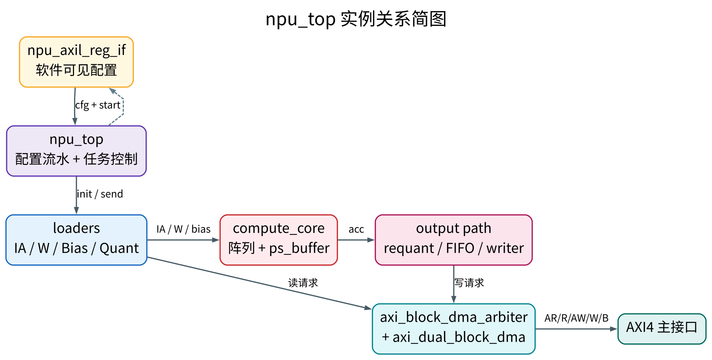
</p>
<p align="center">图4-1 `npu_top` 实例关键关系</p>

#### 4.7.3 接口定义

本模块接口包括时钟复位接口、配置或控制接口、数据输入接口、数据输出接口以及状态反馈接口。下表列出主要信号，位宽按照 RTL 参数化表达；当位宽由参数决定时，表中保留参数名。

| 信号名 | 位宽 | 方向 | 时钟域 | 功能描述 | 备注 |
|---|---:|---|---|---|---|
| `calc_start` | 1 | 输入 | NPU 时钟域 | 任务启动 | 由 AXI-Lite 控制寄存器产生 |
| `cfg_16bits_ia` | 1 | 输入 | NPU 时钟域 | IA 位宽模式 | 0 表示 s8，1 表示 s16 |
| `cfg_dataflow_mode` | 1 | 输入 | NPU 时钟域 | 数据流模式 | 0 WS，1 IS |
| `lhs_base` | 32 | 输入 | NPU 时钟域 | LHS 矩阵基地址 | 来自寄存器组 |
| `rhs_base` | 32 | 输入 | NPU 时钟域 | RHS 矩阵基地址 | 来自寄存器组 |
| `dst_base` | 32 | 输入 | NPU 时钟域 | 输出矩阵基地址 | 来自寄存器组 |
| `bias_base` | 32 | 输入 | NPU 时钟域 | 偏置基地址 | 0 表示无偏置 |
| `q_mult_pt` | 32 | 输入 | NPU 时钟域 | 定点缩放乘法系数或参数数组地址 | 按通道模式下作为地址 |
| `q_shift_pt` | 32 | 输入 | NPU 时钟域 | 定点缩放移位参数或参数数组地址 | 按通道模式下作为地址 |
| `k` | 32 | 输入 | NPU 时钟域 | LHS 矩阵行数 | 来自寄存器组 |
| `n` | 32 | 输入 | NPU 时钟域 | RHS 矩阵行数 | 来自寄存器组 |
| `m` | 32 | 输入 | NPU 时钟域 | RHS 矩阵列数 | 来自寄存器组 |
| `sa_ready` | 1 | 输出 | NPU 时钟域 | NPU 可接受启动 | 配置流水和控制器均空闲时为 1 |
| `done_valid` | 1 | 输出 | NPU 时钟域 | 任务完成状态有效 | 与寄存器组 `ready` 握手 |
| `done_ready` | 1 | 输入 | NPU 时钟域 | 完成状态可接收 | 当前寄存器组固定为 1 |
| `m_axi_rvalid` | 1 | 输入 | AXI 时钟域 | DMA 读数据有效 | 来自互连 |
| `m_axi_arvalid` | 1 | 输出 | AXI 时钟域 | DMA 读地址有效 | 读取 IA/权重/参数 |
| `m_axi_awvalid` | 1 | 输出 | AXI 时钟域 | DMA 写地址有效 | 输出写回 |
| `m_axi_wvalid` | 1 | 输出 | AXI 时钟域 | DMA 写数据有效 | 携带输出数据和字节写掩码 |
| `err_code` | 2 | 输出 | NPU 时钟域 | 错误码 | 配置或资源错误 |

接口时序上，输入控制信号在时钟有效边沿采样，输出控制信号在寄存器更新后保持到下游完成握手或被状态机清除。`valid/ready` 类接口以双方同周期为高作为一次传输完成条件；`req/done` 类接口以请求保持和完成反馈作为一次多周期操作的完成条件。地址、数据和掩码信号在对应 `valid` 或 `req` 有效期间保持稳定。

#### 4.7.4 工作流程与状态机

复位后，配置流水级 `valid` 位为 0，运行参数清零或置为最小有效默认值，各子模块处于空闲状态。`calc_start && sa_ready` 形成启动事件，`cfg_stage0` 锁存软件配置，`cfg_stage1` 根据阵列规模和缓存容量计算可用复用次数，`cfg_stage2` 在 `npu_controller` 空闲时提交运行参数。`ctrl_calc_start` 有效后，控制器初始化加载单元、定点缩放单元和写回单元。

正常任务中，输入激活、权重、偏置和定点缩放参数通过共享 DMA 读侧进入片上缓存或参数缓存。`compute_core` 完成阵列乘加和部分和保存或回灌，最终 int32 输出进入 `vec_requant`。定点缩放后的 int8 向量进入输出 FIFO，再由 `oa_writer` 生成 AXI 写请求。`oa_calc_over` 表示输出写回已完成，控制器随后通过 `done_valid` 向寄存器组报告任务结果。若配置检查失败，控制器进入 ERROR 状态并通过 `err_code` 返回错误类型。

#### 4.7.5 时序行为

启动事件进入三级配置流水后至少经过三个时钟周期才向控制器提交运行参数。加载和写回事务通过 DMA `valid/ready` 握手推进，地址、行步长、行数、突发长度、槽位编号和写数据在请求被接受前保持稳定。阵列计算存在与阵列规模相关的填充和排空延迟，`partial_sum_calc_over` 和 `tile_calc_over` 用于通知控制器当前计算阶段完成。输出 FIFO 满时，控制器不再发出可能产生新输出的 IA 触发；写回单元未收到 B 响应前不报告对应输出完成。


#### 4.7.6 参数配置说明

综合期模块参数决定阵列规模、数据宽度、总线宽度、输入激活缓存块数、部分和帧数和 DMA 未完成事务深度。

| 参数 | 功能含义 |
|---|---|
| `WEIGHT_WIDTH` | 权重内部数据宽度，默认 16 bit |
| `DATA_WIDTH` | 输入激活内部数据宽度，默认 16 bit |
| `SIZE` | 阵列规模和基本分块边长 |
| `BUS_WIDTH` | NPU AXI4 数据宽度，默认 32 bit |
| `REG_WIDTH` | 运行参数和内部计数位宽，默认 32 bit |
| `ADDR_WIDTH` | NPU 内部 AXI 地址宽度 |
| `IA_CACHE_BLOCKS` | 输入激活缓存块数，决定复用上限 |
| `PS_FRAME_COUNT` | 部分和帧数量，影响权重复用窗口 |
| `AXI_READ_OUTSTANDING` | AXI 读侧未完成事务深度 |
| `AXI_WRITE_OUTSTANDING` | AXI 写侧未完成事务深度，默认等于 `AXI_READ_OUTSTANDING` |
| `ENABLE_IS_MODE` | IS 数据流模式综合使能 |
| `ENABLE_PER_CHANNEL` | per-channel 定点缩放参数读取综合使能 |
| `OA_FIFO_BANKS_MAX` | 输出 FIFO 最大 bank 数，按 IS 和 per-channel 配置选择 |

### 4.8 `npu_controller`模块设计

本模块位于 `npu_top` 内部，是 NPU 任务级控制器。该模块接收三级配置流水提交的启动请求和任务参数，检查基地址、维度、步长和定点缩放参数是否合法，并调度输入激活加载、权重加载、偏置加载、定点缩放、输出 FIFO 和输出写回。控制器不直接搬移矩阵数据，而是通过初始化脉冲、发送触发和等待条件控制各子模块推进。

#### 4.8.1 功能说明

本模块接收 `calc_start`、配置字段、加载单元数据有效标志、发送完成标志、偏置可用标志、定点缩放参数可用标志、FIFO 满标志、阵列拖尾完成标志和输出写回完成标志。输出侧产生 `init_cfg_ia`、`init_cfg_weight`、`init_cfg_bias`、`init_cfg_requant`、`init_cfg_oa`、`send_weight_trigger`、`send_ia_trigger`、`done_valid` 和 `err_code`。当配置合法且数据供给条件满足时，控制器交替发出权重发送触发和输入激活发送触发；当输出写回完成时，控制器通过完成握手返回任务状态。

#### 4.8.2 结构组成

内部包含配置检查函数、错误类型选择函数、主状态机、配置位锁存寄存器、计算拖尾等待寄存器、初始化脉冲生成逻辑、发送触发生成逻辑和 writeback 状态生成逻辑。`check_config_valid` 检查 LHS/RHS/DST 指针非零、K/N/M 非零、三类步长非零，以及按通道定点缩放时乘法系数地址和移位参数地址非零。状态机处于 NPU 时钟域，`rst_n` 复位后进入 IDLE，所有初始化脉冲和发送触发为 0，错误码为正常。

#### 4.8.3 接口定义

本模块接口包括时钟复位接口、配置或控制接口、数据输入接口、数据输出接口以及状态反馈接口。下表列出主要信号，位宽按照 RTL 参数化表达；当位宽由参数决定时，表中保留参数名。

| 信号名 | 位宽 | 方向 | 时钟域 | 功能描述 | 备注 |
|---|---:|---|---|---|---|
| `calc_start` | 1 | 输入 | NPU 时钟域 | 启动请求 | IDLE 状态采样 |
| `lhs_base` | 32 | 输入 | NPU 时钟域 | LHS 矩阵基地址 | 用于合法性检查 |
| `rhs_base` | 32 | 输入 | NPU 时钟域 | RHS 矩阵基地址 | 用于合法性检查 |
| `dst_base` | 32 | 输入 | NPU 时钟域 | 输出矩阵基地址 | 用于合法性检查 |
| `k` | 32 | 输入 | NPU 时钟域 | LHS 矩阵行数 | 不能为 0 |
| `n` | 32 | 输入 | NPU 时钟域 | RHS 矩阵行数 | 不能为 0 |
| `m` | 32 | 输入 | NPU 时钟域 | RHS 矩阵列数 | 不能为 0 |
| `weight_data_valid` | 1 | 输入 | NPU 时钟域 | 权重数据有效 | 允许进入计算 |
| `ia_data_valid` | 1 | 输入 | NPU 时钟域 | IA 数据有效 | 允许发送 IA |
| `fifo_full_flag` | 1 | 输入 | NPU 时钟域 | 输出 FIFO 满 | 满时暂停推进 |
| `oa_calc_over` | 1 | 输入 | NPU 时钟域 | 输出写回完成 | 允许任务结束 |
| `partial_sum_calc_over` | 1 | 输入 | NPU 时钟域 | 阵列拖尾完成 | 清除 `compute_tail_pending` |
| `init_cfg_ia` | 1 | 输出 | NPU 时钟域 | 初始化输入激活加载单元 | 单周期脉冲 |
| `init_cfg_weight` | 1 | 输出 | NPU 时钟域 | 初始化权重加载单元 | 单周期脉冲 |
| `init_cfg_bias` | 1 | 输出 | NPU 时钟域 | 初始化偏置加载单元 | 单周期脉冲 |
| `init_cfg_requant` | 1 | 输出 | NPU 时钟域 | 初始化定点缩放单元 | 单周期脉冲 |
| `init_cfg_oa` | 1 | 输出 | NPU 时钟域 | 初始化输出写回单元 | 单周期脉冲 |
| `send_ia_trigger` | 1 | 输出 | NPU 时钟域 | 发送 IA 触发 | 驱动输入激活加载单元 |
| `send_weight_trigger` | 1 | 输出 | NPU 时钟域 | 发送权重触发 | 驱动权重加载单元 |
| `done_valid` | 1 | 输出 | NPU 时钟域 | 任务完成状态有效 | 完成或错误时置位 |
| `done_ready` | 1 | 输入 | NPU 时钟域 | 任务完成状态接受 | 寄存器组可接收时置位 |
| `err_code` | 2 | 输出 | NPU 时钟域 | 错误码 | 软件通过 `status` 读取 |

接口时序上，输入控制信号在时钟有效边沿采样，输出控制信号在寄存器更新后保持到下游完成握手或被状态机清除。`valid/ready` 类接口以双方同周期为高作为一次传输完成条件；`req/done` 类接口以请求保持和完成反馈作为一次多周期操作的完成条件。地址、数据和掩码信号在对应 `valid` 或 `req` 有效期间保持稳定。

#### 4.8.4 工作流程与状态机

复位后，状态机进入 IDLE，`sa_ready` 为 1，初始化脉冲、发送触发和 `done_valid` 均为 0。状态机包含 IDLE、INIT、WEIGHT_START、WEIGHT_WAIT、IA_START、IA_WAIT、WAIT_DONE 和 ERROR。IDLE 等待 `calc_start`；若配置检查失败则进入 ERROR，若配置合法则进入 INIT。INIT 输出各子模块初始化脉冲并锁存 `cfg_16bits_ia`。WEIGHT_START 在权重数据有效、阵列拖尾允许且输出未结束时发出 `send_weight_trigger`，随后进入 WEIGHT_WAIT 等待 `weight_sending_done`。IA_START 在输入激活数据、偏置、定点缩放参数和 FIFO 条件满足时发出 `send_ia_trigger`，随后进入 IA_WAIT 等待 `ia_sending_done`。

控制器使用 `compute_tail_pending` 跟踪上一次输入激活触发后阵列仍需排空的周期。该标志在 `send_ia_trigger` 后置位，在 `partial_sum_calc_over` 有效后清除，权重触发需要等待该条件满足。若输出写回单元报告 `oa_calc_over`，控制器进入 WAIT_DONE 或直接回到 IDLE，具体取决于 `done_ready`。ERROR 状态保持错误码，并在完成握手结束后返回 IDLE。

配置检查规则由 RTL 函数 `check_config_valid` 和 `get_error_type` 定义。该规则检查硬件启动所需的基础条件，并在配置非法时使状态机进入 ERROR。

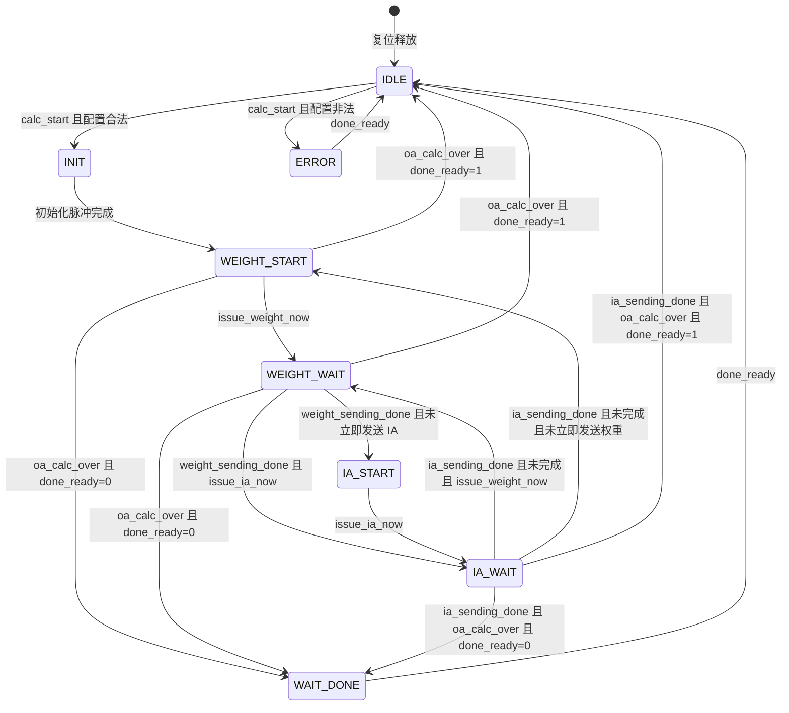
<p align="center">图4-2 `npu_controller` 状态机关系</p>

#### 4.8.5 时序行为

`calc_start` 只在 IDLE 被采样。INIT 状态的初始化输出均为单周期脉冲。WEIGHT_START 和 IA_START 中的发送触发同样为单周期脉冲，发出后必须进入对应 WAIT 状态等待发送完成反馈。`fifo_full_flag` 为 1 时，IA_START 不发出新的 IA 触发，避免定点缩放输出继续进入已满 FIFO。`done_valid` 在 `oa_calc_over`、WAIT_DONE 或 ERROR 条件下有效，直到 `done_ready` 完成握手。错误码在 ERROR 状态写入，IDLE 状态清回正常值。


#### 4.8.6 参数配置说明

模块参数决定阵列规模、数据位宽、总线位宽和内部运行参数位宽。

| 参数 | 功能含义 |
|---|---|
| `WEIGHT_WIDTH` | 权重内部数据宽度 |
| `DATA_WIDTH` | 输入激活内部数据宽度 |
| `SIZE` | 阵列规模和基本分块边长 |
| `BUS_WIDTH` | DMA 数据总线宽度 |
| `REG_WIDTH` | 运行参数和计数器宽度 |

### 4.9 `ia_loader_ctrl`模块设计

本模块位于`npu_top` / `ia_loader`中，生成左矩阵输入激活的 DMA 读请求，管理输入激活缓存槽位、复用循环和阵列输入发送。上级控制来自 `npu_controller`，下级连接 DMA 仲裁器和输入激活缓存管理单元。

#### 4.9.1 功能说明

本模块接收的主要输入包括 `init_cfg`、`send_ia_trigger`、`lhs_base`、`lhs_row_stride_b`、`k`、`n`、`m`、`dma_rd_done` 等信号，输出的主要结果包括 `dma_rd_req`、`dma_base_addr`、`dma_row_stride`、`dma_rows_to_read`、`dma_valid_cols`、`ia_data_valid` 等信号。生成左矩阵输入激活的 DMA 读请求，管理输入激活缓存槽位、复用循环和阵列输入发送。在系统运行过程中，该模块通过时钟边沿采样输入条件，更新内部寄存器或状态标志，并在满足握手、完成或错误条件后驱动下游接口。

#### 4.9.2 结构组成

内部包含状态机、分块几何计算单元、L1/L2 复用计数器、槽位分配单元、DMA 请求保持寄存器、tail 行列计算单元和 IA 发送计数器。这些子单元在同一时钟域内通过寄存器和握手信号协同工作。NPU 时钟域，低有效复位。复位后状态机进入 S_IDLE，槽位指针、循环计数和请求保持寄存器清零。

#### 4.9.3 接口定义

本模块接口包括时钟复位接口、配置或控制接口、数据输入接口、数据输出接口以及状态反馈接口。下表列出主要信号，位宽按照 RTL 参数化表达；当位宽由参数决定时，表中保留参数名。

| 信号名 | 位宽 | 方向 | 时钟域 | 功能描述 | 备注 |
|---|---:|---|---|---|---|
| `init_cfg` | 1 | 输入 | NPU 时钟域 | 初始化配置 | 控制器发出 |
| `send_ia_trigger` | 1 | 输入 | NPU 时钟域 | 发送触发 | 开始或继续 IA 发送 |
| `lhs_base` | 32 | 输入 | NPU 时钟域 | 左矩阵基址 | 来自寄存器组 |
| `lhs_row_stride_b` | 32 | 输入 | NPU 时钟域 | 左矩阵行跨度 | 字节单位 |
| `k` | 32 | 输入 | NPU 时钟域 | LHS 矩阵行数 | 用于分块几何计算 |
| `n` | 32 | 输入 | NPU 时钟域 | RHS 矩阵行数 | 用于分块几何计算 |
| `m` | 32 | 输入 | NPU 时钟域 | RHS 矩阵列数 | 用于分块几何计算 |
| `dma_rd_done` | 1 | 输入 | NPU 时钟域 | DMA 读完成 | 释放加载状态 |
| `blk_valid` | `CACHE_BLOCKS` | 输入 | NPU 时钟域 | 缓存槽位有效状态 | 决定是否可加载 |
| `blk_busy` | `CACHE_BLOCKS` | 输入 | NPU 时钟域 | 缓存槽位占用状态 | 决定是否可释放或覆盖 |
| `dma_rd_req` | 1 | 输出 | NPU 时钟域 | DMA 读请求 | 请求输入激活分块 |
| `dma_base_addr` | 32 | 输出 | NPU 时钟域 | DMA 基地址 | 分块首地址 |
| `dma_row_stride` | 32 | 输出 | NPU 时钟域 | DMA 行跨度 | 字节单位 |
| `dma_rows_to_read` | `REG_WIDTH` | 输出 | NPU 时钟域 | 读取行数 | tail 裁剪后 |
| `dma_valid_cols` | `REG_WIDTH` | 输出 | NPU 时钟域 | 有效列数 | tail 裁剪后 |
| `ia_data_valid` | 1 | 输出 | NPU 时钟域 | IA 输出有效 | 供控制器判断 |
| `ia_sending_done` | 1 | 输出 | NPU 时钟域 | IA 发送完成 | 本组发送结束 |

接口时序上，输入控制信号在时钟有效边沿采样，输出控制信号在寄存器更新后保持到下游完成握手或被状态机清除。`valid/ready` 类接口以双方同周期为高作为一次传输完成条件；`req/done` 类接口以请求保持和完成反馈作为一次多周期操作的完成条件。地址、数据和掩码信号在对应 `valid` 或 `req` 有效期间保持稳定。

#### 4.9.4 工作流程与状态机

复位后，NPU 时钟域，低有效复位。复位后状态机进入 S_IDLE，槽位指针、循环计数和请求保持寄存器清零。启动或运行条件由上游控制信号给出，模块在配置字段稳定后进入正常工作。状态机包含 S_IDLE、S_INIT、S_LOAD、S_SEND 和 S_DONE。S_INIT 计算几何参数；S_LOAD 在缓存有空槽位时发起 DMA；S_SEND 按复用顺序输出 IA；S_DONE 通知控制器本次发送完成。

`init_cfg` 被采样后进入初始化。`dma_rd_req` 在命令字段稳定后保持到仲裁器接受。DMA 返回并写入缓存后，`blk_valid` 置位。发送阶段按时钟推进 `ia_idx`、`w_group_idx`、`l1_idx` 和 `l2_idx`；当最后一个有效元素发送完成后置 `ia_sending_done`。未完成握手时，相关计数器不推进。

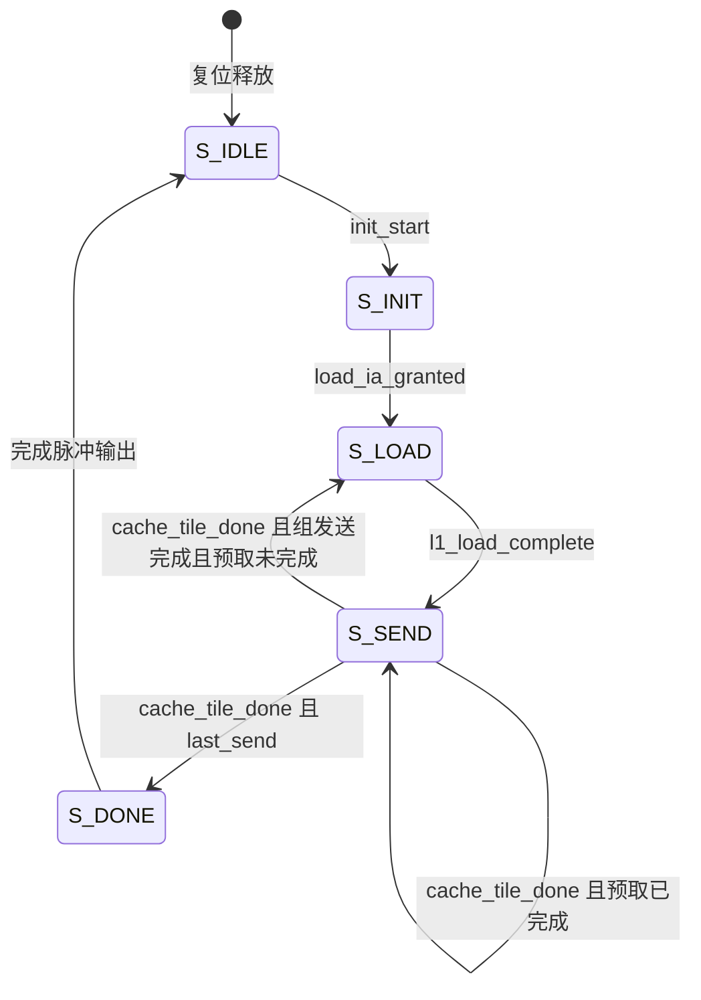
<p align="center">图4-3 `ia_loader_ctrl` 状态机关系</p>

#### 4.9.5 时序行为

`init_cfg` 被采样后，模块锁存分块几何、行步长、复用深度和尾块尺寸。加载阶段在存在可写 cache 槽位且 tile loader 空闲时产生 `load_ia_req`，仲裁器授权后以单周期 `tl_start` 提交 `tl_base_addr`、`tl_row_stride`、`tl_rows_to_read`、`tl_valid_cols`、槽位编号和输入位宽模式。`tl_tile_done` 返回后，对应槽位标记为有效。发送阶段由 `send_ia_trigger` 启动，只有目标槽位有效时才启动 L1 组输出；若目标槽位尚未完成加载，`ia_data_valid` 保持为低并等待加载完成。`cache_l1_done` 返回后更新 `ia_idx`、`w_group_idx`、`l1_idx` 和 `l2_idx`，最后一组发送结束后产生 `ia_sending_done`。


#### 4.9.6 参数配置说明

| 参数 | 功能含义 |
|---|---|
| `DATA_WIDTH` | IA 元素内部数据宽度 |
| `SIZE` | 阵列边长和基本分块尺寸 |
| `BUS_WIDTH` | DMA 数据总线宽度 |
| `REG_WIDTH` | 运行参数和内部计数位宽 |
| `COUNT_WIDTH` | 内部计数器宽度，默认等于 `REG_WIDTH` |
| `CACHE_BLOCKS` | IA cache 槽位数量 |
| `PS_FRAME_COUNT` | 部分和帧数量 |

### 4.10 `ia_loader_cache_mgr`模块设计

本模块位于`ia_loader`中，保存 DMA 读回的输入激活，并按脉动阵列要求产生对角化输入流。上级为 `ia_loader_ctrl` 和 DMA 读数据，下级为 `compute_core` 的 IA 输入。

#### 4.10.1 功能说明

本模块接收的主要输入包括 `wr_valid`、`wr_data`、`wr_slot_id`、`rd_slot_base`、`rd_en`、`lhs_zp` 等信号，输出的主要结果包括 `ia_data_out`、`ia_data_valid`、`blk_valid`、`blk_busy` 等信号。保存 DMA 读回的输入激活，并按脉动阵列要求产生对角化输入流。在系统运行过程中，该模块通过时钟边沿采样输入条件，更新内部寄存器或状态标志，并在满足握手、完成或错误条件后驱动下游接口。

#### 4.10.2 结构组成

内部包含多槽位输入激活缓存、槽位 `valid`/`busy` 标志、写地址计数器、读地址计数器、col0 leader 选择单元和对角化移位寄存器。这些子单元在同一时钟域内通过寄存器和握手信号协同工作。NPU 时钟域，复位后所有槽位 `valid` 和 `busy` 清零，移位寄存器回到无效状态。

#### 4.10.3 接口定义

本模块接口包括时钟复位接口、配置或控制接口、数据输入接口、数据输出接口以及状态反馈接口。下表列出主要信号，位宽按照 RTL 参数化表达；当位宽由参数决定时，表中保留参数名。

| 信号名 | 位宽 | 方向 | 时钟域 | 功能描述 | 备注 |
|---|---:|---|---|---|---|
| `wr_valid` | 1 | 输入 | NPU 时钟域 | 缓存写有效 | DMA 数据到达 |
| `wr_data` | `BUS_WIDTH` | 输入 | NPU 时钟域 | 缓存写数据 | s8/s16 解包后写入 |
| `wr_slot_id` | `SLOT_W` | 输入 | NPU 时钟域 | 写槽位号 | `SLOT_W = (CACHE_BLOCKS <= 1) ? 1 : $clog2(CACHE_BLOCKS)` |
| `rd_slot_base` | `SLOT_W` | 输入 | NPU 时钟域 | 读槽位基址 | 发送阶段使用 |
| `rd_en` | 1 | 输入 | NPU 时钟域 | 读推进 | 阵列可接收时有效 |
| `lhs_zp` | `DATA_WIDTH` | 输入 | NPU 时钟域 | 输入零点 | 无效计算通道填充值 |
| `ia_data_out` | `SIZE*DATA_WIDTH` | 输出 | NPU 时钟域 | 阵列输入向量 | 按对角相位输出 |
| `ia_data_valid` | 1 | 输出 | NPU 时钟域 | 输出有效 | 与 `ia_data_out` 同周期 |
| `blk_valid` | `CACHE_BLOCKS` | 输出 | NPU 时钟域 | 槽位有效标志 | 供控制器调度 |
| `blk_busy` | `CACHE_BLOCKS` | 输出 | NPU 时钟域 | 槽位忙标志 | 防止覆盖 |

接口时序上，输入控制信号在时钟有效边沿采样，输出控制信号在寄存器更新后保持到下游完成握手或被状态机清除。`valid/ready` 类接口以双方同周期为高作为一次传输完成条件；`req/done` 类接口以请求保持和完成反馈作为一次多周期操作的完成条件。地址、数据和掩码信号在对应 `valid` 或 `req` 有效期间保持稳定。

#### 4.10.4 工作流程与状态机

复位后，所有槽位 `valid` 和 `busy` 清零，移位寄存器回到无效状态。启动或运行条件由上游控制信号给出，模块在配置字段稳定后进入正常工作。模块无命名状态机，状态由槽位 `valid`/`busy`、读写指针和移位寄存器内容决定。

`wr_valid` 有效的时钟边沿写入目标槽位。读阶段在 `rd_en` 有效时从 `rd_slot_base` 对应槽位取数，并通过移位寄存器在随后的周期对齐各阵列行。若下游不能接收，`rd_en` 拉低，读指针和输出相位保持。未完成握手时，相关计数器不推进。

#### 4.10.5 时序行为

`wr_valid` 有效的时钟边沿，模块把 DMA 返回数据写入 `wr_slot_id` 指定槽位，并按输入位宽完成元素抽取和符号扩展。读阶段只有在 `rd_en` 有效时推进读地址和对角化移位寄存器；`rd_en` 为低时，读指针、移位相位、`ia_data_out` 和 `ia_data_valid` 保持当前状态。槽位 `valid` 标志在写入完成后置位，槽位 `busy` 标志在 L1 输出进行期间保持为 1，并在该槽位最后一次复用发送完成后释放。


#### 4.10.6 参数配置说明

| 参数 | 功能含义 |
|---|---|
| `DATA_WIDTH` | IA 元素内部数据宽度 |
| `SIZE` | 阵列边长和每拍输出 IA 数量 |
| `BUS_WIDTH` | DMA 数据总线宽度 |
| `REG_WIDTH` | 运行参数和内部计数位宽 |
| `CACHE_BLOCKS` | 缓存槽位数量 |

### 4.11 `kernel_loader_ctrl`模块设计

本模块位于`npu_top` / `kernel_loader`中，生成右矩阵权重的 DMA 读请求，并控制权重数据进入阵列。上级控制来自 `npu_controller`，下级连接 DMA 仲裁器和 `kernel_loader_buffer`。

#### 4.11.1 功能说明

本模块接收的主要输入包括 `init_cfg`、`send_weight_trigger`、`rhs_base`、`rhs_col_stride_b`、`k`、`n`、`m`、`dma_rd_done` 等信号，输出的主要结果包括 `dma_rd_req`、`dma_base_addr`、`dma_rows_to_read`、`dma_valid_cols`、`weight_data_valid`、`weight_sending_done` 等信号。生成右矩阵权重的 DMA 读请求，并控制权重数据进入阵列。在系统运行过程中，该模块通过时钟边沿采样输入条件，更新内部寄存器或状态标志，并在满足握手、完成或错误条件后驱动下游接口。

#### 4.11.2 结构组成

内部包含权重分块几何计算、DMA 命令生成、加载计数、发送计数、tail 行列裁剪和重复次数控制。这些子单元在同一时钟域内通过寄存器和握手信号协同工作。NPU 时钟域，复位后状态机进入 S_IDLE，计数器和请求保持寄存器清零。

#### 4.11.3 接口定义

本模块接口包括时钟复位接口、配置或控制接口、数据输入接口、数据输出接口以及状态反馈接口。下表列出主要信号，位宽按照 RTL 参数化表达；当位宽由参数决定时，表中保留参数名。

| 信号名 | 位宽 | 方向 | 时钟域 | 功能描述 | 备注 |
|---|---:|---|---|---|---|
| `init_cfg` | 1 | 输入 | NPU 时钟域 | 初始化权重加载 | 控制器发出 |
| `send_weight_trigger` | 1 | 输入 | NPU 时钟域 | 发送权重触发 | 开始权重流 |
| `rhs_base` | 32 | 输入 | NPU 时钟域 | 右矩阵基址 | 来自寄存器组 |
| `rhs_col_stride_b` | 32 | 输入 | NPU 时钟域 | 右矩阵列跨度 | 字节单位 |
| `k` | 32 | 输入 | NPU 时钟域 | LHS 矩阵行数 | 计算分块几何 |
| `n` | 32 | 输入 | NPU 时钟域 | RHS 矩阵行数 | 计算分块几何 |
| `m` | 32 | 输入 | NPU 时钟域 | RHS 矩阵列数 | 计算分块几何 |
| `dma_rd_done` | 1 | 输入 | NPU 时钟域 | DMA 读完成 | 加载完成反馈 |
| `dma_rd_req` | 1 | 输出 | NPU 时钟域 | DMA 读请求 | 请求权重分块 |
| `dma_base_addr` | 32 | 输出 | NPU 时钟域 | 权重分块地址 | 按列组计算 |
| `dma_rows_to_read` | `REG_WIDTH` | 输出 | NPU 时钟域 | 读取行数 | tail 裁剪 |
| `dma_valid_cols` | `REG_WIDTH` | 输出 | NPU 时钟域 | 有效列数 | tail 裁剪 |
| `weight_data_valid` | 1 | 输出 | NPU 时钟域 | 权重数据有效 | 控制器观察 |
| `weight_sending_done` | 1 | 输出 | NPU 时钟域 | 权重发送完成 | 本组权重结束 |

接口时序上，输入控制信号在时钟有效边沿采样，输出控制信号在寄存器更新后保持到下游完成握手或被状态机清除。`valid/ready` 类接口以双方同周期为高作为一次传输完成条件；`req/done` 类接口以请求保持和完成反馈作为一次多周期操作的完成条件。地址、数据和掩码信号在对应 `valid` 或 `req` 有效期间保持稳定。

#### 4.11.4 工作流程与状态机

复位后，状态机进入 S_IDLE，计数器和请求保持寄存器清零。启动或运行条件由上游控制信号给出，模块在配置字段稳定后进入正常工作。状态机包含 S_IDLE、S_INIT、S_RUN 和 S_DONE。S_INIT 计算 `valid_n_rows`、`valid_m_cols` 和 `repeat_total`；S_RUN 发请求并跟踪 `loaded_count`/`sent_count`；S_DONE 返回完成。

`send_weight_trigger` 被采样后，命令字段稳定并拉高 `dma_rd_req`。DMA 响应写入 buffer 后，控制器按 `sent_count` 推进权重发送。当最后一组有效权重被发送到阵列后，`weight_sending_done` 置位一个周期或保持到控制器采样。未完成握手时，相关计数器不推进。

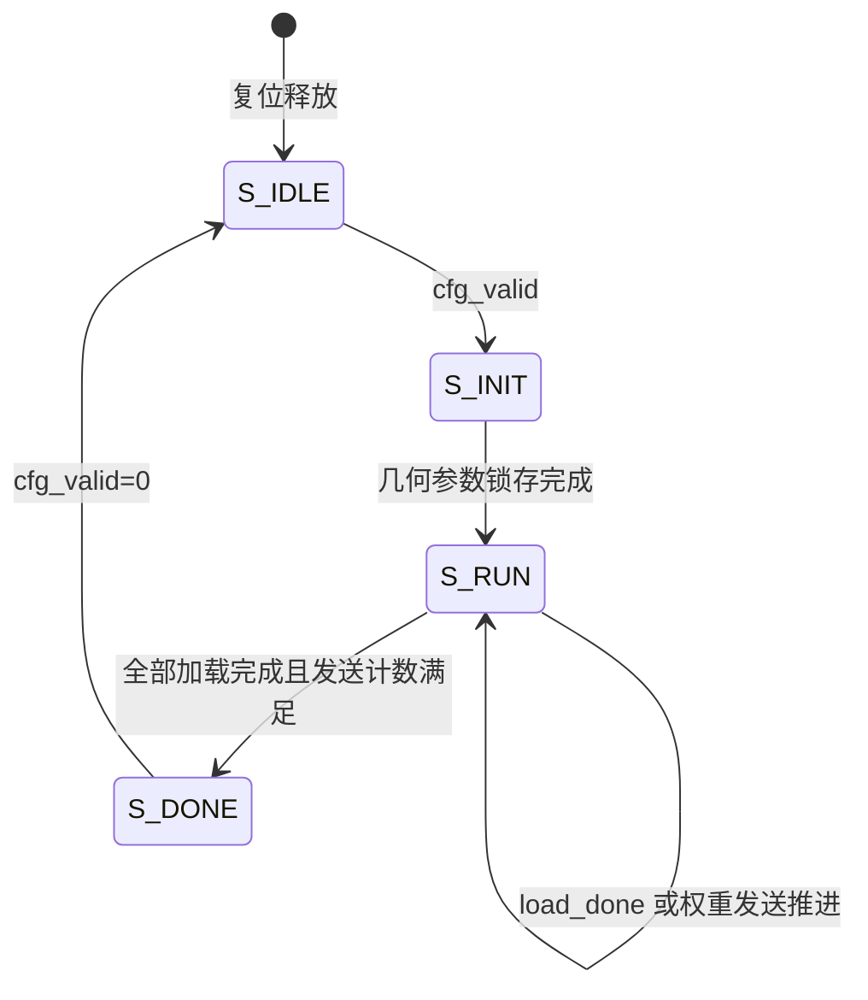
<p align="center">图4-4 `kernel_loader_ctrl` 状态机关系</p>

#### 4.11.5 时序行为

`cfg_valid` 被采样后，模块计算权重分块行数、列数、输出列组宽度和重复次数。S_RUN 状态下，当权重 buffer 可接收且仍有待加载分块时，`load_weight_req` 拉高；仲裁器授权的周期产生单周期 `dma_start` 和 `buf_load_start`，并锁存权重分块基址、读取行数、行步长、有效列数和零点。`load_done` 返回后推进加载计数。`send_weight_trigger` 与 buffer 数据有效同时成立时，模块产生 `buf_send_start`，发送计数由 buffer 的完成反馈推进；全部加载和发送完成后进入 S_DONE。


#### 4.11.6 参数配置说明

| 参数 | 功能含义 |
|---|---|
| `SIZE` | 每组权重列数 |
| `REG_WIDTH` | 运行参数和内部计数位宽 |
| `COUNT_WIDTH` | 内部计数器宽度，默认等于 `REG_WIDTH` |

### 4.12 `kernel_loader_buffer`模块设计

本模块位于`kernel_loader`中，缓存 DMA 读回的权重并按阵列列向量输出。上级为 `kernel_loader_ctrl` 和 DMA 读数据，下级为 `ws_systolic_array`。

#### 4.12.1 功能说明

本模块接收的主要输入包括 `wr_valid`、`wr_data`、`send_weight_trigger`、`rst_n` 等信号，输出的主要结果包括 `weight_out`、`store_weight_req`、`weight_data_valid`、`weight_sending_done` 等信号。缓存 DMA 读回的权重并按阵列列向量输出。在系统运行过程中，该模块通过时钟边沿采样输入条件，更新内部寄存器或状态标志，并在满足握手、完成或错误条件后驱动下游接口。

#### 4.12.2 结构组成

内部包含权重存储阵列、写指针、读指针、发送计数器、有效标志和输出寄存器。这些子单元在同一时钟域内通过寄存器和握手信号协同工作。NPU 时钟域。复位后读写指针、`valid` 标志和发送计数清零。

#### 4.12.3 接口定义

本模块接口包括时钟复位接口、配置或控制接口、数据输入接口、数据输出接口以及状态反馈接口。下表列出主要信号，位宽按照 RTL 参数化表达；当位宽由参数决定时，表中保留参数名。

| 信号名 | 位宽 | 方向 | 时钟域 | 功能描述 | 备注 |
|---|---:|---|---|---|---|
| `wr_valid` | 1 | 输入 | NPU 时钟域 | 写 buffer 有效 | 权重数据到达 |
| `wr_data` | `BUS_WIDTH` | 输入 | NPU 时钟域 | 写入权重数据 | 来自 DMA |
| `send_weight_trigger` | 1 | 输入 | NPU 时钟域 | 发送触发 | 开始输出权重 |
| `rst_n` | 1 | 输入 | NPU 时钟域 | 低有效复位 | 清空控制寄存器 |
| `weight_out` | `SIZE*WEIGHT_WIDTH` | 输出 | NPU 时钟域 | 权重向量 | 送入阵列 |
| `store_weight_req` | 1 | 输出 | NPU 时钟域 | 权重装载请求 | PE 捕获权重 |
| `weight_data_valid` | 1 | 输出 | NPU 时钟域 | 权重输出有效 | 供控制器判断 |
| `weight_sending_done` | 1 | 输出 | NPU 时钟域 | 发送完成 | 本组权重完成 |

接口时序上，输入控制信号在时钟有效边沿采样，输出控制信号在寄存器更新后保持到下游完成握手或被状态机清除。`valid/ready` 类接口以双方同周期为高作为一次传输完成条件；`req/done` 类接口以请求保持和完成反馈作为一次多周期操作的完成条件。地址、数据和掩码信号在对应 `valid` 或 `req` 有效期间保持稳定。

#### 4.12.4 工作流程与状态机

复位后，读写指针、`valid` 标志和发送计数清零。启动或运行条件由上游控制信号给出，模块在配置字段稳定后进入正常工作。模块主要由读写指针和发送计数控制，不含复杂枚举状态。

`wr_valid` 有效时在时钟边沿写入 buffer。发送阶段，读指针按阵列列向量步进，`weight_out` 在寄存器更新后保持到下游采样。`store_weight_req` 有效周期内，PE 在同一时钟边沿捕获对应权重。未完成握手时，相关计数器不推进。

#### 4.12.5 时序行为

`wr_valid` 有效时，DMA 返回的权重数据在时钟边沿写入权重 buffer。`send_weight_trigger` 启动发送阶段后，读指针按阵列列向量推进，`weight_out` 在寄存器更新后送往阵列。`store_weight_req` 有效周期表示权重装载周期，PE 在同一时钟边沿捕获对应权重并进入权重暂存状态。最后一个权重向量送出后，`weight_sending_done` 置位，后续计算阶段由阵列保持已装载权重。


#### 4.12.6 参数配置说明

| 参数 | 功能含义 |
|---|---|
| `DATA_WIDTH` | 权重元素位宽 |
| `SIZE` | 每拍输出权重数量 |

### 4.13 `bias_loader_ctrl`模块设计

本模块位于`npu_top` / `bias_loader`中，按输出通道组读取偏置，并向计算核心提供初始累加值。上级控制来自 `npu_controller`，下级连接 DMA 仲裁器和偏置缓存/偏置 mux。

#### 4.13.1 功能说明

本模块接收的主要输入包括 `init_cfg_bias`、`bias_base`、`bias_switch`、`m`、`dma_rd_done` 等信号，输出的主要结果包括 `dma_rd_req`、`dma_base_addr`、`dma_rows_to_read`、`bias_valid`、`bias_sleep` 等信号。按输出通道组读取偏置，并向计算核心提供初始累加值。在系统运行过程中，该模块通过时钟边沿采样输入条件，更新内部寄存器或状态标志，并在满足握手、完成或错误条件后驱动下游接口。

#### 4.13.2 结构组成

内部包含组几何计算、双 bank 控制、DMA 命令生成、`last` 组裁剪、`bias_valid` 标志和 `bias_sleep` 处理逻辑。这些子单元在同一时钟域内通过寄存器和握手信号协同工作。NPU 时钟域，复位后状态机进入 S_IDLE，bank `valid` 和组计数清零。

#### 4.13.3 接口定义

本模块接口包括时钟复位接口、配置或控制接口、数据输入接口、数据输出接口以及状态反馈接口。下表列出主要信号，位宽按照 RTL 参数化表达；当位宽由参数决定时，表中保留参数名。

| 信号名 | 位宽 | 方向 | 时钟域 | 功能描述 | 备注 |
|---|---:|---|---|---|---|
| `init_cfg_bias` | 1 | 输入 | NPU 时钟域 | 初始化偏置加载 | 控制器发出 |
| `bias_base` | 32 | 输入 | NPU 时钟域 | 偏置基地址 | 0 可表示无偏置 |
| `bias_switch` | 1 | 输入 | NPU 时钟域 | 切换输出通道组 | 由 IA/输出组推进 |
| `m` | 32 | 输入 | NPU 时钟域 | 输出通道数 | 计算最后一组 |
| `dma_rd_done` | 1 | 输入 | NPU 时钟域 | DMA 读完成 | 当前组加载完成 |
| `dma_rd_req` | 1 | 输出 | NPU 时钟域 | DMA 读请求 | 读取偏置 |
| `dma_base_addr` | 32 | 输出 | NPU 时钟域 | 偏置组地址 | 按输出组递增 |
| `dma_rows_to_read` | `REG_WIDTH` | 输出 | NPU 时钟域 | 读取行数 | 按组大小计算 |
| `bias_valid` | 1 | 输出 | NPU 时钟域 | 偏置有效 | 允许计算使用 |
| `bias_sleep` | 1 | 输出 | NPU 时钟域 | 无偏置或无需等待 | 控制器可跳过等待 |

接口时序上，输入控制信号在时钟有效边沿采样，输出控制信号在寄存器更新后保持到下游完成握手或被状态机清除。`valid/ready` 类接口以双方同周期为高作为一次传输完成条件；`req/done` 类接口以请求保持和完成反馈作为一次多周期操作的完成条件。地址、数据和掩码信号在对应 `valid` 或 `req` 有效期间保持稳定。

#### 4.13.4 工作流程与状态机

复位后，状态机进入 S_IDLE，bank `valid` 和组计数清零。启动或运行条件由上游控制信号给出，模块在配置字段稳定后进入正常工作。状态包括 S_IDLE、S_INIT_GEOM、S_INIT_LAST、S_INIT_MARK、S_INIT_GROUP、S_CMD、S_REQ、S_LOAD、S_WAIT、S_NEXT_IDX、S_NEXT_MARK 和 S_NEXT_GROUP。

`init_cfg_bias` 后计算本任务所需偏置组数。`bias_base` 为 0 时置 `bias_sleep`。正常模式下，DMA 请求保持到被接受，读数据完成后置 `bias_valid`。`bias_switch` 到来时切换 bank 或发起下一组读取。未完成握手时，相关计数器不推进。

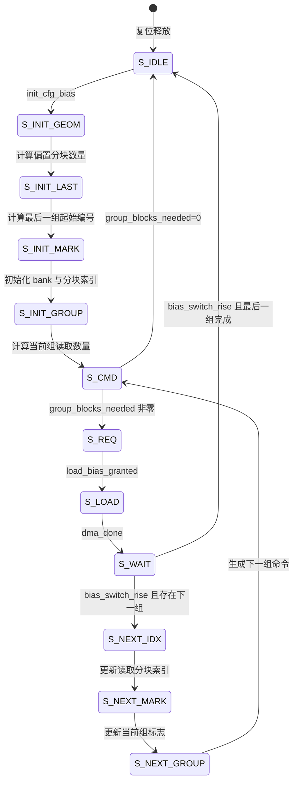
<p align="center">图4-5 `bias_loader_ctrl` 状态机关系</p>

#### 4.13.5 时序行为

`init_cfg_bias` 被采样后，模块依次计算偏置分组数量、最后一组位置和当前组读取数量。S_CMD 状态生成当前组的 `dma_base_addr`、`dma_rows_to_read` 和 `dma_burst_len_m1`；S_REQ 状态保持 `load_bias_req`，直到仲裁器授权。授权周期产生单周期 `dma_start`，随后 S_LOAD 等待 `dma_done`。读数据完成后，活动 bank 切换为本次加载 bank，并清除 `switch_pending`。S_WAIT 状态等待 `bias_switch` 上升沿；若当前组不是最终组，模块切换加载 bank 并发起下一组读取，若最终组已完成且 `bias_last_loop` 有效，则返回空闲。


#### 4.13.6 参数配置说明

| 参数 | 功能含义 |
|---|---|
| `SIZE` | 每组偏置元素数 |
| `REG_WIDTH` | 运行参数和内部计数位宽 |
| `COUNT_WIDTH` | 内部计数器宽度，默认等于 `REG_WIDTH` |

### 4.14 `compute_core`模块设计

本模块位于 `npu_top` 中，连接偏置选择单元、权重固定脉动阵列和部分和缓存，完成矩阵乘加主计算。上级调度来自 `npu_controller`，输入来自输入激活加载单元、权重加载单元和偏置加载单元，输出送往 `ps_buffer` 或 `vec_requant`。

#### 4.14.1 功能说明

本模块接收 `ia_data`、`weight_data`、`store_weight_req`、`bias_data` 和 `send_ia_trigger` 等输入信号，并输出 `acc_data`、`acc_valid`、`partial_sum_calc_over` 和 `ps_calc_done` 等结果信号。当权重装载请求有效时，阵列捕获权重向量；当 IA 触发信号有效时，对角化输入激活进入阵列并与已保持的权重相乘累加。该模块根据当前 N 方向分块选择 bias、0 或部分和回灌值作为累加初值，并在阵列排空后产生有效累加结果。

#### 4.14.2 结构组成

内部包含 `bias_mux`、`ws_systolic_array`、`ps_buffer` 接口、尾部计数器、分块启动流水线和部分和控制逻辑。这些子单元在同一时钟域内通过寄存器和握手信号协同工作。复位后，尾部计数器、分块启动流水线和输出 `valid` 标志清零。

<p align="center">
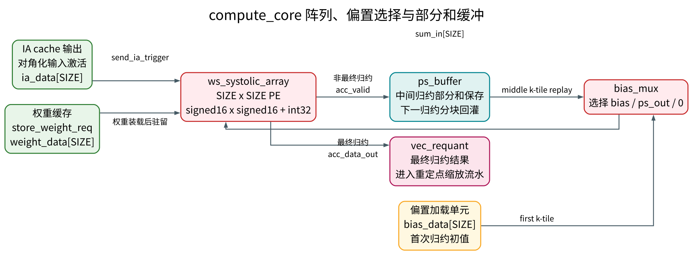
</p>
<p align="center">图4-6 `compute_core` 内部阵列、偏置选择与部分和缓冲关系</p>

<p align="center">
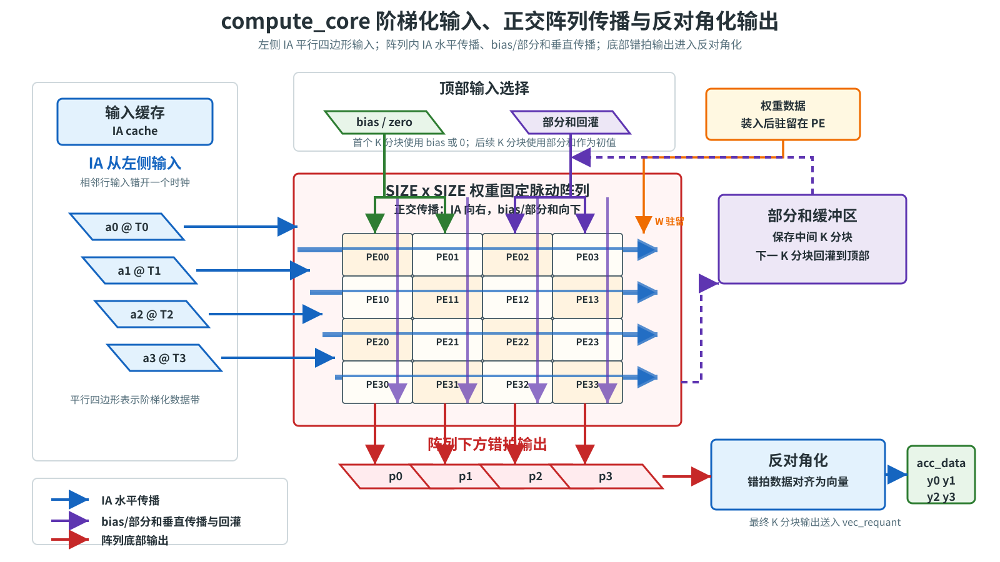
</p>
<p align="center">图4-7 `compute_core` 阶梯化输入、正交阵列传播与反对角化输出示意</p>

#### 4.14.3 接口定义

本模块接口包括时钟复位接口、配置或控制接口、数据输入接口、数据输出接口以及状态反馈接口。下表列出主要信号，位宽按照 RTL 参数化表达；当位宽由参数决定时，表中保留参数名。

| 信号名 | 位宽 | 方向 | 时钟域 | 功能描述 | 备注 |
|---|---:|---|---|---|---|
| `ia_data` | `SIZE*DATA_WIDTH` | 输入 | NPU 时钟域 | 输入激活向量 | 来自输入激活缓存 |
| `weight_data` | `SIZE*WEIGHT_WIDTH` | 输入 | NPU 时钟域 | 权重向量 | 来自权重缓存 |
| `store_weight_req` | 1 | 输入 | NPU 时钟域 | 权重装载控制 | 送入阵列 |
| `bias_data` | `SIZE*ACC_WIDTH` | 输入 | NPU 时钟域 | 偏置初值 | 来自偏置加载单元 |
| `send_ia_trigger` | 1 | 输入 | NPU 时钟域 | IA 发送触发 | 控制计算窗口 |
| `acc_data` | `SIZE*ACC_WIDTH` | 输出 | NPU 时钟域 | 累加结果向量 | 送往定点缩放 |
| `acc_valid` | 1 | 输出 | NPU 时钟域 | 累加结果有效 | 与 `acc_data` 同周期 |
| `partial_sum_calc_over` | 1 | 输出 | NPU 时钟域 | 部分和计算完成 | 控制器等待条件 |
| `ps_calc_done` | 1 | 输出 | NPU 时钟域 | PS 输出完成 | 用于 tail 收尾 |

接口时序上，输入控制信号在时钟有效边沿采样，输出控制信号在寄存器更新后保持到下游完成握手或被状态机清除。`valid/ready` 类接口以双方同周期为高作为一次传输完成条件；`req/done` 类接口以请求保持和完成反馈作为一次多周期操作的完成条件。地址、数据和掩码信号在对应 `valid` 或 `req` 有效期间保持稳定。

#### 4.14.4 工作流程与状态机

复位后，尾部计数器、分块启动流水线和输出 `valid` 标志清零。启动或运行条件由上游控制信号给出，模块在配置字段稳定后进入正常工作。模块通过 `ps_tail_cnt`、`ia_tile_start_pipe`、`ps_stream_valid` 和 `ps_tile_switch` 等寄存器表达计算阶段，无集中枚举状态。

`store_weight_req` 有效时阵列捕获权重。IA 输入按时钟进入阵列后，部分和需要经过阵列传播延迟。最后一拍 IA 后，`ps_tail_cnt` 继续计数，直到底部输出全部有效并置 `partial_sum_calc_over`。未完成握手时，相关计数器不推进。

#### 4.14.5 时序行为

权重装载相位由 `store_weight_req` 标识，阵列在该相位捕获 `weight_data` 并清除 PE 内部数据和部分和暂存。IA 计算相位由 `send_ia_trigger` 启动，`ia_tile_start_pipe` 标记当前分块起始周期，`bias_mux` 根据当前分块位置选择 bias、零值或 `ps_buffer` 回灌值作为 `sum_in`。IA 向量按对角化时序进入阵列后，部分和沿列方向传播。最后一拍 IA 输入后，`ps_tail_cnt` 继续计数以覆盖阵列排空延迟；当底部输出全部有效并完成保存或输出后，`partial_sum_calc_over` 置位。


#### 4.14.6 参数配置说明

| 参数 | 功能含义 |
|---|---|
| `SIZE` | 阵列边长和并行输出通道数 |
| `DATA_WIDTH` | IA 元素内部数据宽度 |
| `WEIGHT_WIDTH` | 权重元素内部数据宽度 |
| `PS_FRAME_COUNT` | 部分和帧数量 |
| `MAX_IA_REUSE` | IA 复用次数上限 |

### 4.15 `ws_systolic_array`模块设计

本模块位于`compute_core`中，实现参数化权重固定脉动阵列，执行 `SIZE`×`SIZE` 并行乘加。上级为 `compute_core`，下级为部分和输出路径。

#### 4.15.1 功能说明

本模块接收的主要输入包括 `data_in`、`weight_in`、`sum_in`、`store_weight_req` 等信号，输出结果为 `sum_out`。阵列结构信号包括 `data_pipe` 和 `sum_pipe`，分别表示 PE 行向数据传播和列向部分和传播。实现参数化权重固定脉动阵列，执行 `SIZE`×`SIZE` 并行乘加。在系统运行过程中，该模块通过时钟边沿采样输入条件，更新内部寄存器或状态标志，并在满足握手、完成或错误条件后驱动下游接口。

#### 4.15.2 结构组成

阵列由 generate 生成 `SIZE`×`SIZE` 个 `ws_systolic_cell`。每个 PE 包含 `data_reg`、`weight_reg`、`sum_reg`、乘法器和加法器。阵列级逻辑负责 `store_weight_req` 扇出和行列之间的数据连接。这些子单元在同一时钟域内通过寄存器和握手信号协同工作。NPU 时钟域。复位后 PE 中 `data_reg`、`weight_reg` 和 `sum_reg` 清零或回到 RTL 复位值。

#### 4.15.3 接口定义

本模块接口包括时钟复位接口、配置或控制接口、数据输入接口、数据输出接口以及状态反馈接口。下表列出主要信号，位宽按照 RTL 参数化表达；当位宽由参数决定时，表中保留参数名。

| 信号名 | 位宽 | 方向 | 时钟域 | 功能描述 | 备注 |
|---|---:|---|---|---|---|
| `data_in` | `SIZE*DATA_WIDTH` | 输入 | NPU 时钟域 | IA 输入向量 | 按对角相位进入 |
| `weight_in` | `SIZE*WEIGHT_WIDTH` | 输入 | NPU 时钟域 | 权重输入向量 | 装载到 PE |
| `sum_in` | `SIZE*ACC_WIDTH` | 输入 | NPU 时钟域 | 初始或重放部分和 | 从上方进入 |
| `store_weight_req` | 1 | 输入 | NPU 时钟域 | 权重装载请求 | 有效时 PE 保存权重 |
| `sum_out` | `SIZE*ACC_WIDTH` | 输出 | NPU 时钟域 | 阵列底部输出 | 每列一个累加结果 |
| `data_pipe` | `SIZE*SIZE*DATA_IN_WIDTH` | 结构信号 | NPU 时钟域 | 行向数据传播 | RTL 形式为 `wire signed [DATA_IN_WIDTH-1:0] data_pipe [SIZE][SIZE]` |
| `sum_pipe` | `SIZE*SIZE*ACC_WIDTH` | 结构信号 | NPU 时钟域 | 列向部分和传播 | RTL 形式为 `wire signed [ACC_WIDTH-1:0] sum_pipe [SIZE][SIZE]` |

接口时序上，输入控制信号在时钟有效边沿采样，输出控制信号在寄存器更新后保持到下游完成握手或被状态机清除。`valid/ready` 类接口以双方同周期为高作为一次传输完成条件；`req/done` 类接口以请求保持和完成反馈作为一次多周期操作的完成条件。地址、数据和掩码信号在对应 `valid` 或 `req` 有效期间保持稳定。

#### 4.15.4 工作流程与状态机

复位后，PE 中 `data_reg`、`weight_reg` 和 `sum_reg` 清零或回到 RTL 复位值。阵列无集中状态机，每个 PE 的工作状态由 `store_weight_req` 决定。`store_weight_req` 有效时，PE 进入权重暂存状态并更新 `weight_reg`；`store_weight_req` 无效时，PE 进入计算状态，保持 `weight_reg`，并对输入数据和上方部分和执行乘加传播。

计算状态下，数据沿行方向传播，部分和沿列方向传播。阵列输出相对于左侧输入激活和顶部部分和存在与 `SIZE` 相关的传播延迟。上游控制器负责在权重暂存状态与计算状态之间插入正确相位，避免权重装载周期被解释为有效计算周期。

#### 4.15.5 时序行为

权重暂存状态由 `store_weight_req` 为 1 表示。在该状态下，每个 PE 在时钟上升沿把 `weight_in` 写入本级 `weight_reg`，同时将 `data_reg` 和 `sum_reg` 清零。权重沿列方向逐级传递，下一行 PE 通过上一行 `weight_out` 获取权重值。该状态只完成权重装载和权重驻留更新，不采样有效 IA 数据，也不推进部分和累加。

计算状态由 `store_weight_req` 为 0 表示。在该状态下，`weight_reg` 保持上一轮已装载的权重，PE 在时钟上升沿采样 `data_in` 和 `sum_in`，分别更新 `data_reg` 和 `sum_reg`。`data_out` 由 `data_reg` 驱动并沿行方向传播，`sum_out` 由 `sum_reg + data_reg * weight_reg` 的组合结果驱动并沿列方向传播。阵列底部 `sum_out` 相对于左侧 `data_in` 和顶部 `sum_in` 存在与 `SIZE` 相关的传播延迟。


#### 4.15.6 参数配置说明

| 参数 | 功能含义 |
|---|---|
| `SIZE` | 阵列行列数 |
| `DATA_IN_WIDTH` | IA 输入位宽 |
| `WEIGHT_WIDTH` | 权重位宽 |
| `ACC_WIDTH` | 累加和部分和位宽 |

### 4.16 `ps_buffer`模块设计

本模块位于`compute_core`中，保存并回灌跨分块的 int32 部分和，避免将中间结果写回外部 RAM。上级为 `compute_core` 阵列输出，下级为 `compute_core` 部分和回灌输入和 `vec_requant`。

#### 4.16.1 功能说明

本模块接收的主要输入包括 `ps_in`、`ps_valid`、`replay_enable`、`ia_l1_switch`、`send_ia_trigger` 等信号，输出的主要结果包括 `ps_out`、`ps_out_valid`、`ps_calc_done` 等信号。保存并回灌跨分块的 int32 部分和，避免将中间结果写回外部 RAM。在系统运行过程中，该模块通过时钟边沿采样输入条件，更新内部寄存器或状态标志，并在满足握手、完成或错误条件后驱动下游接口。

#### 4.16.2 结构组成

内部包含宽 FIFO、帧管理计数器、反对角化单元、读写指针、部分和回灌选择逻辑和完成标志生成逻辑。这些子单元在同一时钟域内通过寄存器和握手信号协同工作。NPU 时钟域，复位后 FIFO 指针、帧计数和 `valid` 标志清零。

#### 4.16.3 接口定义

本模块接口包括时钟复位接口、配置或控制接口、数据输入接口、数据输出接口以及状态反馈接口。下表列出主要信号，位宽按照 RTL 参数化表达；当位宽由参数决定时，表中保留参数名。

| 信号名 | 位宽 | 方向 | 时钟域 | 功能描述 | 备注 |
|---|---:|---|---|---|---|
| `ps_in` | `SIZE*ACC_WIDTH` | 输入 | NPU 时钟域 | 写入部分和 | 来自阵列输出 |
| `ps_valid` | 1 | 输入 | NPU 时钟域 | 写入有效 | 与 `ps_in` 同周期 |
| `replay_enable` | 1 | 输入 | NPU 时钟域 | 部分和回灌使能 | 跨分块累加时有效 |
| `ia_l1_switch` | 1 | 输入 | NPU 时钟域 | IA 分组切换 | 更新帧 |
| `send_ia_trigger` | 1 | 输入 | NPU 时钟域 | 发送触发 | 同步重放时机 |
| `ps_out` | `SIZE*ACC_WIDTH` | 输出 | NPU 时钟域 | 重放部分和 | 送回计算路径 |
| `ps_out_valid` | 1 | 输出 | NPU 时钟域 | 重放数据有效 | 与 `ps_out` 同周期 |
| `ps_calc_done` | 1 | 输出 | NPU 时钟域 | 部分和输出完成 | 控制器等待条件 |

接口时序上，输入控制信号在时钟有效边沿采样，输出控制信号在寄存器更新后保持到下游完成握手或被状态机清除。`valid/ready` 类接口以双方同周期为高作为一次传输完成条件；`req/done` 类接口以请求保持和完成反馈作为一次多周期操作的完成条件。地址、数据和掩码信号在对应 `valid` 或 `req` 有效期间保持稳定。

#### 4.16.4 工作流程与状态机

复位后，FIFO 指针、帧计数和 `valid` 标志清零。启动或运行条件由上游控制信号给出，模块在配置字段稳定后进入正常工作。该模块没有集中枚举状态机，状态由 FIFO 读写指针、帧计数器、`replay_enable` 和 `valid` 标志定义。

`ps_valid` 有效时在时钟边沿写入当前帧。部分和回灌使能有效时，读指针按计算相位读出已保存的部分和。反对角化单元调整输出顺序，使其与新一轮 IA/权重乘积对齐。未完成握手时，相关计数器不推进。

#### 4.16.5 时序行为

`ps_valid` 有效时，阵列底部输出的部分和在时钟边沿写入当前帧。后续公共累加维度分块需要继续累加时，`replay_enable` 使能读出已保存帧，读指针按计算相位推进，反对角化单元调整输出顺序，使回灌数据与新一轮 IA/权重乘积对齐。`ia_l1_switch` 更新帧窗口和输出相位。无回灌需求时，输出侧保持无效或提供初值选择所需的零值。当前帧读出结束后产生 `ps_calc_done`。


#### 4.16.6 参数配置说明

| 参数 | 功能含义 |
|---|---|
| `SIZE` | 阵列边长和每帧向量元素数 |
| `DATA_WIDTH` | 部分和数据宽度 |
| `FRAME_COUNT` | 部分和帧数量 |
| `MAX_IA_REUSE` | IA 复用次数上限 |

### 4.17 `vec_requant`模块设计

本模块位于`npu_top`中，将 int32 累加结果按 TFLM/NMSIS-NN 定点缩放参数转换为 int8 输出。上级为 `compute_core`/`ps_buffer` 输出，下级为 `vec_s8_to_fifo`。

#### 4.17.1 功能说明

本模块接收的主要输入包括 `acc_valid`、`acc_data`、`use_per_channel`、`q_mult_pt`、`q_shift_pt`、`dma_raw_data` 和 `dma_raw_valid` 等信号，输出的主要结果包括 `load_quant_req`、`dma_base_addr`、`out_valid`、`out_vec_s8` 和 `out_tile_done` 等信号。`vec_requant` 处理的是已经在上游合入偏置的 int32 向量：WS 模式下 bias 作为计算核心初值进入阵列，IS 模式下 `npu_top` 在送入定点缩放前加上对应 bias scalar。该模块负责按 TFLM/NMSIS-NN 定点缩放参数把 int32 结果转换为 int8 输出。

#### 4.17.2 结构组成

内部包含参数加载状态机、按通道参数缓存、分块/并行通道计数器、十二级左右的定点缩放流水、乘法拆分、移位、舍入、偏移加法、激活裁剪和饱和单元。这些子单元在同一时钟域内通过寄存器和握手信号协同工作。NPU 时钟域。复位后状态机进入 IDLE，参数缓存、流水 `valid` 和输出 `valid` 清零。

#### 4.17.3 接口定义

本模块接口包括时钟复位接口、配置或控制接口、数据输入接口、数据输出接口以及状态反馈接口。下表列出主要信号，位宽按照 RTL 参数化表达；当位宽由参数决定时，表中保留参数名。

| 信号名 | 位宽 | 方向 | 时钟域 | 功能描述 | 备注 |
|---|---:|---|---|---|---|
| `acc_valid` | 1 | 输入 | NPU 时钟域 | 累加结果有效 | 启动流水 |
| `acc_data` | `SIZE*ACC_WIDTH` | 输入 | NPU 时钟域 | int32 累加向量 | 每个并行输出通道一个结果 |
| `use_per_channel` | 1 | 输入 | NPU 时钟域 | 按通道选择 | 控制参数选择 |
| `q_mult_pt` | 32 | 输入 | NPU 时钟域 | 按张量乘法系数或按通道参数数组地址 | 来自寄存器组 |
| `q_shift_pt` | 32 | 输入 | NPU 时钟域 | 按张量移位参数或按通道参数数组地址 | 来自寄存器组 |
| `dma_raw_valid` | 1 | 输入 | NPU 时钟域 | 参数 DMA 原始数据有效 | 按通道模式使用 |
| `load_quant_req` | 1 | 输出 | NPU 时钟域 | 定点缩放参数读请求 | 按通道模式有效 |
| `dma_base_addr` | 32 | 输出 | NPU 时钟域 | 参数数组地址 | mult 或移位参数 |
| `out_valid` | 1 | 输出 | NPU 时钟域 | int8 输出有效 | 与 `out_data` 同周期 |
| `out_data` | `SIZE*8` | 输出 | NPU 时钟域 | int8 输出向量 | 送入 FIFO |
| `out_tile_done` | 1 | 输出 | NPU 时钟域 | 分块输出完成 | 控制写回进度 |

接口时序上，输入控制信号在时钟有效边沿采样，输出控制信号在寄存器更新后保持到下游完成握手或被状态机清除。`valid/ready` 类接口以双方同周期为高作为一次传输完成条件；`req/done` 类接口以请求保持和完成反馈作为一次多周期操作的完成条件。地址、数据和掩码信号在对应 `valid` 或 `req` 有效期间保持稳定。

#### 4.17.4 工作流程与状态机

复位后，状态机进入 IDLE，参数缓存、流水 `valid` 和输出 `valid` 清零。启动或运行条件由上游控制信号给出，模块在配置字段稳定后进入正常工作。状态机包含 IDLE、LOAD 和 COMPUTE；按通道参数加载相位包括 PH_MUL 和 PH_SHIFT。IDLE 等待初始化或输入，LOAD 发 DMA 读取参数，COMPUTE 处理累加结果。

`acc_valid` 被采样后，数据进入 `stage0`。流水后级每拍推进一级，`stage11_valid` 有效时 `out_data` 更新。per-channel 模式下，必须在参数 DMA 完成并写入 `ch_multiplier_r`、`ch_lshift_r`、`ch_rshift_r` 后才允许对应输出通道计算。未完成握手时，相关计数器不推进。

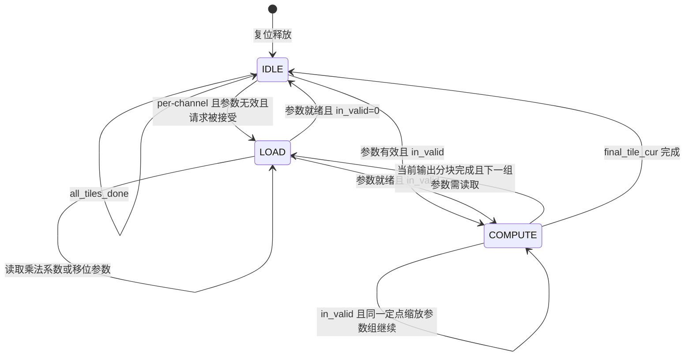
<p align="center">图4-8 `vec_requant` 状态机关系</p>

#### 4.17.5 时序行为

`acc_valid` 被采样后，int32 累加向量进入定点缩放流水。按张量模式使用寄存器给出的乘法系数和移位参数，参数在输入采样周期同步进入流水。per-channel 模式下，模块先发起参数读取请求，只有 DMA 返回的乘法系数和移位参数写入通道参数缓存后，才允许对应输出通道进入计算。流水各级按时钟推进，依次完成乘法、舍入移位、输出零点加法、激活范围裁剪和 int8 饱和；末级有效时更新 `out_data` 和 `out_valid`。当前输出分块最后一个有效向量完成后产生 `out_tile_done`。


#### 4.17.6 参数配置说明

| 参数 | 功能含义 |
|---|---|
| `VLEN` | 每拍并行处理的累加结果数量 |
| `REG_WIDTH` | 运行参数和内部计数位宽 |
| `MAX_IA_REUSE` | IA 复用次数上限 |
| `ENABLE_PER_CHANNEL` | per-channel 定点缩放参数读取综合使能 |
| `ENABLE_IS_MODE` | IS 数据流相关处理综合使能 |

### 4.18 `vec_s8_to_fifo`模块设计

本模块位于`npu_top`中，缓存 int8 输出并打包为 32 位写回数据，同时生成字节写掩码。上级为 `vec_requant`，下级为 `oa_writer`。

#### 4.18.1 功能说明

本模块接收的主要输入包括 `in_valid`、`in_data`、`output_ready`、`transpose_mode`、`rst_n` 等信号，输出的主要结果包括 `output_valid`、`output_data`、`output_mask`、`output_row_switch`、`fifo_full_flag` 等信号。缓存 int8 输出并打包为 32 位写回数据，同时生成字节写掩码。在系统运行过程中，该模块通过时钟边沿采样输入条件，更新内部寄存器或状态标志，并在满足握手、完成或错误条件后驱动下游接口。

#### 4.18.2 结构组成

内部包含多 bank FIFO、写 bank 指针、读 bank 指针、`bank_count`、水位判断、32 位打包单元、字节写掩码生成单元和可选转置读出控制。这些子单元在同一时钟域内通过寄存器和握手信号协同工作。NPU 时钟域。复位后 bank `valid`、读写 bank、计数器和输出寄存器清零。

#### 4.18.3 接口定义

本模块接口包括时钟复位接口、配置或控制接口、数据输入接口、数据输出接口以及状态反馈接口。下表列出主要信号，位宽按照 RTL 参数化表达；当位宽由参数决定时，表中保留参数名。

| 信号名 | 位宽 | 方向 | 时钟域 | 功能描述 | 备注 |
|---|---:|---|---|---|---|
| `in_valid` | 1 | 输入 | NPU 时钟域 | int8 输入有效 | 来自定点缩放 |
| `in_data` | `SIZE*8` | 输入 | NPU 时钟域 | int8 输出向量 | 待打包 |
| `output_ready` | 1 | 输入 | NPU 时钟域 | 下游可接收 | 来自 OA 写回单元 |
| `transpose_mode` | 1 | 输入 | NPU 时钟域 | 转置输出模式 | IS 模式相关 |
| `rst_n` | 1 | 输入 | NPU 时钟域 | 低有效复位 | 清空 FIFO 状态 |
| `output_valid` | 1 | 输出 | NPU 时钟域 | 打包输出有效 | 与 `output_data` 同周期 |
| `output_data` | 32 | 输出 | NPU 时钟域 | 32 位写数据 | 送 DMA 写通道 |
| `output_mask` | 4 | 输出 | NPU 时钟域 | 字节写掩码 | 尾部字节有效标志 |
| `output_row_switch` | 1 | 输出 | NPU 时钟域 | 输出行切换 | 供写回单元更新地址 |
| `fifo_full_flag` | 1 | 输出 | NPU 时钟域 | FIFO 满标志 | 反压控制器 |

接口时序上，输入控制信号在时钟有效边沿采样，输出控制信号在寄存器更新后保持到下游完成握手或被状态机清除。`valid/ready` 类接口以双方同周期为高作为一次传输完成条件；`req/done` 类接口以请求保持和完成反馈作为一次多周期操作的完成条件。地址、数据和掩码信号在对应 `valid` 或 `req` 有效期间保持稳定。

#### 4.18.4 工作流程与状态机

复位后，bank `valid`、读写 bank、计数器和输出寄存器清零。启动或运行条件由上游控制信号给出，模块在配置字段稳定后进入正常工作。模块不使用命名状态机，状态由 `write_bank`、`read_bank`、`bank_count`、`stream_active` 和 `fifo_full_flag` 表示。

`in_valid` 有效时，输入向量被写入当前 bank。`output_ready` 有效且 FIFO 非空时，模块输出一个 32 位数据拍。最后不足 4 个 int8 时，`output_mask` 只标记有效字节。若 FIFO 达到保留水位，`fifo_full_flag` 拉高并反压上游。未完成握手时，相关计数器不推进。

#### 4.18.5 时序行为

`in_valid` 有效时，定点缩放输出向量写入当前 FIFO bank，并更新写 bank 指针和占用计数。`output_ready` 有效且 FIFO 非空时，模块从读 bank 取出数据并打包为 32 bit 写数据拍；若当前行或尾块不足 4 个 int8 元素，`output_mask` 只标记有效字节。`transpose_mode` 有效时，读出顺序按 IS 输出排列调整。FIFO 占用达到保留水位后，`fifo_full_flag` 拉高，控制器停止发出新的 IA 触发，直到写回侧释放足够 bank。


#### 4.18.6 参数配置说明

| 参数 | 功能含义 |
|---|---|
| `VLEN` | 每拍输入 int8 元素数量 |
| `BANKS` | FIFO bank 数量 |
| `ENABLE_TRANSPOSE` | 转置读出综合使能 |

### 4.19 `oa_writer`模块设计

本模块位于`npu_top`中，根据输出矩阵布局将 FIFO 中的 int8 数据写回系统 RAM。上级为 `vec_s8_to_fifo` 和 `npu_controller`，下级为 DMA 仲裁器写客户端。

#### 4.19.1 功能说明

本模块接收的主要输入包括 `init_cfg_oa`、`dst_base`、`dst_row_stride_b`、`output_valid`、`output_data`、`output_mask` 等信号，输出的主要结果包括 `write_oa_req`、`dma_base_addr`、`dma_row_stride`、`dma_rows_to_write`、`dma_burst_len_m1`、`output_ready` 等信号。根据输出矩阵布局将 FIFO 中的 int8 数据写回系统 RAM。在系统运行过程中，该模块通过时钟边沿采样输入条件，更新内部寄存器或状态标志，并在满足握手、完成或错误条件后驱动下游接口。

#### 4.19.2 结构组成

内部包含输出分块几何计算、地址生成单元、DMA 写命令寄存器、FIFO 读取控制、tail 行列裁剪、突发传输长度计算和完成状态机。这些子单元在同一时钟域内通过寄存器和握手信号协同工作。NPU 时钟域。复位后状态机进入 S_IDLE，分块计数、请求寄存器和完成标志清零。

<p align="center">
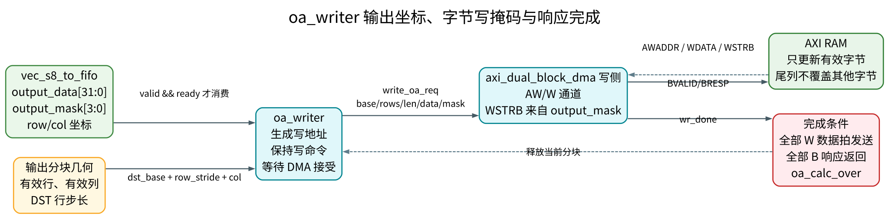
</p>
<p align="center">图4-9 `oa_writer` 输出坐标、字节写掩码与写响应完成关系</p>

#### 4.19.3 接口定义

本模块接口包括时钟复位接口、配置或控制接口、数据输入接口、数据输出接口以及状态反馈接口。下表列出主要信号，位宽按照 RTL 参数化表达；当位宽由参数决定时，表中保留参数名。

| 信号名 | 位宽 | 方向 | 时钟域 | 功能描述 | 备注 |
|---|---:|---|---|---|---|
| `init_cfg_oa` | 1 | 输入 | NPU 时钟域 | 输出写回初始化 | 控制器发出 |
| `dst_base` | 32 | 输入 | NPU 时钟域 | 输出基地址 | 来自寄存器组 |
| `dst_row_stride_b` | 32 | 输入 | NPU 时钟域 | 输出行跨度 | 字节单位 |
| `output_valid` | 1 | 输入 | NPU 时钟域 | FIFO 数据有效 | 与 `output_data` 同周期 |
| `output_data` | 32 | 输入 | NPU 时钟域 | 打包输出数据 | 写入 RAM |
| `output_mask` | 4 | 输入 | NPU 时钟域 | 字节写掩码 | 用于生成写 strobe |
| `write_done` | 1 | 输入 | NPU 时钟域 | DMA 写完成 | 写回结束 |
| `write_oa_req` | 1 | 输出 | NPU 时钟域 | 写 DMA 请求 | 向仲裁器申请 |
| `dma_base_addr` | 32 | 输出 | NPU 时钟域 | 写回基地址 | 分块输出首地址 |
| `dma_row_stride` | 32 | 输出 | NPU 时钟域 | 写回行跨度 | 来自寄存器组 |
| `dma_rows_to_write` | `REG_WIDTH` | 输出 | NPU 时钟域 | 写回行数 | tail 裁剪 |
| `dma_burst_len_m1` | 8 | 输出 | NPU 时钟域 | 每行突发传输长度 | 数据拍数减一 |
| `output_ready` | 1 | 输出 | NPU 时钟域 | FIFO 读使能 | 下游可接收时有效 |
| `oa_calc_over` | 1 | 输出 | NPU 时钟域 | 输出写回完成 | 控制器等待条件 |

接口时序上，输入控制信号在时钟有效边沿采样，输出控制信号在寄存器更新后保持到下游完成握手或被状态机清除。`valid/ready` 类接口以双方同周期为高作为一次传输完成条件；`req/done` 类接口以请求保持和完成反馈作为一次多周期操作的完成条件。地址、数据和掩码信号在对应 `valid` 或 `req` 有效期间保持稳定。

#### 4.19.4 工作流程与状态机

复位后，状态机进入 S_IDLE，分块计数、请求寄存器和完成标志清零。启动或运行条件由上游控制信号给出，模块在配置字段稳定后进入正常工作。状态机包含 S_IDLE、S_REQ、S_START、S_WRITE 和 S_DONE。S_REQ 申请写通道，S_START 发起 DMA 写，S_WRITE 消费 FIFO 数据，S_DONE 等待写完成并报告。

`init_cfg_oa` 后计算输出分块总数。进入 S_START 时，`dma_base_addr`、`row_stride`、`rows_to_write` 和 `burst_len` 保持稳定。S_WRITE 中只有 `output_valid` 与 DMA 写侧可接收条件同时满足时才拉高 `output_ready`。`write_done` 有效后置 `oa_calc_over`。未完成握手时，相关计数器不推进。

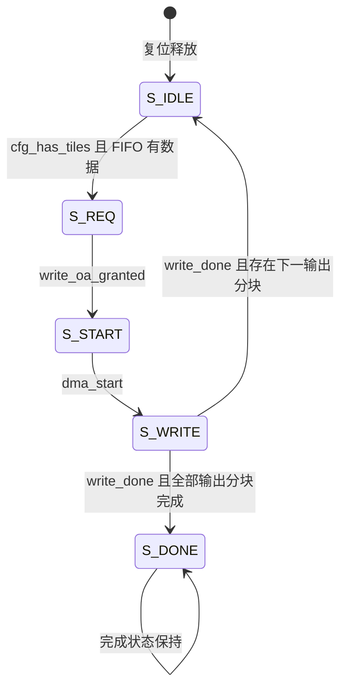
<p align="center">图4-10 `oa_writer` 状态机关系</p>

#### 4.19.5 时序行为

`init_cfg_oa` 被采样后，模块计算输出分块总数、尾行尾列有效范围和每行写数据拍数。S_REQ 状态向 DMA 仲裁器申请写客户端，授权后进入 S_START 并提交 `dma_base_addr`、`dma_row_stride`、`dma_rows_to_write` 和 `dma_burst_len_m1`。S_WRITE 状态只在 FIFO `output_valid` 有效且 DMA 写侧可接收时拉高 `output_ready`，因此 FIFO 数据、掩码和输出坐标不会在未被接收时推进。DMA 写响应全部返回后，`write_done` 置位，模块更新输出分块计数；最后一个分块完成后拉高 `oa_calc_over`。


#### 4.19.6 参数配置说明

| 参数 | 功能含义 |
|---|---|
| `VLEN` | 每拍输出 int8 元素数量 |
| `DATA_WIDTH` | 输出元素位宽 |
| `REG_WIDTH` | 运行参数和内部计数位宽 |
| `BUS_WIDTH` | DMA 写数据宽度 |
| `COUNT_WIDTH` | 内部计数器宽度，默认等于 `REG_WIDTH` |
| `ENABLE_IS_MODE` | IS 数据流相关写回处理综合使能 |

### 4.20 `axi_block_dma_arbiter`模块设计

本模块位于`npu_top`中，在多个 NPU 读客户端和输出写客户端之间分配共享 DMA 资源。上级请求来自 IA、权重、偏置、quant 和 OA 写回单元，下级为 `axi_dual_block_dma`。

#### 4.20.1 功能说明

本模块接收的主要输入包括 `ia_rd_req`、`kernel_rd_req`、`bias_rd_req`、`quant_rd_req`、`oa_wr_req`、`dma_rd_done` 和 `dma_wr_done` 等信号，输出的主要结果包括 `rd_start`、`wr_start`、`ia_granted`、`kernel_granted`、`bias_granted`、`quant_granted`、`oa_granted`、`rd_base_addr`、`wr_base_addr` 等信号。在多个 NPU 读客户端和输出写客户端之间分配共享 DMA 资源。在系统运行过程中，该模块通过时钟边沿采样输入条件，更新内部寄存器或状态标志，并在满足握手、完成或错误条件后驱动下游接口。

#### 4.20.2 结构组成

内部包含读请求仲裁单元、写请求仲裁单元、当前客户端保持寄存器、DMA 命令多路选择器和完成返回解码单元。这些子单元在同一时钟域内通过寄存器和握手信号协同工作。NPU 时钟域。复位后当前 grant、`busy` 标志和命令保持寄存器清零。

<p align="center">
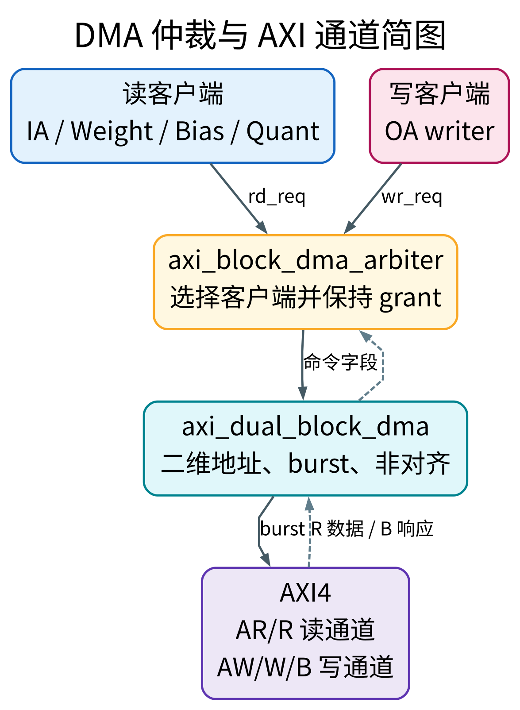
</p>
<p align="center">图4-11 DMA 仲裁与 AXI 通道关键关系</p>

#### 4.20.3 接口定义

本模块接口包括时钟复位接口、配置或控制接口、数据输入接口、数据输出接口以及状态反馈接口。下表列出主要信号，位宽按照 RTL 参数化表达；当位宽由参数决定时，表中保留参数名。

| 信号名 | 位宽 | 方向 | 时钟域 | 功能描述 | 备注 |
|---|---:|---|---|---|---|
| `ia_rd_req` | 1 | 输入 | NPU 时钟域 | IA 读请求 | 读取输入分块 |
| `kernel_rd_req` | 1 | 输入 | NPU 时钟域 | 权重读请求 | 读取权重分块 |
| `bias_rd_req` | 1 | 输入 | NPU 时钟域 | 偏置读请求 | 读取偏置 |
| `quant_rd_req` | 1 | 输入 | NPU 时钟域 | 定点缩放参数读请求 | 按通道模式 |
| `oa_wr_req` | 1 | 输入 | NPU 时钟域 | 输出写请求 | 写回输出 |
| `dma_rd_done` | 1 | 输入 | NPU 时钟域 | DMA 读完成 | 释放读 grant |
| `dma_wr_done` | 1 | 输入 | NPU 时钟域 | DMA 写完成 | 释放写 grant |
| `rd_start` | 1 | 输出 | NPU 时钟域 | DMA 读启动 | 发送给双向 DMA |
| `wr_start` | 1 | 输出 | NPU 时钟域 | DMA 写启动 | 发送给双向 DMA |
| `ia_granted` | 1 | 输出 | NPU 时钟域 | IA 读 grant | 返回 IA 客户端 |
| `kernel_granted` | 1 | 输出 | NPU 时钟域 | 权重读 grant | 返回权重客户端 |
| `bias_granted` | 1 | 输出 | NPU 时钟域 | 偏置读 grant | 返回偏置客户端 |
| `quant_granted` | 1 | 输出 | NPU 时钟域 | 定点缩放参数读 grant | 返回参数客户端 |
| `oa_granted` | 1 | 输出 | NPU 时钟域 | 写 grant | 返回 OA 写回单元 |
| `rd_base_addr` | 32 | 输出 | NPU 时钟域 | 读基地址 | 来自获选客户端 |
| `wr_base_addr` | 32 | 输出 | NPU 时钟域 | 写基地址 | 来自 OA 写回单元 |

接口时序上，输入控制信号在时钟有效边沿采样，输出控制信号在寄存器更新后保持到下游完成握手或被状态机清除。`valid/ready` 类接口以双方同周期为高作为一次传输完成条件；`req/done` 类接口以请求保持和完成反馈作为一次多周期操作的完成条件。地址、数据和掩码信号在对应 `valid` 或 `req` 有效期间保持稳定。

#### 4.20.4 工作流程与状态机

复位后，当前 grant、`busy` 标志和命令保持寄存器清零。启动或运行条件由上游控制信号给出，模块在配置字段稳定后进入正常工作。状态由读 `busy`、写 `busy`、当前读 grant 和当前写 grant 表示。读 grant 保持到 `rd_done`，写 grant 保持到 `wr_done`。

当某个读客户端请求有效且读 DMA 空闲时，仲裁器在时钟边沿锁存该客户端命令并拉高 `rd_start`。DMA 接受后，命令保持到 `rd_done`。写侧采用独立流程，允许读写引擎并行工作。未完成握手时，相关计数器不推进。

#### 4.20.5 时序行为

当某个读客户端请求有效且读 DMA 空闲时，仲裁器在时钟边沿锁存当前读客户端编号和命令字段，并产生单周期 `rd_start`。当前读 grant 保持到 `rd_done` 返回，读数据在此期间只返回给被授权客户端。写侧以独立状态跟踪 OA 写请求；写 DMA 空闲且 `oa_wr_req` 有效时，仲裁器锁存写命令并产生单周期 `wr_start`，当前写 grant 保持到 `wr_done` 返回。读侧和写侧可以同时处于忙状态，因此读请求和输出写回可以并行推进。


#### 4.20.6 参数配置说明

该模块参数用于确定客户端数据宽度、仲裁命令宽度、缓存槽位数量、定点缩放参数客户端是否生成，以及传递给 DMA 的未完成事务深度。

| 参数 | 功能含义 |
|---|---|
| `DATA_WIDTH` | IA 数据宽度 |
| `KERNEL_WIDTH` | 权重数据宽度，默认等于 `DATA_WIDTH` |
| `SIZE` | 计算阵列边长 |
| `DMA_SIZE` | DMA 客户端向量宽度，默认等于 `SIZE` |
| `BUS_WIDTH` | AXI 数据宽度 |
| `REG_WIDTH` | 命令字段和计数字段宽度 |
| `CACHE_BLOCKS` | IA cache 槽位数量 |
| `ENABLE_QUANT_CLIENT` | 定点缩放参数读客户端综合使能 |
| `READ_OUTSTANDING` | 读侧未完成事务深度传递给 DMA |
| `WRITE_OUTSTANDING` | 写侧未完成事务深度传递给 DMA |

### 4.21 `axi_dual_block_dma`模块设计

本模块位于`npu_top`中，执行二维分块读写、AXI 突发传输、非对齐处理和读写通道并行。上级为 `axi_block_dma_arbiter`，下级为 SoC AXI 互连的 NPU 主设备端口。

#### 4.21.1 功能说明

本模块接收的主要输入包括 `rd_start`、`rd_base_addr`、`rd_row_stride`、`rd_rows_to_read`、`wr_start`、`wr_base_addr` 等信号，输出的主要结果包括 `m_axi_arvalid`、`m_axi_arlen`、`rd_data_valid`、`m_axi_awvalid`、`m_axi_wvalid`、`m_axi_wstrb` 等信号。执行二维分块读写、AXI 突发传输、非对齐处理和读写通道并行。在系统运行过程中，该模块通过时钟边沿采样输入条件，更新内部寄存器或状态标志，并在满足握手、完成或错误条件后驱动下游接口。

#### 4.21.2 结构组成

内部包含读地址生成单元、读响应解包单元、写地址生成单元、写数据发送单元、B 响应等待单元、非对齐合并逻辑、未完成事务计数器和行列计数器。这些子单元在同一时钟域内通过寄存器和握手信号协同工作。NPU/AXI 同一时钟域。复位后读写状态、地址寄存器、未完成事务计数、非对齐缓冲和 `done` 标志清零。

#### 4.21.3 接口定义

本模块接口包括时钟复位接口、配置或控制接口、数据输入接口、数据输出接口以及状态反馈接口。下表列出主要信号，位宽按照 RTL 参数化表达；当位宽由参数决定时，表中保留参数名。

| 信号名 | 位宽 | 方向 | 时钟域 | 功能描述 | 备注 |
|---|---:|---|---|---|---|
| `rd_start` | 1 | 输入 | NPU 时钟域 | 读启动 | 锁存读命令 |
| `rd_base_addr` | 32 | 输入 | NPU 时钟域 | 读基地址 | 二维分块首地址 |
| `rd_row_stride` | 32 | 输入 | NPU 时钟域 | 读行跨度 | 字节单位 |
| `rd_rows_to_read` | `REG_WIDTH` | 输入 | NPU 时钟域 | 读行数 | tail 裁剪后 |
| `wr_start` | 1 | 输入 | NPU 时钟域 | 写启动 | 锁存写命令 |
| `wr_base_addr` | 32 | 输入 | NPU 时钟域 | 写基地址 | 输出分块首地址 |
| `src_wvalid` | 1 | 输入 | NPU 时钟域 | 写数据流有效 | 来自输出 FIFO |
| `src_wdata` | `BUS_WIDTH` | 输入 | NPU 时钟域 | 写数据流数据 | 来自输出 FIFO |
| `src_wmask` | `BUS_WIDTH/8` | 输入 | NPU 时钟域 | 写数据流字节掩码 | 来自输出 FIFO |
| `m_axi_arready` | 1 | 输入 | AXI 时钟域 | AXI 读地址接受 | 下游接受 |
| `m_axi_awready` | 1 | 输入 | AXI 时钟域 | AXI 写地址接受 | 下游接受 |
| `m_axi_wready` | 1 | 输入 | AXI 时钟域 | AXI 写数据接受 | 下游接受 |
| `m_axi_arvalid` | 1 | 输出 | AXI 时钟域 | 读地址有效 | 保持到 arready |
| `m_axi_arlen` | 8 | 输出 | AXI 时钟域 | 读突发长度 | 数据拍数减一 |
| `rd_data_valid` | 1 | 输出 | NPU 时钟域 | 解包读数据有效 | 返回客户端 |
| `m_axi_awvalid` | 1 | 输出 | AXI 时钟域 | 写地址有效 | 保持到 awready |
| `m_axi_wvalid` | 1 | 输出 | AXI 时钟域 | 写数据有效 | 与 `wstrb` 同周期 |
| `m_axi_wstrb` | 4 | 输出 | AXI 时钟域 | 字节写使能 | 由 `output_mask` 转换得到 |
| `rd_done` | 1 | 输出 | NPU 时钟域 | 读完成 | 返回仲裁器 |
| `wr_done` | 1 | 输出 | NPU 时钟域 | 写完成 | 返回仲裁器 |

接口时序上，输入控制信号在时钟有效边沿采样，输出控制信号在寄存器更新后保持到下游完成握手或被状态机清除。`valid/ready` 类接口以双方同周期为高作为一次传输完成条件；`req/done` 类接口以请求保持和完成反馈作为一次多周期操作的完成条件。地址、数据和掩码信号在对应 `valid` 或 `req` 有效期间保持稳定。

#### 4.21.4 工作流程与状态机

复位后，NPU/AXI 同一时钟域。复位后读写状态、地址寄存器、未完成事务计数、非对齐缓冲和 `done` 标志清零。启动或运行条件由上游控制信号给出，模块在配置字段稳定后进入正常工作。读引擎和写引擎分别维护运行状态。读侧在 `rd_start` 后发起 AR，跟踪 R 数据拍和未完成事务；写侧在 `wr_start` 后发起 AW/W，等待 B 响应。

`rd_start` 或 `wr_start` 被采样后，命令字段被锁存。AR/AW `valid` 保持到 `ready`。R 数据拍到达时根据地址偏移解包并输出给客户端。写侧只有 `src_valid` 且 W 通道可接收时发送 WDATA/WSTRB，最后数据拍拉高 WLAST。所有响应完成后置 `rd_done` 或 `wr_done`。未完成握手时，相关计数器不推进。

#### 4.21.5 时序行为

`rd_start` 被采样后，读引擎锁存基址、行步长、行数、有效列数和突发长度。AR 通道 `valid` 保持到 AXI 从设备接受，返回的 R 数据按地址低位和元素位宽完成解包，再以 `rd_data_valid` 送回当前读客户端。读侧未完成事务计数在 AR 握手后增加，在最后一个 R 数据拍返回后减少；所有行和返回数据拍完成后置 `rd_done`。

`wr_start` 被采样后，写引擎锁存写基址、行步长、行数和突发长度。AW 通道地址保持到握手完成；W 通道只有在源端数据有效且 AXI 写数据通道可接收时发送 `m_axi_wdata` 和 `m_axi_wstrb`，最后一个写数据拍拉高 `wlast`。B 响应返回后写侧更新未完成事务计数；所有写数据拍和对应 B 响应完成后置 `wr_done`。非对齐写回通过前一数据拍缓冲和尾拍掩码合并，保证未被 `src_wmask` 标记的字节不被修改。


#### 4.21.6 参数配置说明

| 参数 | 功能含义 |
|---|---|
| `DATA_WIDTH` | 客户端元素数据宽度 |
| `SIZE` | 每拍客户端向量元素数量 |
| `BUS_WIDTH` | AXI 数据位宽，默认 32 bit |
| `REG_WIDTH` | 命令字段和计数字段宽度 |
| `CACHE_BLOCKS` | IA cache 槽位数量 |
| `READ_OUTSTANDING` | 读侧未完成事务上限 |
| `WRITE_OUTSTANDING` | 写侧未完成事务上限 |

### 4.22 `soc_axi_pingpong_buffer`模块设计

本模块位于 SoC AXI 数据通路中，负责在 AXI 主从接口之间插入逐通道缓冲寄存器。该模块的功能范围是保持 AXI 五个通道的 `valid/ready` 握手规则，改善长组合路径的时序分割，并在下游反压时保存已经接受但尚未转发的数据负载。该模块不改变地址、数据、突发长度、响应码或写掩码的含义。

#### 4.22.1 功能说明

本模块接收上游 AXI 从侧信号，包括 `s_axi_arvalid`、`s_axi_awvalid`、`s_axi_wvalid`、`s_axi_rready` 和 `s_axi_bready` 等，同时接收下游 AXI 主侧返回的 `m_axi_arready`、`m_axi_awready`、`m_axi_wready`、`m_axi_rvalid` 和 `m_axi_bvalid` 等信号。模块对 AR、R、AW、W 和 B 五个通道分别进行缓冲，将数据负载与 `valid` 状态寄存后再传递到另一侧。

在系统运行过程中，该模块不参与地址译码和仲裁，也不产生新的事务。其作用是在上游和下游 `ready` 不同时到达时保持传输数据稳定，防止数据负载在握手完成前变化。设计要求每个通道在 `ready` 为低时保持 `valid` 和数据负载，传输顺序、`last` 标志和 response 字段按握手完成次序传递。

#### 4.22.2 结构组成

模块内部由五个 `soc_axi_pingpong_chan` 实例组成，分别处理 AR、R、AW、W 和 B 通道。每个通道实例包含输入侧握手、输出侧握手、数据负载寄存器和有效标志寄存器。AR 与 AW 数据负载包含地址、`cache`、`prot`、`lock`、突发传输、`len` 和 `size`；W 数据负载包含 `data`、`strb` 和 `last`；R 数据负载包含 `data`、`resp` 和 `last`；B 数据负载包含 `resp`。

所有通道工作在同一 AXI 时钟域内。复位后，各通道 `valid` 标志清零，数据负载寄存器内容不作为有效数据使用。该结构不跨时钟域，因此不需要异步 FIFO 或双触发器同步。

#### 4.22.3 接口定义

本模块接口为完整 AXI 缓冲接口，包含上游 `s_axi_*` 端口和下游 `m_axi_*` 端口。上游端口面向发起侧或返回侧，下游端口面向被缓冲后的目标侧。

| 信号名 | 位宽 | 方向 | 时钟域 | 功能描述 | 备注 |
|---|---:|---|---|---|---|
| `s_axi_arvalid` | 1 | 输入 | AXI 时钟域 | 上游读地址有效 | 与 `s_axi_arready` 握手 |
| `s_axi_arready` | 1 | 输出 | AXI 时钟域 | 可接收上游读地址 | 缓冲空或输出被接受时有效 |
| `m_axi_arvalid` | 1 | 输出 | AXI 时钟域 | 下游读地址有效 | 数据负载已寄存或直通 |
| `m_axi_arready` | 1 | 输入 | AXI 时钟域 | 下游读地址接受 | 完成 AR 转发 |
| `s_axi_wvalid` | 1 | 输入 | AXI 时钟域 | 上游写数据有效 | 与 data、strb、`last` 同周期 |
| `m_axi_wvalid` | 1 | 输出 | AXI 时钟域 | 下游写数据有效 | 保持到 `m_axi_wready` |
| `m_axi_rvalid` | 1 | 输入 | AXI 时钟域 | 下游读数据有效 | 返回方向被缓冲 |
| `s_axi_rvalid` | 1 | 输出 | AXI 时钟域 | 上游读数据有效 | 与 `rdata`、`rresp`、`rlast` 同周期 |
| `m_axi_bvalid` | 1 | 输入 | AXI 时钟域 | 下游写响应有效 | 返回方向被缓冲 |
| `s_axi_bvalid` | 1 | 输出 | AXI 时钟域 | 上游写响应有效 | 与 `bresp` 同周期 |

`valid/ready` 握手完成后，对应数据负载才能被覆盖或释放。对于写数据和读数据通道，`last` 位作为数据负载的一部分被同步缓冲，不能与 data 分离更新。

#### 4.22.4 工作流程与状态机

复位释放后，每个通道处于空闲状态，有效标志为 0。当上游 `valid` 为 1 且该通道可接收时，数据负载在时钟边沿写入缓冲寄存器，有效标志置 1。当下游 `ready` 为 1 且缓冲有效时，数据负载被下游接受，有效标志清除或被同周期新输入替换。

该模块不包含多状态枚举状态机。通道状态由“缓冲为空”和“缓冲有效”两个条件表达。当输出侧持续反压时，模块保持 `m_axi_*valid` 或 `s_axi_*valid` 以及数据负载不变；当输出侧恢复 `ready` 后，缓冲数据继续发送。

#### 4.22.5 时序行为

输入侧数据负载在 `valid` 与 `ready` 同时为 1 的时钟边沿被采样。输出侧 `valid` 在缓冲有效后更新，并保持到输出侧 `ready` 为 1。若输入侧和输出侧在同一周期均完成握手，通道允许完成一次弹出和一次写入，保持吞吐不被无谓降低。

该模块不改变 AXI 突发传输结束条件。ARLEN、AWLEN、WLAST、RLAST 和响应码均作为数据负载原样传递。上游数据负载在 `ready` 为 0 时保持稳定，下游接收序列与上游发送序列按握手完成次序一致。

#### 4.22.6 参数配置说明

| 参数 | 功能含义 |
|---|---|
| `ADDR_WIDTH` | AXI 地址位宽，默认 32 bit |
| `DATA_WIDTH` | AXI 数据位宽，默认 32 bit |

当 AXI 数据位宽改变时，需要同步更新 W/R 数据负载宽度和 `wstrb` 宽度。

## 5. 资源与时序实现约束

资源与时序实现约束围绕 FPGA 资源分配、复位策略、数据存储组织和长路径隔离展开。矩阵乘 NPU 的主要资源来自脉动阵列乘加单元、输入激活缓存、权重缓存、部分和缓冲区、输出 FIFO、AXI DMA 和控制状态机。设计在综合期通过阵列规模、输入激活缓存块数、部分和帧数、AXI 未完成事务深度和 CPU RAM 深度选择具体硬件参数；运行期通过寄存器组配置矩阵维度、步长、定点缩放参数、数据流模式和复用参数。该划分使软件配置不改变硬件拓扑，从而保持可综合实现的稳定性。

### 5.1 FPGA 资源分配原则

阵列计算单元按 `SIZE x SIZE` 参数生成，乘法与累加路径优先对应到 FPGA 乘加资源和局部寄存器。输入激活缓存、权重缓存、部分和缓冲区和输出 FIFO 优先采用同步 RAM、BRAM 或适合综合器推断的存储结构，避免把大容量数据阵列展开为寄存器阵列。控制状态、`valid` 标志、标签、读写指针和未完成事务计数使用触发器保存，并在复位后进入确定状态。

<p align="center">
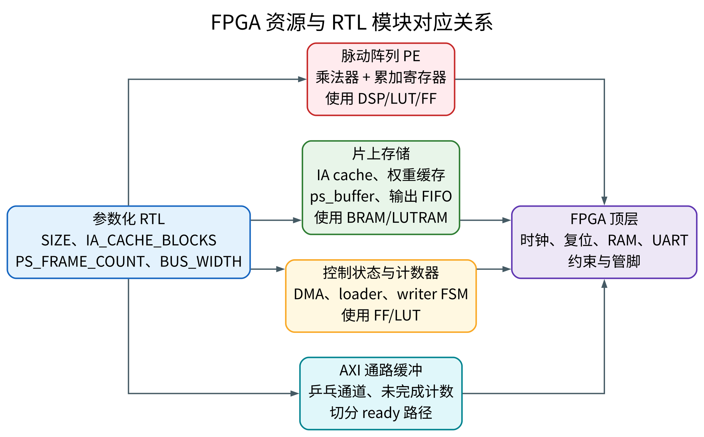
</p>
<p align="center">图5-1 FPGA 资源分配与主要 RTL 模块对应关系</p>

缓存容量与阵列规模需要联合配置。阵列规模增大时，单周期计算需求按平方增长，若输入激活缓存、权重装载、部分和缓冲区和输出 FIFO 没有同步扩大，阵列会等待数据或等待写回。设计规格中将输入激活缓存块数描述为可保存的输入矩阵分块数量，将部分和帧数描述为可保存的输出帧窗口，便于在不同综合参数之间比较资源占用和数据供给能力。

### 5.2 复位与状态保持

系统采用单一核心时钟域，复位信号为低有效；多数 RTL 时序块使用 `posedge clk or negedge rst_n` 形式，使复位可异步进入，复位释放后所有状态按时钟边沿推进。复位后，控制状态机、`ready`/`busy`/`done` 标志、错误码、FIFO 指针、DMA 未完成事务计数、缓存有效位、标签和写回 `valid` 均进入确定状态。大型数据 RAM 不要求在复位期间全量写零；其内容必须由 `valid`、标签、帧状态和读写指针保护，复位释放后未标记为有效的数据不会被下游消费。

寄存器更新采用条件更新方式。状态寄存器、地址寄存器、计数器和 sideband 字段仅在启动、握手完成、计数推进、任务结束或清除条件成立时更新；当下游 `ready` 为 0 或请求未被接受时，源端保持 `valid`、地址、数据和控制字段稳定。该规则适用于 AXI 通道、DMA 客户端接口、加载单元输出、计算输入、定点缩放输出、FIFO 输入和写回单元数据输入。

### 5.3 长路径隔离与流水组织

SoC 互连、AXI RAM、DMA 仲裁器和 NPU 计算数据通路之间存在跨模块 `ready`/`valid` 路径。设计通过乒乓缓冲、一级时序缓冲、局部寄存器切分和状态机预计算隔离长组合路径。AXI 读写请求、响应计数、缓存写入、阵列输入和输出写回均按时钟边沿推进，反压只通过握手信号向上游传播，不通过组合反馈直接改变已提交事务。

<p align="center">
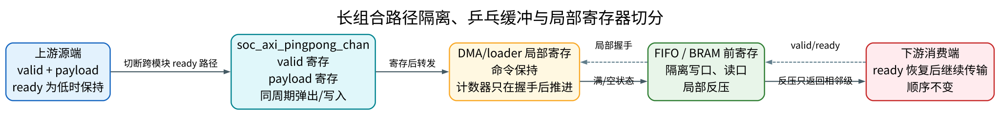
</p>
<p align="center">图5-2 长组合路径隔离、乒乓缓冲与局部寄存器切分关系</p>

流水级插入需要保持功能时序一致。输入加载单元的输出、权重加载单元的权重装载、计算核心的累加、定点缩放的输出和 OA 写回单元的写回之间均有确定延迟。控制器根据 `valid`/`done` 信号推进任务，而不是假设固定的存储响应周期。当 RAM 实现、DMA 缓冲或 AXI 数据宽度发生调整时，需要同步更新握手保持条件、输出延迟补偿和状态完成条件。

### 5.4 参数扩展约束

阵列规模、输入激活缓存块数和部分和帧数为综合期参数。运行期软件能够改变矩阵尺寸、数据类型、定点缩放方式、数据流模式和复用窗口，但不能改变 PE 数量、缓存物理深度或 AXI 数据宽度。参数扩展时需要同时确认 RTL elaboration、驱动宏、能力寄存器、TFLM/NMSIS-NN 适配层和仿真用例的配置一致。

更大阵列需要更高的数据供给能力。若仅增大阵列规模而保持 32 bit AXI 数据宽度和较小缓存，瞬时并行计算能力会提高，但实际任务可能受装载和写回限制。设计扩展时应同时评估 AXI 数据拍利用、读写未完成事务、IA 复用、W 复用、部分和帧数以及输出 FIFO 占用，并结合综合结果确认资源和时序可接受。

## 6. 设计特色与性能优化

本章集中说明本设计中与计算吞吐、片上复用、总线带宽利用率、低功耗控制和可配置能力相关的结构特性。优化目标不是单独扩大脉动阵列规模，而是在矩阵分块调度、IA cache 复用、分块DMA、总线仲裁、输出写回、主动门控时钟和参数化配置之间建立匹配关系。矩阵乘 NPU 在任务启动后自主完成数据读取、计算、部分和保存、定点缩放、输出打包和写回，CPU 只承担任务级配置、状态读取和软件调度。该分工使硬件能够在规则矩阵乘场景中连续使用片上数据，并减少 CPU 逐元素参与造成的控制开销。

本设计包含六项关键结构。第一，矩阵乘采用分块矩阵外积式数据流调度，使一个输入矩阵分块和一组权重分块在多个输出分块上复用。第二，IA cache、权重驻留和部分和缓冲区共同减少重复外存访问，使总线主要承担必要的输入、权重、参数和最终输出传输。第三，分块DMA 与仲裁器把多个加载单元和写回单元的访问汇聚到一个 AXI4 主设备接口，支持二维突发传输、未完成事务、非对齐访问和写掩码。第四，参数化阵列、缓存深度、部分和帧数以及 WS/IS 数据流为不同任务规模和 FPGA 资源条件提供参数选择。第五，反压局部化、乒乓缓冲、BRAM 前寄存和输出 FIFO 使高并行计算通路能够保持明确的握手规则。第六，NPU 计算核心采用主动门控时钟，满足低功耗技术指标，并在空闲阶段关闭计算核心时钟以减少无效翻转。

<p align="center">表6-1 设计特色与硬件结构对应关系</p>

| 设计特色 | 相关模块 | 硬件作用 | 性能影响 |
|---|---|---|---|
| 分块矩阵外积式调度 | `npu_controller`、输入激活加载单元、权重加载单元 | 将输入激活行组与权重列组组成调度窗口 | 减少同一输入分块和权重分块的重复读取 |
| IA cache 复用 | `ia_loader_cache_mgr`、`ia_loader_ctrl` | 保存多个输入矩阵分块并按对角化时序输出 | 降低 LHS 读数据拍和阵列输入等待 |
| 权重驻留与部分和缓冲区 | `kernel_loader_buffer`、`ws_systolic_array`、`ps_buffer` | 权重在 PE 中保持，中间和在片上部分和帧中保存 | 减少 RHS 重复加载和 int32 中间和外存访问 |
| 分块DMA 与仲裁器 | `axi_block_dma_arbiter`、`axi_dual_block_dma` | 汇聚多个读写客户端并转换为 AXI4 突发传输 | 提高共享总线连续访问能力，降低 CPU 逐元素搬移开销 |
| 输出打包与写掩码 | `vec_s8_to_fifo`、`oa_writer` | 将 int8 输出打包为 32 bit 数据拍并生成 `wstrb` | 保持固定 AXI 写口宽度，同时支持尾列逐字节有效 |
| 参数化与双数据流 | `npu_top`、加载单元、写回单元、驱动配置 | 支持阵列规模、缓存容量、WS/IS 模式选择 | 适配不同 FPGA 资源和算子数据布局 |
| 主动门控时钟 | `npu_axil_top`、`npu_axil_reg_if`、`npu_top`、`BUFGCE` | 空闲时关闭 NPU 计算核心时钟，AXI-Lite 寄存器组保持系统时钟工作 | 减少计算核心无效翻转，对应低功耗设计指标 |

### 6.1 分块矩阵外积式数据流调度

本设计面向的基本计算为 `C[K, M] = A[K, N] × B[N, M]`。硬件以 `SIZE × SIZE` 为基本分块，把输出行方向、输出列方向和 N 方向分别拆分为行分块、列分块和 N 方向分块。传统逐分块调度通常围绕单个输出分块完成全部 N 方向累加，然后再切换到下一个输出分块；这种方式在输出列较多或输出行较多时容易重复读取同一输入激活分块或同一权重分块。NPU 控制器采用分块矩阵外积式调度，把一组输入激活行分块与一组权重列分块组合成一个调度窗口，使一次读入的输入激活分块能够服务多个输出列组，一次装载的权重分块能够服务多个输出行组。

<p align="center">
</p>
<p align="center">图6-1 分块矩阵乘数据通路与片上复用结构</p>

调度窗口由 `ia_reuse_num` 和 `w_reuse_num` 描述。`ia_reuse_num` 表示一个 N 方向分块下同时驻留或连续处理的输入激活行分块数，`w_reuse_num` 表示同一输入激活组覆盖的输出列分块数。硬件在启动阶段根据矩阵规模、IA cache 块数、部分和帧数以及软件配置裁剪这两个参数，并把裁剪结果用于加载单元、计算和写回单元的计数器。写 0 表示使用硬件派生值，写非 0 表示软件给出期望值，硬件仍会限制到容量允许的 2 的幂范围。该规则避免在运行时引入除法和复杂取模，同时防止缓存槽位或输出帧被非法覆盖。

<p align="center">表6-2 复用参数与分块调度作用</p>

| 参数或状态 | 硬件含义 | 作用模块 | 对数据访问的影响 |
|---|---|---|---|
| `ia_reuse_num` | 同一 N 方向分块下的输入激活行分块复用深度 | 输入激活加载单元、控制器 | 增加同一 LHS 分块服务的输出列组数 |
| `w_reuse_num` | 同一输入激活组覆盖的输出列分块数 | 权重加载单元、控制器 | 增加同一权重分块服务的输出行组数 |
| IA cache 标签有效性 | 缓存槽位中数据与矩阵坐标的有效关系 | `ia_loader_cache_mgr` | 防止错误复用不匹配的输入分块 |
| 部分和帧标签 | 部分和与输出分块、N 方向分块次序的对应关系 | `ps_buffer`、计算核心 | 保证跨 N 方向分块的 int32 中间和正确回灌 |
| 有效计算通道标志 | 尾行、尾列和尾部 N 方向位置的有效性 | 加载单元、计算、定点缩放、写回单元 | 防止无效通道参与输出写回 |

分块外积式调度的核心收益来自外存读取次数下降。对于一个 N 方向分块，若同一输入激活分块能够覆盖多个输出列组，则 LHS 读取量不再随输出列分块数线性增长；若同一权重分块能够覆盖多个输出行组，则 RHS 读取量也不再随输出行分块数线性增长。输出部分和不写回外存，而是在片上部分和缓冲区中跨 N 方向分块保存。只有最终 N 方向分块完成后，结果才进入定点缩放和 int8 写回阶段。该组织方式把外部总线访问集中在输入、权重、bias、定点缩放参数和最终输出上，避免中间和反复进出共享 RAM。

调度顺序仍保持 GEMM 数学定义不变。K 表示输出行数，N 表示公共累加维度，M 表示输出列数；每个输出元素只由同一行 LHS、同一列 RHS、对应 bias 和对应定点缩放参数形成。内部行组、列组和 N 方向分组只改变硬件访问和复用顺序，不改变软件可见的输出矩阵布局。尾行、尾列和尾部 N 方向分块通过有效计算通道标志处理，无效通道不会写入有效输出字节。

### 6.2 IA cache 与矩阵分块复用

IA cache 是分块复用结构中的主要片上存储。IA 加载单元把 LHS 分块读入多个缓存槽位，每个槽位保存一个输入矩阵分块，并配套保存 `valid`、`busy`、标签、行组索引、N 方向分块索引和发送状态。`valid` 表示数据已经装入并可被发送，`busy` 表示该槽位仍在被当前调度窗口使用，标签表示该槽位对应的矩阵坐标。控制器只有在标签与当前任务坐标匹配、`valid` 为 1 且发送条件满足时，才允许缓存管理单元输出该槽位的数据。

缓存管理单元不是简单地按存储顺序读出数据，而是按照脉动阵列要求生成对角化输入流。对于 `SIZE × SIZE` 阵列，不同行的输入元素按照行号错开进入 PE，使相同公共累加维度索引的 IA 和权重在正确周期相遇。缓存管理单元使用读指针、列延迟寄存器和输出 `valid` 标志，按对角化时序输出各行 IA 数据。尾行或尾部 N 方向位置无效时，输出通道使用零贡献或无效标志处理，保证无效位置不影响累加结果。

IA cache 支持连续组输出。一个输入激活组中的多个输入分块全部有效后，缓存管理单元可以在一个分块发送结束后的下一周期切换到下一个分块，减少分块切换空拍。若每个分块之间都插入等待周期，脉动阵列需要重新经历填充和排空过程，短矩阵和小批次场景中损失尤其明显。连续输出把多个输入分块视为同一调度窗口内的顺序数据流，使计算核心能够在更长时间内接收有效 IA 数据。

缓存槽位的释放采用发送完成与复用计数共同控制。某个槽位在最后一次服务输出列组后即可释放给下一组预取，而不必等待整个矩阵任务结束。释放条件由缓存管理单元、IA 加载控制器和上级控制器共同形成：该槽位已完成全部必要发送，相关输出列组不再需要该输入分块，且没有下游反压导致的未完成传输。该策略允许当前组仍在计算时预取下一组数据，从而减少下一组输入等待。

预取数据需要遵守容量和坐标约束。IA 加载单元只有在待写槽位不会覆盖仍需复用的数据、DMA 仲裁器可接受请求、当前任务配置稳定且缓存组次序确定时，才发起下一组读请求。预取命令包含 LHS 基址、行步长、N 方向分块偏移、有效行数、有效列数和数据宽度，DMA 返回后写入指定缓存槽位。预取不会改变当前正在发送的 IA 数据，也不会越过调度窗口中尚未完成的复用需求。

<p align="center">
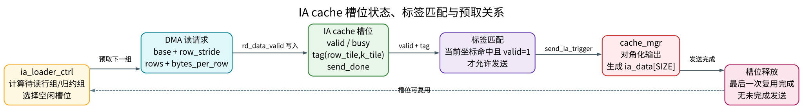
</p>
<p align="center">图6-2 IA cache 槽位状态、标签匹配与预取时序关系</p>

### 6.3 权重驻留、部分和缓存与计算数据通路

计算阵列采用权重固定模式作为主要数据流。权重加载单元按输出列组和 N 方向分块读取 RHS/权重分块，把权重组织为阵列列方向向量，并通过 `store_weight_req` 装入 PE。权重在 PE 内保持，随后多个输入激活行分块进入阵列并与该权重分块相乘累加。权重驻留减少了同一 RHS 分块在多个输出行上的重复读取，也使 PE 乘法输入在计算窗口内保持稳定。

权重固定模式与分块外积调度相互配合。一个权重组可以覆盖多个输入激活行组，一个输入激活组也可以覆盖多个权重列组。控制器在每次切换输出列组时检查权重是否需要重新装载，在切换输出行组时检查输入激活缓存组是否可复用。尾列不足阵列规模时，权重加载单元只对有效输出列产生真实权重，计算核心、定点缩放和写回单元使用同一有效列信息处理输出，避免尾列产生不可见写入。

部分和缓冲区保存跨 N 方向分块的 int32 中间和。矩阵乘的公共累加维度通常被拆成多个 N 方向分块，同一个输出元素需要多次累加。如果每个 N 方向分块后把 int32 中间和写回外存，再由下一 N 方向分块读回，外部总线会承担大量非最终数据传输。部分和缓冲区在片上按部分和帧保存中间和，下一 N 方向分块到来时回灌给计算核心。首次 N 方向分块的初值来自偏置或 0，中间 N 方向分块的初值来自部分和缓冲区，最终 N 方向分块的结果进入定点缩放。

部分和帧与输出分块坐标绑定。帧信息至少包含输出行组、输出列组、N 方向分块次序和有效计算通道。写入时，控制器确认当前结果属于中间 N 方向分块；读取时，控制器确认对应输出分块的上一轮中间和已经有效。若帧未就绪，计算核心等待；若帧空间不足，上游停止提交新的中间和。该机制保证跨分块累加顺序与 GEMM 定义一致，并防止偏置重复加入。

计算核心的输出不直接写回外存。最终 N 方向分块产生的 int32 向量进入 `vec_requant`，完成乘法缩放、舍入、移位、加输出偏移、激活值上下限钳位和 int8 饱和。PE 内部只承担 signed 16 bit 乘法、signed 32 bit 累加和寄存传递，最终数值范围限制集中在定点缩放阶段。这种分工减少 PE 阵列中重复比较器和 mux，并使按张量与按通道定点缩放共享同一输出处理单元。

<p align="center">
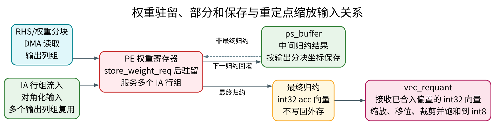
</p>
<p align="center">图6-3 权重驻留、部分和保存与定点缩放输入关系</p>

### 6.4 DMA仲裁器调度与总线带宽优化设计

NPU 计算数据通路中的输入激活加载单元、权重加载单元、偏置加载单元、定点缩放参数加载和 OA 写回单元共用一套分块DMA。各客户端不直接驱动 AXI，而是向 `axi_block_dma_arbiter` 提交请求，由仲裁器选择请求并转交给 `axi_dual_block_dma`。读请求描述 base、行数、每行有效字节数、行步长、元素宽度和客户端编号；写请求描述 base、行步长、写数据拍、字节写掩码和输出坐标。分块DMA 负责把二维分块访问拆分为 AXI 突发传输，并处理非对齐首地址、尾数据拍、未完成事务和响应等待。

仲裁器调度需要兼顾计算供给和写回完成。IA 数据、权重数据、偏置和定点缩放参数直接影响计算是否可以启动；OA 写回单元的写请求直接影响输出 FIFO 是否可以释放。仲裁器在运行时根据客户端请求、DMA 忙状态、读写未完成事务和任务阶段选择请求源。读 DMA 与写 DMA 在内部独立跟踪，但共享 AXI 主设备端口；当写响应长时间未返回时，写回单元维持 pending 计数，控制器不会提前置 `done`。

总线优化采用多项结构配合实现。NPU 优先仲裁减少 NPU 活跃窗口内被 CPU 取指或外设访问打断的次数；RAM 流水化和指令缓存减少 CPU 对共享 RAM 的瞬时干扰；DMA 未完成事务用于覆盖存储响应延迟；乒乓时序缓冲用于切断跨互连和 RAM 的长 `ready` 路径；输入激活缓存复用减少同一 LHS 分块重复读取。上述结构共同作用，形成面向矩阵分块访问的总线优化设计。

读侧调度采用客户端请求保持和命令多路选择结构。权重、定点缩放参数、输入激活和偏置读请求进入仲裁器后，仲裁器锁存当前读客户端，并将对应的基址、行步长、行数、每行突发长度、数据宽度、槽位编号和零点字段送入双向块 DMA。读事务开始后，当前客户端标识保持到 DMA 返回 `done`，返回数据再按客户端分发到对应加载单元。该结构使多个加载单元共用一套 AXI 读通道，同时避免每个加载单元重复实现地址通道、响应通道和非对齐处理逻辑。

写侧调度由输出写回单元独占。`oa_writer` 在输出 FIFO 有数据且 DMA 写侧可接收时提交写请求，并把 DST 基址、行步长、输出行列坐标、写数据和字节写掩码传递给 DMA。写 DMA 发起 AW/W 后继续等待 B 响应，写回单元只有在响应返回后才释放对应输出范围。该规则把输出矩阵完成点绑定到 AXI 写响应，而不是绑定到写地址或写数据握手，保证软件读取 `done` 时输出数据已经完成写回。

DMA 命令字段按二维分块访问组织。加载单元不直接生成每一个 AXI 地址，而是提供分块首地址、行步长、有效行数和每行有效字节数；DMA 在内部按行生成递增突发传输，并在尾行、尾列和非对齐首地址情况下保持有效字节选择。该方式使输入激活、权重、偏置、定点缩放参数和输出写回共享同一类地址生成规则，降低模块间接口复杂度，也便于在总线宽度参数变化时同步调整数据拍拆分与打包逻辑。

<p align="center">
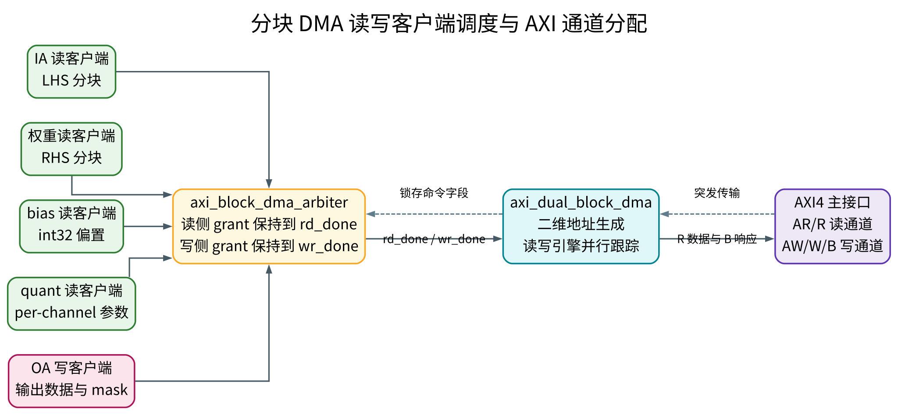
</p>
<p align="center">图6-4 分块DMA 读写客户端调度与 AXI 通道分配关系</p>

### 6.5 预取、未完成事务与反压局部化

预取机制围绕加载单元与缓存状态展开。IA 加载单元在当前缓存组可以继续输出且下一批槽位可安全写入时，提前发起下一组 LHS 读请求；权重加载单元在输出列组即将切换时准备下一组权重；bias 加载单元和定点缩放参数加载在输出列组粒度上准备相关 int32 参数。预取不会改变任务可见顺序，所有预取数据在被计算使用前仍要经过标签、`valid` 和坐标匹配。

AXI 未完成事务用于覆盖 RAM 响应延迟。读引擎可以在前一笔读数据尚未完全返回时继续发出下一笔读请求，并通过客户端编号、行列计数和返回顺序把数据送到目标加载单元；写引擎可以在多个写请求等待 B 响应时继续处理已允许的写数据。未完成事务深度增加会提高计数器、标签和仲裁资源开销，因此需要与 FPGA 资源、RAM 行为和总线宽度一起选择。对 32 bit AXI 数据总线而言，过大的未完成事务不能替代片上复用，只能减少部分响应等待。

反压局部化用于控制 `ready`/`valid` 组合路径长度。FIFO 满只暂停直接上游，DMA 未完成事务满只阻止新的 DMA 请求，写回单元等待 B 响应不直接形成跨越阵列的组合 `ready` 返回。`vec_s8_to_fifo`、乒乓缓冲、DMA 客户端缓冲和 BRAM 写口寄存把长路径切分为相邻模块之间的握手。传输未完成时，源端保持 `valid`、数据负载、地址、掩码、`last`、坐标和标签不变；只有 `valid` 与 `ready` 同周期为高时，计数器才推进。

反压不会改变任务坐标。若定点缩放输出被 FIFO 反压，int8 数据、输出行列、有效列标志和通道索引保持在输出级；若写回单元被 AXI 写通道反压，写地址、写数据和字节写掩码保持到握手完成；若缓存管理单元被计算反压，当前 IA 发送坐标和数据保持，不提前释放槽位。该规则使各级可以独立停顿，同时保证输出元素与输入矩阵坐标的一一对应关系。

<p align="center">
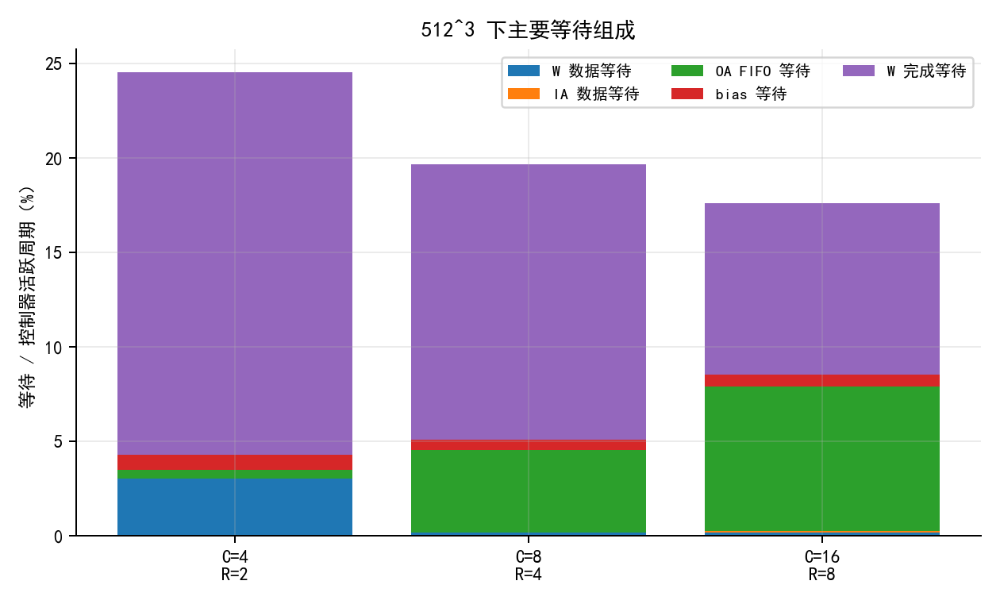
</p>
<p align="center">图6-5 512×512×512 任务主要等待组成</p>

<p align="center">
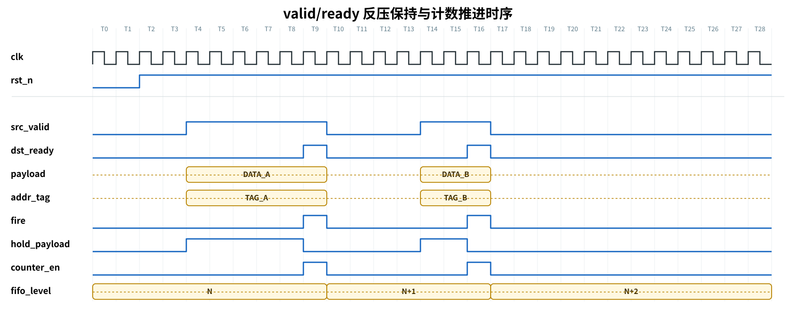
</p>
<p align="center">图6-6 `valid/ready` 握手与反压保持时序</p>

### 6.6 输出打包、字节写掩码与写回完成条件

输出阶段以 int8 为最终存储格式，而 AXI 数据总线为 32 bit。`vec_s8_to_fifo` 将多个 int8 输出通道打包为 32 位写数据，并生成 4 bit 字节写掩码。对于输出列数不是 4 的整数倍、输出基址非 4 字节对齐或尾列不足的情况，写掩码只使目标输出字节有效。该设计保持 AXI 写口宽度固定，同时保证同一个 32 位 word 中不属于当前输出矩阵范围的字节不被修改。

输出 FIFO 同时承担速率匹配和坐标保存功能。定点缩放以向量形式产生 int8 输出，写回单元以 AXI 数据拍为单位写回内存，二者速率并不总是相同。FIFO 写入时保存数据、字节写掩码、输出行、输出列、最后数据拍标志和有效通道信息；FIFO 读出时，写回单元根据 DST 基址、行步长和坐标生成 AW/W 请求。对于阵列规模大于 4 的参数配置，一个输出向量会拆成多个 32 bit 数据拍；对于尾列，最后一个数据拍可能只有部分字节有效。

写回完成必须等待 AXI B 响应。AW 握手只表示写地址被接受，W 握手只表示写数据拍被接受，B 响应返回才表示对应写事务完成。写回单元内部保存 pending 计数，只有所有输出数据拍的响应返回后，才向控制器报告写回完成。控制器据此更新 `done` sticky 和 `busy`。该规则防止 CPU 在写响应尚未返回时读取未完成输出，也避免下一任务过早覆盖仍在写回的数据区域。

<p align="center">
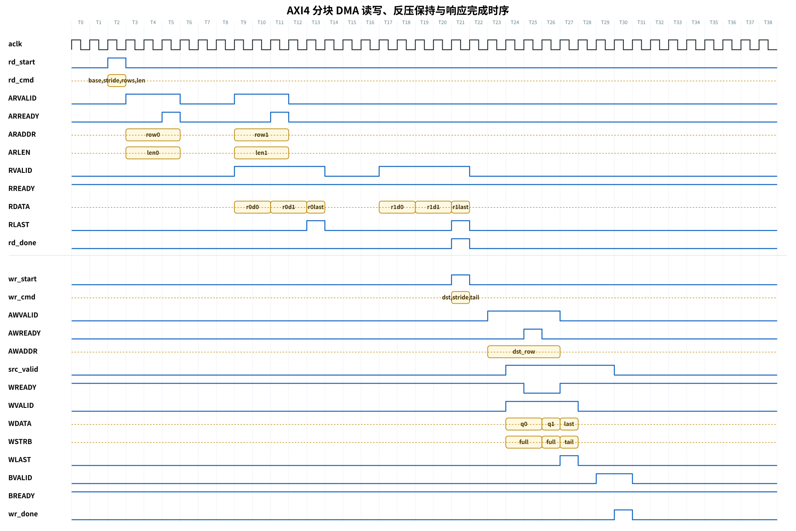
</p>
<p align="center">图6-7 AXI4 递增突发读写与响应时序</p>

<p align="center">
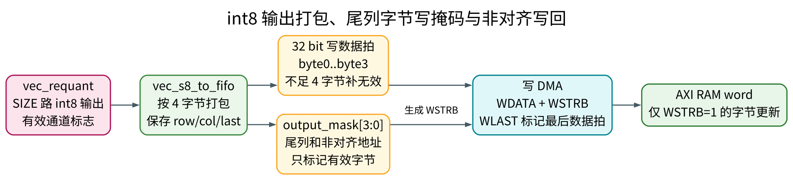
</p>
<p align="center">图6-8 int8 输出打包、尾列字节写掩码与非对齐写回关系</p>

### 6.7 WS/IS 双数据流支持

本设计支持 WS 和 IS 两类数据流模式。WS 模式即权重固定模式，RHS/权重分块装入 PE 后保持，IA/LHS 以对角化形式从阵列左侧进入，部分和沿列方向累加。WS 适合全连接、常规 GEMM 和 im2col 后卷积，因为权重通常可以作用于多个输出行，输入激活缓存也可以在多个输出列组之间复用。主要性能数据和 FPGA 综合配置以 WS、s8 输入和按张量或按通道定点缩放为核心路径。

IS 模式用于输入固定或矩阵角色交换的场景。`cfg_dataflow_mode` 在 `npu_top`、加载单元、定点缩放和写回单元中传递，使内部地址生成、输入输出顺序和写回坐标可按模式调整。IS 模式下，IA 和 W 的内部角色发生变化，输出产生顺序与最终行主序写回之间可能需要重排。输出 FIFO 和写回单元因此需要保存更多坐标信息，确保最终 DST 仍按软件定义的 K×M 行主序排列。

双数据流支持不改变软件可见 GEMM 公式。软件仍按 LHS、RHS、DST、K、N、M、步长、偏移和定点缩放参数提交任务；模式位只影响硬件内部驻留数据、流式数据和写回次序。对于软件层，WS 和 IS 的结果矩阵含义一致。该设计使 TFLM/NMSIS-NN 接入层不需要为内部阵列方向重写上层算子，只需要在满足条件时选择对应模式。

<p align="center">
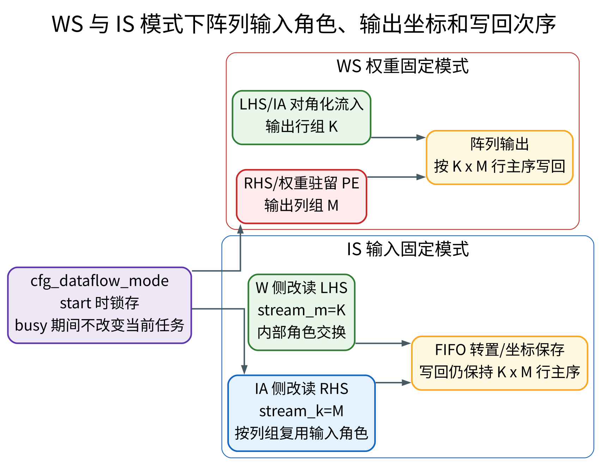
</p>
<p align="center">图6-9 WS 与 IS 模式下阵列输入角色、输出坐标和写回次序关系</p>

WS/IS 模式共享大部分基础模块。AXI-Lite 寄存器组、分块DMA、偏置加载单元、定点缩放、状态寄存器和软件驱动结构保持一致；差异主要集中在加载单元输出顺序、阵列输入角色、输出坐标展开和 FIFO 排列上。共享模块减少了接口数量，也使同一组状态位、错误码和完成条件能够覆盖两类模式。模式相关字段在 `start` 时锁存，`busy` 期间软件写入不会改变当前任务行为。

### 6.8 主动门控时钟与低功耗技术指标

主动门控时钟用于降低 NPU 空闲阶段的无效翻转。本设计在 `npu_axil_top` 中对完整 `npu_top` 计算核心实施主动门控时钟，门控使能由启动请求、NPU 忙状态、AXI 主设备活动状态和计算核心完成握手状态共同决定。AXI-Lite 寄存器组仍使用系统 `clk`，因此 CPU 在计算核心时钟关闭时仍可写入配置、发起 `start`、读取 `status` 并清除 `STATUS[2]` sticky 状态。该划分把低功耗控制限制在计算核心范围内，不影响 MMIO 访问的时序和软件可见寄存器行为。

门控控制逻辑在复位释放后保持预热周期，保证计算核心复位相关状态获得有效时钟。软件写 `NPU_REG_CTRL[0]` 后，`npu_axil_reg_if` 产生 `calc_start` 脉冲，封装层将该请求保存在 `npu_start_pending_q` 中并打开 `npu_clk_gate_en`。当启动预热结束且 `npu_sa_ready` 为 1 时，封装层产生 `npu_core_calc_start`，随后 `npu_top` 进入正常任务执行。该处理避免在计算核心时钟关闭时丢失启动脉冲，空闲后首次启动只引入固定的预热延迟，不改变计算阶段的阵列吞吐。

<p align="center">
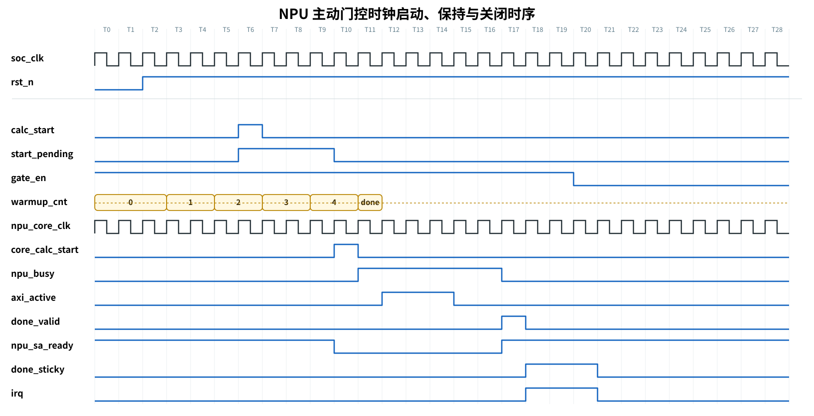
</p>
<p align="center">图6-10 NPU 主动门控时钟启动与关闭波形</p>

图6-10展示了门控控制与任务启动、完成状态之间的关系。复位释放后，`npu_clk_gate_en` 保持一个预热窗口，使 `npu_top` 内部状态机完成复位后稳定；当 CPU 写入 `NPU_REG_CTRL[0]` 时，AXI-Lite 寄存器组先产生单周期 `calc_start`，封装层把该脉冲保持为 `npu_start_pending_q`，随后打开 `npu_clk_gate_en`。等待启动预热结束且 `npu_sa_ready` 为 1 后，封装层才向核心时钟域发出 `npu_core_calc_start`，避免核心时钟关闭时丢失启动请求。任务执行期间，`npu_busy` 或 AXI 主设备读写活动会继续保持门控使能；只有当 `done_valid` 已返回、计算核心重新 `ready` 且 AXI 主设备无未完成读写事务时，`npu_clk_gate_en` 才关闭。若 `CTRL[4]` 中断使能有效，`done` sticky 置位后 `irq` 保持为高，并在软件向 `STATUS[2]` 写 1 清除后拉低。

门控时钟保持条件包括复位预热、待启动请求、启动预热、NPU 运行中、AXI 读写通道仍有活动以及计算核心完成握手尚未结束。任务完成后，只有在 `npu_sa_ready` 为 1、`npu_done_valid` 已撤销、AXI 主设备读写通道空闲且无待启动请求时，门控控制逻辑才撤销 `npu_clk_gate_en`。FPGA 实现使用 Xilinx `BUFGCE` 作为时钟门控单元，通用仿真分支采用锁存式门控模型，避免使能信号在时钟高电平期间变化造成毛刺。综合阶段已识别到 1 个 NPU 门控用 `BUFGCE`，具体功耗降低幅度由功耗分析报告给出。

## 7. 性能分析

本节从模块级吞吐、SoC 级总线利用率和 TFLM 模型推理三个层次分析 NPU 性能。模块级实验直接统计矩阵乘核心在不同 `SIZE` 和 `IA_CACHE_BLOCKS` 下的执行周期，用于观察阵列规模、IA cache 深度和分块数据流之间的匹配关系。SoC 级实验加载完整程序并统计推理周期、NPU 活跃周期和 AXI 有效数据拍，用于评价 CPU、驱动、总线、共享 RAM 与 NPU 共同运行时的端到端性能。

模块级主扫描条件为 WS 数据流、s8 LHS、per-tensor 定点缩放、`K=N=M=256`、`PS_FRAME_COUNT=ceil(M/SIZE)`。`cfg_ia_reuse_num=0`、`cfg_w_reuse_num=0` 表示 RTL 按 `SIZE`、`IA_CACHE_BLOCKS` 和 `PS_FRAME_COUNT` 自动选择可用复用窗口。一次乘加按 2 个操作计，吞吐率计算式如下：

```text
OPS = 2 x K x N x M
GOPS@200MHz = OPS x 200MHz / cycles / 1e9
理想上限 GOPS@200MHz = 2 x SIZE x SIZE x 200MHz / 1e9
阵列利用率 = 实测 GOPS / 理想上限 GOPS
IA cache 容量 = SIZE x SIZE x IA_CACHE_BLOCKS x 4Byte
```

其中 IA cache 容量按每个 cache 元素 32bit 存储估算。硬件要求 `IA_CACHE_BLOCKS` 为 2 的幂且不小于 2，因此目标容量小于单个大尺寸 cache 块时，实验采用最小可综合配置 `IA_CACHE_BLOCKS=2`，并在表中标记为非精确容量。

### 7.1 系统吞吐量分析

#### 7.1.1 阵列规模参数与算力关系

第一组实验固定 `IA_CACHE_BLOCKS=32`，用较深 IA cache 块数让每种阵列都有足够的复用机会，观察 `SIZE=4/8/16/32/64` 的实测吞吐与理想上限之间的差距。该实验不是固定容量实验，实际 IA cache 容量会随 `SIZE^2` 增长，用于分析阵列规模变大时分块数据流对 PE 阵列的供给能力。

<p align="center">
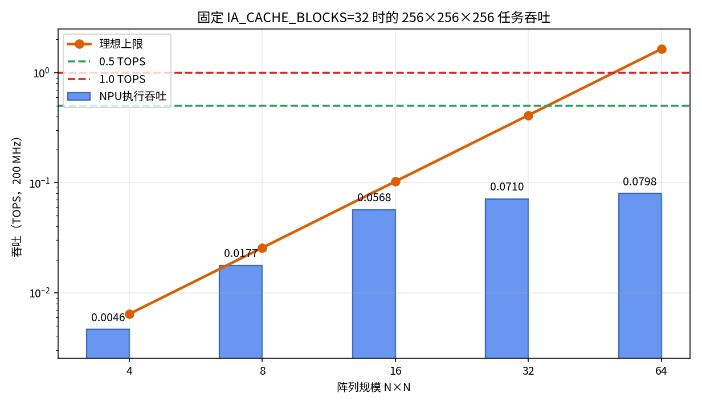
</p>
<p align="center">图7-1 固定 `IA_CACHE_BLOCKS`=32 时的阵列规模扫描</p>

<p align="center">表7-1 固定 `IA_CACHE_BLOCKS`=32、256x256x256 模块级吞吐扫描</p>

| SIZE | `IA_CACHE_BLOCKS` | 实际 IA cache(B) | 周期 | 实测GOPS | 理想GOPS | 阵列利用率 | 总线数据拍利用率 | 读数据拍 | 写数据拍 |
|---:|---:|---:|---:|---:|---:|---:|---:|---:|---:|
| 4 | 32 | 2,048 | 1,447,156 | 4.64 | 6.40 | 72.46% | 6.86% | 82,944 | 16,384 |
| 8 | 32 | 8,192 | 378,210 | 17.74 | 25.60 | 69.31% | 17.46% | 49,664 | 16,384 |
| 16 | 32 | 32,768 | 118,183 | 56.78 | 102.40 | 55.45% | 41.81% | 33,024 | 16,384 |
| 32 | 32 | 131,072 | 94,491 | 71.02 | 409.60 | 17.34% | 52.29% | 33,024 | 16,384 |
| 64 | 32 | 524,288 | 84,099 | 79.80 | 1,638.40 | 4.87% | 58.75% | 33,024 | 16,384 |

从绝对吞吐看，`SIZE` 从 4 增加到 16 时收益明显，4.64 GOPS 提升到 56.78 GOPS；继续增大到 32 和 64 后，吞吐只提升到 71.02 GOPS 和 79.80 GOPS。理想上限从 `SIZE=16` 的 102.40 GOPS 增加到 `SIZE=64` 的 1638.40 GOPS，但实测只增长 1.41 倍，阵列利用率从 55.45% 降到 4.87%。这说明在 32bit AXI、单组 DMA 读写和既有 loader/写回组织方式下，`SIZE=64` 的主要限制因素已经转为总线带宽。

从读写数据拍数量看，`SIZE=16`、`SIZE=32` 和 `SIZE=64` 的读数据拍均为 33,024，写数据拍均为 16,384，说明在 `IA_CACHE_BLOCKS=32`、复用窗口足够时，外部搬运数据量已经接近下界；但 `SIZE=32` 和 `SIZE=64` 的计算窗口变短，总线数据拍利用率反而升高，阵列利用率下降。这类结果的含义不是“总线更好”，而是“阵列太大以后，同样的数据搬运和阶段开销占据了更高比例”。因此，仅扩大阵列不能线性换算成算力，必须同步提高内部供数并行度、预取深度和写回排空能力。

#### 7.1.2 固定 IA cache 存储容量、扫描阵列 SIZE 的实验

第二组实验固定目标 IA cache 存储容量，扫描 `SIZE=4/8/16/32/64`。这里“固定容量”指固定 `SIZE x SIZE x IA_CACHE_BLOCKS x 4Byte` 的目标值，而“扫描 SIZE”指在同一目标容量下改变阵列边长，并按容量公式反向选择 `IA_CACHE_BLOCKS`。容量组选择 4KiB、16KiB 和 64KiB，其中 4KiB 对应 `SIZE=16`、`IA_CACHE_BLOCKS=4`，即 `16 x 16 x 4 x 4Byte`。该实验用于比较同等片上存储预算下小阵列配合较深 IA cache 与大阵列配合较少 IA cache 分块时的性能差异。

<p align="center">
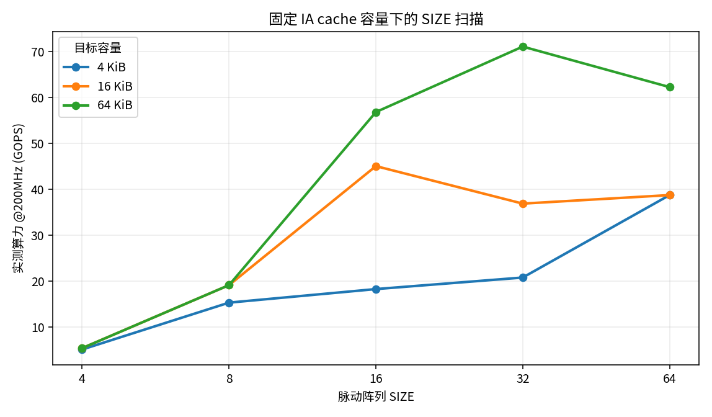
</p>
<p align="center">图7-2 固定 IA cache 存储容量时的实测算力</p>

<p align="center">
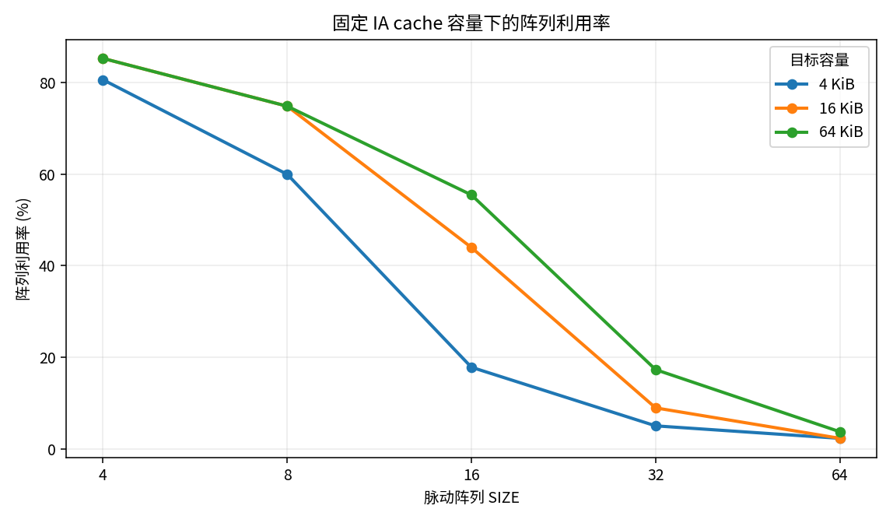
</p>
<p align="center">图7-3 固定 IA cache 存储容量时的阵列利用率</p>

<p align="center">表7-2 固定 IA cache 存储容量下的 256x256x256 吞吐扫描</p>

| 目标容量 | SIZE | `IA_CACHE_BLOCKS` | 实际容量(B) | 精确容量 | 周期 | 实测GOPS | 阵列利用率 | 总线数据拍利用率 |
|---:|---:|---:|---:|---|---:|---:|---:|---:|
| 4KiB | 4 | 64 | 4,096 | 是 | 1,301,686 | 5.16 | 80.56% | 5.07% |
| 4KiB | 8 | 16 | 4,096 | 是 | 437,316 | 15.35 | 59.94% | 22.71% |
| 4KiB | 16 | 4 | 4,096 | 是 | 366,878 | 18.29 | 17.86% | 45.22% |
| 4KiB | 32 | 2 | 8,192 | 否 | 322,566 | 20.80 | 5.08% | 51.43% |
| 4KiB | 64 | 2 | 32,768 | 否 | 173,270 | 38.73 | 2.36% | 57.33% |
| 16KiB | 4 | 256 | 16,384 | 是 | 1,230,439 | 5.45 | 85.22% | 4.02% |
| 16KiB | 8 | 64 | 16,384 | 是 | 350,439 | 19.15 | 74.80% | 14.10% |
| 16KiB | 16 | 16 | 16,384 | 是 | 149,026 | 45.03 | 43.98% | 44.32% |
| 16KiB | 32 | 4 | 16,384 | 是 | 181,996 | 36.87 | 9.00% | 54.58% |
| 16KiB | 64 | 2 | 32,768 | 否 | 173,270 | 38.73 | 2.36% | 57.33% |
| 64KiB | 4 | 1024 | 65,536 | 是 | 1,230,439 | 5.45 | 85.22% | 4.02% |
| 64KiB | 8 | 256 | 65,536 | 是 | 350,439 | 19.15 | 74.80% | 14.10% |
| 64KiB | 16 | 64 | 65,536 | 是 | 118,183 | 56.78 | 55.45% | 41.81% |
| 64KiB | 32 | 16 | 65,536 | 是 | 94,491 | 71.02 | 17.34% | 52.29% |
| 64KiB | 64 | 4 | 65,536 | 是 | 107,877 | 62.21 | 3.80% | 61.23% |

固定 IA cache 容量约束下，阵列规模和 cache 分块数之间存在明确的供给匹配关系，而不是单调的“阵列越大，吞吐越高”。

第一，较小阵列更容易获得较高阵列利用率，但其绝对吞吐受 PE 数量上限限制。以 16KiB 和 64KiB 容量组为例，`SIZE=4` 的阵列利用率均为 85.22%，说明 32bit AXI 数据通路和分块数据流能够较充分地供给 4x4 阵列；但该配置只有 16 个 PE，实测吞吐仅为 5.45 GOPS。因此，阵列利用率高并不等价于系统吞吐最优，必须同时考察 PE 规模和有效计算周期。

第二，在有限片上存储预算下，保留足够的 IA cache 分块数比单纯扩大阵列更关键。4KiB 容量组中，`SIZE=16`、`IA_CACHE_BLOCKS=4` 的实测吞吐为 18.29 GOPS；当容量提高到 16KiB 时，`SIZE=16`、`IA_CACHE_BLOCKS=16` 的吞吐提升到 45.03 GOPS，并高于同容量下 `SIZE=32`、`IA_CACHE_BLOCKS=4` 的 36.87 GOPS。该结果表明，在分块外积数据流调度下，IA cache 分块数直接影响可覆盖的复用窗口和 DMA 重读次数；若分块数过少，较大的阵列会更频繁地等待 loader、DMA 或写回路径，实际有效工作比例下降。

第三，当 IA cache 容量提高到 64KiB 后，最高实测吞吐转移到 `SIZE=32`、`IA_CACHE_BLOCKS=16`，达到 71.02 GOPS；而 `SIZE=64`、`IA_CACHE_BLOCKS=4` 下降到 62.21 GOPS。该现象说明较大阵列只有在 cache 深度、预取、写回排空和片上 bank 调度同步增强时才能转化为有效吞吐。对于 `SIZE=64`，虽然理论 PE 数量最大，但 IA 复用窗口和 OA writer 周转能力不足以持续供给 4096 个 PE，阶段切换和写回排空开销占比上升，导致阵列利用率降至 3.80%。

综合上述结果，在 32bit AXI、单组 DMA 读写和 200MHz 折算条件下，若优先考虑阵列利用率，`SIZE=4` 和 `SIZE=8` 更容易获得较高有效工作比例；若同时考虑绝对吞吐、可综合面积和时序余量，`SIZE=16`、`IA_CACHE_BLOCKS=16` 是较均衡的配置；在允许约 64KiB IA cache 容量且面积预算更宽松时，`SIZE=32`、`IA_CACHE_BLOCKS=16` 是模块级扫描中吞吐最高的精确容量配置。继续扩大到 `SIZE=64` 需要配套更宽外部总线、多 bank 片上缓存、更强预取以及更高写回并行度，否则新增 PE 主要表现为空转资源。

ASIC 等效算力按任务级实测吞吐进行频率换算。`SIZE=4` 基础阵列在 200MHz 下的理想峰值为 6.40 GOPS，用于板级 SoC 集成和 TFLM 模型验证。1TOPS 等效评估选取 32x32 阵列、16 个 IA cache 分块、约 64KiB IA cache 的配置作为参考点；该配置在 200MHz 折算下实测吞吐为 71.02 GOPS。若微结构、片上存储和总线随核心时钟同步提升且访存效率不下降，达到 1TOPS 对应的等效工作频率为 `200MHz x 1000 / 71.02 = 2.82GHz`。该结果反映 ASIC 高频条件下的等效任务吞吐，200MHz FPGA/RTL 仿真结果仍按实测周期计算。

#### 7.1.3 SIZE=4 时的 IA cache 深度影响

第三组实验切换到 SoC 级测试平台，固定板级部署阵列规模 `SIZE=4`，扫描 `IA_CACHE_BLOCKS=4/32/64/256`。该实验固定 `K=N=M=256`、`PS_FRAME_COUNT=16`、AXI 读写 outstanding 均为 4、CPU I-cache 打开、RAM 随机响应延时关闭，用于观察小阵列配置下增加 IA cache 分块数对系统周期、NPU 活跃周期和外部总线流量的影响。

<p align="center">
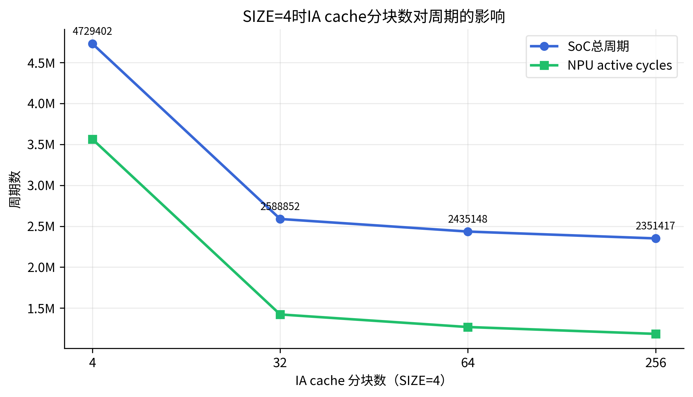
</p>
<p align="center">图7-4 SIZE=4 时 IA cache 分块数对执行周期的影响</p>

<p align="center">
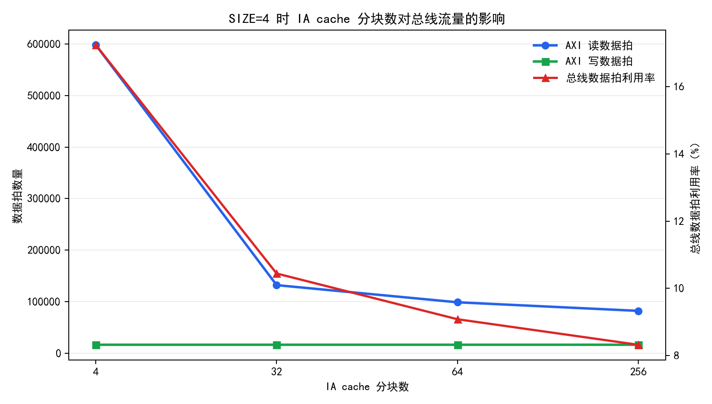
</p>
<p align="center">图7-5 SIZE=4 时 IA cache 分块数对总线流量和利用率的影响</p>

<p align="center">表7-3 SIZE=4、256x256x256 SoC 级 IA cache 分块数扫描</p>

| SIZE | `IA_CACHE_BLOCKS` | K=N=M | SoC 总周期 | NPU 活跃周期 | AXI 读数据拍 | AXI 写数据拍 | 总数据拍 | 总线数据拍利用率 |
|---:|---:|---:|---:|---:|---:|---:|---:|---:|
| 4 | 4 | 256 | 4,729,402 | 3,563,083 | 598,016 | 16,384 | 614,400 | 17.24% |
| 4 | 32 | 256 | 2,588,852 | 1,422,485 | 132,096 | 16,384 | 148,480 | 10.44% |
| 4 | 64 | 256 | 2,435,148 | 1,268,765 | 98,816 | 16,384 | 115,200 | 9.08% |
| 4 | 256 | 256 | 2,351,417 | 1,185,029 | 82,176 | 16,384 | 98,560 | 8.32% |

表7-3表明，在 `SIZE=4` 固定时，IA cache 分块数从 4 增加到 32 的收益最明显：SoC 总周期从 4,729,402 降到 2,588,852，减少 45.26%；NPU 活跃周期从 3,563,083 降到 1,422,485，减少 60.08%；AXI 总数据拍从 614,400 降到 148,480，减少 75.83%。这是因为较深 IA cache 覆盖了更多输入分块复用窗口，显著减少 IA 数据重读。

继续从 `IA_CACHE_BLOCKS=32` 增加到 64 和 256 后，周期仍有改善，但收益明显变小。`IA_CACHE_BLOCKS=256` 相对 32 的 SoC 总周期只再减少 9.17%，而 IA cache 容量增加 8 倍。对板级部署配置而言，`SIZE=4`、`IA_CACHE_BLOCKS=32` 是更均衡的点：它已经消除了大部分重读流量，同时避免过深 cache 带来的片上存储资源和综合压力。总线数据拍利用率从 17.24% 降到 10.44% 不是退化，而是 cache 复用减少了外部搬运需求，小阵列已经从“总线压力受限”转向“计算规模和控制开销受限”。

#### 7.1.4 硬件加速推理性能提升分析

`SIZE=4`、`IA_CACHE_BLOCKS=32`、`PS_FRAME_COUNT=16` 的小阵列参数用于 TFLM MNIST MLP、`hello_world`、`micro_speech` 和 MNIST CNN 的 SoC 级软硬件对比。硬件执行方式启用 NMSIS NN 加速函数并由软件通过 AXI-Lite 寄存器提交 NPU 任务；纯软件执行方式关闭 NPU 加速路径和 NMSIS NN 加速路径。同一模型的软硬件成对使用相同 RAM 容量、相同 CPU、相同 UART 输出路径和相同 CPU I-cache 设置。MNIST MLP 和 `hello_world` 使用 65536 word RAM，`micro_speech` 与 MNIST CNN 使用 524288 word RAM。周期只统计模型推理阶段，不包含模型初始化和 tensor arena 分配。

MNIST CNN 模型结构为 Conv(8)、MaxPool、Conv(16)、MaxPool、FC(64) 和 FC(10)，全模型采用 int8 TFLite 数据。卷积层通过 im2col 形成矩阵乘任务后调用 NPU，全连接层直接对应到矩阵乘任务，池化、softmax、张量形状处理和 TFLM 调度仍由 CPU 执行。CNN 对比测试限制为 1 个 MNIST 样本，样本 0 的标签和预测值均为 7。硬件路径推理周期为 5,534,554，纯软件路径推理周期为 80,563,979，加速比为 14.56 倍；按完整 SoC 运行周期计算，硬件路径为 8,922,010 周期，纯软件路径为 83,951,418 周期，对应 9.41 倍。

<p align="center">
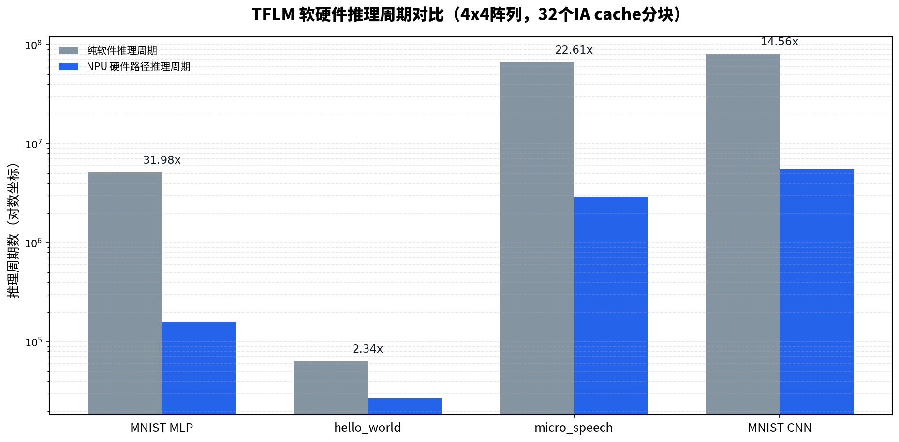
</p>
<p align="center">图7-6 SIZE=4、`IA_CACHE_BLOCKS`=32 的 TFLM 推理周期对比</p>

<p align="center">
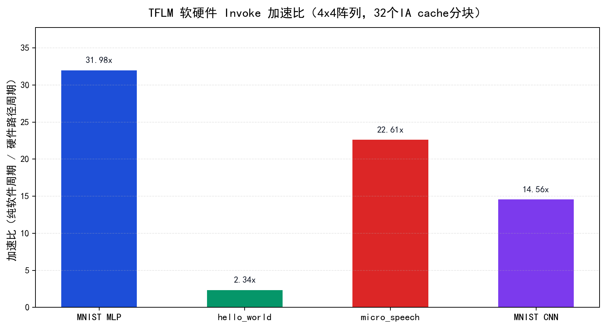
</p>
<p align="center">图7-7 SIZE=4、`IA_CACHE_BLOCKS`=32 的 TFLM 推理加速比</p>

<p align="center">表7-4 SIZE=4、`IA_CACHE_BLOCKS`=32 的 TFLM 软硬件推理对比</p>

| 模型 | 测试样本数 | 软件平均推理周期 | 硬件平均推理周期 | 加速比 | NPU调用数 | NPU 活跃周期累计 | NPU总线数据拍利用率 |
|---|---:|---:|---:|---:|---:|---:|---:|
| MNIST MLP | 3 | 5,114,414 | 159,925 | 31.98x | 6 | 192,105 | 20.34% |
| `hello_world` | 4 | 63,161 | 27,035 | 2.34x | 12 | 3,288 | 17.88% |
| `micro_speech` | 1 | 66,383,752 | 2,936,028 | 22.61x | 17 | 79,278 | 24.13% |
| MNIST CNN | 1 | 80,563,979 | 5,534,554 | 14.56x | 34 | 118,395 | 21.46% |

MNIST MLP 的两层全连接均由 NPU 执行，3 个样本共触发 6 次 NPU 调用，平均推理周期从 5,114,414 降到 159,925，加速 31.98 倍。该结果表明 AXI-Lite 寄存器配置、NMSIS NN 调用路径、NPU 总线访问和输出写回能够在真实 TFLM 程序中形成完整执行过程。由于 MLP 的主要运算集中在全连接层，矩阵乘占比较高，硬件路径能够显著减少 PicoRV32 标量乘加循环和数据访问次数。

`hello_world` 的模型规模很小，单次推理中 NPU 活跃周期约为 822 cycle，TFLM 调度、输入输出张量访问和固定软件开销占比很高，因此加速比为 2.34 倍。该用例反映了短矩阵、频繁 NPU 启停和任务配置开销对端到端时间的影响，不用于评价峰值算力。

`micro_speech` 同时包含 depthwise convolution、reshape、fully connected 和 softmax。硬件执行方式在 1 次推理中触发 17 次 NPU 调用，周期从 66,383,752 降到 2,936,028，加速 22.61 倍。其 NPU 活跃周期只占硬件推理周期的一小部分，说明 TFLM 调度、非矩阵算子和数据准备仍占据较多时间。对该类模型，端到端性能改善需要同时减少 depthwise wrapper、im2col batch 和小矩阵重复提交开销，单纯提高阵列峰值吞吐不能直接转化为同等比例的推理周期下降。

MNIST CNN 在 1 次推理中触发 34 次 NPU 调用，NPU 活跃周期累计为 118,395，NPU 活跃窗口内的等效吞吐约为 1.13 GOPS@200MHz。该数值高于按完整推理周期折算的 0.024 GOPS，说明卷积 im2col、池化、softmax、TFLM 算子调度、MMIO 任务提交和 CPU 内存访问对端到端时间影响较大。硬件路径的 CPU 指令请求为 1,095,934，纯软件路径为 8,328,183；硬件路径的 CPU 数据请求为 226,981，纯软件路径为 3,035,402。该对比说明 NPU 覆盖矩阵乘后显著减少了 CPU 标量指令和数据访问，但 CNN 的非矩阵部分仍需要由软件执行。


为隔离外部 RAM 响应延时对 IA cache 深度的影响，本节给出一个 Verilator 模块级对照实验。实验固定 `SIZE=4`、`PS_FRAME_COUNT=16`、WS 数据流、s8 LHS、per-tensor 定点缩放、`K=128`、`N=128`、`M=64`，分别测试 `IA_CACHE_BLOCKS=4` 和 `IA_CACHE_BLOCKS=32`。RAM 延时模型采用更接近突发访问的返回方式：每个 AXI burst 内部连续返回数据，只在 burst 起始响应前插入等待；固定大延时用例将该等待设置为 50 周期。

<p align="center">
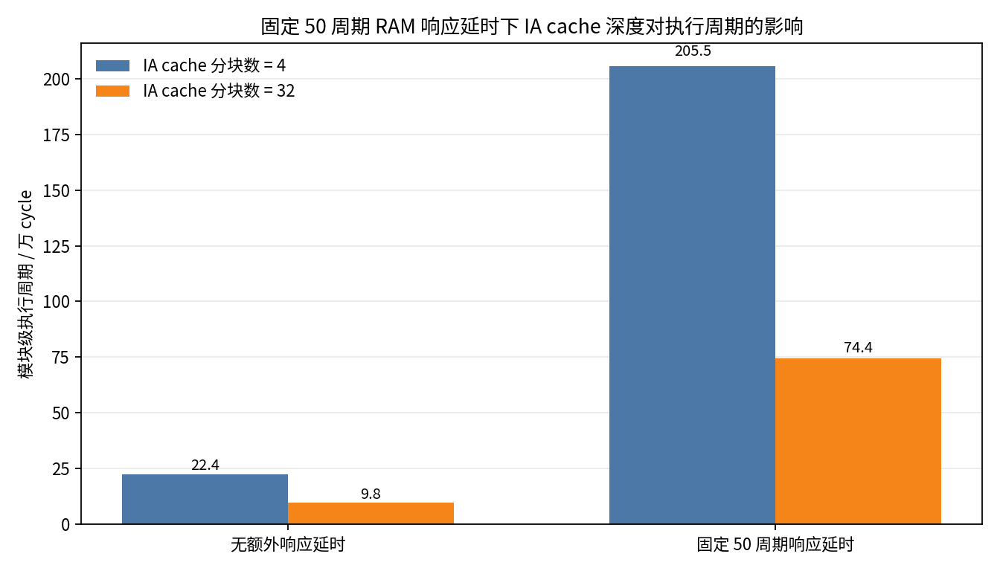
</p>
<p align="center">图7-8 固定 50 周期 RAM 响应延时下 IA cache 深度对执行周期的影响</p>

<p align="center">表7-5 固定 50 周期 RAM 响应延时下 IA cache 深度对模块级执行周期的影响</p>

| 延时模型 | SIZE | `IA_CACHE_BLOCKS` | K | N | M | 执行周期 |
|---|---:|---:|---:|---:|---:|---:|
| 无额外 RAM 响应延时 | 4 | 4 | 128 | 128 | 64 | 224,432 |
| 无额外 RAM 响应延时 | 4 | 32 | 128 | 128 | 64 | 98,054 |
| 固定 50 周期 RAM 响应延时 | 4 | 4 | 128 | 128 | 64 | 2,054,684 |
| 固定 50 周期 RAM 响应延时 | 4 | 32 | 128 | 128 | 64 | 743,902 |

该实验说明，IA cache 的收益会随外部 RAM 首拍响应延时增大而更加明显。在无额外响应延时时，`IA_CACHE_BLOCKS=32` 相对 `IA_CACHE_BLOCKS=4` 的周期减少 56.31%；在固定 50 周期响应延时时，周期减少 63.80%。原因是较深 IA cache 可以让同一批 IA 分块在更多输出列 tile 上复用，减少需要重新发起的读 burst 数；当每个 burst 起始都要付出较大固定等待时，减少 burst 数带来的收益会被放大。该结果与 TFLM 推理章节中选择 `SIZE=4`、`IA_CACHE_BLOCKS=32` 作为小阵列基线参数的结论一致。

### 7.2 总线利用与数据供给匹配分析

本节使用 NPU 顶层 `NPU_UTIL` 统计 AXI 有效数据拍。总线利用率定义为：

```text
总线数据拍利用率 = (axi_r + axi_w) / NPU 活跃周期
读利用率 = axi_r / NPU 活跃周期
写利用率 = axi_w / NPU 活跃周期
```

该指标描述 NPU 活跃窗口中有多少周期发生有效 AXI 数据传输。它不是 AXI 全双工理论带宽，也不是越高越好的单一性能指标。对于给定矩阵规模，IA cache 分块数增加后，输入激活分块可以在更多输出列组之间复用，外部 RAM 读数据拍数会下降；当读写数据拍的下降幅度大于活跃周期的下降幅度时，总线数据拍利用率会降低，但 SoC 总周期和 NPU 活跃周期仍可能同步减少。因此，较低的总线数据拍利用率可能表示片上复用更充分、外部访存需求更低，而不能直接解释为总线供给能力下降。阵列规模增大时，活跃周期缩短，同样的读写数据拍又会表现为更高总线利用率，但阵列利用率可能下降。因此需要同时观察周期、读写数据拍、每次运算外部访问量、阵列利用率和 FIFO/loader stall。

需要区分两类统计范围：模块级仿真用来分析阵列、cache 和数据流的匹配关系；85% 以上的总线利用率指标采用 SoC 级总线压力实验测试结果。两者的活跃窗口和软件/总线环境不同，因此不能直接把模块级或小阵列 SoC 用例中的低总线利用率解释为总线优化退化。除压力测试外，本节的固定 SIZE cache 深度扫描采用板级部署参数 `SIZE=4`，用于评价小阵列配置下 IA cache 深度对读流量、执行周期和数据供给匹配关系的影响。

#### 7.2.1 SoC 级总线利用率

本小节列出 RTL、驱动和仿真环境下的 SoC 级统计结果。总线利用率指标采用压力用例测试，实验条件为 `SIZE=16`、`IA_CACHE_BLOCKS=4`、`PS_FRAME_COUNT=16`、`K=N=M=256`、WS 数据流、s8 LHS、per-tensor 定点缩放、AXI 读写 outstanding 均为 4、RAM 随机响应延时关闭。该压力用例使用较浅 IA cache，外部读流量压力较高，适合观察 AXI interconnect、RAM full-pipe、NPU 总线锁和写回排空路径是否能够持续供给数据。

<p align="center">表7-6 SoC 总线利用率压力测试结果</p>

| 用例 | SIZE | `IA_CACHE_BLOCKS` | `PS_FRAME_COUNT` | K=N=M | `CPU_MEM_DP` | SoC 总周期 | NPU 活跃周期 | AXI 读数据拍 | AXI 写数据拍 | 总线数据拍利用率 | 指标结论 |
|---|---:|---:|---:|---:|---:|---:|---:|---:|---:|---:|---|
| 总线压力测试 | 16 | 4 | 16 | 256 | 524288 word | 1,353,561 | 187,476 | 149,504 | 16,384 | 88.49% | 达标，接近 90% |

压力用例中的总线利用率计算为：

```text
总线数据拍利用率 = (149,504 + 16,384) / 187,476 = 88.49%
```

表7-6表明，在相同矩阵规模和相同 32bit AXI 数据宽度下，SoC 总线通路达到 85% 以上有效数据拍占用，并接近 90% 的压力水平，满足总线利用率指标要求。写回 FIFO 在浅 cache 压力测试下仍保留 32 个可排空 bank，`fifo_stall` 和 `fifo_full` 在该压力用例中均为 0。`SOC_AXI_STATS` 中的 NPU 读写请求等待也为 0，说明总线请求一旦发出即可被 RAM 侧连续接收，interconnect 和 RAM 通路没有形成主要气泡。剩余约 11.51% 的非数据拍周期主要来自 AXI 地址/响应阶段、loader 切 tile、tail 处理和二维写回每行发起一次写 burst 的结构性开销；这些开销不属于 RAM 仲裁堵塞。

为观察小阵列参数下的 cache 深度影响，固定 `SIZE=4`、`K=N=M=256`、`PS_FRAME_COUNT=16` 时不同 `IA_CACHE_BLOCKS` 的 SoC 级总线利用率如表7-7所示。该扫描与 TFLM 推理对比所使用的硬件参数一致。

<p align="center">表7-7 固定 SIZE=4 下不同 IA cache 分块数的 SoC 总线利用率</p>

| SIZE | `IA_CACHE_BLOCKS` | K=N=M | SoC 总周期 | NPU 活跃周期 | AXI 读数据拍 | AXI 写数据拍 | 总线数据拍利用率 | 读利用率 | 写利用率 | FIFO full | FIFO stall |
|---:|---:|---:|---:|---:|---:|---:|---:|---:|---:|---:|---:|
| 4 | 4 | 256 | 4,729,402 | 3,563,083 | 598,016 | 16,384 | 17.24% | 16.78% | 0.46% | 0 | 0 |
| 4 | 32 | 256 | 2,588,852 | 1,422,485 | 132,096 | 16,384 | 10.44% | 9.29% | 1.15% | 72,464 | 55,232 |
| 4 | 64 | 256 | 2,435,148 | 1,268,765 | 98,816 | 16,384 | 9.08% | 7.79% | 1.29% | 75,928 | 57,736 |
| 4 | 256 | 256 | 2,351,417 | 1,185,029 | 82,176 | 16,384 | 8.32% | 6.93% | 1.38% | 64,404 | 48,256 |

表7-7说明，4x4 阵列扫描属于小阵列低外部带宽压力场景，其总线数据拍利用率不应与表7-6的压力用例指标作一一对照。`SIZE=4` 只有 16 个 PE，计算消耗数据的速度显著低于 `SIZE=16`，因此即使总线供给充分，也不会形成高外部总线压力。随着 `IA_CACHE_BLOCKS` 从 4 增加到 256，AXI 总数据拍从 614,400 降到 98,560，减少 83.96%；SoC 总周期从 4,729,402 降到 2,351,417，减少 50.28%。总线数据拍利用率从 17.24% 降到 8.32%，其原因是 IA cache 复用窗口扩大后，LHS 分块重读次数显著减少，外部 RAM 访问需求下降。该现象表示片上复用降低了总线压力，并不表示总线优化退化。

#### 7.2.2 固定 IA cache 存储容量、扫描阵列 SIZE 实验中的总线压力

本小节复用 7.1.2 的固定 IA cache 存储容量实验，观察在同一容量预算下改变 `SIZE` 时的总线压力变化。

<p align="center">
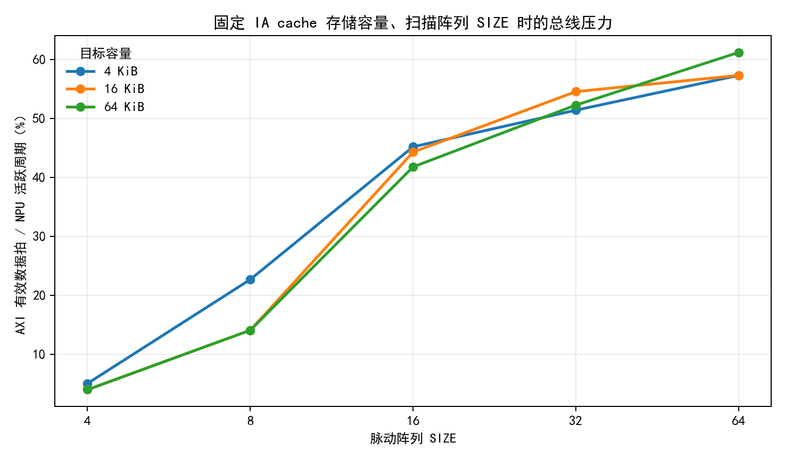
</p>
<p align="center">图7-9 固定 IA cache 存储容量扫描中的总线数据拍利用率</p>

固定 IA cache 存储容量扫描中，总线数据拍利用率随 `SIZE` 增大整体上升。其根本原因是阵列变大后活跃周期缩短，但权重、IA、偏置、输出写回仍需要通过同一 32bit AXI 口搬运。`SIZE=64`、`IA_CACHE_BLOCKS=4` 在 64KiB 目标容量下的总线数据拍利用率达到 61.23%，但阵列利用率只有 3.80%；这说明它更接近数据供给不匹配的大阵列，不是本设计的均衡参数点。

`SIZE=16`、`IA_CACHE_BLOCKS=16` 与 `SIZE=32`、`IA_CACHE_BLOCKS=4` 的对比表明，容量分配对数据供给具有直接影响。两者目标容量同为 16KiB，前者有 16 个 IA cache 块，吞吐为 45.03 GOPS；后者只有 4 个 IA cache 块，吞吐降到 36.87 GOPS，阵列利用率仅 9.00%。在本数据流中，IA cache 块数不仅影响总容量，也影响复用窗口；当块数过少时，DMA 必须更频繁地重读或等待，阵列虽然更大但有效工作比例下降。

## 8. 实现结果总结

本章从硬件结构、功能接口、数据通路、资源指标和性能指标五个方面给出 PicoRV32 与矩阵乘 NPU 异构处理器的实现结果。

### 8.1 系统级实现结果

本设计实现了一个以 PicoRV32 RISC-V 软核为控制核心、以参数化矩阵乘 NPU 为计算后端的异构处理器系统。CPU 负责程序控制、寄存器配置、任务启动和状态读取；NPU 负责矩阵乘、分块数据搬移、片上复用、部分和保存、定点缩放和输出写回。二者通过统一的 AXI 互连和共享 RAM 协同工作，形成了面向 TFLM 算子加速的软硬件协同架构。

系统顶层集成了 PicoRV32、native-to-AXI 桥、AXI 共享互连、AXI RAM、UART、SoC 控制寄存器和 NPU AXI-Lite 外设。CPU 侧通过固定 MMIO 地址窗口访问 NPU 寄存器、UART 和 SoC 控制寄存器；NPU 侧通过 AXI4 主设备接口访问共享 RAM。该结构将控制路径、数据路径和外设状态路径清晰分离，使软件可以用任务粒度调度 NPU，而不需要参与逐元素数据搬移。

| 实现内容 | 设计结果 | 设计作用 |
|---|---|---|
| 控制处理器 | PicoRV32 RISC-V 软核 | 执行 C 程序、配置 NPU 任务并读取状态 |
| SoC 互连结构 | native-to-AXI 桥、AXI 互连、RAM、UART 和控制寄存器 | 连接 CPU、NPU、共享存储和片上外设 |
| NPU 外设封装 | AXI-Lite 控制接口与 AXI4 数据接口 | 将 NPU 封装为可编程 AXI 外设 |
| 共享存储访问 | CPU 与 NPU 共享 AXI RAM | 输入、权重、参数和输出均位于统一地址空间 |
| 软件接口 | 寄存器驱动和 TFLM/NMSIS-NN 接入 | 支持 TFLM 算子提交 NPU GEMM 任务 |

### 8.2 功能与指标实现结果

本设计的功能与指标覆盖处理器集成、AXI 通信、NPU 计算、DMA、低功耗控制和 TFLM 推理测试。下表列出主要测试结果。

| 指标条目 | 目标内容 | 实现结果 |
|---|---|---|
| 控制处理器选择 | 采用 Cortex-M0 或 RISC-V CPU 作为控制处理器 | 系统采用 PicoRV32 RISC-V 软核作为控制处理器。CPU 负责程序执行、MMIO 配置、任务启动和状态读取。 |
| 32 位 NPU 集成 | 在指定 CPU 系统中集成 32 位 NPU 计算单元 | `npu_axil_top` 封装 `npu_top`，控制接口按 32 bit AXI-Lite 访问。NPU 数据主接口采用 32 bit AXI4，与 SoC 共享 RAM 连接。 |
| 4x4 脉动阵列 | 基础设计采用 4x4 脉动阵列架构 | `SIZE=4` 生成 4x4 权重固定脉动阵列。RTL 同一结构支持 `SIZE=8/16/32/64` 综合期配置。 |
| AXI-Lite 单拍接口 | CPU 与 NPU 通过 AXI-Lite 完成配置和状态访问 | 已实现标准 AXI-Lite 从接口。CPU 通过该接口完成寄存器单拍读写、任务启动和状态读取。 |
| AXI Burst 数据搬移 | 支持 Burst 传输和地址递增模式 | NPU 通过 AXI4 主设备访问共享 RAM。`axi_dual_block_dma` 将二维分块请求转换为地址递增 burst，并处理非对齐访问和字节写掩码。 |
| CPU/NPU 协同任务 | CPU 负责逻辑控制，NPU 执行矩阵运算 | 软件以 GEMM 任务粒度写入配置并启动 NPU。NPU 自主完成输入、权重、bias、定点缩放参数读取、分块计算和输出写回。 |
| RTL 仿真与功能测试 | 完成 RTL 仿真，覆盖基本功能、压力和极限条件测试 | 模块级测试覆盖矩阵乘、DMA、缓存、定点缩放和写回。SoC 级测试覆盖 PicoRV32、AXI、驱动和 TFLM 调用路径。 |
| INT8 算力评估 | RTL 仿真频率按 200MHz 折算 NPU INT8 算力，基础目标为 0.5TOPS 峰值，优化目标接近或超过 1TOPS，并给出 ASIC 等效频率 | `SIZE=4`、`IA_CACHE_BLOCKS=32` 在 256x256x256 模块级任务中实测 4.64 GOPS@200MHz。`SIZE=32`、`IA_CACHE_BLOCKS=16` 的 71.02 GOPS@200MHz 换算到 2.82GHz ASIC 等效频率时达到 1TOPS。 |
| AXI Burst 带宽利用率 | Burst 场景基础目标为 60%，优化目标为 80% | 256x256x256 SoC 压力用例有效数据拍占比为 88.49%。512x512x512 任务读数据拍/活跃周期为 81.56%。 |
| 低功耗设计 | NPU 未使用时关闭脉动阵列时钟，采用门控时钟或 DFS 等低功耗技术 | `npu_axil_top` 使用 `ENABLE_CLOCK_GATING` 控制计算核心时钟。空闲时关闭 `npu_top` 时钟，AXI-Lite 寄存器保持系统时钟访问。 |
| AXI 共享互连拓扑 | 采用 AXI 共享总线互连拓扑结构，支持主从设备共享访问 | `soc_axi_interconnect` 仲裁 CPU 与 NPU 主设备访问。RAM、NPU、UART 和 SoC 控制窗口由地址译码选择。 |
| DMA 控制器集成 | 集成 DMA 控制器，减少 CPU 数据搬移参与 | `axi_block_dma_arbiter` 汇聚 IA、权重、bias、定点缩放参数和输出写回请求。`axi_dual_block_dma` 负责二维读写和响应跟踪。 |
| 动态可调阵列与扩展性 | 根据任务需求提高阵列灵活性和计算效率 | RTL 通过 `SIZE` 参数生成阵列规模。运行期 K/N/M、复用深度和有效通道标志处理不同矩阵尺寸与尾块。 |
| AXI 接口标准化 | 通过 AXI 总线接口标准化提升可复用性 | 控制侧采用 AXI-Lite，从设备寄存器按 32 bit 访问。数据侧采用 AXI4 主设备，矩阵数据通过共享 RAM 搬移。 |
| 标准模型推理测试 | 使用标准测试集（如 MNIST、CIFAR-10 等）进行 AI 推理性能测试 | MNIST MLP、`hello_world`、`micro_speech` 和 MNIST CNN 已接入 NPU GEMM 后端。推理加速比分别为 31.98x、2.34x、22.61x 和 14.56x。 |

### 8.3 总体实现成果

本设计完成了从 RISC-V 控制 CPU、SoC 地址空间、AXI 互连、NPU 外设封装、矩阵乘计算核心、DMA 数据搬移到 TFLM 软件调用路径的完整实现。硬件结构围绕“CPU 负责任务控制，NPU 负责高并行矩阵计算”的目标展开，接口层次清晰，控制路径和数据路径分工明确。

NPU 部分形成了可参数化、可配置、可复用的数据通路：前端通过寄存器接收矩阵维度、地址、步长、数据类型、定点缩放和复用配置；中间通过 loader、cache、DMA、脉动阵列和 `ps_buffer` 完成分块计算；后端通过定点缩放、输出打包和写回单元生成 int8 输出。

软件部分完成了 TFLM/NMSIS-NN 在 PicoRV32 SoC 软件环境中的移植适配，并保持 TFLM 算子入口、张量布局和整数定点推理规则兼容。驱动层封装 MMIO 寄存器访问、任务启动、状态轮询、错误返回和超时处理；矩阵乘、全连接和卷积 im2col 后端能够按算子条件提交 NPU GEMM 任务；当算子形状、数据类型或内存布局不满足硬件提交条件时，仍保持 TFLM 软件执行路径。该实现兼顾矩阵乘核心计算、TFLM 运行时兼容性、AXI 系统集成、软件适配和低功耗控制，为后续扩展更多算子接入、调整阵列规模和优化片上缓存策略提供了稳定的软硬件基础。

# 附录


## 附录 A：主要参数符号

| 符号 | 含义 |
|---|---|
| K | 输出行数或批次行数。 |
| N | 公共累加维度。 |
| M | 输出列数或输出通道数。 |
| SIZE | 脉动阵列边长和基本分块尺寸。 |
| `IA_CACHE_BLOCKS` | 输入激活缓存槽位数量。 |
| `PS_FRAME_COUNT` | 部分和与输出窗口数量。 |
| `DATA_WIDTH` | PE 输入激活内部计算位宽，设计中为 signed 16 bit；signed 8 bit 输入进入阵列前符号扩展到该位宽。 |
| `WEIGHT_WIDTH` | PE 权重内部计算位宽，设计中为 signed 16 bit。 |
| `ACC_WIDTH` | PE 累加器和部分和位宽，设计中为 signed int32。 |
| `OUT_WIDTH` | 输出元素位宽，定点缩放后写回 signed 8 bit 结果。 |
| `BUS_WIDTH` | NPU AXI4 数据主接口位宽，本设计为 32 bit。 |
| `NPU_ENABLE_CLOCK_GATING` | SoC 顶层 NPU 计算核心门控时钟使能参数，默认值为 1。 |
| `ENABLE_CLOCK_GATING` | `npu_axil_top` 内部门控时钟使能参数，默认值为 1。 |

## 参考文献

[1] RISC-V International. The RISC-V Instruction Set Manual, Volume I: Unprivileged Architecture: Version 20260120[S/OL]. 2026-01-20[2026-07-04]. https://docs.riscv.org/reference/isa/v20260120/unpriv/unpriv-index.html.
[2] YosysHQ. PicoRV32: A Size-Optimized RISC-V CPU[CP/OL]. 2019-03-02[2026-07-04]. https://github.com/YosysHQ/picorv32.
[3] Arm Limited. AMBA AXI and ACE Protocol Specification: ARM IHI 0022H[S/OL]. 2020-03-31[2026-07-04]. https://developer.arm.com/-/media/Arm%20Developer%20Community/PDF/IHI0022H_amba_axi_protocol_spec.pdf.
[4] TensorFlow. TensorFlow Lite for Microcontrollers[CP/OL]. [2026-07-04]. https://github.com/tensorflow/tflite-micro.
[5] Google. LiteRT 8-bit quantization specification[EB/OL]. 2026-05-28[2026-07-04]. https://developers.google.com/edge/litert/conversion/tensorflow/quantization/quantization_spec.
[6] Nuclei. NMSIS NN Overview: NMSIS 1.6.0 documentation[EB/OL]. 2026-06-15[2026-07-04]. https://doc.nucleisys.com/nmsis/nn/overview.html.
