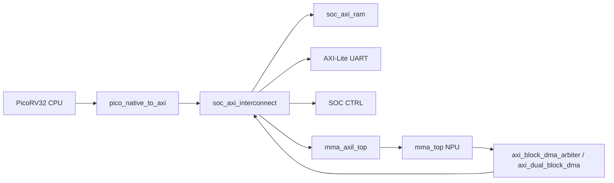

# 基于 PicoRV32 与优化 NPU 的异构处理器设计报告

版本：2026-07-03 技术报告稿

文档定位：本设计面向 PicoRV32 SoC 中 AI-DSA/MMA 加速器的体系结构、模块接口、软件控制、仿真验证和性能分析展开。系统由 PicoRV32、AXI/AXI-Lite 互连、AXI RAM、MMA 控制寄存器、参数化矩阵乘 NPU、片上缓存、统一块 DMA、重量化输出单元和 TFLite Micro/NMSIS-NN 软件接入层组成。

核心对象：PicoRV32 处理器、AXI/AXI-Lite 互连、AXI RAM、AXI-Lite 控制寄存器、参数化矩阵乘 NPU、权重固定/输入固定数据流、片上缓存、统一块 DMA、量化输出和 TFLite Micro/NMSIS-NN 软件接入。

## 目录

1. 应用背景、需求分析与总体方案

2. 设计目标与规格约束

3. CPU 与 NPU 异构 SoC 总体架构

4. AXI 总线与存储子系统设计

5. NPU 总体架构

6. 4x4 阵列与优化阵列设计

7. 模块设计

8. 低功耗设计与实现范围

9. 性能优化特色与访存瓶颈缓解设计

10. 寄存器、指令与软件接口

11. CPU/NPU 协同执行流程

12. 软件驱动与 TFLM 接入

13. 标准测试集 AI 推理性能

14. 设计目标完成情况汇总

15. 当前限制与后续改进

16. 关键数据通路与系统级时序

17. 工程实现、验证结果与交付状态

18. 附录


# 正文


## 1. 应用背景、需求分析与总体方案

端侧智能设备通常需要在受限面积、功耗和存储资源条件下完成神经网络推理。PicoRV32 软核能够承担控制、调度、地址管理、异常处理和运行时执行等任务，但对卷积、全连接和矩阵乘等高密度算子而言，通用 CPU 的指令级执行方式难以提供足够的吞吐。AI-DSA/MMA 加速器的设计目标是在 PicoRV32 SoC 内提供可配置的矩阵乘后端，使 TFLite Micro 和 NMSIS-NN 中的矩阵乘、全连接以及卷积 im2col 后端能够通过硬件完成主要计算。

本设计面向的核心计算为量化 GEMM：`C[K, M] = A[K, N] x B[N, M]`。其中 LHS/IA 默认按行展平，RHS/W 默认按输出列展平，DST 按行主序写回。硬件通过 AXI-Lite CSR 接收矩阵基址、尺寸、stride、量化参数、数据类型、数据流模式和 reuse 参数；任务启动后，MMA 内部自主完成分块加载、片上缓存复用、脉动阵列乘加、部分和缓存、重量化、FIFO 打包和 AXI 写回。CPU 不参与逐元素搬移，也不直接控制每个 PE 的计算节拍。

从系统需求看，设计需要同时满足四类约束。第一，软件接口需要与 TFLite Micro/NMSIS-NN 的 int8 推理路径匹配，包括 per-tensor/per-channel 量化、bias、activation clamp、s8/s16 输入路径和非致密 stride。第二，硬件数据通路需要能够以 `SIZE x SIZE` 脉动阵列为核心执行分块矩阵乘，并正确处理 K/N/M 尾块、非对齐地址和输出 byte mask。第三，存储系统需要通过 AXI burst、outstanding、读写通道分离、IA cache、PS buffer 和输出 FIFO 降低外部存储压力。第四，SoC 集成需要提供确定的 AXI-Lite 控制寄存器和 AXI4 master 数据接口，使 PicoRV32、UART、RAM 和 MMA 在同一地址空间内协同工作。

总体架构分为控制面、互连与存储面、NPU 控制面和 NPU 数据面。控制面由 PicoRV32、驱动程序、TFLM/NMSIS-NN 适配层和 AXI-Lite 寄存器组成；互连与存储面由 CPU native-to-AXI 桥、共享 AXI interconnect、AXI RAM、UART、SOC 控制寄存器和 AXI ping-pong buffer 组成；NPU 控制面由 `mma_axil_top`、`csr_unit`、`mma_controller`、`wbu` 和 DMA 仲裁器组成；NPU 数据面由 IA loader、kernel loader、bias loader、compute core、权重固定脉动阵列、partial sum buffer、vec_requant、vec_s8_to_fifo、oa_writer 和 axi_dual_block_dma 组成。

PicoRV32 的职责是运行软件栈、完成模型调度、写入 CSR、启动任务并检查状态。NPU 的职责是根据 CSR 配置完成矩阵乘相关数据搬移和计算。该任务划分使 CPU 保持可编程控制能力，使 NPU 在规则矩阵计算中获得较高吞吐，并通过片上缓存和 DMA 降低 CPU 参与数据传输的开销。设计不假定所有神经网络算子都由硬件执行；非矩阵乘类算子、当前未覆盖的数据类型和不适合硬件提交的小算子仍可由软件路径执行。

算力统计采用标准 MAC 计算方式：一次乘加记为两个操作。`SIZE x SIZE` 阵列在频率 `freq_hz` 下的理论峰值为 `2 × SIZE × SIZE × freq_hz`。按 200 MHz 估算，4x4 阵列为 6.4 GOPS，16x16 阵列为 102.4 GOPS，32x32 参数探索构型为 409.6 GOPS。覆盖率、功耗、物理时序和完整数据集准确率不列入已完成指标。

## 2. 设计目标与规格约束

AI-DSA/MMA 的设计目标是为 PicoRV32 SoC 提供可由软件直接调用的端侧推理加速后端。硬件不作为孤立矩阵乘单元交付，而是作为 SoC 内部的 NPU 数据通路，与 AXI-Lite 控制寄存器、AXI4 数据主接口、共享存储系统和 TFLM/NMSIS-NN 软件入口共同构成完整执行过程。表 2-1 给出主要设计目标和当前 RTL 中的实现位置。

| 设计目标 | 当前实现位置 | 说明 |
|---|---|---|
| PicoRV32 SoC 集成 | `soc_top.sv`、`pico_native_to_axi.sv`、`soc_axi_interconnect.sv` | CPU 通过 AXI-Lite 配置 MMA，MMA 通过 AXI master 访问 RAM。 |
| 量化 GEMM/FC/Conv-im2col 加速 | `mma_top.sv`、NMSIS-NN ExtraAccFunctions、`dsa_accel.c` | 软件将矩阵乘类算子映射为硬件任务。 |
| 参数化脉动阵列 | `ws_systolic_array.sv`、`ws_systolic_cell.sv` | `SIZE` 可综合时配置，基础构型支持 4x4，当前优化构型以 S16 为主。 |
| AXI-Lite 控制寄存器 | `mma_axil_top.sv`、`csr_unit.v` | 控制、状态、写回信息、reuse 和矩阵 CSR 均为 32 位访问。 |
| AXI4 burst 数据搬移 | `axi_block_dma_arbiter.sv`、`axi_dual_block_dma.sv` | 读写通道支持二维块访问、outstanding、非对齐处理和写 mask。 |
| 片上数据复用 | `ia_loader_ctrl.sv`、`ia_loader_cache_mgr.sv`、`ps_buffer.sv` | IA cache、W reuse 和部分和缓存降低重复访存。 |
| 量化输出 | `vec_requant.sv`、`vec_s8_to_fifo.sv`、`oa_writer.sv` | int32 累加结果转换为 int8，按 32 位 beat 打包写回。 |
| WS/IS 数据流 | `mma_top.sv`、loader、FIFO 和 writer | `cfg_dataflow_mode=0` 表示 WS，`cfg_dataflow_mode=1` 表示 IS。 |
| 功能验证 | VCS/Verilator 仿真结果、MNIST MLP/CNN 运行结果 | 已有随机矩阵、尺寸扫描和模型样例验证；覆盖率需进一步补充。 |

数据类型约束如下：IA/LHS 内部为 signed 16 bit，外存可按 s8 或 s16 读取；W/RHS 内部为 signed 16 bit，WS 模式下通常由 s8 RHS 符号扩展得到；accumulator 为 signed int32；bias 为 signed int32；quant multiplier/shift 为 signed int32；最终输出为 signed int8。PE 内部不进行逐拍饱和，饱和、舍入、activation clamp 和 int8 裁剪在 `vec_requant` 阶段完成。

内存布局约束如下：LHS 默认按行展平，`lhs_row_stride_b` 表示相邻两行首地址的字节距离；RHS 默认按输出列展平，`rhs_col_stride_b` 表示相邻输出列或 channel 的字节距离；DST 按行主序写回，`dst_row_stride_b` 表示相邻输出行首地址的字节距离。AXI DMA 允许非对齐基址和非致密 stride，非对齐拼接由 `axi_dual_block_dma` 处理，尾行、尾列和尾 beat 由 loader、requant/FIFO 与 OA writer 共同生成有效 lane 和 byte mask。

参数化约束如下：`SIZE` 决定阵列边长和基本 tile 边长；`IA_CACHE_BLOCKS` 决定 IA cache slot 数量；`PS_FRAME_COUNT` 决定 partial sum 和输出 FIFO 的帧窗口；`AXI_READ_OUTSTANDING` 与 `AXI_WRITE_OUTSTANDING` 决定 AXI 读写在途事务上限。当前设计支持综合时选择不同 SIZE/CACHE 组合，但不支持运行时改变 PE 数量或阵列拓扑。软件可在运行时改变矩阵维度、stride、数据类型、量化方式、WS/IS 模式和 reuse 配置。

低功耗相关目标在 RTL 中主要体现为减少无效数据搬移和提高片上复用，包括 IA cache、权重固定、partial sum buffer、输出打包和 DMA burst。系统未集成独立 clock-gating 单元、DFS 控制、电源域划分、功耗仿真或功耗实测流程，因此低功耗量化指标不列入已完成项。后续低功耗实现需要补充时钟门控策略、切换活动统计和功耗分析结果。

验证目标包括：小尺寸矩阵、K/N/M 尾块、不同 `SIZE` 与 `IA_CACHE_BLOCKS`、WS/IS 模式、s8/s16 数据路径、per-tensor/per-channel 量化、非对齐地址、非致密 stride、随机内存延迟、SoC 程序启动、TFLM/NMSIS-NN 算子调用和模型级推理结果。当前已有 4x4 随机、固定尺寸/缓存扫描、MNIST MLP 和 MNIST CNN 结果；完整覆盖率、完整数据集准确率、AXI-Lite 逐寄存器波形和极限错误响应仍需进一步确认。


### 2.1 软件映射与算子覆盖范围

软件映射以量化矩阵乘为硬件提交单元。TFLite Micro 和 NMSIS-NN 的上层算子在运行时仍保留原有函数行为，适配层只在矩阵形状、数据类型、量化参数和内存布局满足硬件条件时生成 DSA 任务。全连接算子的输入 batch 可映射为输出行数 K，filter 的输入通道映射为归约维度 N，filter 的输出通道映射为输出列数 M。卷积算子在当前实现中通过 im2col 缓冲把滑窗采样结果整理为矩阵行，再以矩阵乘任务提交给 MMA。该映射保持软件可回退能力，当算子规模过小、数据类型不匹配、参数布局不满足约束或任务启动开销大于预期收益时，软件路径仍可继续执行。

硬件任务的最小软件契约由矩阵基地址、维度、stride、零点、偏置、量化参数和输出裁剪参数组成。软件在启动前需要保证 LHS、RHS、bias、per-channel multiplier、per-channel shift 和输出缓冲地址均位于 NPU DMA 可访问的 RAM 空间内；硬件不解析 TFLite 模型图，也不保存算子层级信息。此设计把模型图调度、算子选择、异常处理和超时策略放在 CPU 软件中，把大块规则矩阵乘的数据搬移、乘加和写回放在 NPU 中，从而避免在寄存器接口上暴露过细粒度的 PE 控制。

硬件直接覆盖的入口包括普通 int8 矩阵乘、s16 LHS 与 s8 RHS 的 kernel 矩阵乘、带行偏移的 kernel 矩阵乘、全连接以及 im2col 后的卷积矩阵乘。非矩阵乘类算子、浮点算子、int4 算子和需要复杂稀疏索引的算子不作为硬件直接执行对象，对应软件路径保留 fallback。这样的划分有利于保持硬件控制状态机可验证，也避免为低占比或不规则算子引入复杂地址发生器。

软件提交任务时，适配层需要把 NMSIS-NN 的参数结构转换为硬件 CSR 字段。输入 offset 和权重 offset 进入累加前的加法路径，输出 offset 在重量化后加入，activation min/max 在输出裁剪阶段使用。per-tensor 量化时，multiplier 和 shift 可以作为标量配置；per-channel 量化时，CSR 保存参数数组基地址，由硬件按输出通道读取。bias 指针为 0 时表示无偏置，硬件应把偏置初值视为 0，而不是访问地址 0 作为有效偏置数组。

为了保证软件与硬件结果一致，驱动层需要统一矩阵含义。K 表示输出行数，N 表示归约维度，M 表示输出列数；LHS 形状为 K×N，RHS 形状为 N×M，DST 形状为 K×M。WS 与 IS 模式只改变内部流式输入和驻留数据的角色，不改变软件可见的 GEMM 公式。软件不需要根据内部模式改变结果矩阵的数学定义，只需要按寄存器定义写入模式位和 stride 字段。

### 2.2 逻辑矩阵、物理布局与地址约束

逻辑矩阵布局采用便于 NMSIS-NN 后端映射的约定。LHS/IA 默认按行展平，`lhs_row_stride_b` 表示相邻两行首地址之间的字节距离；RHS/W 默认按输出列展平，`rhs_col_stride_b` 表示相邻输出列或 channel 的字节距离；DST 按行主序写回，`dst_row_stride_b` 表示相邻输出行首地址之间的字节距离。stride 以字节为单位而不是元素数，原因是同一 RTL 需要覆盖 s8 与 s16 两类输入宽度，并需要支持软件侧非致密缓冲。

地址生成单元按照 tile 行、tile 列和归约 tile 计算每次 DMA 访问的起始地址。对 LHS，行地址由 `lhs_base + row_index * lhs_row_stride_b` 形成，列内偏移由归约 tile 和元素宽度决定。对 RHS，列基地址由 `rhs_base + col_index * rhs_col_stride_b` 形成，归约方向在列内连续排列。对 DST，写回地址由 `dst_base + out_row * dst_row_stride_b + out_col` 形成，输出为 int8 时每个元素占 1 字节，最后不足 4 字节的写 beat 通过 byte mask 限定有效字节。

NPU DMA 支持非对齐基址和带 stride 的二维块访问，但这种支持不表示软件可以忽略内存一致性。CPU 在启动任务前需要完成输入、权重、偏置和量化参数写入，并通过必要的顺序约束保证这些写入对 NPU 可见；NPU 任务完成后，CPU 读取输出前也应遵守内存访问顺序。当前 PicoRV32 SoC 没有启用复杂数据 cache 一致性机制，因此一致性主要由软件写入顺序和 MMIO fence 保证。若后续引入 CPU data cache，需要增加 flush 或 invalidate 规则。

K、N、M 不是 SIZE 整数倍时，硬件按尾块处理。输入 loader 根据有效行数和有效列数决定 DMA 读取长度，并对无效 lane 使用零点或无效标志处理；kernel loader 对最后输出列组裁剪有效列数；requant 和输出 FIFO 记录最后一组有效 lane；OA writer 根据有效输出列和地址低位生成写掩码。该行为的目标是只修改目标输出矩阵中属于有效元素的字节，不覆盖同一 32 位 word 中的相邻内存内容。

地址约束还包含非法访问处理要求。硬件配置检查识别维度为 0、stride 无法覆盖有效行、基地址未配置、输出地址与输入区域异常重叠等风险场景。RTL 中具备基本错误码和状态反馈；非法配置的完整覆盖需要通过 CSR 组合扫描、非法地址访问、AXI 响应错误和软件超时测试进一步扩展，并在仿真结果中记录错误码、busy 清除和 done 状态的关系。

### 2.3 数据类型、零点与重量化规则

数据类型设计围绕 int8 推理和 s16 中间输入路径展开。IA/LHS 在内部数据面统一为 signed 16 bit，外存读取可以是 s8 或 s16；s8 输入进入内部后进行符号扩展，s16 输入直接进入内部 16 位通路。W/RHS 在内部同样按 signed 16 bit 进入 PE，常见 WS 路径中由 s8 权重符号扩展得到。乘法结果和累加结果使用 signed int32 表达，bias 也按 signed int32 进入累加初值。该选择与 NMSIS-NN 常见量化算子保持一致，并避免在 PE 内部引入浮点或可变宽度运算。

零点处理发生在进入乘法前。LHS 元素与 `lhs_offset` 相加后参与乘法，RHS 元素与有效的 RHS offset 相加后参与乘法。当前常见 int8 权重路径中 RHS 零点通常为 0，但硬件保留相关字段以支持模式交换和后续扩展。零点加法需要在元素有效时执行；尾块无效 lane 不能产生真实乘法贡献，应由无效标志、补零或等价的零贡献策略处理。这样可以保证最后 tile 不会因为未定义数据进入 PE 而影响有效输出。

PE 内部不进行逐拍饱和。每个 PE 接收输入数据、驻留权重和来自上一行的 partial sum，在时钟边沿更新累加路径，并把 int32 宽度内的结果向下游传递。删除逐拍饱和比较器符合 accumulator 计算规则，因为 NMSIS-NN 的结果裁剪发生在重量化和 activation clamp 阶段，而不是每一次 MAC 后。该设计同时减少 PE 阵列中重复比较器和 mux 的数量，有利于时序和面积，但功能结论仍以仿真结果为准。

重量化由 `vec_requant` 完成。该模块接收 int32 累加值、bias 后结果、输出 multiplier、输出 shift、dst offset、activation min 和 activation max，并产生 signed int8 输出。per-tensor 模式下，所有输出 lane 共享同一 multiplier 和 shift；per-channel 模式下，硬件按输出通道索引加载对应参数。重量化过程需要完成乘法缩放、舍入、移位、加输出 offset、activation clamp 和 int8 饱和。舍入细节的逐位一致性尚未作为完成项；已有模型和矩阵测试说明当前主要路径可通过。

输出阶段以 int8 为内存格式。`vec_s8_to_fifo` 将多个 lane 组合为 32 位写数据，同时生成 4 bit byte mask；`oa_writer` 使用 mask 发起 AXI 写事务。对于 IS 模式或转置写回场景，输出 FIFO 还需要按最终行主序重排输出顺序。写回完成不能只看 FIFO 输入有效，而必须等待 FIFO 数据被 DMA 消费、写地址发送、写数据发送和 B 通道响应返回后才能作为任务完成条件的一部分。

### 2.4 分块外积调度与片上复用策略

MMA 的分块调度以 SIZE×SIZE tile 为基本单位，但任务执行不是简单地按一个输出 tile 完成后再进入下一个输出 tile。当前设计使用分块外积式调度，将一组 IA row-tile 与一组 W col-tile 组合，形成多个输出 tile 的更新。`ia_reuse_num` 表示同一归约 tile 下连续缓存的 IA row-tile 数，`w_reuse_num` 表示同一 IA group 服务的输出列 tile 数。两个参数共同决定一个调度窗口内的片上复用强度。

IA cache 是片上复用的核心结构。IA loader 把输入 tile 读入多个 cache slot，并在同一归约 tile 下重复向阵列输出。cache manager 通过 valid、busy、slot pointer、group pointer 和发送完成标志维护 slot 状态。一个 IA tile 在完成最后一次复用前不能被新 DMA 数据覆盖；完成复用后，slot 可以尽早释放给下一组预取。该策略减少了 IA 重复从外存读取的次数，同时保持阵列输入连续性。

W reuse 通过 kernel loader 和控制器协同完成。权重按输出列展平从内存读取，进入 kernel buffer 后按阵列列方向输出并驻留在 PE 中。一个权重 tile 装入后，可以服务多个 IA row-tile；当输出列 group 切换或最后列 group 宽度变化时，kernel loader 重新加载下一组权重。W 侧不设置与 IA cache 等规模的大 cache，原因是权重列本身在内存中连续，burst 读取效率较好，而 IA 在多个输出列上重复使用的收益更直接。

partial sum buffer 用于跨归约 tile 保存中间和。矩阵乘的 N 维被拆成多个归约 tile 后，同一个输出元素需要多次累加。如果每次归约 tile 后都把 int32 partial sum 写回外存，再在下一次读回，外部带宽会被中间和读写占据。PS buffer 在片上保存这些中间结果，并在下一次归约 tile 到来时回灌给 compute core。只有最终归约 tile 完成后，结果才进入 requant 和输出写回。

复用参数的运行时处理需要避免硬件除法和复杂取模。软件可写入 0 表示使用默认派生值，也可写入非 0 值进行探索；硬件根据 `IA_CACHE_BLOCKS`、`PS_FRAME_COUNT`、输出行 tile 数和输出列 tile 数裁剪到合法范围，并向下取 2 的幂。这样可以用移位、比较和 mask 实现 group 判断，降低控制路径复杂度。若软件写入超出硬件容量的值，硬件不应扩大缓存窗口，而应裁剪或返回错误，具体行为以 RTL 状态机为准。

分块调度的收益受矩阵形状影响。大矩阵、输出列较多、归约维度较长时，IA 与 W 复用能够明显减少重复读；小矩阵、尾块比例高或 per-channel 参数读取占比大时，任务启动、DMA 命令和写回固定开销会提高。性能评价区分 MLP、CNN、固定尺寸扫描和参数组合扫描，单一形状结果不作为所有网络层的通用结论。

### 2.5 总线、DMA 与存储访问约束

NPU 数据面通过统一 DMA 访问 SoC RAM。各 loader 和 OA writer 不直接驱动 AXI，而是向 `axi_block_dma_arbiter` 提交读写请求，由仲裁器选择一个 client 并把请求发送给 `axi_dual_block_dma`。统一 DMA 处理 AXI burst、outstanding、非对齐地址、行 stride、读数据返回拆分、写数据 mask 和响应等待。这样可以避免每个 loader 各自实现 AXI 协议，同时便于统计和调试总线行为。

读 DMA 支持二维块读取。请求字段包括基地址、行数、每行有效字节或元素数、行 stride、元素宽度、zero point 和 client 标识。DMA 将一行拆成一个或多个 burst，并跟踪返回数据属于哪个 client、哪一行和哪一列。由于 AXI 读响应可能在多个周期后返回，client 侧不能假设发出请求后下一拍得到数据；必须使用 valid/ready 或等价握手机制接收返回 payload。随机内存延迟仿真正是用于验证这种变延迟条件下的保持行为。

写 DMA 支持输出打包后的 32 位 beat 写回。OA writer 提供写地址、写数据、byte mask、行 stride 和任务完成条件；DMA 负责发出 AW/W，并等待 B 通道响应。写数据通道的 `wlast` 必须与对应 burst 的最后一个 beat 对齐，byte mask 必须只在有效输出字节上为 1。若下游 RAM 或互连反压，写数据、地址和 mask 保持不变，直到握手完成。任务 done 不能在 B 响应全部返回前置位。

CPU 与 NPU 共用 AXI interconnect 和 RAM，因此互连需要处理 owner、active、outstanding 和等待状态。CPU 侧主要执行取指、MMIO 和少量数据访问；NPU 侧主要执行 burst DMA。互连不能让 NPU 的长 burst 使 CPU 外设访问永久等待，也不能因为 CPU 单拍访问频繁打断 NPU 导致阵列长期饥饿。当前性能记录中的 CPU 等待、MMA 等待和 yield 计数可用于判断仲裁策略对任务周期的影响。

总线带宽计算需要把理论峰值、任务周期和实际字节数放在同一统计范围内。32 位 AXI 数据宽度在 200 MHz 下单方向理论峰值为 800 MB/s；若按 150 MHz FPGA 实现频率计算，则单方向理论峰值为 600 MB/s。实际任务带宽应由同一任务窗口内的 read bytes、write bytes 和 NPU active cycles 计算。现有 beat/active 数据可用于瓶颈分析，但精确达标结论需要可复现计数器或统一仿真脚本支撑。

### 2.6 参数化实现与 FPGA 收敛约束

RTL 通过参数控制阵列规模、缓存深度、输出窗口和 AXI outstanding 深度。`SIZE` 决定脉动阵列边长和 tile 基本尺寸；`IA_CACHE_BLOCKS` 决定 IA cache slot 数；`PS_FRAME_COUNT` 决定 partial sum 和输出 FIFO 的窗口；`AXI_READ_OUTSTANDING` 与 `AXI_WRITE_OUTSTANDING` 决定 DMA 读写在途事务数量。参数在综合期确定，软件运行时不能改变 PE 数量、阵列形状或物理缓存容量。

参数化的约束不是只保证功能可综合，还需要保证不同参数组合下控制字段宽度、FIFO 深度、地址计数和状态机终止条件正确。SIZE 增大时，PE 数量按平方增长，权重 buffer、输出 FIFO、PS buffer 和 requant lane 数也随之增长；cache blocks 减少时，IA 复用窗口受限，大阵列更容易等待数据。性能扫描显示，S32/C4 虽然理论峰值较高，但 active utilization 明显低于 S16/C16，这说明缓存容量与总线供给必须和阵列规模匹配。

FPGA 实现将大数组优先映射到 BRAM 或 SRL。输出 FIFO、kernel buffer、bias buffer 和 PS buffer 如果用寄存器阵列表达并带全量复位，综合器容易产生大量 LUT mux、FF 和 reset 控制资源。优化实现只复位 valid、pointer、tag 和状态机，不对无效时不被消费的大 payload 数组进行全量清零；规则延迟线使用 SRL；随机访问缓存使用同步 RAM。该策略使 OA FIFO、kernel loader 和 MMA 总体 LUT 显著下降。

时序收敛的关键路径集中在 DMA 到 buffer 写入、AXI RAM enable、kernel BRAM 写口、systolic 到 PS buffer 写口以及高扇出控制信号。已经采用的结构优化包括 bias 写入侧本地打一拍、AXI interconnect/RAM 前增加 ping-pong timing buffer、去除 PE 内逐拍饱和比较器、PS FIFO BRAM 写口前寄存以及删除无功能意义的数据寄存器复位。这些修改不改变软件可见接口，但改变内部时序阶段，因此需要用功能仿真确认输出一致。

`SIZE=16, IA_CACHE_BLOCKS=4, PS_FRAME_COUNT=16` 在 Artix-7 `xc7a200tfbg484-3` 上的 `syncrst_v6` 实现结果为 core clock 150 MHz、WNS +0.055 ns、TNS 0、setup failing endpoints 0、Slice LUT 27755、Slice FF 31339、BRAM tile 173、DSP 320，并已生成 bitstream。`syncrst_v7/src` 作为源码参考版本使用；若对 v7 形成最终 PPA 结论，需要使用同一约束重新导出综合与实现结果。

### 2.7 验证目标与可确认结果

验证目标覆盖模块级、NPU 子系统级、SoC 级和软件模型级四个层次。模块级验证关注 loader、buffer、DMA、requant 和 writer 在独立激励下的握手、地址、状态机和数据对齐；NPU 子系统级验证关注一次矩阵乘任务从 start 到 done 的完整执行；SoC 级验证关注 PicoRV32 通过 MMIO 配置 NPU 并与 RAM、UART 和互连协同；软件模型级验证关注 TFLM/NMSIS-NN 算子调用和模型推理结果。

矩阵维度方面，验证应覆盖 K、N、M 小于 SIZE、等于 SIZE、大于 SIZE、非 SIZE 整数倍、输出列尾块和输出行尾块。数据类型方面，应覆盖 s8 LHS、s16 LHS、s8 RHS、int32 bias、per-tensor 量化和 per-channel 量化。地址方面，应覆盖对齐基址、非对齐基址、非致密 stride、尾 beat byte mask 和不同输出行步进。总线方面，应覆盖零延迟 RAM、随机延迟 RAM、读写反压、outstanding 达上限和写响应延迟。

功能验证结果包括 4x4 随机矩阵用例 PASS、固定 SIZE/CACHE 扫描 12 个组合 PASS、MNIST MLP 三个样例预测正确并给出平均周期、MNIST CNN 三个样例预测正确并给出样例加速。功能回归还包含带 DDR 随机延迟的设置，说明基础控制器、DMA 和尾块处理在非理想内存等待条件下能够完成任务。覆盖率达标仍需要独立统计。

性能验证区分功能正确、周期改善和指标达成。MLP 平均加速约 99.4 倍，反映全连接主导网络中硬件矩阵乘覆盖了主要时间；CNN 样例加速约 14.39 倍，反映卷积 im2col、池化和小块控制开销降低了端到端收益。固定矩阵扫描显示 S16/C16 在容量约束下比 S32/C4 更均衡，任一单点结果不作为所有模型的保证。

覆盖率、功耗和完整板级压力测试仍需进一步确认。覆盖率 95% 汇总、基于切换活动的功耗分析、所有非法配置和 AXI 错误响应的完整断言结果尚未形成完成指标。交付级验证应增加覆盖率统计、协议断言、随机测试种子管理、软件超时场景、输出一致性批量比对和板级长时间运行记录。

### 2.8 软件驱动访问规则

驱动通过内存映射寄存器访问 NPU。寄存器为 32 位宽，软件使用 volatile load/store 读写，访问基址为 `0x10000000`。驱动在写 start 前需要先写矩阵基址、维度、stride、offset、量化、激活范围和复用参数，再通过 fence 或等价顺序约束保证内存数据与 MMIO 配置顺序。写 start 后，硬件应锁存本次任务配置；软件在 busy 期间不应修改会影响当前任务的数据寄存器。

状态轮询以 ready、busy、done、writeback valid、error code 和 response error 为主要字段。ready 表示可接受新任务，busy 表示任务正在执行，done 是 sticky 完成标志，writeback valid 表示写回信息有效。软件读取 done 后还需要检查错误位，不能只把 done 置位解释为计算正确。清 done 和清 writeback valid 使用控制寄存器中的清除位，清除操作应与下一次 start 分离或按 RTL 允许的同周期规则执行。

驱动选择 reuse 参数时，应考虑矩阵形状与硬件容量。`cfg_ia_reuse_num` 和 `cfg_w_reuse_num` 写 0 表示使用硬件默认派生值，写非 0 表示给出期望复用窗口。软件可按 power-of-two 值选择以便硬件裁剪，也可根据 K/N/M 和 `IA_CACHE_BLOCKS` 估算较合适的组合。若驱动无法确定收益，使用默认值比写入过大值更稳妥，因为硬件需要防止 cache slot 覆盖和 FIFO 窗口溢出。

超时策略由软件维护。NPU 正常执行时，busy 会保持到任务所有读写和计算完成；若配置非法、总线错误或状态机异常，软件不能无限等待。驱动中设置轮询次数上限，超时后返回错误，使上层算子能够选择 fallback 或上报失败。硬件侧若检测到配置错误，应设置错误码并退出 busy；若是 AXI 响应错误，应通过状态寄存器反映响应异常。错误恢复覆盖范围限于状态位、错误码和软件超时返回，更多异常场景需要后续测试补充。

TFLM/NMSIS-NN 适配层还需要处理输出一致性。硬件返回后，上层函数应按原算子要求写入输出 buffer，并保持输出维度、batch 顺序和 channel 顺序不变。卷积 im2col 路径中，im2col buffer 的生命周期需要覆盖 NPU DMA 读取窗口，不能在任务完成前复用或释放。对于 per-channel 参数数组，软件需保证数组长度至少覆盖输出通道数，且地址满足 DMA 访问范围。

### 2.9 性能指标定义与统计方法

性能指标分为理论峰值、任务周期、有效吞吐、总线利用和端到端推理加速。理论峰值按 `2 × SIZE × SIZE × frequency` 计算，其中一次乘加按两个操作计。该指标只反映阵列在每周期所有 PE 都完成有效 MAC 时的上限，不包含 loader、DMA、requant、FIFO、写回和 CPU 调度开销。任务周期由 NPU 从 start 到 done 的周期数表示，端到端推理周期还包括软件调度、im2col、非矩阵乘算子和轮询开销。

有效吞吐应使用实际 MAC 数除以任务时间计算。实际 MAC 数可由 K、N、M 得到，即 `K × N × M` 次 MAC，再乘以 2 得到操作数。若矩阵存在尾块，无效 lane 不应计入 actual MACs；否则小矩阵会被虚高估计。NPU active GOPS 可以只统计硬件任务窗口，SoC effective GOPS 则应包含 CPU 配置和等待时间。列出两类数据时需要说明统计范围，避免把不同窗口的数值直接比较。

总线利用需要实际字节计数。读字节包括 LHS、RHS、bias、per-channel multiplier、per-channel shift 和可能的 partial 参数读取；写字节包括最终输出写回。若使用 AXI beat 近似，需要注意最后 beat 的 byte mask、非对齐访问造成的额外 beat、burst 地址开销和 CPU 干扰。精确带宽利用率应以任务窗口内的 read bytes、write bytes、bus frequency 和 bus width 计算，并排除复位、程序初始化和 UART 输出阶段。

端到端加速比按软件基线周期除以硬件路径周期计算。软件基线应使用同一输入、同一模型、同一量化参数和同一 CPU 配置；硬件路径应保证输出结果与基线一致。若硬件路径只加速矩阵乘，CNN 中的 im2col、池化、activation 和内存整理仍会留在 CPU 上，因此加速比不会等于单个 GEMM 的加速比。MLP 与 CNN 的加速比差异体现了这一点。

性能统计还需要保留 stall 和等待信息。阵列空转可能来自 IA cache 未就绪、kernel loader 未就绪、bias/quant 参数未就绪、PS buffer 满、输出 FIFO 满、OA writer 等待 AXI 写响应或 interconnect 仲裁等待。若只记录总周期，难以判断瓶颈属于计算、读、写还是控制。后续建议把 stall reason 计数器做成软件可读寄存器，使每次任务结束后都能给出可复现的分解结果。

### 2.10 实现与验证状态

实现状态分为 RTL 结构、功能验证、性能统计和 FPGA 实现四个层次。RTL 结构已经覆盖 SoC 顶层、AXI 桥与互连、AXI RAM、MMA AXI-Lite 外设、MMA 顶层、loader、compute、requant、writer 和 DMA 子模块。功能验证覆盖独立矩阵乘、固定尺寸扫描、随机内存延迟、MNIST MLP 和 MNIST CNN。性能统计包含任务周期、GOPS、read/write beat、等待计数和模型级加速比。FPGA 实现包含 S16/C4/P16 配置在 Artix-7 150 MHz 下的资源、时序和 bitstream 结果。

已完成实现数据包括 S16/C4/P16 配置的 Artix-7 150 MHz 实现结果、资源数量和 bitstream 生成状态，也包括功能 smoke 中的 `dsa_execute_cycles=5752`、深复用场景 `dsa_execute_cycles=8188`、固定尺寸扫描结果、MNIST MLP 与 CNN 推理周期。模块设计小节只列出与接口、时序和状态相关的验证结论，完整性能数据放在性能和验证章节中统一说明。

完整覆盖率统计、功耗仿真、板级电流测量、v7 参考源码的重新 routed 结果和完整数据集准确率尚未列入已完成指标。后续工作优先补充覆盖率统计、统一性能计数器、当前参考源码的 Vivado routed 结果和功耗分析，使资源、时序、性能和功耗结论能够在同一配置下对齐。


## 3. CPU 与 NPU 异构 SoC 总体架构

当前 SoC 的顶层文件为 `soc_top.sv`。顶层参数显示系统以 32 位 AXI-Lite 数据宽度、16 位 AXI-Lite 地址宽度、32 位 CPU 原生地址宽度和 32 位 NPU AXI 数据总线为基础。默认优化配置使用 `WEIGHT_WIDTH=16`、`DATA_WIDTH=16`、`SIZE=16`、`BUS_WIDTH=32`、`REG_WIDTH=32`、`IA_CACHE_BLOCKS=4`、`PS_FRAME_COUNT=SIZE`、`AXI_READ_OUTSTANDING=4`。CPU RAM 深度为 524288 字，复位地址在 RAM 基址，NPU 外设窗口在 `0x10000000`。

系统结构如下：



控制路径从 CPU 发起。PicoRV32 的 `mem_valid/mem_addr/mem_wdata/mem_wstrb` 原生接口进入 `pico_native_to_axi`，桥接模块把普通 load/store 转换为 AXI 读写请求。如果地址落在 RAM 区间，互连把请求发送给 AXI RAM；如果地址落在 NPU、UART 或 SOC 控制窗口，互连把请求转为对应外设的 AXI-Lite 访问。NPU 的配置寄存器位于 `MMA_AXIL_BASE`，软件按字地址写入 CSR，最后写控制寄存器的 start 位。

数据路径由 NPU 主口发起。`mma_top` 不要求 CPU 搬运每一个元素，而是根据 CSR 中的基地址、行列维度、stride 和量化参数，向内部 DMA 仲裁器提出读写请求。DMA 将二维 tile 请求转换为 AXI burst，读输入矩阵、权重矩阵、偏置或 per-channel 参数，并将输出结果写回目标地址。这个路径通过 `soc_axi_interconnect` 与 CPU 共用 RAM，因此互连必须处理 CPU 与 NPU 的 read/write owner、outstanding 数量、yield 条件和错误响应。

从软件视角看，CPU 可见的外设窗口并不暴露 NPU 内部所有队列和状态机，而是提供一组稳定的寄存器定义：控制、状态、写回数据、写回信息、IA/W 复用参数和矩阵 CSR。这个抽象使 TFLM/NMSIS-NN 驱动不需要知道阵列内部是 4x4、16x16 或其他参数化组合，只需要按矩阵乘定义给出 K、N、M、base pointer 和量化信息。硬件内部再根据 `SIZE`、cache 数量和数据流模式生成 tile 序列。

从硬件视角看，SoC 架构刻意把 CPU 和 NPU 的职责分离。CPU 不直接控制每一个 DMA beat，也不直接向脉动阵列喂数；NPU 不参与软件分支、模型图调度或异常恢复。CPU 只在任务粒度上发起和等待，NPU 在 tile 粒度上调度内部模块。这种粒度分层减少了软件轮询开销，也避免把高速计算阵列绑定在慢速寄存器写循环上。

SoC 地址空间的划分如下：RAM 基址为 `0x00000000`，UART 基址为 `0x02000000`，MMA/NPU AXI-Lite 基址为 `0x10000000`，SOC 控制寄存器基址为 `0x20000000`。互连在地址解码时把请求归入 RAM、MMA、UART、CTRL 或 ERR。对非法地址，互连返回错误响应和固定读值，从而避免 CPU 在无响应外设上永久挂起。

PicoRV32 的配置也体现了本设计的取舍。当前使能计数器、16-31 号寄存器、双端口寄存器、两级移位、乘法和除法，关闭 IRQ 使用路径，复位 PC 指向 RAM。关闭复杂中断并不影响轮询式 DSA 驱动，但会使 NPU 完成中断无法被当前 CPU 配置直接使用；`mma_axil_top` 仍有 IRQ 输出和状态掩码，属于硬件接口上预留但系统层未启用的能力。

## 4. AXI 总线与存储子系统设计

AXI 子系统是本设计能否从单模块计算走向 SoC 协同的关键。CPU、NPU、RAM 和外设之间使用两类协议规则：控制侧以 AXI-Lite 单拍访问为主，数据侧以 AXI burst 为主。AXI-Lite 适合寄存器访问，因为配置寄存器数量有限、时序简单、单次访问的原子性清晰；AXI burst 适合矩阵 tile 读写，因为输入、权重和输出在内存中具有连续或按 stride 分布的块结构，逐字访问会造成握手开销过大。

`pico_native_to_axi.sv` 是 CPU 进入 AXI 世界的第一层。PicoRV32 原生接口只表达一次 CPU memory transaction，该桥把指令取值和数据访问转换为 AXI 请求。写请求按单拍处理，`awlen=0`、`wlast=1`，符合 CPU store 的粒度。读请求在可选指令 cache 打开时可以按 cache line 进行 burst 填充，`arlen=ICACHE_LINE_WORDS-1`，`arburst=INCR`。这使 CPU 侧既保留简单接口，又能在取指路径上利用 AXI burst 的效率。当前顶层默认 `CPU_ENABLE_ICACHE=0`，因此指令 cache 性能不列入默认收益。

`soc_axi_interconnect.sv` 是共享拓扑的中心。它接收 CPU AXI 主口和 MMA AXI 主口，向 RAM 发起共享读写，同时把 CPU 的外设地址解码到 MMA、UART 或 SOC 控制模块。互连维护读 owner 与写 owner、active 标志、outstanding 计数、CPU AR 小队列和 MMA 请求等待信息。对于 RAM 访问，互连需要在 CPU 与 NPU 之间仲裁；对于外设访问，则只有 CPU 路径被允许，NPU 不应访问 AXI-Lite 外设窗口。这样既保证数据面可共享 RAM，又避免 NPU DMA 意外写外设寄存器。

`soc_axi_ram.sv` 是可仿真的 AXI RAM 模型，支持读写 burst、`wstrb` 字节写、`rlast/wlast` 和 outstanding。它还支持通过 plusargs 注入随机 DDR 命令、写数据和响应延迟，因此仿真不只覆盖零延迟理想内存，也能观察 NPU 在读数据不连续、响应变慢时的等待行为。4x4 随机仿真记录中使用了 DDR 随机延迟设置，说明控制器和 DMA 能在一定等待条件下完成任务。

NPU 侧的 AXI burst 主要由 `axi_dual_block_dma.sv` 发起。读引擎把二维 tile 参数转换成一组行内 burst，支持线性读模式、行 stride、有效列数、burst 长度、slot id、8/16 位数据模式和 zero point。写引擎把输出 FIFO 的 32 位数据与字节 mask 转换为 AXI 写事务，支持非对齐写、tail mask 和写响应等待。读写引擎相互独立，可以在协议允许时形成读写重叠。

总线带宽的基本公式在本设计中按如下方式使用：`bus_peak_bw_Bps = bus_width_bytes × bus_freq_hz`。默认总线宽度为 32 bit，即 4 byte；若按 200MHz 统计，单方向理论峰值为 800MB/s。某个任务的执行时间可由 `task_time_s = npu_cycle_count / npu_freq_hz` 给出，实际总线字节带宽可由 `bus_actual_bw_Bps = (read_bytes + write_bytes) / task_time_s` 估计，带宽利用率为 `bus_utilization = bus_actual_bw_Bps / bus_peak_bw_Bps × 100%`。如果采用周期级繁忙度，则 `bus_busy_ratio = bus_busy_cycle_count / npu_cycle_count × 100%`。计算阵列利用率则按 `compute_utilization = actual_macs / (peak_mac_per_cycle × npu_cycle_count) × 100%`。

AXI beat 与等待统计覆盖多组任务。例如 MNIST MLP 某层出现 `axi_ar=25252`、`axi_r=101800`、`axi_aw=32`、`axi_w=128`、`axi_b=32`，互连层也记录了 CPU 与 MMA 的 AR 等待和 yield 次数。固定尺寸扫描给出了不同 SIZE/CACHE 组合下的 read beat/active 与 write beat/active 比例。这些数据足以定位访存瓶颈，但还不能完全替代需求定义的精确字节带宽利用率，因为需要在同一任务窗口内同时记录读字节、写字节、NPU 周期和总线峰值统计范围。总线利用率按近似 beat 统计和精确字节统计分别描述，不直接把 beat/active 近似值写成 60% 或 80% 达标结论。

存储子系统还包含 timing buffer 和 ping-pong buffer。顶层实例化 CPU 读写侧的 `soc_axi_pingpong_buffer`，用于缓冲 AXI 通道信号并改善时序隔离。NPU 内部则通过 IA cache、kernel buffer、bias 双 bank buffer、partial sum buffer 和 output FIFO 降低外存对阵列的直接影响。外部 RAM 与内部缓存的层次关系决定了性能优化的重点：不是把所有数据都永久留在片上，而是在 tile 级别选择最值得复用的数据，并在 DMA、buffer 和阵列之间形成足够平滑的流水。

## 5. NPU 总体架构

NPU 由 `mma_axil_top.sv` 和 `mma_top.sv` 两层共同构成。`mma_axil_top` 面向 SoC，负责 AXI-Lite 寄存器访问、CSR 保存、start/done/busy 状态、写回信息和 IRQ 输出。`mma_top` 面向计算，负责把寄存器配置转换为 DMA 读写、tile 调度、脉动阵列计算、量化和输出写回。这个分层使软件接口相对稳定，同时让内部计算架构可以继续参数化优化。

`mma_axil_top` 的寄存器包括控制寄存器、状态寄存器、写回数据、写回信息、IA 复用、W 复用以及 `0x7C0` 到 `0x7D0` 的 CSR 区间。控制寄存器 bit0 为 start，bit1 表示 IA 是否 16 位，bit2 表示 per-channel 量化，bit3 表示输入固定数据流，bit8 用于清 done，bit9 用于清写回有效。状态寄存器包含阵列 ready、busy、done sticky、last writeback valid、错误码、响应错误和 CSR ready 等信息。软件写 start 后，硬件产生 `calc_start_pulse`，NPU 进入一次任务。

`csr_unit.v` 把软件配置拆成硬件字段：左矩阵基地址、右矩阵基地址、输出基地址、偏置基地址、K/N/M 维度、输出/输入/权重 stride、输入和权重 offset、输出 offset、输出 multiplier、输出 shift、激活最小值和最大值。为了兼容 TFLite Micro/NMSIS-NN，CSR 同时支持 per-tensor 和 per-channel 量化。per-tensor 时 multiplier 和 shift 可作为标量；per-channel 时它们指向内存中的参数数组，由 requant 模块按输出通道加载。

`mma_top` 内部包含七个主要数据阶段。第一阶段是控制器，检查配置、计算 tile 次序、触发 IA 与权重加载。第二阶段是 IA loader，根据左矩阵形状、数据宽度和复用参数读取输入 tile 并送入 IA cache。第三阶段是 kernel loader，读取右矩阵 tile，组织成阵列需要的权重输入。第四阶段是 bias loader，在每个输出通道组加载偏置。第五阶段是 compute core，驱动权重固定脉动阵列并通过 partial sum buffer 处理跨 tile 累加。第六阶段是 vec requant，把 int32 累加结果变换为 int8 输出。第七阶段是输出 FIFO 与 OA writer，把向量结果打包并写回内存。

NPU 支持两种数据流模式。权重固定模式是基础路径，权重先进入阵列的各列并保持，输入数据按对角线节奏进入阵列，partial sum 沿列传播并在尾部输出。输入固定模式用于某些形状下改善复用关系，硬件通过模式位改变 loader、输出 FIFO 转置和写回路径的组织。输入固定模式不是通用最优模式，其收益依赖 K/N/M 形状、cache 数量、输出 tail 和总线行为。

NPU 的 32 位特征体现在三个方面。第一，软件可见寄存器为 32 位，适配 PicoRV32 load/store。第二，AXI 数据总线默认 32 位，DMA 以 4 byte beat 组织读写，输出 FIFO 把多个 int8 结果打包成 32 位写数据并生成 4 bit byte mask。第三，累加和重量化路径使用更宽内部数据以保证 int8/ int16 输入乘加后的精度，最终再经过 clamp 和 saturation 得到 int8 输出。

从控制完整控制过程看，一次任务从 `calc_start_pulse` 开始，到 `done_sticky` 置位结束。中间的 done 并不是阵列最后一个 MAC 完成就立即置位，而是必须等待输出 FIFO 被写回、AXI 写响应完成、写回单元记录信息并且内部状态安全回到可接受下一次任务的状态。这个顺序很重要，因为软件只看 AXI-Lite 状态寄存器；如果硬件提前置 done，CPU 可能读取尚未完全写回的输出。

## 6. 4x4 阵列与优化阵列设计

基础配置要求是 4x4 脉动阵列。当前 `ws_systolic_array.sv` 使用参数 `SIZE` 生成二维 PE 阵列，因此 `SIZE=4` 时就是基础 4x4 阵列，`SIZE=16` 时就是默认优化阵列。每个 PE 位于 `ws_systolic_cell.sv`，内部包含输入数据寄存器、权重寄存器和累加寄存器。`store_weight_req` 有效时，PE 捕获权重并清理数据/累加路径；正常计算时，PE 将左侧输入与本地权重相乘，并把上方传入的 sum 加上乘积后向下传递。

权重固定阵列的数据流具有清晰的空间含义。权重从阵列上方按列进入，并在 PE 内保持；输入数据从阵列左侧按行进入，为了让同一矩阵乘的不同 k 项在正确时刻相遇，IA loader/cache manager 会把输入流做对角化处理；partial sum 从阵列上方向下传播，底行每列输出一个结果流。这样，一个 SIZE×SIZE 阵列每个周期最多完成 SIZE×SIZE 个乘加。

按标准统计范围，理论峰值公式为 `peak_ops_per_second = 2 × SIZE × SIZE × freq_hz`。在 200MHz 下，4x4 阵列峰值为 `2 × 4 × 4 × 200MHz = 6.4GOPS = 0.0064TOPS`；8x8 为 25.6GOPS；16x16 为 102.4GOPS；32x32 为 409.6GOPS。这个公式是算力统计范围的基准。它同时说明，基础 4x4 阵列无法接近 0.5TOPS；即使扩大到 32x32，在 200MHz 下也只有 0.4096TOPS。除非提高频率、扩大阵列、增加并行阵列或改变操作计数统计范围，否则不能声称达到 0.5TOPS。

优化阵列并不是简单把 SIZE 改大。SIZE 增大后，单周期 MAC 峰值提高，但对 IA、权重、偏置、partial sum、requant 和输出写回的供给压力也同步提高。固定 16KiB IA cache 的扫描结果显示，S4/C256 的 active utilization 在大矩阵下可以很高，但峰值太低；S32/C4 的峰值很高，但 cache 太少导致阵列难以保持忙碌；S16/C16 在 512^3 矩阵下取得更好的 SoC 有效 GOPS。这说明阵列规模与片上缓存之间存在平衡点。

4x4 基础版本的价值是结构正确、验证简单、面积小、适合作为基础配置功能证明。默认 S16/C4 或 S16/C16 构型体现优化方向：增加阵列规模，增加 partial sum frame 和 IA cache 复用，配合 burst DMA 和输出打包，把更多时间用于有效 MAC。二者同时说明可以避免两个常见误解：一是把参数化优化版本写成基础要求之外的另一个系统；二是把 4x4 的低峰值误写成优化版本的峰值。

尾块 tile 是脉动阵列设计中必须显式处理的问题。当 K、N 或 M 不是 SIZE 的整数倍时，最后一组输入行、权重列或输出列可能只有部分有效。当前 loader、requant 和 OA writer 都保留了 tail 相关逻辑：输入端使用有效行/列和 zero point 补齐，权重端使用有效行列控制，requant 记录最后 tile 的 lane 数，输出写回使用 byte mask 和 burst 长度避免写坏相邻数据。没有这些尾块处理，矩阵尺寸一旦不是 SIZE 对齐，就会出现错误输出或越界访问。

## 7. 模块设计

本章按照模块级数字 IC 设计说明的格式组织。每个模块小节均说明模块位置、功能范围、接口、内部结构、状态机、时序行为、寄存器配置和验证结果。面积、功耗、物理时序余量和覆盖率指标在对应实现或验证章节中单独说明。

### 7.1 soc_top模块设计

本模块位于SoC 顶层中，完成 PicoRV32、AXI 桥、共享 AXI 互连、NPU 外设、AXI RAM、UART 与系统控制寄存器的顶层集成。该模块处于系统最上层，向下实例化 CPU、存储、互连和 NPU，向上连接仿真平台或外部顶层约束。本小节限定在 RTL 中已经提供的控制、数据搬移、缓存、仲裁、配置和状态维护功能，不扩展描述未实现的物理实现数据、功耗数据或覆盖率结果。

#### 7.1.1 功能说明

本模块接收的主要输入包括 clk、resetn、uart_rx 等信号，输出的主要结果包括 uart_tx、soc_finish、soc_status 等信号。完成 PicoRV32、AXI 桥、共享 AXI 互连、NPU 外设、AXI RAM、UART 与系统控制寄存器的顶层集成。在系统运行过程中，该模块通过时钟边沿采样输入条件，更新内部寄存器或状态标志，并在满足握手、完成或错误条件后驱动下游接口。

验证方面，SoC/TFLM 仿真记录显示 CPU 程序能够启动、访问 NPU、完成 MNIST MLP/CNN 推理并返回 PASS；该结论来自 RTL 仿真，不包含物理实现数据。覆盖率、物理时序或功耗结论需要对应仿真统计、综合结果或功耗分析结果支撑。

#### 7.1.2 结构组成

内部由 PicoRV32 实例、pico_native_to_axi、soc_axi_interconnect、soc_axi_ram、mma_axil_top、soc_axil_simpleuart、soc_axil_ctrl 和可选 ping-pong buffer 组成。顶层参数给出 CPU_RAM_BASE、MMA_AXIL_BASE、UART_BASE、SOC_CTRL_BASE、SIZE、BUS_WIDTH、IA_CACHE_BLOCKS 和 AXI outstanding 深度。这些子单元在同一时钟域内通过寄存器和握手信号协同工作。单一系统时钟域，复位信号为低有效同步或异步进入各子模块，具体复位分支由被实例化模块实现。复位处理的目标是使状态机、计数器、有效标志、请求保持寄存器和输出寄存器进入确定状态，避免复位释放后产生虚假请求或错误完成标志。

#### 7.1.3 接口定义

本模块接口包括时钟复位接口、配置或控制接口、数据输入接口、数据输出接口以及状态反馈接口。下表列出主要信号，位宽按照 RTL 参数化表达；当位宽由参数决定时，表中保留参数名。

| 信号名 | 位宽 | 方向 | 时钟域 | 功能描述 | 备注 |
|---|---:|---|---|---|---|
| clk | 1 | 输入 | 系统时钟域 | SoC 同步逻辑采样时钟 | 所有子模块使用该时钟或由顶层派生 |
| resetn | 1 | 输入 | 系统时钟域 | 低有效复位 | 复位后 CPU 从 RAM 基址取指 |
| uart_rx | 1 | 输入 | 系统时钟域 | UART 接收 | 调试串口输入 |
| uart_tx | 1 | 输出 | 系统时钟域 | UART 发送 | 用于 C 程序仿真记录输出 |
| soc_finish | 1 | 输出 | 系统时钟域 | 仿真完成标志 | 由软件写 SOC 控制寄存器产生 |
| soc_status | 32 | 输出 | 系统时钟域 | 仿真状态码 | 用于 testbench 判定 |

接口时序上，输入控制信号在时钟有效边沿采样，输出控制信号在寄存器更新后保持到下游完成握手或被状态机清除。valid/ready 类接口以双方同周期为高作为一次传输完成条件；req/done 类接口以请求保持和完成反馈作为一次多周期操作的完成条件。地址、数据和掩码信号在对应 valid 或 req 有效期间保持稳定。

#### 7.1.4 工作流程与状态机

复位后，单一系统时钟域，复位信号为低有效同步或异步进入各子模块，具体复位分支由被实例化模块实现。启动或运行条件由上游控制信号给出，模块在配置字段稳定后进入正常工作。本模块不设置独立状态机，控制状态由 CPU、互连、NPU 控制器和 AXI RAM 分别维护。

复位释放后，PicoRV32 从 CPU_RAM_BASE 对应地址取指。CPU 原生访问先被转换为 AXI 请求，再由互连分发到 RAM 或外设。NPU 在软件写入 start 后通过 AXI master 访问 RAM。SoC 完成标志由软件写控制寄存器产生，testbench 在时钟边沿采样该标志。异常处理方面，当下游无法接受数据、FIFO 满、DMA 未完成、响应未返回或配置非法时，模块保持当前状态或输出错误信息，不应在未完成握手时推进内部计数器。

#### 7.1.5 时序行为

复位释放后，PicoRV32 从 CPU_RAM_BASE 对应地址取指。CPU 原生访问先被转换为 AXI 请求，再由互连分发到 RAM 或外设。NPU 在软件写入 start 后通过 AXI master 访问 RAM。SoC 完成标志由软件写控制寄存器产生，testbench 在时钟边沿采样该标志。多周期操作期间，地址、长度、模式和选择信号在请求被接受前保持不变；数据输出在 valid 有效期间保持稳定；完成信号只在最后一个必要响应或最后一个有效数据被处理后产生。若下游反压，模块保持当前寄存器值并停止推进相关计数器。

从验证观察信号看，本模块应重点监测 clk、resetn、uart_rx、uart_tx、soc_finish、soc_status。这些信号能够反映采样、保持、更新和完成条件是否符合 RTL 预期。

#### 7.1.6 寄存器与配置说明

顶层自身无软件可见寄存器，软件可见地址空间包括 RAM、NPU AXI-Lite 窗口、UART 和 SOC 控制窗口。

| 名称 | 复位值或参数 | 属性 | 功能含义 |
|---|---|---|---|
| CPU_RAM_BASE | 0x00000000 | 参数 | CPU 复位与 RAM 基址 |
| MMA_AXIL_BASE | 0x10000000 | 参数 | NPU 外设基址 |
| SIZE | 16 默认 | 参数 | NPU 阵列规模，综合时确定 |

软件访问规则以 AXI-Lite 寄存器层和驱动头文件为准。仅在模块内部使用的寄存器不分配软件地址；其复位值和更新条件以 RTL 复位分支和时钟逻辑为准。

### 7.2 pico_native_to_axi模块设计

本模块位于soc_top中，将 PicoRV32 原生存储接口转换为 AXI master 读写事务。上级模块为 PicoRV32，下级模块为 soc_axi_interconnect 的 CPU master 端口。本小节限定在 RTL 中已经提供的控制、数据搬移、缓存、仲裁、配置和状态维护功能，不扩展描述未实现的物理实现数据、功耗数据或覆盖率结果。

#### 7.2.1 功能说明

本模块接收的主要输入包括 mem_valid、mem_instr、mem_addr、mem_wdata、mem_wstrb、m_axi_arready 等信号，输出的主要结果包括 mem_ready、mem_rdata、m_axi_arvalid、m_axi_awvalid、m_axi_wvalid、m_axi_rready 等信号。将 PicoRV32 原生存储接口转换为 AXI master 读写事务。在系统运行过程中，该模块通过时钟边沿采样输入条件，更新内部寄存器或状态标志，并在满足握手、完成或错误条件后驱动下游接口。

验证方面，SoC 程序能完成取指、MMIO 配置和状态轮询，说明该桥在当前回归场景下完成 CPU 到 AXI 的基本转换。覆盖率、物理时序或功耗结论需要对应仿真统计、综合结果或功耗分析结果支撑。

#### 7.2.2 结构组成

内部包含请求保持单元、读通道控制单元、写地址/写数据控制单元、写响应等待单元和可选指令缓存。写请求被组织为 awlen=0 的单拍传输；指令缓存打开时，取指 miss 可形成多 beat INCR 读。这些子单元在同一时钟域内通过寄存器和握手信号协同工作。与 CPU 使用同一 SoC 时钟。复位后内部请求保持寄存器、响应寄存器和可选指令缓存 valid 位被清零。复位处理的目标是使状态机、计数器、有效标志、请求保持寄存器和输出寄存器进入确定状态，避免复位释放后产生虚假请求或错误完成标志。

#### 7.2.3 接口定义

本模块接口包括时钟复位接口、配置或控制接口、数据输入接口、数据输出接口以及状态反馈接口。下表列出主要信号，位宽按照 RTL 参数化表达；当位宽由参数决定时，表中保留参数名。

| 信号名 | 位宽 | 方向 | 时钟域 | 功能描述 | 备注 |
|---|---:|---|---|---|---|
| mem_valid | 1 | 输入 | CPU 时钟域 | CPU 请求有效 | 保持到 mem_ready |
| mem_instr | 1 | 输入 | CPU 时钟域 | 指令访问标志 | 用于可选指令缓存判断 |
| mem_addr | 32 | 输入 | CPU 时钟域 | 访问地址 | 字节地址 |
| mem_wdata | 32 | 输入 | CPU 时钟域 | 写数据 | 与 mem_wstrb 同周期有效 |
| mem_wstrb | 4 | 输入 | CPU 时钟域 | 字节写使能 | 全 0 表示读访问 |
| m_axi_arready | 1 | 输入 | AXI 时钟域 | 读地址接受 | 与 arvalid 握手 |
| m_axi_rvalid | 1 | 输入 | AXI 时钟域 | 读数据有效 | 与 rready 握手 |
| m_axi_bvalid | 1 | 输入 | AXI 时钟域 | 写响应有效 | 与 bready 握手 |
| mem_ready | 1 | 输出 | CPU 时钟域 | CPU 请求完成 | 读数据或写响应完成后置位 |
| mem_rdata | 32 | 输出 | CPU 时钟域 | CPU 读数据 | mem_ready 周期有效 |
| m_axi_arvalid | 1 | 输出 | AXI 时钟域 | AXI 读地址有效 | 保持到 arready |
| m_axi_awvalid | 1 | 输出 | AXI 时钟域 | AXI 写地址有效 | 单拍写请求 |
| m_axi_wvalid | 1 | 输出 | AXI 时钟域 | AXI 写数据有效 | 与 wlast 同步 |
| m_axi_rready | 1 | 输出 | AXI 时钟域 | 读数据接受 | 桥接模块可接收读数据时置位 |

接口时序上，输入控制信号在时钟有效边沿采样，输出控制信号在寄存器更新后保持到下游完成握手或被状态机清除。valid/ready 类接口以双方同周期为高作为一次传输完成条件；req/done 类接口以请求保持和完成反馈作为一次多周期操作的完成条件。地址、数据和掩码信号在对应 valid 或 req 有效期间保持稳定。

#### 7.2.4 工作流程与状态机

复位后，与 CPU 使用同一 SoC 时钟。复位后内部请求保持寄存器、响应寄存器和可选指令缓存 valid 位被清零。启动或运行条件由上游控制信号给出，模块在配置字段稳定后进入正常工作。实现以请求保持和 AXI 五通道握手为主，未暴露命名状态表。读访问等待 AR 握手和 R 数据返回；写访问等待 AW/W 握手和 B 响应。

当 mem_valid 被采样为高时，模块锁存地址、写数据和写使能。读访问在 AR 握手后等待 RVALID，最后一个读数据被采样后更新 mem_rdata 并拉高 mem_ready。写访问在 AW、W 和 B 响应完成后拉高 mem_ready。若下游 ready 拉低，地址和数据保持不变。异常处理方面，当下游无法接受数据、FIFO 满、DMA 未完成、响应未返回或配置非法时，模块保持当前状态或输出错误信息，不应在未完成握手时推进内部计数器。

#### 7.2.5 时序行为

当 mem_valid 被采样为高时，模块锁存地址、写数据和写使能。读访问在 AR 握手后等待 RVALID，最后一个读数据被采样后更新 mem_rdata 并拉高 mem_ready。写访问在 AW、W 和 B 响应完成后拉高 mem_ready。若下游 ready 拉低，地址和数据保持不变。多周期操作期间，地址、长度、模式和选择信号在请求被接受前保持不变；数据输出在 valid 有效期间保持稳定；完成信号只在最后一个必要响应或最后一个有效数据被处理后产生。若下游反压，模块保持当前寄存器值并停止推进相关计数器。

从验证观察信号看，本模块应重点监测 mem_valid、mem_instr、mem_addr、mem_wdata、mem_wstrb、m_axi_arready、m_axi_rvalid、m_axi_bvalid。这些信号能够反映采样、保持、更新和完成条件是否符合 RTL 预期。

#### 7.2.6 寄存器与配置说明

本模块无软件可见寄存器。内部寄存器包括请求保持寄存器、读数据寄存器、写事务等待标志和可选缓存 tag/data/valid。

| 名称 | 复位值或参数 | 属性 | 功能含义 |
|---|---|---|---|
| ENABLE_ICACHE | 顶层默认 0 | 参数 | 决定是否启用指令缓存 |
| ICACHE_LINES | 64 | 参数 | 指令缓存行数 |
| ICACHE_LINE_WORDS | 4 | 参数 | 每行取指字数 |

软件访问规则以 AXI-Lite 寄存器层和驱动头文件为准。仅在模块内部使用的寄存器不分配软件地址；其复位值和更新条件以 RTL 复位分支和时钟逻辑为准。

### 7.3 soc_axi_interconnect模块设计

本模块位于soc_top中，仲裁 CPU 与 NPU 对共享 RAM 的 AXI 访问，并将 CPU 外设地址译码到 NPU、UART 和 SOC 控制寄存器。上游为 CPU AXI master 与 NPU AXI master，下游为 AXI RAM 和多个 AXI-Lite 外设。本小节限定在 RTL 中已经提供的控制、数据搬移、缓存、仲裁、配置和状态维护功能，不扩展描述未实现的物理实现数据、功耗数据或覆盖率结果。

#### 7.3.1 功能说明

本模块接收的主要输入包括 s0_axi_arvalid、s1_axi_arvalid、s0_axi_awvalid、s1_axi_awvalid、m_ram_rvalid、m_ram_bvalid 等信号，输出的主要结果包括 m_ram_arvalid、m_ram_awvalid、m_mma_awvalid、s0_axi_rvalid、s1_axi_rvalid、cpu_ar_wait 等信号。仲裁 CPU 与 NPU 对共享 RAM 的 AXI 访问，并将 CPU 外设地址译码到 NPU、UART 和 SOC 控制寄存器。在系统运行过程中，该模块通过时钟边沿采样输入条件，更新内部寄存器或状态标志，并在满足握手、完成或错误条件后驱动下游接口。

验证方面，MNIST MLP/CNN 仿真记录记录 cpu_ar_wait、mma_ar_wait 和 rd_yield，说明 CPU 与 NPU 共享 RAM 时互连统计被触发，程序最终 PASS 说明未出现死锁或响应归属错误。覆盖率、物理时序或功耗结论需要对应仿真统计、综合结果或功耗分析结果支撑。

#### 7.3.2 结构组成

内部包含地址译码单元、读通道仲裁单元、写通道仲裁单元、RAM owner 保持寄存器、CPU 外设转接单元、错误响应生成单元和等待统计计数器。读写通道分别维护 owner，防止多 beat 传输中的响应返回给错误主设备。这些子单元在同一时钟域内通过寄存器和握手信号协同工作。单一 AXI 时钟域。复位后 owner、active、outstanding 计数和等待统计清零。复位处理的目标是使状态机、计数器、有效标志、请求保持寄存器和输出寄存器进入确定状态，避免复位释放后产生虚假请求或错误完成标志。

#### 7.3.3 接口定义

本模块接口包括时钟复位接口、配置或控制接口、数据输入接口、数据输出接口以及状态反馈接口。下表列出主要信号，位宽按照 RTL 参数化表达；当位宽由参数决定时，表中保留参数名。

| 信号名 | 位宽 | 方向 | 时钟域 | 功能描述 | 备注 |
|---|---:|---|---|---|---|
| s0_axi_arvalid | 1 | 输入 | AXI 时钟域 | CPU 读地址有效 | CPU master 读请求 |
| s1_axi_arvalid | 1 | 输入 | AXI 时钟域 | NPU 读地址有效 | NPU DMA 读请求 |
| s0_axi_awvalid | 1 | 输入 | AXI 时钟域 | CPU 写地址有效 | CPU 写请求 |
| s1_axi_awvalid | 1 | 输入 | AXI 时钟域 | NPU 写地址有效 | NPU DMA 写请求 |
| m_ram_rvalid | 1 | 输入 | AXI 时钟域 | RAM 读数据有效 | 返回给当前读 owner |
| m_ram_bvalid | 1 | 输入 | AXI 时钟域 | RAM 写响应有效 | 返回给当前写 owner |
| m_ram_arvalid | 1 | 输出 | AXI 时钟域 | RAM 读地址有效 | 由仲裁结果产生 |
| m_ram_awvalid | 1 | 输出 | AXI 时钟域 | RAM 写地址有效 | 由仲裁结果产生 |
| m_mma_awvalid | 1 | 输出 | AXI-Lite 时钟域 | NPU 外设写地址有效 | 仅 CPU 可访问 |
| s0_axi_rvalid | 1 | 输出 | AXI 时钟域 | CPU 读数据有效 | CPU 读响应 |
| s1_axi_rvalid | 1 | 输出 | AXI 时钟域 | NPU 读数据有效 | NPU 读响应 |
| cpu_ar_wait | 32 | 输出 | AXI 时钟域 | CPU 读等待统计 | 仿真统计信号 |

接口时序上，输入控制信号在时钟有效边沿采样，输出控制信号在寄存器更新后保持到下游完成握手或被状态机清除。valid/ready 类接口以双方同周期为高作为一次传输完成条件；req/done 类接口以请求保持和完成反馈作为一次多周期操作的完成条件。地址、数据和掩码信号在对应 valid 或 req 有效期间保持稳定。

#### 7.3.4 工作流程与状态机

复位后，单一 AXI 时钟域。复位后 owner、active、outstanding 计数和等待统计清零。启动或运行条件由上游控制信号给出，模块在配置字段稳定后进入正常工作。读写 owner 有 OWNER_CPU 与 OWNER_MMA 两类，地址目标包含 D_RAM、D_MMA、D_UART、D_CTRL、D_ERR。事务接受后 active 位置位，直到相应 burst 或响应结束后清除。

当 CPU 与 NPU 同时请求 RAM 时，仲裁器在时钟边沿选择一个 master，并将地址通道保持到下游 ready。读 burst 的 R 数据根据 ram_rd_owner_q 返回给 CPU 或 NPU。写事务在 AW/W 和 B 完成后释放写 owner。外设访问不进入 RAM owner 流程。异常处理方面，当下游无法接受数据、FIFO 满、DMA 未完成、响应未返回或配置非法时，模块保持当前状态或输出错误信息，不应在未完成握手时推进内部计数器。

#### 7.3.5 时序行为

当 CPU 与 NPU 同时请求 RAM 时，仲裁器在时钟边沿选择一个 master，并将地址通道保持到下游 ready。读 burst 的 R 数据根据 ram_rd_owner_q 返回给 CPU 或 NPU。写事务在 AW/W 和 B 完成后释放写 owner。外设访问不进入 RAM owner 流程。多周期操作期间，地址、长度、模式和选择信号在请求被接受前保持不变；数据输出在 valid 有效期间保持稳定；完成信号只在最后一个必要响应或最后一个有效数据被处理后产生。若下游反压，模块保持当前寄存器值并停止推进相关计数器。

从验证观察信号看，本模块应重点监测 s0_axi_arvalid、s1_axi_arvalid、s0_axi_awvalid、s1_axi_awvalid、m_ram_rvalid、m_ram_bvalid、m_ram_arvalid、m_ram_awvalid。这些信号能够反映采样、保持、更新和完成条件是否符合 RTL 预期。

#### 7.3.6 寄存器与配置说明

本模块无软件可见寄存器。内部寄存器包括 ram_rd_owner_q、ram_wr_owner_q、ram_rd_active_q、ram_wr_active_q、ram_rd_outs_q、ram_wr_outs_q、cpu_ar_wait、mma_ar_wait、rd_yield 和 wr_yield。

| 名称 | 复位值或参数 | 属性 | 功能含义 |
|---|---|---|---|
| READ_OUTSTANDING | 顶层参数 | 参数 | 读在途事务数量上限 |
| WRITE_OUTSTANDING | 顶层参数 | 参数 | 写在途事务数量上限 |
| MMA_AXIL_BASE | 0x10000000 | 参数 | NPU 外设译码基址 |

软件访问规则以 AXI-Lite 寄存器层和驱动头文件为准。仅在模块内部使用的寄存器不分配软件地址；其复位值和更新条件以 RTL 复位分支和时钟逻辑为准。

### 7.4 soc_axi_ram模块设计

本模块位于soc_top中，提供可仿真的 AXI RAM，从协议上支持读写突发传输、字节写使能和随机延迟。上级模块为 soc_axi_interconnect，下级对象为仿真内存数组。本小节限定在 RTL 中已经提供的控制、数据搬移、缓存、仲裁、配置和状态维护功能，不扩展描述未实现的物理实现数据、功耗数据或覆盖率结果。

#### 7.4.1 功能说明

本模块接收的主要输入包括 s_axi_arvalid、s_axi_arlen、s_axi_awvalid、s_axi_wvalid、s_axi_wstrb、s_axi_bready 等信号，输出的主要结果包括 s_axi_arready、s_axi_rvalid、s_axi_rlast、s_axi_awready、s_axi_wready、s_axi_bvalid 等信号。提供可仿真的 AXI RAM，从协议上支持读写突发传输、字节写使能和随机延迟。在系统运行过程中，该模块通过时钟边沿采样输入条件，更新内部寄存器或状态标志，并在满足握手、完成或错误条件后驱动下游接口。

验证方面，4x4 随机用例在 DDR 随机延迟开启时 PASS，说明上游 DMA 与控制器没有依赖零延迟 RAM。覆盖率、物理时序或功耗结论需要对应仿真统计、综合结果或功耗分析结果支撑。

#### 7.4.2 结构组成

内部包含 memory array、读命令寄存器、写命令寄存器、读 beat 计数器、写 beat 计数器、WSTRB 字节写控制和随机延迟计数逻辑。这些子单元在同一时钟域内通过寄存器和握手信号协同工作。单一 AXI 时钟域。复位后读写命令队列、响应状态、延迟计数器和在途计数清零。复位处理的目标是使状态机、计数器、有效标志、请求保持寄存器和输出寄存器进入确定状态，避免复位释放后产生虚假请求或错误完成标志。

#### 7.4.3 接口定义

本模块接口包括时钟复位接口、配置或控制接口、数据输入接口、数据输出接口以及状态反馈接口。下表列出主要信号，位宽按照 RTL 参数化表达；当位宽由参数决定时，表中保留参数名。

| 信号名 | 位宽 | 方向 | 时钟域 | 功能描述 | 备注 |
|---|---:|---|---|---|---|
| s_axi_arvalid | 1 | 输入 | AXI 时钟域 | 读地址有效 | 保持到 arready |
| s_axi_arlen | 8 | 输入 | AXI 时钟域 | 读突发长度 | 表示 beat 数减一 |
| s_axi_awvalid | 1 | 输入 | AXI 时钟域 | 写地址有效 | 保持到 awready |
| s_axi_wvalid | 1 | 输入 | AXI 时钟域 | 写数据有效 | 与 wstrb 同周期 |
| s_axi_wstrb | 4 | 输入 | AXI 时钟域 | 字节写使能 | 控制每个 byte lane |
| s_axi_bready | 1 | 输入 | AXI 时钟域 | 写响应接受 | 主设备准备接收 B 响应 |
| s_axi_arready | 1 | 输出 | AXI 时钟域 | 读地址接受 | 命令队列可接收时置位 |
| s_axi_rvalid | 1 | 输出 | AXI 时钟域 | 读数据有效 | 保持到 rready |
| s_axi_rlast | 1 | 输出 | AXI 时钟域 | 读突发最后 beat | 最后一个读数据周期置位 |
| s_axi_awready | 1 | 输出 | AXI 时钟域 | 写地址接受 | 写命令可接收 |
| s_axi_wready | 1 | 输出 | AXI 时钟域 | 写数据接受 | 写数据队列可接收 |
| s_axi_bvalid | 1 | 输出 | AXI 时钟域 | 写响应有效 | 写事务完成 |

接口时序上，输入控制信号在时钟有效边沿采样，输出控制信号在寄存器更新后保持到下游完成握手或被状态机清除。valid/ready 类接口以双方同周期为高作为一次传输完成条件；req/done 类接口以请求保持和完成反馈作为一次多周期操作的完成条件。地址、数据和掩码信号在对应 valid 或 req 有效期间保持稳定。

#### 7.4.4 工作流程与状态机

复位后，单一 AXI 时钟域。复位后读写命令队列、响应状态、延迟计数器和在途计数清零。启动或运行条件由上游控制信号给出，模块在配置字段稳定后进入正常工作。模块不使用高层业务状态机，使用命令有效、数据有效、响应有效和计数器组合描述读写状态。

读命令握手后，模块按 arlen 逐 beat 返回 rdata，并在最后一个 beat 拉高 rlast。写命令和写数据被采样后，wstrb 控制对应字节更新；写 burst 的最后 beat 被接收后，模块产生 bvalid。随机延迟参数可推迟 ready 或 valid，但不得改变顺序。异常处理方面，当下游无法接受数据、FIFO 满、DMA 未完成、响应未返回或配置非法时，模块保持当前状态或输出错误信息，不应在未完成握手时推进内部计数器。

#### 7.4.5 时序行为

读命令握手后，模块按 arlen 逐 beat 返回 rdata，并在最后一个 beat 拉高 rlast。写命令和写数据被采样后，wstrb 控制对应字节更新；写 burst 的最后 beat 被接收后，模块产生 bvalid。随机延迟参数可推迟 ready 或 valid，但不得改变顺序。多周期操作期间，地址、长度、模式和选择信号在请求被接受前保持不变；数据输出在 valid 有效期间保持稳定；完成信号只在最后一个必要响应或最后一个有效数据被处理后产生。若下游反压，模块保持当前寄存器值并停止推进相关计数器。

从验证观察信号看，本模块应重点监测 s_axi_arvalid、s_axi_arlen、s_axi_awvalid、s_axi_wvalid、s_axi_wstrb、s_axi_bready、s_axi_arready、s_axi_rvalid。这些信号能够反映采样、保持、更新和完成条件是否符合 RTL 预期。

#### 7.4.6 寄存器与配置说明

本模块无软件可见寄存器。内部寄存器包括 RAM 数组、命令保持寄存器、延迟计数器、burst beat 计数和响应有效位。

| 名称 | 复位值或参数 | 属性 | 功能含义 |
|---|---|---|---|
| DDR_RAND_LAT | 仿真 plusarg | 仿真参数 | 使能随机延迟 |
| DDR_CMD_MAX_LAT | 仿真 plusarg | 仿真参数 | 命令最大延迟 |
| DDR_W_MAX_LAT | 仿真 plusarg | 仿真参数 | 写数据最大延迟 |

软件访问规则以 AXI-Lite 寄存器层和驱动头文件为准。仅在模块内部使用的寄存器不分配软件地址；其复位值和更新条件以 RTL 复位分支和时钟逻辑为准。

### 7.5 mma_axil_top模块设计

本模块位于soc_top / NPU 外设中，实现 NPU 的 AXI-Lite 寄存器接口，将 CPU 写入的控制和 CSR 配置转换为 NPU 启动、状态和写回信息。上级模块为 AXI-Lite 外设访问路径，下级模块为 csr_unit、mma_top 和 wbu。本小节限定在 RTL 中已经提供的控制、数据搬移、缓存、仲裁、配置和状态维护功能，不扩展描述未实现的物理实现数据、功耗数据或覆盖率结果。

#### 7.5.1 功能说明

本模块接收的主要输入包括 s_axil_awvalid、s_axil_wvalid、s_axil_arvalid、mma_done、mma_busy、wb_valid 等信号，输出的主要结果包括 s_axil_bvalid、s_axil_rvalid、calc_start_pulse、cfg_16bits_ia、cfg_dataflow_mode、irq 等信号。实现 NPU 的 AXI-Lite 寄存器接口，将 CPU 写入的控制和 CSR 配置转换为 NPU 启动、状态和写回信息。在系统运行过程中，该模块通过时钟边沿采样输入条件，更新内部寄存器或状态标志，并在满足握手、完成或错误条件后驱动下游接口。

验证方面，SoC 程序通过 dsa_matmul_execute 写 CSR、写 CTRL 并轮询 STATUS；MNIST MLP/CNN 硬件路径 PASS 说明寄存器控制过程在这些场景下可用。覆盖率、物理时序或功耗结论需要对应仿真统计、综合结果或功耗分析结果支撑。

#### 7.5.2 结构组成

内部包含 AXI-Lite 写通道译码、读通道译码、控制寄存器、状态寄存器、CSR 地址窗口、复用寄存器、done sticky、last writeback 寄存和 IRQ 产生逻辑。这些子单元在同一时钟域内通过寄存器和握手信号协同工作。与 SoC 同一时钟域。复位后控制寄存器、done sticky、busy 寄存、写回有效和复用寄存器清零或回到 RTL 指定初值。复位处理的目标是使状态机、计数器、有效标志、请求保持寄存器和输出寄存器进入确定状态，避免复位释放后产生虚假请求或错误完成标志。

#### 7.5.3 接口定义

本模块接口包括时钟复位接口、配置或控制接口、数据输入接口、数据输出接口以及状态反馈接口。下表列出主要信号，位宽按照 RTL 参数化表达；当位宽由参数决定时，表中保留参数名。

| 信号名 | 位宽 | 方向 | 时钟域 | 功能描述 | 备注 |
|---|---:|---|---|---|---|
| s_axil_awvalid | 1 | 输入 | AXI-Lite 时钟域 | 写地址有效 | 与 awready 握手 |
| s_axil_wvalid | 1 | 输入 | AXI-Lite 时钟域 | 写数据有效 | 与 wready 握手 |
| s_axil_arvalid | 1 | 输入 | AXI-Lite 时钟域 | 读地址有效 | 与 arready 握手 |
| mma_done | 1 | 输入 | NPU 时钟域 | NPU 任务完成 | 置 done sticky |
| mma_busy | 1 | 输入 | NPU 时钟域 | NPU 忙状态 | 反映任务运行 |
| wb_valid | 1 | 输入 | NPU 时钟域 | 写回信息有效 | 更新写回寄存器 |
| s_axil_bvalid | 1 | 输出 | AXI-Lite 时钟域 | 写响应有效 | 寄存器写完成 |
| s_axil_rvalid | 1 | 输出 | AXI-Lite 时钟域 | 读数据有效 | 读寄存器返回 |
| calc_start_pulse | 1 | 输出 | NPU 时钟域 | 启动脉冲 | 写 CTRL.start 后单周期有效 |
| cfg_16bits_ia | 1 | 输出 | NPU 时钟域 | IA 位宽选择 | CTRL bit1 |
| cfg_dataflow_mode | 1 | 输出 | NPU 时钟域 | 数据流模式选择 | CTRL bit3 |
| irq | 1 | 输出 | NPU 时钟域 | 中断请求 | 当前系统主要使用轮询 |

接口时序上，输入控制信号在时钟有效边沿采样，输出控制信号在寄存器更新后保持到下游完成握手或被状态机清除。valid/ready 类接口以双方同周期为高作为一次传输完成条件；req/done 类接口以请求保持和完成反馈作为一次多周期操作的完成条件。地址、数据和掩码信号在对应 valid 或 req 有效期间保持稳定。

#### 7.5.4 工作流程与状态机

复位后，与 SoC 同一时钟域。复位后控制寄存器、done sticky、busy 寄存、写回有效和复用寄存器清零或回到 RTL 指定初值。启动或运行条件由上游控制信号给出，模块在配置字段稳定后进入正常工作。本模块没有长流程状态机，状态由 AXI-Lite 通道握手、start pulse、busy、done sticky 和 writeback valid 表示。

AXI-Lite 写地址和写数据完成后，reg_wr_en 在时钟边沿更新目标寄存器。写 CTRL.start 时，calc_start_pulse 在 NPU 侧形成单周期脉冲。done sticky 在 mma_done 有效时置位，软件写 clear 位后清除。读访问在地址译码后返回 status、CSR 或写回数据。异常处理方面，当下游无法接受数据、FIFO 满、DMA 未完成、响应未返回或配置非法时，模块保持当前状态或输出错误信息，不应在未完成握手时推进内部计数器。

#### 7.5.5 时序行为

AXI-Lite 写地址和写数据完成后，reg_wr_en 在时钟边沿更新目标寄存器。写 CTRL.start 时，calc_start_pulse 在 NPU 侧形成单周期脉冲。done sticky 在 mma_done 有效时置位，软件写 clear 位后清除。读访问在地址译码后返回 status、CSR 或写回数据。多周期操作期间，地址、长度、模式和选择信号在请求被接受前保持不变；数据输出在 valid 有效期间保持稳定；完成信号只在最后一个必要响应或最后一个有效数据被处理后产生。若下游反压，模块保持当前寄存器值并停止推进相关计数器。

从验证观察信号看，本模块应重点监测 s_axil_awvalid、s_axil_wvalid、s_axil_arvalid、mma_done、mma_busy、wb_valid、s_axil_bvalid、s_axil_rvalid。这些信号能够反映采样、保持、更新和完成条件是否符合 RTL 预期。

#### 7.5.6 寄存器与配置说明

软件可见寄存器包括 REG_CTRL、REG_STATUS、REG_WB_DATA、REG_WB_INFO、REG_IA_REUSE、REG_W_REUSE 和 0x7C0 至 0x7D0 CSR 窗口。

| 名称 | 复位值或参数 | 属性 | 功能含义 |
|---|---|---|---|
| REG_CTRL bit0 | 0 | RW | 写 1 启动 NPU |
| REG_CTRL bit8 | 0 | W1C | 清 done sticky |
| REG_STATUS | 只读 | RO | 返回 ready、busy、done、错误码和 CSR ready |
| REG_IA_REUSE | 实现相关 | RW | 输入复用配置 |

软件访问规则以 AXI-Lite 寄存器层和驱动头文件为准。仅在模块内部使用的寄存器不分配软件地址；其复位值和更新条件以 RTL 复位分支和时钟逻辑为准。

### 7.6 csr_unit模块设计

本模块位于mma_axil_top中，保存矩阵乘任务的地址、维度、stride、zero point、量化参数和激活范围。上级模块为 mma_axil_top 的 CSR 读写译码，下级模块为 mma_top 配置输入。本小节限定在 RTL 中已经提供的控制、数据搬移、缓存、仲裁、配置和状态维护功能，不扩展描述未实现的物理实现数据、功耗数据或覆盖率结果。

#### 7.6.1 功能说明

本模块接收的主要输入包括 csr_wr_en、csr_rd_en、csr_addr、csr_wdata、rst_n 等信号，输出的主要结果包括 csr_rdata、lhs_base、rhs_base、dst_base、k_n_m 等信号。保存矩阵乘任务的地址、维度、stride、zero point、量化参数和激活范围。在系统运行过程中，该模块通过时钟边沿采样输入条件，更新内部寄存器或状态标志，并在满足握手、完成或错误条件后驱动下游接口。

验证方面，驱动头文件和 registers_v2.md 使用相同 CSR 地址，SoC 算子通过这些字段配置矩阵乘任务。覆盖率、物理时序或功耗结论需要对应仿真统计、综合结果或功耗分析结果支撑。

#### 7.6.2 结构组成

内部为 32 位 CSR 寄存器组和地址译码单元。译码单元根据 csr_addr 选择 LHS/RHS/DST/BIAS 指针、K/N/M、stride、offset、mult、shift 和 activation 字段。这些子单元在同一时钟域内通过寄存器和握手信号协同工作。NPU 时钟域。复位后 CSR 字段回到 RTL 指定复位值，软件需要在 start 前写入有效配置。复位处理的目标是使状态机、计数器、有效标志、请求保持寄存器和输出寄存器进入确定状态，避免复位释放后产生虚假请求或错误完成标志。

#### 7.6.3 接口定义

本模块接口包括时钟复位接口、配置或控制接口、数据输入接口、数据输出接口以及状态反馈接口。下表列出主要信号，位宽按照 RTL 参数化表达；当位宽由参数决定时，表中保留参数名。

| 信号名 | 位宽 | 方向 | 时钟域 | 功能描述 | 备注 |
|---|---:|---|---|---|---|
| csr_wr_en | 1 | 输入 | NPU 时钟域 | CSR 写使能 | 写周期有效 |
| csr_rd_en | 1 | 输入 | NPU 时钟域 | CSR 读使能 | 读周期有效 |
| csr_addr | 12 | 输入 | NPU 时钟域 | CSR 字地址 | 0x7C0 至 0x7D0 |
| csr_wdata | 32 | 输入 | NPU 时钟域 | CSR 写数据 | 时钟边沿采样 |
| rst_n | 1 | 输入 | NPU 时钟域 | 低有效复位 | 复位寄存器 |
| csr_rdata | 32 | 输出 | NPU 时钟域 | CSR 读数据 | 读地址对应字段 |
| lhs_base | 32 | 输出 | NPU 时钟域 | 左矩阵基址 | 供 IA loader 使用 |
| rhs_base | 32 | 输出 | NPU 时钟域 | 右矩阵基址 | 供 kernel loader 使用 |
| dst_base | 32 | 输出 | NPU 时钟域 | 输出基址 | 供 OA writer 使用 |
| k_n_m | 各 32 | 输出 | NPU 时钟域 | 矩阵维度 | K/N/M 配置 |

接口时序上，输入控制信号在时钟有效边沿采样，输出控制信号在寄存器更新后保持到下游完成握手或被状态机清除。valid/ready 类接口以双方同周期为高作为一次传输完成条件；req/done 类接口以请求保持和完成反馈作为一次多周期操作的完成条件。地址、数据和掩码信号在对应 valid 或 req 有效期间保持稳定。

#### 7.6.4 工作流程与状态机

复位后，NPU 时钟域。复位后 CSR 字段回到 RTL 指定复位值，软件需要在 start 前写入有效配置。启动或运行条件由上游控制信号给出，模块在配置字段稳定后进入正常工作。本模块为寄存器组，无状态机。写使能有效时更新寄存器；读使能有效时组合或寄存返回对应字段。

CSR 写入在时钟边沿采样 csr_wdata。软件完成所有 CSR 写入后再写 CTRL.start。NPU 在 start 后使用这些寄存器的稳定值，不要求软件在任务运行期间修改。异常处理方面，当下游无法接受数据、FIFO 满、DMA 未完成、响应未返回或配置非法时，模块保持当前状态或输出错误信息，不应在未完成握手时推进内部计数器。

#### 7.6.5 时序行为

CSR 写入在时钟边沿采样 csr_wdata。软件完成所有 CSR 写入后再写 CTRL.start。NPU 在 start 后使用这些寄存器的稳定值，不要求软件在任务运行期间修改。多周期操作期间，地址、长度、模式和选择信号在请求被接受前保持不变；数据输出在 valid 有效期间保持稳定；完成信号只在最后一个必要响应或最后一个有效数据被处理后产生。若下游反压，模块保持当前寄存器值并停止推进相关计数器。

从验证观察信号看，本模块应重点监测 csr_wr_en、csr_rd_en、csr_addr、csr_wdata、rst_n、csr_rdata、lhs_base、rhs_base。这些信号能够反映采样、保持、更新和完成条件是否符合 RTL 预期。

#### 7.6.6 寄存器与配置说明

CSR 地址 0x7C0 至 0x7D0 分别对应 LHS_PTR、RHS_PTR、DST_PTR、BIAS_PTR、K、N、M、DST_ROW_STRIDE、LHS_ROW_STRIDE、RHS_COL_STRIDE、LHS_OFFSET、RHS_OFFSET、DST_OFFSET、DST_MULT、DST_SHIFT、ACT_MIN 和 ACT_MAX。

| 名称 | 复位值或参数 | 属性 | 功能含义 |
|---|---|---|---|
| CSR_MULT_LHS_PTR | 实现相关 | RW | 左矩阵基地址 |
| CSR_MULT_RHS_PTR | 实现相关 | RW | 右矩阵基地址 |
| CSR_MULT_DST_PTR | 实现相关 | RW | 输出矩阵基地址 |
| CSR_MULT_ACT_MIN/MAX | 实现相关 | RW | 输出激活裁剪范围 |

软件访问规则以 AXI-Lite 寄存器层和驱动头文件为准。仅在模块内部使用的寄存器不分配软件地址；其复位值和更新条件以 RTL 复位分支和时钟逻辑为准。

### 7.7 mma_top模块设计

本模块位于mma_axil_top中，组织 NPU 内部控制器、DMA、输入/权重/偏置加载、计算阵列、重量化和输出写回。上级模块为 mma_axil_top，下级为各 NPU 数据通路和访存子模块。本小节限定在 RTL 中已经提供的控制、数据搬移、缓存、仲裁、配置和状态维护功能，不扩展描述未实现的物理实现数据、功耗数据或覆盖率结果。

#### 7.7.1 功能说明

本模块接收的主要输入包括 calc_start、cfg_16bits_ia、cfg_dataflow_mode、lhs_base/rhs_base/dst_base、k/n/m、m_axi_rvalid 等信号，输出的主要结果包括 m_axi_arvalid、m_axi_awvalid、m_axi_wvalid、mma_done、mma_busy、err_code 等信号。组织 NPU 内部控制器、DMA、输入/权重/偏置加载、计算阵列、重量化和输出写回。在系统运行过程中，该模块通过时钟边沿采样输入条件，更新内部寄存器或状态标志，并在满足握手、完成或错误条件后驱动下游接口。

验证方面，固定 SIZE/CACHE sweep、4x4 随机回归和 MNIST 模型均通过，说明该顶层在多种参数组合和软件调用场景下能够完成任务。覆盖率、物理时序或功耗结论需要对应仿真统计、综合结果或功耗分析结果支撑。

#### 7.7.2 结构组成

内部实例化 axi_block_dma_arbiter、mma_controller、ia_loader、kernel_loader、bias_loader、compute_core、vec_requant、vec_s8_to_fifo 和 oa_writer。顶层还负责根据 IA_CACHE_BLOCKS、PS_FRAME_COUNT 和复用寄存器裁剪实际复用次数。这些子单元在同一时钟域内通过寄存器和握手信号协同工作。NPU 与 AXI 使用同一 SoC 时钟。复位后所有子模块状态机、DMA 状态、FIFO 和 done/busy 标志初始化。复位处理的目标是使状态机、计数器、有效标志、请求保持寄存器和输出寄存器进入确定状态，避免复位释放后产生虚假请求或错误完成标志。

#### 7.7.3 接口定义

本模块接口包括时钟复位接口、配置或控制接口、数据输入接口、数据输出接口以及状态反馈接口。下表列出主要信号，位宽按照 RTL 参数化表达；当位宽由参数决定时，表中保留参数名。

| 信号名 | 位宽 | 方向 | 时钟域 | 功能描述 | 备注 |
|---|---:|---|---|---|---|
| calc_start | 1 | 输入 | NPU 时钟域 | 任务启动 | 由 AXI-Lite 控制寄存器产生 |
| cfg_16bits_ia | 1 | 输入 | NPU 时钟域 | IA 位宽模式 | 0 表示 s8，1 表示 s16 |
| cfg_dataflow_mode | 1 | 输入 | NPU 时钟域 | 数据流模式 | 0 WS，1 IS |
| lhs_base/rhs_base/dst_base | 32 | 输入 | NPU 时钟域 | 矩阵基址 | 来自 CSR |
| k/n/m | 32 | 输入 | NPU 时钟域 | 矩阵维度 | 来自 CSR |
| m_axi_rvalid | 1 | 输入 | AXI 时钟域 | DMA 读数据有效 | 来自互连 |
| m_axi_arvalid | 1 | 输出 | AXI 时钟域 | DMA 读地址有效 | 读取 IA/权重/参数 |
| m_axi_awvalid | 1 | 输出 | AXI 时钟域 | DMA 写地址有效 | 输出写回 |
| m_axi_wvalid | 1 | 输出 | AXI 时钟域 | DMA 写数据有效 | 携带 output data/mask |
| mma_done | 1 | 输出 | NPU 时钟域 | 任务完成 | 所有写回完成后有效 |
| mma_busy | 1 | 输出 | NPU 时钟域 | 任务忙 | 任务运行期间有效 |
| err_code | 2 | 输出 | NPU 时钟域 | 错误码 | 配置或资源错误 |

接口时序上，输入控制信号在时钟有效边沿采样，输出控制信号在寄存器更新后保持到下游完成握手或被状态机清除。valid/ready 类接口以双方同周期为高作为一次传输完成条件；req/done 类接口以请求保持和完成反馈作为一次多周期操作的完成条件。地址、数据和掩码信号在对应 valid 或 req 有效期间保持稳定。

#### 7.7.4 工作流程与状态机

复位后，NPU 与 AXI 使用同一 SoC 时钟。复位后所有子模块状态机、DMA 状态、FIFO 和 done/busy 标志初始化。启动或运行条件由上游控制信号给出，模块在配置字段稳定后进入正常工作。顶层自身不设置长状态机；任务状态由 mma_controller 表示，DMA 与各 loader 独立维护自己的状态。

calc_start 被采样后，控制器初始化各子模块。读 DMA 和写 DMA 按 valid/ready 与 AXI 互连交互。compute_core 的输出经过 requant 和 FIFO 后由 oa_writer 写回。mma_done 只有在控制器确认输出写回完成后才有效。异常处理方面，当下游无法接受数据、FIFO 满、DMA 未完成、响应未返回或配置非法时，模块保持当前状态或输出错误信息，不应在未完成握手时推进内部计数器。

#### 7.7.5 时序行为

calc_start 被采样后，控制器初始化各子模块。读 DMA 和写 DMA 按 valid/ready 与 AXI 互连交互。compute_core 的输出经过 requant 和 FIFO 后由 oa_writer 写回。mma_done 只有在控制器确认输出写回完成后才有效。多周期操作期间，地址、长度、模式和选择信号在请求被接受前保持不变；数据输出在 valid 有效期间保持稳定；完成信号只在最后一个必要响应或最后一个有效数据被处理后产生。若下游反压，模块保持当前寄存器值并停止推进相关计数器。

从验证观察信号看，本模块应重点监测 calc_start、cfg_16bits_ia、cfg_dataflow_mode、lhs_base/rhs_base/dst_base、k/n/m、m_axi_rvalid、m_axi_arvalid、m_axi_awvalid。这些信号能够反映采样、保持、更新和完成条件是否符合 RTL 预期。

#### 7.7.6 寄存器与配置说明

本模块无软件地址寄存器，配置来自上游 CSR 和控制寄存器。内部派生寄存器包括实际 IA/W 复用值、模式位、done/busy 和错误码。

| 名称 | 复位值或参数 | 属性 | 功能含义 |
|---|---|---|---|
| cfg_ia_reuse_num | 控制寄存器派生 | RW 经上游 | IA 复用次数 |
| cfg_w_reuse_num | 控制寄存器派生 | RW 经上游 | 权重复用次数 |
| cfg_dataflow_mode | CTRL bit3 | RW 经上游 | WS/IS 模式 |

软件访问规则以 AXI-Lite 寄存器层和驱动头文件为准。仅在模块内部使用的寄存器不分配软件地址；其复位值和更新条件以 RTL 复位分支和时钟逻辑为准。

### 7.8 mma_controller模块设计

本模块位于mma_top中，检查配置并调度输入、权重、偏置、重量化和输出写回子模块。上级模块为 mma_top，下级模块包括 IA loader、kernel loader、bias loader、vec_requant、oa_writer 和 compute_core。本小节限定在 RTL 中已经提供的控制、数据搬移、缓存、仲裁、配置和状态维护功能，不扩展描述未实现的物理实现数据、功耗数据或覆盖率结果。

#### 7.8.1 功能说明

本模块接收的主要输入包括 calc_start、lhs_base/rhs_base/dst_base、k/n/m、weight_data_valid、ia_data_valid、fifo_full_flag 等信号，输出的主要结果包括 init_cfg_ia、init_cfg_weight、init_cfg_bias、send_ia_trigger、send_weight_trigger、err_code 等信号。检查配置并调度输入、权重、偏置、重量化和输出写回子模块。在系统运行过程中，该模块通过时钟边沿采样输入条件，更新内部寄存器或状态标志，并在满足握手、完成或错误条件后驱动下游接口。

验证方面，随机 DDR 延迟和 tail tile 用例 PASS，说明控制器在等待输入、权重、输出写回时没有依赖固定延迟。覆盖率、物理时序或功耗结论需要对应仿真统计、综合结果或功耗分析结果支撑。

#### 7.8.2 结构组成

内部包含配置合法性检查单元、主状态机、初始化脉冲产生逻辑、触发控制逻辑、等待条件组合逻辑和错误码寄存器。仿真中还可统计不同等待原因。这些子单元在同一时钟域内通过寄存器和握手信号协同工作。NPU 时钟域，低有效复位。复位后状态机进入 IDLE，所有 init 和 trigger 输出为无效，错误码为正常值。复位处理的目标是使状态机、计数器、有效标志、请求保持寄存器和输出寄存器进入确定状态，避免复位释放后产生虚假请求或错误完成标志。

#### 7.8.3 接口定义

本模块接口包括时钟复位接口、配置或控制接口、数据输入接口、数据输出接口以及状态反馈接口。下表列出主要信号，位宽按照 RTL 参数化表达；当位宽由参数决定时，表中保留参数名。

| 信号名 | 位宽 | 方向 | 时钟域 | 功能描述 | 备注 |
|---|---:|---|---|---|---|
| calc_start | 1 | 输入 | NPU 时钟域 | 启动请求 | IDLE 状态采样 |
| lhs_base/rhs_base/dst_base | 32 | 输入 | NPU 时钟域 | 基地址 | 用于合法性检查 |
| k/n/m | 32 | 输入 | NPU 时钟域 | 维度配置 | 不能为 0 |
| weight_data_valid | 1 | 输入 | NPU 时钟域 | 权重数据有效 | 允许进入计算 |
| ia_data_valid | 1 | 输入 | NPU 时钟域 | IA 数据有效 | 允许发送 IA |
| fifo_full_flag | 1 | 输入 | NPU 时钟域 | 输出 FIFO 满 | 满时暂停推进 |
| oa_calc_over | 1 | 输入 | NPU 时钟域 | 输出写回完成 | 允许任务结束 |
| init_cfg_ia | 1 | 输出 | NPU 时钟域 | 初始化 IA loader | 单周期脉冲 |
| init_cfg_weight | 1 | 输出 | NPU 时钟域 | 初始化权重 loader | 单周期脉冲 |
| init_cfg_bias | 1 | 输出 | NPU 时钟域 | 初始化偏置 loader | 单周期脉冲 |
| send_ia_trigger | 1 | 输出 | NPU 时钟域 | 发送 IA 触发 | 驱动 IA loader |
| send_weight_trigger | 1 | 输出 | NPU 时钟域 | 发送权重触发 | 驱动 kernel loader |
| err_code | 2 | 输出 | NPU 时钟域 | 错误码 | 软件通过 status 读取 |

接口时序上，输入控制信号在时钟有效边沿采样，输出控制信号在寄存器更新后保持到下游完成握手或被状态机清除。valid/ready 类接口以双方同周期为高作为一次传输完成条件；req/done 类接口以请求保持和完成反馈作为一次多周期操作的完成条件。地址、数据和掩码信号在对应 valid 或 req 有效期间保持稳定。

#### 7.8.4 工作流程与状态机

复位后，NPU 时钟域，低有效复位。复位后状态机进入 IDLE，所有 init 和 trigger 输出为无效，错误码为正常值。启动或运行条件由上游控制信号给出，模块在配置字段稳定后进入正常工作。状态机包含 IDLE、INIT、WEIGHT_START、IA_START、WEIGHT_WAIT、IA_WAIT、WAIT_WB 和 ERROR。IDLE 等待 start；INIT 检查配置并初始化；WEIGHT_START/IA_START 发触发；等待状态监测各子模块完成；WAIT_WB 等待输出写回；ERROR 保持错误信息。

当 calc_start 在 IDLE 被采样为高且配置合法时，状态机进入 INIT。初始化脉冲保持一个时钟周期。若权重、IA、bias 或 quant 参数尚未有效，状态机保持在对应等待状态。fifo_full_flag 为高时不启动可能产生新输出的计算。oa_calc_over 为高后，状态机返回 IDLE 并报告完成。异常处理方面，当下游无法接受数据、FIFO 满、DMA 未完成、响应未返回或配置非法时，模块保持当前状态或输出错误信息，不应在未完成握手时推进内部计数器。

#### 7.8.5 时序行为

当 calc_start 在 IDLE 被采样为高且配置合法时，状态机进入 INIT。初始化脉冲保持一个时钟周期。若权重、IA、bias 或 quant 参数尚未有效，状态机保持在对应等待状态。fifo_full_flag 为高时不启动可能产生新输出的计算。oa_calc_over 为高后，状态机返回 IDLE 并报告完成。多周期操作期间，地址、长度、模式和选择信号在请求被接受前保持不变；数据输出在 valid 有效期间保持稳定；完成信号只在最后一个必要响应或最后一个有效数据被处理后产生。若下游反压，模块保持当前寄存器值并停止推进相关计数器。

从验证观察信号看，本模块应重点监测 calc_start、lhs_base/rhs_base/dst_base、k/n/m、weight_data_valid、ia_data_valid、fifo_full_flag、oa_calc_over、init_cfg_ia。这些信号能够反映采样、保持、更新和完成条件是否符合 RTL 预期。

#### 7.8.6 寄存器与配置说明

本模块无软件地址寄存器。内部寄存器包括 state、next_state、err_code、use_16bits、触发保持寄存器和等待统计寄存器。

| 名称 | 复位值或参数 | 属性 | 功能含义 |
|---|---|---|---|
| ERR_NONE | 2b00 | 内部编码 | 正常 |
| ERR_CONFIG | 2b01 | 内部编码 | 配置非法 |
| ERR_RESOURCE | 2b10 | 内部编码 | 必要资源缺失 |

软件访问规则以 AXI-Lite 寄存器层和驱动头文件为准。仅在模块内部使用的寄存器不分配软件地址；其复位值和更新条件以 RTL 复位分支和时钟逻辑为准。

### 7.9 ia_loader_ctrl模块设计

本模块位于mma_top / ia_loader中，生成左矩阵输入激活的 DMA 读请求，管理 IA cache slot、复用循环和阵列输入发送。上级控制来自 mma_controller，下级连接 DMA 仲裁器和 IA cache manager。本小节限定在 RTL 中已经提供的控制、数据搬移、缓存、仲裁、配置和状态维护功能，不扩展描述未实现的物理实现数据、功耗数据或覆盖率结果。

#### 7.9.1 功能说明

本模块接收的主要输入包括 init_cfg、send_ia_trigger、lhs_base、lhs_row_stride_b、k/n/m、dma_rd_done 等信号，输出的主要结果包括 dma_rd_req、dma_base_addr、dma_row_stride、dma_rows_to_read、dma_valid_cols、ia_data_valid 等信号。生成左矩阵输入激活的 DMA 读请求，管理 IA cache slot、复用循环和阵列输入发送。在系统运行过程中，该模块通过时钟边沿采样输入条件，更新内部寄存器或状态标志，并在满足握手、完成或错误条件后驱动下游接口。

验证方面，4x4 随机用例覆盖 K/N/M 非整块，若 IA tail 或 slot 释放错误会导致 memory compare 失败；当前仿真记录 PASS。覆盖率、物理时序或功耗结论需要对应仿真统计、综合结果或功耗分析结果支撑。

#### 7.9.2 结构组成

内部包含状态机、tile 几何计算单元、L1/L2 复用计数器、slot 分配单元、DMA 请求保持寄存器、tail 行列计算单元和 IA 发送计数器。这些子单元在同一时钟域内通过寄存器和握手信号协同工作。NPU 时钟域，低有效复位。复位后状态机进入 S_IDLE，slot 指针、循环计数和请求保持寄存器清零。复位处理的目标是使状态机、计数器、有效标志、请求保持寄存器和输出寄存器进入确定状态，避免复位释放后产生虚假请求或错误完成标志。

#### 7.9.3 接口定义

本模块接口包括时钟复位接口、配置或控制接口、数据输入接口、数据输出接口以及状态反馈接口。下表列出主要信号，位宽按照 RTL 参数化表达；当位宽由参数决定时，表中保留参数名。

| 信号名 | 位宽 | 方向 | 时钟域 | 功能描述 | 备注 |
|---|---:|---|---|---|---|
| init_cfg | 1 | 输入 | NPU 时钟域 | 初始化配置 | 控制器发出 |
| send_ia_trigger | 1 | 输入 | NPU 时钟域 | 发送触发 | 开始或继续 IA 发送 |
| lhs_base | 32 | 输入 | NPU 时钟域 | 左矩阵基址 | 来自 CSR |
| lhs_row_stride_b | 32 | 输入 | NPU 时钟域 | 左矩阵行跨度 | 字节单位 |
| k/n/m | 32 | 输入 | NPU 时钟域 | 矩阵维度 | 用于 tile 几何计算 |
| dma_rd_done | 1 | 输入 | NPU 时钟域 | DMA 读完成 | 释放加载状态 |
| blk_valid/blk_busy | 若干 | 输入 | NPU 时钟域 | cache slot 状态 | 决定是否可加载或释放 |
| dma_rd_req | 1 | 输出 | NPU 时钟域 | DMA 读请求 | 请求 IA tile |
| dma_base_addr | 32 | 输出 | NPU 时钟域 | DMA 基地址 | tile 首地址 |
| dma_row_stride | 32 | 输出 | NPU 时钟域 | DMA 行跨度 | 字节单位 |
| dma_rows_to_read | 若干 | 输出 | NPU 时钟域 | 读取行数 | tail 裁剪后 |
| dma_valid_cols | 若干 | 输出 | NPU 时钟域 | 有效列数 | tail 裁剪后 |
| ia_data_valid | 1 | 输出 | NPU 时钟域 | IA 输出有效 | 供控制器判断 |
| ia_sending_done | 1 | 输出 | NPU 时钟域 | IA 发送完成 | 本组发送结束 |

接口时序上，输入控制信号在时钟有效边沿采样，输出控制信号在寄存器更新后保持到下游完成握手或被状态机清除。valid/ready 类接口以双方同周期为高作为一次传输完成条件；req/done 类接口以请求保持和完成反馈作为一次多周期操作的完成条件。地址、数据和掩码信号在对应 valid 或 req 有效期间保持稳定。

#### 7.9.4 工作流程与状态机

复位后，NPU 时钟域，低有效复位。复位后状态机进入 S_IDLE，slot 指针、循环计数和请求保持寄存器清零。启动或运行条件由上游控制信号给出，模块在配置字段稳定后进入正常工作。状态机包含 S_IDLE、S_INIT、S_LOAD、S_SEND 和 S_DONE。S_INIT 计算几何参数；S_LOAD 在 cache 有空 slot 时发起 DMA；S_SEND 按复用顺序输出 IA；S_DONE 通知控制器本次发送完成。

init_cfg 被采样后进入初始化。dma_rd_req 在命令字段稳定后保持到仲裁器接受。DMA 返回并写入 cache 后，blk_valid 置位。发送阶段按时钟推进 ia_idx、w_group_idx、l1_idx 和 l2_idx；当最后一个有效元素发送完成后置 ia_sending_done。异常处理方面，当下游无法接受数据、FIFO 满、DMA 未完成、响应未返回或配置非法时，模块保持当前状态或输出错误信息，不应在未完成握手时推进内部计数器。

#### 7.9.5 时序行为

init_cfg 被采样后进入初始化。dma_rd_req 在命令字段稳定后保持到仲裁器接受。DMA 返回并写入 cache 后，blk_valid 置位。发送阶段按时钟推进 ia_idx、w_group_idx、l1_idx 和 l2_idx；当最后一个有效元素发送完成后置 ia_sending_done。多周期操作期间，地址、长度、模式和选择信号在请求被接受前保持不变；数据输出在 valid 有效期间保持稳定；完成信号只在最后一个必要响应或最后一个有效数据被处理后产生。若下游反压，模块保持当前寄存器值并停止推进相关计数器。

从验证观察信号看，本模块应重点监测 init_cfg、send_ia_trigger、lhs_base、lhs_row_stride_b、k/n/m、dma_rd_done、blk_valid/blk_busy、dma_rd_req。这些信号能够反映采样、保持、更新和完成条件是否符合 RTL 预期。

#### 7.9.6 寄存器与配置说明

本模块无软件可见寄存器。内部寄存器包括 l2_idx、l1_idx、w_group_idx、w_cnt、ia_idx、wr_slot_ptr、rd_slot_base、tl_base_addr、tl_valid_cols 和 tl_burst_len_m1。

| 名称 | 复位值或参数 | 属性 | 功能含义 |
|---|---|---|---|
| cfg_ia_reuse_num | 上游寄存器 | 配置输入 | IA 复用次数 |
| cfg_16bits_ia | CTRL bit1 | 配置输入 | IA 数据宽度选择 |

软件访问规则以 AXI-Lite 寄存器层和驱动头文件为准。仅在模块内部使用的寄存器不分配软件地址；其复位值和更新条件以 RTL 复位分支和时钟逻辑为准。

### 7.10 ia_loader_cache_mgr模块设计

本模块位于ia_loader中，保存 DMA 读回的输入激活，并按脉动阵列要求产生对角化输入流。上级为 ia_loader_ctrl 和 DMA 读数据，下级为 compute_core 的 IA 输入。本小节限定在 RTL 中已经提供的控制、数据搬移、缓存、仲裁、配置和状态维护功能，不扩展描述未实现的物理实现数据、功耗数据或覆盖率结果。

#### 7.10.1 功能说明

本模块接收的主要输入包括 wr_valid、wr_data、wr_slot_id、rd_slot_base、rd_en、lhs_zp 等信号，输出的主要结果包括 ia_data_out、ia_data_valid、blk_valid、blk_busy 等信号。保存 DMA 读回的输入激活，并按脉动阵列要求产生对角化输入流。在系统运行过程中，该模块通过时钟边沿采样输入条件，更新内部寄存器或状态标志，并在满足握手、完成或错误条件后驱动下游接口。

验证方面，tail tile 用例 PASS 说明无效列处理和输出相位在已测随机场景下与 golden 结果一致。覆盖率、物理时序或功耗结论需要对应仿真统计、综合结果或功耗分析结果支撑。

#### 7.10.2 结构组成

内部包含多 slot cache、slot valid/busy 标志、写地址计数器、读地址计数器、col0 leader 选择单元和对角化移位寄存器。这些子单元在同一时钟域内通过寄存器和握手信号协同工作。NPU 时钟域，复位后所有 slot valid 和 busy 清零，移位寄存器回到无效状态。复位处理的目标是使状态机、计数器、有效标志、请求保持寄存器和输出寄存器进入确定状态，避免复位释放后产生虚假请求或错误完成标志。

#### 7.10.3 接口定义

本模块接口包括时钟复位接口、配置或控制接口、数据输入接口、数据输出接口以及状态反馈接口。下表列出主要信号，位宽按照 RTL 参数化表达；当位宽由参数决定时，表中保留参数名。

| 信号名 | 位宽 | 方向 | 时钟域 | 功能描述 | 备注 |
|---|---:|---|---|---|---|
| wr_valid | 1 | 输入 | NPU 时钟域 | cache 写有效 | DMA 数据到达 |
| wr_data | BUS_WIDTH | 输入 | NPU 时钟域 | cache 写数据 | s8/s16 解包后写入 |
| wr_slot_id | 若干 | 输入 | NPU 时钟域 | 写 slot 号 | 由 loader 控制 |
| rd_slot_base | 若干 | 输入 | NPU 时钟域 | 读 slot 基址 | 发送阶段使用 |
| rd_en | 1 | 输入 | NPU 时钟域 | 读推进 | 阵列可接收时有效 |
| lhs_zp | DATA_WIDTH | 输入 | NPU 时钟域 | 输入 zero point | 无效 lane 填充值 |
| ia_data_out | SIZE*DATA_WIDTH | 输出 | NPU 时钟域 | 阵列输入向量 | 按对角相位输出 |
| ia_data_valid | 1 | 输出 | NPU 时钟域 | 输出有效 | 与 ia_data_out 同周期 |
| blk_valid | CACHE_BLOCKS | 输出 | NPU 时钟域 | slot 有效标志 | 供控制器调度 |
| blk_busy | CACHE_BLOCKS | 输出 | NPU 时钟域 | slot 忙标志 | 防止覆盖 |

接口时序上，输入控制信号在时钟有效边沿采样，输出控制信号在寄存器更新后保持到下游完成握手或被状态机清除。valid/ready 类接口以双方同周期为高作为一次传输完成条件；req/done 类接口以请求保持和完成反馈作为一次多周期操作的完成条件。地址、数据和掩码信号在对应 valid 或 req 有效期间保持稳定。

#### 7.10.4 工作流程与状态机

复位后，NPU 时钟域，复位后所有 slot valid 和 busy 清零，移位寄存器回到无效状态。启动或运行条件由上游控制信号给出，模块在配置字段稳定后进入正常工作。模块无命名状态机，状态由 slot valid/busy、读写指针和移位寄存器内容决定。

wr_valid 有效的时钟边沿写入目标 slot。读阶段在 rd_en 有效时从 rd_slot_base 对应 slot 取数，并通过移位寄存器在后续周期对齐各阵列行。若下游不能接收，rd_en 拉低，读指针和输出相位保持。异常处理方面，当下游无法接受数据、FIFO 满、DMA 未完成、响应未返回或配置非法时，模块保持当前状态或输出错误信息，不应在未完成握手时推进内部计数器。

#### 7.10.5 时序行为

wr_valid 有效的时钟边沿写入目标 slot。读阶段在 rd_en 有效时从 rd_slot_base 对应 slot 取数，并通过移位寄存器在后续周期对齐各阵列行。若下游不能接收，rd_en 拉低，读指针和输出相位保持。多周期操作期间，地址、长度、模式和选择信号在请求被接受前保持不变；数据输出在 valid 有效期间保持稳定；完成信号只在最后一个必要响应或最后一个有效数据被处理后产生。若下游反压，模块保持当前寄存器值并停止推进相关计数器。

从验证观察信号看，本模块应重点监测 wr_valid、wr_data、wr_slot_id、rd_slot_base、rd_en、lhs_zp、ia_data_out、ia_data_valid。这些信号能够反映采样、保持、更新和完成条件是否符合 RTL 预期。

#### 7.10.6 寄存器与配置说明

无软件可见寄存器。内部寄存器包括 cache 存储阵列、blk_valid、blk_busy、写指针、读指针和 shift register。

| 名称 | 复位值或参数 | 属性 | 功能含义 |
|---|---|---|---|
| CACHE_BLOCKS | 综合参数 | 参数 | cache slot 数量 |
| DATA_WIDTH | 综合参数 | 参数 | IA 元素位宽 |

软件访问规则以 AXI-Lite 寄存器层和驱动头文件为准。仅在模块内部使用的寄存器不分配软件地址；其复位值和更新条件以 RTL 复位分支和时钟逻辑为准。

### 7.11 kernel_loader_ctrl模块设计

本模块位于mma_top / kernel_loader中，生成右矩阵权重的 DMA 读请求，并控制权重数据进入阵列。上级控制来自 mma_controller，下级连接 DMA 仲裁器和 kernel_loader_buffer。本小节限定在 RTL 中已经提供的控制、数据搬移、缓存、仲裁、配置和状态维护功能，不扩展描述未实现的物理实现数据、功耗数据或覆盖率结果。

#### 7.11.1 功能说明

本模块接收的主要输入包括 init_cfg、send_weight_trigger、rhs_base、rhs_col_stride_b、k/n/m、dma_rd_done 等信号，输出的主要结果包括 dma_rd_req、dma_base_addr、dma_rows_to_read、dma_valid_cols、weight_data_valid、weight_sending_done 等信号。生成右矩阵权重的 DMA 读请求，并控制权重数据进入阵列。在系统运行过程中，该模块通过时钟边沿采样输入条件，更新内部寄存器或状态标志，并在满足握手、完成或错误条件后驱动下游接口。

验证方面，固定尺寸扫描覆盖 S4/S8/S16/S32 多种阵列规模，说明权重 tile 生成和 tail 处理在这些组合中功能通过。覆盖率、物理时序或功耗结论需要对应仿真统计、综合结果或功耗分析结果支撑。

#### 7.11.2 结构组成

内部包含权重 tile 几何计算、DMA 命令生成、加载计数、发送计数、tail 行列裁剪和重复次数控制。这些子单元在同一时钟域内通过寄存器和握手信号协同工作。NPU 时钟域，复位后状态机进入 S_IDLE，计数器和请求保持寄存器清零。复位处理的目标是使状态机、计数器、有效标志、请求保持寄存器和输出寄存器进入确定状态，避免复位释放后产生虚假请求或错误完成标志。

#### 7.11.3 接口定义

本模块接口包括时钟复位接口、配置或控制接口、数据输入接口、数据输出接口以及状态反馈接口。下表列出主要信号，位宽按照 RTL 参数化表达；当位宽由参数决定时，表中保留参数名。

| 信号名 | 位宽 | 方向 | 时钟域 | 功能描述 | 备注 |
|---|---:|---|---|---|---|
| init_cfg | 1 | 输入 | NPU 时钟域 | 初始化权重加载 | 控制器发出 |
| send_weight_trigger | 1 | 输入 | NPU 时钟域 | 发送权重触发 | 开始权重流 |
| rhs_base | 32 | 输入 | NPU 时钟域 | 右矩阵基址 | 来自 CSR |
| rhs_col_stride_b | 32 | 输入 | NPU 时钟域 | 右矩阵列跨度 | 字节单位 |
| k/n/m | 32 | 输入 | NPU 时钟域 | 矩阵维度 | 计算 tile 几何 |
| dma_rd_done | 1 | 输入 | NPU 时钟域 | DMA 读完成 | 加载完成反馈 |
| dma_rd_req | 1 | 输出 | NPU 时钟域 | DMA 读请求 | 请求权重 tile |
| dma_base_addr | 32 | 输出 | NPU 时钟域 | 权重 tile 地址 | 按列组计算 |
| dma_rows_to_read | 若干 | 输出 | NPU 时钟域 | 读取行数 | tail 裁剪 |
| dma_valid_cols | 若干 | 输出 | NPU 时钟域 | 有效列数 | tail 裁剪 |
| weight_data_valid | 1 | 输出 | NPU 时钟域 | 权重数据有效 | 控制器观察 |
| weight_sending_done | 1 | 输出 | NPU 时钟域 | 权重发送完成 | 本组权重结束 |

接口时序上，输入控制信号在时钟有效边沿采样，输出控制信号在寄存器更新后保持到下游完成握手或被状态机清除。valid/ready 类接口以双方同周期为高作为一次传输完成条件；req/done 类接口以请求保持和完成反馈作为一次多周期操作的完成条件。地址、数据和掩码信号在对应 valid 或 req 有效期间保持稳定。

#### 7.11.4 工作流程与状态机

复位后，NPU 时钟域，复位后状态机进入 S_IDLE，计数器和请求保持寄存器清零。启动或运行条件由上游控制信号给出，模块在配置字段稳定后进入正常工作。状态机包含 S_IDLE、S_INIT、S_RUN 和 S_DONE。S_INIT 计算 valid_n_rows、valid_m_cols 和 repeat_total；S_RUN 发请求并跟踪 loaded_count/sent_count；S_DONE 返回完成。

send_weight_trigger 被采样后，命令字段稳定并拉高 dma_rd_req。DMA 响应写入 buffer 后，控制器按 sent_count 推进权重发送。当最后一组有效权重被发送到阵列后，weight_sending_done 置位一个周期或保持到控制器采样。异常处理方面，当下游无法接受数据、FIFO 满、DMA 未完成、响应未返回或配置非法时，模块保持当前状态或输出错误信息，不应在未完成握手时推进内部计数器。

#### 7.11.5 时序行为

send_weight_trigger 被采样后，命令字段稳定并拉高 dma_rd_req。DMA 响应写入 buffer 后，控制器按 sent_count 推进权重发送。当最后一组有效权重被发送到阵列后，weight_sending_done 置位一个周期或保持到控制器采样。多周期操作期间，地址、长度、模式和选择信号在请求被接受前保持不变；数据输出在 valid 有效期间保持稳定；完成信号只在最后一个必要响应或最后一个有效数据被处理后产生。若下游反压，模块保持当前寄存器值并停止推进相关计数器。

从验证观察信号看，本模块应重点监测 init_cfg、send_weight_trigger、rhs_base、rhs_col_stride_b、k/n/m、dma_rd_done、dma_rd_req、dma_base_addr。这些信号能够反映采样、保持、更新和完成条件是否符合 RTL 预期。

#### 7.11.6 寄存器与配置说明

无软件可见寄存器。内部寄存器包括 valid_n_rows、valid_m_cols、repeat_total、loaded_count、sent_count、tile group 计数和 DMA 命令保持寄存器。

| 名称 | 复位值或参数 | 属性 | 功能含义 |
|---|---|---|---|
| cfg_w_reuse_num | 上游寄存器 | 配置输入 | 权重复用次数 |
| SIZE | 综合参数 | 参数 | 每组权重列数 |

软件访问规则以 AXI-Lite 寄存器层和驱动头文件为准。仅在模块内部使用的寄存器不分配软件地址；其复位值和更新条件以 RTL 复位分支和时钟逻辑为准。

### 7.12 kernel_loader_buffer模块设计

本模块位于kernel_loader中，缓存 DMA 读回的权重并按阵列列向量输出。上级为 kernel_loader_ctrl 和 DMA 读数据，下级为 ws_systolic_array。本小节限定在 RTL 中已经提供的控制、数据搬移、缓存、仲裁、配置和状态维护功能，不扩展描述未实现的物理实现数据、功耗数据或覆盖率结果。

#### 7.12.1 功能说明

本模块接收的主要输入包括 wr_valid、wr_data、send_weight_trigger、rst_n 等信号，输出的主要结果包括 weight_out、store_weight_req、weight_data_valid、weight_sending_done 等信号。缓存 DMA 读回的权重并按阵列列向量输出。在系统运行过程中，该模块通过时钟边沿采样输入条件，更新内部寄存器或状态标志，并在满足握手、完成或错误条件后驱动下游接口。

验证方面，权重固定阵列用例和矩阵 golden compare 间接验证该 buffer 输出顺序；若权重列错位，输出矩阵会产生系统性错误。覆盖率、物理时序或功耗结论需要对应仿真统计、综合结果或功耗分析结果支撑。

#### 7.12.2 结构组成

内部包含权重存储阵列、写指针、读指针、发送计数器、有效标志和输出寄存器。这些子单元在同一时钟域内通过寄存器和握手信号协同工作。NPU 时钟域。复位后读写指针、valid 标志和发送计数清零。复位处理的目标是使状态机、计数器、有效标志、请求保持寄存器和输出寄存器进入确定状态，避免复位释放后产生虚假请求或错误完成标志。

#### 7.12.3 接口定义

本模块接口包括时钟复位接口、配置或控制接口、数据输入接口、数据输出接口以及状态反馈接口。下表列出主要信号，位宽按照 RTL 参数化表达；当位宽由参数决定时，表中保留参数名。

| 信号名 | 位宽 | 方向 | 时钟域 | 功能描述 | 备注 |
|---|---:|---|---|---|---|
| wr_valid | 1 | 输入 | NPU 时钟域 | 写 buffer 有效 | 权重数据到达 |
| wr_data | BUS_WIDTH | 输入 | NPU 时钟域 | 写入权重数据 | 来自 DMA |
| send_weight_trigger | 1 | 输入 | NPU 时钟域 | 发送触发 | 开始输出权重 |
| rst_n | 1 | 输入 | NPU 时钟域 | 低有效复位 | 清空控制寄存器 |
| weight_out | SIZE*WEIGHT_WIDTH | 输出 | NPU 时钟域 | 权重向量 | 送入阵列 |
| store_weight_req | 1 或 SIZE | 输出 | NPU 时钟域 | 权重装载请求 | PE 捕获权重 |
| weight_data_valid | 1 | 输出 | NPU 时钟域 | 权重输出有效 | 供控制器判断 |
| weight_sending_done | 1 | 输出 | NPU 时钟域 | 发送完成 | 本组权重完成 |

接口时序上，输入控制信号在时钟有效边沿采样，输出控制信号在寄存器更新后保持到下游完成握手或被状态机清除。valid/ready 类接口以双方同周期为高作为一次传输完成条件；req/done 类接口以请求保持和完成反馈作为一次多周期操作的完成条件。地址、数据和掩码信号在对应 valid 或 req 有效期间保持稳定。

#### 7.12.4 工作流程与状态机

复位后，NPU 时钟域。复位后读写指针、valid 标志和发送计数清零。启动或运行条件由上游控制信号给出，模块在配置字段稳定后进入正常工作。模块主要由读写指针和发送计数控制，不含复杂枚举状态。

wr_valid 有效时在时钟边沿写入 buffer。发送阶段，读指针按阵列列向量步进，weight_out 在寄存器更新后保持到下游采样。store_weight_req 有效周期内，PE 在同一时钟边沿捕获对应权重。异常处理方面，当下游无法接受数据、FIFO 满、DMA 未完成、响应未返回或配置非法时，模块保持当前状态或输出错误信息，不应在未完成握手时推进内部计数器。

#### 7.12.5 时序行为

wr_valid 有效时在时钟边沿写入 buffer。发送阶段，读指针按阵列列向量步进，weight_out 在寄存器更新后保持到下游采样。store_weight_req 有效周期内，PE 在同一时钟边沿捕获对应权重。多周期操作期间，地址、长度、模式和选择信号在请求被接受前保持不变；数据输出在 valid 有效期间保持稳定；完成信号只在最后一个必要响应或最后一个有效数据被处理后产生。若下游反压，模块保持当前寄存器值并停止推进相关计数器。

从验证观察信号看，本模块应重点监测 wr_valid、wr_data、send_weight_trigger、rst_n、weight_out、store_weight_req、weight_data_valid、weight_sending_done。这些信号能够反映采样、保持、更新和完成条件是否符合 RTL 预期。

#### 7.12.6 寄存器与配置说明

无软件可见寄存器。内部寄存器包括权重 RAM、写指针、读指针、发送计数和输出有效标志。

| 名称 | 复位值或参数 | 属性 | 功能含义 |
|---|---|---|---|
| WEIGHT_WIDTH | 综合参数 | 参数 | 权重元素位宽 |
| SIZE | 综合参数 | 参数 | 每拍输出权重数量 |

软件访问规则以 AXI-Lite 寄存器层和驱动头文件为准。仅在模块内部使用的寄存器不分配软件地址；其复位值和更新条件以 RTL 复位分支和时钟逻辑为准。

### 7.13 bias_loader_ctrl模块设计

本模块位于mma_top / bias_loader中，按输出通道组读取 bias，并向计算核心提供初始累加值。上级控制来自 mma_controller，下级连接 DMA 仲裁器和 bias buffer/bias mux。本小节限定在 RTL 中已经提供的控制、数据搬移、缓存、仲裁、配置和状态维护功能，不扩展描述未实现的物理实现数据、功耗数据或覆盖率结果。

#### 7.13.1 功能说明

本模块接收的主要输入包括 init_cfg_bias、bias_base、bias_switch、m、dma_rd_done 等信号，输出的主要结果包括 dma_rd_req、dma_base_addr、dma_rows_to_read、bias_valid、bias_sleep 等信号。按输出通道组读取 bias，并向计算核心提供初始累加值。在系统运行过程中，该模块通过时钟边沿采样输入条件，更新内部寄存器或状态标志，并在满足握手、完成或错误条件后驱动下游接口。

验证方面，MNIST MLP/CNN 硬件路径包含带 bias 的全连接和卷积映射，最终预测 PASS 间接验证 bias 参与计算的配置过程。覆盖率、物理时序或功耗结论需要对应仿真统计、综合结果或功耗分析结果支撑。

#### 7.13.2 结构组成

内部包含组几何计算、双 bank 控制、DMA 命令生成、last group 裁剪、bias_valid 标志和 bias_sleep 处理逻辑。这些子单元在同一时钟域内通过寄存器和握手信号协同工作。NPU 时钟域，复位后状态机进入 S_IDLE，bank valid 和 group 计数清零。复位处理的目标是使状态机、计数器、有效标志、请求保持寄存器和输出寄存器进入确定状态，避免复位释放后产生虚假请求或错误完成标志。

#### 7.13.3 接口定义

本模块接口包括时钟复位接口、配置或控制接口、数据输入接口、数据输出接口以及状态反馈接口。下表列出主要信号，位宽按照 RTL 参数化表达；当位宽由参数决定时，表中保留参数名。

| 信号名 | 位宽 | 方向 | 时钟域 | 功能描述 | 备注 |
|---|---:|---|---|---|---|
| init_cfg_bias | 1 | 输入 | NPU 时钟域 | 初始化偏置加载 | 控制器发出 |
| bias_base | 32 | 输入 | NPU 时钟域 | bias 基地址 | 0 可表示无 bias |
| bias_switch | 1 | 输入 | NPU 时钟域 | 切换输出通道组 | 由 IA/输出组推进 |
| m | 32 | 输入 | NPU 时钟域 | 输出通道数 | 计算最后一组 |
| dma_rd_done | 1 | 输入 | NPU 时钟域 | DMA 读完成 | 当前组加载完成 |
| dma_rd_req | 1 | 输出 | NPU 时钟域 | DMA 读请求 | 读取 bias |
| dma_base_addr | 32 | 输出 | NPU 时钟域 | bias 组地址 | 按输出组递增 |
| dma_rows_to_read | 若干 | 输出 | NPU 时钟域 | 读取行数 | 按组大小计算 |
| bias_valid | 1 | 输出 | NPU 时钟域 | bias 有效 | 允许计算使用 |
| bias_sleep | 1 | 输出 | NPU 时钟域 | 无 bias 或无需等待 | 控制器可跳过等待 |

接口时序上，输入控制信号在时钟有效边沿采样，输出控制信号在寄存器更新后保持到下游完成握手或被状态机清除。valid/ready 类接口以双方同周期为高作为一次传输完成条件；req/done 类接口以请求保持和完成反馈作为一次多周期操作的完成条件。地址、数据和掩码信号在对应 valid 或 req 有效期间保持稳定。

#### 7.13.4 工作流程与状态机

复位后，NPU 时钟域，复位后状态机进入 S_IDLE，bank valid 和 group 计数清零。启动或运行条件由上游控制信号给出，模块在配置字段稳定后进入正常工作。状态包括 S_IDLE、S_INIT_GEOM、S_INIT_LAST、S_INIT_MARK、S_INIT_GROUP、S_CMD、S_REQ、S_LOAD、S_WAIT、S_NEXT_IDX、S_NEXT_MARK 和 S_NEXT_GROUP。

init_cfg_bias 后计算本任务所需 bias 组数。bias_base 为 0 时置 bias_sleep。正常模式下，DMA 请求保持到被接受，读数据完成后置 bias_valid。bias_switch 到来时切换 bank 或发起下一组读取。异常处理方面，当下游无法接受数据、FIFO 满、DMA 未完成、响应未返回或配置非法时，模块保持当前状态或输出错误信息，不应在未完成握手时推进内部计数器。

#### 7.13.5 时序行为

init_cfg_bias 后计算本任务所需 bias 组数。bias_base 为 0 时置 bias_sleep。正常模式下，DMA 请求保持到被接受，读数据完成后置 bias_valid。bias_switch 到来时切换 bank 或发起下一组读取。多周期操作期间，地址、长度、模式和选择信号在请求被接受前保持不变；数据输出在 valid 有效期间保持稳定；完成信号只在最后一个必要响应或最后一个有效数据被处理后产生。若下游反压，模块保持当前寄存器值并停止推进相关计数器。

从验证观察信号看，本模块应重点监测 init_cfg_bias、bias_base、bias_switch、m、dma_rd_done、dma_rd_req、dma_base_addr、dma_rows_to_read。这些信号能够反映采样、保持、更新和完成条件是否符合 RTL 预期。

#### 7.13.6 寄存器与配置说明

无软件可见寄存器。内部寄存器包括 load_block_idx、group_blocks_needed、bank select、last group 标志和 bias_valid。

| 名称 | 复位值或参数 | 属性 | 功能含义 |
|---|---|---|---|
| bias_base | CSR 0x7C3 | RW 经上游 | bias 数组基地址 |
| SIZE | 综合参数 | 参数 | 每组 bias 元素数 |

软件访问规则以 AXI-Lite 寄存器层和驱动头文件为准。仅在模块内部使用的寄存器不分配软件地址；其复位值和更新条件以 RTL 复位分支和时钟逻辑为准。

### 7.14 compute_core模块设计

本模块位于mma_top中，连接 bias、脉动阵列和部分和缓存，完成主要乘加计算。上级调度来自 mma_controller，输入来自 IA loader、kernel loader 和 bias loader，输出送往 ps_buffer 或 vec_requant。本小节限定在 RTL 中已经提供的控制、数据搬移、缓存、仲裁、配置和状态维护功能，不扩展描述未实现的物理实现数据、功耗数据或覆盖率结果。

#### 7.14.1 功能说明

本模块接收的主要输入包括 ia_data、weight_data、store_weight_req、bias_data、send_ia_trigger 等信号，输出的主要结果包括 acc_data、acc_valid、partial_sum_calc_over、ps_calc_done 等信号。连接 bias、脉动阵列和部分和缓存，完成主要乘加计算。在系统运行过程中，该模块通过时钟边沿采样输入条件，更新内部寄存器或状态标志，并在满足握手、完成或错误条件后驱动下游接口。

验证方面，固定容量 sweep 中 S16/C16 在 512³ 下功能 PASS，说明 compute core 与 PS buffer 在大矩阵分块下保持正确。覆盖率、物理时序或功耗结论需要对应仿真统计、综合结果或功耗分析结果支撑。

#### 7.14.2 结构组成

内部包含 bias_mux、ws_systolic_array、ps_buffer 接口、tail 计数器、tile start pipeline 和 partial sum 控制逻辑。这些子单元在同一时钟域内通过寄存器和握手信号协同工作。NPU 时钟域，复位后尾部计数、tile start pipeline 和输出 valid 清零。复位处理的目标是使状态机、计数器、有效标志、请求保持寄存器和输出寄存器进入确定状态，避免复位释放后产生虚假请求或错误完成标志。

#### 7.14.3 接口定义

本模块接口包括时钟复位接口、配置或控制接口、数据输入接口、数据输出接口以及状态反馈接口。下表列出主要信号，位宽按照 RTL 参数化表达；当位宽由参数决定时，表中保留参数名。

| 信号名 | 位宽 | 方向 | 时钟域 | 功能描述 | 备注 |
|---|---:|---|---|---|---|
| ia_data | SIZE*DATA_WIDTH | 输入 | NPU 时钟域 | 输入激活向量 | 来自 IA cache |
| weight_data | SIZE*WEIGHT_WIDTH | 输入 | NPU 时钟域 | 权重向量 | 来自 weight buffer |
| store_weight_req | 1 或 SIZE | 输入 | NPU 时钟域 | 权重装载控制 | 送入阵列 |
| bias_data | SIZE*ACC_WIDTH | 输入 | NPU 时钟域 | bias 初值 | 来自 bias loader |
| send_ia_trigger | 1 | 输入 | NPU 时钟域 | IA 发送触发 | 控制计算窗口 |
| acc_data | SIZE*ACC_WIDTH | 输出 | NPU 时钟域 | 累加结果向量 | 送往 requant |
| acc_valid | 1 | 输出 | NPU 时钟域 | 累加结果有效 | 与 acc_data 同周期 |
| partial_sum_calc_over | 1 | 输出 | NPU 时钟域 | 部分和计算完成 | 控制器等待条件 |
| ps_calc_done | 1 | 输出 | NPU 时钟域 | PS 输出完成 | 用于 tail 收尾 |

接口时序上，输入控制信号在时钟有效边沿采样，输出控制信号在寄存器更新后保持到下游完成握手或被状态机清除。valid/ready 类接口以双方同周期为高作为一次传输完成条件；req/done 类接口以请求保持和完成反馈作为一次多周期操作的完成条件。地址、数据和掩码信号在对应 valid 或 req 有效期间保持稳定。

#### 7.14.4 工作流程与状态机

复位后，NPU 时钟域，复位后尾部计数、tile start pipeline 和输出 valid 清零。启动或运行条件由上游控制信号给出，模块在配置字段稳定后进入正常工作。模块通过 ps_tail_cnt、ia_tile_start_pipe、ps_stream_valid、ps_tile_switch 等寄存器表达计算阶段，无集中枚举状态。

store_weight_req 有效时阵列捕获权重。IA 输入按时钟进入阵列后，partial sum 需要经过阵列传播延迟。最后一拍 IA 后，ps_tail_cnt 继续计数，直到底部输出全部有效并置 partial_sum_calc_over。异常处理方面，当下游无法接受数据、FIFO 满、DMA 未完成、响应未返回或配置非法时，模块保持当前状态或输出错误信息，不应在未完成握手时推进内部计数器。

#### 7.14.5 时序行为

store_weight_req 有效时阵列捕获权重。IA 输入按时钟进入阵列后，partial sum 需要经过阵列传播延迟。最后一拍 IA 后，ps_tail_cnt 继续计数，直到底部输出全部有效并置 partial_sum_calc_over。多周期操作期间，地址、长度、模式和选择信号在请求被接受前保持不变；数据输出在 valid 有效期间保持稳定；完成信号只在最后一个必要响应或最后一个有效数据被处理后产生。若下游反压，模块保持当前寄存器值并停止推进相关计数器。

从验证观察信号看，本模块应重点监测 ia_data、weight_data、store_weight_req、bias_data、send_ia_trigger、acc_data、acc_valid、partial_sum_calc_over。这些信号能够反映采样、保持、更新和完成条件是否符合 RTL 预期。

#### 7.14.6 寄存器与配置说明

无软件可见寄存器。内部寄存器包括 ps_tail_cnt、ia_tile_start_pipe、PS 控制寄存器和输出 valid 寄存器。

| 名称 | 复位值或参数 | 属性 | 功能含义 |
|---|---|---|---|
| cfg_dataflow_mode | CTRL bit3 | 配置输入 | WS 或 IS 模式 |
| PS_FRAME_COUNT | 综合参数 | 参数 | 部分和 frame 数量 |

软件访问规则以 AXI-Lite 寄存器层和驱动头文件为准。仅在模块内部使用的寄存器不分配软件地址；其复位值和更新条件以 RTL 复位分支和时钟逻辑为准。

### 7.15 ws_systolic_array模块设计

本模块位于compute_core中，实现参数化权重固定脉动阵列，执行 SIZE×SIZE 并行乘加。上级为 compute_core，下级为 partial sum 输出路径。本小节限定在 RTL 中已经提供的控制、数据搬移、缓存、仲裁、配置和状态维护功能，不扩展描述未实现的物理实现数据、功耗数据或覆盖率结果。

#### 7.15.1 功能说明

本模块接收的主要输入包括 data_in、weight_in、sum_in、store_weight_req 等信号，输出的主要结果包括 sum_out、data_pipe、sum_pipe 等信号。实现参数化权重固定脉动阵列，执行 SIZE×SIZE 并行乘加。在系统运行过程中，该模块通过时钟边沿采样输入条件，更新内部寄存器或状态标志，并在满足握手、完成或错误条件后驱动下游接口。

验证方面，SIZE=4 随机用例 PASS 证明基础 4×4 阵列计算可用；S16/S32 sweep 证明参数化扩展在已测配置下功能通过。覆盖率、物理时序或功耗结论需要对应仿真统计、综合结果或功耗分析结果支撑。

#### 7.15.2 结构组成

阵列由 generate 生成 SIZE×SIZE 个 ws_systolic_cell。每个 PE 包含 data_reg、weight_reg、sum_reg、乘法器和加法器。阵列级逻辑负责 store_weight_req 扇出和行列之间的数据连接。这些子单元在同一时钟域内通过寄存器和握手信号协同工作。NPU 时钟域。复位后 PE 中 data_reg、weight_reg 和 sum_reg 清零或回到 RTL 复位值。复位处理的目标是使状态机、计数器、有效标志、请求保持寄存器和输出寄存器进入确定状态，避免复位释放后产生虚假请求或错误完成标志。

#### 7.15.3 接口定义

本模块接口包括时钟复位接口、配置或控制接口、数据输入接口、数据输出接口以及状态反馈接口。下表列出主要信号，位宽按照 RTL 参数化表达；当位宽由参数决定时，表中保留参数名。

| 信号名 | 位宽 | 方向 | 时钟域 | 功能描述 | 备注 |
|---|---:|---|---|---|---|
| data_in | SIZE*DATA_WIDTH | 输入 | NPU 时钟域 | IA 输入向量 | 按对角相位进入 |
| weight_in | SIZE*WEIGHT_WIDTH | 输入 | NPU 时钟域 | 权重输入向量 | 装载到 PE |
| sum_in | SIZE*ACC_WIDTH | 输入 | NPU 时钟域 | 初始或重放部分和 | 从上方进入 |
| store_weight_req | 1 或 SIZE | 输入 | NPU 时钟域 | 权重装载请求 | 有效时 PE 保存权重 |
| sum_out | SIZE*ACC_WIDTH | 输出 | NPU 时钟域 | 阵列底部输出 | 每列一个累加结果 |
| data_pipe | 内部 | 输出 | NPU 时钟域 | 行向数据传播 | 调试和结构信号 |
| sum_pipe | 内部 | 输出 | NPU 时钟域 | 列向部分和传播 | 调试和结构信号 |

接口时序上，输入控制信号在时钟有效边沿采样，输出控制信号在寄存器更新后保持到下游完成握手或被状态机清除。valid/ready 类接口以双方同周期为高作为一次传输完成条件；req/done 类接口以请求保持和完成反馈作为一次多周期操作的完成条件。地址、数据和掩码信号在对应 valid 或 req 有效期间保持稳定。

#### 7.15.4 工作流程与状态机

复位后，NPU 时钟域。复位后 PE 中 data_reg、weight_reg 和 sum_reg 清零或回到 RTL 复位值。启动或运行条件由上游控制信号给出，模块在配置字段稳定后进入正常工作。阵列无集中状态机。每个 PE 在 store_weight_req 有效时处于权重装载行为，在无效时处于乘加传播行为。

在时钟上升沿，PE 先寄存输入数据和权重或保持权重，然后组合乘积在下一个寄存更新中参与累加。数据沿行传播，partial sum 沿列传播。阵列输出相对于输入存在与 SIZE 相关的传播延迟。异常处理方面，当下游无法接受数据、FIFO 满、DMA 未完成、响应未返回或配置非法时，模块保持当前状态或输出错误信息，不应在未完成握手时推进内部计数器。

#### 7.15.5 时序行为

在时钟上升沿，PE 先寄存输入数据和权重或保持权重，然后组合乘积在下一个寄存更新中参与累加。数据沿行传播，partial sum 沿列传播。阵列输出相对于输入存在与 SIZE 相关的传播延迟。多周期操作期间，地址、长度、模式和选择信号在请求被接受前保持不变；数据输出在 valid 有效期间保持稳定；完成信号只在最后一个必要响应或最后一个有效数据被处理后产生。若下游反压，模块保持当前寄存器值并停止推进相关计数器。

从验证观察信号看，本模块应重点监测 data_in、weight_in、sum_in、store_weight_req、sum_out、data_pipe、sum_pipe。这些信号能够反映采样、保持、更新和完成条件是否符合 RTL 预期。

#### 7.15.6 寄存器与配置说明

无软件可见寄存器。内部寄存器为每个 PE 的 data_reg、weight_reg 和 sum_reg。

| 名称 | 复位值或参数 | 属性 | 功能含义 |
|---|---|---|---|
| SIZE | 综合参数 | 参数 | 阵列行列数 |
| DATA_WIDTH | 综合参数 | 参数 | 输入位宽 |
| WEIGHT_WIDTH | 综合参数 | 参数 | 权重位宽 |

软件访问规则以 AXI-Lite 寄存器层和驱动头文件为准。仅在模块内部使用的寄存器不分配软件地址；其复位值和更新条件以 RTL 复位分支和时钟逻辑为准。

### 7.16 ps_buffer模块设计

本模块位于compute_core中，保存和重放跨 tile 的 int32 部分和，避免将中间结果写回外部 RAM。上级为 compute_core 阵列输出，下级为 compute_core replay 输入和 vec_requant。本小节限定在 RTL 中已经提供的控制、数据搬移、缓存、仲裁、配置和状态维护功能，不扩展描述未实现的物理实现数据、功耗数据或覆盖率结果。

#### 7.16.1 功能说明

本模块接收的主要输入包括 ps_in、ps_valid、replay_enable、ia_l1_switch、send_ia_trigger 等信号，输出的主要结果包括 ps_out、ps_out_valid、ps_calc_done 等信号。保存和重放跨 tile 的 int32 部分和，避免将中间结果写回外部 RAM。在系统运行过程中，该模块通过时钟边沿采样输入条件，更新内部寄存器或状态标志，并在满足握手、完成或错误条件后驱动下游接口。

验证方面，大矩阵 sweep PASS 表明跨 N tile 分块累加在已测尺寸下正确；若 PS 重放错位，golden compare 会出现整块输出错误。覆盖率、物理时序或功耗结论需要对应仿真统计、综合结果或功耗分析结果支撑。

#### 7.16.2 结构组成

内部包含宽 FIFO、frame 管理计数器、de-diagonalizer、读写指针、replay 选择逻辑和完成标志生成逻辑。这些子单元在同一时钟域内通过寄存器和握手信号协同工作。NPU 时钟域，复位后 FIFO 指针、frame 计数和 valid 标志清零。复位处理的目标是使状态机、计数器、有效标志、请求保持寄存器和输出寄存器进入确定状态，避免复位释放后产生虚假请求或错误完成标志。

#### 7.16.3 接口定义

本模块接口包括时钟复位接口、配置或控制接口、数据输入接口、数据输出接口以及状态反馈接口。下表列出主要信号，位宽按照 RTL 参数化表达；当位宽由参数决定时，表中保留参数名。

| 信号名 | 位宽 | 方向 | 时钟域 | 功能描述 | 备注 |
|---|---:|---|---|---|---|
| ps_in | SIZE*ACC_WIDTH | 输入 | NPU 时钟域 | 写入部分和 | 来自阵列输出 |
| ps_valid | 1 | 输入 | NPU 时钟域 | 写入有效 | 与 ps_in 同周期 |
| replay_enable | 1 | 输入 | NPU 时钟域 | 重放使能 | 跨 tile 累加时有效 |
| ia_l1_switch | 1 | 输入 | NPU 时钟域 | IA 分组切换 | 更新 frame |
| send_ia_trigger | 1 | 输入 | NPU 时钟域 | 发送触发 | 同步重放时机 |
| ps_out | SIZE*ACC_WIDTH | 输出 | NPU 时钟域 | 重放部分和 | 送回计算路径 |
| ps_out_valid | 1 | 输出 | NPU 时钟域 | 重放数据有效 | 与 ps_out 同周期 |
| ps_calc_done | 1 | 输出 | NPU 时钟域 | 部分和输出完成 | 控制器等待条件 |

接口时序上，输入控制信号在时钟有效边沿采样，输出控制信号在寄存器更新后保持到下游完成握手或被状态机清除。valid/ready 类接口以双方同周期为高作为一次传输完成条件；req/done 类接口以请求保持和完成反馈作为一次多周期操作的完成条件。地址、数据和掩码信号在对应 valid 或 req 有效期间保持稳定。

#### 7.16.4 工作流程与状态机

复位后，NPU 时钟域，复位后 FIFO 指针、frame 计数和 valid 标志清零。启动或运行条件由上游控制信号给出，模块在配置字段稳定后进入正常工作。没有集中枚举状态机，状态由 FIFO 读写指针、frame counter、replay_enable 和 valid 标志定义。

ps_valid 有效时在时钟边沿写入当前 frame。replay_enable 有效时，读指针按计算相位读出历史部分和。de-diagonalizer 调整输出顺序，使其与新一轮 IA/权重乘积对齐。异常处理方面，当下游无法接受数据、FIFO 满、DMA 未完成、响应未返回或配置非法时，模块保持当前状态或输出错误信息，不应在未完成握手时推进内部计数器。

#### 7.16.5 时序行为

ps_valid 有效时在时钟边沿写入当前 frame。replay_enable 有效时，读指针按计算相位读出历史部分和。de-diagonalizer 调整输出顺序，使其与新一轮 IA/权重乘积对齐。多周期操作期间，地址、长度、模式和选择信号在请求被接受前保持不变；数据输出在 valid 有效期间保持稳定；完成信号只在最后一个必要响应或最后一个有效数据被处理后产生。若下游反压，模块保持当前寄存器值并停止推进相关计数器。

从验证观察信号看，本模块应重点监测 ps_in、ps_valid、replay_enable、ia_l1_switch、send_ia_trigger、ps_out、ps_out_valid、ps_calc_done。这些信号能够反映采样、保持、更新和完成条件是否符合 RTL 预期。

#### 7.16.6 寄存器与配置说明

无软件可见寄存器。内部寄存器包括 FIFO 存储、读写指针、frame counter、输出寄存器和完成标志。

| 名称 | 复位值或参数 | 属性 | 功能含义 |
|---|---|---|---|
| FRAME_COUNT | 综合参数 | 参数 | 部分和 frame 数量 |
| MAX_IA_REUSE | 综合参数 | 参数 | 最大 IA 复用次数 |

软件访问规则以 AXI-Lite 寄存器层和驱动头文件为准。仅在模块内部使用的寄存器不分配软件地址；其复位值和更新条件以 RTL 复位分支和时钟逻辑为准。

### 7.17 vec_requant模块设计

本模块位于mma_top中，将 int32 累加结果按 TFLM/NMSIS-NN 量化参数转换为 int8 输出。上级为 compute_core/ps_buffer 输出，下级为 vec_s8_to_fifo。本小节限定在 RTL 中已经提供的控制、数据搬移、缓存、仲裁、配置和状态维护功能，不扩展描述未实现的物理实现数据、功耗数据或覆盖率结果。

#### 7.17.1 功能说明

本模块接收的主要输入包括 acc_valid、acc_data、bias_data、use_per_channel、q_mult_pt/q_shift_pt、dma_rd_done 等信号，输出的主要结果包括 dma_rd_req、dma_base_addr、out_valid、out_data、out_tile_done 等信号。将 int32 累加结果按 TFLM/NMSIS-NN 量化参数转换为 int8 输出。在系统运行过程中，该模块通过时钟边沿采样输入条件，更新内部寄存器或状态标志，并在满足握手、完成或错误条件后驱动下游接口。

验证方面，MNIST MLP/CNN int8 模型预测正确，说明重量化输出在这些模型路径上与软件期望一致。完整逐元素 tensor 对比仍需补充。覆盖率、物理时序或功耗结论需要对应仿真统计、综合结果或功耗分析结果支撑。

#### 7.17.2 结构组成

内部包含参数加载状态机、per-channel 参数缓存、tile/lane 计数器、十二级左右的重量化流水、乘法拆分、移位、舍入、offset 加法、激活裁剪和饱和单元。这些子单元在同一时钟域内通过寄存器和握手信号协同工作。NPU 时钟域。复位后状态机进入 IDLE，参数缓存、流水 valid 和输出 valid 清零。复位处理的目标是使状态机、计数器、有效标志、请求保持寄存器和输出寄存器进入确定状态，避免复位释放后产生虚假请求或错误完成标志。

#### 7.17.3 接口定义

本模块接口包括时钟复位接口、配置或控制接口、数据输入接口、数据输出接口以及状态反馈接口。下表列出主要信号，位宽按照 RTL 参数化表达；当位宽由参数决定时，表中保留参数名。

| 信号名 | 位宽 | 方向 | 时钟域 | 功能描述 | 备注 |
|---|---:|---|---|---|---|
| acc_valid | 1 | 输入 | NPU 时钟域 | 累加结果有效 | 启动流水 |
| acc_data | SIZE*ACC_WIDTH | 输入 | NPU 时钟域 | int32 累加向量 | 每 lane 一个结果 |
| bias_data | SIZE*ACC_WIDTH | 输入 | NPU 时钟域 | bias 数据 | 可选参与 |
| use_per_channel | 1 | 输入 | NPU 时钟域 | per-channel 选择 | 控制参数选择 |
| q_mult_pt/q_shift_pt | 32 | 输入 | NPU 时钟域 | per-tensor 参数或指针 | 来自 CSR |
| dma_rd_done | 1 | 输入 | NPU 时钟域 | 参数 DMA 完成 | per-channel 模式使用 |
| dma_rd_req | 1 | 输出 | NPU 时钟域 | 量化参数读请求 | per-channel 模式有效 |
| dma_base_addr | 32 | 输出 | NPU 时钟域 | 参数数组地址 | mult 或 shift |
| out_valid | 1 | 输出 | NPU 时钟域 | int8 输出有效 | 与 out_data 同周期 |
| out_data | SIZE*8 | 输出 | NPU 时钟域 | int8 输出向量 | 送入 FIFO |
| out_tile_done | 1 | 输出 | NPU 时钟域 | tile 输出完成 | 控制写回进度 |

接口时序上，输入控制信号在时钟有效边沿采样，输出控制信号在寄存器更新后保持到下游完成握手或被状态机清除。valid/ready 类接口以双方同周期为高作为一次传输完成条件；req/done 类接口以请求保持和完成反馈作为一次多周期操作的完成条件。地址、数据和掩码信号在对应 valid 或 req 有效期间保持稳定。

#### 7.17.4 工作流程与状态机

复位后，NPU 时钟域。复位后状态机进入 IDLE，参数缓存、流水 valid 和输出 valid 清零。启动或运行条件由上游控制信号给出，模块在配置字段稳定后进入正常工作。状态机包含 IDLE、LOAD 和 COMPUTE；per-channel 参数加载相位包括 PH_MUL 和 PH_SHIFT。IDLE 等待初始化或输入，LOAD 发 DMA 读取参数，COMPUTE 处理累加结果。

acc_valid 被采样后，数据进入 stage0。后续流水每拍推进一级，stage11_valid 有效时 out_data 更新。per-channel 模式下，必须在参数 DMA 完成并写入 ch_multiplier_r、ch_lshift_r、ch_rshift_r 后才允许对应输出通道计算。异常处理方面，当下游无法接受数据、FIFO 满、DMA 未完成、响应未返回或配置非法时，模块保持当前状态或输出错误信息，不应在未完成握手时推进内部计数器。

#### 7.17.5 时序行为

acc_valid 被采样后，数据进入 stage0。后续流水每拍推进一级，stage11_valid 有效时 out_data 更新。per-channel 模式下，必须在参数 DMA 完成并写入 ch_multiplier_r、ch_lshift_r、ch_rshift_r 后才允许对应输出通道计算。多周期操作期间，地址、长度、模式和选择信号在请求被接受前保持不变；数据输出在 valid 有效期间保持稳定；完成信号只在最后一个必要响应或最后一个有效数据被处理后产生。若下游反压，模块保持当前寄存器值并停止推进相关计数器。

从验证观察信号看，本模块应重点监测 acc_valid、acc_data、bias_data、use_per_channel、q_mult_pt/q_shift_pt、dma_rd_done、dma_rd_req、dma_base_addr。这些信号能够反映采样、保持、更新和完成条件是否符合 RTL 预期。

#### 7.17.6 寄存器与配置说明

无直接软件地址寄存器，配置来自 CSR_MULT_DST_MULT、CSR_MULT_DST_SHIFT、CSR_MULT_DST_OFFSET、CSR_MULT_ACT_MIN 和 CSR_MULT_ACT_MAX。内部寄存器包括参数缓存和 stage0 至 stage11。

| 名称 | 复位值或参数 | 属性 | 功能含义 |
|---|---|---|---|
| CSR_MULT_DST_MULT | 0x7CD | RW 经上游 | per-tensor mult 或 per-channel mult 指针 |
| CSR_MULT_DST_SHIFT | 0x7CE | RW 经上游 | per-tensor shift 或 per-channel shift 指针 |
| CSR_MULT_ACT_MIN/MAX | 0x7CF/0x7D0 | RW 经上游 | 激活裁剪范围 |

软件访问规则以 AXI-Lite 寄存器层和驱动头文件为准。仅在模块内部使用的寄存器不分配软件地址；其复位值和更新条件以 RTL 复位分支和时钟逻辑为准。

### 7.18 vec_s8_to_fifo模块设计

本模块位于mma_top中，缓存 int8 输出并打包为 32 位写回数据，同时生成字节写掩码。上级为 vec_requant，下级为 oa_writer。本小节限定在 RTL 中已经提供的控制、数据搬移、缓存、仲裁、配置和状态维护功能，不扩展描述未实现的物理实现数据、功耗数据或覆盖率结果。

#### 7.18.1 功能说明

本模块接收的主要输入包括 in_valid、in_data、output_ready、transpose_mode、rst_n 等信号，输出的主要结果包括 output_valid、output_data、output_mask、output_row_switch、fifo_full_flag 等信号。缓存 int8 输出并打包为 32 位写回数据，同时生成字节写掩码。在系统运行过程中，该模块通过时钟边沿采样输入条件，更新内部寄存器或状态标志，并在满足握手、完成或错误条件后驱动下游接口。

验证方面，tail tile 随机用例 PASS 说明输出 mask 与最终 RAM 写回在已测尾部场景下未破坏相邻字节。覆盖率、物理时序或功耗结论需要对应仿真统计、综合结果或功耗分析结果支撑。

#### 7.18.2 结构组成

内部包含多 bank FIFO、写 bank 指针、读 bank 指针、bank_count、水位判断、32 位打包单元、mask 生成单元和可选转置读出控制。这些子单元在同一时钟域内通过寄存器和握手信号协同工作。NPU 时钟域。复位后 bank valid、读写 bank、计数器和输出寄存器清零。复位处理的目标是使状态机、计数器、有效标志、请求保持寄存器和输出寄存器进入确定状态，避免复位释放后产生虚假请求或错误完成标志。

#### 7.18.3 接口定义

本模块接口包括时钟复位接口、配置或控制接口、数据输入接口、数据输出接口以及状态反馈接口。下表列出主要信号，位宽按照 RTL 参数化表达；当位宽由参数决定时，表中保留参数名。

| 信号名 | 位宽 | 方向 | 时钟域 | 功能描述 | 备注 |
|---|---:|---|---|---|---|
| in_valid | 1 | 输入 | NPU 时钟域 | int8 输入有效 | 来自 requant |
| in_data | SIZE*8 | 输入 | NPU 时钟域 | int8 输出向量 | 待打包 |
| output_ready | 1 | 输入 | NPU 时钟域 | 下游可接收 | 来自 OA writer |
| transpose_mode | 1 | 输入 | NPU 时钟域 | 转置输出模式 | IS 模式相关 |
| rst_n | 1 | 输入 | NPU 时钟域 | 低有效复位 | 清空 FIFO 状态 |
| output_valid | 1 | 输出 | NPU 时钟域 | 打包输出有效 | 与 output_data 同周期 |
| output_data | 32 | 输出 | NPU 时钟域 | 32 位写数据 | 送 DMA 写通道 |
| output_mask | 4 | 输出 | NPU 时钟域 | 字节写掩码 | tail byte 有效标志 |
| output_row_switch | 1 | 输出 | NPU 时钟域 | 输出行切换 | 供 writer 更新地址 |
| fifo_full_flag | 1 | 输出 | NPU 时钟域 | FIFO 满标志 | 反压控制器 |

接口时序上，输入控制信号在时钟有效边沿采样，输出控制信号在寄存器更新后保持到下游完成握手或被状态机清除。valid/ready 类接口以双方同周期为高作为一次传输完成条件；req/done 类接口以请求保持和完成反馈作为一次多周期操作的完成条件。地址、数据和掩码信号在对应 valid 或 req 有效期间保持稳定。

#### 7.18.4 工作流程与状态机

复位后，NPU 时钟域。复位后 bank valid、读写 bank、计数器和输出寄存器清零。启动或运行条件由上游控制信号给出，模块在配置字段稳定后进入正常工作。模块不使用命名状态机，状态由 write_bank、read_bank、bank_count、stream_active 和 fifo_full_flag 表示。

in_valid 有效时，输入向量被写入当前 bank。output_ready 有效且 FIFO 非空时，模块输出一个 32 位 beat。最后不足 4 个 int8 时，output_mask 只标记有效字节。若 FIFO 达到保留水位，fifo_full_flag 拉高并反压上游。异常处理方面，当下游无法接受数据、FIFO 满、DMA 未完成、响应未返回或配置非法时，模块保持当前状态或输出错误信息，不应在未完成握手时推进内部计数器。

#### 7.18.5 时序行为

in_valid 有效时，输入向量被写入当前 bank。output_ready 有效且 FIFO 非空时，模块输出一个 32 位 beat。最后不足 4 个 int8 时，output_mask 只标记有效字节。若 FIFO 达到保留水位，fifo_full_flag 拉高并反压上游。多周期操作期间，地址、长度、模式和选择信号在请求被接受前保持不变；数据输出在 valid 有效期间保持稳定；完成信号只在最后一个必要响应或最后一个有效数据被处理后产生。若下游反压，模块保持当前寄存器值并停止推进相关计数器。

从验证观察信号看，本模块应重点监测 in_valid、in_data、output_ready、transpose_mode、rst_n、output_valid、output_data、output_mask。这些信号能够反映采样、保持、更新和完成条件是否符合 RTL 预期。

#### 7.18.6 寄存器与配置说明

无软件可见寄存器。内部寄存器包括 bank RAM、读写 bank 指针、计数器、output_data、output_mask 和水位标志。

| 名称 | 复位值或参数 | 属性 | 功能含义 |
|---|---|---|---|
| BANKS | 综合参数 | 参数 | FIFO bank 数量 |
| BUS_WIDTH | 32 默认 | 参数 | 写回数据宽度 |

软件访问规则以 AXI-Lite 寄存器层和驱动头文件为准。仅在模块内部使用的寄存器不分配软件地址；其复位值和更新条件以 RTL 复位分支和时钟逻辑为准。

### 7.19 oa_writer模块设计

本模块位于mma_top中，根据输出矩阵布局将 FIFO 中的 int8 数据写回系统 RAM。上级为 vec_s8_to_fifo 和 mma_controller，下级为 DMA 仲裁器写客户端。本小节限定在 RTL 中已经提供的控制、数据搬移、缓存、仲裁、配置和状态维护功能，不扩展描述未实现的物理实现数据、功耗数据或覆盖率结果。

#### 7.19.1 功能说明

本模块接收的主要输入包括 init_cfg_oa、dst_base、dst_row_stride_b、output_valid、output_data、output_mask 等信号，输出的主要结果包括 write_oa_req、dma_base_addr、dma_row_stride、dma_rows_to_write、dma_burst_len_m1、output_ready 等信号。根据输出矩阵布局将 FIFO 中的 int8 数据写回系统 RAM。在系统运行过程中，该模块通过时钟边沿采样输入条件，更新内部寄存器或状态标志，并在满足握手、完成或错误条件后驱动下游接口。

验证方面，AXI 统计中存在 axi_aw、axi_w、axi_b 计数，MNIST 与随机用例最终输出 PASS，说明写回路径在这些场景下功能正确。覆盖率、物理时序或功耗结论需要对应仿真统计、综合结果或功耗分析结果支撑。

#### 7.19.2 结构组成

内部包含输出 tile 几何计算、地址生成单元、DMA 写命令寄存器、FIFO 读取控制、tail 行列裁剪、burst 长度计算和完成状态机。这些子单元在同一时钟域内通过寄存器和握手信号协同工作。NPU 时钟域。复位后状态机进入 S_IDLE，tile 计数、请求寄存器和完成标志清零。复位处理的目标是使状态机、计数器、有效标志、请求保持寄存器和输出寄存器进入确定状态，避免复位释放后产生虚假请求或错误完成标志。

#### 7.19.3 接口定义

本模块接口包括时钟复位接口、配置或控制接口、数据输入接口、数据输出接口以及状态反馈接口。下表列出主要信号，位宽按照 RTL 参数化表达；当位宽由参数决定时，表中保留参数名。

| 信号名 | 位宽 | 方向 | 时钟域 | 功能描述 | 备注 |
|---|---:|---|---|---|---|
| init_cfg_oa | 1 | 输入 | NPU 时钟域 | 输出写回初始化 | 控制器发出 |
| dst_base | 32 | 输入 | NPU 时钟域 | 输出基地址 | 来自 CSR |
| dst_row_stride_b | 32 | 输入 | NPU 时钟域 | 输出行跨度 | 字节单位 |
| output_valid | 1 | 输入 | NPU 时钟域 | FIFO 数据有效 | 与 output_data 同周期 |
| output_data | 32 | 输入 | NPU 时钟域 | 打包输出数据 | 写入 RAM |
| output_mask | 4 | 输入 | NPU 时钟域 | 字节掩码 | 写 strobe 生成 |
| write_done | 1 | 输入 | NPU 时钟域 | DMA 写完成 | 写回结束 |
| write_oa_req | 1 | 输出 | NPU 时钟域 | 写 DMA 请求 | 向仲裁器申请 |
| dma_base_addr | 32 | 输出 | NPU 时钟域 | 写回基地址 | tile 输出首地址 |
| dma_row_stride | 32 | 输出 | NPU 时钟域 | 写回行跨度 | 来自 CSR |
| dma_rows_to_write | 若干 | 输出 | NPU 时钟域 | 写回行数 | tail 裁剪 |
| dma_burst_len_m1 | 若干 | 输出 | NPU 时钟域 | 每行 burst 长度 | beat 数减一 |
| output_ready | 1 | 输出 | NPU 时钟域 | FIFO 读使能 | 下游可接收时有效 |
| oa_calc_over | 1 | 输出 | NPU 时钟域 | 输出写回完成 | 控制器等待条件 |

接口时序上，输入控制信号在时钟有效边沿采样，输出控制信号在寄存器更新后保持到下游完成握手或被状态机清除。valid/ready 类接口以双方同周期为高作为一次传输完成条件；req/done 类接口以请求保持和完成反馈作为一次多周期操作的完成条件。地址、数据和掩码信号在对应 valid 或 req 有效期间保持稳定。

#### 7.19.4 工作流程与状态机

复位后，NPU 时钟域。复位后状态机进入 S_IDLE，tile 计数、请求寄存器和完成标志清零。启动或运行条件由上游控制信号给出，模块在配置字段稳定后进入正常工作。状态机包含 S_IDLE、S_REQ、S_START、S_WRITE 和 S_DONE。S_REQ 申请写通道，S_START 发起 DMA 写，S_WRITE 消费 FIFO 数据，S_DONE 等待写完成并报告。

init_cfg_oa 后计算输出 tile 总数。进入 S_START 时，dma_base_addr、row_stride、rows_to_write 和 burst_len 保持稳定。S_WRITE 中只有 output_valid 与 DMA 写侧可接收条件同时满足时才拉高 output_ready。write_done 有效后置 oa_calc_over。异常处理方面，当下游无法接受数据、FIFO 满、DMA 未完成、响应未返回或配置非法时，模块保持当前状态或输出错误信息，不应在未完成握手时推进内部计数器。

#### 7.19.5 时序行为

init_cfg_oa 后计算输出 tile 总数。进入 S_START 时，dma_base_addr、row_stride、rows_to_write 和 burst_len 保持稳定。S_WRITE 中只有 output_valid 与 DMA 写侧可接收条件同时满足时才拉高 output_ready。write_done 有效后置 oa_calc_over。多周期操作期间，地址、长度、模式和选择信号在请求被接受前保持不变；数据输出在 valid 有效期间保持稳定；完成信号只在最后一个必要响应或最后一个有效数据被处理后产生。若下游反压，模块保持当前寄存器值并停止推进相关计数器。

从验证观察信号看，本模块应重点监测 init_cfg_oa、dst_base、dst_row_stride_b、output_valid、output_data、output_mask、write_done、write_oa_req。这些信号能够反映采样、保持、更新和完成条件是否符合 RTL 预期。

#### 7.19.6 寄存器与配置说明

无独立软件地址寄存器，配置来自 CSR_MULT_DST_PTR 和 CSR_MULT_DST_ROW_STRIDE。内部寄存器包括 tile 行列计数、rows_valid_cur_tile、beats_per_row、dma_base_addr 和状态寄存器。

| 名称 | 复位值或参数 | 属性 | 功能含义 |
|---|---|---|---|
| CSR_MULT_DST_PTR | 0x7C2 | RW 经上游 | 输出矩阵基地址 |
| CSR_MULT_DST_ROW_STRIDE | 0x7C7 | RW 经上游 | 输出行跨度 |

软件访问规则以 AXI-Lite 寄存器层和驱动头文件为准。仅在模块内部使用的寄存器不分配软件地址；其复位值和更新条件以 RTL 复位分支和时钟逻辑为准。

### 7.20 axi_block_dma_arbiter模块设计

本模块位于mma_top中，在多个 NPU 读客户端和输出写客户端之间分配共享 DMA 资源。上级请求来自 IA、权重、bias、quant 和 OA writer，下级为 axi_dual_block_dma。本小节限定在 RTL 中已经提供的控制、数据搬移、缓存、仲裁、配置和状态维护功能，不扩展描述未实现的物理实现数据、功耗数据或覆盖率结果。

#### 7.20.1 功能说明

本模块接收的主要输入包括 ia_rd_req、kernel_rd_req、bias_rd_req、quant_rd_req、oa_wr_req、dma_rd_done/dma_wr_done 等信号，输出的主要结果包括 rd_start、wr_start、rd_grant、wr_grant、rd_base_addr、wr_base_addr 等信号。在多个 NPU 读客户端和输出写客户端之间分配共享 DMA 资源。在系统运行过程中，该模块通过时钟边沿采样输入条件，更新内部寄存器或状态标志，并在满足握手、完成或错误条件后驱动下游接口。

验证方面，performance_report 中 axi_block_dma_arbiter 单测记录 kernel 读与 OA 写同周期请求、AXI 读写并行推进且 PASS。覆盖率、物理时序或功耗结论需要对应仿真统计、综合结果或功耗分析结果支撑。

#### 7.20.2 结构组成

内部包含读请求仲裁单元、写请求仲裁单元、当前客户端保持寄存器、DMA 命令多路选择器和完成返回解码单元。这些子单元在同一时钟域内通过寄存器和握手信号协同工作。NPU 时钟域。复位后当前 grant、busy 标志和命令保持寄存器清零。复位处理的目标是使状态机、计数器、有效标志、请求保持寄存器和输出寄存器进入确定状态，避免复位释放后产生虚假请求或错误完成标志。

#### 7.20.3 接口定义

本模块接口包括时钟复位接口、配置或控制接口、数据输入接口、数据输出接口以及状态反馈接口。下表列出主要信号，位宽按照 RTL 参数化表达；当位宽由参数决定时，表中保留参数名。

| 信号名 | 位宽 | 方向 | 时钟域 | 功能描述 | 备注 |
|---|---:|---|---|---|---|
| ia_rd_req | 1 | 输入 | NPU 时钟域 | IA 读请求 | 读取输入 tile |
| kernel_rd_req | 1 | 输入 | NPU 时钟域 | 权重读请求 | 读取权重 tile |
| bias_rd_req | 1 | 输入 | NPU 时钟域 | bias 读请求 | 读取偏置 |
| quant_rd_req | 1 | 输入 | NPU 时钟域 | 量化参数读请求 | per-channel 模式 |
| oa_wr_req | 1 | 输入 | NPU 时钟域 | 输出写请求 | 写回输出 |
| dma_rd_done/dma_wr_done | 1 | 输入 | NPU 时钟域 | DMA 完成 | 释放 grant |
| rd_start | 1 | 输出 | NPU 时钟域 | DMA 读启动 | 发送给双向 DMA |
| wr_start | 1 | 输出 | NPU 时钟域 | DMA 写启动 | 发送给双向 DMA |
| rd_grant | 若干 | 输出 | NPU 时钟域 | 读 grant | 返回对应客户端 |
| wr_grant | 1 | 输出 | NPU 时钟域 | 写 grant | 返回 OA writer |
| rd_base_addr | 32 | 输出 | NPU 时钟域 | 读基地址 | 来自获选客户端 |
| wr_base_addr | 32 | 输出 | NPU 时钟域 | 写基地址 | 来自 OA writer |

接口时序上，输入控制信号在时钟有效边沿采样，输出控制信号在寄存器更新后保持到下游完成握手或被状态机清除。valid/ready 类接口以双方同周期为高作为一次传输完成条件；req/done 类接口以请求保持和完成反馈作为一次多周期操作的完成条件。地址、数据和掩码信号在对应 valid 或 req 有效期间保持稳定。

#### 7.20.4 工作流程与状态机

复位后，NPU 时钟域。复位后当前 grant、busy 标志和命令保持寄存器清零。启动或运行条件由上游控制信号给出，模块在配置字段稳定后进入正常工作。状态由读 busy、写 busy、当前读 grant 和当前写 grant 表示。读 grant 保持到 rd_done，写 grant 保持到 wr_done。

当某个读客户端请求有效且读 DMA 空闲时，仲裁器在时钟边沿锁存该客户端命令并拉高 rd_start。DMA 接受后，命令保持到 rd_done。写侧采用独立流程，允许读写引擎并行工作。异常处理方面，当下游无法接受数据、FIFO 满、DMA 未完成、响应未返回或配置非法时，模块保持当前状态或输出错误信息，不应在未完成握手时推进内部计数器。

#### 7.20.5 时序行为

当某个读客户端请求有效且读 DMA 空闲时，仲裁器在时钟边沿锁存该客户端命令并拉高 rd_start。DMA 接受后，命令保持到 rd_done。写侧采用独立流程，允许读写引擎并行工作。多周期操作期间，地址、长度、模式和选择信号在请求被接受前保持不变；数据输出在 valid 有效期间保持稳定；完成信号只在最后一个必要响应或最后一个有效数据被处理后产生。若下游反压，模块保持当前寄存器值并停止推进相关计数器。

从验证观察信号看，本模块应重点监测 ia_rd_req、kernel_rd_req、bias_rd_req、quant_rd_req、oa_wr_req、dma_rd_done/dma_wr_done、rd_start、wr_start。这些信号能够反映采样、保持、更新和完成条件是否符合 RTL 预期。

#### 7.20.6 寄存器与配置说明

无软件可见寄存器。内部寄存器包括 current_rd_client、current_wr_client、rd_busy、wr_busy 和命令保持字段。

| 名称 | 复位值或参数 | 属性 | 功能含义 |
|---|---|---|---|
| READ_OUTSTANDING | 综合参数 | 参数 | 读侧在途深度传递给 DMA |
| WRITE_OUTSTANDING | 综合参数 | 参数 | 写侧在途深度传递给 DMA |

软件访问规则以 AXI-Lite 寄存器层和驱动头文件为准。仅在模块内部使用的寄存器不分配软件地址；其复位值和更新条件以 RTL 复位分支和时钟逻辑为准。

### 7.21 axi_dual_block_dma模块设计

本模块位于mma_top中，执行二维块读写、AXI 突发传输、非对齐处理和读写通道并行。上级为 axi_block_dma_arbiter，下级为 SoC AXI 互连的 NPU master 端口。本小节限定在 RTL 中已经提供的控制、数据搬移、缓存、仲裁、配置和状态维护功能，不扩展描述未实现的物理实现数据、功耗数据或覆盖率结果。

#### 7.21.1 功能说明

本模块接收的主要输入包括 rd_start、rd_base_addr、rd_row_stride、rd_rows_to_read、wr_start、wr_base_addr 等信号，输出的主要结果包括 m_axi_arvalid、m_axi_arlen、rd_data_valid、m_axi_awvalid、m_axi_wvalid、m_axi_wstrb 等信号。执行二维块读写、AXI 突发传输、非对齐处理和读写通道并行。在系统运行过程中，该模块通过时钟边沿采样输入条件，更新内部寄存器或状态标志，并在满足握手、完成或错误条件后驱动下游接口。

验证方面，axi_dual_block_dma 单测覆盖读写同周期启动、读数据解包、多 beat 写回和非对齐读写；SoC 仿真记录中的 axi_ar/axi_r/axi_aw/axi_w/axi_b 计数证明模型执行中使用该 DMA。覆盖率、物理时序或功耗结论需要对应仿真统计、综合结果或功耗分析结果支撑。

#### 7.21.2 结构组成

内部包含读地址生成单元、读响应解包单元、写地址生成单元、写数据发送单元、B 响应等待单元、非对齐合并逻辑、outstanding 计数器和行列计数器。这些子单元在同一时钟域内通过寄存器和握手信号协同工作。NPU/AXI 同一时钟域。复位后读写状态、地址寄存器、outstanding 计数、非对齐缓冲和 done 标志清零。复位处理的目标是使状态机、计数器、有效标志、请求保持寄存器和输出寄存器进入确定状态，避免复位释放后产生虚假请求或错误完成标志。

#### 7.21.3 接口定义

本模块接口包括时钟复位接口、配置或控制接口、数据输入接口、数据输出接口以及状态反馈接口。下表列出主要信号，位宽按照 RTL 参数化表达；当位宽由参数决定时，表中保留参数名。

| 信号名 | 位宽 | 方向 | 时钟域 | 功能描述 | 备注 |
|---|---:|---|---|---|---|
| rd_start | 1 | 输入 | NPU 时钟域 | 读启动 | 锁存读命令 |
| rd_base_addr | 32 | 输入 | NPU 时钟域 | 读基地址 | 二维块首地址 |
| rd_row_stride | 32 | 输入 | NPU 时钟域 | 读行跨度 | 字节单位 |
| rd_rows_to_read | 若干 | 输入 | NPU 时钟域 | 读行数 | tail 裁剪后 |
| wr_start | 1 | 输入 | NPU 时钟域 | 写启动 | 锁存写命令 |
| wr_base_addr | 32 | 输入 | NPU 时钟域 | 写基地址 | 输出 tile 首地址 |
| src_valid/src_data/src_mask | 若干 | 输入 | NPU 时钟域 | 写数据流 | 来自输出 FIFO |
| m_axi_arready/m_axi_awready/m_axi_wready | 1 | 输入 | AXI 时钟域 | AXI ready | 下游接受 |
| m_axi_arvalid | 1 | 输出 | AXI 时钟域 | 读地址有效 | 保持到 arready |
| m_axi_arlen | 8 | 输出 | AXI 时钟域 | 读突发长度 | beat 数减一 |
| rd_data_valid | 1 | 输出 | NPU 时钟域 | 解包读数据有效 | 返回客户端 |
| m_axi_awvalid | 1 | 输出 | AXI 时钟域 | 写地址有效 | 保持到 awready |
| m_axi_wvalid | 1 | 输出 | AXI 时钟域 | 写数据有效 | 与 wstrb 同周期 |
| m_axi_wstrb | 4 | 输出 | AXI 时钟域 | 字节写使能 | 来自 output mask |
| rd_done/wr_done | 1 | 输出 | NPU 时钟域 | 读写完成 | 返回仲裁器 |

接口时序上，输入控制信号在时钟有效边沿采样，输出控制信号在寄存器更新后保持到下游完成握手或被状态机清除。valid/ready 类接口以双方同周期为高作为一次传输完成条件；req/done 类接口以请求保持和完成反馈作为一次多周期操作的完成条件。地址、数据和掩码信号在对应 valid 或 req 有效期间保持稳定。

#### 7.21.4 工作流程与状态机

复位后，NPU/AXI 同一时钟域。复位后读写状态、地址寄存器、outstanding 计数、非对齐缓冲和 done 标志清零。启动或运行条件由上游控制信号给出，模块在配置字段稳定后进入正常工作。读引擎和写引擎分别维护运行状态。读侧在 rd_start 后发起 AR，跟踪 R beat 和 outstanding；写侧在 wr_start 后发起 AW/W，等待 B 响应。

rd_start 或 wr_start 被采样后，命令字段被锁存。AR/AW valid 保持到 ready。R beat 到达时根据地址偏移解包并输出给客户端。写侧只有 src_valid 且 W 通道可接收时发送 WDATA/WSTRB，最后 beat 拉高 WLAST。所有响应完成后置 rd_done 或 wr_done。异常处理方面，当下游无法接受数据、FIFO 满、DMA 未完成、响应未返回或配置非法时，模块保持当前状态或输出错误信息，不应在未完成握手时推进内部计数器。

#### 7.21.5 时序行为

rd_start 或 wr_start 被采样后，命令字段被锁存。AR/AW valid 保持到 ready。R beat 到达时根据地址偏移解包并输出给客户端。写侧只有 src_valid 且 W 通道可接收时发送 WDATA/WSTRB，最后 beat 拉高 WLAST。所有响应完成后置 rd_done 或 wr_done。多周期操作期间，地址、长度、模式和选择信号在请求被接受前保持不变；数据输出在 valid 有效期间保持稳定；完成信号只在最后一个必要响应或最后一个有效数据被处理后产生。若下游反压，模块保持当前寄存器值并停止推进相关计数器。

从验证观察信号看，本模块应重点监测 rd_start、rd_base_addr、rd_row_stride、rd_rows_to_read、wr_start、wr_base_addr、src_valid/src_data/src_mask、m_axi_arready/m_axi_awready/m_axi_wready。这些信号能够反映采样、保持、更新和完成条件是否符合 RTL 预期。

#### 7.21.6 寄存器与配置说明

无软件可见寄存器。内部寄存器包括 rd_outstanding_cnt、wr_outstanding_cnt、当前行地址、beat 计数、非对齐前一 beat 缓冲、wr_tail_data、wr_tail_mask 和 done 标志。

| 名称 | 复位值或参数 | 属性 | 功能含义 |
|---|---|---|---|
| READ_OUTSTANDING | 综合参数 | 参数 | 读在途事务上限 |
| WRITE_OUTSTANDING | 综合参数 | 参数 | 写在途事务上限 |
| BUS_WIDTH | 32 默认 | 参数 | AXI 数据位宽 |

软件访问规则以 AXI-Lite 寄存器层和驱动头文件为准。仅在模块内部使用的寄存器不分配软件地址；其复位值和更新条件以 RTL 复位分支和时钟逻辑为准。

### 7.22 soc_axi_pingpong_buffer模块设计

本模块位于 SoC AXI 数据通路中，负责在 AXI 主从接口之间插入逐通道缓冲寄存器。该模块的功能范围是保持 AXI 五个通道的 valid/ready 握手规则，改善长组合路径的时序分割，并在下游反压时保存已经接受但尚未转发的 payload。该模块不改变地址、数据、突发长度、响应码或写掩码的含义。

#### 7.22.1 功能说明

本模块接收上游 AXI 从侧信号，包括 s_axi_arvalid、s_axi_awvalid、s_axi_wvalid、s_axi_rready 和 s_axi_bready 等，同时接收下游 AXI 主侧返回的 m_axi_arready、m_axi_awready、m_axi_wready、m_axi_rvalid 和 m_axi_bvalid 等信号。模块对 AR、R、AW、W 和 B 五个通道分别进行缓冲，将 payload 与 valid 状态寄存后再传递到另一侧。

在系统运行过程中，该模块不参与地址译码和仲裁，也不产生新的事务。其作用是在上游和下游 ready 不同时到达时保持传输数据稳定，防止 payload 在握手完成前变化。验证时应重点观察每个通道的 valid、ready 和 payload，在随机反压条件下确认传输顺序、last 标志和 response 字段保持一致。

#### 7.22.2 结构组成

模块内部由五个 soc_axi_pingpong_chan 实例组成，分别处理 AR、R、AW、W 和 B 通道。每个通道实例包含输入侧握手、输出侧握手、payload 寄存器和有效标志寄存器。AR 与 AW payload 包含地址、cache、prot、lock、burst、len 和 size；W payload 包含 data、strb 和 last；R payload 包含 data、resp 和 last；B payload 包含 resp。

所有通道工作在同一 AXI 时钟域内。复位后，各通道 valid 标志清零，payload 寄存器内容不作为有效数据使用。该结构不跨时钟域，因此不需要异步 FIFO 或双触发器同步。

#### 7.22.3 接口定义

本模块接口为完整 AXI 缓冲接口，包含上游 s_axi_* 端口和下游 m_axi_* 端口。上游端口面向发起侧或返回侧，下游端口面向被缓冲后的目标侧。

| 信号名 | 位宽 | 方向 | 时钟域 | 功能描述 | 备注 |
|---|---:|---|---|---|---|
| s_axi_arvalid | 1 | 输入 | AXI 时钟域 | 上游读地址有效 | 与 s_axi_arready 握手 |
| s_axi_arready | 1 | 输出 | AXI 时钟域 | 可接收上游读地址 | 缓冲空或输出被接受时有效 |
| m_axi_arvalid | 1 | 输出 | AXI 时钟域 | 下游读地址有效 | payload 已寄存或直通 |
| m_axi_arready | 1 | 输入 | AXI 时钟域 | 下游读地址接受 | 完成 AR 转发 |
| s_axi_wvalid | 1 | 输入 | AXI 时钟域 | 上游写数据有效 | 与 data、strb、last 同周期 |
| m_axi_wvalid | 1 | 输出 | AXI 时钟域 | 下游写数据有效 | 保持到 m_axi_wready |
| m_axi_rvalid | 1 | 输入 | AXI 时钟域 | 下游读数据有效 | 返回方向被缓冲 |
| s_axi_rvalid | 1 | 输出 | AXI 时钟域 | 上游读数据有效 | 与 rdata、rresp、rlast 同周期 |
| m_axi_bvalid | 1 | 输入 | AXI 时钟域 | 下游写响应有效 | 返回方向被缓冲 |
| s_axi_bvalid | 1 | 输出 | AXI 时钟域 | 上游写响应有效 | 与 bresp 同周期 |

valid/ready 握手完成后，对应 payload 才能被覆盖或释放。对于写数据和读数据通道，last 位作为 payload 的一部分被同步缓冲，不能与 data 分离更新。

#### 7.22.4 工作流程与状态机

复位释放后，每个通道处于空闲状态，有效标志为 0。当上游 valid 为 1 且该通道可接收时，payload 在时钟边沿写入缓冲寄存器，有效标志置 1。当下游 ready 为 1 且缓冲有效时，payload 被下游接受，有效标志清除或被同周期新输入替换。

该模块不包含多状态枚举状态机。通道状态由“缓冲为空”和“缓冲有效”两个条件表达。当输出侧持续反压时，模块保持 m_axi_*valid 或 s_axi_*valid 以及 payload 不变；当输出侧恢复 ready 后，缓冲数据继续发送。

#### 7.22.5 时序行为

输入侧 payload 在 valid 与 ready 同时为 1 的时钟边沿被采样。输出侧 valid 在缓冲有效后更新，并保持到输出侧 ready 为 1。若输入侧和输出侧在同一周期均完成握手，通道允许完成一次弹出和一次写入，保持吞吐不被无谓降低。

该模块不改变 AXI 突发传输结束条件。ARLEN、AWLEN、WLAST、RLAST 和响应码均作为 payload 原样传递。验证时应使用反压场景检查上游 payload 在 ready 为 0 时保持稳定，并检查下游接收序列与上游发送序列一致。

#### 7.22.6 寄存器与配置说明

本模块无软件可见寄存器。配置项为 ADDR_WIDTH 和 DATA_WIDTH 两个综合参数，分别决定地址字段和数据字段宽度。内部寄存器包括每个通道的 payload 寄存器和 valid 标志寄存器。

| 名称 | 复位值或参数 | 属性 | 功能含义 |
|---|---|---|---|
| ADDR_WIDTH | 32 默认 | 参数 | AXI 地址位宽 |
| DATA_WIDTH | 32 默认 | 参数 | AXI 数据位宽 |
| 通道 valid 标志 | 复位为 0 | 内部寄存器 | 指示对应通道缓冲是否有效 |

软件不直接访问该模块。若后续改变 AXI 数据位宽，需要同步更新 W/R payload 宽度和 wstrb 宽度。

### 7.23 wbu模块设计

本模块位于 NPU 响应返回路径中，负责在 CSR 写回数据和 MMA 执行单元写回数据之间进行缓冲与优先级选择。该模块的功能范围是接收两个写回源，使用 ping-pong buffer 保存写回数据，并向响应接口输出 nice_rsp_valid、nice_rsp_rdat 和 nice_rsp_err。当前实现中 MMA 写回优先级高于 CSR 写回，错误输出固定为 0。

#### 7.23.1 功能说明

本模块接收 csr_wb_valid/csr_wb_data 和 mma_wb_valid/mma_wb_data 两组输入。当输入 valid 与对应 ready 同时有效时，写回数据被写入各自的 ping-pong buffer。模块在输出侧根据 buffer valid 选择返回源，并在 nice_rsp_ready 有效时完成一次响应发送。

该模块用于解耦写回源和响应消费端。CSR 与 MMA 写回可能在不同周期到达，响应接口可能因为下游反压暂时不能接受数据。通过独立 buffer 和优先级选择，模块保证写回数据不会因下游 ready 拉低而丢失。

#### 7.23.2 结构组成

内部包含两个 wb_pingpong_buf 实例，分别用于 CSR 写回和 MMA 写回。每个 buffer 提供 wr_valid/wr_ready 写入接口和 rd_valid/rd_ready 读出接口。仲裁逻辑根据 mma_buf_rd_valid 和 csr_buf_rd_valid 选择输出数据，当二者同时有效时选择 MMA 数据。

所有逻辑工作在 clk 时钟域内，rst_n 为低有效复位。复位后两个 ping-pong buffer 的有效状态被清除，nice_rsp_valid 为 0。该模块不跨时钟域，不包含异步同步结构。

#### 7.23.3 接口定义

本模块接口包括两个写回输入接口和一个响应输出接口。输入侧使用 valid/ready 握手，输出侧同样使用 valid/ready 握手。

| 信号名 | 位宽 | 方向 | 时钟域 | 功能描述 | 备注 |
|---|---:|---|---|---|---|
| csr_wb_valid | 1 | 输入 | clk | CSR 写回有效 | 与 csr_wb_ready 握手 |
| csr_wb_ready | 1 | 输出 | clk | CSR 写回可接收 | CSR buffer 可写时有效 |
| csr_wb_data | DW | 输入 | clk | CSR 写回数据 | 握手周期采样 |
| mma_wb_valid | 1 | 输入 | clk | MMA 写回有效 | 与 mma_wb_ready 握手 |
| mma_wb_ready | 1 | 输出 | clk | MMA 写回可接收 | MMA buffer 可写时有效 |
| mma_wb_data | DW | 输入 | clk | MMA 写回数据 | 握手周期采样 |
| nice_rsp_valid | 1 | 输出 | clk | 响应有效 | 任一 buffer 非空时有效 |
| nice_rsp_ready | 1 | 输入 | clk | 响应可接收 | 下游接受响应 |
| nice_rsp_rdat | DW | 输出 | clk | 响应数据 | MMA 优先，否则 CSR |
| nice_rsp_err | 1 | 输出 | clk | 响应错误标志 | 当前固定为 0 |

当 nice_rsp_valid 与 nice_rsp_ready 同周期为 1 时，当前被选择的 buffer 读出完成。未被选择的 buffer 不接收 rd_ready，因此其数据保持。

#### 7.23.4 工作流程与状态机

复位后，两个 buffer 为空，响应输出无效。当 CSR 或 MMA 写回输入握手完成时，对应 buffer 进入有效状态。仲裁逻辑持续检查两个 buffer 的 rd_valid。当 MMA buffer 有效时，sel_mma 为 1，输出选择 MMA 数据；当 MMA buffer 无效且 CSR buffer 有效时，输出选择 CSR 数据。

该模块没有显式枚举状态机。状态由两个 ping-pong buffer 的有效标志和输出选择信号组成。若 nice_rsp_ready 为 0，nice_rsp_valid 和 nice_rsp_rdat 保持稳定。只有被选择的 buffer 在响应握手完成后释放数据。

#### 7.23.5 时序行为

输入写回数据在 wr_valid 与 wr_ready 同时为 1 的时钟边沿写入对应 buffer。输出数据由当前选择的 buffer 提供，nice_rsp_valid 在至少一个 buffer 有效时为 1。若两个 buffer 同时有效，MMA 数据优先输出，CSR 数据保持在 buffer 中等待后续周期。

反压处理由 rd_ready 分配完成。mma_buf_rd_ready 仅在 sel_mma 且 nice_rsp_ready 为 1 时有效；csr_buf_rd_ready 仅在 sel_csr 且 nice_rsp_ready 为 1 时有效。该时序保证未被选择的数据不会被错误弹出。

#### 7.23.6 寄存器与配置说明

本模块无软件可见寄存器。唯一参数 DW 决定写回数据宽度，默认值为 32。内部寄存器位于两个 wb_pingpong_buf 实例内，用于保存写回数据和有效状态。

| 名称 | 复位值或参数 | 属性 | 功能含义 |
|---|---|---|---|
| DW | 32 默认 | 参数 | 写回数据位宽 |
| CSR buffer valid | 复位为 0 | 内部寄存器 | 指示 CSR 写回数据有效 |
| MMA buffer valid | 复位为 0 | 内部寄存器 | 指示 MMA 写回数据有效 |
| nice_rsp_err | 0 | 输出常量 | 当前实现不产生错误响应 |

若后续需要返回错误码或区分更多写回源，需要扩展仲裁优先级、响应信息字段和软件状态读取规则。

## 8. 低功耗设计与实现范围

系统需求把低功耗时钟门控、动态频率调节和功耗优化列为重要方向。当前 RTL 中包含若干减少无效数据搬运的结构，例如 IA cache 复用、权重固定、partial sum buffer、输出 FIFO 打包、DMA burst 和写掩码。这些结构确实可能降低同等任务下的外存访问次数和总线翻转次数，也能减少 CPU 逐元素搬运带来的指令执行开销。但它们不是严格意义上的低功耗实现，不能替代 clock gating cell、clock enable 插入策略、功耗域、电压频率切换或功耗仿真结果。

低功耗设计分为两层。第一层是已经实现的能效友好架构：让数据尽量在片上复用，让 burst 减少握手开销，让 CPU 在 NPU 执行期间只轮询状态而不参与每个元素的搬运，让输出以 32 位 beat 打包写回。这些设计可以提高每次外存访问产生的有效计算量，从系统能效角度是合理的。第二层是未实现的低功耗机制：RTL 未集成独立时钟门控单元、自动 gating enable、DFS 控制寄存器和多电压域，也未完成基于 SAIF/VCD 的功耗统计。因此低功耗量化指标不列入已完成项。

如果后续要把低功耗做实，最自然的切入点是分层 clock enable。PicoRV32、AXI-Lite 寄存器、NPU 控制器、DMA、loader、阵列、requant 和输出 FIFO 的活跃窗口并不相同。控制寄存器只在配置阶段活跃，IA/weight loader 只在对应 tile 装载阶段活跃，阵列只在 compute window 活跃，requant 与写回则滞后于阵列。基于这些窗口插入可验证的 clock enable，可以在不改变功能行为的情况下减少无效翻转。

另一个方向是任务级动态频率或分频。CPU 配置阶段不需要 NPU 阵列高频，NPU 计算阶段也不一定需要 UART 或调试逻辑高频。若要实现 DFS，需要增加时钟域关系、跨域同步、频率切换安全点、软件控制寄存器和仿真验证。当前设计没有这些内容，因此只能作为后续改进建议，而不能算作本次完成项。

低功耗章节还需要避免一个误区：性能优化不天然等于低功耗达标。提高阵列利用率可能缩短任务时间，但瞬时功耗可能上升；减少总线访问可能降低外存功耗，但更大阵列和更多缓存也会带来更多寄存器与 SRAM 翻转。没有功耗模型和测量数据时，只能陈述设计动机和潜在收益，不能给出节能百分比。

## 9. 性能优化特色与访存瓶颈缓解设计

本设计的性能问题本质上是计算峰值与访存供给之间的匹配问题。脉动阵列的理论峰值随 SIZE 平方增长，而 32 位 AXI 数据总线的单 beat 只有 4 byte。如果直接从外存逐元素读取输入和权重，再逐元素写回输出，阵列会长期等待数据。当前优化的核心不是追求某一个孤立模块看起来复杂，而是让每一次外存访问尽量服务更多次 MAC，并让总线握手开销被 burst 和缓存摊薄。

第一项优化是权重固定数据流。权重进入 PE 后保持在本地寄存器中，多个输入周期共享同一批权重。这样，权重矩阵的一块数据不需要在每个输出元素上重复从外存读取，而是被转化为阵列内部寄存器的时间复用。权重固定特别适合全连接和卷积展开后的矩阵乘，因为同一组权重会作用于多个输入行。

第二项优化是 IA cache 与复用控制。`IA_CACHE_BLOCKS` 决定片上能够容纳多少个输入 tile，`cfg_ia_reuse_num` 和 `cfg_w_reuse_num` 决定在合法范围内怎样复用输入或权重。驱动侧的 `dsa_matmul_select_reuse` 会根据矩阵形状和硬件参数选择 power-of-two 复用值，硬件侧再裁剪到允许范围。这个策略避免软件把所有 tile 次序硬编码，同时减少 IA 重复读取。

第三项优化是 partial sum buffer。矩阵乘的 N 维被分块后，同一个输出元素需要跨多个 N tile 累加。如果每个 N tile 后都把 partial sum 写回外存，再读回来继续累加，带宽会急剧上升。`ps_buffer` 在片上保存和重放中间和，让跨 tile 累加在 NPU 内部完成，外存只接收最终重量化后的 int8 输出。

第四项优化是统一块 DMA 和二维 burst。矩阵在内存中通常是行主序或带 stride 的二维布局。DMA 接收 base、row stride、rows、valid cols 和 burst length 后，可以把每一行转换为 burst 请求。相比 CPU 循环 load/store，DMA 减少了指令开销；相比单 beat 硬件读，burst 减少了地址通道握手开销。读引擎还处理非对齐和跨 beat 情况，使软件不必强制所有矩阵地址都按 tile 宽度对齐。

第五项优化是输出侧 int8 打包和 byte mask。requant 每次产生一组 int8 lane，`vec_s8_to_fifo` 把它们打包成 32 位 beat，并为最后不足 4 byte 的位置生成 mask。`oa_writer` 再按输出矩阵 stride 发起写 burst。这样既保持 AXI 写口的 32 位宽度，又避免 tail tile 写坏相邻地址。输出写回的数据量本来就小于 int32 partial sum，如果能在片上完成重量化，就显著降低外存压力。

第六项优化是读写独立和 outstanding。`axi_dual_block_dma` 分离读引擎和写引擎，读请求可以有多个 outstanding，在内存有延迟时继续发起后续请求。写引擎也跟踪写响应，避免因为等待 B 通道而错误释放任务。对于随机延迟仿真，这种设计比严格一读一等的实现更能保持 pipeline 前进。

第七项优化是共享互连中的 owner/yield 统计。CPU 与 NPU 共享 RAM 时，NPU 长 burst 可能影响 CPU 取指或轮询，CPU 请求也可能打断 NPU 数据流。互连通过 owner、active、outstanding 和 yield 条件控制 RAM 通道，并记录等待计数。`cpu_ar_wait`、`mma_ar_wait`、`rd_yield`、`wr_yield` 用于判断当前瓶颈是 NPU 读太密、CPU 访问干扰，还是内存响应延迟。

访存瓶颈主要来自五个方面。其一，输入和权重规模随矩阵维度线性或平方增长，而总线宽度固定；阵列越大，单位周期所需数据越多。其二，卷积通过 im2col 转成矩阵乘时会产生展开缓冲，虽然简化硬件控制，但增加软件侧内存读写。其三，per-channel 量化需要额外读取 multiplier 和 shift，输出通道多时这部分读流量不可忽略。其四，tail tile 降低阵列有效 lane 数，尤其小矩阵或非对齐维度下计算利用率下降。其五，CPU 与 NPU 共用 RAM，CPU 取指、轮询和软件搬运会与 NPU DMA 竞争。

在公式层面，性能分析采用以下指标。总线峰值为 `bus_peak_bw_Bps = bus_width_bytes × bus_freq_hz`。任务时间为 `task_time_s = npu_cycle_count / npu_freq_hz`。实际带宽为 `bus_actual_bw_Bps = (read_bytes + write_bytes) / task_time_s`。带宽利用率为 `bus_utilization = bus_actual_bw_Bps / bus_peak_bw_Bps × 100%`。周期繁忙度为 `bus_busy_ratio = bus_busy_cycle_count / npu_cycle_count × 100%`。计算利用率为 `compute_utilization = actual_macs / (peak_mac_per_cycle × npu_cycle_count) × 100%`。这些公式要求在同一任务窗口内统计字节、周期和实际 MAC 数，否则不同窗口的数据混用会产生误导。

固定容量扫描结果说明阵列与缓存的平衡关系。S4/C256 在 512^3 下 active utilization 约 96.50%，说明小阵列容易被喂饱；但 SoC 有效只有约 4.58 GOPS，峰值限制明显。S16/C16 在 512^3 下 SoC 约 13.68 GOPS、MMA active 约 60.91 GOPS，是当前统计中较好的折中。S32/C4 虽然理论峰值 409.6 GOPS，但 active utilization 只有约 10.87%，说明缓存和总线不足会让大阵列空转。

MNIST MLP 与 CNN 的结果说明，端到端推理性能不仅取决于 GEMM 峰值。MLP 中全连接占比高，硬件矩阵乘能覆盖主要计算，因此平均加速约 99.4 倍。CNN 中卷积、im2col、池化和控制开销共同存在，硬件矩阵乘仍带来约 14.39 倍样例加速，但加速比低于 MLP。这个差异符合架构直觉：越规则、越大块的矩阵乘，越能摊薄配置和访存开销；越多小算子和数据重排，CPU 和内存开销占比越高。

当前尚未达成的性能点也很明确。首先，标准统计范围下峰值未达到 0.5TOPS。其次，精确总线带宽利用率需要统一计数器补充，现有 beat/active 和等待统计只能作为近似诊断。再次，运行时动态阵列规模未实现，不能根据任务自动关闭或启用 PE 子阵列。最后，低功耗机制没有落地，因此无法在性能提升之外给出能耗优势结论。

后续优化可从四个方向推进。第一，扩大 AXI 数据宽度或增加多通道内存，使 S16/S32 阵列获得更多数据供给。第二，增加 IA cache 和权重 buffer 的容量或重构 tile 次序，减少大阵列空转。第三，在硬件中加入更直接的卷积滑窗或 im2col 融合，降低软件展开带来的内存流量。第四，完善性能计数器，将 read bytes、write bytes、NPU active cycles、bus busy cycles、stall reason 和 actual MACs 固化为软件可读寄存器，使性能公式能够由一次任务直接计算。

## 10. 寄存器、指令与软件接口

当前设计没有新增自定义 RISC-V 指令，而是采用内存映射寄存器接口。这个选择降低了 CPU 修改成本，也让普通 C 代码可以通过 volatile load/store 控制 NPU。NPU 外设基址为 `0x10000000`，寄存器按 32 位字地址访问。

| 寄存器 | 字偏移 | 作用 |
|---|---:|---|
| REG_CTRL | 0x000 | start、16bit IA、per-channel、IS dataflow、clear done、clear writeback valid |
| REG_STATUS | 0x001 | ready、busy、done、writeback valid、error code、response error、csr ready |
| REG_WB_DATA | 0x002 | 写回数据或任务结果信息 |
| REG_WB_INFO | 0x003 | 写回附加信息 |
| REG_IA_REUSE | 0x004 | IA 复用次数配置 |
| REG_W_REUSE | 0x005 | 权重复用次数配置 |
| CSR 0x7C0-0x7D0 | 0x7C0..0x7D0 | 矩阵基址、维度、stride、offset、量化和激活范围 |

CSR 映射如下：`0x7C0` 为 LHS_PTR，`0x7C1` 为 RHS_PTR，`0x7C2` 为 DST_PTR，`0x7C3` 为 BIAS_PTR，`0x7C4` 为 LHS_ROWS/K，`0x7C5` 为 RHS_COLS/N，`0x7C6` 为 RHS_ROWS/M，`0x7C7` 为 DST_ROW_STRIDE，`0x7C8` 为 LHS_ROW_STRIDE，`0x7C9` 为 RHS_COL_STRIDE，`0x7CA` 为 LHS_OFFSET，`0x7CB` 为 RHS_OFFSET，`0x7CC` 为 DST_OFFSET，`0x7CD` 为 DST_MULT，`0x7CE` 为 DST_SHIFT，`0x7CF` 为 ACT_MIN，`0x7D0` 为 ACT_MAX。驱动头文件与 RTL CSR 单元保持这个映射。

控制寄存器的写入顺序需要保证配置先于 start。软件先写所有 CSR，再写 IA/W reuse，再用 fence 保证内存和 MMIO 顺序，最后写 CTRL 的 start 和清标志位。硬件在 start 脉冲到达时采样配置，进入 busy 状态。任务完成后 done sticky 置位，软件读取 status 并可读取 writeback 信息，再通过 clear 位清除 sticky 状态。

状态寄存器把内部复杂状态压缩成软件可轮询的少量 bit。ready 表示 NPU 可接受任务，busy 表示任务正在进行，done 表示任务完成，last writeback valid 表示写回信息有效，error code 表示配置错误或资源错误，response error 表示 AXI 或内部响应异常。软件不能只看 done，还应检查错误位，否则错误配置可能被误认为正常完成。

从指令接口角度看，当前实现用标准 RISC-V load/store 完成所有交互。优点是工具链和运行时侵入小，C 驱动可直接移植；缺点是每次任务启动仍需多次 MMIO 写，极小矩阵会被配置开销占比较大。若未来加入自定义指令，可以把常用 CSR 组写入或 start/poll 合并，但这会增加 CPU 修改、汇编支持和异常处理复杂度。当前设计目标下，MMIO 接口是更稳妥的实现。

## 11. CPU/NPU 协同执行流程

一次协同执行从软件算子入口开始。TFLM 或 NMSIS-NN 调用矩阵乘、全连接或卷积函数，硬件适配层判断形状、数据类型和量化参数是否适合 NPU。如果适合，构造 `dsa_matmul_config_t`；如果不适合，保留软件 fallback 的可能。配置结构包含左矩阵、右矩阵、输出、偏置、K/N/M、stride、zero point、输出 offset、multiplier、shift、激活范围、per-channel 标志和数据流模式。

CPU 写寄存器时，先写基地址和维度，再写 stride 和量化参数，最后写控制寄存器。这个顺序防止 NPU 在配置未完整时启动。驱动中的 fence 用来约束内存写和 MMIO 写的顺序，特别是当输入矩阵或 im2col buffer 刚由 CPU 写入内存时，必须保证 NPU DMA 读取的是最新数据。

NPU 收到 start 后，`mma_controller` 进入初始化，检查指针、维度和 stride 是否有效。如果配置错误，控制器进入 ERROR 并设置错误码；如果配置合法，控制器触发权重和 IA 加载，同时根据 bias 和量化模式触发相应参数加载。IA loader、kernel loader、bias loader 和 requant 参数加载通过 DMA 仲裁器共享读通道，输出写回通过写通道进行。

计算阶段中，权重被装入阵列，IA 按对角线节奏送入，partial sum 在阵列内向下传播，并由 partial sum buffer 在跨 tile 时保存或重放。每当一组输出向量准备好，requant 模块按 per-tensor 或 per-channel 规则完成缩放、舍入、offset、clamp 和饱和。输出 FIFO 负责把 int8 向量打包，OA writer 负责写回对应输出地址。

任务完成条件需要覆盖整个流水尾部。控制器不仅要等待 IA 和权重发送完成，还要等待阵列尾部 partial sum 完成、requant 输出完成、FIFO 中数据被 OA writer 消费、AXI 写响应返回。只有这些条件满足后，done sticky 才对 CPU 可见。CPU 轮询到 done 后可以继续执行后续算子或读取输出。

伪代码层面，CPU/NPU 协同可表达为：准备输入和权重数据；选择复用参数；写 CSR；写 start；轮询 status；检查 error；读取 writeback；清除 done；进入下一算子。硬件侧对应为：采样配置；检查配置；调度 loader；执行阵列；重量化；输出写回；置 done。二者之间唯一稳定契约就是 MMIO 寄存器和内存布局。

## 12. 软件驱动与 TFLM 接入

软件驱动位于 `drivers/dsa_accel.h` 和 `drivers/dsa_accel.c`。驱动定义了 NPU MMIO 基址、寄存器偏移、控制位、状态位和 CSR 地址，并提供 `dsa_matmul_config_init`、`dsa_matmul_select_reuse`、`dsa_build_cfg_word`、`dsa_matmul_execute` 等接口。这个层次把硬件寄存器细节从上层算子中隔离出来，避免每个 TFLM/NMSIS-NN 函数重复写 MMIO 序列。

`dsa_matmul_execute` 是核心函数。它先把配置写入 CSR，再写 IA 和 W reuse，然后构造 control word。control word 包含 start、clear done、clear writeback valid，以及 16bit IA、per-channel 和 IS dataflow 等模式位。写 start 后，函数进入轮询循环，直到 status 的 done 位出现或超时。超时阈值当前为 2000000 次轮询。完成后函数读取 status 和写回信息，并根据错误位返回结果。

复用参数选择由 `dsa_matmul_select_reuse` 完成。它根据 `DSA_TILE_SIZE`、`DSA_IA_CACHE_BLOCKS`、`DSA_PS_FRAME_COUNT` 和矩阵形状估算可用复用次数，并裁剪为硬件支持的 power-of-two 范围。这个策略避免软件传入非法复用值导致硬件状态机无法覆盖，同时能在不同 SIZE/CACHE 构型间保持同一驱动风格。

TFLM/NMSIS-NN 接入层改造了多个 ExtraAcc 函数，包括 `riscv_nn_mat_mult_nt_t_s8_acc`、`riscv_nn_mat_mult_kernel_s8_s16_acc`、`riscv_nn_mat_mult_kernel_row_offset_s8_s16_acc`、`riscv_nn_mat_mult_kernel_s8_acc`、`riscv_fully_connected_s8_acc`、`riscv_fully_connected_per_channel_s8_acc` 和 `riscv_convolve_s8_acc` 等。全连接算子天然可以映射到矩阵乘；卷积算子先用 im2col 形成输入矩阵，再分批调用矩阵乘硬件。

全连接路径的映射相对直接。输入 batch 对应 K，filter 的输入通道对应 N，输出通道对应 M。偏置、输出 multiplier、shift、offset、activation min/max 直接来自 NMSIS-NN 参数结构。per-channel 全连接则把每个输出通道的 multiplier 和 shift 作为数组地址传给硬件，由 requant 模块按输出通道加载。

卷积路径更复杂，因为卷积窗口需要展开。当前实现通过 im2col buffer 把若干输出位置的输入 patch 整理成矩阵行，再调用矩阵乘 kernel。批量行数由 `DSA_CONV_IM2COL_BATCH_ROWS` 控制，常见值为 32。这个方法复用了矩阵乘硬件，但增加了 CPU 侧或软件侧的数据重排成本，也是 CNN 加速比低于 MLP 的原因之一。

软件接口的一个重要范围是数据一致性。NPU DMA 直接访问系统 RAM，因此 CPU 在启动 NPU 前必须确保输入、权重、偏置和量化参数已经写入目标地址；NPU 完成后，CPU 读取输出前也应遵守内存顺序。当前简单 SoC 没有复杂 cache coherency，若未来打开 CPU data cache 或引入多级 cache，需要增加 flush/invalidate 或一致性桥接。

## 13. 标准测试集 AI 推理性能

性能与验证结果包含功能回归、固定尺寸扫描和 MNIST 模型推理。功能回归中，4x4 随机用例在带 DDR 随机延迟的设置下通过，说明基础阵列、控制器、DMA 和尾块处理至少覆盖了非理想内存等待场景。固定尺寸/缓存扫描共 12 个组合通过，覆盖 S4/C256、S8/C64、S16/C16、S32/C4 以及 128^3、256^3、512^3 的矩阵规模。

MNIST MLP 模型结构为 784→512→256→128→10，int8 TFLite 路径使用硬件矩阵乘。记录中三个样例预测分别为 7、2、1，与标签一致；硬件总 invoke 周期约 1331710，平均约 443903；软件平均约 44126602；平均加速约 99.4 倍。按 200MHz 换算，Invoke GOPS 从软件约 0.0051 提升到硬件约 0.5105。这个结果说明对于全连接主导的网络，NPU 能显著降低执行周期。

MNIST CNN 模型结构包含 Conv(8)、MaxPool、Conv(16)、MaxPool、FC(64)、FC(10)，int8 TFLite 路径中卷积通过 im2col 和硬件矩阵乘执行。三个样例预测同样为 7、2、1，与标签一致；硬件平均 invoke 周期约 4200423；软件样例周期约 60410324；样例加速约 14.39 倍。CNN 的加速比低于 MLP，主要因为卷积包含 im2col、池化和更多小块控制，硬件矩阵乘无法覆盖全部时间。

固定 IA cache 16KiB 的扫描结果给出了不同阵列规模的平衡关系：

| 构型 | 512^3 SoC GOPS | 512^3 MMA active GOPS | active utilization | read beat/active | write beat/active |
|---|---:|---:|---:|---:|---:|
| S4/C256 | 4.58 | 6.18 | 96.50% | 6.80% | 0.75% |
| S8/C64 | 9.96 | 22.85 | 89.26% | 16.78% | 2.79% |
| S16/C16 | 13.68 | 60.91 | 59.48% | 44.85% | 7.44% |
| S32/C4 | 12.64 | 44.53 | 10.87% | 49.26% | 5.44% |

这张表说明，阵列变大并不自动带来端到端加速。S32 的理论峰值最高，但 cache 数量太少、访存压力太大，active utilization 很低。S16 在当前固定容量设置下更均衡。S4 几乎总能被喂饱，但峰值不足。这些结果为默认优化构型选择提供了基础：应优先选择能被存储系统持续供给的阵列规模，而不是只看理论峰值。

从总线角度看，S16/C16 在 512^3 下 read beat/active 约 44.85%，write beat/active 约 7.44%。如果把读写 beat 占用简单相加，约为 52.29%，但这只是当前统计范围下的近似占用，不等同于需求带宽利用率公式中的精确字节带宽。要精确计算，需要在同一任务窗口内记录 read bytes、write bytes、npu_cycle_count 和 bus_width/frequency，并排除空闲、错误和 CPU 干扰窗口。

仿真环境使用 VCS 与 Verilator 作为主要工具链。覆盖率 95% 汇总尚未形成完成指标；PASS 结果证明了一批功能路径和模型路径正确，覆盖率指标需要后续通过系统化 covergroup、代码覆盖和断言覆盖统计补充。

## 14. 设计目标完成情况汇总

| 指标 | 结论 | 备注 |
|---|---|---|
| PicoRV32 CPU 集成 | 完成 | 顶层实例化 PicoRV32，复位到 RAM，MMIO 控制 NPU。 |
| 32 位 NPU 接口 | 完成 | AXI-Lite/CSR/状态/AXI 数据口围绕 32 位组织。 |
| 4x4 脉动阵列 | 完成 | 参数 SIZE=4 可构成基础阵列，随机仿真通过。 |
| 优化 NPU 阵列 | 部分完成 | 默认和性能探索使用更大 SIZE，但运行时动态阵列未实现。 |
| AXI-Lite 控制 | 完成 | `mma_axil_top` 提供寄存器与 CSR。 |
| AXI Burst 数据传输 | 完成 | 块 DMA 支持 burst、outstanding、非对齐和写 mask。 |
| CPU/NPU 协同 | 完成 | 驱动与 TFLM/NMSIS-NN 接入形成端到端路径。 |
| 功能仿真 | 完成一批 | 4x4 随机、尺寸扫描、MNIST MLP/CNN 通过。 |
| 覆盖率 95% | 未完成 | 覆盖率汇总尚未形成完成指标。 |
| 0.5TOPS | 未达成 | S32@200MHz 标准统计范围 0.4096TOPS，S16 为 0.1024TOPS。 |
| 总线利用率 60/80% | 未作达标声称 | 有 beat/active 与等待统计，需补充精确字节计数。 |
| 共享 AXI 拓扑 | 完成 | CPU 与 NPU 共用 RAM，外设 AXI-Lite 解码。 |
| DMA | 完成 | NPU 内部统一块 DMA 与仲裁器。 |
| 低功耗 clock gating/DFS | 未实现 | 只有复用和减少搬运的架构性收益。 |

总体来看，当前项目已经完成了异构处理器的主要功能完整控制过程和一批有意义的性能优化：CPU 可以通过 AXI-Lite 管理 NPU，NPU 可以通过 AXI burst 自主搬运矩阵数据，脉动阵列、片上缓存、DMA、重量化和输出写回形成完整矩阵乘路径，TFLM/NMSIS-NN 能把全连接和卷积类算子映射到硬件执行。未完成或待补充的部分集中在更高峰值、更精确带宽达标、运行时动态阵列、低功耗实现和覆盖率结果。

## 15. 当前限制与后续改进

第一项限制是峰值算力。基础 4x4 阵列满足基础设计结构，但峰值只有 6.4GOPS。默认优化 S16 阵列峰值为 102.4GOPS，S32 参数探索构型峰值为 409.6GOPS，仍低于 0.5TOPS。要达到或超过 0.5TOPS，需要至少扩大阵列、提高频率、增加并行阵列，或者在更宽数据通路下提高每周期 MAC 数。

第二项限制是存储供给。32 位 AXI 数据总线对大阵列并不宽裕，S32/C4 的低 active utilization 已经说明阵列扩大后最先暴露的是数据供给问题。后续可以考虑 64/128 位 AXI、更多 outstanding、更深 IA/weight cache、双端口或多 bank RAM，以及更强的 tile 重排。

第三项限制是卷积路径。当前卷积通过 im2col 转为矩阵乘，复用硬件简单，但软件展开带来额外内存流量和 CPU 控制开销。后续可以在硬件 loader 中直接支持卷积滑窗地址生成，或者用小型 line buffer/window buffer 减少 im2col buffer 写读。

第四项限制是动态可配置能力。当前参数化可以在综合前选择 SIZE、cache 数量和 frame 数量，但运行时不能按任务关闭部分 PE、改变阵列形状或动态分配 cache。若要实现真正动态阵列，需要增加 PE mask、子阵列调度、局部 clock enable、软件查询能力和更复杂的尾部处理。

第五项限制是低功耗实现。现有设计有减少访存的结构性优化，但没有 clock gating、DFS、电源域或功耗仿真。后续应先增加模块级 enable，再用仿真波形生成切换活动，最后建立可复现的功耗估算流程。

第六项限制是验证覆盖率。已有回归覆盖了多种尺寸、随机延迟和模型推理，但覆盖率 95% 尚未形成完成指标。后续需要加入系统化随机测试、协议断言、极限尺寸覆盖、非法配置覆盖、AXI 响应错误覆盖、FIFO full/empty 覆盖和软件超时路径覆盖。

第七项限制是性能计数器。现有仿真记录中有不少 trace 和统计，但软件可读、统一统计范围的计数器还不完整。建议加入任务级 read bytes、write bytes、active cycles、stall cycles、bus busy cycles、actual MACs、tail invalid lanes 和 error counters，让每次 NPU 任务都能生成可复现的性能记录。


## 16. 关键数据通路与系统级时序

### 16.1 配置写入数据通路

配置写入数据通路从 PicoRV32 的 store 指令开始，经 `pico_native_to_axi` 转换为 AXI 写事务，再由 `soc_axi_interconnect` 按地址译码送入 `mma_axil_top`。当写地址落在 NPU 外设窗口时，互连选择 AXI-Lite 外设端口，写地址、写数据和写 strobe 在握手完成时被 `mma_axil_top` 采样。CSR 字段随后进入 `csr_unit` 保存为矩阵基址、维度、stride、offset、量化参数和模式控制字段。

该路径的关键时序要求是配置稳定性。软件必须在 start 写入前完成全部 CSR 写入；硬件在 start 脉冲产生时锁存当前配置，不应在 busy 期间重新采样可能变化的 CSR 字段。对于 clear done 和 clear writeback valid 等控制位，硬件应把它们作为一次性控制脉冲处理，而不是长期保持的模式位。这样可以避免软件连续写控制寄存器时把清标志操作误解释为新的计算启动。

AXI-Lite 写通道按地址通道和数据通道握手完成后返回 B 响应。`mma_axil_top` 不应在 AW 和 W 未同时具备可提交条件时更新寄存器。若 CPU 写入保留地址或未定义 CSR 地址，硬件可以返回默认响应或忽略写入，非法地址矩阵扫描尚未列入已完成项。后续需要逐寄存器仿真或断言确认每个可写字段的复位值、写入时刻和状态影响。

### 16.2 任务启动与控制状态传播

任务启动由控制寄存器中的 start 位触发。`mma_axil_top` 在 AXI-Lite 写入被接受后产生 `calc_start_pulse`，并把当前 CSR 配置送入 `mma_top`。`mma_top` 对 reuse、WS/IS、s8/s16、per-channel 等字段进行有效化处理，然后把必要配置分发给 controller、loader、requant 和 writer。启动信号必须为单周期或等价脉冲，不能在 busy 期间重复进入控制器，否则会造成 loader 地址计数和输出状态混乱。

`mma_controller` 是任务级控制的中心。复位后控制器处于 IDLE，等待 start 和配置有效。采样 start 后，控制器进入配置检查和初始化阶段，向各 loader 下发 `init_cfg_*` 字段，并清理上一次任务遗留的 done、sending_done、FIFO 状态和内部 tile 计数。只有当必要的 loader、bias、quant 和输出 FIFO 均处于可接受状态时，控制器才进入运行阶段。若配置非法，控制器应进入错误状态并通过状态寄存器报告错误码。

控制状态传播采用寄存器化信号而不是软件逐拍控制。CPU 不需要也不能直接控制 IA cache slot、kernel buffer bank、PS frame 或 OA writer 行计数。控制器根据矩阵维度、tile 坐标和复用参数产生内部触发，loader 与 writer 再按握手反馈推进各自状态。这样的粒度划分使软件接口保持简单，也使硬件内部可以根据反压局部暂停而不改变软件可见寄存器定义。

### 16.3 IA 读取、缓存和阵列输入时序

IA 读取路径由 IA loader 发起 DMA 读请求。控制器给出当前归约 tile、输出行 tile 和 reuse group 后，IA loader 计算 LHS 访问地址、有效行数、有效列数和元素宽度。读 DMA 返回数据后，IA loader 将其写入 IA cache 对应 slot，并设置 slot valid、rows、cols 和 tag。slot valid 只表示缓存数据完整可用，不能与 slot 正在发送或仍需复用的 busy 状态混淆。

IA cache 输出需要生成脉动阵列需要的对角化输入。cache manager 以列 0 为主地址推进，其余列按列号延迟，使同一矩阵乘中的数据在正确周期到达对应 PE。输出 valid 与数据向量在时钟边沿对齐，当下游 compute core 不能接收时，cache manager 需要保持当前输出或停止推进地址计数。若在反压期间继续推进，会导致输入行与权重驻留周期错位，从而产生错误累加。

连续 IA group 输出是减少阵列空拍的重要行为。一个 cache group 的多个 IA tile 均有效后，cache manager 可以在前一个 tile 最后一行发出后立即进入下一个 tile，而不是返回 IDLE 再重新启动。该行为要求 slot 顺序、有效行数和 group 终止条件提前确定，并要求 PS buffer 能识别 IA group 切换。若最后一个输出行 tile不足 SIZE 行，loader 只输出有效行，其余 lane 不能被计入有效 MAC。

### 16.4 权重读取与 PE 驻留时序

权重读取路径由 kernel loader 控制。RHS 物理布局按输出列展平，因此 kernel loader 对每个输出列 group 计算列基地址，再沿归约维度连续读取权重数据。DMA 返回的数据先进入 kernel buffer，buffer 根据阵列需要把内存中的列展平顺序转换为每拍 `weight_out[SIZE]`，并在 `store_weight_req` 有效时送入 `ws_systolic_array`。

PE 驻留权重的更新必须与输入流分离。`store_weight_req` 有效时，PE 捕获新的权重并准备进入下一组计算；在正常计算期间，权重寄存器保持不变，输入数据和 partial sum 每周期推进。若权重未完成加载而 IA 已经开始发送，阵列会使用旧权重或未定义权重参与乘法。控制器因此必须在权重 valid、kernel sending ready 和 IA sending ready 三者之间建立确定的启动顺序。

最后输出列 group 的宽度可能小于 SIZE。kernel loader 需要记录有效列数，并把无效权重 lane 标为无效或送入不会产生贡献的值。requant 与 writer 也需要使用同一有效列数生成输出 lane 和写掩码。权重读取阶段不应扩大最后列 group 的内存读取范围到不属于 RHS 矩阵的区域；若为了 burst 对齐读取额外字节，也必须保证额外数据不会影响有效输出。

### 16.5 偏置、量化参数和计算窗口对齐

bias loader 在输出列 group 粒度上读取 int32 偏置。对于无 bias 场景，bias base 为 0，compute core 以 0 作为累加初值。对于有 bias 场景，bias loader 需要在对应输出列 group 开始计算前完成读取，并把每个 lane 的 bias 与输出列索引对齐。若 bias 数据未就绪，控制器应暂停计算启动，而不是先以 0 累加后再补偿，因为补偿会改变溢出、舍入和 partial sum 保存含义。

per-channel 量化参数与输出列相关。`vec_requant` 在处理某一输出列 group 时，需要使用对应 channel 的 multiplier 和 shift。参数加载可以与前级计算重叠，但在 requant 接收该 group 的 int32 结果前必须有效。per-tensor 模式下参数为标量，控制简单；per-channel 模式下参数数组访问会增加 DMA 读流量，也可能在输出通道数量较多时形成额外等待。性能统计应把这部分读取纳入总读字节。

偏置和量化参数与计算窗口的对齐关系需要在状态机中显式维护。输出 tile 坐标、归约 tile 计数、IA group、W group 和 channel index 共同决定应读取的 bias 与量化参数。如果 IS 模式改变内部输出顺序，writer 和 requant 仍必须保证最终输出 channel 与参数数组索引一致。验证时应使用不同 output channel 的非相同 multiplier、shift 和 bias，以发现 lane 交换或参数错位问题。

### 16.6 脉动阵列、partial sum 与输出向量生成

compute core 接收 IA 向量、权重向量、bias/partial sum 选择信号和控制器状态。首次归约 tile 进入某个输出 tile 时，sum 输入来自 bias 或 0；后续归约 tile 进入同一输出 tile 时，sum 输入来自 PS buffer 回灌。脉动阵列内部每个 PE 在时钟边沿完成输入寄存、乘法结果加到 sum 输入，并把结果向下一行传递。底行在相应延迟后产生输出列向量。

PS buffer 是归约维度分块后保持结果一致性的关键。对于还未到最后归约 tile 的输出，compute core 输出的 int32 partial sum 写入 PS buffer；对于后续归约 tile，PS buffer 按输出 tile 坐标读出上一次 partial sum 并送回 compute core。对于最后归约 tile，partial sum 不再写回 PS buffer，而是进入 requant 阶段。状态机必须区分 first K/N tile、中间 tile 和 last tile，否则 bias 可能被重复加入或 final 结果可能被错误缓存。

阵列输出存在固定流水延迟。控制器不能以 IA 最后一拍发送完成作为计算结果立即有效条件，而需要等待阵列拖尾、de-diagonalizer 和 PS buffer 写入或读出完成。SIZE 越大，阵列填充和拖尾周期越多；尾块有效 lane 越少，实际有效 MAC 占比越低。利用率分析需要考虑这些周期，而不能只使用理论峰值。

### 16.7 重量化、FIFO 打包和输出写回时序

`vec_requant` 接收 int32 向量后执行量化缩放和裁剪。该模块通常包含多周期乘法、移位和饱和处理，输入 valid 被采样后，输出 valid 会在固定或受参数加载影响的延迟后产生。输入端在反压时必须保持 int32 数据和 channel 信息稳定；输出端在 FIFO 不能接收时必须保持 int8 lane、mask 和有效列数稳定。若 requant 内部使用流水，valid 信号需要随数据逐级打拍。

`vec_s8_to_fifo` 将 int8 lane 打包成 32 位 beat。对于 SIZE 大于 4 的阵列，单个向量可能拆成多个 32 位 beat；对于最后列 group，最后一个 beat 可能只有部分字节有效。FIFO 需要保存输出行、输出列、byte mask 和数据，供 OA writer 按最终内存顺序消费。IS 模式下，FIFO 还可能承担输出 tile 顺序调整，使写回地址仍符合 DST 行主序。

`oa_writer` 根据输出 tile 坐标、行 stride、有效列数和 FIFO 数据生成 AXI 写请求。写地址和写数据通道可能被互连或 RAM 反压，因此 writer 需要分别跟踪 AW、W 和 B 通道完成情况。一次输出行写回只有在地址、全部数据 beat 和响应均完成后才算完成。若 writer 在 B 响应返回前释放内部状态，后续任务可能覆盖尚未提交完成的输出信息。

### 16.8 完成条件与软件可见状态

任务完成条件覆盖配置、读取、计算、量化、打包、写回和响应。控制器需要等待所有 loader 不再有未完成读请求，阵列输出完成，PS buffer 不再有待处理 partial sum，requant pipeline 排空，输出 FIFO 被 writer 消费，写 DMA 响应全部返回，然后才能使 done 对软件可见。done 置位后，busy 清零，ready 可重新拉高，软件可读取状态和写回信息。

writeback 信息用于向 CPU 返回任务结果或调试信息。`wbu` 在 CSR 写回源和 MMA 写回源之间选择，当前 MMA 优先级高于 CSR。响应侧反压时，ping-pong buffer 保持数据有效，直到 nice_rsp_ready 接受。写回数据的有效性独立于 done sticky，软件读取时需要根据 status 中的 writeback valid 判断，而不是假设每个 done 都带有有效写回信息。

清除 done 与启动下一任务之间需要明确访问顺序。软件可以在读取 status 后写 clear done，再写新任务 CSR 和 start；若 RTL 支持同一控制写中同时 clear 和 start，也必须保证新任务不会读取上一次任务的状态。驱动保持清标志、配置和启动的顺序分离，以降低软件误用风险。硬件验证应覆盖 done sticky 保持、多次读取、清除后重新启动和连续任务提交。

### 16.9 反压传播与寄存保持规则

valid/ready 握手的基本规则是 valid 表示当前 payload 有效，ready 表示接收侧可接受，二者同周期为 1 时完成一次传输。传输未完成时，payload 必须保持稳定。该规则适用于 AXI 通道、loader 输出、compute 输入、requant 输出、FIFO 输入和 writer 数据输入。任何模块在 ready 为 0 时推进地址、计数器或数据选择，都可能导致 payload 与控制字段错位。

反压传播需要局部化。输出 writer 等待 AXI 写响应时，不应无限制地向前级施加组合反压，使阵列 ready 形成跨多个模块的长组合路径。设计中使用 FIFO、ping-pong buffer、内部 valid 寄存和状态机等待点把反压拆分为局部握手。这样既能保持协议正确，也有助于 FPGA 时序收敛。若后续新增流水级，需要同时移动 valid、data、mask、坐标和错误标志。

寄存保持还涉及复位后的无效数据处理。大型 payload 数组在复位后可以不清零，只要 valid、tag、pointer 和状态机复位到无效状态，并保证无效 payload 不被消费。该策略减少 reset mux 和控制集合，有利于面积与时序。验证时应检查复位释放后不会产生虚假 valid、虚假 done、虚假 DMA 请求或虚假写回。

### 16.10 异常条件与错误状态处理

异常条件包括非法配置、维度为 0、DMA 地址错误、AXI 响应错误、FIFO 溢出风险、loader 状态不一致和软件轮询超时。硬件应优先避免错误数据写回，其次通过状态寄存器报告错误。对于可在启动阶段发现的配置错误，控制器可以不发起 DMA 请求，直接设置错误码并结束任务；对于运行中出现的 AXI 响应错误，硬件需要停止继续推进相关数据路径，并在已发事务安全返回后清理 busy。

软件超时不一定意味着硬件内部错误，也可能来自仿真模型、输入数据错误或过小超时阈值。驱动在超时后应返回错误给上层，避免应用永久停在轮询循环。若系统允许复位 NPU，软件可以执行外设复位或 SoC 复位恢复；独立 NPU soft reset 寄存器尚未定义，恢复能力以系统复位和软件超时返回为主。后续可以补充任务取消、错误清除和 soft reset 设计。

异常验证需要针对每类错误观察确定信号。配置错误应观察 status error code、busy 清除和 done sticky；AXI 错误应观察响应错误位和 DMA 状态清理；FIFO 相关错误应观察 full、ready、valid 和写指针；软件超时应观察轮询次数、status 历史和最后一次内部状态。没有这些场景的仿真结果时，只能说明接口预留和建议验证方法，不能写成错误处理已经完全覆盖。

### 16.11 跨模块时序分割原则

跨模块时序分割以寄存器化 ready/valid 和 payload 为主。AXI interconnect、RAM、DMA、loader、compute core 和 writer 之间均可能形成长组合路径，尤其是 ready 反向传播、地址比较、bank enable 和多路 payload 选择。设计中使用 ping-pong buffer、写侧本地流水、BRAM 前寄存和状态预计算来缩短路径，使每个模块只处理局部控制条件。

时序优化不能破坏握手含义。增加寄存器后，必须同时处理 valid 延迟、data 延迟、last 标志延迟、mask 延迟和坐标延迟；若只给 data 加拍而不移动 sideband，会造成输出地址或响应信息错位。PS buffer 写口打一拍、bias loader 写入打一拍和 AXI timing buffer 的共同要求都是在功能上保持同一事务的所有字段对齐。

跨模块分割还需要防止吞吐无意降低。某些流水级可以在 steady-state 下保持每周期一拍传输，某些阶段则因为 BRAM 读延迟或写响应等待出现自然空拍。不是所有加拍都等价于性能无损；只有经过仿真周期对比且结果一致的修改，才能说明没有观察到可见吞吐下降。部分 smoke 周期在不同时序版本间存在差异，需要按版本注明。

### 16.12 数据一致性与内存生命周期

NPU DMA 与 CPU 共享系统 RAM，数据一致性由软件和 SoC 内存系统共同保证。当前简单 SoC 没有复杂 data cache coherency，因此 CPU 写入输入、权重、偏置和量化参数后，只要遵守写入顺序并在 start 前执行必要 fence，NPU DMA 就应读取到最新内存内容。若未来启用 CPU data cache，需要在驱动中增加 cache flush 和 invalidate，否则硬件可能读取旧数据或 CPU 读取旧输出。

im2col buffer 的生命周期尤其重要。卷积适配层在 CPU 上展开输入 patch 后，必须保证该 buffer 在 NPU 任务完成前不被复用。对于分批 im2col，软件可能交替填充和提交多个 batch；每个 batch 的输出行数、输入指针和输出写回位置需要一一对应。若软件在硬件读取完成前覆盖 im2col buffer，仿真可能出现随机性错误，硬件无法通过 CSR 检测这种软件生命周期问题。

输出 buffer 也需要按任务完成点维护。NPU 写回完成前，CPU 不应读取或覆盖输出区域；done 置位后，CPU 可以读取输出并传递给后续算子。若后续算子仍由 NPU 执行，软件可以把前一层输出地址作为下一层输入地址，但必须避免输入和输出重叠导致写后读冲突。硬件不自动检测所有内存重叠场景，驱动或模型调度层承担主要检查职责。

## 17. 工程实现、验证结果与交付状态

### 17.1 RTL 源码组织与可综合基线

参考 RTL 位于 `vivado_export/tflm_ai_dsa_soc_s16_c4_icache_pipe_syncrst_v7/src`。源码按 SoC 顶层、AXI 桥与互连、AXI RAM、MMA AXI-Lite 外设、MMA 顶层、loader、compute、requant、writer 和 DMA 子模块组织。模块设计小节描述软件可见接口、内部状态机、握手时序和寄存器配置，未实现的外设或协议不列入设计功能。

可综合基线与 PPA 结果需要区分版本。完整 routed 结果和 bitstream 记录对应 `syncrst_v6`，参考源码目录为 `syncrst_v7/src`。资源、WNS 和 bitstream 指标按版本分别给出；若需要形成 v7 最终 PPA 结论，需要重新运行同一 Vivado flow 并保存 v7 对应 routed 结果。

RTL 源码组织还体现了可综合约束。大块缓存优先使用同步 RAM，规则延迟优先使用 SRL，valid/tag/pointer 使用复位，payload 数据在无效时不强制清零。控制状态机避免运行期硬件除法，reuse 选择采用 2 的幂裁剪，地址发生器使用递增和比较。该组织方式是为了同时满足功能、面积和时序，而不是仅以仿真可运行为目标。

### 17.2 面积实现结果与结构含义

面积优化过程中，早期 MMA 相关逻辑曾达到较高 LUT 和 FF 使用量，主要来自输出 FIFO、kernel buffer、bias buffer 和 PS buffer 中的大规模寄存器数组与组合选择。通过同步 RAM、BRAM、SRL、控制字段压缩和无效 payload 不复位等措施，`u_mma_top` 的 LUT 使用显著下降，最终已完成实现点中 MMA 约 28183 LUT，SoC 顶层约 32844 LUT；后续 `syncrst_v6` routed 结果为顶层 27755 LUT、31339 FF、173 BRAM tile 和 320 DSP。

这些面积数字的结构含义需要正确理解。DSP 数量主要由 16×16 PE 阵列决定，320 DSP 说明计算核心仍保留 16 位乘加资源，没有通过减少 PE 来换面积。BRAM tile 数量较高，反映 kernel buffer、IA cache、PS buffer、输出 FIFO 和 RAM 模型等结构改用 FPGA 原生存储。LUT 下降主要来自减少寄存器 FIFO、减少全量复位、减少大 for 组合展开和删除 PE 内不必要饱和比较器。

面积结果不能单独证明性能最优。更小 LUT 可能来自更强共享，也可能增加等待；更多 BRAM 可以降低 LUT，但可能引入读延迟和端口限制。面积结果用于说明可综合性和资源受控状态，性能改善由周期、GOPS、stall 和模型推理结果判断。若后续继续压面积，应同步检查功能回归和关键性能用例，避免为了资源下降破坏阵列供给。

### 17.3 时序实现结果与关键路径

`SIZE=16, IA_CACHE_BLOCKS=4, PS_FRAME_COUNT=16` 配置在 Artix-7 `xc7a200tfbg484-3` 上完成 150 MHz 实现。`syncrst_v6` routed 结果为 WNS +0.055 ns、TNS 0、setup failing endpoints 0，并生成 bitstream。该结果说明在对应约束、器件和实现流程下，设计能够达到 150 MHz core clock。该结果不外推到其他 SIZE、其他 cache 深度、其他器件或未重跑的 RTL 版本。

关键路径曾集中在 DMA 响应到 bias buffer、systolic 到 PS FIFO 写口、AXI RAM enable、kernel DMA row data 到 BRAM 写口和 kernel group width 控制。优化措施包括 bias 写入侧局部打一拍、PS FIFO BRAM 写口前打一拍、去除 PE 内逐拍饱和比较器、删除 kernel 输出数据复位、增加 AXI ping-pong timing buffer 和依赖 post-route phys-opt 修复 route-heavy 路径。每项优化都需要保持事务字段对齐，不能只看 WNS 变化。

时序余量仍然有限。+0.055 ns 属于可通过但不宽裕的余量，且部分路径 route 占比较高，说明布局布线对结果敏感。后续若调整阵列规模、BRAM 放置、AXI 数据宽度或 cache 数量，需要重新检查 WNS、TNS、hold、DRC 和功能回归。时序结果限定为指定实现点通过，而不是所有参数组合均通过。

### 17.4 仿真平台与功能验证结果

RTL 验证平台以 VCS 和 Verilator 仿真为主。独立 MMA 回归使用 testbench 直接比较仿真 memory 中的输出区域与 golden memory，能够发现 tail mask、stride、非对齐写回和量化舍入导致的字节错误。SoC/TFLM 回归通过 PicoRV32 运行程序，UART 输出模型预测和 PASS/FAIL 信息，同时性能计数器记录任务周期和部分总线行为。

功能结果包括小矩阵随机用例、固定尺寸和 cache 组合扫描、带随机内存延迟的场景、MNIST MLP 和 MNIST CNN。固定容量 sweep 为 12/12 PASS；IA loader 独立回归包含 18/18 PASS 和随机 20/20 PASS；S16/C4、K=N=M=64、WS、s8、per-tensor 的 smoke 结果在不同版本中出现过 5752 和 6149 周期，周期数据按具体 RTL 和实现版本分别使用，不把不同版本周期混为同一数据点。

功能验证仍有待补项。当前没有完整覆盖率汇总，没有所有 CSR 地址和非法配置的逐项扫描，没有 AXI 响应错误的完整断言集合，也没有每层中间 tensor 与 Python reference 的逐元素对比。模型样例预测正确可以证明端到端路径在样例上可运行，但不能替代完整测试集准确率和中间 tensor 比对。这些项目保持待确认状态。

### 17.5 性能结果与应用场景适配

性能结果表明，硬件收益与算子形状密切相关。MNIST MLP 主要由大块全连接层组成，矩阵乘占比较高，硬件矩阵乘平均加速约 99.4 倍，Invoke GOPS 从软件约 0.0051 提升到硬件约 0.5105。这个结果符合架构预期，因为全连接层能够提供较长矩阵乘任务，配置和写回开销容易被大量 MAC 摊薄。

MNIST CNN 的样例加速约 14.39 倍，低于 MLP。原因在于 CNN 路径包含 im2col 展开、池化、较多小块控制和非矩阵乘算子，硬件只覆盖其中矩阵乘部分。卷积通过 im2col 复用 GEMM 硬件，降低了硬件控制复杂度，但把滑窗展开的内存流量和 CPU 控制开销留在软件中。若未来需要提高 CNN 加速比，应优先考虑硬件滑窗地址生成、line buffer 或更低开销的 im2col 批处理。

固定 SIZE/CACHE 扫描显示，阵列规模和缓存容量存在匹配关系。S4/C256 的 active utilization 高但峰值低，S32/C4 的理论峰值高但 active utilization 低，S16/C16 取得较均衡的 SoC GOPS 和 active GOPS。该结果说明系统优化不能只扩大 PE 数量；总线宽度、IA cache、PS frame、输出 FIFO 和 DMA outstanding 需要同步规划。

### 17.6 低功耗状态与实现范围

当前 RTL 中存在有利于降低无效访问的结构，如 IA cache、权重驻留、partial sum buffer、输出打包、DMA burst 和写掩码。这些结构减少了 CPU 逐元素搬运和外存重复访问，在任务级能效上具有合理设计动机。RTL 未集成独立 clock gating cell、DFS 控制、电源域划分、切换活动统计、功耗仿真或板级功耗测量，因此低功耗量化指标不列入已完成项。

低功耗后续工作可以从 clock enable 分层开始。CSR、loader、阵列、requant 和 writer 的活跃窗口不同，控制寄存器只在配置阶段活跃，阵列只在计算窗口活跃，writer 只在输出排空阶段活跃。若为这些模块设计可验证的 clock enable，需要保证 enable 拉低时 valid、state、FIFO 指针和 AXI outstanding 不丢失。该工作完成后，还需要通过波形切换统计和功耗工具给出量化结果。

动态频率调节需要额外的时钟域处理和软件控制接口。频率切换必须发生在安全点，例如 NPU idle 且无 outstanding 事务时；跨域状态需要同步，MMIO 访问也需要考虑频率关系。当前 RTL 没有这些机制，因此 DFS 只能作为后续方案，不属于已实现功能。低功耗说明保持设计动机、已实现结构和待确认指标三者分离。

### 17.7 接口兼容性与软件维护要求

软件接口的稳定性依赖 CSR 地址、字段含义和控制位含义不随内部结构变化而改变。未来扩大阵列、增加 cache 或优化 DMA 时，应尽量保持 `dsa_accel.h` 中的寄存器定义不变，只通过硬件参数、状态寄存器或能力寄存器暴露新的能力。若必须改变 CSR 字段，需要同步更新驱动、TFLM/NMSIS-NN 适配层和寄存器表。

驱动维护还需要关注超时阈值和 fallback 策略。不同 SIZE/CACHE 组合、不同矩阵形状和不同总线延迟会导致任务周期差异很大。固定轮询次数过小会误判正常任务超时，过大又会延迟错误恢复。较合理的方式是根据 K、N、M 和硬件参数估算最大周期，或读取硬件性能计数器进行诊断。驱动已设置超时机制，但其阈值不作为所有任务充分的通用保证。

TFLM/NMSIS-NN 版本升级可能改变参数结构、量化规则或算子入口。适配层应以清晰的硬件配置结构作为中间表示，减少上层库变化对 MMIO 写序列的影响。每次库升级后，需要重新运行全连接、矩阵乘、卷积 im2col 和 per-channel 量化回归，确认输出标签和关键 tensor 与参考路径一致。

### 17.8 后续验证与实现任务清单

后续验证的第一项任务是建立覆盖率统计。需要对 controller 状态、loader 状态、DMA client、AXI 通道、FIFO full/empty、tail 行列、per-channel 参数、WS/IS 模式和错误路径建立覆盖项，并结合代码覆盖和断言覆盖生成汇总。只有达到明确覆盖目标后，覆盖率才能列为达成项。

第二项任务是补充性能计数器。建议增加 read bytes、write bytes、AXI read stall、AXI write stall、compute active cycles、array bubble cycles、requant stall、FIFO full stall、actual MACs、tail invalid lanes 和 error counters。软件读取这些计数器后，可以对单次任务计算总线带宽、阵列利用率和 stall 分解，避免只依赖仿真日志或外部脚本。

第三项任务是针对当前参考 RTL 重新导出实现结果。由于完整 PPA 记录与干净 RTL 参考版本存在版本差异，后续应以同一源码、同一 Vivado 版本、同一约束、同一器件和同一 implementation flow 重新生成 timing、utilization、route status、DRC 和 bitstream 记录，并根据新结果更新资源、WNS、TNS 和警告项。

第四项任务是完善错误恢复与软件策略。应覆盖非法 CSR、维度为 0、地址不对齐、AXI error、FIFO 溢出风险、任务超时和连续任务提交。每个场景都应说明硬件状态、软件返回值和输出内存是否保持不被错误覆盖。该类测试对系统可靠性重要，不能只由正常路径样例替代。

第五项任务是建立更完整的模型级评估。现有 MNIST 样例说明端到端路径可运行，但标准测试集准确率、更多样本、更多网络层形状和中间 tensor 对比仍需补充。评估时应同时记录硬件周期、软件周期、输出一致性、错误计数和任务配置，形成可复现的运行记录。


### 17.9 数值一致性验证要求

数值一致性验证需要覆盖矩阵乘的参考计算、偏置加入、零点处理、重量化舍入、activation clamp 和 int8 饱和。对独立 MMA 回归，参考模型应按同一 K、N、M、stride、offset、multiplier、shift 和 activation 参数生成 golden memory，testbench 在仿真结束后直接比较输出区域。比较粒度应为字节或元素，不宜只比较 checksum，因为 checksum 可能掩盖 lane 交换和局部地址错误。

对 TFLM/NMSIS-NN 路径，模型预测标签一致只能说明端到端输出在该样例上通过。若需要确认每个硬件算子完全等价，应在适配层导出输入、权重、偏置、量化参数和输出 tensor，与纯软件路径逐层比对。尤其是 per-channel 量化和卷积 im2col 场景，输出通道参数错位可能在少量样例中不明显，但会在完整数据集或中间 tensor 中暴露。

数值验证还应覆盖极值。输入可包含 -128、-127、0、1、127，bias 可包含正负较大值，accumulator 应覆盖接近 int32 上限和下限的场景，activation min/max 应覆盖窄范围和全范围。该类测试用于确认乘加、偏置、舍入和裁剪没有符号扩展错误。极值场景尚未作为全部覆盖项完成，后续应在随机测试中加入定向分布。

### 17.10 CSR 与寄存器访问验证要求

CSR 验证应从复位值开始。复位释放后，status、control sticky 位、writeback valid、error code、reuse 默认值和矩阵 CSR 应处于 RTL 规定状态。软件写入每个 CSR 后，硬件应能在读回路径或内部采样点反映正确值。只写部分字段时，未写字段不能被意外覆盖；写保留位时，保留位的读回和行为需要与规格一致。

start、clear done 和 clear writeback valid 是最容易出错的控制字段。验证需要覆盖单独 start、单独 clear、clear 后再 start、done 保持期间重复读 status、busy 期间误写 start 和连续任务提交。观察点包括 `calc_start_pulse`、busy、done sticky、ready、last writeback valid 和内部 controller 状态。若 clear 与 start 同周期写入，RTL 必须有确定优先级；若规格不允许同周期，驱动应避免这种访问。

寄存器访问还应覆盖字节写 strobe。AXI-Lite 写入可能携带不同 `wstrb`，硬件若只支持 32 位完整写，应在文档中说明软件必须使用全字写；若支持部分字节写，则 CSR 更新逻辑需要按 byte enable 合并旧值和新值。部分字节写行为尚未逐项验证，因此驱动统一使用 32 位访问，并在验证中检查非全 strobe 是否被正确处理或被安全忽略。

### 17.11 AXI 协议检查要求

AXI 协议检查应覆盖五个通道的握手和 payload 保持。AR、AW、W、R、B 通道在 valid 为 1 且 ready 为 0 时，地址、长度、burst、size、data、strb、last 和 response 字段必须保持稳定。读写 burst 的 len 与 last 关系必须一致，写响应只能在对应写事务完成后返回。若存在 outstanding，返回计数和事务队列需要确保响应不会归属错误 client。

DMA 非对齐访问是协议验证重点。读请求可能从非 4 字节对齐地址开始，返回数据需要拼接到正确元素 lane；写请求可能只更新 word 中的一部分字节，`wstrb` 必须准确表达有效 byte。尾 beat、行 stride、跨行访问和 burst 长度限制应联合测试。若非对齐拼接只在少数定向用例中验证，后续仍需要随机地址低位和随机列数组合提高覆盖。

互连验证需要同时存在 CPU 和 NPU 访问。CPU 取指、MMIO 轮询和 NPU DMA 共享 RAM 时，互连的 owner、active 和 outstanding 计数不能丢失请求，也不能让某一方永久等待。仿真中应加入 CPU 在 NPU busy 期间访问 RAM 和外设的场景，观察响应顺序、错误响应和等待计数。当前性能记录包含一部分等待统计，但协议级断言仍应补充。

### 17.12 随机回归与种子管理

随机回归应覆盖矩阵尺寸、数据内容、地址低位、stride、量化参数、WS/IS 模式、s8/s16 输入、per-tensor/per-channel、reuse 配置和内存延迟。每个随机用例需要记录 seed、参数、参考输出、仿真结果和失败时的最小复现命令。没有种子管理的随机测试难以定位错误，也难以证明修复后未引入新的问题。

尺寸随机需要包含小矩阵和大矩阵。小矩阵用于触发尾块比例高、有效 lane 少、启动开销占比高和写掩码复杂的场景；大矩阵用于触发 cache 复用、outstanding、PS buffer 回灌和长时间运行场景。只测试 K=N=M=SIZE 的整齐矩阵无法覆盖实际模型中的大量非整除形状。固定极限尺寸和随机尺寸应配合使用。

延迟随机用于模拟非理想存储。AXI RAM 可通过随机命令延迟、写数据延迟和响应延迟检查 loader、DMA 和 writer 是否正确保持状态。延迟范围应包含 0、1、多周期和连续反压，且读写通道可独立变化。若所有仿真都使用零延迟 RAM，很多 ready/valid 保持错误可能不会暴露。

### 17.13 模型级推理记录要求

模型级推理记录应包含模型名称、层结构、输入样例、标签、预测结果、硬件周期、软件周期、加速比、NPU 调用次数和是否使用 fallback。对 MNIST MLP，已记录 784→512→256→128→10 的结构和三个样例预测结果；对 MNIST CNN，已记录两层卷积、池化和两层全连接的结构。后续应把更多样本和完整数据集准确率纳入记录。

模型级性能应区分初始化、模型加载、输入准备、算子执行和输出读取。若把模型初始化和 UART 打印计入硬件路径，会低估 NPU 收益；若只统计单个 GEMM 而忽略 im2col 和调度开销，又会高估端到端收益。性能评价需要同时给出硬件任务窗口和 invoke 窗口的定义，并避免在不同统计范围之间直接做百分比结论。

模型路径还需要记录 fallback 情况。若某些层因形状过小或数据类型不支持而走软件路径，端到端加速比会受影响。需要说明硬件覆盖了哪些层、软件保留了哪些层，以及每类层的周期占比。这样可以把 CNN 加速比低于 MLP 的原因落实到算子组成，而不是简单归因于硬件性能不足。

### 17.14 资源、性能和时序折中说明

资源、性能和时序之间存在明确折中。扩大 SIZE 会提高理论峰值，但 PE、DSP、权重输入、partial sum、requant lane 和输出 FIFO 都会增加，且总线供给压力更高。增加 IA cache blocks 可提高复用，但 BRAM 和控制状态也增加。增加 outstanding 可提升总线覆盖延迟能力，但 RAM 和互连控制路径更复杂。S16/C16 与 S32/C4 对比说明，较大阵列在缓存不足时不一定带来更高 SoC 有效吞吐。

时序优化也可能影响性能。插入 ping-pong buffer 可以切断长 ready/valid 路径，但会增加固定延迟；BRAM 化缓存可以降低 LUT，却引入同步读延迟；写侧打一拍可以改善 WNS，但需要在控制器中等待额外周期。是否接受这些代价取决于端到端周期和实现可通过性。当前最终实现优先保证 150 MHz 通过和面积受控，部分 smoke 周期相对早期版本有差异，应按版本记录。

面积优化不能破坏功能行为。删除 payload 复位可以降低 reset 压力，但前提是 valid 复位可靠且无效 payload 不被消费；删除 PE 内饱和比较器可以降低 LUT 和改善时序，但前提是软件数值规则确实在后级裁剪；把 FIFO 改为同步 RAM 可以降低面积，但需要重新处理读延迟和 full/empty 条件。每项折中都应有仿真回归支撑。

### 17.15 版本与配置一致性要求

设计配置应与 RTL、驱动、仿真结果和实现结果保持版本对应。若源码切换到新的 `syncrst_v7` 或后续版本，模块设计中关于接口、状态机和寄存器的描述需要重新核对；若驱动寄存器定义发生变化，寄存器章节需要同步更新；若性能 CSV 更新，性能表格和结论需要以新数据为准。设计说明排除与当前硬件无关的过程性内容。

配置一致性要求 RTL 参数、软件宏、仿真参数和实现工程参数保持同一组合。`SIZE`、`IA_CACHE_BLOCKS`、`PS_FRAME_COUNT`、AXI outstanding 深度、CPU I-cache 选项和 RAM ping-pong 选项都会影响功能时序和性能数据。若软件按 S16/C4 编译而 RTL 使用其他参数，驱动选择的 reuse、tile 数和超时阈值可能不再匹配。每次构型变化都需要重新生成驱动宏、仿真命令和实现约束。

版本管理还应避免指标错配。v6 的 WNS、资源和 bitstream 不能直接写成 v7 的最终结果，除非 v7 经过同一流程重新实现；某一仿真 seed 的 PASS 不能代表所有随机用例；三个样例预测正确不能代表完整数据集准确率。每个数字均应说明版本、统计范围和适用对象，未完成验证的项目保留待确认表述。

### 17.16 接口与图表一致性要求

体系结构图、模块图、接口表和时序描述需要与实际 RTL 保持一致。体系结构图应表达 CPU、互连、NPU、DMA 和 RAM 的关系；模块图应表达 loader、compute、requant 和 writer 的数据通路；接口表应列出信号名、方向、位宽、时钟域和握手含义。图表只用于辅助理解，不能替代对状态机、寄存器和时序行为的文字说明。

公式和性能表需要使用同一统计范围。理论峰值按 `2 × SIZE × SIZE × frequency` 计算，任务周期按 start 到 done 计算，端到端 invoke 周期还包含软件调度和非硬件算子。资源表应给出 LUT、FF、BRAM 和 DSP，时序表应给出频率、WNS、TNS 和失败端点。若表格对应不同版本或不同构型，需要在表名或说明中标注版本。

参考文档覆盖设计目标、架构说明、RTL 源码、驱动文件、仿真结果和性能结果。技术结论以硬件行为、仿真结果和实现结果为准，不把未验证目标写成完成结果。附录保存参考路径、术语和辅助图示。

### 17.17 复位策略与初始化要求

复位策略应以状态可控和可综合收敛为目标。系统顶层使用低有效复位信号，关键状态机、valid 标志、FIFO 指针、DMA outstanding 计数、错误码、done sticky 和 writeback valid 需要在复位后进入确定状态。大块 payload 存储、缓存数据 RAM 和输出 FIFO 数据 RAM 在 valid 无效时不会被消费，因此不必在复位期间全量清零。该策略既降低 reset fanout，也减少 FPGA control set 压力。

复位释放后的第一项要求是不能产生虚假请求。CPU 取指路径、AXI bridge、interconnect、MMA AXI-Lite、DMA、loader 和 writer 的 valid 输出都应在复位后保持无效，直到软件或控制器发起真实事务。第二项要求是不能产生虚假完成。done sticky、busy、ready 和错误状态之间应保持一致，软件在复位后读取 status 应能判断 NPU 处于可配置状态。第三项要求是复位释放与时钟边沿关系明确，跨模块复位规则不能造成部分模块提前发起事务。

若后续加入局部 soft reset，需要定义它与 AXI outstanding、内部 FIFO 和 writeback 状态的关系。soft reset 不能在尚有 AXI 写响应未返回时直接清空 writer，否则可能造成外部内存状态不确定。较安全的规则是在 NPU idle 时允许 soft reset，在 busy 时只设置取消请求并等待硬件进入安全状态。独立 soft reset 功能尚未实现，后续若实现应补充寄存器和验证说明。

### 17.18 时钟域与同步要求

主要 RTL 行为按单一系统时钟域描述。PicoRV32、AXI bridge、interconnect、AXI RAM、MMA AXI-Lite 和 MMA 内部数据面在同一时钟下工作，valid/ready 和 req/done 信号均按同一时钟有效边沿采样。因此当前设计不需要在这些模块之间引入异步 FIFO 或双触发器同步结构。若顶层平台增加不同频率的外设或 NPU 独立时钟域，接口规格需要重新定义。

单时钟域不表示可以忽略时序分割。即使没有 CDC，ready/valid 反压、地址译码、DMA 仲裁、BRAM enable 和 PE 到 PS buffer 的数据路径仍可能形成长组合路径。当前设计使用局部寄存、ping-pong buffer 和 BRAM 前寄存分割这些路径。验证时应检查加拍后 valid 与 payload 的关系，而不是只检查最终结果 PASS。

若未来实现动态频率或多时钟域，需要增加同步规则。控制寄存器写入、start 脉冲、done sticky、错误状态和中断信号都需要跨域同步；宽 payload 数据应使用异步 FIFO 或握手桥，不应只对单 bit valid 做同步。频率切换必须在 idle 且无 outstanding 事务时进行。这些结构尚未集成，因此系统保持单时钟域假设。

### 17.19 流水延迟与计数器对齐

流水延迟需要在设计和验证中显式计算。IA cache 输出到阵列底行产生结果之间包含阵列传播延迟，PS buffer 写入和读出可能包含 BRAM 同步读写延迟，requant 包含乘法和移位流水，输出 FIFO 与 writer 还包含打包和 AXI 写响应等待。控制器的 done 判断必须覆盖这些延迟，不能只根据最后一个输入数据发送完成产生任务结束。

计数器对齐是避免结果错位的基础。输出 row、col、channel、tile index、last 标志和 valid 信号需要随数据经过每个流水级同步移动。若某一级增加一拍寄存，相关坐标和状态也必须增加同等延迟。尤其是 per-channel 量化，multiplier/shift 的 channel index 必须与 int32 数据保持同一流水位置，否则输出数值会表现为通道间混用参数。

性能计数器也需要定义起止时刻。NPU cycle count 可以从 start 被控制器接受开始，到 done 条件满足为止；compute active cycles 可以从阵列实际接收有效 IA 和权重开始，到最后有效结果离开阵列为止；bus busy cycles 可以统计 AXI 通道有效传输周期。不同计数器服务不同分析目标，使用时不应混用其含义。

### 17.20 复用配置异常场景

复用配置异常主要来自软件写入过大、非 2 的幂或与矩阵 tile 数不匹配的值。硬件应根据 cache 和 FIFO 容量裁剪 `ia_reuse_num` 和 `w_reuse_num`，并保证裁剪后的值至少覆盖当前任务的合法执行。若矩阵本身只有一个输出行 tile 或一个输出列 tile，复用窗口应自然退化为 1，而不是保持较大值造成空 slot 等待。

配置值 0 的含义需要稳定。当前设计把 0 作为使用默认派生值的请求，硬件根据参数和矩阵形状选择可行窗口。驱动可以利用该含义降低软件复杂度，但验证必须覆盖 0、1、2、4、超过容量和超过 tile 数等情况。每种情况都需要检查 loader 不覆盖未消费 cache、PS buffer 不覆盖未输出帧、writer 不读取未写入 FIFO bank。

复用配置还影响性能统计。较大 IA reuse 能减少输入重复读，但可能增加等待某一组 IA 全部缓存完成的时间；较大 W reuse 能减少权重重复读，但需要输出 FIFO 和 PS buffer 能保存更多窗口。性能探索应记录每组配置下的读 beat、写 beat、active cycles 和 stall 原因，而不是只记录总周期。这样才能判断配置变化究竟改善了访存还是引入了新的等待。

### 17.21 安全写回与内存保护要求

输出写回必须保证只修改目标矩阵有效区域。对于行主序 DST，OA writer 根据输出行和输出列生成地址，最后一列 group 和最后一个 32 位 beat 使用 byte mask 限定有效字节。若输出列数不是 4 的整数倍，最后 beat 中无效字节的 `wstrb` 必须为 0。若输出行数不是 SIZE 的整数倍，writer 不应为无效行生成写事务。

软件需要避免输入、权重、偏置、量化参数和输出缓冲发生不安全重叠。硬件 DMA 不具备完整内存保护单元，无法识别所有区域冲突。若输出覆盖正在读取的输入区域，结果取决于读写时序，硬件难以保证正确。驱动或上层运行时应在必要时分配独立缓冲，或者确认覆盖顺序不会破坏后续读取。

非法地址访问应由互连和 DMA 响应机制处理。CPU 访问非法外设地址时，互连可返回错误响应；NPU DMA 若访问无效 RAM 区域，也应得到错误反馈或在仿真中暴露异常。完整内存保护策略尚未集成，因此安全写回主要依赖正确配置和验证。后续可增加地址范围检查寄存器或软件端缓冲管理规则。

### 17.22 可复现验证输入要求

可复现性要求每个关键结论都有对应输入文件、命令、版本和输出记录。RTL 仿真应保存 seed、矩阵参数、数据类型、模式位、参考输出和 PASS/FAIL；性能扫描应保存 CSV、脚本参数、构型和图表；Vivado 实现应保存约束、器件、综合策略、实现策略、timing summary、utilization、route status、DRC 和 bitstream 文件路径。缺少这些信息时，结论只能作为阶段性观察。

验证输入还需要包含软件和硬件两侧配置。软件侧包括模型文件、输入样例、驱动宏、fallback 开关和超时阈值；硬件侧包括 RTL 版本、综合参数、RAM 延迟模型、随机种子和仿真工具版本。只有这些条件明确，周期、输出和错误状态才具有可重复性。若任一条件变化，应把结果视为新的验证点。

工程记录需要区分稳定结果与临时调试内容。模块接口、状态机、寄存器、验证结果和资源数据属于设计记录；临时脚本、失败中间文件和调试假设不作为设计结论。对外说明使用稳定结果和必要路径，内部调试记录可以独立保存以便追溯。

### 17.23 模块级评审检查要求

模块级评审应围绕接口、状态、寄存器和时序展开。每个模块需要确认输入信号在何时采样，输出信号在何时更新，valid/ready 或 req/done 的完成条件是否明确，复位后状态是否确定，内部计数器是否会在反压时错误推进。对于 loader、DMA、FIFO 和 writer，还需要检查地址、长度、mask、last 和 tag 是否与数据保持同步。

评审时应把软件可见寄存器和内部寄存器分开。软件可见寄存器需要给出地址、字段、读写属性和清除规则；内部寄存器只需要说明功能、复位值和更新条件，不应给出虚构 MMIO 地址。无寄存器模块也应说明其参数和内部状态，例如 AXI ping-pong buffer 的 valid 标志、wbu 的两个缓冲 valid 以及 DMA 的 outstanding 计数。

模块级评审还应检查描述是否与 RTL 名称一致。模块名称使用 `soc_top`、`mma_axil_top`、`mma_top`、`ia_loader_ctrl`、`kernel_loader_ctrl`、`compute_core`、`vec_requant`、`oa_writer` 和 `axi_dual_block_dma` 等实际模块名。若 RTL 后续重命名或拆分，设计说明需要同步更新，避免出现不存在的模块或已经删除的接口。

### 17.24 系统级评审检查要求

系统级评审应从 CPU 写 CSR 开始，跟踪任务到输出写回结束的完整控制过程。评审者需要确认 CPU、AXI bridge、interconnect、MMA AXI-Lite、controller、loader、DMA、compute、requant、FIFO 和 writer 的职责划分明确，且没有某个阶段依赖软件逐拍参与。任务完成条件必须包括最后一个写响应返回，而不是只包括计算阵列完成。

系统级评审还应检查共享资源。CPU 和 NPU 共享 RAM，互连需要处理仲裁和响应；DMA 读写通道共享内部命令资源，仲裁器需要处理多个 client；输出 FIFO 和 PS buffer 共享有限 bank，控制器需要防止覆盖未消费数据。若共享资源的等待条件不明确，仿真中可能只在大矩阵或随机延迟下暴露问题。

系统级评审最后检查技术结论是否与验证结果匹配。已经通过 RTL 仿真和性能统计的项目列为已验证路径；覆盖率、功耗或完整数据集尚未完成的项目列为待确认。PPA 结果注明器件、频率、RTL 版本和实现流程，避免把规划目标写成已实现结论。

### 17.25 设计一致性约束

设计一致性首先体现在术语和接口定义上。设计说明将 CPU 侧访问、AXI-Lite 配置、AXI4 DMA、片上缓存、脉动阵列、重量化和写回分别描述为不同功能层，避免把软件调度、总线事务和阵列内部周期混为同一概念。寄存器字段、数据类型、矩阵维度、stride 单位和状态位含义应在架构章节、模块章节和软件接口章节保持一致。

模块设计一致性要求每个模块均说明“功能说明”“结构组成”“接口定义”“工作流程与状态机”“时序行为”“寄存器与配置说明”六类内容。接口表需要包含信号名、位宽、方向、时钟域、功能描述和备注；状态机描述需要给出复位状态、进入条件和跳转条件；时序行为需要说明采样、保持、更新和完成条件。对于无软件可见寄存器的模块，应说明内部状态和综合参数。

结果一致性要求每个结论都对应可复现验证或实现结果。功能正确性来自仿真和 golden 比对，性能结论来自周期、GOPS 和计数器，资源与时序结论来自 Vivado routed 结果，低功耗结论需要功耗分析或测量支持。未完成验证的项目保留待确认表述。该规则保证设计说明与 RTL、驱动、仿真和实现结果保持一致。

### 17.26 结论性技术定位

本设计的技术定位是带 PicoRV32 控制处理器的可配置矩阵乘异构 SoC。CPU 负责运行时调度、寄存器配置、状态轮询和异常处理，NPU 负责规则矩阵数据搬移、片上复用、脉动阵列乘加、重量化和输出写回。该职责划分说明硬件已经形成可运行的数据通路，同时覆盖率、功耗、完整数据集和当前参考版本实现结果仍保持待确认状态。

在工程使用中，软件以任务粒度提交矩阵乘，硬件以 tile 粒度组织内部调度，二者通过内存映射寄存器和共享 RAM 交互。该分层使软件接口保持稳定，也使 loader、DMA、阵列、requant 和 writer 可以在不改变算子 API 的前提下继续优化。后续若增加更宽 AXI、更深缓存或更多阵列并行度，仍应保持寄存器定义、内存布局和输出数值规则的兼容性。

从后续扩展角度看，最重要的约束是保持任务级可观测状态稳定。无论内部采用更深流水、更大缓存、更多 outstanding 或更复杂的输出重排，软件仍应通过同一组状态位判断 ready、busy、done 和 error，通过同一组 CSR 描述矩阵与量化参数，通过同一内存布局读取输出。只要该外部契约保持稳定，内部微结构优化就可以独立验证，并通过性能计数器说明收益构成。
同时，驱动层应在任务提交前检查维度、地址、stride 和量化参数，在任务完成后检查状态和错误码，使硬件异常能够被软件明确感知。该规则有助于把功能错误定位到配置、总线、计算或写回阶段。
对于性能调试，软件还应保存每次任务的矩阵尺寸、模式位、reuse 配置和周期计数，使不同构型之间的比较具有相同输入条件。

工程交付状态还要求硬件和软件保持同一寄存器定义。`REG_CTRL` 的 start、clear done、clear writeback valid、s16 输入选择、per-channel 选择和 IS 模式选择均为任务级控制字段；`REG_STATUS` 的 ready、busy、done、writeback valid、error code 和 response error 均为软件轮询字段。软件写入 CSR 后，硬件在 start 脉冲到达时锁存配置；任务执行期间，驱动不修改影响当前任务的矩阵基址、尺寸、stride、量化和复用字段。该规则使连续任务提交可以按“配置、启动、轮询、检查、清除”的顺序稳定执行。

数据一致性由共享 RAM 访问规则保证。CPU 在启动 NPU 前完成输入、权重、偏置和量化参数写入，NPU 通过 AXI DMA 读取这些区域并把 int8 输出写回目标区域。由于输出写回必须等待 AW、W 和 B 通道全部完成，done 置位后输出缓冲才被软件视为有效。对于卷积 im2col 场景，临时展开缓冲在 NPU 读取完成前保持有效；对于后续层复用前一层输出的场景，软件在上一任务 done 后再把该区域作为下一任务输入。

实现约束以可综合、可验证和可扩展为核心。大型缓存使用同步 RAM 或 BRAM，规则延迟线使用 SRL，状态机和 valid/tag/pointer 使用确定复位，payload 数据在无效时不参与消费。DMA、loader、compute、requant 和 writer 之间通过寄存器化握手隔离长组合路径；当下游反压时，地址、数据、mask、last 和坐标字段保持稳定。该结构保证功能正确性与时序收敛可以分别检查，也为后续扩展更宽总线、更深缓存和更强性能计数器保留接口空间。

验证执行以可复现输入和确定输出为基本要求。矩阵用例固定 K、N、M、stride、数据类型、zero point、bias、multiplier、shift 和 activation clamp 后生成参考输出，testbench 在任务完成后直接比较输出内存区域。SoC 用例由 PicoRV32 程序完成寄存器写入和状态轮询，UART 仅作为运行结果输出通道。随机内存延迟、尾块尺寸、非对齐地址和不同 reuse 配置共同覆盖数据搬移、阵列计算、重量化和写回阶段。

性能分析以任务窗口为单位。硬件任务周期从 start 被接受开始，到写回响应完成并置 done 结束；软件 invoke 周期还包含算子调度、im2col、非矩阵乘算子和轮询开销。两类周期分别用于分析硬件数据通路效率和端到端应用收益。read/write beat、等待计数、active cycles 和 actual MACs 共同描述瓶颈位置，使阵列规模、缓存容量和总线宽度的调整可以用同一组指标比较。

最终交付的硬件功能以可运行 SoC、可配置 NPU、确定 MMIO 接口、AXI DMA 数据搬移、参数化脉动阵列、片上复用、int8 输出写回和 TFLM/NMSIS-NN 接入为核心。后续扩展围绕更高峰值、更精确计数器、更完整覆盖率和低功耗量化实现展开。
这些方向均不改变当前软件可见的任务提交模型，接口定义并保持稳定。

系统运行时，CPU 通过 AXI-Lite 完成配置写入和状态读取，NPU 通过 AXI4 主口完成数据搬移，二者只在共享 RAM 和状态寄存器处交互。该组织方式使控制面和数据面职责清晰：控制面负责任务顺序、错误返回和软件回退，数据面负责连续访存、阵列计算、重量化和写回响应。所有状态推进均由时钟边沿驱动，反压条件下保持地址、数据和控制字段稳定。

在模块实现上，loader、buffer、compute、requant、writer 和 DMA 均以局部状态机推进。每个状态机在复位后进入确定初始状态，在启动条件满足后进入运行状态，在完成条件满足后返回空闲或置位完成标志。该设计保证模块级验证可以分别观察请求、数据、响应和错误状态，也保证系统级任务完成条件覆盖最后一个必要响应。


# 附录

## 附录 A：参考文档与设计文件

- 设计目标：`/media/proj_tmp/aiEngine_integrated/doc/DSA 设计目标.md`。
- 架构说明：`/media/proj_tmp/aiEngine_integrated/doc/mma_architecture_design_report_cn.md`。
- RTL 源码：`/home/etc/FPGA/tflm_ai_dsa/vivado_export/tflm_ai_dsa_soc_s16_c4_icache_pipe_syncrst_v7/src`。
- 软件驱动：`/media/proj_tmp/aiEngine_integrated/drivers/dsa_accel.h`、`/media/proj_tmp/aiEngine_integrated/drivers/dsa_accel.c`。
- 仿真与性能结果文件：`/home/etc/FPGA/tflm_ai_dsa/docs/rtl_simulation_report.md`、`/home/etc/FPGA/tflm_ai_dsa/docs/size_cache_hw_sw_perf_report_cn.md`。

## 附录 B：WaveDrom JSON 示例

以下片段只作为图形生成辅助，不计入正文论述。

```json
{"signal":[{"name":"clk","wave":"p....."},{"name":"start","wave":"010..."},{"name":"busy","wave":"01..0."},{"name":"done","wave":"0...10"}]}
```

```json
{"signal":[{"name":"arvalid","wave":"010.10"},{"name":"arready","wave":"01.01."},{"name":"rvalid","wave":"0.1110"},{"name":"rlast","wave":"0...10"}]}
```

## 附录 C：AI 绘图 Prompt

Prompt 1：绘制一个 PicoRV32 与优化 NPU 的异构 SoC 架构图，左侧是 PicoRV32 和 native-to-AXI bridge，中间是共享 AXI interconnect，右侧是 AXI RAM、UART、SOC CTRL 和 mma_axil_top，NPU 内部展开为 CSR、controller、DMA、IA loader、kernel loader、systolic array、requant、output writer，风格为工程论文黑白线框图。

Prompt 2：绘制 SIZE×SIZE 权重固定脉动阵列示意图，权重从顶部进入并保持，输入激活从左侧斜向进入，partial sum 从上向下传播，底部输出累加结果，标注 store_weight_req、data_in、weight_in、sum_in、sum_out。

Prompt 3：绘制 NPU 软件栈调用路径，TFLite Micro/NMSIS-NN 算子调用 DSA driver，driver 写 MMIO CSR，NPU DMA 访问 RAM，完成后 CPU 轮询状态继续执行后续算子。

## 参考文献

[1] PicoRV32 RTL 与公开 RISC-V 软核设计文档。
[2] 当前项目 RTL、驱动、仿真结果和性能结果文件。
[3] TensorFlow Lite Micro 与 NMSIS-NN int8 量化算子接口。
