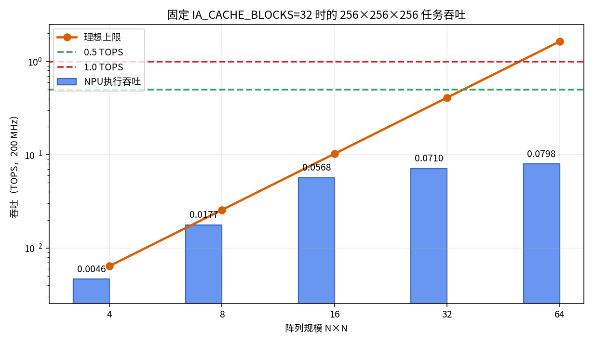
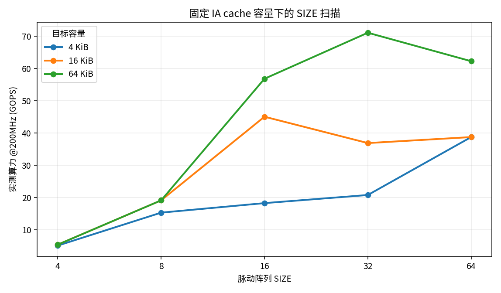
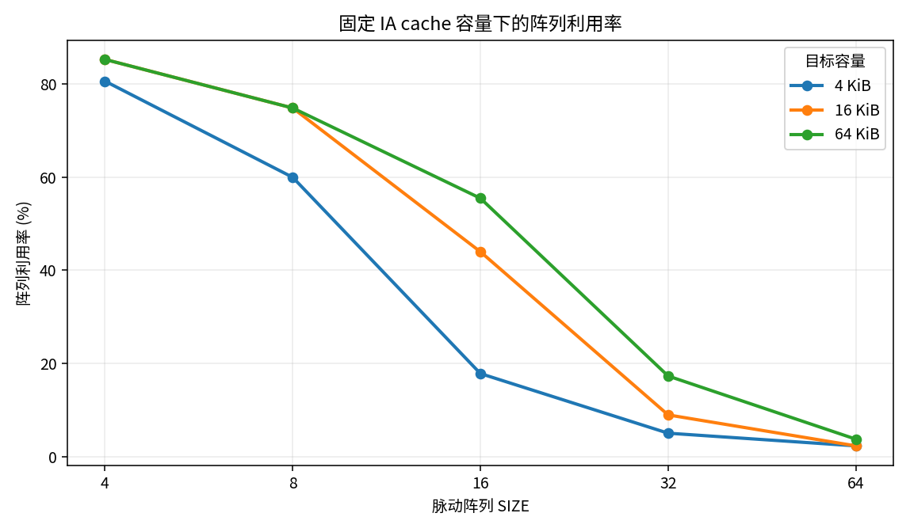
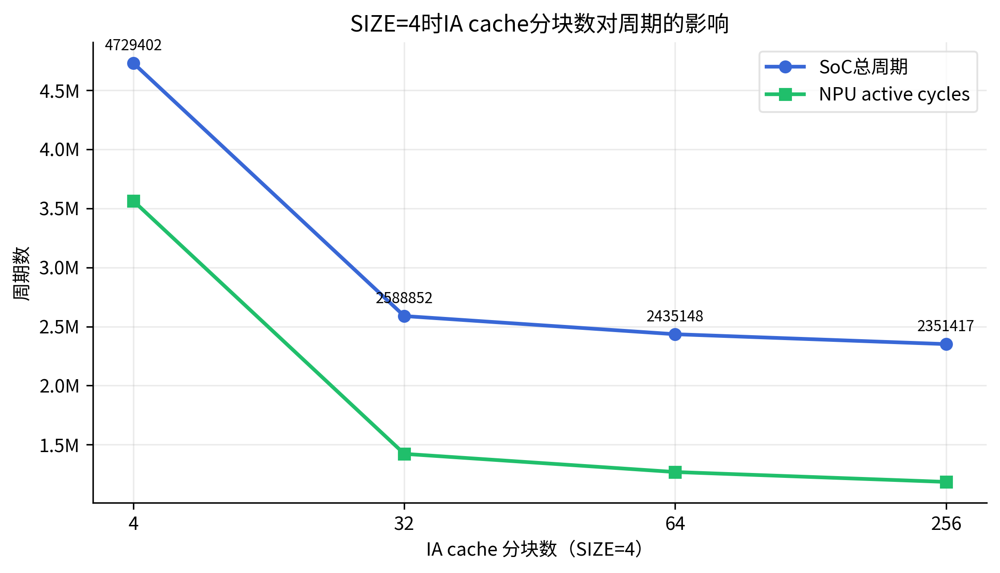
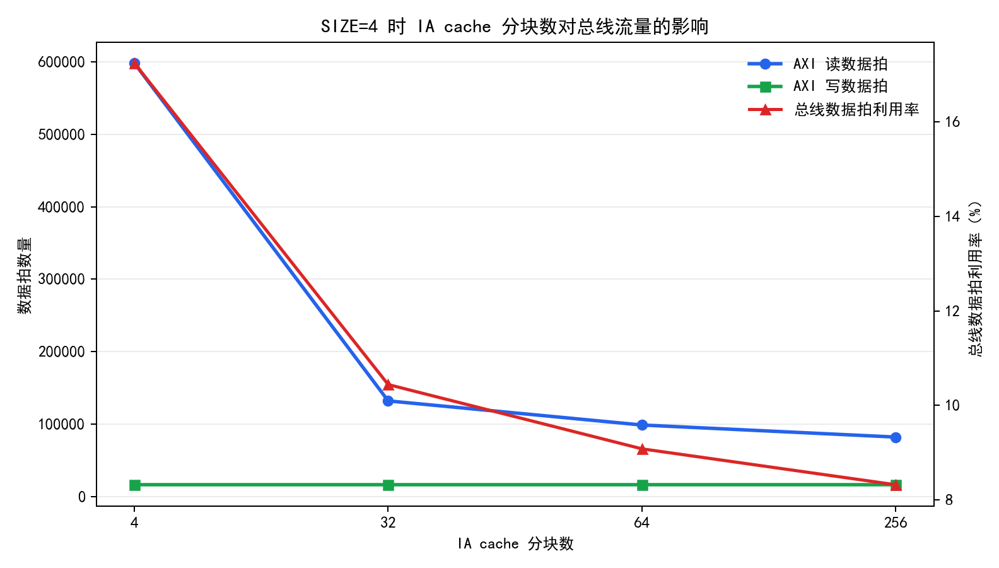
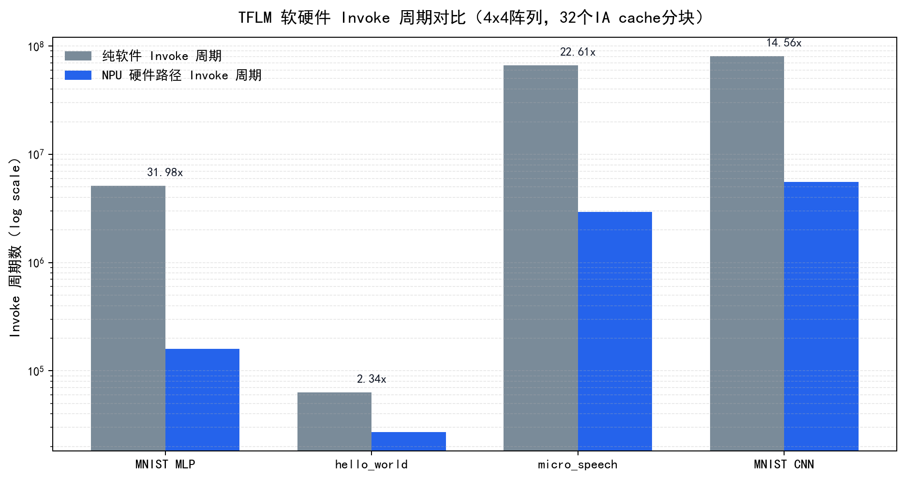
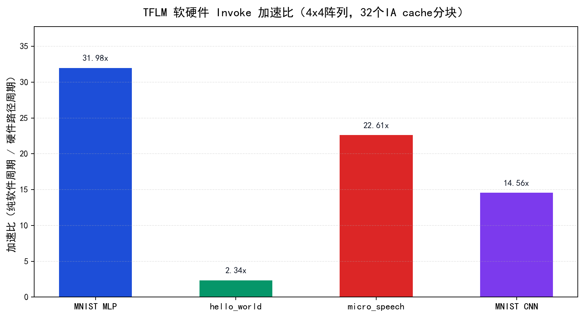
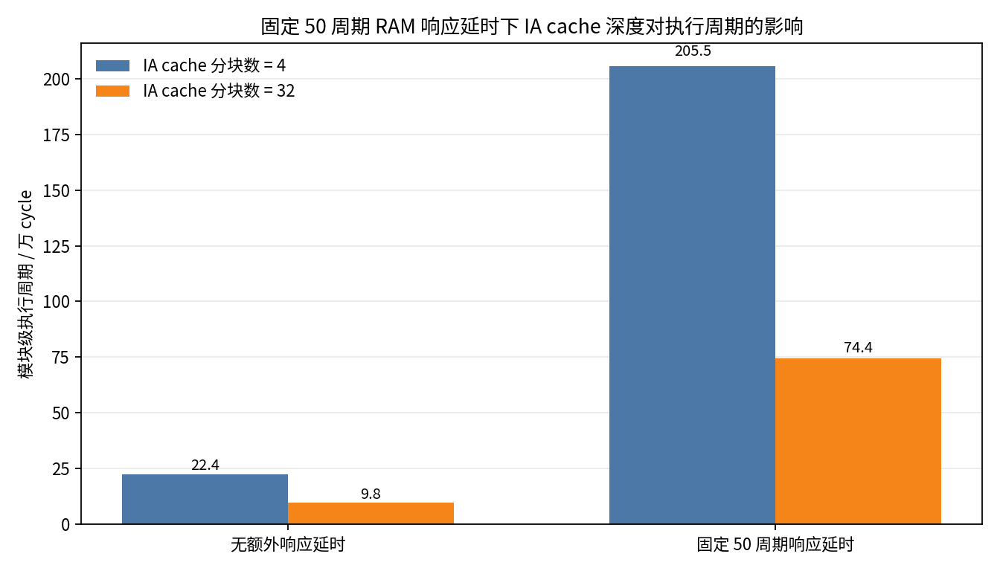
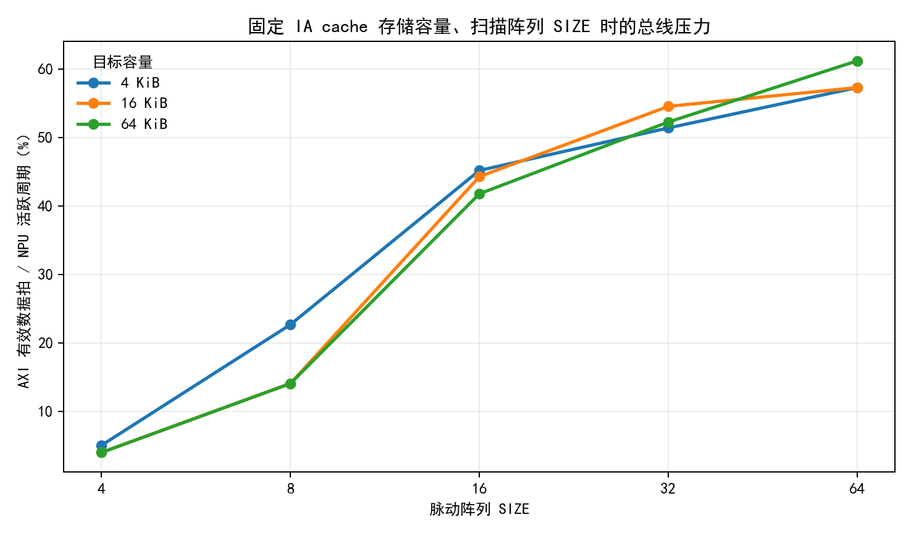

## 7. 性能分析

本节从两个层次评价当前 NPU 版本的性能。第一类实验使用模块级测试平台，直接统计矩阵乘核心在不同 `SIZE` 和 `IA_CACHE_BLOCKS` 下的吞吐率，避免 CPU 初始化、取指、软件轮询和 UART 输出影响。第二类实验使用 SoC 级 VCS 仿真，加载 TFLM 程序并统计 `Invoke()` 的真实执行周期，用于评价最终软件栈调用 NPU 后的端到端推理收益。

模块级主扫描条件为 WS 数据流、s8 LHS、per-tensor 量化、`K=N=M=256`、`PS_FRAME_COUNT=ceil(M/SIZE)`。`cfg_ia_reuse_num=0`、`cfg_w_reuse_num=0` 表示 RTL 按当前 `SIZE`、`IA_CACHE_BLOCKS` 和 `PS_FRAME_COUNT` 自动选择可用复用窗口。一次乘加按 2 个操作计，吞吐率计算式如下：

```text
OPS = 2 x K x N x M
GOPS@200MHz = OPS x 200MHz / cycles / 1e9
理想上限 GOPS@200MHz = 2 x SIZE x SIZE x 200MHz / 1e9
阵列利用率 = 实测 GOPS / 理想上限 GOPS
IA cache 容量 = SIZE x SIZE x IA_CACHE_BLOCKS x 4Byte
```

其中 IA cache 容量按当前 RTL 中每个 cache 元素以 32bit 存储估算。硬件要求 `IA_CACHE_BLOCKS` 为 2 的幂且不小于 2，因此目标容量小于单个大尺寸 cache 块时，会使用最小可综合配置 `IA_CACHE_BLOCKS=2`，并在表中标记为非精确容量。

### 7.1 系统吞吐量分析

#### 7.1.1 阵列规模参数与算力关系

第一组实验固定 `IA_CACHE_BLOCKS=32`，用较深 IA cache 块数让每种阵列都有足够的复用机会，观察 `SIZE=4/8/16/32/64` 的实测吞吐与理想上限之间的差距。该实验不是固定容量实验，实际 IA cache 容量会随 `SIZE^2` 增长，用于回答“阵列规模变大时，当前数据流能否把 PE 喂满”。

<p align="center">

</p>
<p align="center">图7-1 固定 IA_CACHE_BLOCKS=32 时的阵列规模扫描</p>

<p align="center">表7-1 固定 IA_CACHE_BLOCKS=32、256x256x256 模块级吞吐扫描</p>

| SIZE | IA_CACHE_BLOCKS | 实际 IA cache(B) | 周期 | 实测GOPS | 理想GOPS | 阵列利用率 | 总线beat利用率 | 读beat | 写beat |
|---:|---:|---:|---:|---:|---:|---:|---:|---:|---:|
| 4 | 32 | 2,048 | 1,447,156 | 4.64 | 6.40 | 72.46% | 6.86% | 82,944 | 16,384 |
| 8 | 32 | 8,192 | 378,210 | 17.74 | 25.60 | 69.31% | 17.46% | 49,664 | 16,384 |
| 16 | 32 | 32,768 | 118,183 | 56.78 | 102.40 | 55.45% | 41.81% | 33,024 | 16,384 |
| 32 | 32 | 131,072 | 94,491 | 71.02 | 409.60 | 17.34% | 52.29% | 33,024 | 16,384 |
| 64 | 32 | 524,288 | 84,099 | 79.80 | 1,638.40 | 4.87% | 58.75% | 33,024 | 16,384 |

从绝对吞吐看，`SIZE` 从 4 增加到 16 时收益明显，4.64 GOPS 提升到 56.78 GOPS；继续增大到 32 和 64 后，吞吐只提升到 71.02 GOPS 和 79.80 GOPS。理想上限从 `SIZE=16` 的 102.40 GOPS 增加到 `SIZE=64` 的 1638.40 GOPS，但实测只增长 1.41 倍，阵列利用率从 55.45% 降到 4.87%。这说明当前 32bit AXI、单组 DMA 读写、当前 loader/写回组织方式下，`SIZE=64` 已经明显不是 PE 数量不足，而是数据供给、分块切换、权重装载和写回排空共同限制。

从读写 beat 看，`SIZE=16`、`SIZE=32` 和 `SIZE=64` 的读 beat 均为 33,024，写 beat 均为 16,384，说明在 `IA_CACHE_BLOCKS=32`、复用窗口足够时，外部搬运数据量已经接近下界；但 `SIZE=32` 和 `SIZE=64` 的计算窗口变短，总线 beat 利用率反而升高，阵列利用率下降。这类结果的含义不是“总线更好”，而是“阵列太大以后，同样的数据搬运和阶段开销占据了更高比例”。因此，仅扩大阵列不能线性换算成算力，必须同步提高内部供数并行度、预取深度和写回排空能力。

#### 7.1.2 固定 IA cache 存储容量、扫描阵列 SIZE 的实验

第二组实验固定目标 IA cache 存储容量，扫描 `SIZE=4/8/16/32/64`。这里“固定容量”指固定 `SIZE x SIZE x IA_CACHE_BLOCKS x 4Byte` 的目标值，而“扫描 SIZE”指在同一目标容量下改变阵列边长，并按容量公式反向选择 `IA_CACHE_BLOCKS`。容量组选择 4KiB、16KiB 和 64KiB，其中 4KiB 对应历史综合配置 `SIZE=16`、`IA_CACHE_BLOCKS=4`，即 `16 x 16 x 4 x 4Byte`。该实验用于回答“在同样片上存储预算下，选择小阵列加深 IA cache，还是选择大阵列减少 IA cache 分块数”。

<p align="center">

</p>
<p align="center">图7-2 固定 IA cache 存储容量时的实测算力</p>

<p align="center">

</p>
<p align="center">图7-3 固定 IA cache 存储容量时的阵列利用率</p>

<p align="center">表7-2 固定 IA cache 存储容量下的 256x256x256 吞吐扫描</p>

| 目标容量 | SIZE | IA_CACHE_BLOCKS | 实际容量(B) | 精确容量 | 周期 | 实测GOPS | 阵列利用率 | 总线beat利用率 |
|---:|---:|---:|---:|---|---:|---:|---:|---:|
| 4KiB | 4 | 64 | 4,096 | 是 | 1,301,686 | 5.16 | 80.56% | 5.07% |
| 4KiB | 8 | 16 | 4,096 | 是 | 437,316 | 15.35 | 59.94% | 22.71% |
| 4KiB | 16 | 4 | 4,096 | 是 | 366,878 | 18.29 | 17.86% | 45.22% |
| 4KiB | 32 | 2 | 8,192 | 否 | 322,566 | 20.80 | 5.08% | 51.43% |
| 4KiB | 64 | 2 | 32,768 | 否 | 173,270 | 38.73 | 2.36% | 57.33% |
| 16KiB | 4 | 256 | 16,384 | 是 | 1,230,439 | 5.45 | 85.22% | 4.02% |
| 16KiB | 8 | 64 | 16,384 | 是 | 350,439 | 19.15 | 74.80% | 14.10% |
| 16KiB | 16 | 16 | 16,384 | 是 | 149,026 | 45.03 | 43.98% | 44.32% |
| 16KiB | 32 | 4 | 16,384 | 是 | 181,996 | 36.87 | 9.00% | 54.58% |
| 16KiB | 64 | 2 | 32,768 | 否 | 173,270 | 38.73 | 2.36% | 57.33% |
| 64KiB | 4 | 1024 | 65,536 | 是 | 1,230,439 | 5.45 | 85.22% | 4.02% |
| 64KiB | 8 | 256 | 65,536 | 是 | 350,439 | 19.15 | 74.80% | 14.10% |
| 64KiB | 16 | 64 | 65,536 | 是 | 118,183 | 56.78 | 55.45% | 41.81% |
| 64KiB | 32 | 16 | 65,536 | 是 | 94,491 | 71.02 | 17.34% | 52.29% |
| 64KiB | 64 | 4 | 65,536 | 是 | 107,877 | 62.21 | 3.80% | 61.23% |

固定 IA cache 容量约束下，阵列规模和 cache 分块数之间存在明确的供给匹配关系，而不是单调的“阵列越大，吞吐越高”。

第一，较小阵列更容易获得较高阵列利用率，但其绝对吞吐受 PE 数量上限限制。以 16KiB 和 64KiB 容量组为例，`SIZE=4` 的阵列利用率均为 85.22%，说明当前 32bit AXI 数据通路和分块数据流能够较充分地供给 4x4 阵列；但该配置只有 16 个 PE，实测吞吐仅为 5.45 GOPS。因此，阵列利用率高并不等价于系统吞吐最优，必须同时考察 PE 规模和有效计算周期。

第二，在有限片上存储预算下，保留足够的 IA cache 分块数比单纯扩大阵列更关键。4KiB 容量组中，`SIZE=16`、`IA_CACHE_BLOCKS=4` 为历史综合配置，实测吞吐为 18.29 GOPS；当容量提高到 16KiB 时，`SIZE=16`、`IA_CACHE_BLOCKS=16` 的吞吐提升到 45.03 GOPS，并高于同容量下 `SIZE=32`、`IA_CACHE_BLOCKS=4` 的 36.87 GOPS。该结果表明，在当前复用调度下，IA cache 分块数直接影响可覆盖的复用窗口和 DMA 重读次数；若分块数过少，较大的阵列会更频繁地等待 loader、DMA 或写回路径，实际有效工作比例下降。

第三，当 IA cache 容量提高到 64KiB 后，最高实测吞吐转移到 `SIZE=32`、`IA_CACHE_BLOCKS=16`，达到 71.02 GOPS；而 `SIZE=64`、`IA_CACHE_BLOCKS=4` 下降到 62.21 GOPS。该现象说明较大阵列只有在 cache 深度、预取、写回排空和片上 bank 调度同步增强时才能转化为有效吞吐。对于 `SIZE=64`，虽然理论 PE 数量最大，但 IA 复用窗口和 OA writer 周转能力不足以持续供给 4096 个 PE，阶段切换和写回排空开销占比上升，导致阵列利用率降至 3.80%。

综合上述结果，在当前 32bit AXI、单组 DMA 读写和 200MHz 折算条件下，若优先考虑阵列利用率，`SIZE=4` 和 `SIZE=8` 更容易被喂满；若同时考虑绝对吞吐、可综合面积和时序收敛，`SIZE=16`、`IA_CACHE_BLOCKS=16` 是更稳妥的工程折中配置；在允许约 64KiB IA cache 容量且面积预算更宽松时，`SIZE=32`、`IA_CACHE_BLOCKS=16` 是本轮模块级扫描中吞吐最高的精确容量配置。继续扩大到 `SIZE=64` 需要配套更宽外部总线、多 bank 片上缓存、更强预取以及更高写回并行度，否则新增 PE 主要表现为空转资源。

#### 7.1.3 最终部署配置附近的 IA cache 深度影响

第三组实验切换到 SoC 级测试平台，固定最终部署阵列规模 `SIZE=4`，扫描 `IA_CACHE_BLOCKS=4/32/64/256`。该实验固定 `K=N=M=256`、`PS_FRAME_COUNT=16`、AXI 读写 outstanding 均为 4、CPU I-cache 打开、RAM 随机响应延时关闭，用于观察在最终小阵列基线下，增加 IA cache 分块数对系统周期、NPU active cycles 和外部总线流量的影响。

<p align="center">

</p>
<p align="center">图7-4 SIZE=4 时 IA cache 分块数对执行周期的影响</p>

<p align="center">

</p>
<p align="center">图7-5 SIZE=4 时 IA cache 分块数对总线流量和利用率的影响</p>

<p align="center">表7-3 SIZE=4、256x256x256 SoC 级 IA cache 分块数扫描</p>

| SIZE | IA_CACHE_BLOCKS | K=N=M | SoC 总周期 | NPU active cycles | AXI read beat | AXI write beat | 总beat | 总线beat利用率 |
|---:|---:|---:|---:|---:|---:|---:|---:|---:|
| 4 | 4 | 256 | 4,729,402 | 3,563,083 | 598,016 | 16,384 | 614,400 | 17.24% |
| 4 | 32 | 256 | 2,588,852 | 1,422,485 | 132,096 | 16,384 | 148,480 | 10.44% |
| 4 | 64 | 256 | 2,435,148 | 1,268,765 | 98,816 | 16,384 | 115,200 | 9.08% |
| 4 | 256 | 256 | 2,351,417 | 1,185,029 | 82,176 | 16,384 | 98,560 | 8.32% |

表7-3表明，在 `SIZE=4` 固定时，IA cache 分块数从 4 增加到 32 的收益最明显：SoC 总周期从 4,729,402 降到 2,588,852，减少 45.26%；NPU active cycles 从 3,563,083 降到 1,422,485，减少 60.08%；AXI 总 beat 从 614,400 降到 148,480，减少 75.83%。这是因为较深 IA cache 覆盖了更多输入分块复用窗口，显著减少 IA 数据重读。

继续从 `IA_CACHE_BLOCKS=32` 增加到 64 和 256 后，周期仍有改善，但边际收益明显变小。`IA_CACHE_BLOCKS=256` 相对 32 的 SoC 总周期只再减少 9.17%，而 IA cache 容量增加 8 倍。对当前最终部署版本而言，`SIZE=4`、`IA_CACHE_BLOCKS=32` 是更均衡的点：它已经消除了大部分重读流量，同时避免过深 cache 带来的片上存储面积和综合压力。总线 beat 利用率从 17.24% 降到 10.44% 不是退化，而是 cache 复用减少了外部搬运需求，小阵列已经从“总线压力受限”转向“计算规模和控制开销受限”。

#### 7.1.4 硬件加速推理性能提升分析

本小节使用最终部署配置 `SIZE=4`、`IA_CACHE_BLOCKS=32`、`PS_FRAME_COUNT=16`，对 TFLM 自建 MNIST MLP、TFLM hello_world 和 TFLM micro_speech 进行 SoC 级软硬件对比。硬件版本通过 NMSIS NN 加速函数调用 NPU，工程宏仍沿用历史命名 `TFLM_SOC_MMA_ENABLE=1`；纯软件版本关闭该加速宏和 `NMSIS_NN` 宏定义。同一模型的软硬件成对使用相同 RAM 容量、相同 CPU、相同 UART 输出路径，CPU I-cache 打开；MNIST MLP 和 hello_world 使用最终 FPGA 对齐的 65536 word RAM，micro_speech 因程序和 tensor arena 超过该容量，使用 524288 word SoC 仿真 RAM。周期只统计 `interpreter.Invoke()` 内部时间，不包含模型初始化和 tensor arena 分配。上述 6 个 SoC 仿真日志均由 UART 监视器捕获程序输出，日志中包含 `[PICO_UART] monitor enabled`、`[tflm_perf]` 周期统计和 `[tflm] ... PASS`，说明最终软件路径、UART 打印路径和 NPU 调用路径均在同一仿真闭环中通过。

<p align="center">

</p>
<p align="center">图7-6 SIZE=4、IA_CACHE_BLOCKS=32 的 TFLM 推理周期对比</p>

<p align="center">

</p>
<p align="center">图7-7 SIZE=4、IA_CACHE_BLOCKS=32 的 TFLM 推理加速比</p>

<p align="center">表7-4 SIZE=4、IA_CACHE_BLOCKS=32 的 TFLM 软硬件推理对比</p>

| 模型 | 测试样本数 | 软件平均 Invoke 周期 | 硬件平均 Invoke 周期 | 加速比 | NPU调用数 | NPU active cycles | NPU总线beat利用率 | 验证结果 |
|---|---:|---:|---:|---:|---:|---:|---:|---|
| MNIST MLP（784 -> 64 -> 10） | 3 | 5,114,414 | 159,925 | 31.98x | 6 | 192,105 | 20.34% | PASS |
| hello_world | 4 | 63,161 | 27,035 | 2.34x | 12 | 3,288 | 17.88% | PASS |
| micro_speech | 1 | 66,383,752 | 2,936,028 | 22.61x | 17 | 79,278 | 24.13% | PASS |

MNIST MLP 的两层全连接都能由 NPU 执行，3 个样本共触发 6 次 NPU 调用，平均 Invoke 周期从 5,114,414 降到 159,925，加速 31.98 倍。该结果说明 AXI-Lite 寄存器配置、NMSIS NN 调用路径和 NPU 总线独占机制已经在真实 TFLM 程序中闭环工作。相较早期报告，本次数据使用最新时序收敛版本重新编译仿真程序，CPU I-cache 命中返回路径多插入 1 拍寄存器以截断关键路径，因此绝对周期略有变化，但软硬件对比仍保持稳定加速。

hello_world 的模型极小，单次 Invoke 中 NPU active cycles 约为 822 cycle，TFLM 调度、输入输出张量访问和 UART 打印前后的固定软件开销占比很高，因此加速比只有 2.34 倍。这个用例的意义主要是验证小尺寸、短矩阵和频繁 NPU 启停的边界行为，而不是评价峰值算力。

micro_speech 同时包含 depthwise convolution、reshape、fully connected 和 softmax。硬件版本在 1 次 Invoke 中触发 17 次 NPU 调用，周期从 66,383,752 降到 2,936,028，加速 22.61 倍。其 NPU active cycles 只占硬件 Invoke 周期的一小部分，说明当前仍有较多 TFLM 框架调度、非矩阵算子和数据准备开销。后续若继续提升 micro_speech，需要把 depthwise wrapper、im2col batch 和小矩阵调用合并策略一起优化，而不是只提高 NPU 峰值吞吐。


为隔离外部 RAM 响应延时对 IA cache 深度的影响，本节补充一个 Verilator 模块级对照实验。实验固定 `SIZE=4`、`PS_FRAME_COUNT=16`、WS 数据流、s8 LHS、per-tensor 量化、`K=128`、`N=128`、`M=64`，分别测试 `IA_CACHE_BLOCKS=4` 和 `IA_CACHE_BLOCKS=32`。RAM 延时模型采用更接近突发访问的语义：每个 AXI burst 内部连续返回数据，只在 burst 起始响应前插入等待；固定大延时用例将该等待设置为 50 周期。

<p align="center">

</p>
<p align="center">图7-8 固定 50 周期 RAM 响应延时下 IA cache 深度对执行周期的影响</p>

<p align="center">表7-5 固定 50 周期 RAM 响应延时下 IA cache 深度对模块级执行周期的影响</p>

| 延时模型 | SIZE | IA_CACHE_BLOCKS | K | N | M | 执行周期 | 验证结果 |
|---|---:|---:|---:|---:|---:|---:|---|
| 无额外 RAM 响应延时 | 4 | 4 | 128 | 128 | 64 | 224,432 | PASS |
| 无额外 RAM 响应延时 | 4 | 32 | 128 | 128 | 64 | 98,054 | PASS |
| 固定 50 周期 RAM 响应延时 | 4 | 4 | 128 | 128 | 64 | 2,054,684 | PASS |
| 固定 50 周期 RAM 响应延时 | 4 | 32 | 128 | 128 | 64 | 743,902 | PASS |

该实验说明，IA cache 的收益会随外部 RAM 首拍响应延时增大而更加明显。在无额外响应延时时，`IA_CACHE_BLOCKS=32` 相对 `IA_CACHE_BLOCKS=4` 的周期减少 56.31%；在固定 50 周期响应延时时，周期减少 63.80%。原因是较深 IA cache 可以让同一批 IA 分块在更多输出列 tile 上复用，减少需要重新发起的读 burst 数；当每个 burst 起始都要付出较大固定等待时，减少 burst 数带来的收益会被放大。该结果与 TFLM 推理章节中选择 `SIZE=4`、`IA_CACHE_BLOCKS=32` 作为最终部署基线的结论一致。

### 7.2 总线利用与数据供给匹配分析

本节使用 NPU 顶层 `NPU_UTIL` 统计 AXI 有效 beat。总线利用率定义为：

```text
总线 beat 利用率 = (axi_r + axi_w) / NPU active cycles
读利用率 = axi_r / NPU active cycles
写利用率 = axi_w / NPU active cycles
```

该指标描述 NPU 活跃窗口中有多少周期发生有效 AXI 数据传输。它不是 AXI 全双工理论带宽，也不能单独代表性能优劣。IA cache 越深，读 beat 可能越少，总线利用率可能下降，但总周期仍然更短；阵列越大，active cycles 越短，同样的读写 beat 会表现为更高总线利用率，但阵列利用率可能下降。因此需要同时观察周期、读写 beat、B/op、阵列利用率和 FIFO/loader stall。

需要特别区分两类统计口径：模块级仿真用来分析阵列、cache 和数据流的匹配关系；85% 以上的总线利用率指标采用 SoC 级总线压力实验验收。两者的 active window 和软件/总线环境不同，因此不能直接把模块级或小阵列 SoC 用例中的低总线利用率解释为总线优化退化。除压力验收外，本节的固定 SIZE cache 深度扫描统一采用最终部署基线 `SIZE=4`，用于评价小阵列配置下 IA cache 深度对读流量、执行周期和数据供给匹配关系的影响。

#### 7.2.1 SoC 级总线利用率验收

本小节列出最终 RTL、驱动和仿真环境下的 SoC 级统计结果。总线利用率指标按压力用例验收，实验条件为 `SIZE=16`、`IA_CACHE_BLOCKS=4`、`PS_FRAME_COUNT=16`、`K=N=M=256`、WS 数据流、s8 LHS、per-tensor 量化、AXI 读写 outstanding 均为 4、RAM 随机响应延时关闭。该压力用例使用较浅 IA cache，外部读流量压力较高，适合验证 AXI interconnect、RAM full-pipe、NPU 总线锁和写回排空路径是否能够持续供给数据。

<p align="center">表7-6 最终 RTL 的 SoC 总线利用率压力验收数据</p>

| 用例 | SIZE | IA_CACHE_BLOCKS | PS_FRAME_COUNT | K=N=M | CPU_MEM_DP | SoC 总周期 | NPU active cycles | AXI read beat | AXI write beat | 总线beat利用率 | 指标结论 |
|---|---:|---:|---:|---:|---:|---:|---:|---:|---:|---:|---|
| 总线压力验收 | 16 | 4 | 16 | 256 | 524288 word | 1,353,561 | 187,476 | 149,504 | 16,384 | 88.49% | 达标，接近 90% |

最终 RTL 在压力用例中的总线利用率计算为：

```text
总线 beat 利用率 = (149,504 + 16,384) / 187,476 = 88.49%
```

由表7-6可见，在相同矩阵规模和相同 32bit AXI 数据宽度下，最终版本 SoC 总线通路达到 85% 以上有效 beat 占用，并恢复到接近 90% 的压力水平，满足总线利用率指标要求。该版本将写回 FIFO 的最大 bank 数从仅随 IA cache 浅层配置收缩，调整为浅 cache 压力测试下仍保留 32 个可排空 bank；`fifo_stall` 和 `fifo_full` 在该压力用例中均降为 0。`SOC_AXI_STATS` 记录的 NPU 读写请求等待也为 0，说明总线请求一旦发出即可被 RAM 侧连续接收，interconnect 和 RAM 通路没有重新形成主要气泡。剩余约 11.51% 的非数据 beat 周期主要来自 AXI 地址/响应阶段、loader 切 tile、tail 处理和二维写回每行发起一次写 burst 的结构性开销；这些开销不属于 RAM 仲裁堵塞。

为观察最终部署参数在小阵列下的 cache 深度影响，本文同步测试固定 `SIZE=4`、`K=N=M=256`、`PS_FRAME_COUNT=16` 时不同 `IA_CACHE_BLOCKS` 的 SoC 级总线利用率，结果如表7-7所示。该扫描替代早期固定 `SIZE=16` 的总线扫描，更贴近最终 FPGA 部署版本和 TFLM 推理对比所使用的硬件参数。

<p align="center">表7-7 最终 RTL 在固定 SIZE=4 下不同 IA cache 分块数的 SoC 总线利用率</p>

| SIZE | IA_CACHE_BLOCKS | K=N=M | SoC 总周期 | NPU active cycles | AXI read beat | AXI write beat | 总线beat利用率 | 读利用率 | 写利用率 | FIFO full | FIFO stall |
|---:|---:|---:|---:|---:|---:|---:|---:|---:|---:|---:|---:|
| 4 | 4 | 256 | 4,729,402 | 3,563,083 | 598,016 | 16,384 | 17.24% | 16.78% | 0.46% | 0 | 0 |
| 4 | 32 | 256 | 2,588,852 | 1,422,485 | 132,096 | 16,384 | 10.44% | 9.29% | 1.15% | 72,464 | 55,232 |
| 4 | 64 | 256 | 2,435,148 | 1,268,765 | 98,816 | 16,384 | 9.08% | 7.79% | 1.29% | 75,928 | 57,736 |
| 4 | 256 | 256 | 2,351,417 | 1,185,029 | 82,176 | 16,384 | 8.32% | 6.93% | 1.38% | 64,404 | 48,256 |

表7-7说明，小阵列的总线利用率不能按压力验收口径直接要求达到 85%。`SIZE=4` 只有 16 个 PE，计算消耗数据的速度显著低于 `SIZE=16`，因此即使总线供给充分，也不会形成高外部总线压力。随着 `IA_CACHE_BLOCKS` 从 4 增加到 256，AXI 总 beat 从 614,400 降到 98,560，减少 83.96%；SoC 总周期从 4,729,402 降到 2,351,417，减少 50.28%。总线 beat 利用率从 17.24% 降到 8.32%，并不是总线优化退化，而是更深 IA cache 减少了外部重读次数，使 NPU 对外部 RAM 的依赖下降。

#### 7.2.2 固定 IA cache 存储容量、扫描阵列 SIZE 实验中的总线压力

本小节复用 7.1.2 的固定 IA cache 存储容量实验，观察在同一容量预算下改变 `SIZE` 时的总线压力变化。

<p align="center">

</p>
<p align="center">图7-9 固定 IA cache 存储容量扫描中的总线 beat 利用率</p>

固定 IA cache 存储容量扫描中，总线 beat 利用率随 `SIZE` 增大整体上升。其根本原因是阵列变大后 active cycles 缩短，但权重、IA、偏置、输出写回仍需要通过同一 32bit AXI 口搬运。`SIZE=64`、`IA_CACHE_BLOCKS=4` 在 64KiB 目标容量下的总线 beat 利用率达到 61.23%，但阵列利用率只有 3.80%；这说明它更接近“数据供给不匹配的大阵列”，不是当前最优设计点。

对比 `SIZE=16`、`IA_CACHE_BLOCKS=16` 和 `SIZE=32`、`IA_CACHE_BLOCKS=4` 可以看到容量分配的重要性：两者目标容量同为 16KiB，前者有 16 个 IA cache 块，吞吐为 45.03 GOPS；后者只有 4 个 IA cache 块，吞吐降到 36.87 GOPS，阵列利用率仅 9.00%。这说明在当前数据流中，IA cache 块数不仅是容量问题，也是复用窗口问题；当块数过少时，DMA 必须更频繁地重读或等待，阵列虽然更大但有效工作比例下降。

#### 7.2.3 固定 SIZE=4 基线下的 cache 深度和数据供给

本小节将固定 SIZE 扫描切换到最终部署基线 `SIZE=4`，并扫描 `IA_CACHE_BLOCKS=4/32/64/256`。实验条件与 7.1.3 一致：`K=N=M=256`、`PS_FRAME_COUNT=16`、SoC 级 VCS 仿真、RAM 随机响应延时关闭。

在 `SIZE=4` 基线下，增加 IA cache 分块数的首要作用是减少外部读流量，而不是提高总线占用率。`IA_CACHE_BLOCKS=4` 时读 beat 为 598,016；`IA_CACHE_BLOCKS=32` 时读 beat 降到 132,096，减少 77.91%；`IA_CACHE_BLOCKS=256` 时读 beat 进一步降到 82,176。写 beat 始终为 16,384，说明输出规模固定，cache 深度主要影响输入复用和权重/IA 搬运。

从数据供给匹配角度看，`SIZE=4`、`IA_CACHE_BLOCKS=32` 已经覆盖主要复用窗口，后续继续加深 cache 的性能收益主要来自进一步减少少量读侧搬运。`IA_CACHE_BLOCKS=64` 和 256 的周期收益小于 32 相对 4 的收益，说明最终部署配置没有再被外部总线强烈限制。这个结论与 7.1.2 的固定容量实验一致：小阵列容易被供满，但绝对吞吐受 PE 数量限制；大阵列拥有更高理论上限，但需要更多 IA cache 分块、更强预取和更高写回排空能力才能维持利用率。

#### 7.2.4 与总线优化设计的对应关系

`doc/bus_optimization_report_cn.md` 中的 SoC 级实验说明，统一 DMA、NPU 优先仲裁、RAM full-pipe、CPU I-cache 和 AXI ping-pong buffer 能显著减少 CPU 与 NPU 共享 RAM 时的互相阻塞。本文的模块级实验在没有 CPU 干扰的条件下进一步隔离出内部数据供给瓶颈：当 `SIZE<=16` 时，阵列和 IA cache 的配比决定主要吞吐；当 `SIZE>=32` 时，总线 beat 利用率升高但阵列利用率下降，说明瓶颈转向 loader/写回/复用窗口匹配。

因此，最终参数选择不应只追求最大 PE 数或最高总线利用率，而应满足三点匹配：外部总线能够连续提供当前 tile 所需的 IA/权重数据；IA cache 块数足够覆盖输出列组复用窗口；OA writer 和 FIFO 能在下一组结果到达前排空足够 bank。按本轮扫描，当前 32bit AXI 和 200MHz 约束下推荐两档配置：面积和时序优先选 `SIZE=4`、`IA_CACHE_BLOCKS=32` 作为可部署版本；吞吐优先且可接受更大面积时，模块级测试中 `SIZE=16`、`IA_CACHE_BLOCKS=16` 和 `SIZE=32`、`IA_CACHE_BLOCKS=16` 仍然具备更高绝对吞吐。`SIZE=64` 暂不作为最终 sweet spot，除非后续同步扩大总线宽度、片上 bank 数和写回并行度。

本节原始数据与脚本保存在：

```text
doc/original_docx_report_md/perf_data/npu_module_perf_20260703.csv
doc/original_docx_report_md/report_figures/scripts/run_npu_perf_analysis.py
doc/original_docx_report_md/report_figures/charts/table_tflm_hw_sw_s4_c32.csv
doc/original_docx_report_md/report_figures/charts/table_cache_fixed50_verilator.csv
doc/original_docx_report_md/report_figures/charts/table_perf_s4_soc_cache_scan.csv
veri/sim/runs/tflm_hw_sw_s4_c32_20260704/
```
