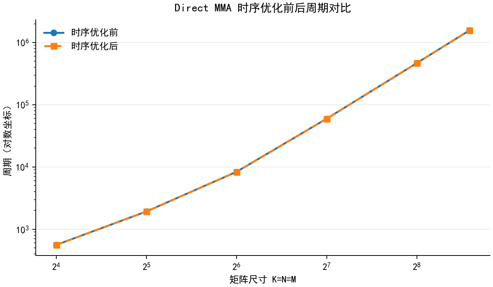
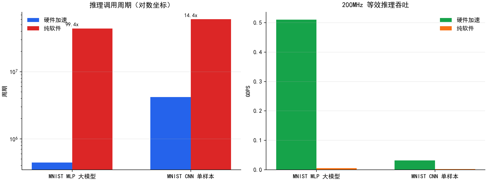
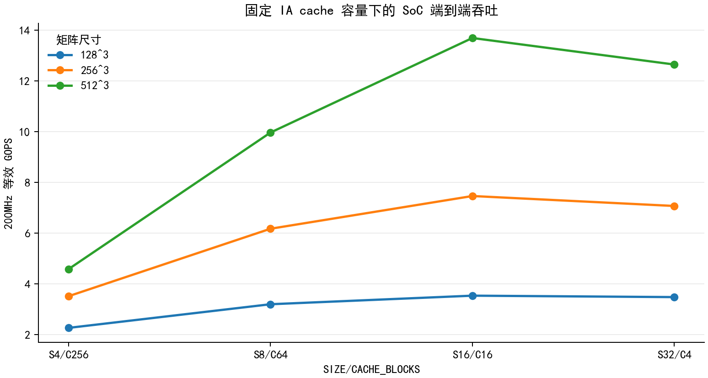
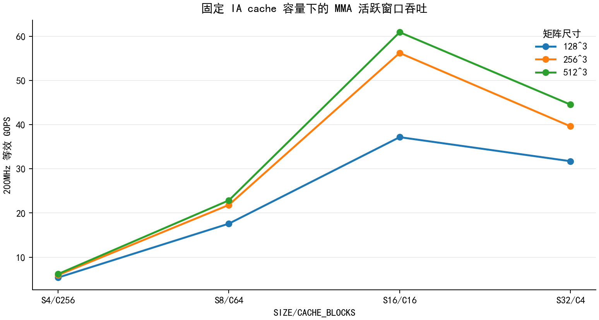
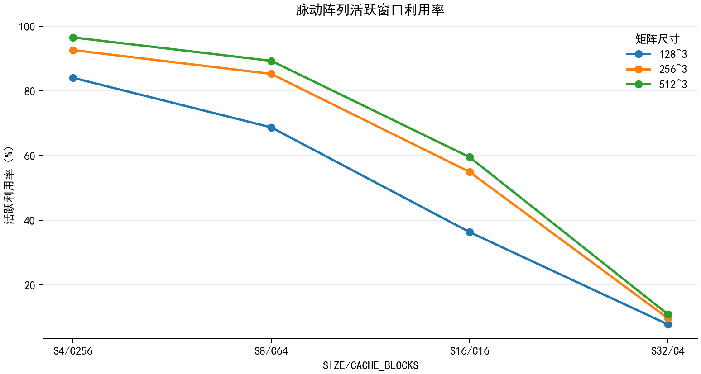
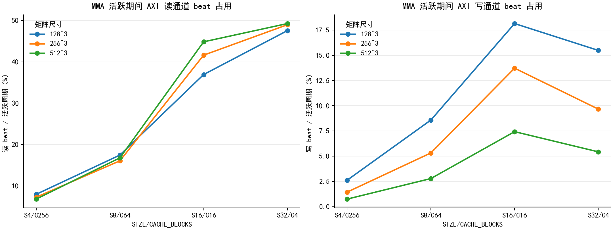

# SIZE/cache 与 TFLM 硬软推理性能报告

日期：2026-07-02

## 结论摘要

- 时序优化没有降低 direct MMA 吞吐。以时序优化前 cached dataflow 版本作为 old 基线，`SIZE=16, IA_CACHE_BLOCKS=4` 下 `16^3` 到 `384^3` 方阵的 old/new cycles 完全一致，说明本轮时序修正是流水/语义保持，不是靠插等待拍换时序。
- MNIST MLP 大模型硬件加速相对 TFLM reference 软件 `Invoke()` 平均加速 `99.4x`，200MHz 等效推理吞吐从 `0.0051 GOPS` 提升到 `0.5105 GOPS`。
- MNIST CNN 单样本硬件加速相对 TFLM reference 软件 `Invoke()` 加速 `14.39x`，200MHz 等效推理吞吐从 `0.0022 GOPS` 提升到 `0.0317 GOPS`。CNN 的 MMA active 内吞吐达到 `2.03 GOPS`，但端到端仍主要受 CPU im2col、pooling/softmax 和 TFLM 调度影响。
- 固定 IA cache 总容量约 `16 KiB` 时，阵列利用率百分比最高的是 `S4/C256`，512^3 下 active 阵列利用率 `96.5%`；但绝对算力最高的是 `S16/C16`，512^3 下 SoC 口径 `13.68 GOPS`，MMA active 口径 `60.91 GOPS`。
- `S32/C4` 的理论峰值达到 `409.6 GOPS`，但固定容量下只有 4 个 IA cache block，复用窗口太浅且 AXI 读通道供数压力变大，512^3 下 active 阵列利用率只有 `10.87%`，实际 SoC 吞吐反而低于 `S16/C16`。

## 统计口径

- int8 ops：按 `1 MAC = 2 ops` 计算。
- 200MHz 等效 GOPS：`ops / cycles * 0.2`。
- 200MHz 理论峰值：`2 * SIZE * SIZE ops/cycle * 200MHz`。例如 `SIZE=16` 为 `102.4 GOPS = 0.1024 TOPS`。
- MMA active GOPS：只统计 MMA active 周期，剔除 SoC/TFLM 初始化、CPU 调度和非 MMA 算子时间。
- Invoke GOPS：只统计 `interpreter.Invoke()` 包围的推理时间，不包含模型初始化、`AllocateTensors()` 和输入拷贝前的 SoC 启动。
- 总线利用率：用 `axi_r / mma_active` 和 `axi_w / mma_active` 近似表示 MMA active 期间 AXI 读/写 beat 占用率。读写通道分开统计，不能简单相加为单一总线饱和率。

数据源：

- 固定容量 sweep：`veri/sim/runs/fixed_capacity_size_cache_sweep_burst8_fix/perf.csv`，`12/12 PASS`。
- MLP 日志：`veri/sim/runs/mnist_mlp_hw_sw/mnist_mlp_big_hw_s16_c4_p16.log` 与 `mnist_mlp_big_sw_s16_c4_p16.log`。
- CNN 日志：`veri/sim/runs/mnist_cnn_hw_sw/mnist_cnn_hw_s16_c4_p16_batch32_sample1_summary.log` 与 `mnist_cnn_sw_s16_c4_p16_sample1.log`。
- 图表生成脚本：`doc/gen_size_cache_perf_plots.py`。

## 时序优化吞吐保持



| K=N=M | old cycles | new cycles | 差异 | ops/cycle | 200MHz GOPS | 阵列利用率 |
|---:|---:|---:|---:|---:|---:|---:|
| 16 | 560 | 560 | 0.00% | 14.629 | 2.926 | 2.86% |
| 32 | 1,926 | 1,926 | 0.00% | 34.027 | 6.805 | 6.65% |
| 64 | 8,355 | 8,355 | 0.00% | 62.751 | 12.550 | 12.26% |
| 128 | 59,643 | 59,643 | 0.00% | 70.323 | 14.065 | 13.74% |
| 256 | 466,395 | 466,395 | 0.00% | 71.944 | 14.389 | 14.05% |
| 384 | 1,566,715 | 1,566,715 | 0.00% | 72.283 | 14.457 | 14.12% |

这组数据的 old 基线不是最早的非 cache 架构，而是时序优化前的 cached dataflow 稳定版本。new 在所有尺寸上 cycles 完全相同，因此当前时序优化没有引入可观测吞吐损失。direct MMA 的主要瓶颈仍是供数和调度效率，而不是这批 timing patch 本身。

## TFLM 硬件加速与纯软件推理对比



MNIST MLP 使用 `conda activate tf_2_18` 后训练和导出，结构为 `784 -> 512 -> 256 -> 128 -> 10`，全 int8 TFLite，float test accuracy `96.93%`。导出文件位于 `drivers/tflm/my_tflm/tflite-micro/mnist_mlp/`，SoC 程序为 `veri/soc_csrc/tflm_mnist_mlp_soc_main.cc`。

CNN 使用 `Conv(8) -> MaxPool -> Conv(16) -> MaxPool -> FC(64) -> FC(10)`，全 int8 TFLite，float test accuracy `97.74%`。CNN 主要用于观察 Conv im2col 和小 batch 卷积下的端到端瓶颈。

| 模型 | 样本数 | ops/sample | HW avg Invoke | SW avg Invoke | Invoke 加速 | HW Invoke GOPS | SW Invoke GOPS | HW 完整 SoC cycles | SW 完整 SoC cycles |
|---|---:|---:|---:|---:|---:|---:|---:|---:|---:|
| MNIST MLP big | 3 | 1,133,056 | 443,903 | 44,126,602 | 99.4x | 0.5105 | 0.0051 | 8,455,926 | 139,511,687 |
| MNIST CNN sample1 | 1 | 666,112 | 4,198,745 | 60,410,324 | 14.39x | 0.0317 | 0.0022 | 6,696,944 | 62,899,923 |

MMA active 口径如下：

| 模型 | MMA ops | MMA active cycles | MMA active GOPS | active/Invoke | S16 理论峰值 | active 阵列利用率 | AXI read beat/active | AXI write beat/active |
|---|---:|---:|---:|---:|---:|---:|---:|---:|
| MNIST MLP big | 12 | 1,112,607 | 0.6110 | 83.55% | 102.4 GOPS | 0.60% | 38.87% | 0.06% |
| MNIST CNN sample1 | 34 | 65,688 | 2.0281 | 1.56% | 102.4 GOPS | 1.98% | 34.54% | 3.61% |

分析：

- MLP 大模型的硬件加速非常明显，原因是 FC 层 MAC 数足够大，纯软件 Pico 标量循环被完全拉开；但单样本 FC 本质上仍接近 vector-matrix，MMA active 内阵列利用率只有 `0.60%`，主要时间消耗在权重 DMA 读取。
- CNN 的端到端加速只有 `14.39x`，不是 MMA 算得慢，而是 MMA active 只占 `Invoke()` 的 `1.56%`。其余时间主要在 CPU 侧 im2col、pooling/softmax reference op、TFLM 调度和内存访问。
- CNN active 内有 `2.03 GOPS`，明显高于 Invoke 口径 `0.0317 GOPS`，说明后续 CNN 优化应优先减少 CPU im2col 搬运和小批次 MMA 提交开销，而不是单纯扩大阵列。
- 硬件路径 read beat/active 在 MLP/CNN 中约 `35%~39%`，读通道已有持续压力；写通道远低于读通道，当前小模型主要不是 OA 写回瓶颈。

## 固定 IA cache 容量下的 SIZE/CACHE_BLOCKS sweep

本轮固定 IA cache 总容量近似为：

`CACHE_BLOCKS * SIZE * SIZE * 32bit = 16 KiB`

| 配置 | 固定容量 | 200MHz 理论峰值 | 理论 TOPS |
|---|---:|---:|---:|
| S4/C256 | 16 KiB | 6.4 GOPS | 0.0064 |
| S8/C64 | 16 KiB | 25.6 GOPS | 0.0256 |
| S16/C16 | 16 KiB | 102.4 GOPS | 0.1024 |
| S32/C4 | 16 KiB | 409.6 GOPS | 0.4096 |

复现命令：

```bash
cd /media/proj_tmp/aiEngine_integrated/veri/sim
SOC_CPU_ENABLE_ICACHE=1 python3 ./run_axi_soc_perf_sweep.py \
  --log-root runs/fixed_capacity_size_cache_sweep_burst8_fix \
  --size-cache-pairs '4:256 8:64 16:16 32:4' \
  --ps-frame-counts '16' \
  --dims '128x128x128 256x256x256 512x512x512' \
  --dataflow-modes '0' --lhs-dtypes '1' --quant-modes '0' \
  --ia-reuse-list '0' --w-reuse-list '0' \
  --jobs 6 --timeout 1200 --soc-timeout-cycles 80000000 \
  --sim-args '+MMA_UTIL_SUMMARY +MMA_CTRL_UTIL +SOC_AXI_STATS +SOC_CPU_AXI_STATS'
```

### SoC 口径算力



| SIZE/CACHE_BLOCKS | 128^3 GOPS | 256^3 GOPS | 512^3 GOPS |
|---|---:|---:|---:|
| S4/C256 | 2.26 | 3.51 | 4.58 |
| S8/C64 | 3.19 | 6.17 | 9.96 |
| S16/C16 | 3.53 | 7.46 | 13.68 |
| S32/C4 | 3.47 | 7.06 | 12.64 |

SoC 口径包含 CPU 配置、DMA 启动、bias/quant 装载和写回尾部，因此小矩阵差距不大；到 512^3 后，`S16/C16` 成为当前总线和 cache 容量下的最佳点。`S32/C4` 理论峰值更高，但 IA cache block 数太少，不能维持足够复用，实际吞吐低于 `S16/C16`。

### MMA active 口径算力



| SIZE/CACHE_BLOCKS | 128^3 active GOPS | 256^3 active GOPS | 512^3 active GOPS |
|---|---:|---:|---:|
| S4/C256 | 5.38 | 5.93 | 6.18 |
| S8/C64 | 17.58 | 21.82 | 22.85 |
| S16/C16 | 37.16 | 56.22 | 60.91 |
| S32/C4 | 31.72 | 39.61 | 44.53 |

MMA active 口径下，`S16/C16` 在三个尺寸上也都是绝对算力最优。`S32/C4` 在 128^3 时已经低于 `S16/C16`，说明当前架构不是“SIZE 越大越好”，而是阵列规模、cache block 数和 AXI 读通道之间需要匹配。

### 阵列利用率



| SIZE/CACHE_BLOCKS | 128^3 利用率 | 256^3 利用率 | 512^3 利用率 |
|---|---:|---:|---:|
| S4/C256 | 84.02% | 92.59% | 96.50% |
| S8/C64 | 68.68% | 85.22% | 89.26% |
| S16/C16 | 36.29% | 54.90% | 59.48% |
| S32/C4 | 7.74% | 9.67% | 10.87% |

阵列利用率百分比最高的是 `S4/C256`，因为 4x4 阵列很小，16 KiB IA cache 能提供 256 个 block，数据复用深度非常大，供数相对容易连续。但它的理论峰值只有 `6.4 GOPS`，即使 512^3 达到 `96.5%` 利用率，也只有 `6.18 GOPS` active 算力。

`S16/C16` 是当前更实用的 sweet spot：它的利用率不如 S4，但峰值高得多，512^3 active 算力达到 `60.91 GOPS`。`S32/C4` 的利用率最差，原因是峰值突然增大到 `409.6 GOPS`，但固定容量下 IA cache 只剩 4 个 block，供数和复用跟不上阵列规模。

### 总线利用率



512^3 下的 MMA active 期间 AXI beat 占用如下：

| SIZE/CACHE_BLOCKS | active cycles | read beat/active | write beat/active | 现象 |
|---|---:|---:|---:|---|
| S4/C256 | 8,692,416 | 6.80% | 0.75% | 阵列小，cache 深，读通道不忙但 tile 数多 |
| S8/C64 | 2,349,509 | 16.78% | 2.79% | 读通道压力上升，利用率仍较高 |
| S16/C16 | 881,398 | 44.85% | 7.44% | 读通道较忙，绝对算力最高 |
| S32/C4 | 1,205,700 | 49.26% | 5.44% | 读通道更忙但阵列仍饥饿，cache block 太少 |

总线数据说明，`S32/C4` 不是因为 AXI read 完全空闲才慢；相反，它已经有更高的 read beat/active，占用接近 `49%`。问题在于 32x32 阵列每拍可消费的数据规模远大于当前读通道和 cache 复用能力，导致 active 周期内阵列大部分 lane 没有有效计算。

## sweet spot 判断

如果目标是“阵列利用率百分比最高”，sweet spot 是 `S4/C256`：

- 512^3 active 利用率 `96.50%`。
- active 算力 `6.18 GOPS`，已经接近 `S4` 理论峰值 `6.4 GOPS`。
- 代价是绝对算力低，SoC 口径只有 `4.58 GOPS`。

如果目标是“当前总线带宽和 16 KiB IA cache 容量下的最高实际算力”，sweet spot 是 `S16/C16`：

- 512^3 SoC 口径 `13.68 GOPS`，MMA active 口径 `60.91 GOPS`。
- active 利用率 `59.48%`，虽然低于 S4/S8，但峰值更高，综合结果最好。
- read beat/active `44.85%`，已经能看到读通道压力，但还没有像 S32 那样明显被 cache block 数限制。

`S32/C4` 暂时不适合作为默认点：

- 理论峰值 `409.6 GOPS`，但 512^3 active 利用率只有 `10.87%`。
- 固定容量下 IA cache block 数降到 4，reuse 深度变浅，权重和 IA 调度频繁等待。
- 若要让 S32 成为 sweet spot，需要增加 IA cache 总容量、提高读带宽/并行 outstanding，或者重排 loop order 以增强权重复用；只改 SIZE 不会得到线性收益。

## 复现与更新图表

生成图表：

```bash
cd /media/proj_tmp/aiEngine_integrated
python3 doc/gen_size_cache_perf_plots.py \
  --mirror-dir /home/etc/FPGA/tflm_ai_dsa/docs/perf_plots
```

MLP 模型生成：

```bash
cd /media/proj_tmp/aiEngine_integrated
source "$(conda info --base)/etc/profile.d/conda.sh"
conda activate tf_2_18
python drivers/tflm/my_tflm/tflite-micro/mnist_mlp/generate_mnist_mlp.py \
  --out_dir drivers/tflm/my_tflm/tflite-micro/mnist_mlp \
  --hidden_units 512,256,128 \
  --train_samples 30000 \
  --epochs 4 \
  --representative_samples 1024 \
  --sample_count 3
```

TFLM SoC 硬件/软件对比：

```bash
cd /media/proj_tmp/aiEngine_integrated/veri/sim

make tflm_mnist_mlp_run \
  MMA_SIZE=16 MMA_IA_CACHE_BLOCKS=4 MMA_PS_FRAME_COUNT=16 \
  TFLM_SOC_MMA_ENABLE=1 SOC_CPU_MEM_DP=524288 \
  SOC_CPU_ENABLE_ICACHE=0 SOC_BYPASS_RAM_PINGPONG=1 \
  SOC_RAM_WRITE_TIMING_BUFFER=1 DUMPOPTS=0 \
  SIM_ARGS='+MMA_UTIL_TRACE +MMA_CTRL_UTIL +SOC_AXI_STATS +SOC_CPU_AXI_STATS'

make tflm_mnist_mlp_run \
  MMA_SIZE=16 MMA_IA_CACHE_BLOCKS=4 MMA_PS_FRAME_COUNT=16 \
  TFLM_SOC_MMA_ENABLE=0 SOC_CPU_MEM_DP=524288 \
  SOC_CPU_ENABLE_ICACHE=0 SOC_BYPASS_RAM_PINGPONG=1 \
  SOC_RAM_WRITE_TIMING_BUFFER=1 DUMPOPTS=0 \
  SIM_ARGS='+SOC_AXI_STATS +SOC_CPU_AXI_STATS'
```

纯软件路径通过关闭 `TFLM_SOC_MMA_ENABLE` 同步关闭 NMSIS NN 宏，走 TFLM reference kernel；硬件路径通过 NMSIS NN 的 ExtraAccFunctions 调用加速器，不修改 TFLM 主体代码。

