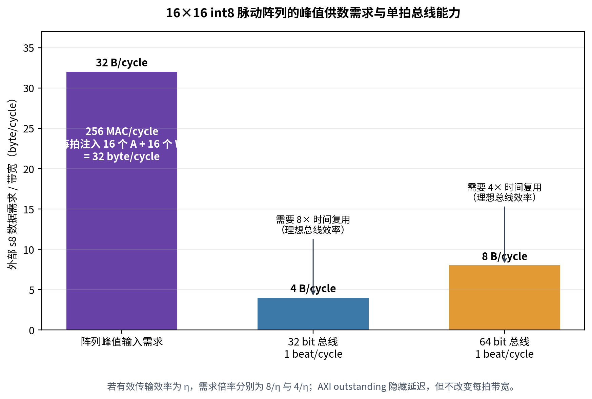
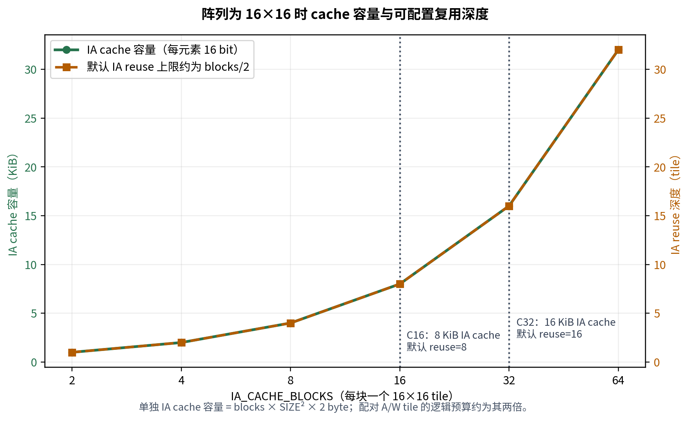
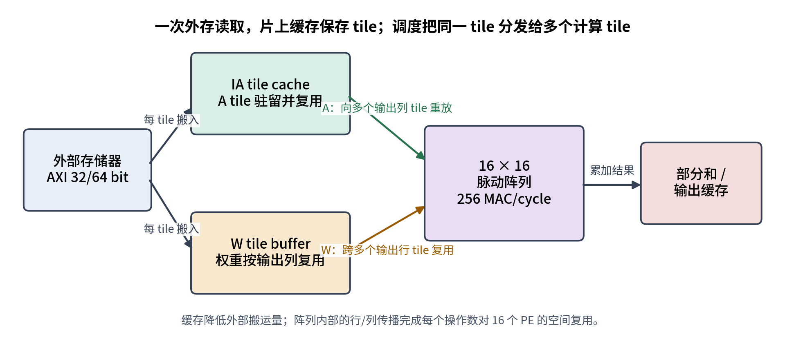
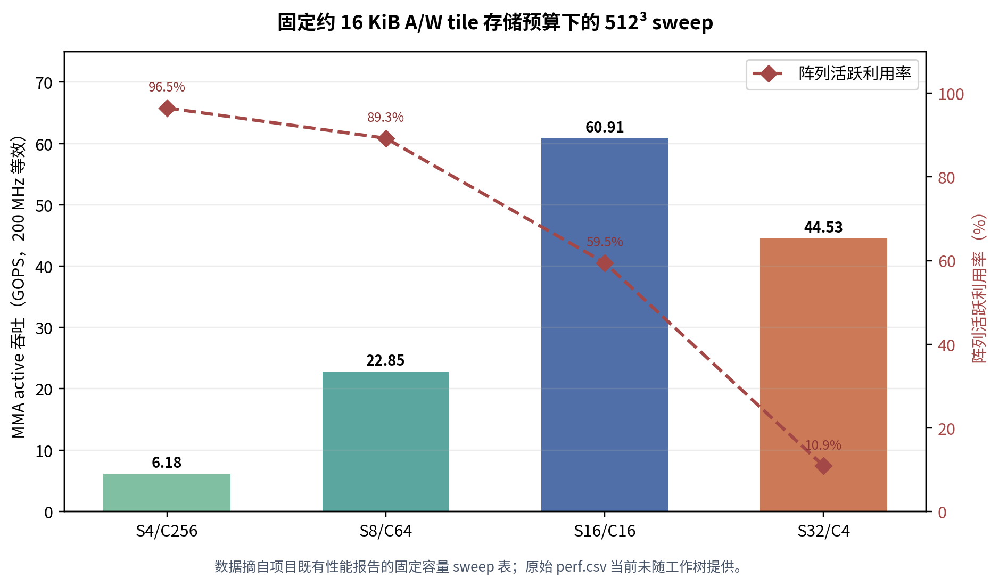

# 脉动阵列吞吐量与 Tile Cache 瓶颈分析

**报告类型：** 设计分析报告  
**对象：** AI DSA（`SIZE=16` 默认配置）  
**日期：** 2026-11-07

## 摘要

当前 NPU 默认采用 16×16 int8 脉动阵列和 32 bit AXI 数据总线。阵列完全填充时，每拍执行 256 MAC，即按 1 MAC=2 ops 计为 512 ops/cycle；200 MHz 等效峰值为 102.4 GOPS。为了连续供给阵列，每拍需要从片上存储向阵列注入 16 个激活值和 16 个权重值，共 32 byte/cycle。若外部总线每拍只完成一次传输，32 bit 总线只能提供 4 byte/cycle，64 bit 总线提供 8 byte/cycle。因此需要分别约 8 倍和 4 倍的有效数据复用，才可在理想总线效率下支撑阵列峰值。

tile cache 通过把已搬入的矩阵分块保存在片上，并让它服务多个相邻输出 tile，降低外部重复读取量。当前 RTL 中一个 IA cache block 存放 `SIZE×SIZE` 个 16 bit 内部元素；当 `SIZE=16` 时为 512 byte/block。建议将 `IA_CACHE_BLOCKS=16`（8 KiB IA cache，默认 IA reuse 深度 8）作为 16×16 阵列的起始配置，并利用 `PS_FRAME_COUNT=16` 所支持的权重侧复用窗口。按理想分块调度估算，这组参数的 A/W 合计外存流量复用因子约为 10.67 倍，足以覆盖 32 bit 单拍总线的 8 倍理论差距；如果总线有效传输率低于约 75%，或需要更大余量，可评估 `IA_CACHE_BLOCKS=32`（16 KiB IA cache，默认 IA reuse 深度 16）。

已有固定容量 sweep 给出的证据与上述设计方向一致：在约 16 KiB 的 A/W tile 存储预算下，512³ 方阵的 `S16/C16` 达到 60.91 GOPS MMA active 吞吐、59.48% 活跃利用率；同一存储预算下 `S32/C4` 虽有更高理论峰值，但实测 active 吞吐降至 44.53 GOPS，利用率为 10.87%。这些结果表明增加 cache 可以缓解供数不足，但当前 `S16/C16` 仍没有达到阵列峰值。消除外存带宽瓶颈不等于消除 DMA 延迟、缓存调度、控制气泡、输出写回和任务尾部开销。

## 1. 分析范围与工程参数

分析聚焦于矩阵乘数据通路的外部供数、tile 复用与阵列有效吞吐。性能数字采用项目已有 SoC 仿真报告记录；本次工作树未包含该 sweep 的原始 `perf.csv`，因此报告中的 sweep 结果属于引用既有工程记录，不构成本轮重新执行的仿真测量。

| 参数或事实 | 当前值 | 来源与说明 |
|---|---:|---|
| 脉动阵列边长 `SIZE` | 16 | `rtl/axi_accelerator/npu/npu_top.sv`、`veri/sim/Makefile` 默认值 |
| AXI `BUS_WIDTH` | 32 bit | `npu_top.sv` 默认参数；顶层 master 数据端口同宽 |
| AXI 读 outstanding | 4 | `npu_top.sv` 与 SoC Makefile 默认参数；用于隐藏延迟，不提高单拍字节数 |
| IA 内部元素宽度 | 16 bit | s8 输入在 loader 中扩展到至少 16 bit 后存入 IA RAM |
| 每个 IA cache block | 16×16 元素 | `ia_loader_cache_mgr.sv` 的 `RAM_DEPTH=CACHE_BLOCKS×SIZE`，每个 bank 为 16 bit |
| 默认 IA cache blocks | 4 | `npu_top.sv` / `veri/sim/Makefile` 默认值 |
| 默认时钟统计基准 | 200 MHz 等效 | 既有性能报告采用的归一化统计基准；实际吞吐应乘以目标时钟相对 200 MHz 的比例 |

AXI 端口数据宽度本身不能说明每周期一定传输一个完整 beat。本文先以 1 beat/cycle 的理想情况计算，再用传输效率系数显式表示 RAM 仲裁、突发间隙和响应停顿。读写为独立 AXI 通道，以下输入带宽只讨论矩阵操作数读取，不将写回带宽合并进读带宽。

## 2. 阵列峰值与输入带宽下限

### 2.1 计算峰值

边长为 $S$ 的二维阵列每拍完成 $S^2$ 个乘加操作。采用 1 MAC=2 ops 的统计规则，时钟频率为 $f$ 时峰值吞吐为

$$P_{peak}=2S^2f. \qquad \text{(1)}$$

当 $S=16$ 时，阵列有 256 个 MAC 单元，每拍最多执行 512 ops。对应 125 MHz 为 64 GOPS，150 MHz 为 76.8 GOPS，200 MHz 为 102.4 GOPS。实际吞吐还要乘以阵列有效利用率 $U$：

$$P_{actual}=P_{peak}U. \qquad \text{(2)}$$

### 2.2 注入端的每拍需求

每拍有 16 个激活值沿阵列一侧进入，另有 16 个权重值从另一侧进入。int8 情况下，阵列输入端需求为

$$B_{array}=2S\ \text{byte/cycle}=32\ \text{byte/cycle}. \qquad \text{(3)}$$

这里已计入脉动阵列内部的空间复用：一个注入的激活值会随数据流经过一列中的多个 PE，一个权重值也会沿另一维传播。因此不能把每个 PE 每拍所做的两次 8 bit 操作直接当成两次外存读取。式（3）是阵列边缘的唯一新操作数输入量，尚未计入跨输出 tile 的 IA/W 缓存复用。

若总线每拍传输一个 beat，则带宽为 $B_{bus}=W/8$ byte/cycle，其中 $W$ 为总线位宽。峰值运算下要求的时间/分块复用倍率为

$$R_{need}=\frac{B_{array}}{B_{bus}}=\frac{16S}{W}. \qquad \text{(4)}$$

对于 `SIZE=16`，32 bit 总线需要 8 倍复用，64 bit 总线需要 4 倍复用。表 1 同时给出按 125 MHz 和 200 MHz 换算的绝对带宽。这里假设总线和阵列同频、每周期一个完整 beat，且不扣除总线空拍。

**表 1  16×16 int8 阵列的操作数读取带宽**

| 总线宽度 | 单拍带宽 | @125 MHz | @200 MHz | 对阵列边缘供数的理论复用要求 |
|---:|---:|---:|---:|---:|
| 32 bit | 4 byte/cycle | 0.50 GB/s | 0.80 GB/s | 8× |
| 64 bit | 8 byte/cycle | 1.00 GB/s | 1.60 GB/s | 4× |
| 阵列注入需求 | 32 byte/cycle | 4.00 GB/s | 6.40 GB/s | — |

若总线的有效传输率为理想值的 $\eta$，式（4）的复用要求进一步变为 $R_{need}/\eta$。例如 $\eta=0.8$ 时，32 bit 与 64 bit 总线分别需要 10× 和 5× 的等效复用。若使用 s16 操作数，阵列注入需求加倍为 64 byte/cycle，带宽倍率也加倍。提高 outstanding 深度可以覆盖部分存储响应延迟，但不会改变总线每周期的位数，因此不能替代数据复用。

**图 1  16×16 int8 脉动阵列的峰值输入需求与单拍总线能力**

## 3. Tile cache 的容量、复用与外存流量

### 3.1 IA cache 的实际存储规模

IA cache manager 由 `SIZE` 个同步 RAM bank 组成。每个 bank 深度为 `CACHE_BLOCKS×SIZE`，每个元素宽度为 16 bit，因此容量为

$$C_{IA}=C\times S^2\times 2\ \text{byte}. \qquad \text{(5)}$$

其中 $C$ 为 IA cache block 数。对 `SIZE=16`，单块大小为 512 byte。C4、C8、C16、C32 分别占 2 KiB、4 KiB、8 KiB、16 KiB。这里是 IA cache 的物理数据容量，不含 tag/控制、权重存储、部分和缓存及 AXI 缓冲。若按 A/W 两类 tile 做容量规划，且两侧都按一块 `S×S`、16 bit 元素估算，逻辑预算约为 IA 单侧容量的两倍；项目已有固定容量 sweep 采用的正是约 16 KiB 的 A/W 合计近似预算。

### 3.2 两个方向的 tile 复用

GEMM 可以按输出行、输出列和归约维分块。令一个 IA tile 在 $W_r$ 个输出列 tile 上重复使用，一个权重 tile 在 $R_r$ 个输出行 tile 上重复使用。计算 $R_rW_r$ 个输出 tile 时，若每个输出 tile 单独读取一份 IA 和一份 W，基线需读取 $2R_rW_r$ 份 tile；采用片上驻留后只需读取 $R_r+W_r$ 份。因此 A/W 合计的理想流量降低因子为

$$F_{reuse}=\frac{2R_rW_r}{R_r+W_r}. \qquad \text{(6)}$$

当前默认配置规则将 IA reuse 上限设为 `IA_CACHE_BLOCKS/2`，为正在发送和预取的 tile 留出存储空间；权重 reuse 窗口受 `PS_FRAME_COUNT` 和实际输出 tile 数裁剪。对 `SIZE=16, IA_CACHE_BLOCKS=16, PS_FRAME_COUNT=16`，容量上限给出 $R_r=8$，而权重窗口最多按 $W_r=16$ 估算。式（6）得到 $F_{reuse}=10.67$。这高于理想 32 bit 总线的 8 倍需求，也高于 80% 总线效率时的 10 倍估算，但仅有约 6.7% 余量；真实执行还受末尾 tile、不规则维度、访问冲突、预取间隙和调度限制。

若采用 C32 并令两侧窗口均可达到 16，则理想合计流量降低因子为 16。它为 32 bit、80% 有效传输率的需求留下约 60% 余量；对 64 bit 总线则有更多余量。缓存容量与复用深度关系见图 2。

**图 2  16×16 阵列的 IA cache 容量和默认 IA reuse 深度**

### 3.3 复用如何缓解带宽瓶颈

Cache 并不会把 32 bit AXI 物理总线变成 256 bit 总线。它改变的是外存数据被读取一次后在片内被使用的次数：

1. DMA 将 A tile 从外存读入 IA cache，W tile 进入权重缓冲。
2. 阵列完成当前输出 tile 时，控制器继续从 cache 读取尚未释放的 A/W tile，而不重新发起同一块外存读取。
3. IA tile 保留期间，调度切换到另一组输出列；权重 tile 保留期间，调度切换到另一组输出行。
4. 仅当 tile 的最后一次复用完成后才释放对应存储位置，DMA 再把下一组 tile 预取到空闲位置。

因此，外部总线提供较低速率但连续的 tile 流，片上 cache 通过时间复用和分块顺序把这些数据供给更宽的阵列边缘。双缓冲/预取还能将一部分 DMA 等待与当前 tile 的计算重叠。数据通路与复用方向见图 3。

**图 3  IA cache 与权重缓冲跨输出 tile 的复用关系**

## 4. 容量建议与配置取舍

**表 2  `SIZE=16` 时 IA cache 规模与建议用途**

| `IA_CACHE_BLOCKS` | IA 物理容量 | 默认 IA reuse 上限 | 配合 W reuse=16 时的理想合计复用因子 | 适用判断 |
|---:|---:|---:|---:|---|
| 4 | 2 KiB | 2 | 3.56× | 当前默认面积配置；不足以单靠 tile 复用覆盖 32 bit 峰值差距 |
| 8 | 4 KiB | 4 | 6.40× | 接近 64 bit 理想需求，32 bit 下余量不足 |
| 16 | 8 KiB | 8 | 10.67× | 推荐起点；按理想分块模型可覆盖 32 bit 单拍需求，资源与收益较平衡 |
| 32 | 16 KiB | 16 | 16.00× | 适用于低效率总线或希望提高复用余量的评估配置；需核算 BRAM 与布线成本 |

推荐先以 `SIZE=16, IA_CACHE_BLOCKS=16, PS_FRAME_COUNT=16` 作为性能评估点。此配置 IA cache 为 8 KiB；若把 A/W 两侧同尺寸 tile 都纳入预算，约为 16 KiB。对 32 bit 总线，在总线效率约 80% 及以上时，模型估算有足够合计复用率；若目标要覆盖更低效率、s16 高带宽工况或增加 DMA 并发，则评估 C32。64 bit 总线能把理想复用需求减半，但在总线效率较低、突发间隙多或外存共享竞争时仍需复用。

增加 cache 有面积、BRAM 使用、地址控制、数据路由、预取仲裁和时序压力成本。也不宜将 cache 无限增大：当矩阵较小、输出 tile 数不足或其余环节限制速度时，多出来的 tile 容量不会带来等比例吞吐提升。缓存大小应按目标阵列规模、工作规模中的 tile 数、总线有效效率和片上 RAM 资源共同选择。

## 5. 项目已有性能数据与瓶颈证据

项目既有 `SIZE/cache 与 TFLM 硬软推理性能报告` 记录了固定约 16 KiB IA/A-W tile 容量的 sweep。对于 512³ 方阵，报告给出以下 MMA active 结果。理论峰值列按 200 MHz 及 int8 计算。

**表 3  固定容量 sweep 的 512³ 性能结果**

| 阵列 / cache | 理论峰值 | MMA active 吞吐 | 活跃利用率 | AXI read beat / active cycle | 说明 |
|---|---:|---:|---:|---:|---|
| S4/C256 | 6.4 GOPS | 6.18 GOPS | 96.50% | 6.80% | 小阵列容易喂满，绝对吞吐受峰值规模限制 |
| S8/C64 | 25.6 GOPS | 22.85 GOPS | 89.26% | 16.78% | 利用率高，绝对吞吐仍低于 S16 |
| S16/C16 | 102.4 GOPS | 60.91 GOPS | 59.48% | 44.85% | 固定容量下的最高绝对吞吐点 |
| S32/C4 | 409.6 GOPS | 44.53 GOPS | 10.87% | 49.26% | cache 深度随阵列扩大而变浅，阵列峰值远超供数能力 |

**图 4  约 16 KiB 固定 A/W tile 存储预算下的阵列规模对比**

数据说明：表中数据转录自仓库原 `doc/size_cache_hw_sw_perf_report_cn.md` 的固定容量 sweep 表。该报告记录的生成数据路径为 `veri/sim/runs/fixed_capacity_size_cache_sweep_burst8_fix/perf.csv`，但该 CSV 当前不在工作树中，因此本报告只复述已归档的表格值，不声称本轮重跑。图 4 用于比较既有记录，不是本轮重新测量。

结果有两点工程含义。第一，固定存储预算下从 S16/C16 扩大到 S32/C4 会让阵列 MAC 数增加 4 倍、单拍峰值输入数据需求增加 2 倍，但 IA cache block 数下降到四分之一，无法维持同样复用深度，实际吞吐反而下降。第二，S16/C16 的 AXI read beat 活跃占比约 44.85%，没有显示读通道在每个 active 周期都满拍传输；其 59.48% 利用率表明除了总线位宽外，cache 可用性、DMA/loader 调度及统计窗口内的非计算周期也影响实际吞吐。单独加宽总线或增大 cache 都不保证利用率立即达到 100%。

## 6. 结论与下一步评估

对当前 16×16 int8 阵列，峰值计算为 512 ops/cycle，阵列边缘需要 32 byte/cycle 操作数输入。按同频、单 beat/cycle 理想条件，32 bit AXI 的绝对输入带宽为 0.8 GB/s（200 MHz），低于阵列峰值需求 6.4 GB/s 8 倍；64 bit 总线分别为 1.6 GB/s 与 6.4 GB/s，仍差 4 倍。tile cache 通过跨输出行/列 tile 重用数据降低外存平均流量，而不是增加物理总线宽度。

容量建议为：以 C16（IA 侧 8 KiB、默认 IA reuse=8）作为 16×16 阵列的首选评估配置；配合 16 tile 的权重复用窗口，理想 A/W 合计流量复用约 10.67 倍。对低总线效率或更高余量需求，评估 C32（IA 侧 16 KiB、默认 IA reuse=16），其理想合计复用约 16 倍。既有 sweep 证明了 cache 与阵列规模必须协同设计，但当前 S16/C16 的仿真利用率仍为 59.48%，所以“供数瓶颈得到缓解”有数据支持，“所有瓶颈均已消除”则没有数据支持。

后续性能评估应在相同矩阵工作规模与时钟下对 C4/C8/C16/C32 记录原始 perf.csv，并同时采集 AXI read beat、DMA 等待周期、IA cache 空槽等待、权重等待、阵列有效周期、输出回压和 cache BRAM 使用量。比较 32 bit 与 64 bit 时应保持 outstanding、突发长度、RAM 时延及缓存容量相同，才能分离总线宽度与复用深度的作用。对 s16 操作数还应单独扫参，因为它的输入带宽需求为 int8 的两倍。

## 参考工程资料

1. `rtl/axi_accelerator/npu/npu_top.sv`：阵列、总线、cache 与 outstanding 默认参数。
2. `rtl/axi_accelerator/npu/ia_loader.sv`、`ia_loader_cache_mgr.sv`：IA tile 调度、cache 深度和 RAM 结构。
3. `rtl/axi_accelerator/npu/axi_dual_block_dma.sv`：AXI DMA 参数与数据端口定义。
4. `doc/size_cache_hw_sw_perf_report_cn.md`：SIZE/cache 固定容量 sweep 的既有性能表及统计基准。
5. `doc/mma_architecture_design_report_cn.md`：MMA 分块数据流、cache 组复用及 loader 结构说明。

