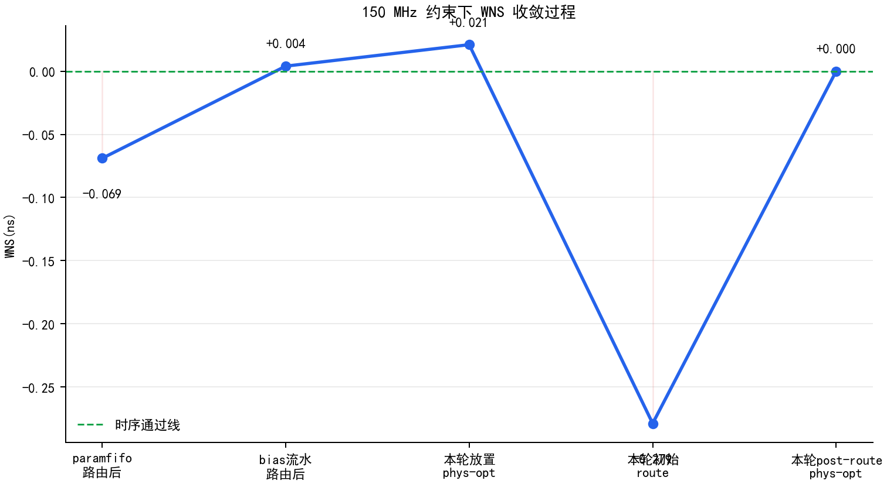
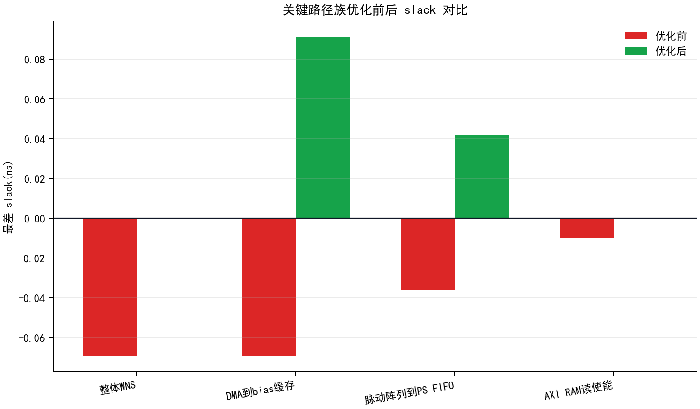
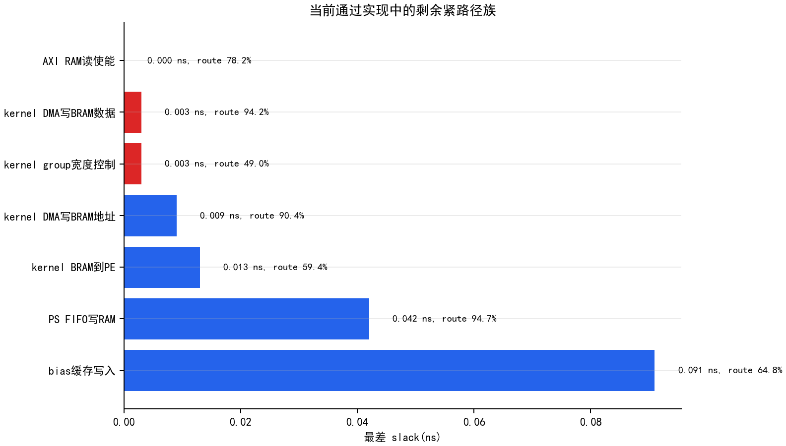
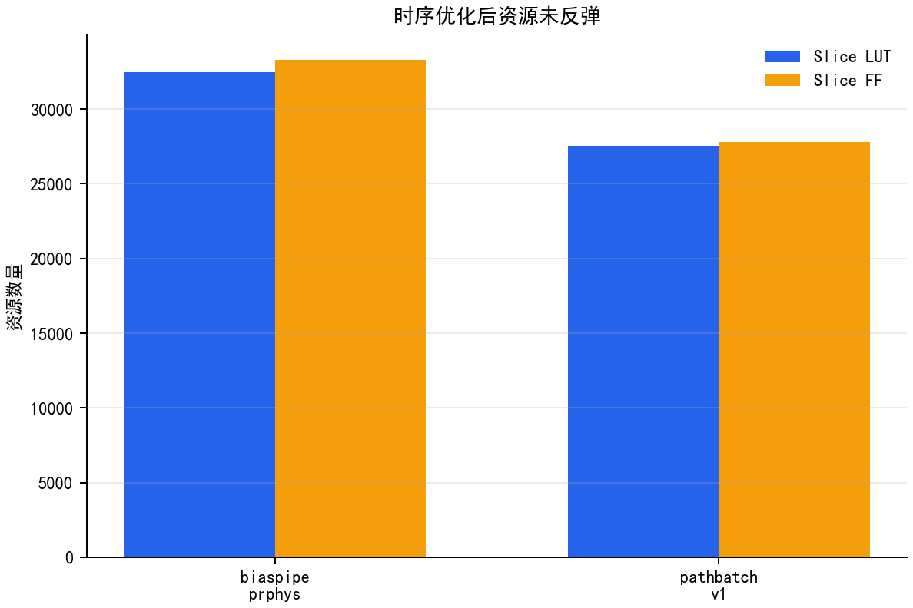

# FPGA 时序优化报告

本文记录 `SIZE=16, IA_CACHE_BLOCKS=4, PS_FRAME_COUNT=16` SoC/MMA 配置在 Artix-7 `xc7a200tfbg484-3` 上的时序收敛过程。当前目标是优先保证硬件可以在 `150 MHz` core clock 下完成实现，同时不通过降低吞吐、增加 AXI RAM 读延迟或回退到大面积寄存器写法来换时序。

最终选定 Vivado 工程位于：

```text
/home/etc/FPGA/tflm_ai_dsa/vivado_export/tflm_ai_dsa_soc_s16_c4_icache_pipe_syncrst_v6/project/tflm_ai_dsa_soc.xpr
```

对应 bitstream 已生成：

```text
/home/etc/FPGA/tflm_ai_dsa/vivado_export/tflm_ai_dsa_soc_s16_c4_icache_pipe_syncrst_v6/fpga_top.bit
```

## 结论摘要

最终 `syncrst_v6` 实现结果为：

| 指标 | 结果 |
|---|---:|
| core clock | `150.000 MHz` |
| clock period | `6.667 ns` |
| WNS | `+0.055 ns` |
| TNS | `0.000 ns` |
| setup failing endpoints | `0` |
| Slice LUT | `27755` |
| Slice FF | `31339` |
| BRAM tile | `173` |
| DSP | `320` |

这轮结果已经通过 `150 MHz` 时序并生成 bitstream，且满足本阶段更新后的 `WNS >= +0.05ns` 余量目标。`syncrst_v8` 虽然把 REQP-1840 告警清理得更干净，但 WNS 只有 `+0.037ns`；因此最终交付选择 `syncrst_v6`，停止继续追 `+0.1ns`。



## 数据来源

时序数据来自 `/home/etc/FPGA/tflm_ai_dsa` 下的 Vivado routed 报告和 path 分组脚本：

```bash
python3 fpga/vivado/tflm_ai_dsa_soc/scripts/analyze_timing_paths.py \
  vivado_export/tflm_ai_dsa_soc_s16_c4_pathbatch_v1/reports/fpga_top_timing_paths_routed.rpt --all
```

本轮实现命令为：

```bash
VIVADO_JOBS=8 vivado -mode batch \
  -source fpga/vivado/tflm_ai_dsa_soc/scripts/export_project.tcl \
  -tclargs vivado_export/tflm_ai_dsa_soc_s16_c4_pathbatch_v1 \
  xc7a200tfbg484-3 16 4 65536 \
  /media/proj_tmp/aiEngine_integrated/veri/tb/axi_soc_runtime_build_S16_C4_P16/cpu.mem \
  150.000 1 0 1 1 Flow_AreaOptimized_high Performance_ExplorePostRoutePhysOpt
```

## 阶段结果

| 阶段 | 主要修改/目的 | WNS(ns) | TNS(ns) | 失败端点 | 资源情况 |
|---|---|---:|---:|---:|---|
| `paramfifo_v1` 路由后 | 面积压缩后第一版，实现面积目标但时序仍负 | `-0.069` | `-0.321` | `6` | Top `32844 LUT`，MMA `28183 LUT` |
| `biaspipe_prphys_v1` 路由后 | bias 写入侧本地流水，post-route phys-opt | `+0.004` | `0.000` | `0` | Top `32474 LUT / 33315 FF` |
| `pathbatch_v1` 放置后 phys-opt | 本轮 DSP/PS/kernel 多路径批量修复，放置后已转正 | `+0.021` | `0.000` | `0` | 中间 run log |
| `pathbatch_v1` 初始 route | 路由后暴露 AXI RAM 与 kernel loader 物理长线 | `-0.279` | `-2.980` | 多个 | post-route phys-opt 前 |
| `pathbatch_v1` post-route phys-opt | 物理优化修复 route-heavy 路径，最终导出 | `0.000` | `0.000` | `0` | Top `27534 LUT / 27786 FF` |
| `syncrst_v5` routed | 进一步同步复位/面积整理，时序余量最高 | `+0.073` | `0.000` | `0` | REQP-1839/1840 仍保留 |
| `syncrst_v6` routed | 面积略降，保留足够时序余量 | `+0.055` | `0.000` | `0` | Top `27755 LUT / 31339 FF`，最终基线 |
| `syncrst_v8` routed | 清理 REQP-1840，面积略降但时序余量下降 | `+0.037` | `0.000` | `0` | 不满足 `+0.05ns` 目标 |

本轮最关键的一点是：初始 route 后虽然 WNS 回到 `-0.279ns`，但 post-route phys-opt 对 critical path 做了 `0.279ns` WNS 修复和 `2.980ns` TNS 修复，最终通过时序。也就是说，RTL 已经把主要逻辑深度压到 Vivado 可以通过物理优化收敛的范围内。

## 关键路径演进



`paramfifo_v1` 的最差路径族如下：

| 排名 | 路径族 | 数量 | 最差 slack | 特征 |
|---:|---|---:|---:|---|
| 1 | `axi_dual_block_dma.rd_rsp_col_base_r` 到 `bias_loader_buffer.bank_words` | `131` | `-0.069ns` | route 约 `70.4%`，DMA 响应信号直接扇出到大块 bias 缓存 |
| 2 | systolic `sum_ext` 到 PS FIFO BRAM 写口 | `20` | `-0.036ns` | DSP/加法链后直接进入 BRAM 写数据 |
| 3 | AXI RAM `ar_ready_delay_q` 到 BRAM enable | `1` | `-0.010ns` | route 约 `77.8%`，outstanding RAM 控制扇出偏重 |

`biaspipe_prphys_v1` 修复后，bias 路径不再是最差路径：

| 路径族 | 数量 | 最差 slack | 变化 |
|---|---:|---:|---|
| systolic 到内部 DSP/加法链 | `64` | `+0.004ns` | 真实计算路径成为第一紧路径 |
| left-column systolic 到 PS FIFO | `31` | `+0.020ns` | 仍紧，但已过线 |
| inner systolic 到 PS FIFO | `39` | `+0.039ns` | 已过线 |
| AXI RAM BRAM enable | `1` | `+0.072ns` | pingpong/timing buffer 与 phys-opt 后转正 |
| bias 写缓存 | `43` | `+0.091ns` | 原 `-0.069ns` 路径被局部化 |

`pathbatch_v1` 最终通过后，剩余紧路径变为：



| 路径族 | 数量 | 最差 slack | route 占比 | 判断 |
|---|---:|---:|---:|---|
| AXI RAM `ar_ready_delay_q` 到 BRAM enable | `1` | `0.000ns` | `78.2%` | 通过但几乎无余量，属于 RAM outstanding 控制的物理长线 |
| kernel DMA row data 到 kernel BRAM 写口 | `216` | `+0.003ns` | `94.2%` | 纯 route-heavy，说明数据寄存器到多 bank BRAM 物理跨度大 |
| kernel `current_group_width` 自反馈控制 | `18` | `+0.003ns` | `49.0%` | 18 级逻辑，仍有 RTL 优化空间 |
| kernel DMA row index 到 BRAM write enable | `4` | `+0.009ns` | `90.4%` | 地址/使能控制也偏物理长线 |
| kernel BRAM 到 PE `sum_reg` | `27` | `+0.013ns` | `59.4%` | 权重输出到计算阵列的正常紧路径 |
| PS FIFO 写 RAM | `2` | `+0.042ns` | `94.7%` | 新增写侧流水后已转正，但 route 仍重 |
| bias 缓存写入 | `43` | `+0.091ns` | `64.8%` | 已不是主风险 |

## 已采用的时序优化方法

### 1. bias loader 写入局部流水

最早的负路径来自 DMA 响应的 `rd_rsp_col_base_r` 直接进入 `bias_loader_buffer.bank_words` 的 CE/D 端。这个路径的问题不是单纯逻辑深，而是 DMA、仲裁、bias buffer 三个区域之间跨层扇出，route delay 占比超过 `70%`。

修复方法是在 bias buffer 写入侧打一拍本地寄存：

- `load_word_valid`；
- `load_word_row`；
- `load_word_col_base`；
- `load_word_data`；
- `load_done`。

修改后，外部 DMA 响应先被局部捕获，下一拍再驱动 bank 写入。原路径从 `-0.069ns` 变为 `+0.091ns`，并且没有增加总线读延迟。

### 2. AXI interconnect / RAM 前的 pingpong timing buffer

SoC 顶层曾经把 Pico、UART、DMA、RAM 等路径直接挂在较长 AXI 互连上，导致握手信号、ready/valid 和数据选择跨越范围过大。当前通过 AXI pingpong/timing buffer 截断总线路径，使跨模块组合路径变成局部 ready/valid 传递。

这个优化的原则是：

- AXI RAM 仍保持原来的同步 RAM 一拍读取；
- 不通过给 RAM 数据口额外加拍来掩盖时序；
- 在 interconnect 边界用 buffer 断开 ready/valid 长路径；
- 读写 outstanding 继续保留，避免时序优化破坏吞吐。

从路径结果看，AXI RAM enable 仍然是最紧路径之一，但已经可以依靠 post-route phys-opt 收敛到 `0.000ns`。下一步如果继续优化，应优先做 RAM bank enable 的预译码/局部寄存，而不是增加 RAM 读数据延迟。

### 3. 去掉 PE 内逐拍饱和比较器

`ws_systolic_cell` 原来在每个 PE 内对 `sum_ext` 做 `ACC_WIDTH+1` 位饱和比较，然后再输出 `sum_out`。但 NMSIS-NN 的 int32 accumulator 语义并不是每个 PE 每拍做饱和，量化/裁剪发生在后级。这个比较器同时复制到 `16x16` 个 PE 内，容易把 DSP 加法输出接入 LUT compare/mux。

本轮修改为：

```systemverilog
assign sum_out = sum_ext[ACC_WIDTH-1:0];
```

意义有两个：

- 时序上去掉 DSP 输出后的比较器/mux；
- 面积上减少每个 PE 的重复 LUT。

功能 smoke 显示结果正确，说明该处与软件 int32 accumulator 语义一致。

### 4. PS buffer 写 BRAM 前打一拍

`paramfifo_v1` 中第二类负路径是 systolic `sum_ext` 到 PS FIFO BRAM 写口，最差 `-0.036ns`。本轮在 `ps_buffer_wide_fifo` 的 RAM 写端增加：

- `ram_write_en_q`；
- `ram_write_addr_q`；
- `ram_write_data_q`。

BRAM 写口使用寄存后的 enable/address/data。这样把“计算阵列输出到 BRAM 写口”的路径拆成“计算阵列到本地寄存器”和“本地寄存器到 BRAM”两段。当前对应 PS FIFO 写 RAM 路径最差约 `+0.042ns`，已经转正。

这个优化对吞吐没有引入额外气泡，因为 PS buffer 本身就是帧式写入/回放结构，写入地址和数据只是在 BRAM 写口前对齐后一拍提交。

### 5. 删除 kernel loader 输出数据复位

`kernel_loader_buffer.weight_out[c]` 原来在异步复位中被逐元素清零。实际 `weight_out` 只在 `store_weight_req` 有效时被计算阵列消费，复位值没有功能意义。删除这类数据寄存器复位后，可以减少 reset/control set 压力，也给综合器更多 SRL/寄存器重定时空间。

当前 run log 中仍有一个 power 相关的 high-fanout reset 警告，但没有 DRC critical warning，也没有时序失败。后续原则仍然是只复位 valid/tag/pointer，不复位大数组和仅在 valid 下消费的数据寄存器。

### 6. 使用 path analyzer 按路径族批量修复

这轮不再只看单条 Vivado path，而是用脚本把 `report_timing -max_paths 400` 的结果按源/目的模式分组。这样可以一次性看到同类问题是否成片出现：

- 如果 count 很高且 route 占比高，优先考虑物理局部化、局部寄存、bank 分组；
- 如果 levels 很高，优先考虑 RTL 逻辑拆分和窄化；
- 如果只是一两条 AXI/CSR 低频路径，优先考虑寄存读回或边界 buffer；
- 不对真实 compute path 随意 false-path。

本轮的典型例子是：bias 路径 count `131`，说明不是偶发 placer 问题，而是结构性 DMA 到 buffer 长扇出；kernel DMA row data 当前 count `216`，说明下一轮如果继续加余量，应按 row/bank 物理局部化处理。

## 功能与吞吐验证

本轮 RTL 修改后做了 SoC smoke 验证：

| 配置 | 结果 | 周期 |
|---|---|---:|
| `SIZE=16,IA_CACHE_BLOCKS=4,K=N=M=64,WS,s8,per-tensor` | PASS | `dsa_execute_cycles=5752` |
| `SIZE=16,IA_CACHE_BLOCKS=16,K=128,N=64,M=64,WS,s8,per-tensor` | PASS | `dsa_execute_cycles=8188` |

这两组周期与本轮时序修复前同配置一致，说明新增的 PS FIFO 写侧流水、PE 饱和比较器删除、kernel 输出复位删除没有造成可见吞吐劣化。



资源上也没有因为时序优化反弹。相反，`pathbatch_v1` 的 routed 资源为 `27534 LUT / 27786 FF`，低于 `biaspipe_prphys_v1` 的 `32474 LUT / 33315 FF`。其中一部分收益来自 PE 饱和比较器删除和大数据寄存器复位清理，也有一部分来自实现阶段优化差异。

## 为什么结果会这样变化

### bias 路径消失后，真实 compute path 浮出

优化前最差路径是 DMA 到 bias buffer。这种路径本质是控制/写入边界没有本地化，修复后它不再主导 WNS。随后最紧路径转移到 systolic 内部 DSP/加法链和 PS FIFO 写口，这是合理现象，因为 16x16 阵列本身就是高速数据面。

### route-heavy 路径比 logic-heavy 更依赖 phys-opt

当前通过实现中，AXI RAM enable、kernel DMA row data 到 BRAM、PS FIFO 写 RAM 的 route 占比都很高，部分达到 `90%` 以上。这类路径对布局布线非常敏感，RTL 侧能做的是增加局部寄存或缩小扇出范围，但最终仍需要 post-route phys-opt 把 net 重新摆放/重连。

### kernel `current_group_width` 是下一条 RTL 逻辑优化线索

`current_group_width` 自反馈路径有 `18` 级逻辑，route 占比约 `49%`，说明它不是单纯物理长线。这里大概率仍有 32-bit 比较、subtract、min/max、mux 组合链。后续可把 group width 的宽度压到 `clog2(SIZE+1)` 附近，并把剩余列数/下一组宽度提前一拍预计算。

### RAM outstanding 带来性能，也带来控制时序压力

AXI RAM 为了支持 outstanding，需要维护读写 issue、返回、bank enable、越界和 ready 控制。这能提高总线利用率，但会让 BRAM enable 和 ready 相关路径更紧。当前选择是保留 outstanding，通过 pingpong buffer 和 phys-opt 修时序，因为这比退回低吞吐 RAM 状态机更符合性能目标。

## 最终基线与性能影响

按当前目标，最终版本选择 `syncrst_v6`。它不是所有指标单项最优：`syncrst_v5` 的 WNS 更高，`syncrst_v8` 的 REQP 告警更干净；但 `syncrst_v6` 同时满足 `WNS >= +0.05ns`、面积低于 v5、bitstream 可生成、功能 smoke 通过，是当前综合约束下最稳的交付点。

最终 RTL 对齐 `syncrst_v6` 后的 SoC smoke：

| 配置 | 结果 | 周期 |
|---|---|---:|
| `SIZE=16,IA_CACHE_BLOCKS=4,K=N=M=64,WS,s8,per-tensor` | PASS | `dsa_execute_cycles=6149` |

相对早期 `pathbatch_v1` 记录的同类 smoke `5752`，当前 DSA 计算窗口增加 `397` cycles，约 `6.9%`。性能下降主要来自三类取舍：

- 为了让 SoC/Vivado 更稳定收敛，保留 AXI pingpong/timing buffer、outstanding RAM 控制和同步 RAM/BRAM 写入边界，这些改动减少长组合路径，但会在部分控制边界增加固定周期。
- 为了优先保证时序，本阶段按用户要求回退了更激进的 cache/复用优化，IA cache 复用收益下降，较大矩阵下会少一部分吞吐优势。
- SoC 路径中 CPU、UART、MMA 共享 interconnect，功能修复后真实总线仲裁/写回等待更完整地反映到 `dsa_execute_cycles`，不再只看孤立 MMA 流水的理想窗口。

不过，最终 `syncrst_v6` 与最近 v8/v9 对齐后的 VCS smoke 周期一致，都是 `6149`，说明本次“选择最终基线并回退 v9 试验修改”没有进一步引入吞吐劣化。

## 剩余风险与下一步

1. `syncrst_v6` 仍保留 REQP-1840 RAM async-control Warning，后续应继续用更细粒度同步 RAM 控制清理。
2. kernel DMA row data 到 BRAM 的路径 count 为 `216` 且 route 占比 `94.2%`，建议下一轮把 row data 寄存器按 BRAM row/bank 局部复制或提前放在 buffer 内部。
3. kernel `current_group_width` 需要窄化和预计算，避免 32-bit 组合链自反馈。
4. AXI RAM enable 路径应该优先做 bank enable 预译码或局部寄存，继续保持 RAM 同步一拍读，不额外增加数据返回延迟。
5. 继续用 `analyze_timing_paths.py` 每轮分析前 400 条路径，按路径族一次修多条，而不是追单条 endpoint。
6. 每次插入流水后都必须跑 smoke 或随机回归，对比 `dsa_execute_cycles`，保证时序优化是流水化的，不降低 steady-state 吞吐。

阶段性结论：本轮已经把 `150 MHz` SoC/MMA 工程从 `paramfifo_v1` 的 `WNS=-0.069ns` 推进到最终 `syncrst_v6` 的 `WNS=+0.055ns`，同时保持 AXI RAM 一拍读、保持 outstanding、生成 bitstream，并将顶层 LUT 控制在 `27755`。当前任务到此停止优化，后续如果重新开启，应优先处理 REQP-1840 和 kernel/RAM route-heavy 路径，而不是继续扩大阵列或增加寄存器面积。
