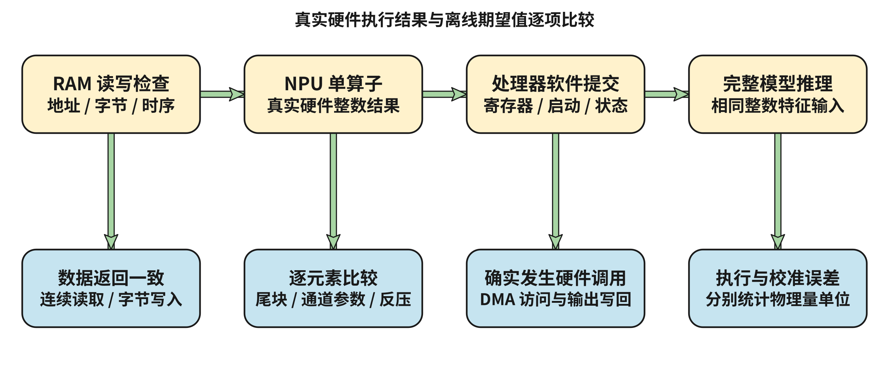

# 测试验证报告

## 5 NPU 与 SoC 功能、正确性和性能验证

### 5.1 验证对象与方法

验证对象包括 NPU RTL、PicoRV32 SoC 联合仿真环境，以及 VU3P 板级 MicroBlaze V SoC 的 FPGA 实现。RTL 回归直接检查 NPU 输出存储区与期望整数结果；SoC 程序通过处理器驱动 NPU，覆盖寄存器配置、AXI 数据访问、TFLM 算子调用及模型输出检查；FPGA 实现报告用于核对目标器件资源占用和布线后时序。

PicoRV32 SoC 用于仿真和软件联合验证，MicroBlaze V 系统用于 VU3P 板级部署。测试程序配置并启动 NPU，检查其对共享存储的读取、阵列运算和结果写入，再将硬件输出与用例预置的期望整数值逐项比较。

图 5-1　NPU 与 SoC 分层验证流程

图 5-2　NPU 内部结构及运算数据通路

#### 5.1.1 验证层次

验证分为 NPU 单元、处理器 SoC、完整模型软件执行和 FPGA 实现四个层次。NPU 单元级检查寄存器配置、数据搬运、阵列运算和输出写回；处理器 SoC 级增加 C 程序、驱动、互连及共享 RAM，检查软件任务是否真正触发 NPU；模型执行层运行 TFLM，核对多个算子组成的实际模型输出；FPGA 实现层检查器件资源、时钟约束、建立时间和保持时间。

不同层次使用不同的观察方式。单元和 SoC 仿真能够读取内部信号和仿真 RAM 内容；软件日志能够给出模型初始化阶段、样本结果和执行周期；Vivado 报告提供布局布线后的资源和时序数据。各类数据只用于对应层次，不把仿真周期直接当作板卡实测时间，也不把逻辑综合结果当作布线后时序结果。

每层均设置直接的检查对象。NPU 单元级查看实际输出地址范围及有效元素；SoC 级查看任务寄存器启动、DMA 活动和程序结束状态；模型层查看 TFLM 张量分配、模型调用与校准输出；FPGA 层查看实现状态、资源数量和主时钟的 WNS、WHS。检查对象与其结果共同构成可复核的测试记录。

#### 5.1.2 仿真与实现环境

独立 NPU 顶层回归使用 Verilator 运行矩阵测试，测试平台产生输入、权重、偏置及量化参数，并检查存储器中的输出整数。AXI-Lite 和 SoC 联合回归使用 VCS 与 UVM 环境，PicoRV32 程序通过 MMIO 配置 NPU，仿真 RAM 响应处理器及 NPU 的 AXI 请求。TFLM SoC 案例将 C++ 模型运行程序编译成处理器存储镜像后由 VCS 启动。

近期传感器 SoC 日志中的工具版本为 VCS W-2024.09-SP1。部分覆盖率统计使用 VCS 数据库生成行、条件、分支、状态机和翻转汇总；行覆盖率是该覆盖率报告所列的主要统计值。Vivado 工程使用 2024.2 系列工具实现 VU3P 板级 SoC，目标器件为 `xcvu3p-ffvc1517`。

SoC 仿真配置中的阵列尺寸为 S=16，输入缓存块数和部分和帧数由相应仿真二进制文件名及编译选项给出。传感器模型回归使用整数 TFLite 文件和固定输入样本，仿真程序设置循环上限后等待 SoC 完成标志。完成状态、处理器陷阱状态、UVM 错误数及程序自身的 PASS/FAIL 信息共同用于确认一次仿真是否结束。

#### 5.1.3 数据记录与比较方式

单算子测试把输入矩阵和任务参数加载到仿真 RAM，启动 NPU 后等待完成，之后读取目标输出区。比较过程以有效行列数为准，逐元素比较定点整数。尾块位置按有效数据范围检查，并核对非有效字节是否未覆盖相邻区域。

TFLM 模型测试由处理器程序准备输入张量并调用 Invoke。目标全连接内核提交 NPU 任务，程序在测试样本完成后输出整数结果、模型调用周期和状态码。预置输入样本、量化参数和期望结果与仿真镜像共同保存，使同一程序可以重复运行并比较输出。

模型量化精度评价使用传感器标定值和有效样本集合，分别统计平均绝对误差及最大绝对误差。NPU 正确性评价使用硬件运行后的整数张量，按样本或算子比较预期整数结果。二者的数据单位不同，模型误差以物理量单位表示，NPU 整数差异以 LSB 或定点整数表示。

FPGA 实现评价采用 Vivado 布线后时序摘要及器件资源报告。时序结果应同时记录目标时钟周期、WNS、TNS、WHS 和 THS；资源结果记录 LUT、寄存器、BRAM、URAM 和 DSP 数量及器件总量。当前布线报告给出的主时钟为 125 MHz，资源数据来自 fully placed 阶段报告，时序数据来自 routed 阶段报告。

### 5.2 NPU 功能验证

已有 NPU 回归覆盖 AXI-Lite 寄存器访问、AXI 突发读写、权重固定及输入固定数据流、int8 与 int16 激活、按张量及按通道量化、输入和权重复用、尾块尺寸、最小矩阵、输出限幅及存储随机等待等场景。测试程序将硬件写回结果逐元素与期望整数值比较。

覆盖率报告记录模块级 24 个运行项和 SoC 级 21 个运行项，NPU RTL 行覆盖率分别为 96.71% 和 95.21%。该组统计结果对应覆盖率报告所记录的回归配置，作为 NPU 功能场景覆盖情况的补充说明。

| 检查项目 | 已记录结果 | 检查方式 |
|---|---|---|
| AXI-Lite 控制与状态 | 回归用例通过 | 读取和写入控制寄存器，检查任务启动及状态更新 |
| AXI 突发读写与尾块 | 随机等待用例通过 | 检查存储器最终内容与期望值 |
| WS、IS 与操作数复用 | 回归用例通过 | 对比不同数据组织方式的输出整数 |
| int8、int16 与按通道量化 | 回归用例通过 | 覆盖不同输入位宽和逐输出通道缩放参数 |
| 输出限幅与偏移 | 回归用例通过 | 检查硬件写回值及有效字节位置 |
| NPU 行覆盖率 | 模块级 96.71%；SoC 级 95.21% | VCS 覆盖率汇总 |

#### 5.2.1 控制寄存器与任务状态

寄存器测试覆盖启动控制、矩阵基址、维度、步长、量化参数和状态读取。测试程序按寄存器地址写入配置，再读取状态或返回字段，检查写字节使能、读回数据和启动状态变化。AXI-Lite 写地址与写数据可以分别到达，测试须保证两者均被接受后再检查写响应；读事务则检查地址接受和数据响应过程。

任务状态测试覆盖复位后的空闲状态、启动后的 busy 状态、正常完成状态及错误返回。重复任务执行前清除完成保持位并写入新参数，检查前一任务的完成状态不会被误认为后一任务的完成。非法维度和错误步长属于防御性配置场景，检查控制器返回状态后不产生越界写回。

#### 5.2.2 AXI 数据传输与存储访问

DMA 读测试检查输入、权重、偏置及量化参数的地址计算、突发长度、返回顺序和目标缓存选择。测试 RAM 可插入确定或随机响应等待，验证读引擎在 RVALID/RREADY 未同时有效时保持请求状态，并在最后一拍响应接受后完成当前读取。

DMA 写测试检查输出地址、字节使能、突发结束标记和写响应处理。int8 每个总线字可包含多个输出元素，int16 每个总线字可包含较少元素；低位地址不为零的首地址及行末尾按有效字节使能提交。测试读取最终 RAM 内容，确保有效位置更新且其余位置保持初值。

带随机延迟的回归用于覆盖 RAM 响应时间变化。现有独立阵列用例在命令、写数据和响应阶段分别设置随机等待上限，并检查最终存储内容。SoC 级覆盖率计划还列出地址跨越总线字范围的访问与随机 RAM 延迟组合，用于检查地址推进和握手暂停行为。

#### 5.2.3 矩阵尺寸、分块和尾块

矩阵测试覆盖最小尺寸、整除阵列尺寸和非整除尺寸。最小矩阵检查单个输入、权重和输出的基础乘加；整除尺寸检查完整阵列利用；非整除尺寸检查最后一块的有效行数、有效列数和有效内积长度。NPU 对无效阵列位置抑制写入，输出引擎只提交有效元素。

分块测试改变 K、N、M 三个维度，使输出行数、内积长度和输出通道数分别跨越阵列块尺寸。多内积分块任务检查首块偏置初值、后续部分和回读及最终输出处理。多输出列块任务检查缓存轮换、量化参数索引和输出地址在块切换时保持一致。

#### 5.2.4 数据类型与量化参数

int8 输入测试检查符号扩展、int8 权重乘法、int32 累加和 int8 输出缩放。int16 输入测试检查较宽激活读取、乘积累加、int32 偏置与 int16 输出缩放。测试值覆盖正数、负数、零值及可能触发激活限制的整数，重点核对符号方向、舍入和限幅次序。

按张量量化用同一乘数和移位处理输出通道；按通道量化为每个输出通道准备独立参数。测试为相邻通道设置不同量化值，检查参数加载地址随输出通道推进，并在 WS 和 IS 两种数据组织方式下核对结果位置。不同通道输出若错误共用参数，逐元素检查会产生可观察差异。

复用测试改变输入复用和权重复用设置，检查同一操作数跨多个输出块参与计算时，部分和帧和加载缓存未被过早覆盖。覆盖率计划中的场景包含较宽矩阵、最大复用值、按通道量化和尾块组合，用于检查复用控制与常规矩阵计算的交互。

#### 5.2.5 已覆盖场景与结果范围

覆盖率计划中列有 AXI-Lite directed 测试及多个 SoC runtime 场景，覆盖 WS/IS、int8/int16、per-tensor/per-channel、复用、饱和限幅、尾块和最小矩阵。模块级测试可直接访问寄存器和 NPU 接口；SoC 级测试由 Pico 软件驱动完成任务配置、DMA 数据访问和结果检查。

模块级报告记录 24 个运行项、NPU 行覆盖率 96.71%；SoC 级报告记录 21 个运行项、NPU 行覆盖率 95.21%。条件覆盖率、分支覆盖率、状态机覆盖率和翻转覆盖率也在原报告中分别列出，作为测试场景补充信息。覆盖率数据只描述对应覆盖率报告所用 RTL 与仿真配置。

已有结果适用于报告所列的测试集。新增算子支持、RAM 控制修改、寄存器字段变化或模型数据格式变化时，应对受影响的功能点重新运行相应测试，并更新测试数据记录。覆盖率数值本身不替代新配置下的功能输出检查。

#### 5.2.6 单项矩阵任务的完整检查顺序

单项矩阵用例从确定张量尺寸开始。测试程序准备输入、权重、偏置、乘数、移位量及激活范围，并为输出区域填入已知初始值。每组张量在启动前按任务寄存器定义写入仿真存储器，测试同时记录基地址、元素类型和各矩阵维数。这样可以区分由算术错误导致的输出差异与由地址计算错误造成的存储内容错位。

任务启动后，测试平台观测控制寄存器写入及 busy 状态，确认 NPU 开始执行。AXI 监测器记录读写请求及响应，重点查看请求地址、数据长度、字节使能、最后传输标记和响应状态。对存储端加入等待时，测试保持相同的矩阵与期望结果，只改变响应时间，检查硬件是否正确暂停并在事务恢复后继续执行。

任务完成后，检查程序状态、NPU 错误位和未结束的 AXI 事务计数。随后按有效输出尺寸读取存储内容，逐元素比较整数值。输出矩阵周围的哨兵数据用于确认无效尾部没有写入相邻区域；对于 int8 输出，还检查同一总线字中无效字节的原始值是否保持不变。多内积分块用例另检查中间部分和是否按正确顺序复用。

最终用例判定基于多个条件同时成立：处理器程序正常退出，NPU 状态显示完成，AXI 请求均收到合法响应，输出元素符合预置期望值，哨兵区域保持原值，仿真器未报告断言错误或 UVM 错误。任一条件失败时，用例保存矩阵尺寸、种子、寄存器设置和输出差异，以便用相同输入复现。

#### 5.2.7 量化数值检查的重点

按张量量化用例将相同乘数与移位量用于全部输出通道，按通道量化用例则为各输出通道设置独立参数。为使参数索引问题容易观察，相邻通道使用不同缩放参数，并令输入及权重产生非零累加值。测试分别检查输出通道块起始、块内推进和尾块位置，确认缩放参数随通道编号变化。

整数舍入用例覆盖乘积为正、负、零以及位于舍入变化点附近的累加值。输出偏移在缩放后加入，激活上下限随后限制结果范围。测试数据同时覆盖正常区间和两端饱和区间，以检查各阶段的顺序。按 int8 和 int16 输出分别确认有符号范围及打包宽度，确保较宽输出不会误用单字节步进。

偏置用例检查每个输出通道加载对应的 int32 偏置。首个内积分块以偏置初始化累加器，后续分块从部分和继续计算。对于偏置地址为零的任务，初值为零；对于软件准备的模型偏置，测试检查提供给硬件的 32 位数值。偏置和部分和共用 int32 加法入口的功能，可由单块和多块矩阵用例分别观察。

量化参数在模型文件中以整数乘数和移位量描述。适配软件依据模型张量的尺度参数生成硬件使用的参数数组，NPU 每个通道按照相应索引取值。模型调用回归可以检查真实张量的类型、尺度和通道数；单算子回归则可构造明确的小矩阵，独立检查整数缩放过程。两种测试结合后，既检查模型适配，也检查硬件算术单元。

### 5.3 SoC 与模型数值正确性

传感器模型 SoC 回归在 PicoRV32 系统中运行 TFLM，并由 NPU 执行模型中的全连接运算。一次包含 8 个样本的湿度、电压和电流校准回归完成了张量分配、模型执行及输出比较，日志记录的最大输出差异分别为 0、0 和 1 个 int16 最低有效位，测试容差为 8 个最低有效位。该次回归的 TFLM arena 使用量为 139,308 字节，SoC 程序以 `TEST PASS` 结束，UVM 错误数为 0。

另一次 int16 激活、int8 权重的传感器模型回归执行 3 个样本，NPU 推理均通过程序内数值检查。单次模型调用周期为 94,170、94,125 和 94,102，平均 94,132 个处理器时钟周期。该周期统计对应先前的 int16×int8 测试模型和配置。

| 回归对象 | 样本数 | 数值结果 | 执行结果 |
|---|---:|---|---|
| 湿度、电压、电流校准 SoC 回归 | 8 | 最大差异为 0、0、1 LSB；限差 8 LSB | `TEST PASS`，UVM_ERROR 为 0 |
| int16×int8 传感器模型调用 | 3 | 3 个样本均通过程序内输出检查 | `PASS`；平均 94,132 周期/次 |
| 最新 `pre_release` 模型 FPGA 部署 | 电压、电流、湿度三模型已写入初始化数据 | 尚无板上模型推理输出记录 | FPGA 实现与软件构建完成，板上推理待测 |

模型量化精度通过模型输出相对于传感器标定值的误差评价；NPU 计算正确性通过硬件写回值与用例预置整数结果逐项比较。前者描述模型的预测误差，后者检查硬件整数运算。现有传感器 SoC 回归结果支持整数执行正确性检查，未提供最新模型在完整数据集上的校准误差统计。

#### 5.3.1 多传感器模型联合执行

多传感器 SoC 回归通过 PicoRV32 执行 TFLM 程序，分别调用湿度、电压和电流模型。测试程序完成解释器构造和 `AllocateTensors` 后，依次处理 8 组固定输入。每组输入运行相应模型，程序读取输出张量并检查与预置定点结果的差异，最后汇总三类输出的最大差异。

仿真日志记录 arena 使用量为 139,308 字节，8 个样本全部完成。湿度输出的最大差异为 0 LSB，电压输出的最大差异为 0 LSB，电流输出的最大差异为 1 LSB，单项允许差异为 8 LSB。SoC 最终状态为 1，处理器陷阱状态为 0，UVM_ERROR 与 UVM_FATAL 均为 0，测试程序输出 `TEST PASS`。

该组结果覆盖模型读取、张量分配、传感特征准备、全连接算子调用和多输出数值检查。测试程序逐个处理模型及样本，日志按模型类别输出整数输入和输出差异，因此异常能够定位到特定传感类别及对应调用阶段。

#### 5.3.2 高精度 int16 全连接模型

高精度模型回归使用 int16 激活和 int8 权重，SoC 中的全连接调用由 NPU 执行。仿真程序运行 3 个固定样本，逐样本记录三个模型输出和 `invoke_cycles`。三次调用分别耗费 94,170、94,125 和 94,102 个处理器周期，平均为 94,132 周期，最大值与最小值相差 68 周期。

三个样本均完成软件内的整数输出检查，SoC 状态寄存器最终为完成状态，`cpu_trap=0`，UVM 错误数为 0。该统计包括 TFLM 算子调用期间的软件及硬件交互开销，不能单独解释为阵列有效乘加周期。当前板级模型变更后的同类周期尚未采集。

#### 5.3.3 校准模型误差统计

传感器校准模型质量按电压物理单位统计。一个整数模型验证集合包含 6,825 条有效随机行样本，电脑端 TFLM 的平均绝对误差记录为 4.783 mV，转换后的 TensorFlow Lite 结果为 4.781 mV。对应的浮点与整数模型结果用于描述该模型划分内的量化误差，不用于描述板上最新模型的误差。

同一模型验证还包含 SoC 的三个固定电压检查点。预置测试结果与 NPU SoC 输出差值为 0 µV；相对于标定电压的最大误差为 4.295 mV。三个检查点的误差分别为 1.455 mV、0.396 mV 和 4.295 mV。该数据说明指定输入下的整数计算和量化输出可以按记录的结果运行，样本数不足以代替大规模数据集误差评价。

该模型验证采用随机行划分，测试集同源于发布数据中的采集记录。因此，4.783 mV 的平均绝对误差用于说明该划分的模型表现。跨批次、跨环境或更宽传感器状态范围的误差需使用独立采集数据检查。

#### 5.3.4 结果单位和误差分解

NPU 输出整数差异按量化张量的最低有效位计量。若张量尺度为 s，则相差 d 个量化单位对应实数差异 `|d| × s`。实际校准输出还包含输入特征量化、整数算子运算、输出反量化和残差还原等处理，因此整数张量差异与物理量误差分别报告。

模型误差统计以校准后的输出与传感器标定值比较，单位随物理量变化。电压使用 mV，电流使用 mA，湿度按相应湿度单位记录。均方误差、平均绝对误差和最大绝对误差强调不同误差特征，表格应明确报告的是哪一指标、使用多少有效样本，以及样本如何筛选。

模型运行时输入特征由应用代码生成，特征均值、标准差和量化尺度参与数值转换。若出现逐层整数结果不同，可按输入张量、全连接输出和模型最终输出依次检查。此方法通过对运行程序中实际张量和 NPU 写回值的观察定位数值差异，不要求将算子改为软件计算后再判断硬件结果。

#### 5.3.5 最新模型部署内容检查

最新 `pre_release` 传感器模型包含电压、电流及湿度三个整数 TFLite 文件。现有部署配置记录的输入长度分别为 18、12 和 7，总模型数据约 41,616 字节。模型文件已加入 BRAM 初始化内容，Vitis 应用按三类输入构造特征，并在模型存储区读取模型常量。TFLM arena 规划在 URAM 地址区，容量配置为 2 MiB。

模型部署检查涉及文件、软件、硬件三个层面。文件层核对模型是否存在、长度是否与清单一致、输入形状是否符合应用代码。软件层核对模型符号、TFLM 解析器、算子注册、张量类型和 arena 地址。硬件层核对 BRAM 初始化内容与模型起始地址、AXI 可访问地址及 URAM 运行存储范围。若任一层使用旧模型或旧地址，串口中的初始化状态可能失败或输出异常。

已完成的是模型内容写入初始化数据、软件工程编译及 FPGA 位流生成。当前没有最新模型在板卡上的 `AllocateTensors` 成功记录，没有三类模型实际调用后的输入和输出日志，也没有上板端到端周期数。因此，当前模型部署状态说明构建产物已经准备，不能据此填写板上推理通过。

实机检查时应从串口开机信息依序确认运行时初始化入口、模型地址与长度、模型解析结果、张量分配状态、推理启动、NPU 任务结束和最终校准数值。若停在模型解析前，应先确认 BRAM 初始化数据和模型符号；若解析成功但张量分配失败，应检查 arena 地址与可用容量；若 NPU 任务未结束，应检查任务参数、读写响应和完成状态；若调用结束但结果偏离，应保存输入特征、整数输出和对应传感器标定值。

#### 5.3.6 应用特征及校准输出检查

电压模型的输入向量由连续测量特征、PGA 档位编码及通道编码组成，共 18 个元素；电流模型输入为 12 个元素，湿度模型输入为 7 个元素。输入检查应比较应用生成的元素数、顺序、量化类型和张量尺寸。对离散字段应确认 one-hot 编码恰有一个有效位置；对连续字段应将原始数值、标准化数值及量化后的 int16 值同时保留，便于分辨特征处理与 NPU 运算差异。

应用层的特征转换会影响模型输出，即使 NPU 对量化张量的整数计算完全正确，输入位置或归一化参数错误仍会产生不合适的校准值。因此，完整模型检查应分开保存模型输入张量、NPU 输出张量和应用最终物理量。检查特定样本时，可逐元素比较输入整数，再比较模型输出整数，最后复算反量化和残差恢复步骤。

电压模型使用 6 项连续特征、8 项 PGA 编码和 4 项通道编码；电流模型使用 8 项连续特征和 4 项通道编码；湿度模型使用 7 项连续标准化特征。程序日志可以输出输入向量摘要和模型输出，但进行数值复核时应保存完整张量或等价的逐项文本。这样可排查输入维数、通道索引、PGA 索引和标准化常量使用错误。

最终校准值的计算还可能包含输出张量反量化、目标均值与标准差还原以及残差叠加。测试时逐步记录模型输出的整数值、反量化值、目标空间预测值、原始测量值和残差恢复后的校准值。若误差首次出现在反量化前，应检查 TFLM 输出与量化参数；若整数输出吻合而物理量差异明显，应检查输出尺度、单位换算及残差方向。

### 5.4 FPGA 实现和性能结果

VU3P 板级工程目标器件为 `xcvu3p-ffvc1517`，主要 SoC 时钟为 125 MHz。Vivado 布线后时序报告给出 WNS 为 +0.183 ns、WHS 为 +0.010 ns；建立和保持违例端点均为 0，报告显示用户时序约束满足。

| 资源或时序项目 | 实现结果 | 器件可用量 | 使用比例 |
|---|---:|---:|---:|
| CLB LUT | 41,536 | 394,080 | 10.54% |
| CLB 寄存器 | 41,380 | 788,160 | 5.25% |
| BRAM Tile | 718.5 | 720 | 99.79% |
| URAM | 316 | 320 | 98.75% |
| DSP | 438 | 2,280 | 19.21% |
| 布线后 WNS | +0.183 ns | 0 ns 以上 | 满足 |
| 布线后 WHS | +0.010 ns | 0 ns 以上 | 满足 |

16×16 阵列在 125 MHz 下的理论峰值为 32 GMAC/s；按一次乘法和一次加法分别计数时为 64 GOP/s。该数值依据阵列规模和时钟频率计算，代表理论峰值。当前报告中的传感器模型性能结果来自 RTL SoC 仿真周期统计；最新模型在实机上的端到端推理时间尚未测得。

#### 5.4.1 时序与时钟结果的解释

主时钟频率为 125 MHz，对应时钟周期 8 ns。布线后 WNS 为 +0.183 ns，表示在该实现报告的最差建立路径上仍有正裕量；WHS 为 +0.010 ns，表示最差保持检查也满足当前约束。TNS 和 THS 均为 0，建立与保持违例端点计数均为 0。上述值来自 routed 阶段的时序摘要，适用于该工程约束和该次实现结果。

资源统计来自 fully placed 报告，反映布局完成时的器件单元使用量；时序统计来自 routed 报告，反映布线后路径检查。二者的报告阶段不同，阅读时应分别保留来源信息。LUT、寄存器和 DSP 仍有较大余量，BRAM 与 URAM 的使用接近器件容量。调整 RAM 数量、深度或存储结构时，应重新执行实现并检查资源与布线后时序，原报告的数值不能直接代表调整后的工程。

#### 5.4.2 峰值吞吐量和仿真周期

16×16 阵列共有 256 个处理单元。按每个有效处理单元每周期完成一次乘加计算，频率为 125 MHz 时，峰值为 `256 × 125 MHz = 32 GMAC/s`。若将一次乘法和一次加法分别计为一次运算，理论数值为 64 GOP/s。该估算不包含操作数装载、阵列填充、尾块、缩放和输出写入，因此只描述阵列算术峰值。

先前 int16×int8 传感器模型回归中，单次 `invoke` 平均耗费 94,132 个处理器周期。若按 125 MHz 计数频率折算，该周期数约为 0.753 ms。仿真时钟与板级时钟设置应分别核对，因此该换算用于说明周期数量级，计时对象是 PicoRV32 SoC 仿真中的模型调用，包含软件调用和 NPU 交互，不等于 MicroBlaze 板上实测值。另一组 8 样本多传感器回归完成情况和输出差异已记录，但没有提供相同格式的逐次周期统计。

实际模型吞吐量还受模型内全连接层尺寸、TFLM 调度开销、共享 RAM 读写、缓存命中、阵列有效利用率及每层输出等待影响。不同模型的层数和通道数不同，不能只凭模型文件字节数或阵列峰值推导单次推理延迟。板上测量应在模型调用入口和返回位置读取同一硬件计时源，分别记录初始化时间、首轮调用时间和稳态调用时间，并报告多次调用的最小值、平均值、最大值及样本数。

#### 5.4.3 板上测量数据定义

首轮调用可能包含运行时状态建立和首次存储访问，后续调用反映重复执行时的持续开销。两者应分别计时。若一个采样周期内调用电压、电流和湿度三个模型，应记录每个模型单独的时间以及三者合计时间，并说明采样与 OLED 更新是否计入。

周期数需要注明计数器时钟域和频率。若使用 125 MHz 主时钟计数器，时间可由周期数除以 125,000,000 得到。UART 打印本身需要时间，若计时区间包含格式化和串口发送，结果将反映日志开销；正式测量可在计数区间内只记录计数值，调用结束后再输出。每个模型至少重复多次，并保持相同输入或明确记录输入样本，以便比较测量结果。

数值结果记录应与周期测量分开。对每个模型保存输入特征的整数值、NPU 输出张量、反量化结果、残差还原结果和最终显示数值。若上位机采集数据用于误差统计，还应同步保存对应标定值、传感器原始读数、通道和 PGA 档位。统计表按传感类别分别计算平均绝对误差、均方根误差及最大绝对误差，并列出有效样本数量与剔除规则。

### 5.5 结果说明

已记录的 RTL 与 SoC 回归表明，指定的矩阵数据类型、量化方式、分块尺寸及随机存储等待场景可以完成运算，并通过各用例的整数结果检查。传感器模型的 SoC 回归记录了最多 1 LSB 的端侧整数输出差异。VU3P FPGA 实现完成布线，主要时钟域的建立和保持时序满足约束。

最新 `pre_release` 模型已经纳入 BRAM 初始化数据，Vitis 应用已编译，最终 bit 文件已生成。目前未取得该模型在 VU3P 板卡上的启动日志、TFLM 初始化状态、三路校准输出和实测推理时间，板上模型正确性及端到端性能仍需实测。

#### 5.5.1 片上存储资源与模型容量

当前器件 BRAM Tile 使用 718.5/720，URAM 使用 316/320。模型数据约 41,616 字节，保存在专用 BRAM 初始化区；运行期 TFLM arena 配置为 2 MiB 并安排在 URAM 区。器件资源表中的 BRAM 总使用量还包括处理器本地存储、NPU 缓存及其他逻辑 RAM，因而不能把未用 BRAM Tile 的数值直接换算成模型区可扩展容量。

部署空间检查须以实际 IP 深度、数据宽度、初始化段地址和 Vivado RAM 推断结果为准。模型文件字节数小于 RAM 标称容量仍不足以独立证明加载正确，还需确认起始地址、数据端序、模型段长度、CPU 读接口和 NPU DMA 读接口均访问同一份初始化内容。arena 则需验证其可读写、启动清零及解释器分配过程。

URAM 接近器件可用数量，意味着运行内存布局变更需要谨慎核对。增加 arena、缓存或其他 RAM 时，应检查综合后的 URAM 实例数及布局布线报告，并运行 RAM 单元读写测试。BRAM 和 URAM 初始化方式不同，模型初始化文件只应作用于模型存储区域，运行区的内容由程序启动阶段建立。

#### 5.5.2 实现状态与功能状态

Vivado 完成综合、布局布线并生成 bit 文件，说明工程可以按当前配置完成 FPGA 实现；Vitis 根据更新后的硬件平台编译应用并生成 ELF，说明软件工程构建成功。两项状态分别记录硬件实现和软件构建，不包含板卡上电后的运行结论。

板上功能验证还需要确认配置器件完成下载、处理器输出启动日志、模型解析成功、张量分配成功、NPU 全连接任务执行结束，以及校准结果进入 UART 日志和 OLED 显示。当前资料没有这些最新模型的实机运行记录，所以测试报告将其列为待测内容。取得串口记录和定时数据后，方可补充板上初始化、数值误差和推理时间结果。

该区别对测试结论具有直接影响。RTL 仿真可检查模型算法在 PicoRV32 测试系统中的执行；Vivado 实现报告可检查目标 FPGA 的资源和时序；Vitis 构建可检查软件编译；板卡运行才能检查当前 MicroBlaze 硬件平台、模型初始化数据和实际外设程序在一起工作的情况。不同层次结果互为补充，不能用其中一项代替其他项。

#### 5.5.3 结果适用配置

NPU 覆盖率数字适用于覆盖率报告记录的 RTL 和回归编译选项。8 样本模型 SoC 回归适用于该日志中采用的模型文件、仿真 RAM 和 PicoRV32 SoC。94,132 周期平均值适用于先前的 int16×int8 模型调用。电压误差统计适用于记录的 6,825 条随机行验证样本及对应旧模型。VU3P 资源和时序数据适用于当前报告所述器件、工程结构和时钟约束。

把上述数字用于其他模型或硬件配置之前，须核对相应差异。模型更新会改变层尺寸、张量规划和量化参数；RAM 控制器改变会改变访问时序；AXI 地址变更会影响软件驱动；时钟调整会改变时序和周期换算。报告保留各结果的测试对象和来源，使读者能够判断结果是否覆盖所关注的配置。

#### 5.5.4 后续板卡验证步骤

实机验证从检查部署文件开始。确认最终 bit 文件对应当前 Vivado 工程、Vitis ELF 已合并到处理器程序存储、模型初始化文件对应同一批模型，并确认 XSA 与软件平台一致。板卡连接电源、下载接口、UART 和所需传感器后，先下载 bit 文件，再打开串口终端采集完整启动日志。测试过程记录板卡标识、文件名、串口配置、传感器连接和运行条件。

启动阶段按日志顺序检查时钟和复位释放、C 运行环境进入、UART 初始化、校准运行时进入、模型地址及长度、FlatBuffer 解析、解释器创建和 `AllocateTensors`。每个阶段都应输出明确状态；发生错误时保留停止前后的完整日志。确认三个模型均初始化成功后，再检查真实传感器数据是否读取、特征维数是否正确、NPU 是否收到任务、输出张量是否生成以及结果是否完成单位还原。

功能记录阶段应分别观察 OLED 与 UART。OLED 应显示应用定义的校准值，UART 应同时输出模型类别、必要输入摘要、模型输出和转换后的校准值。将连续采样若干轮，确认输出随传感器输入变化且采样程序持续运行。按键或外设交互若属于正式应用功能，应另行执行对应操作并检查串口是否仍持续输出周期数据。

精度记录阶段准备具有有效标定值的传感器样本。每一条样本记录传感器原始值、模型输入、校准输出和标定值，并按电压、电流、湿度分别计算平均绝对误差、均方根误差和最大绝对误差。测试样本应覆盖多个测量区间、通道或 PGA 档位；若采用现场采集数据，应保留采样条件和无效样本剔除说明。已有旧模型误差数值不能代替新模型的统计结果。

性能阶段使用自由运行计数器或处理器周期计数器包围单次 TFLM 调用。先单独测量各模型首轮调用，再执行重复调用，记录每次周期数。计时不应包含 UART 文本传输；如需评估整套应用响应时间，则另行记录从采样完成到 OLED 更新的总时间。报告中列出时钟频率、计时方法、输入样本、调用次数、最小值、平均值和最大值。

#### 5.5.5 实机通过条件

板上初始化检查要求三个模型均完成解析与张量分配，程序日志没有运行时错误码，实际模型地址及长度与部署清单相符。功能检查要求每次模型调用均返回，NPU 状态显示完成，OLED 校准输出和 UART 输出能够持续更新。数值检查要求保存全部输入输出并用预先确定的传感器误差目标评价；执行性能检查要求给出三类模型单次调用时间及整套采样周期时间。

模型异常时应按照可观察现象分段检查。若串口没有启动文本，检查 bit 文件下载、时钟和处理器程序存储；若出现模型地址但解析失败，检查 BRAM 初始化内容、地址范围和数据长度；若解析成功而张量分配失败，检查 arena 容量及访问权限；若运行时停在 NPU 调用，检查任务寄存器、DMA 请求和完成状态；若任务返回但校准值异常，检查特征顺序、量化参数、输出反量化和残差还原。

每次调试只改变一个明确配置项，并记录相应构建文件与运行日志。若更新模型，需重新生成模型初始化数据并按部署流程重构；若更新硬件或地址定义，需重新导出 XSA 并更新 Vitis 平台；若只修改应用逻辑，也需重新编译并重新合并 ELF。板卡实际运行的 bit 文件名称应记录在日志说明中，避免将不同构建文件的运行数据混用。

上述步骤完成后，测试记录包括模型版本标识、硬件工程配置、软件构建信息、串口日志、原始样本与校准值、调用周期和实现报告。只有具备这些数据，才能分别报告模型初始化、NPU 正确性、传感器校准精度和板上运行性能。

### 5.6 回归执行与资料管理

#### 5.6.1 NPU 单元回归的复现信息

单元回归应保存 RTL 提交状态、测试平台配置、阵列参数、数据类型、矩阵维度、量化设置、随机种子和仿真结束状态。测试输入和输出期望值以明确的整数常量或测试向量文件提供，测试平台直接启动被测 NPU 并读取其写回存储，不调用软件全连接实现代替硬件运算。这样可以保证检查对象始终是正在验证的 RTL 数据通路。

复跑同一个确定性测试时，输入张量、寄存器参数、随机种子及期望结果保持相同。随机等待测试由固定种子产生可重复的读写响应延迟。若失败，日志应输出第一个不同的输出坐标、期望整数、实际整数、相关输入和权重索引，以及当前任务配置。对于地址错误，还应输出请求地址、突发长度和字节使能，便于从存储事务层面复查。

回归结束状态须同时查看仿真进程退出码、测试平台 PASS 标志、断言报告、UVM_ERROR 与 UVM_FATAL 数量。仅凭日志中出现 PASS 字样仍需确认仿真进程没有在随后报错；仅凭仿真进程退出码为零也要确认测试平台确实执行了全部检查。覆盖率数据库应与仿真二进制、配置选项及测试清单保存在同一次运行记录内。

#### 5.6.2 SoC 联合测试的复现信息

SoC 联合测试需要同时固定处理器程序、TFLM 模型文件、SoC 仿真顶层、AXI RAM 配置及 NPU 参数。程序镜像写入 PicoRV32 的仿真存储后，由处理器执行模型初始化和算子调用。日志记录模型类别、输入样本编号、模型解析状态、arena 使用情况、NPU 调用结果、输出数值、状态寄存器和最终周期数。

SoC 测试确认 NPU 硬件是否实际参与计算，可结合驱动任务计数、寄存器启动事务、AXI DMA 请求及输出地址写入观察。程序的模型结果检查以用例预置整数为目标，逐项核验硬件产生的输出。若模型由多个全连接层组成，需确认每个目标算子都走 NPU 适配函数，并记录不支持的其他算子由 TFLM 注册内核执行。

PicoRV32 SoC 与板级 MicroBlaze V SoC 的内存控制和处理器配置不同。因此，SoC 回归的复现信息必须说明处理器实例、地址定义和模型数据装载方式。仿真通过能够说明对应测试系统的执行结果，板级系统仍需独立确认硬件平台文件、处理器程序、模型初始化数据和实际外设连接。

#### 5.6.3 结果表格填写规则

每项功能结果至少记录测试名称、测试对象、软件或硬件配置、输入规模、比较方式、运行结果和日志位置。数值比较列应注明单位及容差；周期统计应注明计数频率和计时范围；覆盖率应注明统计层次和回归项数；FPGA 资源数据应注明报告阶段和目标器件。

多个测试结果不宜合并为一个通过率。寄存器测试、AXI 测试、矩阵数值测试、TFLM 模型测试和 FPGA 实现检查关注的对象不同。报告可在汇总表列出状态，并在章节中保留输入条件和数值细节。未执行项目明确写为待测并说明需要采集的内容，避免把构建完成误写成板上运行成功。

若同一功能在不同模型或工程配置下重复验证，应分别保留条目。例如旧传感器模型的平均误差与最新 `pre_release` 模型板上误差属于不同测试对象；先前 int16×int8 模型的 `invoke` 周期与当前模型周期也应分开。通过保留对象名称、模型输入维数、日期标识或文件校验值，能够防止误用历史数据描述当前构建。

#### 5.6.4 图示与测试对象对应关系

图 5-1 展示从 NPU 单元到 SoC 联合仿真及 FPGA 实现的验证层次；图 5-2 展示阵列、偏置和部分和处理关系。两图分别说明测试顺序和被测计算结构，正文的结果表进一步给出具体配置及数值。图中模块名称与本报告的软件和硬件说明保持一致。

验证流程图说明 NPU 单元回归检查算术和存储访问，SoC 仿真检查 TFLM 调用及处理器控制，FPGA 实现检查器件资源及时序。图示中各层结果分别由对应工具生成。针对模型精度的电脑端评估与 FPGA 运行结果有不同数据来源，报告分别说明样本集、执行平台和输出单位。

### 5.7 验证资料

- `doc/coverage_report_cn.md`
- `doc/rtl_simulation_report.md`
- `drivers/tflm/my_tflm/tflite-micro/sensor_calibration_20261015/validation_report.md`
- `veri/sim/runs/ai_axi_soc_c_test/seed_1/sim.log`
- `veri/sim/runs/tflm_sensor_calibration_int16x8/seed_1/sim.log`
- `/home/etc/FPGA/BIT_PROJ_S1/VU3P_sensor_v2/VU3P_oled.runs/impl_1/bit_soc_wrapper_timing_summary_routed.rpt`
- `/home/etc/FPGA/BIT_PROJ_S1/VU3P_sensor_v2/VU3P_oled.runs/impl_1/bit_soc_wrapper_utilization_placed.rpt`

编写：王
