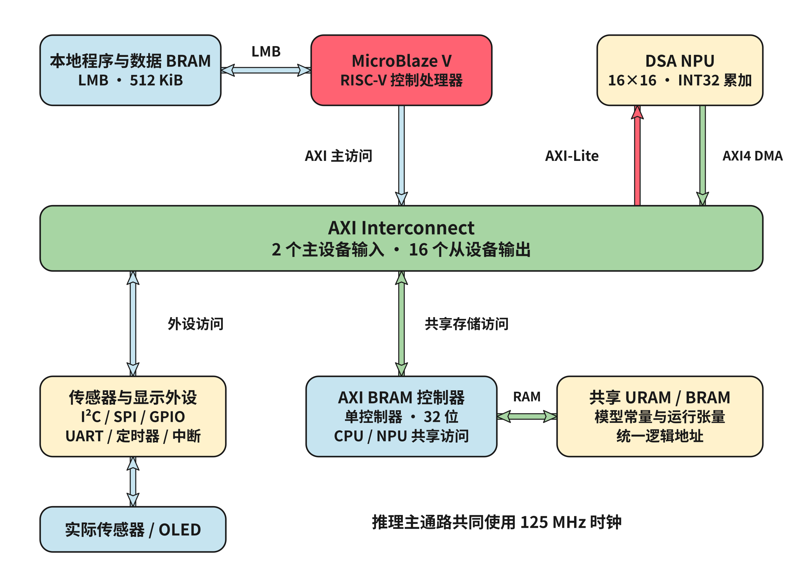
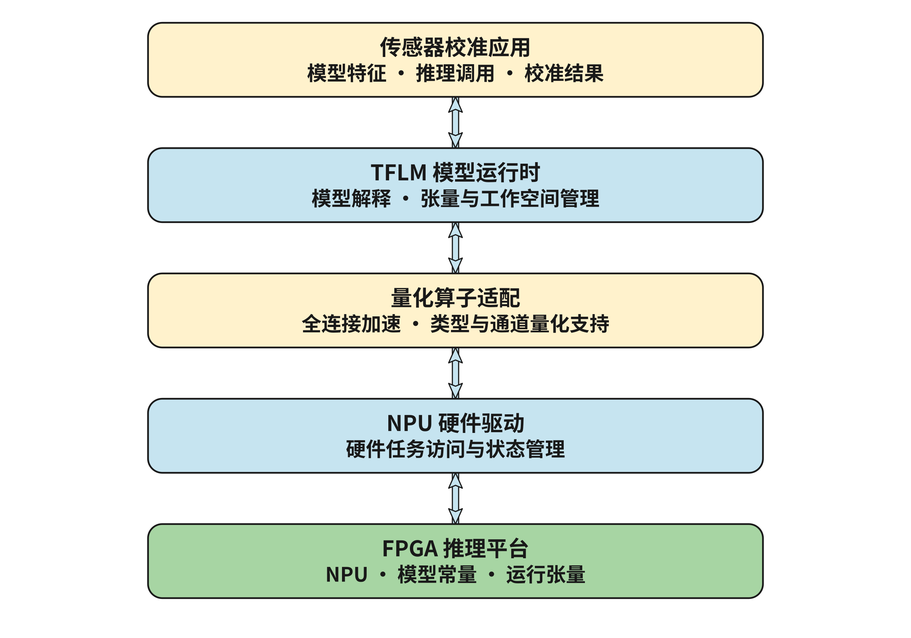

# NPU 与 SoC 设计技术报告

## 摘要

面向电压、电流和湿度等传感器测量值的智能校准，项目形成了 NPU 设计、SoC 设计与 FPGA 部署、软件栈设计三个相互配合的技术成果。NPU 采用脉动阵列与片上数据复用完成整数矩阵运算，支持高精度激活及按通道量化。SoC 以 MicroBlaze V 软处理器为控制核心，集成 NPU、片上存储和传感器外设，在 FPGA 上提供采集、推理和显示所需的硬件环境。软件栈以 TensorFlow Lite for Microcontrollers（TFLM）为模型运行时，将传感器特征处理、模型解释、硬件加速和校准结果使用组织为完整应用。三项设计共同构成传感器校准模型在片上运行的软硬件系统。

**关键词：** NPU；SoC；FPGA；脉动阵列；TFLM；传感器校准

## 1 NPU 设计

### 1.1 设计定位与总体架构

神经网络处理单元（NPU）面向模型推理中的规则矩阵运算，承担全连接层等计算密集任务。传感器校准同时包含外设控制、特征处理和神经网络计算，项目采用处理器与专用加速器协同的结构：处理器组织应用和模型执行，NPU 并行完成整数乘累加及输出处理。

NPU 总体采用任务控制、数据搬运、片上存储和阵列计算相结合的架构。处理器按矩阵任务配置计算要求，NPU 使用共享存储中的输入、权重和量化参数完成计算，并将结果写回输出张量。图 1 给出 NPU 的总体功能及接口关系，FPGA 集成采用 16×16 脉动阵列。

图 1　NPU 总体架构

脉动阵列通过相邻处理单元之间的数据传递组织并行乘加，片上缓存保存可重复使用的操作数和中间结果。矩阵按尺寸划分为多个计算块，较大矩阵通过连续分块执行完成，尾部计算块按照实际有效尺寸处理。该结构将模型矩阵尺寸与阵列规模相结合，为多种全连接形状提供统一的计算方式。

### 1.2 整数量化与数据复用

量化推理以整数表示激活和权重，并通过尺度与零点描述整数和实数之间的关系。项目支持 int8 激活与 int8 权重计算，也支持 int16 激活与 int8 权重的高精度计算。阵列累加、偏置输入和部分和保存统一采用 int32，输出阶段完成定点缩放、舍入及限幅，分别形成 int8 或 int16 结果。

硬件偏置采用 int32 表示。软件将模型偏置整理为相同类型，超出 int32 范围的数值按类型上下限进行限幅。偏置与部分和共用 32 位累加资源，使分块计算与模型偏置处理采用一致的整数表示。

按通道量化为各输出通道提供独立的整数乘数和移位参数，用于保留不同权重通道的数值尺度。输入、权重及部分和的片上复用减少重复存储访问，权重固定和输入固定两种数据组织方式调整操作数的驻留与传递。量化处理与数据复用共同支持高精度整数模型的硬件执行。

### 1.3 计算能力与系统协同

16×16 阵列包含 256 个处理单元，在处理单元全部有效、每周期完成一次乘加且时钟为 125 MHz 时，理论峰值为 32 GMAC/s，对应 64 GOP/s。实际模型的执行效率由矩阵形状、有效尺寸、数据复用和存储传输共同决定。

NPU 通过 AXI-Lite 与处理器交换任务配置和状态，通过 AXI4 主接口访问模型及张量。任务完成后，输出张量供模型后续计算继续使用。项目形成的加速器同时提供整数矩阵计算、按通道量化和共享存储访问能力，与处理器侧模型运行时共同构成硬件加速方案。

## 2 SoC 设计与 FPGA 部署

### 2.1 SoC 总体方案

片上系统（SoC）将处理器、计算加速器、存储和外设集成在同一 FPGA 中，为传感器校准提供完整运行环境。项目选用 MicroBlaze V RISC-V 软处理器作为控制核心，连接本地程序 BRAM、AXI 互连、NPU、共享存储及传感器接口。处理器负责采集管理、模型运行和结果使用，NPU 负责矩阵计算。

AXI 互连连接处理器和 NPU 两个主设备，以及共享存储控制器、NPU 控制接口和外设。处理器通过本地存储总线读取程序，通过 AXI 访问共享数据和设备；NPU 通过相同系统地址读取模型常量和运行张量。图 2 展示 SoC 的总体组成与访问关系。

图 2　FPGA 传感器校准 SoC 总体架构

传感器通过 I²C、SPI 及板级采集接口接入系统，OLED 提供校准结果显示，UART 提供程序状态和校准数值输出。处理器、NPU 和推理相关总线使用 125 MHz 主时钟，系统复位控制协调处理器、存储和外设的启动，使模型计算与实际传感器采集在统一硬件平台上运行。

### 2.2 片上存储与模型运行环境

系统按照数据用途安排存储资源。本地 BRAM 保存处理器程序、栈和局部数据；共享 BRAM 保存模型结构、权重和量化常量；共享 UltraRAM 保存模型解释器的工作空间及运行期张量。NPU 内部缓存进一步保存计算过程中重复使用的输入、权重和部分和。

CPU 与 NPU 通过统一的共享存储接口访问模型和张量，互连及存储控制器处理访问仲裁。模型常量通过 FPGA 配置内容初始化，运行内存在程序启动后清零并由模型解释器分配。该组织使程序执行、模型保存和运行存储分别使用适合的片上资源。

电压、电流和湿度三个整数模型合计占用 41616 字节，模型运行时预留合计 2 MiB 工作空间。模型文件容量描述结构与常量所需空间，工作空间容量描述张量及解释器运行所需空间。模型与工作区分别安排，使 FPGA 片上资源能够支持当前校准应用。

### 2.3 FPGA 工程与软件部署

硬件系统通过 Vivado 的 Block Design 集成软处理器、NPU、互连、存储和外设，板级约束定义时钟及传感器接口引脚。综合和实现生成 FPGA 位流，硬件平台文件 XSA 描述处理器配置、外设地址、时钟和存储区域，为软件工程提供硬件信息。

Vitis 根据 XSA 建立硬件平台和 Standalone 裸机运行环境，板级支持包（BSP）提供启动代码、基础运行库和外设驱动。传感器应用、TFLM 和 NPU 加速支持编译并链接为 ELF 程序。硬件设计更新后，平台支持文件先更新，再编译对应应用，使软件所用地址和驱动配置与硬件一致。

部署文件同时包含 FPGA 逻辑、模型常量和传感器应用。模型常量随 BRAM 初始化内容进入基础位流，处理器程序合并到本地程序存储。最终带软件位流提供处理器启动、模型读取、传感器采集和校准显示所需的内容。

工程将硬件平台、模型文件和应用程序分别组织，模型更新同步调整模型初始化内容及相应预处理参数，程序更新通过重新编译和合并完成。该组织支持传感器校准应用在 FPGA 上持续运行，并为模型与软件维护提供清楚的工程结构。

## 3 软件栈设计

### 3.1 TFLM 背景与软件体系

TensorFlow Lite for Microcontrollers（TFLM）是面向微控制器和资源受限处理器的模型推理运行时。它读取 TFLite 模型中的计算图，管理输入、中间结果和输出张量，并调用相应算子完成计算。TFLM 能够与裸机应用共同运行，适合片上存储容量明确的 FPGA 软处理器系统。

TFLite 模型保存网络结构、张量类型、权重及量化参数，TFLM 根据这些内容组织模型执行。解释器的工作空间称为 tensor arena，由应用提供连续内存，容纳模型运行所需的张量和算子数据。本工程将该空间安排在 UltraRAM 中，使处理器和 NPU 能够访问相同张量。

项目的软件栈分为传感器应用、TFLM 模型运行时、算子适配和 NPU 驱动四层。应用层处理传感器物理量与显示；运行时解释模型并管理张量；适配层连接量化算子与加速器；驱动层提供硬件任务配置和状态管理。图 3 展示软件各层的功能分工及其与硬件的关系。

图 3　传感器校准软件体系

全连接计算通过 NMSIS-NN 兼容接口接入 NPU，量化类型、偏置和按通道参数在适配层统一整理。形状处理、数据整理和逐元素处理由已注册的 TFLM 算子完成。模型解释与硬件计算按照同一张量定义协作，使应用能够通过统一模型接口使用加速器。

### 3.2 模型组织与校准数据处理

传感器校准采用电压、电流和湿度三个整数 TFLite 模型，输入特征数量分别为 18、12 和 7。模型按任务分别组织，电压模型用于两个电压通道，电流模型和湿度模型分别处理对应测量项。温度、增益配置及通道信息作为校准特征的一部分，参与模型输入构造。

应用按照模型训练时确定的特征顺序和归一化参数整理采集数据，再量化为模型要求的 int16 输入。模型输出经反量化和残差恢复后形成校准后的物理量。电压、电流和湿度分别使用自己的输入处理、量化尺度及输出恢复参数，使模型计算结果与实际单位保持对应。

高精度推理采用 int16 激活、int8 权重和 int32 硬件偏置，按通道量化贯穿模型运行时、算子适配和 NPU。三个模型分别管理自己的解释器工作空间，共用算子支持环境，连续采样沿用初始化时建立的运行对象。

### 3.3 应用集成与项目成果

软件将传感器采集、输入有效性检查、模型推理和结果显示组织为持续运行的应用。每个采样周期完成两个电压通道、电流通道和湿度任务的校准，显示层使用校准数值更新 OLED。UART 输出模型初始化状态、推理状态以及校准前后的物理量，为系统运行观察提供信息。

模型输入与输出具有明确的特征定义、物理单位和有效标志。应用根据运行状态使用校准结果，传感器通信、模型执行和显示处理分别由对应软件层承担。该分工使模型数值处理与设备访问分别组织，同时保留应用所需的完整数据处理过程。

项目形成了 NPU 加速硬件、FPGA SoC 工程、硬件平台、模型运行软件和带软件位流等成果。NPU 提供整数矩阵运算能力，SoC 提供处理器、存储和外设运行环境，软件栈将模型计算用于实际传感器校准。三项设计共同支持从传感器采集到模型推理及校准显示的系统应用。
