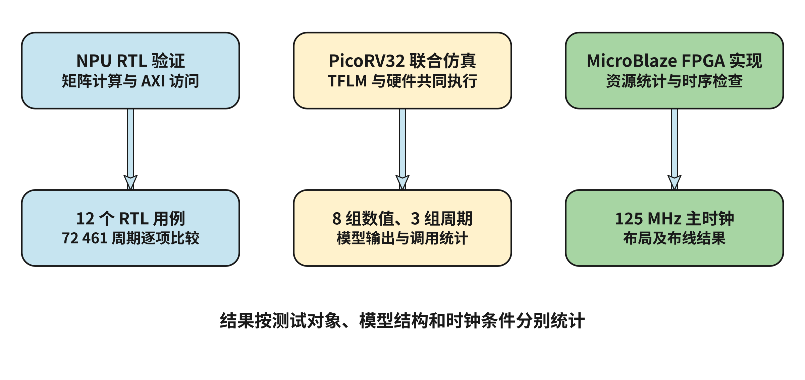
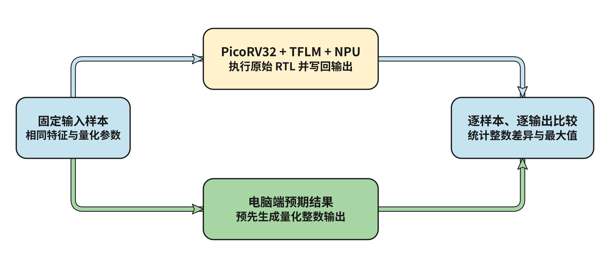
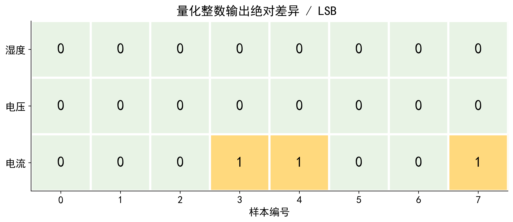
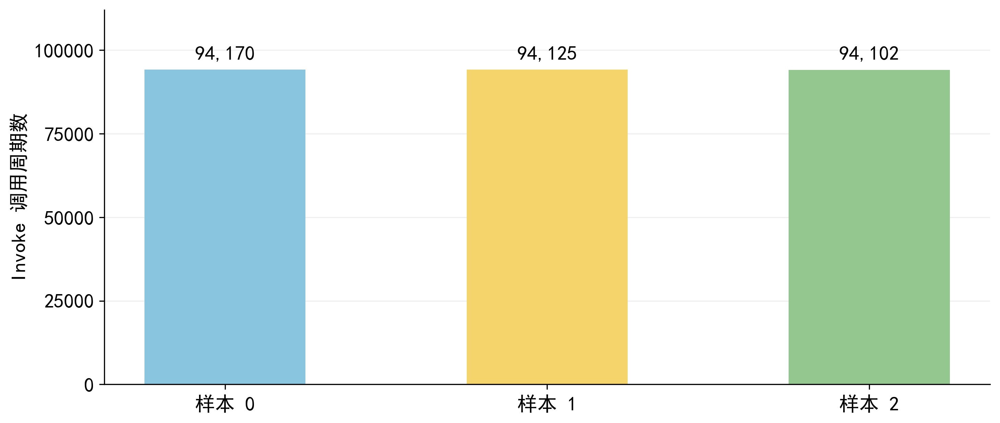
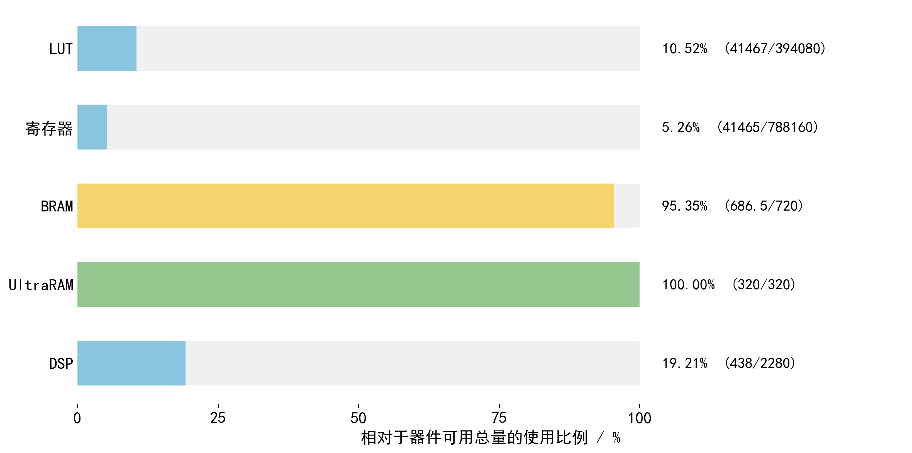

# NPU与传感器校准SoC测试验证报告

## 摘要

面向传感器校准神经网络的片上推理需求，对神经网络处理器（NPU）的计算功能、AXI 访问、TensorFlow Lite for Microcontrollers（TFLM）软件支持、模型数值一致性以及 FPGA 实现开展分层验证。测试采用原始 NPU RTL、PicoRV32 处理器联合仿真和 MicroBlaze FPGA 工程三类对象，分别统计计算结果、执行周期与物理实现指标。

RTL 执行一致性验证包含 12 个用例，累计比较 72 461 个时钟周期，每周期比较 98 个信号字段，两种 RTL 执行方式的输出存储内容及逐周期信号一致。多输入传感器模型的 8 组样本全部满足 8 LSB 的输出差异要求，湿度、电压和电流的最大绝对差异分别为 0、0 和 1 LSB。紧凑型 INT16 激活、INT8 权重模型的 3 次推理调用合计 282 397 周期，平均约 94 132 周期。在 125 MHz SoC 主时钟约束下，FPGA 布线后最差建立时间裕量为 +0.171 ns，最差保持时间裕量为 +0.010 ns。报告同时给出实际传感器校准的板级测试方法，明确输入特征、数值比较、内存检查和显示输出的检查内容。

关键词：NPU；SoC；TFLM；量化推理；联合仿真；FPGA

## 1 测试目标与对象

### 1.1 应用背景

温度、湿度、电压和电流采样会受到器件差异、环境温度以及测量通道特性的影响。神经网络校准模型利用原始采样值及辅助特征计算校准结果，适合通过统一的软件接口接入嵌入式采集系统。模型部署需要同时满足数值精度、片上存储容量和执行时间要求。

NPU 采用脉动阵列完成矩阵乘加，通过 DMA 读取输入、权重和偏置，并将量化输出写回共享存储器。处理器负责传感器采样、输入特征构造、模型执行控制及结果显示。TFLM 是面向微控制器等资源受限设备的神经网络推理运行库，通过静态分配的张量工作区管理中间数据，并按照模型中的算子顺序组织计算。项目在其全连接算子执行部分接入 NPU 驱动，使模型描述和应用程序共同使用同一套推理接口。

### 1.2 验证目标

功能验证检查矩阵乘加、偏置相加、按张量和按输出通道量化、激活限幅以及输出写回。接口验证检查 AXI 寄存器访问、DMA 读写、连续任务执行和存储响应等待。软件验证检查模型解析、张量分配、全连接算子硬件执行以及模型输出比较。FPGA 实现验证检查器件资源使用情况和指定时钟约束下的建立、保持时间。

模型推理的硬件结果取自 RTL 实际计算后的输出存储区域。电脑端生成的预期结果用于离线比较。两类数据分别保留样本编号、输出位置与量化参数，数值检查直接对应实际执行的模型和输入样本。

### 1.3 测试对象及配置

表 1 列出各组测试的对象。联合仿真模型与 FPGA 部署模型分别记录，推理周期和整数差异均按对应模型统计。

**表 1　测试对象与主要配置**

| 对象 | 主要配置 | 检查内容 |
| --- | --- | --- |
| NPU RTL | 16×16 阵列；输入缓存配置为 4、8、16、32 组 | 存储结果、逐周期信号、数据流控制 |
| 多输入模型联合仿真 | PicoRV32；3 个 INT16 输入张量，宽度为 5、3、2 | 8 组样本，湿度、电压、电流输出 |
| 紧凑型模型联合仿真 | PicoRV32；INT16 激活、INT8 权重 | 3 组样本，中间张量、最终输出与调用周期 |
| FPGA SoC 实现 | xcvu3p-ffvc1517-2-i；MicroBlaze；125 MHz | 布局资源、布线后时序 |
| FPGA 部署模型 | 电压、电流、湿度 3 个模型；输入宽度为 18、12、7 | 模型文件、张量维度、内存分配与板级测试方法 |

## 2 验证环境与总体方法

### 2.1 分层验证结构

验证分为 NPU RTL、处理器联合仿真和 FPGA 实现三个层次，如图 1 所示。RTL 层直接控制计算参数并检查存储内容；联合仿真层由处理器执行编译后的 C/C++ 程序，经过 TFLM、驱动和总线访问实际 NPU；FPGA 实现层统计完整 SoC 的资源和时序。

图 1　分层测试结构

NPU RTL 测试采用 Verilator 执行原始硬件描述。测试程序分别通过 Python 时钟驱动接口和独立编译的 RTL 执行程序运行相同输入，比较时钟周期与存储结果。Python 在此承担激励和采样工作，计算主体为编译后的原始 RTL。联合仿真采用 VCS 和 UVM 环境，处理器、AXI 互连、RAM 和 NPU 共同运行。测试程序通过完成状态寄存器报告结果，并检查处理器异常状态和 UVM 结束统计。

### 2.2 时钟与计数范围

处理器联合仿真使用 100 MHz 时钟，对应 10 ns 周期；FPGA SoC 主工作时钟为 125 MHz，对应 8 ns 周期。调用周期以进入 TFLM 的 `Invoke` 前读取计数器为起点，以调用返回后读取计数器为终点，包含该次模型执行的软件控制和硬件计算时间。

NPU 算例的计算周期从计算启动信号被采样开始，至计算忙状态结束并重新出现就绪状态为止。仿真总周期还包含复位、程序启动、模型读取、结果打印和退出过程。各类周期分别标注，调用延时按式（1）换算。

$$
t_{\text{invoke}}=\frac{C_{\text{invoke}}}{f_{\text{clk}}}
$$

（1）

式中，$t_{\text{invoke}}$ 为调用时间，单位为秒；$C_{\text{invoke}}$ 为调用周期数；$f_{\text{clk}}$ 为对应测试环境的时钟频率，单位为赫兹。

### 2.3 数值比较方法

模型输入先按固定顺序构造特征，再使用模型规定的比例因子和零点转换为量化整数。电脑端和处理器端使用相同输入样本、张量顺序及模型参数。图 2 给出硬件执行和预期结果比较的关系，输出位置分别对应湿度、电压和电流。

图 2　模型数值比较流程

第 $i$ 个样本、第 $j$ 个输出的整数绝对差异按式（2）计算，并在相同输出上取最大值。

$$
d_{i,j}=\left|q_{i,j}^{\text{NPU}}-q_{i,j}^{\text{host}}\right|,\qquad D_j=\max_i d_{i,j}
$$

（2）

式中，$q_{i,j}^{\text{NPU}}$ 为联合仿真实际输出；$q_{i,j}^{\text{host}}$ 为电脑端预先生成的量化整数输出；$d_{i,j}$ 和 $D_j$ 的单位均为 LSB，即量化整数的一个最低有效位所代表的步长。多输入模型测试程序规定每个输出的整数绝对差异上限为 8 LSB。

### 2.4 测试通过条件

RTL 算例同时检查目标存储区域的数值和相邻存储内容，以检验计算结果及写入范围；逐周期比较检查计算状态、输入、权重、累加与量化相关信号。处理器联合仿真要求全部样本通过检查、程序完成状态为成功、处理器异常状态为零，且 UVM 错误和严重错误计数均为零。

FPGA 资源检查采用布局报告中的已用量和器件可用量。时序检查采用布线后时序报告，要求所检查时钟组的建立和保持裕量达到非负值，建立和保持违例端点数均为零。板级校准使用相同样本的电脑端 TFLM 输出作为数值比较对象，并分别记录校准值相对于标准测量值的误差。

## 3 NPU 功能与接口验证

### 3.1 计算功能测试设计

计算测试覆盖权重驻留（WS）和输入驻留（IS）两种数据流。WS 方式使权重在阵列中重复使用，IS 方式使输入在阵列中重复使用；两种方式使用同一矩阵乘加目标，分别检查数据装入、计算控制、部分和保存以及输出顺序。

整数计算包含 INT8 输入、INT16 输入、INT16 输出、按输出通道量化和偏置控制。量化检查同时考虑乘法系数、移位参数、输出零点以及激活范围。尾部矩阵测试使用非阵列整数倍尺寸，检查有效元素数量与输出写入范围。偏置关闭测试检查初始累加值，数据复用测试检查跨计算分组的数据保留。

偏置以 INT32 参与硬件计算，累加器宽度为 32 位。测试向量检查设计规定的整数运算、量化和限幅结果。按输出通道量化时，各输出位置使用独立的乘法系数和移位参数，结果与对应输出通道逐项比较。

### 3.2 总线访问与存储等待

存储访问测试分别设置固定响应延时和随机响应延时，使 NPU 在读取输入、读取权重及写回结果时经历不同等待过程。检查内容包括请求地址、读写数据顺序、有效信号保持、计算完成状态和结果存储区域。完成状态与存储比较共同检查一次任务的结束，后续任务继续使用规定的地址和计算参数。

输入缓存容量采用 4、8、16、32 组配置，验证不同参数展开情况下的数据读取和计算过程。缓存容量测试与数据流测试结合，检查相同控制机制在不同配置中的执行结果。AXI-Lite 模块测试检查寄存器读写和计算启动，处理器环境进一步检查软件驱动发出的寄存器访问与 AXI 数据读写。

### 3.3 RTL 执行一致性结果

表 2 给出 12 个 RTL 用例的执行结果。计算周期取各用例启动至就绪的记录，信号比较周期包含启动观察和结束检查过程。每个用例均通过目标存储内容检查，两种执行方式的逐周期记录一致。

**表 2　RTL 用例及结果**

| 测试项目 | 输入缓存组数 | 计算周期数 | 结果 |
| --- | --- | --- | --- |
| WS、INT8、尾部矩阵 | 4 | 369 | 通过 |
| IS、INT16 输入、按通道量化 | 4 | 448 | 通过 |
| WS、INT16 输出 | 4 | 3 138 | 通过 |
| WS、INT16 输出、偏置关闭 | 4 | 1 794 | 通过 |
| WS、数据复用分组 | 4 | 4 361 | 通过 |
| WS、固定存储延时 | 4 | 625 | 通过 |
| WS、随机存储延时 | 4 | 1 921 | 通过 |
| IS、随机存储延时 | 4 | 1 301 | 通过 |
| 缓存参数自动测试 | 8 | 11 810 | 通过 |
| 缓存参数自动测试 | 16 | 13 044 | 通过 |
| IS、INT16 输入 | 16 | 8 250 | 通过 |
| 缓存参数自动测试 | 32 | 25 172 | 通过 |

累计逐周期比较长度为 72 461 周期，每周期包含 98 个信号字段。比较对象包含控制状态、阵列输入、权重、累加结果以及量化输出。12 个用例的两份时序记录具有相同摘要值，存储结果检查均通过。该结果检验了时钟驱动方式与 RTL 执行过程的一致性，并与数值存储比较形成相互补充的检查。

### 3.4 结构覆盖率

覆盖率汇总记录包含模块级和 SoC 级两组统计。模块级由 3 个 AXI-Lite 定向测试和 21 个处理器运行测试组成，共 24 个运行项；SoC 级包含 21 个处理器运行测试。两组均统计 NPU 子树，处理器、UART 和环境 RAM 计入仿真环境。表 3 给出汇总记录中的结构覆盖率。

**表 3　NPU 子树结构覆盖率**

| 统计范围 | 行覆盖率 | 条件覆盖率 | 分支覆盖率 | 状态机覆盖率 | 翻转覆盖率 |
| --- | --- | --- | --- | --- | --- |
| 模块级，24 个运行项 | 96.71% | 82.78% | 82.35% | 57.10% | 52.67% |
| SoC 级，21 个运行项 | 95.21% | 82.17% | 80.77% | 62.72% | 45.13% |

行覆盖率按工程的覆盖率筛选配置统计，筛选项包括仿真打印、性能记录、部分防护状态、参数展开分支和空闲清理过程。功能主体包含数据装入、控制、DMA、阵列计算、重新量化、输出写回、AXI-Lite 寄存器和输入缓存。覆盖率数据用于描述测试触发的结构范围，数值正确性由输出比较检查。

## 4 TFLM 与模型数值验证

### 4.1 软件与硬件共同执行

处理器启动后，测试程序创建算子注册表和模型解释器，执行模型解析及张量工作区分配。全连接算子使用 NPU 加速入口，驱动准备输入、权重、偏置和量化参数，随后发起硬件计算并读取完成状态。输出保存在模型对应的张量区域，供后续算子使用或用于最终结果比较。

TFLM 的张量分配结果用于检查模型运行空间。多输入模型分配后使用 139 308 B，紧凑型模型使用 7 164 B，后者预留工作区为 16 384 B。模型参数、张量类型和运行空间在初始化阶段确定，样本推理复用已分配的工作区。

紧凑型模型测试对各全连接中间张量的首个元素和最终 3 个输出执行整数比较。多输入模型测试则面向最终的湿度、电压和电流输出，检查三类物理量在同一推理过程中的输出次序及数值。两类测试分别检查算子之间传递的部分数据和最终模型结果。

### 4.2 多输入模型测试配置

多输入模型文件大小为 1 354 592 B，包含 3 个输入张量和 3 个输出张量。测试程序从固定传感器记录构造输入，电压、电流和湿度分支的输入宽度分别为 5、3、2，输入和输出类型均为 INT16。8 组样本包含多种温度、湿度、电压和电流组合。

预期整数输出由电脑端 TFLite 解释器预先生成，随测试程序保存；处理器执行每组输入后逐项检查输出。表 4 给出实际硬件计算结果及其相对于预期结果的最大绝对差异。输出列按湿度、电压、电流排列，与测试程序最终比较的顺序一致。

**表 4　多输入模型的实际量化输出**

| 样本编号 | 湿度输出 | 电压输出 | 电流输出 | 三类输出最大绝对差异 / LSB |
| --- | --- | --- | --- | --- |
| 0 | 32 450 | 9 | 3 | 0 |
| 1 | 32 694 | 6 212 | 8 291 | 0 |
| 2 | 32 689 | 7 365 | 22 976 | 0 |
| 3 | 31 839 | 17 668 | 7 175 | 1 |
| 4 | 32 724 | 27 984 | 28 314 | 1 |
| 5 | 32 719 | 5 513 | 1 889 | 0 |
| 6 | 25 491 | 15 828 | 15 648 | 0 |
| 7 | 20 062 | 26 102 | 19 820 | 1 |

### 4.3 整数差异与量化精度

图 3 显示每个样本的整数绝对差异。湿度和电压的全部样本与预期输出一致。电流样本 3、4、7 的实际输出分别比预期输出小 1 LSB，其余电流输出一致。24 个输出值中有 21 个完全一致，全部输出满足 8 LSB 的比较要求，观测最大绝对差异为 1 LSB。

图 3　多输入模型输出整数差异

量化整数差异可按模型输出比例因子换算为物理量差异。设某输出的比例因子为 $s_j$、零点为 $z_j$，反量化结果为 $y_j=s_j(q_j-z_j)$；同一量化参数下，1 LSB 对应 $s_j$ 个物理量单位。测试分别记录整数差异和反量化差异，使 NPU 数值一致性与传感器校准误差具有明确的比较对象。

模型量化精度检查使用同一量化模型的电脑端结果。模型校准效果则以标准传感器或标准电信号的测量值作为比较对象。两项检查分别回答硬件执行是否保持量化数值、模型校准结果达到何种测量误差水平。

### 4.4 联合仿真结束状态

多输入模型与紧凑型模型的测试程序均返回成功，处理器异常状态为零，UVM 错误和严重错误计数均为零。多输入模型的完整仿真经过 168 444 472 周期，紧凑型模型的完整仿真经过 1 207 706 周期；这两项记录描述整个测试程序的运行过程。模型调用性能采用下一章的 `Invoke` 独立周期统计。

## 5 模型推理性能验证

### 5.1 调用时间测量方法

性能测试在张量分配完成后连续执行 3 组固定输入。每次调用前读取周期计数器，调用返回后立即读取计数器，再打印结果与统计值。计数区间包含输入张量已经准备完成后的一次完整 `Invoke` 调用。模型初始化、传感器采样和结果打印分别进行时间记录。

处理器软件对同一计数器执行前后读取，并通过相减得到调用周期。该方法同时计入解释器调度、算子执行、NPU 配置、DMA 等待以及结果写回，有助于评价应用程序实际调用模型时的执行时间。

### 5.2 三组样本的周期结果

图 4 给出紧凑型模型的调用周期。三次调用分别为 94 170、94 125、94 102 周期，合计 282 397 周期，平均值为 94 132.33 周期，最大值与最小值相差 68 周期。

图 4　紧凑型模型三次调用周期统计

在 100 MHz 仿真时钟下，由式（1）得到平均调用时间为 0.941 323 ms，最小值为 0.941 020 ms，最大值为 0.941 700 ms。该统计对应紧凑型模型、PicoRV32 软件程序以及相应仿真存储配置。不同处理器和模型结构分别测量调用周期。

### 5.3 性能统计的应用

传感器应用的单次处理时间由采样、特征构造、模型推理和结果更新组成。模型调用时间可用于制定采样周期，处理器侧同时检查串口输出、按键处理及显示更新的执行时间。多个模型依次执行时，分别记录电压、电流、湿度模型的调用区间，再统计一次完整校准任务的总时间。

板级测量使用处理器计时器或硬件周期计数器。计数开始和结束位置保持在同一模型调用的前后，重复测量覆盖连续运行过程，记录最小值、平均值和最大值。应用总时间以一次采样任务的开始和结果更新完成作为起止位置，便于检查采样周期与处理时间的配合。

## 6 FPGA SoC 实现与部署验证

### 6.1 硬件平台与存储安排

FPGA 工程以 `bit_soc_wrapper` 为顶层，MicroBlaze 处理器运行传感器采集和模型应用程序。处理器通过 AXI 访问 NPU 控制寄存器、传感器外设及共享 RAM，NPU 通过 AXI 主接口读取计算数据并写回结果。SoC 主处理通路统一使用 125 MHz 时钟，时钟稳定后由复位控制电路依次释放系统复位。

模型文件放入支持初始化的 BRAM 区域，运行张量工作区分配在 UltraRAM 区域。软件程序将模型字节数组和工作区放入各自的链接段；模型内容随硬件初始化数据和程序一同部署，工作区由运行程序进行初始化。该安排分别满足模型常量的上电读取和中间张量的读写要求。

### 6.2 资源使用结果

表 5 和图 5 采用完整 FPGA SoC 的布局资源报告。LUT、寄存器、BRAM、UltraRAM 和 DSP 均按器件可用总量计算比例，包含处理器、互连、存储、外设和 NPU。

**表 5　FPGA SoC 布局资源统计**

| 资源 | 使用量 | 可用总量 | 使用比例 |
| --- | --- | --- | --- |
| CLB LUT | 41 467 | 394 080 | 10.52% |
| CLB 寄存器 | 41 465 | 788 160 | 5.26% |
| BRAM Tile | 686.5 | 720 | 95.35% |
| UltraRAM | 320 | 320 | 100.00% |
| DSP | 438 | 2 280 | 19.21% |

图 5　FPGA SoC 资源使用比例

UltraRAM 使用量达到器件总量，BRAM 使用比例为 95.35%，片上存储是当前配置中使用比例最高的资源。模型升级时同时核对模型常量、张量工作区和存储控制器的分配情况。模型参数量与张量尺寸分别影响常量容量和运行空间，资源评估采用完整 SoC 的实现结果。

### 6.3 布线后时序结果

125 MHz 主时钟周期为 8 ns。布线后时序报告中，SoC 主时钟组的最差建立时间裕量 WNS 为 +0.171 ns，最差保持时间裕量 WHS 为 +0.010 ns。全设计建立时间总负裕量 TNS 和保持时间总负裕量 THS 均为 0.000 ns，建立和保持违例端点数均为零。

主时钟组的脉冲宽度最差裕量为 +2.562 ns。时序结论针对工程中已设置约束的内部处理通路和相应时钟组。模型推理的系统运行检查进一步采用实际传感器输入、模型输出和程序完成状态进行检验。

### 6.4 部署模型与程序检查

FPGA 软件平台部署电压、电流、湿度三个 INT16 模型，输入宽度分别为 18、12、7，输出均为单个校准量。对应模型文件分别为 19 600、16 640、5 376 B，总计 41 616 B。三个模型分别保留输入特征顺序、量化参数和输出单位，软件按照通道含义读取对应结果。

部署检查首先核对模型文件大小及 SHA-256 摘要，再核对 ELF 中模型段地址、工作区地址和硬件地址分配。Vitis 硬件平台由同一 FPGA 工程导出的 XSA 更新，软件编译使用相应 BSP 和驱动。程序与硬件初始化内容生成后，检查最终比特流、ELF、XSA 和模型文件之间的对应关系。

内存读写检查包含固定数据、递增数据和交替位数据。处理器写入后读取工作区，检查字节、半字和字访问的一致性；NPU 读取已知输入并写回结果，处理器检查写回区域和相邻数据。模型常量检查采用文件摘要以及模型头、张量数量、数据类型和输入输出维度的共同核对。

### 6.5 板级模型与显示测试方法

板级测试从上电复位开始，依次检查模型常量可读、工作区可读写、解释器初始化、张量分配和首组输入执行。传感器采样完成后，程序按模型要求构造特征，将输入范围限制在模型规定区间，再执行电压、电流和湿度模型。调试程序记录样本编号、输入特征、量化输出、反量化结果和调用时间。

电脑端 TFLM 使用同一份模型和输入特征生成比较结果。每组数据逐项比较量化整数和反量化数值，并根据输出比例因子换算差异。对 INT16 输出，同时检查量化范围和激活限幅。程序连续执行多次采样，检查模型输出随输入变化、工作区复用以及处理器响应。

OLED 检查校准结果与界面变量的对应关系，串口检查调试程序记录的推理结果。电压、电流和湿度分别改变输入时，观察对应显示内容和数值方向；按键操作与采样任务交替执行，检查界面切换和推理任务连续运行。正式程序使用规定的显示输出，调试记录由测试程序保存。

### 6.6 校准误差评价方法

传感器校准效果分别采用原始测量值和校准值相对于标准值的误差评价。平均绝对误差按式（3）计算，电压、电流和湿度分别统计，并使用各自的物理单位。

$$
E_{\text{MAE}}=\frac{1}{N}\sum_{i=1}^{N}\left|y_i-r_i\right|
$$

（3）

式中，$N$ 为有效样本数；$y_i$ 为校准后的输出；$r_i$ 为相应标准值。原始测量值采用相同计算过程得到原始误差。测试保存有效样本数、平均绝对误差、最大绝对误差及温度条件，并按测量通道和量程分别统计。

标准电信号或标准传感器与被测系统同步采样，温度稳定后记录连续样本。湿度测试在规定环境条件下记录湿度及温度；电压、电流测试记录输入设置、参考测量值和通道编号。通过相同条件下的原始误差与校准误差比较，评价模型对传感器测量误差的改善程度。

## 7 结果汇总与结论

RTL 验证的 12 个用例均通过存储结果检查，两种 RTL 执行方式在 72 461 个周期、每周期 98 个字段上的记录一致。测试覆盖 WS、IS、INT8、INT16、按通道量化、尾部矩阵、偏置控制、数据复用和存储响应延时等场景。覆盖率汇总记录中，按配置筛选的 NPU 子树行覆盖率分别达到 96.71% 和 95.21%。

PicoRV32 联合仿真的多输入模型完成 8 组样本验证，湿度、电压输出与预期整数结果一致，电流最大绝对差异为 1 LSB，全部样本满足 8 LSB 的比较要求。紧凑型模型通过所检查的中间张量元素和最终输出检查，3 次调用的平均周期数为 94 132.33，在 100 MHz 仿真时钟下对应 0.941 323 ms。

MicroBlaze FPGA SoC 的布局结果显示，LUT 使用比例为 10.52%，DSP 使用比例为 19.21%，BRAM 使用比例为 95.35%，UltraRAM 使用比例为 100.00%。125 MHz 主时钟下，布线后建立和保持时间检查通过。FPGA 部署的三类模型常量合计 41 616 B，输入维度、工作区分配和程序段地址按部署模型独立检查。

上述结果分别支持 NPU RTL 数值与控制过程、处理器与 TFLM 的联合执行，以及 FPGA SoC 的资源配置和指定时钟下的时序要求。实际传感器的校准误差按第 6 章方法采集标准值与模型输出后计算，形成电压、电流和湿度各通道的板级测试结果。
