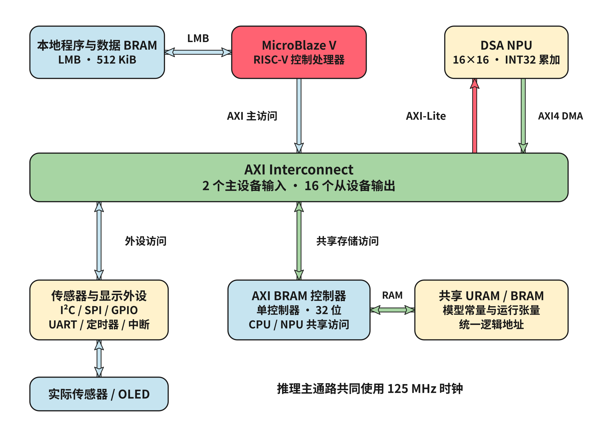
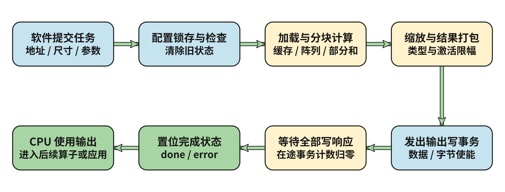
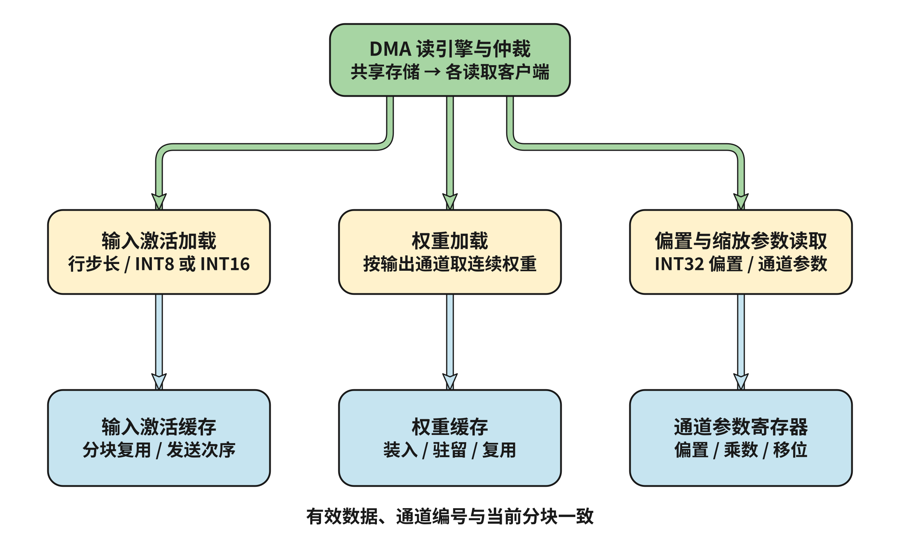
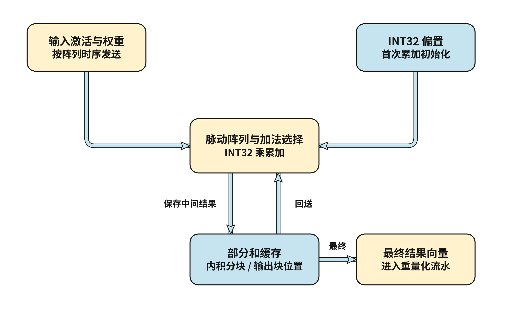
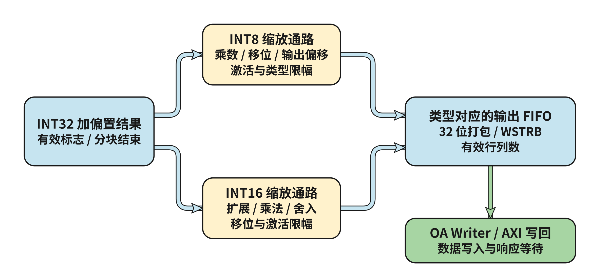
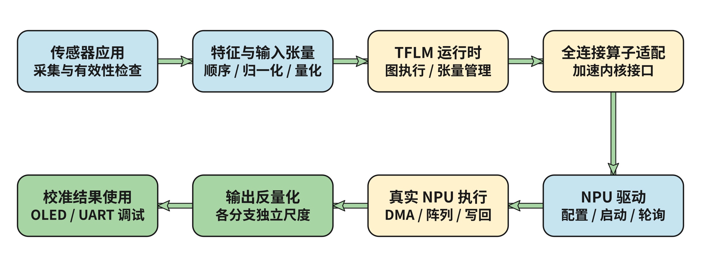
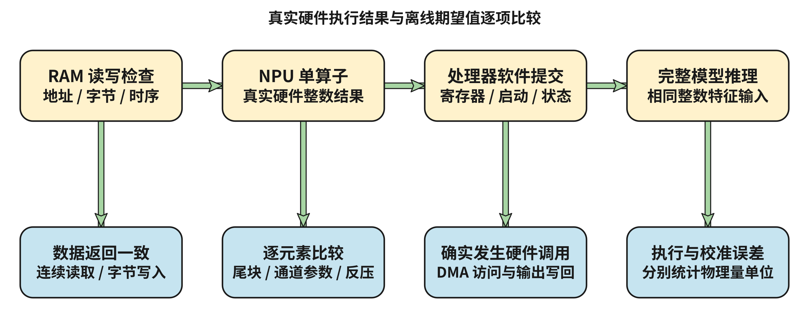

# NPU 与传感器校准 SoC 详细设计技术报告

## 摘要

面向传感器校准应用，系统采用处理器与神经网络处理单元协同工作的片上结构。处理器运行传感器采集程序、TensorFlow Lite for Microcontrollers（TFLM）推理运行时和外设驱动；神经网络处理单元通过 AXI-Lite 接收矩阵任务，通过 AXI4 主接口完成张量搬运，在片上缓存和脉动阵列中执行整数乘累加、部分和保存、定点缩放与输出写回。模型常量和运行期张量分别组织在片上存储区域，处理器与加速器通过统一地址访问共享数据。

NPU 采用任务级控制、分块计算与片上数据复用。加载单元将输入、权重、偏置和按通道量化参数组织为阵列所需的数据流；权重固定与输入固定方式分别调整操作数驻留和发送次序。高精度通路采用 int16 激活、int8 权重、int32 偏置与 int32 累加，输出阶段完成较宽中间运算、舍入和限幅，形成 int16 结果。偏置与部分和采用相同位宽，复用阵列加法输入路径。

软件栈由传感器应用、TFLM 运行时、算子适配和 NPU 驱动组成。应用层构造输入特征并使用校准输出，运行时管理模型和张量，适配层完成数值与布局转换，驱动提交硬件任务。验证方法围绕真实 DSA 执行展开，按存储访问、单算子、处理器系统和完整模型分层比较，分别统计整数输出差异、回归误差和执行时间。

**关键词：** 神经网络处理单元；片上系统；脉动阵列；整数推理；TFLM；传感器校准

## 1 应用任务与系统设计

### 1.1 传感器校准任务

传感器校准程序将采集得到的温度、湿度、电压和电流等数据整理为模型输入，通过训练得到的回归函数估计校准结果。模型输出经反量化恢复为物理量，再进入显示和应用处理。回归任务直接使用输出数值，整数输出的最低有效位经过量化尺度转换后对应明确的物理量变化，因此输入特征、量化参数、整数运算和输出单位共同决定校准结果。

传感器应用包含采集接口、有效性检查、特征归一化、模型调用及 OLED 显示。此类任务具有分支较多、数据量较小和外设依赖较强的特点，适合处理器执行。全连接层及矩阵乘算子包含规则重复的乘加运算，适合专用硬件并行完成。系统据此将应用控制和密集计算分配给处理器与 NPU。

系统使用片上存储保存程序、模型常量、运行期张量和计算缓存。软件通过系统地址访问存储单元，处理器和 NPU 使用相同的张量地址及元素排列。模型解释器直接读取常量区，处理器将特征写入输入张量，NPU 通过 DMA 读取该张量并写入输出张量，后续算子继续使用输出地址中的结果。

传感器校准由电压、电流和湿度三个整数模型组成。电压模型接收 18 个特征，电流模型接收 12 个特征，湿度模型接收 7 个特征；各模型均输出一个校准残差。程序分别设置解释器和工作空间，同一个电压解释器依次计算两个电压通道，每次调用均写入该通道对应的特征。

### 1.2 处理器与专用硬件协同

SoC 采用任务级协同方式。处理器完成模型级控制，向 NPU 提交输入、权重、输出及量化参数；NPU 自主完成分块、加载、计算、缩放和写回。一个硬件任务覆盖一组完整矩阵运算，处理器在提交前整理任务参数，在完成后读取结果并推进模型执行。

MicroBlaze V RISC-V 软处理器负责传感器应用与 TFLM 运行。AXI 互连连接处理器、NPU、共享存储和外设。NPU 的 AXI-Lite 端口接收配置，AXI4 主端口搬运张量。处理器采用状态轮询获取任务完成信息，软件通过普通内存访问操作控制寄存器。

PicoRV32 验证系统承担裸机程序、算子适配和 NPU 的联合验证。两类处理器系统使用相同类型的矩阵任务接口及计算模块，分别提供软件调试环境和传感器应用环境。驱动以地址、维度、步长和状态构成统一接口，使上层算子复用相同的任务提交方式。

### 1.3 功能划分与设计目标

NPU 表示神经网络处理单元，SoC 表示片上系统，DSA 表示领域专用加速器，DMA 表示直接存储访问，RTL 表示寄存器传输级实现。TFLM 提供模型推理运行时，NMSIS-NN 提供本工程采用并扩展的神经网络内核接口。模块名和寄存器字段沿用代码标识，中文说明对应模块的具体功能。

硬件完成整数矩阵乘的任务级执行，支持整块与尾块、字节步长、按输出通道缩放和激活限幅。AXI4 突发事务承担数据搬运，AXI-Lite 寄存器承担参数配置。计算与通信采用独立握手，存储等待通过有效和就绪信号传递，写回完成条件覆盖全部写响应。

软件按照应用、运行时、适配和驱动分层。应用负责传感器物理量和特征顺序，运行时负责模型与张量管理，适配层负责数值及布局转换，驱动负责寄存器访问、启动、完成等待和错误返回。目标全连接算子由 NPU 执行，形状处理、拼接及逐元素算子由 TFLM 注册内核完成。

## 2 计算模型与整数数值设计

### 2.1 矩阵定义与存储布局

加速器的基本计算对象是左矩阵 A、右矩阵 B 和输出矩阵 C，其整数乘累加关系为：

$$
C_{i,j}=b_j+\sum_{r=0}^{N-1}A_{i,r}B_{r,j},\quad 0\le i<K,\quad 0\le j<M.
$$

（1）

其中 K 为输出行数，N 为内积长度，M 为输出通道数，偏置 b 按输出通道提供。进入阵列的数据按式（2）的零点关系完成修正，整数累加结果经过定点缩放、舍入、输出偏移和限幅后形成最终张量。驱动和硬件共同使用 K、N、M 的上述定义。

左矩阵和输出矩阵以行为单位保存，驱动提交相邻两行的字节间隔。全连接权重按输出通道保存连续的 N 个元素，因此右矩阵的数学列在存储器中对应连续权重组。RHS 步长表示相邻输出通道权重组的间隔，加载单元根据输出通道组和内积坐标直接取数。

步长的单位统一为字节。int8 激活的紧凑行步长为 N，int16 激活为 2N；int8 输出的紧凑行步长为 M，int16 输出为 2M。维度描述元素数，步长描述相邻行或权重组的地址距离。带行间间隔的张量通过显式步长访问，尾部元素由有效尺寸控制。

全连接适配将批次数组织为 K，将输入深度组织为 N，将输出通道数组织为 M。输入张量在内积维度上连续，权重以输出通道为组，输出按批次和通道排列。这样的布局使模型张量直接进入分块读取过程，并将矩阵行列关系贯穿加载、阵列计算和写回。

设输入、权重和输出的基地址分别为 $A_0$、$B_0$、$C_0$，字节步长分别为 $s_A$、$s_B$、$s_C$，输入和输出元素的字节数分别为 $e_A$、$e_C$。输入元素的地址为 $A_0+i s_A+r e_A$，权重元素的地址为 $B_0+j s_B+r$，输出元素的地址为 $C_0+i s_C+j e_C$。权重以 int8 保存，因此权重组内相邻元素的地址增量为一个字节。三个地址表达式分别用于输入读取、权重读取和结果写回。

### 2.2 量化参数及零点处理

量化张量利用整数值、尺度和零点表示实数。输入张量的表示关系为：

$$
x_{\text{real}}=s_x(q_x-z_x).
$$

（2）

式中尺度 s 为正实数，q 为存储整数，z 为零点。乘累加前的数据修正与该关系一致。适配层将输入偏移设置为输入零点的相反数，将输出偏移设置为输出零点，硬件据此执行整数修正。int16 全连接通路采用零输入零点、零输出零点和零权重偏移；int8 通路提供输入及输出偏移处理。

按张量量化为一个输出张量提供共用乘数和移位，按通道量化为每个输出通道提供独立参数。按通道方式适应各权重通道的幅值分布，使输出通道分别使用对应尺度。两种方式保持相同的矩阵计算关系，并通过参数读取方式选择具体缩放行为。

按张量模式下，Q_MULT 和 Q_SHIFT 保存整数参数；按通道模式下，这组寄存器保存乘数数组和移位数组的基地址。模式位与寄存器内容共同构成量化配置。软件在构造任务时同时填写模式、参数和激活范围，硬件按选定方式读取并分发缩放信息。

参数数组按输出通道排列。输出分块从通道 j 开始时，参数读取从数组第 j 项开始，并按该块的有效通道数推进。数据流切换时，控制逻辑同步调整内部向量位置与输出通道的对应关系。各通道的整数乘数、移位和输出元素始终按同一通道编号配对。

对输出通道 j，输入尺度与该通道权重尺度的乘积构成累加结果的实数尺度。偏置采用同一尺度，输出缩放比例由该乘积除以输出张量尺度得到。TFLM 在 Prepare 阶段将比例分解为整数乘数和移位，硬件读取分解后的参数执行定点运算。按通道量化改变各通道的缩放参数，矩阵维度与输出通道顺序保持一致。

### 2.3 数据位宽与 int32 偏置

NPU 提供 int8 激活、int8 权重、int8 输出的通路，以及 int16 激活、int8 权重、int16 输出的高精度通路。操作数进入阵列时完成符号扩展，处理单元累加器和部分和缓存统一采用 int32。内部权重端口采用 16 位，模型权重以 int8 保存，在装入阶段扩展为内部表示。

硬件偏置接口统一使用 int32。模型保存 int32 偏置时，适配层直接提供对应地址；模型保存 int64 偏置时，适配层按输出通道准备 int32 缓冲区，将超出类型范围的数值限制到 int32 最小值或最大值，再提交硬件任务。转换缓冲与输出通道一一对应，并在任务执行期间保持有效。

偏置转换采用逐通道饱和处理：大于 2147483647 的数值取 2147483647，小于 −2147483648 的数值取 −2147483648，其余数值直接转为 int32。Prepare 阶段从 arena 申请缓冲，Eval 阶段填入转换结果，硬件始终接收该 int32 数组。限幅处理保留明确的整数输入，验证程序使用相同的偏置数组计算比较值。

偏置、阵列累加结果和缓存部分和具有一致的 32 位表示。首个内积分块使用偏置初始化，后续分块选择缓存部分和作为累加输入，二者复用已有加法路径。该结构使偏置处理与分块累加共用数据选择及累加资源，保持计算核心的统一位宽。

模型存储、硬件计算和输出缩放分别采用各自的数据类型。软件适配负责模型偏置到硬件偏置的转换，阵列负责 int32 乘累加，重量化流水负责较宽中间乘法、舍入和输出限幅。各阶段通过明确的数据类型及有效信号连接，形成完整的定点执行过程。

### 2.4 缩放、舍入与输出范围

累加结果和最终输出使用各自的量化尺度。输出单元通过整数乘数和移位实现尺度换算，再加入输出偏移并限制数值范围。int8 与 int16 通路分别执行对应的定点处理顺序，算术右移、半值舍入和乘数缩减共同确定输出的逐位结果。

int16 输出通路以加偏置后的 int32 结果为起点，先进行符号扩展，再执行与 NMSIS-NN 适配算法对应的较宽乘法和移位。vec_requant_s64 将乘数处理、乘法、移位、舍入和限幅划分为流水阶段。有效信号、分块结束标志和数据同步传播，保证结果进入正确的输出位置。

int8 输出类型范围为 −128 至 127，int16 输出类型范围为 −32768 至 32767。模型激活范围与类型范围共同确定最终限幅区间。输出处理先完成规定的缩放和舍入，再执行限幅及类型转换，保留累加结果在缩放阶段所需的数值信息。

输出先进先出缓冲器（FIFO）按 32 位总线字打包数据。int8 一拍最多容纳四个元素，int16 一拍最多容纳两个元素；首尾字节由写使能标识有效位置。尾块的有效列数同时参与缩放结果选择、FIFO 打包和写地址推进。

高精度输出流水分为五个寄存器阶段：锁存累加结果并缩减乘数、计算 64 位乘积、执行算术右移、执行半值舍入、执行激活及 int16 类型限幅。乘数小于 0x7FFF0000 时，先加 32768 再右移 16 位；其余情况取 32767。乘积右移量由 14 减去量化移位得到，并限制在 0～63。随后对 32 位阶段结果执行加一后算术右移一位，使硬件计算顺序与采用的整数内核一致。

## 3 SoC 总体架构与接口组织

### 3.1 系统组成

SoC 由 MicroBlaze V 处理器、本地指令和数据存储、AXI 互连、NPU、共享存储控制器及传感器外设组成。GPIO、I²C、SPI、定时器和 UART 分别承担板级控制、传感器访问、周期管理及串口交互。处理器通过本地存储接口取指并访问局部数据，通过 AXI 主接口访问共享存储和外设。

NPU 具有两个系统接口：AXI-Lite 从接口接收处理器配置，AXI4 主接口主动访问张量存储。处理器和 NPU DMA 构成互连的两个主设备，NPU 控制端口、共享存储控制器及外设构成从设备。图 1 展示模块归属、接口方向和主要数据流。

图 1　VU3P 传感器校准 SoC 总体架构

AXI 互连采用两个主设备输入端口和十六个从设备输出端口。CPU 与 NPU 通过互连访问同一个共享存储控制器，由互连及控制器完成访问仲裁。共享 RAM 通过统一接口提供模型和运行数据，系统主推理通路共同使用 125 MHz 时钟。

### 3.2 本地存储与共享存储

处理器本地存储保存程序、局部变量、栈和链接脚本安排的数据，通过本地存储总线提供指令及数据访问。共享存储保存模型常量、输入输出张量和运行工作空间，CPU 与 NPU 通过 AXI 访问。两类存储分别服务于处理器执行和模型计算，形成清楚的数据分工。

共享存储采用 BRAM 和 UltraRAM 组织模型及运行区，并向软件提供统一逻辑地址。模型解析器按模型地址读取结构与常量，NPU 按相同地址读取权重及量化参数。tensor arena 保存解释器的持久化对象、中间张量和算子工作缓冲，模型常量区保存只读模型内容。

任务提交前，应用和适配层完成输入张量及参数缓冲写入；驱动通过内存屏障控制访问顺序，再启动 DMA。硬件完成输出写回后，CPU 读取结果并交给后续算子。输入写入、任务提交、硬件计算和结果读取按上述顺序衔接。

模型常量在运行期间持续保留，arena 由解释器统一管理。输入、偏置转换缓冲及通道参数数组在硬件执行期间保持有效；输出写回完成后，解释器允许后续算子读取结果。三个解释器分别使用固定的 arena 子区域，连续调用沿用初始化时分配的张量和算子缓冲。

共享存储由一个 AXI BRAM 控制器提供总线接口。存储模块按地址选择模型 BRAM 或运行区 UltraRAM，处理器与 NPU 均通过该控制器访问。模型 BRAM 的写使能固定为零，配置 FPGA 时装入的模型常量在推理期间保持只读；运行区支持按字节写入，为输入、输出及工作缓冲提供可写存储。

### 3.3 控制面与数据面

AXI-Lite 控制面传输矩阵基址、维度、步长、模式和状态。每项配置通过 32 位寄存器访问完成，处理器以任务为单位提交控制信息。AXI4 数据面读取输入、权重、偏置和按通道参数，并写回输出。控制面与数据面分离，使张量搬运由 DMA 自主推进。

NPU 与处理器访问同一存储目标时，互连选择事务来源，存储控制器将 AXI 事务转换为存储访问。读地址、读数据、写地址、写数据和写响应分别握手，缓存及 FIFO 吸收各通道速率差。下游等待时，有效数据保持稳定，反压沿相关握手路径返回上游。

NPU 寄存器提供就绪、忙、完成及错误状态。驱动通过状态轮询跟踪任务，完成状态保持到软件清除。处理器将算子调用和 NPU 任务关联，在完成后读取返回值，并按运行时调用顺序推进模型。

CPU 与 NPU 同时访问共享存储时，由 AXI 互连仲裁访问次序。NPU 内部读写引擎可以分别发出请求，共享存储端按控制器服务能力接收这些请求。加载缓存与输出 FIFO 保存等待期间的数据，使计算模块通过局部握手适应存储访问速度。

### 3.4 地址分配与软件接口

表 1 列出推理相关的主要系统地址。CPU 本地存储、NPU 控制、UART 和共享存储分别占用独立地址区域，软件通过硬件平台定义和链接脚本使用相应区域。

**表 1　推理相关的主要地址区域**

| 对象 | 系统地址或范围 | 主要用途 |
|:---:|:---:|:---:|
| CPU 本地存储 | 0x00000000，512 KiB | 程序、局部数据与栈 |
| NPU 控制窗口 | 0x10000000，64 KiB | AXI-Lite 配置与状态 |
| 双路 UART | 0x40600000 / 0x40610000 | 串口通信与调试输出 |
| 共享存储窗口 | 0x50000000，32 MiB | 模型及运行区的系统寻址 |
| 模型连续地址区 | 0x51000000 起 | 模型结构、权重和量化常量 |

地址译码窗口定义系统寻址范围，存储模块定义有效物理区域，链接脚本将程序、模型和 arena 放入有效区域。驱动使用任务中的完整基地址访问张量，行步长及分块偏移以字节计。系统地址、张量布局与任务参数共同确定每次实际访问的位置。

外设地址由 XSA 生成的 xparameters.h 提供，驱动使用对应设备的基地址及寄存器偏移。按键控制窗口起于 0x44A00000，NPU 控制窗口起于 0x10000000，两类设备分别执行各自的寄存器操作。模型与 arena 的地址由链接符号提供，应用通过这些符号把实际地址传递给解释器和 NPU 驱动。

### 3.5 Vivado 模块连接与时钟复位

Vivado 的 IP Integrator 通过 Block Design 组织处理器、互连和外设，设计名称为 bit_soc，综合顶层为 bit_soc_wrapper。MicroBlaze V 的本地指令与数据端口连接本地 BRAM，其 AXI 数据主接口连接互连的第一个主设备输入；NPU 的 M_AXI 连接第二个主设备输入。互连输出分别连接 NPU 控制端口、共享存储控制器和外设，CPU 因此能够配置 NPU，CPU 与 NPU 均能够访问共享存储。

共享存储在处理器地址空间和 NPU 地址空间中使用相同起始地址。Block Design 为每个主接口分别建立通往存储控制器的可访问路径，Address Editor 中的地址区域与链接脚本中的存储区域相互对应。接口连接完成后，Vivado 检查总线属性、时钟、复位和地址分配，再生成 HDL 包装文件及各 IP 的输出文件。

板级差分时钟进入 clk_wiz_0，输出的 125 MHz 时钟连接处理器、本地存储、AXI 互连、NPU、共享存储控制器及外设总线接口。时钟锁定信号接入 proc_sys_reset 的锁定输入，外部复位和调试复位也进入该模块。复位控制器按各模块所需极性提供处理器复位、存储复位和低有效外设复位，使总线和计算模块在时钟稳定后开始工作。

中断控制器接收外设中断并连接处理器中断输入，软件中断服务程序读取设备状态并确认相应事件。NPU 提供完成中断输出和完成保持位，推理驱动通过轮询完成位等待任务结束。传感器的 I²C、SPI 以及 OLED 控制端口通过顶层端口连接板级引脚，约束文件给出引脚位置、电气标准和外部时钟条件。

## 4 NPU 总体架构与任务控制

### 4.1 功能模块与执行过程

NPU 外围封装由 npu_axil_top 和 npu_axil_reg_if 组成，内部计算顶层为 npu_top。主要模块包括任务控制器、输入激活加载与缓存、权重加载与缓存、偏置读取、量化参数读取、脉动阵列、部分和缓存、向量缩放、输出打包 FIFO、输出写回单元，以及 DMA 仲裁和 AXI 读写引擎。

图 2 采用原始 AXI 架构图，展示主要模块和控制、数据方向。红色箭头表示控制，蓝色箭头表示内部数据传递，绿色箭头表示系统存储访问。图中每周期 16 次乘加对应可配置阵列示例，16×16 阵列的计算组织见第 6 章。

图 2　NPU 总体架构

一次任务从软件启动开始。寄存器封装产生启动脉冲并锁存配置，任务控制器检查参数、初始化模块状态，协调权重装入、输入发送、偏置读取和量化参数准备。阵列逐拍计算，中间累加结果写入部分和缓存，最终结果进入输出流水。输出写回及全部响应完成后，任务状态更新为完成。

加载完成、阵列完成和任务完成分别对应不同阶段。输入缓存有效后允许发送数据，阵列完成后进入剩余缩放和写回处理，写回引擎接收全部响应后发出任务完成。控制器通过这些事件管理模块依赖，使连续任务按完整执行过程依次提交和消费结果。

### 4.2 寄存器分组与启动操作

寄存器按控制状态、地址、维度步长、量化和复用五类组织。表 2 给出主要偏移分组。任务配置结构将软件张量信息转换为这些寄存器字段，控制位选择数据类型、量化方式和数据流。

**表 2　主要 NPU 寄存器分组**

| 字节偏移 | 名称或分组 | 作用 |
|:---:|:---:|:---:|
| 0x000～0x008 | CTRL、STATUS、WB_DATA | 启动、模式、完成状态与返回值 |
| 0x010～0x01C | LHS、RHS、DST、BIAS 基址 | 输入、权重、输出及 int32 偏置地址 |
| 0x020～0x034 | K、N、M 与三类步长 | 元素数量与字节间隔 |
| 0x038～0x050 | 零点、乘数、移位、激活范围 | 定点缩放与按通道参数地址 |
| 0x054～0x05C | 复用参数、数据流配置 | 输入复用、权重复用及执行组织 |
| 0x0FC | ID | 接口识别信息 |

CTRL 启动位触发任务，其他控制位选择 int16 输入、按通道量化、输入固定方式、中断使能及高精度输出。STATUS 表示就绪、忙和完成状态，完成保持位通过软件写一清除。驱动先写入任务参数，随后清除完成状态并提交启动控制字。

CTRL 的位 0 为 START，位 1 选择 int16 输入，位 2 选择按通道量化，位 3 选择 IS 数据流，位 4 允许完成中断，位 5 选择 int16×int8 高精度输出。STATUS 的位 0 表示阵列就绪，位 1 表示任务忙，位 2 保存完成状态，位 4:3 保存错误类别，位 5 表示寄存器接口就绪。ID 寄存器返回固定值 0x4E505531，用于识别 NPU 控制接口。

AXI-Lite 接口分别接收写地址和写数据，在两者齐备时更新寄存器并返回写响应。写字节使能控制各字节更新，读响应在处理器接收前保持稳定。配置访问和状态读取因此具有独立、完整的握手过程。

写地址和写数据分别保存在内部寄存器中。两者均有效且前一个写响应已经被接收时，接口提交一次寄存器更新；START 提交事件产生一个周期的启动脉冲。读通道在地址握手后保存返回数据，通过 RVALID 保持响应，直至处理器以 RREADY 接收。各通道的等待由本通道握手状态管理。

### 4.3 参数检查与任务状态

控制器检查任务地址、矩阵尺寸、步长及量化配置，并通过返回码报告配置或资源错误。输入、权重和输出采用有效基地址，偏置地址为零时选择零初始化。算子适配层负责张量类型、数组长度、形状和存储区域检查，驱动负责硬件执行状态处理。

驱动在启动后轮询状态，达到完成条件时读取返回值，达到轮询上限时向算子层返回超时状态。轮询计数描述等待迭代次数，计时器记录实际经过时间。任务维度、状态寄存器和返回码共同提供错误定位信息。

任务在硬件就绪且前一任务的事务结束后提交。驱动将超时、配置错误和硬件返回值交给算子适配层，适配层返回 TFLM 状态，应用据此更新本次校准结果的有效标志。完成状态清除和 NPU 复位分别执行状态确认与硬件初始化，任务调用过程按各自功能使用这些操作。

### 4.4 调度握手与并行执行

任务控制器协调加载请求、服务授权、数据发送和发送完成。加载单元获得 DMA 服务后填充缓存，缓存有效后进入发送阶段。输入发送同时依赖权重、偏置、量化参数和输出空间，控制器在这些条件满足时推进分块坐标。

读引擎和写引擎能够并行活动，片上缓存支持已加载数据重复参与计算。控制器按照数据依赖交叠搬运、计算与写回，使一组模块执行时，其他模块完成相邻阶段工作。局部握手将各阶段的速度差传递到对应缓存和调度逻辑。

图 3 展示任务从提交到完成的主要过程。分块循环在加载与计算阶段推进，写响应检查覆盖最后的数据提交。配置锁存、有效计算、输出写回和完成通知构成稳定的执行顺序。

控制器使用权重就绪、偏置就绪、输入缓存有效及输出空间充足等条件共同决定发送时刻。输入块发送结束后，阵列仍需排出流水中的部分和；控制器通过部分和完成事件确认该阶段结束，再允许相应缓存位置进入下一轮使用。该等待关系使新权重装入、部分和回送和最终输出各自获得完整的执行时间。

图 3　任务执行与完成条件

## 5 输入加载、参数读取与片上缓存

### 5.1 输入激活加载

输入加载单元由控制部分和缓存管理部分组成。控制部分根据输出行块、内积分块、输入类型和行步长计算读请求；缓存管理部分接收 DMA 解包后的有效元素，并按阵列要求组织输出。一个总线字中的多个 int8 或 int16 元素分别带有效信息进入缓存。

加载地址由矩阵基址、行偏移、内积偏移和元素字节数共同确定。对于整块，控制器发送完整有效范围；对于尾块，控制器记录有效行数和有效内积长度，并屏蔽补齐通道。读地址、阵列有效控制和写字节使能共同落实尾块处理。

输入缓存将共享存储的排列转换为脉动阵列的发送顺序。数据的通道位置和到达周期共同决定乘加配对，缓存按规定次序生成输入向量。分块起始、有效数据和发送结束沿同一发送过程传播，保持空间坐标与时间坐标一致。

输入缓存由 S 组 RAM 构成，每组深度为 B·S。DMA 返回的数据包含缓存块编号、行号、起始列号和各元素有效位，写入逻辑据此选择 RAM 及块内地址。发送时使用对角次序：第 j 组 RAM 在发送计数处于 j 至 j+R−1 时读取有效行，其中 R 为当前块的有效行数；相邻组的读取起点相差一个周期。读取地址为缓存块号乘 S 再加发送计数减 j，输入由此按阵列传播时间依次到达。

缓存控制通过装入状态、有效状态和发送状态管理数据生命周期。数据装入完成后，控制器将对应缓存块标记为可用；发送过程按目标计算次序读取；复用窗口结束后释放该块。分块编号与缓存位置关联，使相邻任务和相邻内积分块使用对应的数据。

### 5.2 缓存复用与容量关系

输入缓存保留已经读取的激活块，使其参与多个输出列块的计算。控制器改变权重块并重复发送同一输入块，从而减少共享存储中的激活读取。复用窗口定义该输入块服务的输出块集合，缓存状态记录其可用范围和释放时刻。

设阵列边长为 S，输入缓存含 B 个逻辑块，每个内部激活占用 w 位，则有效元素的逻辑存储量为：

$$
V_{\text{IA}}=B S^2 w/8.
$$

（3）

式（3）的单位为字节，描述输入元素占用的数据空间。S=16、B=4、w=16 时，逻辑数据量为 2048 字节。缓存同时保存块编号、有效标志和发送状态，支撑数据复用及对应关系管理。

传感器 SoC 的输入缓存配置为四块，控制器按每组最多占用一半缓存块的方式安排读取和发送，因此输入复用参数的最大值为二。部分和缓存配置十六帧，为输出列块保存累加结果。驱动根据有效行块、列块及这些容量选择复用参数，并把选定值写入 IA_REUSE 和 W_REUSE。

驱动根据输入缓存容量、输出分块数量和部分和帧数选择合法复用参数。输入复用扩大时，需要保留相应输出块的部分和；权重复用扩大时，需要延长相关权重块的保留时间。缓存容量、部分和空间和计算循环顺序共同确定可用复用窗口。

### 5.3 权重加载与驻留

权重加载单元从按输出通道排列的权重组中读取当前内积分块对应的权重，经过缓存组织后送入阵列。权重固定方式下，权重首先装入处理单元，再在对应输入块经过时驻留。控制器以权重就绪和输入有效共同启动计算。

权重缓存衔接总线返回次序与阵列装入次序。总线按字返回紧凑的 int8 权重，缓存按通道及阵列坐标生成装入数据，并在送入内部端口时完成符号扩展。共享存储保持紧凑权重表示，阵列采用适合乘加的数据位宽。

同一权重组能够服务多个输入行块。输入行数较多时，权重复用减少权重读取；输出通道较多时，输入复用减少激活读取。调度器根据矩阵形状组织循环，通过操作数驻留和块级发送减少重复搬运。

在 WS 方式下，一个权重块对应最多 S 个内积位置和 S 个输出通道。权重按列从阵列顶部装入，并通过相邻处理单元逐级向下传递；装入期间，各处理单元保存新权重并清零输入数据及部分和寄存器。装入结束后，保存的权重持续参加乘法，加载单元在本块计算完成后再更新相应权重。

### 5.4 偏置及按通道参数读取

偏置加载单元按输出通道组读取 int32 数据，为首个内积分块提供初始值。零偏置任务使用零初始化，后续分块使用已保存部分和。偏置有效状态与输出列块编号关联，使每个输出通道在首次计算时获得对应初值。

按通道缩放参数包括整数乘数数组和移位数组。加载单元按输出通道读取参数，再按向量位置分发到缩放流水。计算结果与参数均就绪时，输出单元接收该向量；等待状态通过握手传回部分和及任务控制模块。

偏置、乘数和移位均以 32 位元素保存，第 j 通道的地址分别为对应数组基地址加 4j。尾部输出列块仅使用其有效通道参数。首个内积分块将偏置送入阵列顶部，后续分块选择对应输出位置的部分和，最终内积分块产生的结果再与该输出通道的乘数和移位配对。

图 4 展示输入、权重和通道参数的加载与缓存关系。各类数据分别保留在对应缓存或寄存器中，共享 DMA 读取服务，并按照计算阶段的需求提供阵列操作数和缩放参数。

图 4　加载单元与缓存复用

读仲裁器将权重、量化参数、输入和偏置等客户端汇聚到共享读引擎。每次服务保留客户端编号、缓存位置、元素类型和有效长度，返回数据按这些信息送入目标缓存。任务参数和返回路由共同保持请求与数据的对应关系。

## 6 脉动计算与部分和组织

### 6.1 处理单元与阵列规模

脉动阵列由二维处理单元构成。每个处理单元保存或接收操作数，执行乘加，并沿规定方向传递数据或部分和。加载单元生成连续输入流，相邻处理单元通过局部连接实现并行计算，减少全局数据分发和集中累加所需的长通路。

阵列边长 S 为综合期参数。S×S 个处理单元在全部有效时，每周期执行 S² 次乘加。16×16 阵列包含 256 个处理单元，对应每周期 256 次乘加；原始架构图中的每周期 16 次乘加对应 S=4 的阵列示例。

处理单元保存权重、输入数据和输入部分和三个寄存器。计算周期将上一行的部分和与本单元乘积相加，结果沿列方向送向下一行；输入激活沿行方向传向相邻列。权重装入周期由独立控制信号选择，计算周期使用已保存的权重。32 位部分和寄存器和加法输出共同实现各内积位置的逐级累加。

矩阵任务通过行块、列块和内积分块使用阵列。行数与列数共同决定有效处理单元的位置，内积长度决定连续累加次数。输入填充、阵列有效计算和结果排空构成一次块计算过程，控制器通过有效标志管理这些阶段。

输出行块数为 K/S 向上取整，输出列块数为 M/S 向上取整，内积分块数为 N/S 向上取整。每块记录实际有效尺寸，最后一块以剩余元素数参与控制。例如 S=16、K=1、N=18、M=20 时，任务包含一个输出行块、两个输出列块和两个内积分块；末列块保留四个输出通道，末内积分块保留两个内积元素。有效尺寸同时控制加载、乘加结果选择和输出写入范围。

单样本全连接、批量矩阵乘和多输出通道任务具有各自的阵列利用率。调度通过有效行列数控制计算范围，缓存复用则减少输入和权重装入成本。阵列规模、矩阵形状和数据供给共同决定实际计算效率。

### 6.2 分块累加与偏置复用

内积长度 N 按阵列处理能力划分为多个分块。首个分块以偏置或零初始化，后续分块读取先前部分和继续累加，最后一个分块的结果进入重量化。缩放和限幅集中在全部分块累加结束后执行，保留整数累加的统一尺度。

部分和缓存将跨内积分块的中间结果保留在片上。缓存位置由输出行块、输出列块和复用窗口共同确定，控制器按分块访问顺序读回并写入对应位置。每组部分和具有明确的输出归属，使多个输出块能够交替推进。

偏置与回送部分和均为 int32，计算核心通过选择器复用已有加法输入。首个内积分块选择偏置，后续分块选择缓存部分和。选择依据为内积分块状态，阵列累加器、加法输入及部分和存储共同保持 32 位。

### 6.3 部分和缓存的输入输出次序

脉动阵列按内部流水次序产生结果，部分和缓存将结果恢复为软件需要的向量顺序。有效标志、分块结束和尾行尾列信息决定写入及输出位置。缓存接收有效结果，按输出块坐标保存，在后续分块累加或最终输出时读取相应向量。

部分和帧用于保留多组输出列块。按每帧保存一个 S×S 的 int32 逻辑块计算，F 帧的有效数据量为 4FS² 字节。部分和帧数与输入、权重复用窗口共同构成调度资源，驱动据此限制同时保留的输出块数量。

阵列底部各列的结果因传播距离而在相继周期产生。部分和模块依据输出列号和有效周期保存这些结果，再按输出向量次序读取。内积分块状态与输出块编号随控制过程同步保存，读回结果只供对应输出块继续累加；最终分块的有效向量直接进入重量化阶段。缓存占用期间，控制器保留相应输出块的位置。

图 5 展示计算、部分和回送与最终输出的关系。首个内积分块由偏置初始化，中间结果进入部分和缓存，后续分块读回继续累加，最终向量送入缩放单元。数据选择与缓存读写在任务控制器协调下执行。

图 5　计算核心与部分和处理

### 6.4 权重固定与输入固定方式

权重固定（WS）方式在处理单元内驻留权重，输入激活连续流过阵列。该方式使同一权重组服务多个输入向量，适合全连接适配的执行组织。int16 全连接任务采用权重固定方式，加载及量化参数按输出通道组织。

输入固定（IS）方式通过交换内部操作数角色和结果组织方式，使输入在计算过程中驻留或复用。两种数据流均执行式（1）的矩阵关系，外部张量保持统一的行列定义，内部控制根据所选方式安排发送与回收。

数据流配置同时影响输入读取维度、缓存分组、偏置展开、部分和保存、输出地址和通道参数分发。控制器统一维护内部坐标与外部输出通道的对应关系，保证两种数据流使用相同的矩阵任务接口。

IS 方式将外部输入矩阵作为内部驻留操作数，将权重矩阵组织为流动数据，内部输出行列相应交换。偏置仍属于外部输出通道，控制逻辑按交换后的坐标读取偏置及量化参数，写回单元再恢复外部输出排列。全连接 int16 适配函数明确选择 WS，通用矩阵任务通过数据流字段选择执行方式。

## 7 DMA、重量化与输出写回

### 7.1 统一 DMA 与客户端仲裁

NPU 内部的输入、权重、偏置和量化参数读取共享一个 AXI4 主接口。各客户端提出任务请求，仲裁器选择服务对象，读引擎根据基址、步长、行数和突发长度生成访问。输出写回使用独立写引擎，在接口允许时与读取交叠执行。

读写引擎通过在途事务计数管理已经发出且等待响应的请求。事务深度与队列、计数器和接收缓冲容量配合，允许多个访问进入等待过程，以覆盖存储响应时间。总线数据返回后，相应计数和缓存状态随握手更新。

客户端授权、AXI 地址握手和数据接收分别对应服务的各个阶段。任务参数在读引擎锁存后进入执行，地址被接收后等待数据，最后一拍响应被接收后完成该次读取。计数器依据实际有效与就绪握手推进，保持事务数量和数据数量一致。

读仲裁采用固定优先级，顺序为权重、按通道参数、输入激活和偏置。服务对象一经选定，就保持到本次二维读取完成，返回数据始终送往该客户端。读引擎和写引擎各自配置四笔在途事务；地址握手增加计数，对应读取结束或写响应握手减少计数，容量达到上限时暂停继续发出地址。

### 7.2 地址、突发与字节组织

DMA 采用二维任务描述，将矩阵块转换为一行或多行访问。连续元素组合为突发传输，跨行地址依据字节步长计算。AXI 突发长度字段表示传输拍数减一，元素类型决定总字节数和所需总线拍数。

非对齐起始地址通过总线字内的字节位置选择有效元素，首尾写入通过 WSTRB 标识有效字节。每行使用独立行地址和有效长度，行间跳转依据任务步长完成。读取解包与写入打包共同保持原张量的元素顺序。

引擎按任务给出的行数、行宽和突发拍数生成访问，分别维护地址、长度和剩余元素计数。返回字节按原始请求次序重建张量，写出字节按输出坐标组合为总线数据。地址生成和字节组织共同支持 int8、int16 及尾块访问。

32 位 AXI 接口每拍传输四个字节，ARSIZE 和 AWSIZE 对应四字节传输，ARBURST 和 AWBURST 选择地址递增方式。对字内偏移为零的读取，引擎可提前发出多行地址；对字内偏移为非零的读取，引擎按单笔在途方式接收相邻总线字，再组合所需有效字节。字节选择完成后，int8 和 int16 元素分别执行符号扩展。

### 7.3 两类输出缩放流水

int8 输出通路依次完成参数选择、定点乘法和移位、输出偏移、激活限幅及类型限幅。按通道方式为当前向量加载独立参数，按张量方式使用共用参数。每个向量位置根据输出通道编号选择对应乘数和移位。

int16 高精度通路将 int32 加偏置结果扩展为较宽整数，乘数完成规定的缩减处理后参与乘法，再依次执行移位、舍入和限幅。该过程与 NMSIS-NN 定点算法对应，在最终类型转换前保持缩放所需的中间精度。

两类输出流水分别维护有效信号与分块结束标志。进入流水的向量锁定对应量化参数，在流水末端以相同顺序产生结果。输出选择由任务的高精度模式决定，int16 结果进入双字节打包单元，int8 结果进入单字节打包单元；两类打包单元最终向相同写回接口提供总线字和字节使能。

图 6 展示两类输出通路与打包、写回之间的关系。有效控制、完成标志和元素数量与数据同步传递，打包单元形成 32 位写数据，写回单元生成地址及字节使能。缩放结果通过 FIFO 进入 AXI 写通道。

图 6　输出处理与写回

### 7.4 FIFO、写响应与任务完成

输出 FIFO 在向量计算和 AXI 写数据之间提供暂存，将一组计算结果转换为多拍写数据、字节使能及行切换信息。FIFO 满时通过反压暂停上游，FIFO 中存在有效数据时允许写通道发送。写入指针在接收有效结果时推进，读出指针在写通道接收总线字时推进。

输出写回单元根据输出行列坐标计算目标地址，并按有效行数和有效列数处理尾块。int8 按单字节元素组织行宽，int16 按双字节元素组织行宽。输出类型同时决定打包数量、地址增量和尾部字节使能。

AXI 写地址、写数据和写响应分别握手。写引擎保存每笔事务的响应状态，在全部 B 响应被接收后完成写回。控制器随后置位完成状态，CPU 读取输出，下一任务获得可复用的输出空间。

尾行的有效字节数由有效列数与元素字节数相乘得到。写回时，完整总线字设置四个 WSTRB 位，末尾总线字仅设置实际元素对应的字节位。WVALID 有效且 WREADY 为低时，写数据、WSTRB 和 WLAST 保持稳定；最后一个 W 数据握手后，引擎继续等待对应 B 响应。写回完成事件同时要求数据发送结束和全部写响应接收结束。

## 8 软件栈与 TFLM 算子适配

### 8.1 TFLM 背景与软件分层

TensorFlow Lite for Microcontrollers（TFLM）是面向微控制器及资源受限处理器的模型推理运行时。它读取 TFLite FlatBuffer 文件中的计算图，按图中节点顺序调用已经注册的算子实现，并为输入、中间结果和输出张量分配存储。TFLM 能够与裸机程序共同运行，适合以片上存储提供程序和张量空间的 FPGA 软处理器系统。

TFLite 模型文件保存算子编号、张量形状、数据类型、量化参数和常量缓冲。TFLM 根据这些信息构造执行过程，实际数值运算由相应算子内核完成。本工程采用 int16 激活和 int8 权重模型，全连接内核调用 NPU 适配函数，其他注册算子完成形状处理、数据整理及逐元素计算。

TFLM 的 tensor arena 是由应用提供的一块连续内存。解释器在初始化阶段依据模型形状和算子要求规划张量、持久化对象及临时工作区，模型调用阶段使用这些已经分配的地址。应用可以明确安排 arena 的起始位置和容量，因此能够将运行张量集中放入 CPU 与 NPU 共同访问的 UltraRAM 区域。

软件栈由应用层、模型运行时、算子适配层和硬件驱动组成。应用层理解传感器物理量及通道含义，形成模型规定的特征顺序；TFLM 解释模型并管理张量和算子调用；适配层核对类型及布局并组织加速任务；驱动执行寄存器访问和状态处理。

四层软件分别处理物理量、模型张量、矩阵任务和寄存器字段。应用传递的是温度、电压、电流及传感器配置，解释器处理的是整数张量和模型节点，适配函数产生的是输入地址、矩阵尺寸及量化数组，驱动把这些参数写入硬件。各层之间的参数转换集中在对应函数中，使传感器特征与 NPU 接口分别保持明确的数据定义。

图 7 展示一次校准推理的调用关系。传感器应用构造特征并量化为输入张量，TFLM 调用全连接适配，驱动启动 NPU，硬件完成矩阵运算和写回，应用将输出反量化后交给显示及调试接口。

图 7　软件栈与校准推理

应用核对输入定义、特征顺序和归一化参数，运行时核对模型结构与张量，适配层核对整数类型、矩阵维度和量化参数，驱动核对任务状态。各层通过明确的输入输出关系协作，使模型处理、软件组织和硬件计算分别具有可检查的职责。

### 8.2 模型解析与张量分配

TFLM 从模型常量中读取结构，通过算子解析器选择已注册实现，再在 tensor arena 中分配持久化数据和工作空间。模型常量保存图结构、权重和量化信息，arena 保存运行时对象、中间张量和算子缓冲。

初始化过程依次完成模型类型及长度检查、算子注册、解释器构造、AllocateTensors，以及输入输出类型和尺寸核对。各阶段返回明确状态，应用获得初始化结果后进入推理循环。多个解释器共用算子解析器，并使用各自独立的 arena。

张量分配由模型形状、张量生命周期和算子工作区共同决定。运行时管理持久化对象及临时张量，适配层申请偏置转换和任务参数所需缓冲。初始化完成后，输入张量地址、输出张量地址和量化参数供应用及硬件适配使用。

算子实现包含 Init、Prepare 和 Eval 三类操作。Init 建立算子状态；Prepare 检查张量类型和形状、计算量化参数并申请工作区；Eval 在每次模型调用时读取输入、执行计算并写入输出。全连接的 int32 偏置转换缓冲由 Prepare 申请持久化存储，按通道乘数和移位也在初始化时准备，Eval 将实际数组地址交给 NPU。

MicroMutableOpResolver 保存本工程注册的算子集合。模型节点按照算子编号查找相应实现，AllocateTensors 完成节点准备和存储分配。三个解释器共用同一个解析器，分别保留模型指针、输入输出张量和独立工作空间。模型运行期间，输入张量由应用更新，模型常量保持有效，解释器按图执行顺序调用各节点。

TFLM 内存管理器将 arena 分为张量数据、临时对象和持久化对象三个区域。张量数据区位于低地址侧，持久化对象区从高地址侧分配，两者之间提供临时对象所需空间。算子状态、量化参数和偏置转换缓冲随解释器持续保留，临时对象按调用阶段申请和释放。arena 的预留容量同时覆盖这些区域，模型文件大小与 arena 容量分别反映常量存储和运行存储需求。

### 8.3 全连接接入及按通道支持

全连接适配将批次数、输入深度和输出通道数分别组织为 K、N、M，并根据元素类型计算输入、输出和权重步长。int8 通路选择按张量或按通道参数；int16×int8 通路设置 int32 偏置、int16 输出和权重固定方式。配置结果进入统一任务结构。

按通道支持贯穿 TFLM、NMSIS-NN 兼容接口、驱动和硬件。Prepare 阶段生成各输出通道的乘数和移位，调用层传递数组地址及按通道标志，驱动设置模式位和参数寄存器，硬件按通道读取并执行缩放。

riscv_fully_connected_s16_s32_bias_acc 接收 TFLM 全连接 Eval 提供的张量及量化信息，构造矩阵配置后调用 dsa_matmul_execute，由驱动完成 MMIO 参数写入和任务等待。配置明确指定 int16 输入、int8 权重、int32 偏置、int16 输出和 WS 数据流，并将输入、权重、输出步长分别设置为 2N、N、2M 字节。

NMSIS-NN 兼容接口提供张量尺寸、偏移和量化参数结构。本工程在该接口中传递按通道标志和乘数、移位数组，使 int16 全连接能够为每个输出通道选择独立尺度。全连接适配函数将 NPU 执行返回值转换为内核状态，再交给 TFLM 处理，本次模型调用的输出有效性随该状态一并确定。

模型中的 int64 偏置由适配缓冲转换为 int32，超范围数值限幅后参加硬件任务。目标全连接输出来自 NPU 的真实计算和 DMA 写回，执行错误通过驱动和运行时逐层返回。调用计数、寄存器启动、busy 状态和输出写事务共同提供硬件执行观察信息。

### 8.4 驱动顺序与应用输出

驱动先整理合法复用参数，写入地址、尺寸、步长、量化和激活范围，再清除完成状态并启动任务。启动前执行内存屏障，完成后读取状态和返回值，最后清除完成保持位。普通 32 位内存访问构成处理器与 NPU 的控制接口。

传感器程序完成采集、输入有效性检查、特征构造、推理和输出反量化。OLED 显示函数接收校准后的应用数据，UART 输出初始化状态、推理状态以及校准前后的物理量。上位机通信由应用协议组织，校准推理和通信分别使用各自的数据接口。

电压特征包含电压、电压平方、温度、电压与温度乘积、电流和电压与电流乘积，共六个连续量；经均值和标准差归一化后，追加八位增益独热编码和四位通道独热编码，形成 18 维输入。电流模型使用八个连续特征和四位通道编码，湿度模型使用七个连续特征。三个分支分别采用训练导出时确定的特征次序、均值和标准差。

输入量化先将归一化特征除以输入尺度，再加输入零点并舍入，最终限制在 int16 范围。模型输出先按输出尺度和零点反量化，再按残差均值与标准差恢复物理量，最后与原始测量值相加。湿度结果限制在 0～100 %RH。一个采样周期依次执行两个电压通道、电流通道和湿度分支，形成四项校准结果。

显示层接收校准数组和本次有效标志。有效标志成立时，用湿度、电压第 3/4 通道和电流第 2 通道的校准值更新显示数据，其他测量项继续使用采集数据。UART 按物理单位输出这四项的原始值和校准值，使串口观察与 OLED 显示使用相同的计算结果。

离线测试程序使用确定输入及结束标志，传感器应用程序使用实际采集和持续显示。两类程序复用 TFLM 运行时、算子适配及 NPU 驱动，通过输入来源和结果使用方式区分运行任务。软件分层使数值验证与实际应用保持相同的计算过程。

## 9 基于 MicroBlaze 的 FPGA 部署

### 9.1 硬件系统与平台导出

FPGA 部署采用 MicroBlaze V RISC-V 软处理器作为软件执行核心，在 Vivado 中将处理器、本地程序存储、AXI 互连、NPU、共享存储及传感器外设集成为完整 SoC。处理器通过 AXI-Lite 配置 NPU，NPU 通过 AXI4 主接口访问模型和运行张量。第 3 章的 SoC 结构提供模型推理与传感器应用共用的硬件基础。

Vivado 完成硬件实现后导出包含位流的 XSA 硬件平台文件。XSA 将处理器实例、外设地址、时钟和存储区域等硬件信息交给 Vitis，位流则配置 FPGA 内部的处理器、互连和加速器逻辑。硬件设计更新后，软件构建首先导入对应 XSA，再生成平台支持文件和应用程序。

本工程的处理器实例为 microblaze_riscv_0，软件采用 Standalone 裸机运行域。处理器启动后直接执行板级支持包和应用程序，模型推理、NPU 驱动及外设管理共同运行在该执行环境中。

硬件搭建依次配置软处理器与本地存储、连接 AXI 互连、加入 NPU 及共享存储、连接传感器外设、分配地址并连接时钟复位。NPU 通过 npu_axil_bd_wrapper 声明标准 AXI 接口，Vivado 据此连接其控制从接口和数据主接口。共享存储控制器使用单个 32 位 BRAM 访问端口，下接模型 BRAM 与 UltraRAM 运行区。处理器的取指访问由本地存储承担，NPU 张量访问由共享存储承担。

导出平台前，Vivado 完成 Block Design 检查、HDL 生成、综合和实现。write_hw_platform 以当前实现结果导出 XSA，并包含相应基础位流。平台文件中的设备地址、处理器配置和存储定义供 Vitis 生成软件支持文件；bit_soc_wrapper 中的板级接口则由约束文件连接实际传感器和显示器件。

### 9.2 Vitis 平台与应用工程

Vitis 工程分为硬件平台组件和应用组件。硬件平台组件 sensor_hw_v2 接收 XSA，生成处理器配置、存储定义和外设驱动；应用组件 sensor_sw_v2 使用该平台编译传感器程序和模型运行代码。平台生成的板级支持包（BSP）提供启动代码、基础运行库及 UART、GPIO、I²C、SPI 和定时器等接口。

硬件平台更新时，Vitis 先用新的 XSA 更新 sensor_hw_v2，构建平台并重新生成 Standalone 域，再构建 sensor_sw_v2。平台生成的 xparameters.h 提供外设基地址，BSP 提供与硬件配置对应的驱动和启动代码。平台更新先于 ELF 编译，使按键、UART、共享存储和 NPU 的软件访问地址来自同一份硬件平台。

应用工程启用 C、C++ 和汇编语言，分别组织传感器驱动、TFLM 运行时及模型数据。传感器正式程序与离线测试程序使用各自的入口和数据来源，正式应用通过采集任务持续调用模型，并向显示及调试接口提供校准结果。

CMakeLists.txt 负责启用语言、组织应用目标和连接 BSP 库，UserConfig.cmake 指定编译源文件、头文件目录、静态库目录和链接脚本。传感器驱动及主程序采用 C，模型运行时和 TFLM 采用 C++，模型常量声明采用汇编。三类文件由同一工具链编译后链接，使跨语言调用使用相同的地址宽度和函数接口。

### 9.3 TFLM 与 NPU 加速库接入

TFLM 采用面向 MicroBlaze V 的 RISC-V 交叉工具链编译，输出 libtflite-micro.a 静态库。静态库、应用程序和 BSP 使用一致的指令集配置及应用二进制接口，链接时共同组成处理器执行文件。工程同时加入 TFLM、FlatBuffers、量化运算和 NMSIS-NN 兼容接口所需头文件。

全连接内核通过工程内的 NMSIS-NN 兼容适配接入 NPU。适配函数根据输入张量生成矩阵尺寸、地址、步长和量化参数，再调用驱动提交任务。高精度通路将模型偏置整理为 int32 缓冲，为每个输出通道准备乘数和移位，驱动启动硬件后等待计算与写回完成。

运行程序使用算子解析器注册模型需要的实现。矩阵密集计算由 NPU 完成，形状处理、拼接及逐元素处理由注册的 TFLM 内核完成。CMake 将传感器驱动、校准运行程序、模型数据和静态库链接为同一个 ELF，形成从应用入口到硬件任务的完整调用关系。

加速库构建启用 USE_NMSIS_NN，将全连接适配与 NPU 驱动一同编入 libtflite-micro.a。RISC-V 编译配置使用 rv32imf_zicsr_zifencei 指令集和 ilp32f 应用二进制接口，应用、运行库与 BSP 按相同配置连接。头文件搜索目录包含 TFLM、FlatBuffers、整数运算辅助代码和 NMSIS-NN 接口，链接阶段连接数学库及板级运行库。

算子注册依据模型中的实际节点组织，包含全连接、矩阵乘、拼接、形状、切片、加法、乘法和量化等实现。初始化完成后，解释器只使用已经注册并完成 Prepare 的节点。全连接节点取得输入张量和输出缓冲地址后调用加速接口，NPU 直接访问共享区中的张量，计算结果由 DMA 写入下一节点所使用的输出地址。

### 9.4 模型数据与运行内存安排

部署使用整数 TFLite 模型，模型文件中的图结构、权重和量化参数通过模型数据段加入程序。模型数据符号提供起始地址和长度，运行程序据此建立解释器。多个校准模型分别构造解释器，按各自的输入定义组织张量，共用已经注册的算子解析器。

模型导出阶段将训练模型转换为整数 TFLite FlatBuffer，部署阶段使用已经生成的 .tflite 文件。model_data.S 以 .incbin 引入模型二进制，并为每个模型定义起始和结束符号。TFLM 通过这些符号读取模型结构，算子适配通过张量接口取得权重和量化参数。模型字节、输入归一化参数和输出残差恢复参数共同构成软件使用的模型内容。

链接脚本将程序和局部数据安排在处理器本地存储，将模型常量放入 .dsa_model 段，将 tensor arena 放入 .dsa_arena 段。模型与运行张量使用 CPU 和 NPU 均可访问的共享地址，DMA 按这些地址读取操作数并写回输出。模型数据采用对齐存放，arena 由运行程序在启动时清零并交给解释器管理。

.dsa_model 起于 0x51000000，三个模型按电压、电流、湿度次序排列，每个模型的起始地址按 16 字节设置。其文件长度分别为 19600、16640 和 5376 字节，总长度为 41616 字节；电流模型相对起始地址为 0x4C90，湿度模型为 0x8D90。生成模型存储初始化文件时使用相同排列，使链接符号与实际模型字节位置一致。

.dsa_arena 起于 0x50000000，当前运行程序为三个解释器提供合计 2 MiB 空间，其中电压解释器使用 1 MiB，电流与湿度解释器各使用 512 KiB。上述数值为预留容量，解释器实际用量由张量规划和算子缓冲申请确定。各子区域独立分配，输入输出及偏置转换数组在所属解释器工作空间内保持有效。

模型常量段和 arena 段均使用 NOLOAD 属性。链接器据此保留地址、大小和符号，模型 BRAM 由位流中的初始化内容提供实际字节，arena 由启动程序清零。程序本地存储中的代码和初始化数据随 ELF 合并，模型区与运行区分别采用各自的初始化方式。

模型初始化依次执行 GetModel、MicroInterpreter 构造和 AllocateTensors，随后核对输入输出的类型、形状和量化参数。应用取得输入张量地址后写入整数特征，通过 Invoke 推进模型执行，完成后按输出尺度恢复传感器物理量。

### 9.5 ELF 生成与位流整合

应用编译和链接生成 ELF，文件包含处理器执行代码、初始化数据、符号及各段地址。链接脚本规定程序入口和存储位置，BSP 启动代码从入口完成运行环境准备，再进入 main。应用 ELF 与硬件平台共同确定处理器的取指和数据访问位置。

部署将模型初始化内容写入基础位流，再使用处理器存储描述文件 MMI 和 updatemem 工具，把 ELF 中的本地程序及数据段合并到该位流。程序合并使用 microblaze_riscv_0 对应的处理器层次，模型常量保留在已生成的存储初始化内容中，arena 由启动程序建立。最终生成的带软件位流同时提供 SoC 逻辑、模型常量和正式应用程序。

程序更新时重新编译 ELF，并将本地程序段合并到对应的基础位流。模型更新时同步生成模型初始化内容和基础位流，再合并正式程序。此过程将硬件配置、模型数据和处理器程序组成可下载的部署文件。

模型初始化程序按 16 字节排列连接三个 TFLite 文件，将连续四个字节按小端次序组合成 32 位存储字，生成 Block Memory Generator 使用的 COE 文件。模型 BRAM 的初始化数据随 IP 输出文件进入综合和实现，并保存在基础位流中。程序合并脚本使用 objcopy 准备本地程序 ELF，再由 updatemem 根据 MMI 描述的 BRAM 位置更新处理器程序内容。

ELF、基础位流和 MMI 使用相同硬件工程的存储布局。ELF 给出程序内容及地址，MMI 给出处理器地址空间与 BRAM 单元位置的对应关系，基础位流提供已经实现的逻辑及模型初始化内容。最终位流下载后，本地 BRAM 中的程序和模型 BRAM 中的常量分别由各自系统地址访问。

### 9.6 启动推理与应用检查

下载位流后，MicroBlaze V 经 BSP 启动代码进入 main。程序调用 sensor_calibration_runtime_init 初始化模型运行时，成功后设置就绪状态，再开展外设管理和周期采集。初始化状态通过 UART 输出，便于观察模型解析及张量分配过程。

运行时首先在 arena 的若干地址写入并读取与地址有关的测试值，检查 UltraRAM 运行区的基本访问；随后清零 arena 并初始化 TFLM。程序核对三个模型长度和起始地址，检查 FlatBuffer 中的模型格式，再分别执行 AllocateTensors。各模型输入形状依次为 1×18、1×12、1×7，输出形状均为 1×1，输入和输出类型均为 int16。全部检查完成后，运行时设置初始化标志。

采样任务按特征顺序整理温度、湿度、电压、电流及相关采集参数，调用 sensor_calibration_runtime_predict 完成量化输入、模型执行和输出反量化。NPU 驱动在全连接执行期间发起寄存器访问及 DMA 事务，结果经共享张量区返回 TFLM。应用将校准结果及有效标志交给显示层，并通过 UART 输出推理状态和校准数值。

部署检查围绕硬件配置、处理器启动、模型分配、NPU 执行和应用输出依次进行。固定输入测试使用电脑端整数结果逐元素比较，实际传感器程序检查采集特征、校准输出和 OLED 显示之间的对应关系。第 10 章给出数值、精度和执行时间的验证方法。

## 10 正确性、精度与性能验证方法

### 10.1 真实 DSA 执行验证

验证以专用硬件的实际执行过程为检查对象。目标全连接通过寄存器启动 NPU，形成 DMA 读取、阵列计算和输出写回；电脑端整数推理生成离线比较数据。验证程序将算子调用数量与 NPU 启动数量关联，并检查目标输出区域的硬件写入。

验证按存储访问、单算子、处理器系统和完整模型分层组织。存储检查地址及字节读写，单算子检查矩阵尺寸和量化组合，处理器系统检查软件提交及状态处理，完整模型检查预处理、中间输出和物理量误差。各层使用对应的输入、观察信号和比较结果定位问题。

图 8 展示分层验证关系。被测硬件产生结果，离线数据提供输入和期望值；协议状态、执行时间、整数差异和应用误差分别统计，形成对硬件功能与模型数值的完整检查。

图 8　分层验证与数值比较

### 10.2 存储与单算子检查

存储测试覆盖有效区域起止地址、相邻区域交界、字内字节位置及连续访问。测试数据采用随地址变化的模式，读取结果与对应地址的期望值比较。连续读取、隔拍读取和字节写入分别覆盖数据返回及写使能行为。

单算子用例包含整块和尾块、零偏置和非零偏置、正负激活、各通道独立参数、int8 和 int16 输出，以及带间隔步长。随机 AXI 等待检查握手期间地址与数据保持，RLAST 和 WLAST 与长度配合，写响应在任务完成前全部接收。

高精度通路检查偏置转换缓冲、限幅结果及输出数组长度。按通道用例使用具有区分度的乘数和移位，并跨越多个输出列块，检查参数索引与结果位置。比较以任务实际使用的整数输入、int32 偏置和量化参数为依据，输出按有效元素逐项核对。

连续任务测试交替提交不同矩阵尺寸、量化方式和数据类型，分别检查任务启动、完成清除及输出缓冲更新。每次任务前，输出区域填入确定的初值，数组两侧设置检查字；任务完成后核对有效元素及检查字，确认写入范围。执行记录包含 NPU 启动次数、输入输出地址和实际 DMA 写事务，使模型调用与对应硬件运算逐项对应。

### 10.3 回归精度与误差分析

精度验证分别统计模型量化误差和硬件执行差异。浮点模型与整数模型的比较评价量化效果，同一整数模型在电脑端与 NPU 系统中的比较评价硬件执行一致性。两组比较分别使用相同样本和对应的输入处理过程。

设同一样本的电脑端整数模型反量化输出为 y，NPU 系统反量化输出为 h，样本数为 L，则平均执行差异为：

$$
E_{\text{exec}}=\frac{1}{L}\sum_{t=1}^{L}|h_t-y_t|.
$$

（4）

比较同时统计最大绝对差异、整数输出一致比例和相对校准参考值的平均绝对误差。电压、电流和湿度分别使用各自物理单位报告误差，接近零的参考值以绝对差异评价。输入有效性检查结果单独统计，有效样本参与校准误差计算。

两端推理使用相同模型、相同整数特征和相同样本集合。验证保存量化输入、各层整数输出及最终物理量，通过逐层比较定位差异来源。应用预处理、算子缩放和硬件输出分别具有对应观察结果，完整模型精度由相同输入下的数值比较确定。

比较分为三个计算阶段。输入阶段核对原始物理量、归一化特征及量化后的 int16 数组；算子阶段核对各全连接层整数结果及采用的通道参数；输出阶段核对反量化值、恢复后的校准残差及最终物理量。对发生偏置限幅的通道单独记录限幅后的整数输入，使软件偏置处理与硬件执行差异能够分别分析。

### 10.4 算力与执行时间

阵列中每个处理单元每周期完成一次乘加，全部有效时的理论峰值为：

$$
P_{\text{MAC}}=S^2f.
$$

（5）

S=16、f=125 MHz 时，理论峰值为 32 GMAC/s；将一次乘法和一次加法分别计为一次运算，对应 64 GOP/s。实际任务时间由操作数装入、阵列填充、有效计算、结果排空、缩放及 DMA 传输共同组成。

性能测量分别记录 NPU 活动周期、单算子总时间和完整模型时间。采集、预处理、串口打印及显示更新时间作为应用阶段单独统计。硬件周期数除以核心频率得到对应执行时间，完整推理时间通过处理器计时器记录。

一个 K×N 与 N×M 矩阵任务包含 K·N·M 次有效乘加。用该次数除以任务实际时间得到任务平均乘加速率，再除以式（5）的理论峰值得到相应利用率。单样本任务的有效行数、尾块尺寸和读取等待共同影响该数值。对 32 位、125 MHz 的接口，连续每周期完成一次数据握手时，单方向理论传输率为 500 MB/s；实际传输率按有效数据字节数和传输时间计算。

完整传感器周期包含两次电压推理、一次电流推理和一次湿度推理。模型时间分别测量四次 Invoke，应用周期再计入特征准备、结果恢复和外设处理。初始化耗时单独记录，周期推理统计使用已经完成 AllocateTensors 的解释器。模型调用数、NPU 任务数和三类计时结果共同说明处理器开销、加速计算和外设处理各自占用的时间。

功能验证检查初始化完成、目标算子硬件启动、总线正常响应和输出数值满足比较要求。性能验证将任务维度、量化方式、复用参数和测量周期一同记录，使各项时间具有明确的计算条件。

## 11 设计结论

SoC 采用处理器与 NPU 的任务级协同结构。处理器执行模型控制和外设交互，NPU 执行规则矩阵运算，AXI-Lite 配置与 AXI4 张量搬运连接软件控制和硬件数据流。共享存储提供统一的数据视图，片上缓存承担输入、权重和部分和的短期复用。

NPU 以二维脉动阵列完成整数乘累加，通过分块累加覆盖矩阵尺寸，通过 int32 偏置和 int32 部分和复用加法路径。按通道量化参数随输出通道读取，int8 与 int16 缩放流水分别完成规定的定点运算，并经 FIFO 和写引擎提交最终结果。

软件栈通过应用、运行时、适配和驱动分层，将传感器特征、模型张量和硬件任务连接起来。应用使用校准结果驱动 OLED 显示，并通过 UART 观察推理状态和数值。分层验证以真实 DSA 结果为对象，结合逐元素比较、回归误差和周期测量，检查硬件计算与完整模型执行的一致性。
