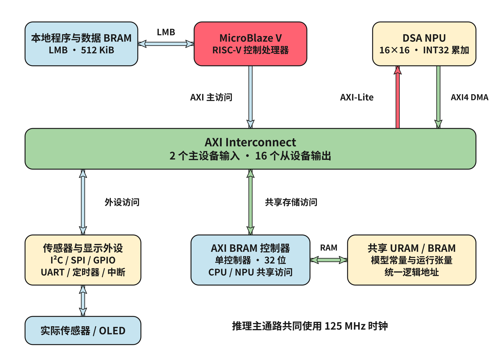
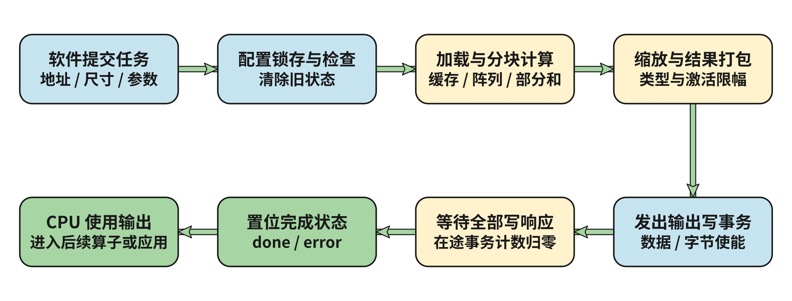
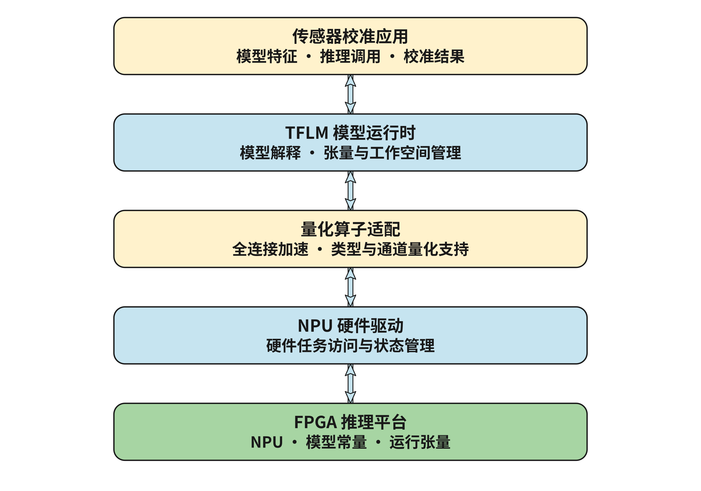
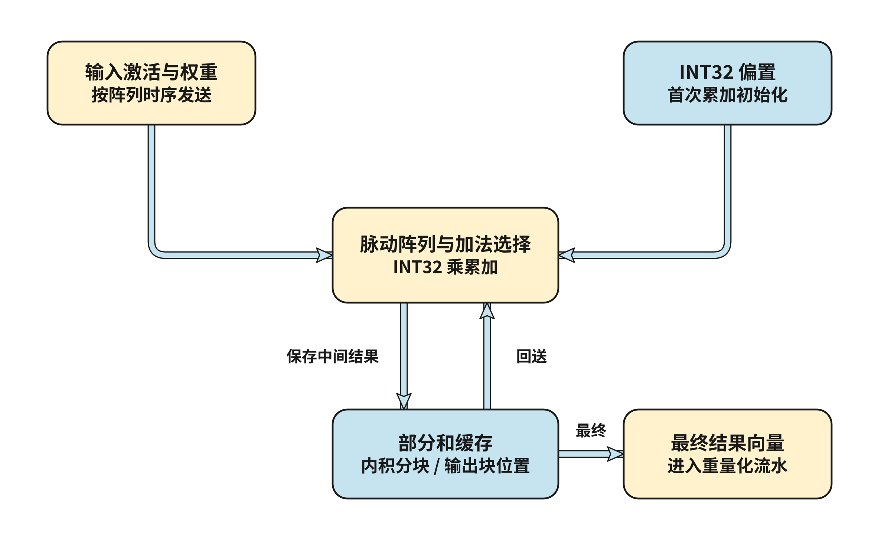

# 项目总结报告

## 3 SoC 与 NPU 设计

### 3.1 系统设计目标

系统面向传感器监测信号的融合处理与智能校准任务。处理器运行传感器采集、特征整理、模型执行和外设控制程序；神经网络处理单元（NPU）执行全连接层等矩阵乘加密集型算子。片上系统（SoC）通过统一的存储访问结构连接处理器、NPU、模型存储、运行期张量存储及板级外设。

设计将应用控制与矩阵计算分配给不同硬件单元。处理器根据 TensorFlow Lite for Microcontrollers（TFLM）模型图依次执行算子，符合硬件接口要求的全连接运算调用 NPU，其余算子由软件内核处理。该分工兼顾模型执行的灵活性和矩阵运算的并行能力。

#### 3.1.1 项目需求与本阶段实现内容

项目研究方案提出微系统内部多物理量监测、信号融合处理、智能校准和状态评估等任务，涉及电压、电流、温度及湿度等数据。方案侧重于从传感采集、数据处理到模型计算的整体结构，并提出面向嵌入式处理器的软硬件协同实现方式。SoC 与 NPU 工作围绕可执行的模型推理任务展开，重点解决处理器如何管理模型、加速器如何读取张量、整数结果如何写回以及应用如何使用校准值等工程问题。

项目方案中的网络示例采用多输入、多输出补偿结构；后续部署模型则按电压、电流和湿度任务分别整理为独立的整数模型。系统结构以当前板级程序和模型部署形式为准，项目方案中提出的状态评估和多传感融合研究目标仍需结合相应算法、输入数据和评价方式单独验证。模型分类方式的调整不改变 SoC 对模型结构进行解析、对全连接算子进行调用并将结果交给应用层的基本职责。

当前传感器校准应用为电压、电流和湿度各配置一个 int16 TFLite 模型。三个模型输出分别供相应校准任务使用，运行时共享算子注册表，并在统一的 tensor arena 中分配各自的运行区。模型输入维数不同，预处理流程依据模型特征定义分别组织，不能将某一类输入向量直接送入另一模型。处理器在调用模型前负责选择模型、填充对应特征并检查输入输出张量类型。

#### 3.1.2 设计目标分解

SoC 设计目标分为应用执行、任务控制、数据访问、矩阵运算和结果使用五部分。应用执行要求处理器能够启动裸机程序并完成外设管理；任务控制要求软件能配置 NPU 地址、维度、步长和量化信息；数据访问要求处理器和 NPU 能使用一致的共享存储地址；矩阵运算要求阵列按设定的数据类型及分块方式计算；结果使用要求 TFLM 收到正确输出并继续执行后续算子。

各部分之间用可检查的接口衔接。处理器应用通过 TFLM 算子调用进入适配层，适配层通过驱动写入控制寄存器，NPU 通过 DMA 访问张量存储，计算结果写回后由运行时接续模型执行。应用层最终读取校准输出并传递至显示任务。该结构使每项软件职责和硬件职责都对应到明确的调用入口或模块接口。

#### 3.1.3 设计对象与验证对象的区分

板级 SoC 由 MicroBlaze V 处理器、Vivado Block Design、AXI 互连、共享存储控制器、NPU 及传感器外设构成。软件运行在 Vitis Standalone 环境。RTL 回归采用 PicoRV32 SoC 作为处理器仿真环境，以便将 C 程序、TFLM、驱动和 NPU 一同运行。两种系统共享 NPU 的计算功能和任务寄存器定义，但处理器实例、地址组织及 SoC 顶层结构并非完全相同。

SoC 仿真结果说明测试程序在 PicoRV32 联合环境中的执行表现，FPGA 实现结果说明 VU3P 板级硬件结构完成综合、布局布线和时序检查。板级模型推理是否正确还需通过 MicroBlaze 上运行的正式程序与 UART 输出进行检查。该区分用于明确每项结果对应的实际被测对象。

### 3.2 SoC 结构

VU3P 板级系统采用 MicroBlaze V RISC-V 软处理器。处理器通过本地存储接口访问程序和局部数据，通过 AXI 互连访问 NPU、共享存储及外设。AXI-Lite 从接口用于 NPU 任务配置和状态读取，AXI4 主接口用于 NPU 对输入、权重、偏置、量化参数及输出张量的突发访问。处理器和 NPU 作为 AXI 主设备访问共享存储；互连与存储控制器处理事务传送。

SoC 的模型常量区和运行内存分开放置。当前部署使用 BRAM 初始化数据保存电压、电流和湿度三个 int16 TFLite 模型，模型输入张量维数分别为 18、12 和 7；URAM 区为 TFLM tensor arena 和推理期间的工作数据提供空间。处理器本地程序存储用于代码、栈及局部变量。各区域由链接脚本、硬件平台地址定义和模型初始化文件共同确定。

传感器采集程序将原始测量值整理为模型特征，执行规定的标准化处理，再调用 TFLM。推理输出还原为校准物理量后用于 OLED 显示，串口日志提供初始化状态、推理状态和校准结果，便于观察程序运行情况。

RTL 联合仿真使用 PicoRV32 SoC 驱动 NPU，覆盖处理器程序、算子适配、寄存器控制、DMA 读写及计算结果检查。该验证系统与 VU3P 板级 MicroBlaze V 系统分别服务于软件联合仿真和 FPGA 部署，处理器实例及顶层互连有所区别。

图 3-1　VU3P 传感器校准 SoC 结构

#### 3.2.1 处理器与本地程序存储

MicroBlaze V 负责取指、执行传感器应用、管理 TFLM 运行时和发起外设访问。本地程序及数据 BRAM 通过 LMB 与处理器连接，提供处理器执行代码、栈和局部变量所需的访问路径。处理器程序启动后，BSP 启动代码建立 C/C++ 运行环境，随后进入应用入口并执行模型初始化。

本地存储与共享模型存储承担不同用途。处理器取指主要经 LMB 本地路径完成；NPU DMA 访问模型和张量使用共享 AXI 存储。将程序代码和模型常量分区安排后，NPU 读取权重不会改变处理器的指令取址方式。链接脚本中的段起始地址、硬件平台地址定义和片上 RAM 控制器容量必须一致，程序构建时按同一硬件平台生成。

#### 3.2.2 AXI 互连与外设访问

处理器 AXI 主接口发起控制寄存器访问、共享存储读写及外设访问。NPU AXI-Lite 从接口接收矩阵任务参数，NPU AXI4 主接口发起张量 DMA。板级设计由 AXI 互连连接处理器主设备、NPU 主设备和各从设备，访问目标根据硬件地址分配进行译码。共享存储由统一的 AXI BRAM 控制器接入，处理器和 NPU 对其发起的事务由互连和控制器按协议处理。

AXI-Lite 适合少量寄存器访问，不承担整块张量传输。AXI4 主接口负责连续数据突发访问，包含读地址、读数据、写地址、写数据和写响应等通道。读地址与读数据分别完成握手，写地址和写数据分别被接受，写响应表示一次写事务已由从设备确认。NPU 驱动等待任务完成时，硬件仍需处理已发出的读响应和写响应。

GPIO、I²C、SPI、UART 和定时器等外设挂接在处理器可访问的 AXI 地址空间中。I²C 用于传感器或板级器件通信，GPIO 处理离散输入输出，UART 输出初始化和推理日志，OLED 控制程序负责显示校准数值。处理器通过 BSP 或工程驱动访问这些寄存器，外设数据经应用逻辑转化为模型特征或显示信息。

#### 3.2.3 时钟与复位组织

VU3P 板级工程从差分系统时钟输入获得 200 MHz 参考时钟，经 Clock Wizard 产生 125 MHz 的 SoC 主时钟。处理器、NPU、共享存储控制器和推理主通路使用该时钟。统一的主时钟使处理器寄存器访问、NPU 状态更新和 RAM 控制在同一时钟周期体系中运行，仿真时钟则由测试平台按对应周期驱动。

时钟锁定状态参与系统复位控制。Clock Wizard 输出稳定后，处理器和外设复位逻辑释放复位，MicroBlaze 才开始取指执行。复位有效期间，NPU 控制状态、DMA 状态和运行时握手标志进入初始状态。复位释放后，软件还需依次完成 BSP 初始化、模型解析和张量分配，再启动应用推理。

板级约束需要同时描述外部差分时钟和由 Clock Wizard 产生的主时钟。时序检查应基于实现后的主时钟约束，并检查建立、保持及脉宽情况。外设引脚存在相应输入输出延迟约束时，也应与板级时序要求保持一致。当前实现报告中的主 SoC 时钟为 125 MHz。

#### 3.2.4 SoC 数据访问层次

SoC 的数据访问可分为处理器本地访问、处理器 AXI 访问和 NPU DMA 访问。处理器本地访问面向指令及局部数据；处理器 AXI 访问面向共享存储与外设；NPU DMA 访问面向模型权重、偏置、量化参数、输入张量和输出张量。三种访问通过各自控制路径发起，模型执行期间由共享存储地址区提供公共数据位置。

数据访问方向依任务阶段变化。推理开始前，处理器写入输入特征和必要参数；任务提交时，驱动写 NPU 控制寄存器；运算期间，NPU 读取张量数据并写出计算结果；算子结束后，处理器按 TFLM 运行顺序读取结果或继续执行下一个算子。输入、权重和输出在内存中的生存期由解释器分配结果及算子执行顺序决定。

#### 3.2.5 共享存储地址与用途

当前软件将 tensor arena 安排在共享存储窗口的 `0x50000000` 起始区，大小为 2 MiB；模型符号从 `0x51000000` 起始。模型段和 arena 段的 ELF 地址属性与硬件平台对这些地址的访问能力对应。模型初始化数据写入 BRAM，arena 在运行时清零并由 TFLM 分配中间张量与算子工作空间。

部署使用的三个模型分别保存为电压、电流和湿度整数 TFLite 文件，总字节数为 41,616。模型结构和权重由 BRAM 初始化内容提供，模型数据符号通过 `model_data.S` 声明起始位置。C++ 运行时代码依据符号长度核对模型尺寸，并以对应指针构造 TFLM 模型对象。

共享存储在逻辑上提供连续地址区，物理资源由 BRAM 和 URAM 实例组成。初始化模型数据所在区域由 BRAM 提供，运行期 arena 使用 URAM 区域。物理资源分配、地址译码窗口、AXI 控制器可访问容量和 ELF 段位置共同决定 CPU 与 NPU 能否访问每个对象。对于非初始化的运行存储，软件负责完成启动清零和张量分配。

| 存储区域 | 软件或硬件用途 | 访问主体 | 初始化方式 |
|---|---|---|---|
| LMB 本地 BRAM | 处理器程序和局部数据 | MicroBlaze V | ELF 程序段写入 |
| 共享 BRAM 模型区 | TFLite 图结构、权重和量化参数 | CPU、NPU DMA | BRAM 初始化数据 |
| 共享 URAM 运行区 | tensor arena 与推理工作空间 | CPU、NPU DMA | 程序启动后清零及分配 |
| NPU 片上缓存 | 输入、权重和部分和短期暂存 | NPU 内部单元 | 任务执行中写入 |

#### 3.2.6 SoC 交互次序

一次模型调用首先由应用完成传感器值有效性检查，并依模型定义形成输入特征。TFLM 将输入写入已分配的张量，解析器按图中顺序选择算子实现。全连接适配接收当前输入、权重、偏置和输出张量地址，驱动将这些地址和计算尺寸写入 NPU 寄存器。

NPU 任务启动后，控制器读取配置并检查维度及数据类型，DMA 发起共享存储读请求。阵列完成分块累加和输出缩放后，写回单元提交 AXI 写事务。全部写响应完成并更新状态后，处理器读取算子结果，TFLM 继续模型图执行。模型最终输出反量化后传回传感器应用，显示程序更新 OLED，UART 输出用于调试观察。

若任务在任一阶段报告错误，驱动将错误状态传给算子适配层，再由 TFLM 或应用接收失败结果。程序日志按初始化、张量分配、模型调用和结果输出阶段记录状态，便于区分模型数据加载问题、运行内存不足、任务参数不合法及硬件执行未完成等情况。

### 3.3 NPU 架构与数据流

NPU 由任务寄存器、任务控制器、输入加载单元、权重加载单元、偏置及量化参数读取单元、片上缓存、脉动阵列、部分和存储、定点缩放流水、输出 FIFO、写回单元和 AXI DMA 组成。AXI-Lite 寄存器保存矩阵基地址、维度、字节步长、数据类型、量化参数及执行模式。软件写入配置并启动任务后，控制器按分块次序调度数据读取、阵列计算和结果写回。

矩阵运算按输出行、输出通道和内积维度分块。DMA 从共享存储读取输入激活、权重、偏置及按通道量化参数。输入和权重加载单元将数据组织为阵列所需的顺序；片上缓存保留可复用数据，减少重复存储访问。阵列支持权重固定和输入固定的数据组织方式，以匹配不同算子任务的操作数复用特点。

计算阵列由可配置的处理单元构成，当前板级配置采用 16×16 阵列。数据通路支持 int8 和高精度 int16 激活运算，权重为 int8，偏置与累加结果均采用 int32。偏置用于首个内积分块的初始累加值，后续分块继续累加已保存的部分和。按通道量化时，NPU 按输出通道读取对应乘数和移位参数。

最终累加结果进入定点缩放流水，执行乘数处理、移位、舍入、输出偏移及激活范围限幅。输出 FIFO 根据元素位宽打包结果，写回单元按有效列和字节使能生成 AXI 写事务。所有输出写响应完成后，NPU 更新任务完成状态，处理器据此继续执行后续模型算子。

图 3-2　DSA NPU 内部架构与数据通路

图 3-3　NPU 任务执行与完成过程

#### 3.3.1 任务寄存器与控制器

NPU 寄存器接口将处理器写入的配置转换为内部任务信息。主要参数包含输入基地址、权重基地址、输出基地址、偏置地址、K/N/M 维度、输入与输出步长、量化乘数和移位、激活范围、数据流选择及复用参数。控制寄存器提供启动位，状态寄存器报告就绪、忙、完成和错误等情况。

控制器在任务启动时锁存参数，避免执行过程中软件对寄存器的后续访问改变当前任务。控制流程依次完成配置检查、加载准备、阵列计算、输出处理和写事务结束检查。对每个矩阵块，控制器维护外层输出行块、输出通道块和内积分块坐标，并根据有效行列数处理矩阵尾部。

任务结束条件覆盖所有输出块和已发出的写事务。阵列产生最后一组结果并不表示整个任务立即结束，结果缩放、FIFO 排空和 AXI 写响应仍需完成。控制器在最后一项事务响应结束后置位完成状态，驱动据此允许 TFLM 使用输出张量。

#### 3.3.2 输入加载与缓存

输入加载器按输入基地址、行步长、元素类型、输出行块及内积分块生成读取位置。int8 元素占一个字节，int16 元素占两个字节；DMA 返回总线字后，解包逻辑按元素位置提取有效输入。缓存控制保留行块及有效元素数，尾部不足阵列宽度时屏蔽无效位置。

脉动阵列要求输入数据按确定的周期顺序到达。输入缓存将内存中的行列布局转化为阵列发送次序，并携带有效信号和块结束标志。数据有效信号与输入值同步推进；缓存等待或下游反压时，控制逻辑保持当前元素及其关联控制信息，避免行列坐标发生偏移。

输入复用适用于同一输入块服务多个输出通道块的情形。控制器保留已载入的输入块，期间改变权重块并继续执行，使共享存储无需重复读取同一输入数据。复用次数受到输入缓存容量、阵列状态和部分和存储空间共同限制。

#### 3.3.3 权重加载与驻留

权重加载器依据输出通道组和内积分块读取连续权重数据。全连接权重按照输出通道组织，每个通道包含与输入深度相应的权重元素。加载器记录当前通道块、有效通道数和有效内积长度，将总线数据重排为阵列列方向的权重输入。

模型权重通常以 int8 保存，进入内部乘加端口时进行符号扩展。权重固定模式下，加载阶段将相应权重送入处理单元寄存状态，并在处理输入向量期间保持。随着新输入向量进入阵列，同一权重能够重复参与乘加，减少权重读取量。

输入固定模式改变操作数的驻留对象和发送顺序，但外部矩阵定义及输出地址定义保持一致。任务参数中包含的数据流模式由控制器传至加载单元、阵列和结果缓存，各单元依据同一模式组织数据。模式切换需要清理或重新初始化相关缓存状态，以免上一任务残留数据影响下一次计算。

#### 3.3.4 偏置加载与部分和复用

每个输出通道对应一个 int32 偏置。首个内积分块开始时，阵列累加路径使用该偏置作为初值；偏置地址为零的任务可采用零初值。后续内积分块将此前保存的 int32 部分和作为新的累加初值。偏置和部分和采用相同位宽，因此共用阵列的累加输入选择路径。

部分和存储按照输出行块及输出列块位置保存中间结果。内积分块处理结束后，控制器决定将结果保留在缓存，或将其送入最终缩放阶段。该结构支持内积长度超过单次阵列计算范围的矩阵任务，也允许调度多个输出块而不将所有中间结果写回外部存储。

部分和读取和阵列下一次有效计算需要具有明确的顺序。缓存读请求发出后，控制逻辑等待相应数据有效，再使能阵列累加输入。输出行列位置、当前内积分块编号和缓存帧编号共同决定读写位置，尾块有效元素控制未参与计算的数据。

#### 3.3.5 DMA 读写引擎

输入、权重、偏置和量化参数共用 NPU AXI4 读接口。仲裁逻辑从已就绪的客户端中选择读取请求，读引擎锁存请求地址、长度和接收目标，再通过 AXI AR/R 通道完成传输。返回数据按请求类型交给对应加载器或参数寄存组。

输出使用独立写引擎。缩放结果经输出 FIFO 进入打包单元，打包单元依据 int8 或 int16 元素宽度形成 32 位写数据和字节使能。写引擎通过 AW/W/B 通道发送事务，并跟踪地址接受、数据接受及响应结束状态。读写引擎分离使张量读取和结果提交可以在协议允许的情况下交叠进行。

突发长度由有效字节数和 AXI 数据宽度共同决定。对于跨行矩阵，地址发生逻辑根据字节步长计算下一行位置；对于非整字长度，首尾数据按有效字节处理。请求状态在地址被接受前保持，数据状态在反压期间保持，响应被接受后才减少未完成事务计数。

#### 3.3.6 阵列规模与运算组织

当前板级配置使用 16×16 处理单元阵列。每个处理单元执行整数乘法和累加，全部处理单元同时有效时，每个时钟周期可执行 256 次乘加。实际任务中，矩阵尾块、缓存装入、阵列填充及输出排空会使有效单元数量随时间变化，因此峰值吞吐率不代表每个模型算子都达到该速率。

阵列处理矩阵任务时，输出行维度决定输入向量组数，输出通道维度决定权重列组数，内积维度决定累加长度。控制器将三维迭代拆分为阵列可处理的块。若某一维度不是 16 的整数倍，尾块以有效元素计数屏蔽超出范围的位置，避免无效输入污染输出或写到相邻张量位置。

阵列流水包含操作数到达、处理单元乘加、部分和推进和结果输出等阶段。输入与权重需要按阵列行列关系错开送入，使每个乘法配对到同一矩阵坐标。流水有效信号及尾部标志随数据传递，计算结束时控制器能够识别最后一组结果并启动缩放和写回流程。

#### 3.3.7 整数数值通路

int8 激活与 int8 权重乘积经符号扩展后进入 int32 累加器；高精度通路使用 int16 激活、int8 权重和 int32 累加。int32 偏置与部分和加入累加路径。当前软件对模型偏置完成 int32 格式准备，超出 int32 表示范围的偏置值由软件限幅后提供给硬件。

缩放参数包括定点乘数和移位量。按张量量化为一组输出提供共用参数，按通道量化则为各输出通道提供独立参数。参数读取位置随当前输出通道块推进，缩放结果与对应输出通道配对。零点和偏移参数由软件根据模型张量量化定义转换为硬件寄存器值。

输出数值依次经过乘数处理、舍入、移位、输出偏移和激活范围限制。int8 输出限于有符号 8 位范围，int16 输出限于有符号 16 位范围。类型限幅和模型指定的激活范围共同决定最终结果。尾块只写入有效元素，写字节使能标记总线字中的有效字节。

#### 3.3.8 任务期间的资源协同

任务执行过程中，控制器、加载单元、阵列和输出单元依据有效与就绪状态推进。加载器只有在目标缓存可写时接收数据，阵列只有在操作数准备完成且部分和可用时执行，输出单元只有在缩放参数和输出 FIFO 空间可用时接收结果。各阶段速率不同，由缓存和握手保存已经到达的数据。

任务参数和张量地址在执行期间保持稳定。处理器驱动在提交前完成参数检查并写入寄存器，启动后等待完成状态；软件不在任务中途改写当前任务参数。完成后，应用读取输出并推进模型图，下一任务再使用相同 NPU 资源。

异常情况包括非法维度、地址或步长配置错误、缓存资源不足、AXI 响应异常及任务超时。硬件状态寄存器和软件返回码分别描述硬件内部状态与驱动调用结果。UART 日志可记录初始化和运行错误，使板上问题能按模型构造、内存分配、任务提交、DMA 访问和输出消费等阶段检查。

#### 3.3.9 矩阵任务的数据组织

全连接计算可写为 `Y = XW + b`。设输入矩阵 `X` 的形状为 M×K，权重矩阵 `W` 的形状为 K×N，偏置向量 `b` 的长度为 N，则输出矩阵 `Y` 的形状为 M×N。对每一个输出元素，阵列累加输入特征与对应输出通道的权重乘积，并以该输出通道的偏置作为初始值。任务寄存器中的维度和步长据此描述输入、权重及输出在共享存储中的位置。

计算控制把 M、N、K 三个维度分别划分为适合阵列处理的区块。输出行区块选择当前输入样本组，输出列区块选择当前输出通道组，内积分块遍历特征方向。若 K 大于单轮可处理长度，控制器分多轮累加中间结果；若 M 或 N 超过阵列的行列规模，控制器依次处理多个输出区块。每个区块根据实际剩余尺寸生成有效行数、有效列数和有效内积长度。

区块次序影响数据在缓存中的驻留时间。权重固定时，权重区块先装入处理单元，多个输入行依次通过阵列；输入固定时，输入区块保留在缓存，多个权重区块依次处理。两种次序都需保证同一输出元素的全部内积项最终累加到同一部分和位置。输出通道切换时，偏置、量化乘数、移位值和激活范围也随之切换，防止相邻通道的参数交叉使用。

输出结果进入后处理阶段前，阵列内部数据仍为累加域整数。缩放流水将累加结果转换到输出张量的整数表示，输出宽度决定打包方式。写回逻辑依据输出行步长计算每行起始位置，并按实际列数生成写使能。该组织方式使同一 NPU 能够处理不同形状的 TFLM 全连接张量，同时把行列尾部的存储保护纳入任务控制过程。

#### 3.3.10 处理器与 NPU 的任务协同

处理器与 NPU 之间采用寄存器配置和共享存储交换任务数据。处理器负责准备张量地址与参数，NPU 负责数据搬运、矩阵计算和结果写回。任务期间处理器可以执行其他允许的应用逻辑；当前软件驱动以等待任务结束的方式返回 TFLM 调用点，保证算子结果在运行时继续执行前已完整写入。

一次调用的参数准备包含地址、维度、字节步长、输入及输出类型、偏置地址、量化数组和激活上下限。适配层将 TFLM 张量信息转换成硬件寄存器要求的整数宽度与单位。地址按字节计，维度按元素计，数据步长按每行实际跨越的字节数计；软件计算这些字段时使用足够宽的临时整数，避免乘法求字节数时发生截断。

处理器写入启动位后，硬件锁存本次任务配置。驱动查询状态直至完成或错误，并在等待期间执行超时检查。任务完成后，输出张量才能交还 TFLM。若驱动报告失败，适配层返回错误码，应用记录模型类别和算子阶段，不继续读取未完成的输出。这个过程把软件调用状态与硬件任务状态保持一致。

任务接口还需要考虑缓存与共享存储的可见性。当前系统采用片上 RAM 供 CPU 和 NPU 访问，软件在启动 DMA 前写入张量，NPU 结束后 CPU 再读取输出。处理器写入、NPU 读取、NPU 写回和处理器读取依照同一存储控制接口完成，驱动以任务完成状态作为输出可用的条件。若未来加入缓存层，应明确缓存清理和失效动作，当前板级设计则按已实现的存储属性运行。

### 3.4 软件栈与 FPGA 部署

软件由传感器应用、TFLM 运行时、算子适配层和 NPU 驱动组成。应用层负责传感器数据采集、特征构造、模型调用和显示；TFLM 解析模型并管理张量；算子适配层检查类型、维度、步长和量化参数，将支持的矩阵运算转换为 NPU 任务；驱动负责寄存器访问、任务启动、完成等待和错误状态处理。

FPGA 部署时，Vivado Block Design 生成 SoC 硬件设计并导出 XSA。Vitis 根据 XSA 更新硬件平台并编译传感器应用及 TFLM。模型常量由 BRAM 初始化数据写入模型存储区；运行期 arena 使用 URAM 地址区。硬件实现文件与编译所得 ELF 合并，形成可加载处理器程序的最终 bit 文件。

图 3-4　软件栈与单次校准推理流程

图 3-5　计算核心与部分和处理

#### 3.4.1 传感器输入构造

应用侧输入构造以模型特征顺序为准。电压模型使用 18 项输入，包括 6 项连续特征、8 项 PGA 档位编码和 4 项通道编码；电流模型使用 12 项输入，包括 8 项连续特征和 4 项通道编码；湿度模型使用 7 项输入。连续特征依模型保存的均值和标准差进行标准化，离散通道及档位通过 one-hot 数值表示。

特征顺序是模型训练、量化转换和板上推理共同使用的数据定义。应用函数在调用解释器前按固定下标填充特征数组，再根据每个输入张量的量化尺度和零点转换为 int16。维数、顺序、标准化系数或通道编码任一项不匹配，都可能改变模型输出；运行时检查张量元素数，应用代码固定特征赋值位置。

模型输出首先从 int16 张量按张量参数反量化为标准化输出，再依模型目标均值和标准差还原为物理量。模型预测为残差形式时，应用将预测残差加到相应原始测量值上，生成校准值。各模型的输入预处理及输出还原独立实现，避免不同传感类别使用错误的尺度参数。

#### 3.4.2 TFLM 初始化与内存管理

程序启动后先取得模型数据地址和文件长度，再检查 FlatBuffer 模型结构、版本、张量维度及算子注册情况。TFLM 解释器对象在共享 arena 中创建，`AllocateTensors` 负责按模型生命周期安排输入、输出和中间张量。初始化完成后，应用读取输入输出张量类型及尺寸，确认其与特征构造函数和输出反量化函数一致。

三个解释器使用同一块总 arena 的不同子区域，运行时分别设置电压模型区和两个较小模型区。程序清零 arena 后依次创建解释器。子区域大小由当前模型和运行时分配需求确定；若容量不足，`AllocateTensors` 返回失败，初始化函数向应用报告错误状态并输出对应日志。

模型常量位于只读共享 BRAM 区，arena 位于可读写共享 URAM 区。TFLM CPU 端读取模型图和张量数据，NPU DMA 在算子执行时访问同一共享存储空间。应用在模型初始化后不再修改模型常量；输入、输出及中间张量由 TFLM 按执行过程更新。

#### 3.4.3 全连接算子适配

全连接算子适配将 TFLM 的批次、输入深度和输出通道数转换为 NPU 的 K、N、M。输入张量、权重张量、偏置数组和输出张量分别提供可供 DMA 访问的地址；适配层按元素位宽计算字节步长，并设置数据类型、量化方式、乘数及移位参数。

调用前，适配层核对张量维数、输入输出类型、权重类型、偏置类型及量化数组长度。支持范围内的 int16 激活、int8 权重全连接任务进入 NPU 驱动；形状处理、拼接和逐元素运算仍由对应的 TFLM 注册内核执行。算子实现的选择来自运行时注册表和任务参数检查。

NPU 驱动先写入源数据地址、目标地址、维度、步长和缩放参数，再启动控制位。驱动按配置的状态方式等待完成，检查错误状态及返回码。任务完成后，适配函数返回 TFLM 调用层，运行时继续后续算子。软件任务调用和 NPU 启动数量可通过调试日志及驱动计数检查。

#### 3.4.4 模型打包与初始化数据

模型数据由模型文件和相应的预处理及量化说明构成。部署脚本先确认三个模型文件及其说明文件存在，再读取 TFLite 输入张量形状并检查预期维数。随后将模型文件复制到软件部署目录，生成模型清单和 BRAM 初始化数据，使模型常量与基础硬件设计使用同一组内容。

初始化数据按模型顺序连续放入 BRAM 模型区。模型符号使用对应起始地址，C++ 运行时获取实际长度并创建解释器。BRAM 初始化容量必须覆盖模型区所需地址范围；arena 不需要写入模型文件，因此留在运行存储中，由软件清零和分配。

软件 ELF 中模型段按存储规划保留地址及尺寸，初始化常量由 BRAM 配置文件写入硬件。ELF 合并时，updatemem 按 MMI 选择可初始化的处理器程序存储单元，避免覆盖模型 BRAM 内容。模型数据、处理器程序和共享 arena 因此分别由初始化配置、程序合并和启动代码管理。

#### 3.4.5 自动部署过程

一键部署脚本从 `pre_release` 目录取得当前电压、电流和湿度模型，检查输入形状，复制模型与说明文件，生成 BRAM 初始化文件。随后脚本运行 Vivado 更新模型 BRAM 初始化内容并执行综合和实现，导出包含硬件信息的 XSA。

Vitis 使用新 XSA 更新硬件平台，然后重新编译 `sensor_sw_v2` 应用。脚本检查 ELF 构建结果，调用合并工具把处理器程序写入基础 bit 文件，并将最终合并文件放入板级工程的位流目录。各阶段失败时脚本以非零状态结束，并保留前一阶段生成的日志和输出文件用于检查。

模型更新会同时影响 BRAM 初始化文件、Vitis 软件模型数据、运行时预处理参数和最终位流。脚本将模型检查、硬件实现、平台更新、软件编译及 ELF 合并编排为固定次序，避免只更新其中一项导致硬件和软件使用不同模型内容。

#### 3.4.6 上电运行与输出观察

板卡下载最终位流后，时钟管理模块建立 125 MHz 主时钟并释放复位。MicroBlaze V 执行本地程序存储中的启动代码，应用初始化 UART 和所需传感器外设，再调用校准运行时初始化接口。UART 输出运行时进入、模型检查及张量分配状态，便于确认程序已进入模型初始化过程。

模型初始化成功后，应用按传感器采样周期获取温度、湿度、电压和电流数据，完成有效性判断及输入特征构造。相应模型执行后，程序将预测结果转换为校准物理量，再交给 OLED 显示。UART 日志输出模型推理结果和校准值，便于区分原始采样值与校准后数值。

正式传感器应用与离线模型测试应用使用不同的输入来源。正式程序读取实际外设，离线程序使用固定输入样本。两者共用校准运行时、算子适配和 NPU 驱动；检查板上采集流程时使用正式应用程序和实际外设配置。

#### 3.4.7 软件错误状态处理

模型文件缺失或长度异常时，初始化过程在构造解释器前返回错误；模型结构损坏或算子未注册时，解释器初始化日志报告对应阶段；arena 分配失败时，程序报告张量分配状态；输入输出尺寸不符时，模型调用前检查失败；NPU 参数或事务异常则由驱动状态返回。错误状态均沿应用调用顺序向上传递。

UART 日志携带阶段名称、错误码及必要的模型信息。模型长度、起始地址、输入维数、arena 使用量和调用状态可用于核对加载内容。对模型初始化状态的检查顺序包括地址范围、初始化数据、模型结构解析、算子解析器和 arena 分配，使输出信息对应实际执行阶段。

#### 3.4.8 设计指标与实现记录

板级实现的目标器件为 `xcvu3p-ffvc1517`，主推理时钟为 125 MHz。当前实现报告记录 CLB LUT 使用 41,536 个、寄存器 41,380 个、BRAM Tile 718.5 个、URAM 316 个和 DSP 438 个。BRAM 与 URAM 使用比例较高，模型容量或 arena 容量调整需要同步检查片上 RAM 的物理分配。

当前推理主通路以 URAM 保存运行期张量，以 BRAM 初始化内容保存模型主体。模型字节数远小于完整 BRAM 总容量，BRAM 实例还包含其他本地存储及 NPU 缓存用途。资源表中的 BRAM 使用量描述全设计实现结果，不能直接当作模型区的可用字节数。

NPU 16×16 阵列在 125 MHz 下的理论峰值为每秒 32 G 次乘加；若把一次乘法和一次加法分别计为一次运算，则理论峰值为每秒 64 G 次运算。完整模型运行时间还包含处理器调度、张量读写、阵列填充、缩放及应用处理，需通过实际任务周期统计确定，不能仅由峰值计算推出模型运行时间。

#### 3.4.9 系统设计总结

SoC 通过 MicroBlaze V 执行应用和模型运行时，通过 AXI-Lite 配置 NPU，通过 AXI4 DMA 访问共享张量存储。BRAM 和 URAM 分别承担模型初始化内容与运行期工作区，LMB 本地 BRAM 保存处理器程序及局部数据。统一的地址规划和任务接口使处理器与 NPU 能够在同一模型调用中协同工作。

NPU 以 16×16 脉动阵列和分块累加处理矩阵运算，使用 int32 偏置和累加结果，支持 int8 与 int16 激活通路及按输出通道量化参数。TFLM 运行时管理模型和张量，适配层把目标全连接算子转换为硬件任务，应用完成特征构造和结果使用。

项目实施结果包括板级 SoC 结构、NPU 矩阵加速模块、TFLM 软件适配、模型 BRAM 初始化和自动生成最终位流的构建过程。NPU 数值正确性、SoC 模型回归和 FPGA 实现数据见测试验证报告第 5 章。

设计工作形成了从模型特征处理、TFLM 算子执行、NPU 矩阵加速到校准结果显示的 SoC 软件与硬件结构。系统功能验证、数值正确性、执行周期和 FPGA 实现结果见《测试验证报告》第 5 章。

#### 3.4.10 软件构建与硬件版本管理

板级程序构建依赖 Vivado 硬件平台、Vitis 平台工程、软件应用工程和模型初始化内容。硬件设计改变后，须从当前 Vivado 工程导出 XSA，并在 Vitis 更新平台；随后重新构建 BSP 和应用，使驱动地址、外设定义、存储容量与硬件设计一致。程序 ELF 由此对应于特定硬件描述，bit 文件则由实现结果及 ELF 初始化内容共同生成。

模型更新同时涉及模型文件、特征说明、BRAM 初始化文件和应用程序。电压、电流及湿度模型的输入形状分别为 18、12 和 7。部署前逐项检查 TFLite 文件是否可读、输入维数是否符合应用定义、模型字节数是否在模型存储区容量内，并核对 BRAM 初始化范围。软件构建完成后，应确认模型符号地址与硬件地址定义相同，最终 bit 文件包含正确的处理器程序和模型数据。

自动部署脚本将这些操作依次执行，并以每阶段的退出状态判断是否继续。输入检查失败时不启动后续实现；Vivado 构建失败时不更新 Vitis 平台；Vitis 编译失败时不生成合并位流。输出目录中的模型初始化文件、平台导出文件、ELF 和最终 bit 文件按照工程既有结构保存，构建日志用于识别发生问题的阶段。

可复现的部署还要求明确使用的模型目录和硬件工程目录。脚本从指定的模型发布目录读取内容，不依赖工作目录中的临时文件；在开始构建前输出三个模型的文件长度和输入维数，构建后输出 ELF 与 bit 文件状态。对同一组模型和硬件工程重复运行时，输入检查和构建次序保持一致，减少人工操作遗漏。

正式板级验证需下载最终 bit 文件并观察串口启动信息。日志至少应包含运行时初始化进入、模型存储地址和字节数、TFLM 模型解析状态、张量分配状态、推理启动与完成状态，以及每类传感器的输入和校准输出。OLED 显示校准后的物理量。串口与显示内容分别用于观察内部计算过程和用户界面呈现，读取结果时应记录传感器原始输入、校准输出及采样时刻，方便重复比较。

### 3.5 设计依据

- `doc/研究所项目/详细设计报告/NPU与传感器校准SoC详细设计技术报告.md`
- `rtl/axi_accelerator/npu/`
- `veri/soc_csrc/`
- `/home/etc/FPGA/BIT_PROJ_S1/VU3P_sensor_v2/`
- `/home/etc/FPGA/BIT_PROJ_S1/Vitis/sensor_sw_v2/`
