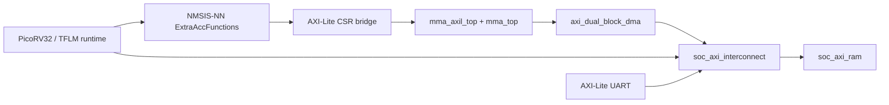
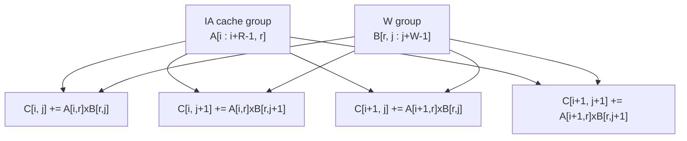
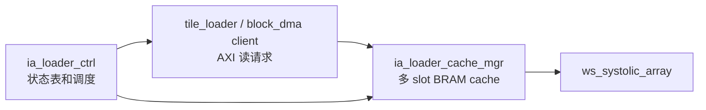
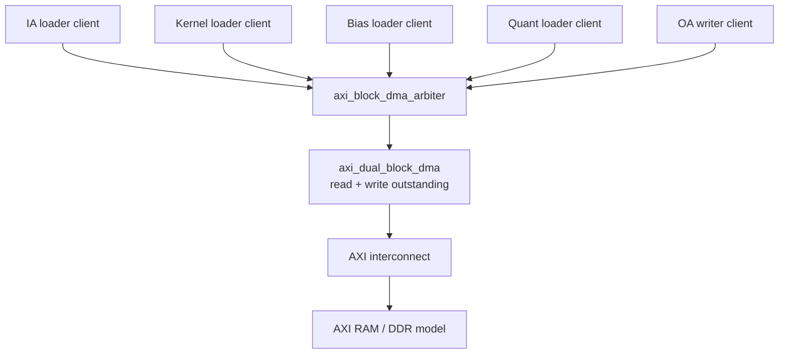
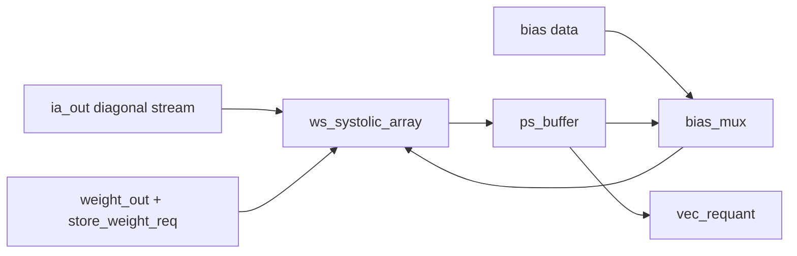

# MMA 架构与模块设计报告

日期：2026-07-02

本文记录当前 TFLM AI DSA 中 MMA 加速器的体系结构、模块划分、分块矩阵数据流、内部 IA cache、统一 AXI DMA、写回与量化流水，以及这些设计对性能、面积和时序的影响。本文定位为设计报告和知识库，不替代验证报告、性能报告或时序报告；验证数据和性能图表可继续参考 `docs/performance_report_cn.md`、`docs/size_cache_hw_sw_perf_report_cn.md`、`veri/doc/bus_optimization_report_cn.md`、`veri/doc/area_optimization_report_cn.md` 和 `veri/doc/timing_optimization_report_cn.md`。

## 1. 设计目标与系统定位

当前加速器面向 TFLite Micro / NMSIS-NN 端侧推理，核心目标不是做一个孤立的矩阵乘单元，而是在 PicoRV32 SoC 中提供可由 NMSIS-NN 魔改入口直接调用的矩阵乘、全连接和卷积 im2col 后端。软件侧通过 CSR/AXI-Lite 配置矩阵基址、尺寸、stride、量化参数和数据流模式，然后触发一次完整 MMA 任务；硬件侧自主完成输入加载、权重加载、偏置加载、矩阵乘累加、重量化、FIFO 打包和 AXI 写回。

设计目标可以分为四层：

| 层级 | 目标 | 对应设计 |
|---|---|---|
| 算法映射 | 将 GEMM / FC / Conv-im2col 映射到可复用的 `SIZE x SIZE` 分块计算 | 分块矩阵外积式调度、WS/IS 模式切换 |
| 片上复用 | 减少 DDR/AXI 重复读，降低访存压力 | IA cache、W reuse、PS buffer、bias/quant 预取 |
| SoC 集成 | 在 PicoRV32 与 UART 共存的 AXI 系统中保持 DMA 吞吐 | 统一 `axi_dual_block_dma`、outstanding、pingpong timing buffer |
| FPGA 可实现 | 在 Artix-7 上控制 LUT/BRAM/DSP，并满足 150 MHz 时序 | BRAM 化 buffer、少用硬件除法、局部流水、控制预计算 |

整个工程的经验结论是：矩阵加速器不能只扩大脉动阵列。若总线带宽、内部 cache block 数、写回 FIFO 周转能力和分块调度不匹配，阵列会出现大量气泡。当前设计因此把“分块数据流调度”和“片上缓存复用”放在和 MAC 阵列同等重要的位置。

## 2. 顶层系统架构

当前 SoC 结构由 PicoRV32、AXI-Lite 控制接口、MMA AXI master、UART、AXI interconnect 和 AXI RAM 组成。Pico 负责运行 TFLM/NMSIS-NN runtime，MMA 负责大块矩阵计算，UART 只用于仿真和调试输出。



`mma_axil_top` 将软件寄存器映射为 `mma_top` 的配置端口，`mma_top` 内部再连接各 loader、compute core、requant 和 writer。SoC interconnect 支持 outstanding，MMA 和 CPU 读写均可排队；AXI RAM 保持同步读一拍延迟，但读响应可 full-pipe 连续返回。顶层还在关键 AXI 边界插入 pingpong/timing buffer，用于切断跨模块 ready/valid 长路径，同时保持通道吞吐。

当前最终选定 Vivado 工程位于：

```text
/home/etc/FPGA/tflm_ai_dsa/vivado_export/tflm_ai_dsa_soc_s16_c4_icache_pipe_syncrst_v6/project/tflm_ai_dsa_soc.xpr
```

对应 bitstream 位于 `/home/etc/FPGA/tflm_ai_dsa/vivado_export/tflm_ai_dsa_soc_s16_c4_icache_pipe_syncrst_v6/fpga_top.bit`。本阶段已停止继续追 `+0.1ns`，以满足 `WNS >= +0.05ns` 且面积受控的 `syncrst_v6` 作为最终交付基线。

## 3. MMA 顶层模块树

`mma_top` 是硬件计算域的顶层，采用“控制面 + 数据面 + DMA 面”三层结构。

| 模块 | 主要职责 | 关键文件 |
|---|---|---|
| `mma_top` | 配置流水、reuse 参数裁剪、模块连接、统一 DMA client 汇聚 | `top/mma_top.sv` |
| `mma_controller` | 发送 IA/W 触发、检查 bias/quant/FIFO 条件、任务完成握手 | `sub_modules/mma_controller.sv` |
| `ia_loader` | IA 分块加载、IA cache 管理、cache 组连续对角化输出 | `sub_modules/ia_loader*.sv` |
| `kernel_loader` | W 分块加载、列展平权重转置输出、W reuse 调度 | `sub_modules/kernel_loader*.sv` |
| `bias_loader` | 按 group 读取 s32 bias，支持 IS 下多行 bias group | `sub_modules/bias_loader*.sv` |
| `compute_core` | WS 脉动阵列、bias/partial-sum 选择、PS buffer 回灌 | `sub_modules/compute_core.sv` |
| `ps_buffer` | 部分和缓存、IA cache 组切换回灌、最终结果输出 | `sub_modules/ps_buffer.sv` |
| `vec_requant` | per-tensor/per-channel 重量化与 s8 裁剪 | `sub_modules/vec_requant.sv` |
| `vec_s8_to_fifo` | s8 向量打包成 32-bit 写回数据和 byte mask | `sub_modules/vec_s8_to_fifo.sv` |
| `oa_writer` | DMA 写回、tile 顺序展开、WS/IS 输出地址映射 | `sub_modules/oa_writer.sv` |
| `axi_block_dma_arbiter` | 多 loader/writer DMA client 仲裁 | `sub_modules/axi_block_dma_arbiter.sv` |
| `axi_dual_block_dma` | 统一 AXI4 读写 DMA，含非对齐访问支持 | `sub_modules/axi_dual_block_dma.sv` |

模块之间的核心握手可以概括为：

```text
loader_req -> controller grant -> DMA/load -> data_valid
controller send_trigger -> loader streaming -> sending_done
compute valid -> requant valid -> fifo valid -> oa_writer DMA write -> oa_calc_over
```

这套语义的关键点是：加载和发送解耦，发送和写回通过 FIFO 解耦，读 DMA 和写 DMA 分通道解耦。这样可以允许 IA cache 已经装好的情况下连续输出多个分块，同时允许 OA writer 在后端持续排空结果。

## 4. 分块矩阵外积式数据流

### 4.1 基本公式

对 GEMM：

```text
C[K, M] = A[K, N] x B[N, M]
```

以 `SIZE x SIZE` 为基本 tile：

```text
C[i, j] += A[i, r] x B[r, j]
```

其中 `i` 是输出行 tile，`j` 是输出列 tile，`r` 是 K/N 方向的归约 tile。传统分块 GEMM 可能按 `i -> j -> r` 顺序逐块计算。当前硬件更接近“分块矩阵外积”的调度思想：一次尽量持有多个 IA row-tile 和多个 W col-tile，让一个 IA cache 组与一个 W group 形成一批输出 tile 的外积更新。



这个调度的收益是，IA tile 不再只服务单个输出 tile，而是在 `w_reuse_num` 个输出列 tile 上复用；W tile 也不再只服务单个输出行 tile，而是在 `ia_reuse_num` 个输出行 tile 上复用。外部 DDR 看到的是较长的连续 block DMA 读，而内部阵列看到的是连续 IA/W 流。

### 4.2 IA cache / L1 / L2 / reuse 术语

本报告中的 `L1 group`、`L2 group` 只描述 MMA 内部 IA cache 的分块调度层级；它们不是 SoC/CPU 的 cache 层级。PicoRV32 取指侧的缓存会明确写成 `CPU I-cache` 或 `PicoRV32 instruction cache`。

| 名称 | 含义 |
|---|---|
| `SIZE` | 脉动阵列边长，也是基本 tile 边长 |
| `IA_CACHE_BLOCKS` | IA cache slot 数，决定可同时驻留多少 IA tile |
| `ia_reuse_num` | IA cache 组复用深度，即一个 cache group 包含多少 IA row-tile |
| `w_reuse_num` | W 侧窗口宽度，即一个 W group 包含多少输出列 tile |
| IA cache group / L1 group | 同一 K/N tile 下，沿输出行方向连续的一组 IA tile；这里的 L1 只是 IA cache 内部调度层级，不是 CPU cache 层级 |
| L2 group / 外层循环组 | 更外层的 IA/W 遍历组，用于组织 W group 回卷、IA cache group 切换和尾块处理 |
| PS frame | `ps_buffer` / OA FIFO 中保存部分和或写回结果的行组窗口 |

当前顶层把 reuse 参数作为可配置输入端口，同时提供默认裁剪逻辑。配置为 0 时，硬件根据 `IA_CACHE_BLOCKS` 和 `PS_FRAME_COUNT` 派生默认值；配置非 0 时，先取不超过容量的 2 的幂窗口，再按实际矩阵 tile 数裁剪。这样既保留软件探索空间，也避免驱动传入过大 reuse 造成 cache/FIFO 覆盖。

### 4.3 为什么不是简单 tile-by-tile

若按最朴素顺序，每个 `C[i,j]` 的每个归约 tile 都要重新读取对应 IA 和 W，AXI 读通道会被重复数据占满。当前分块外积式调度把读流量转为：

```text
读一次 A[i : i+R-1, r]，服务 W 个输出列 tile
读一次 B[r, j : j+W-1]，服务 R 个输出行 tile
```

当矩阵较大、tile 数足够多时，复用收益明显。性能报告中固定 `SIZE=16` 时，`CACHE_BLOCKS=16` 相比 `CACHE_BLOCKS=4` 在 512 点方阵上减少大量 read beats，总周期也更低。相反，小矩阵或过小 MLP 层中，任务启动、DMA 命令和写回尾部开销占比高，cache 深度优势不明显。

## 5. WS/IS 双数据流支持

### 5.1 WS 模式

WS，即 Weight Stationary，权重在 PE 内驻留，IA 以对角化流输入。`kernel_loader` 先把 W tile 按阵列需要的行顺序送入 `ws_systolic_array`，`store_weight_req` 同拍锁存权重；随后 `ia_loader` 输出经过对角化的 IA 向量，阵列每拍推进一行输入，部分和沿列方向累加。

WS 模式适合全连接、常规 GEMM 和 im2col 后的卷积，因为 RHS/W 往往可以在多个 IA tile 上复用。当前性能数据里的主要 sweet spot `SIZE=16/CACHE_BLOCKS=16` 就是在 WS/s8 路径上得到的。

### 5.2 IS 模式

IS，即 Input Stationary，设计目标是让 IA 和 W 的角色可交换，以适应某些 RHS/LHS 展平方向和 TFLM/NMSIS-NN 数据布局。IS 不只是交换两个矩阵端口，还会引入两个额外问题：

1. 输入侧预转置：原始 IA 是行展平，而 W 是列展平。硬件必须保持 DMA 连续读取，同时在内部把 W 输出转置成阵列需要的方向。
2. 输出侧转置：IS 下输出 tile 的产生顺序和最终内存行优先顺序不同，写回 FIFO/oa_writer 不能简单流式连续写，而需要按 tile 坐标重新组织。

当前架构通过 `cfg_dataflow_mode` 贯穿 `mma_top`、`ia_loader`、`kernel_loader`、`vec_requant` 和 `oa_writer`。IS/s16 子集已经能运行；后续若继续增强 IS，需要重点优化写回转置缓冲，避免为了转置而在 FIFO 中引入过多 bank 或额外 stall。

## 6. IA Loader 与内部 IA Cache

IA loader 是当前架构最有特色的模块。它不是“读一个 tile、送一个 tile”的传统 loader，而是同时承担 cache 管理、预取、cache group 连续输出和对角化。

### 6.1 模块结构



`ia_loader_ctrl` 维护 `blk_valid`、`blk_busy`、`wr_slot_ptr`、`rd_slot_base`、`l2_idx`、`l1_idx`、`w_group_idx`、`ia_idx` 等状态。这里保留 L1/L2 命名是为了表达调度层级：`l1_idx` 对应 IA cache group 内的连续 row-tile 索引，`l2_idx` 对应更外层的 group 回卷。控制器的核心工作是找到下一块可写 cache slot、判断当前 IA cache group 是否已经全部 valid、在输出结束后早期释放 slot，并在允许时预取下一组 IA tile。

`ia_loader_cache_mgr` 使用多组同步 RAM 保存 IA tile。每个 cache block 对应一个 `SIZE x SIZE` tile；`CACHE_BLOCKS` 越大，可保存的 IA tile 越多，reuse 窗口越深。输出端采用 col0-leader + shift-register 方式：第 0 列产生连续地址流，其余列按列号延迟，天然形成脉动阵列需要的对角化输入。

### 6.2 IA cache 组连续输出

在 IA cache 中一组 tile 全部缓存好后，IA loader 会连续输出多个分块。旧的单 tile 输出模式在 tile 之间需要重置计数器，至少产生一拍间隔；新版 cache group 输出把 `slot_start` 到 `slot_end` 的范围一次交给 cache manager，让它在当前 tile 最后一行发出后下一拍立即进入下一个 tile。

这对阵列利用率很关键。若 IA 输出有空拍，脉动阵列内部要经过 `SIZE-1` 拍拖尾才能重新填满，短矩阵里损失尤其明显。连续 cache group 输出减少了 tile 边界气泡，也让 `ps_buffer` 可以用历史信号 `ia_l1_switch` 判断 IA cache 组边界，而不需要从每个 tile 的 done 信号猜测。

### 6.3 早期释放与预取

IA cache 的状态不只分 valid/free，还区分 busy。一个 slot 在最后一次 reuse 完成后立即释放，而不是等整个计算阶段结束后统一释放。这样在 deep reuse 下，前面的 IA tile 完成消费后可以被下一组预取覆盖，减少 loader 等待。

预取需要满足三个条件：

1. 当前组仍能继续输出，计算侧没有因为 FIFO 或 bias/quant 反压停住。
2. 下一组所需 slot 不会覆盖仍在输出或仍需 reuse 的有效块。
3. DMA 仲裁器允许 IA loader 发出读请求。

如果这些条件不满足，控制器宁可等待，也不能错误覆盖 cache。正确性优先于短期吞吐。

### 6.4 边界处理

IA loader 对最后一行/最后一列 tile 做有效行列裁剪。对于 s8/s16 输入，DMA 根据 `use_16bits` 选择元素宽度；s8 会符号扩展到内部 `DATA_WIDTH=16`。最后一行 tile 不足 `SIZE` 时，`cache_slot_rows` 记录实际行数，输出端只发有效行，后续列通过对角化延迟自然补零或无效。

设计上避免硬件除法。`ceil(dim/SIZE)` 和 reuse 裁剪使用移位、比较、mask 和配置期预计算；运行期只在少数计数器上做加一和边界比较。

## 7. Kernel Loader 与列展平权重

硬件设计约定：IA 是行展平，W/RHS 是列展平。这个选择有两个原因：

1. DMA 读取可以保持连续。对每个输出列，K/N 方向的数据连续排列，block DMA 可以按 burst 顺序读取。
2. WS 阵列需要权重按 PE 列驻留，内部 buffer 可以把列展平读入的数据转成阵列行输出，而不要求软件 repack RHS。

`kernel_loader_ctrl` 负责 W group 顺序、当前 group width、最后 group width 和地址步进。`kernel_loader_buffer` 使用同步 RAM 暂存一个 W block，并在 `send_weight_trigger` 后按阵列需要的顺序输出 `weight_out[SIZE]` 与 `store_weight_req`。为了时序，当前 buffer 写侧已经加入行数据和 one-hot bank enable 寄存，避免 DMA row data 直接扇到多组 BRAM 写口。

W 侧复用与 IA 侧配合：

```text
IA cache group = R 个输出行 tile
W group     = W 个输出列 tile
一个 W block 输出后，会在 R 个 IA tile 上被消费
```

kernel loader 不维护 IA loader 那样的大 cache。这样做是面积和调度复杂度的折中：W 侧数据按列展平，本身更适合 burst 连续读；IA 侧若不缓存，会被多个 W group 反复读取，收益更大。因此大 cache 放在 IA 侧。

## 8. Unified AXI DMA 与总线架构

早期设计中每个 loader 可能带自己的 DMA 或 ICB 仲裁，容易造成模块间握手复杂、请求级仲裁重复、ready/valid 组合路径过长。当前设计改为多个模块复用一个 `axi_dual_block_dma`，由 `axi_block_dma_arbiter` 负责 DMA client 仲裁。



统一 DMA 的关键能力：

| 能力 | 设计意义 |
|---|---|
| 读写双通道 | loader 读和 OA writer 写互不阻塞 |
| outstanding | 多个 AR/AW 可排队，隐藏 RAM/DDR 响应延迟 |
| 行 stride | 支持 tile 行间非连续布局 |
| burst len | 按有效列/bytes per row 组织较长 burst |
| 非对齐集成 | 非对齐访问在 DMA 内部处理，不再依赖外部端口补丁 |
| raw read | per-channel quant 等模块可直接取 32-bit 参数 |
| write mask | OA writer 可按尾列生成 byte mask，避免覆盖无效输出 |

SoC 总线报告显示，当前 `SIZE=16/CACHE_BLOCKS=4` 在 256 点方阵上 MMA 活跃窗口内有效 AXI beat 占比达到约 `89.3%`。`CACHE_BLOCKS=16` 的 beat util 较低但周期更短，原因是 IA cache/reuse 减少了必须搬运的数据，而不是总线性能退化。

## 9. Compute Core、脉动阵列与 PS Buffer

`compute_core` 是计算数据面的胶水层。新版设计中 IA loader 已经完成对角化，因此 compute core 不再使用旧 `data_setup` 做输入重排。它只负责三件事：

1. 将 `weight_out` 和 `ia_out` 接入 `ws_systolic_array`。
2. 用 `bias_mux` 在首轮 bias 和后续 partial sum 回灌之间选择。
3. 用 `ps_buffer` 存储阵列输出并在后续归约 tile 中回灌。



WS 阵列内部每个 PE 使用 DSP 完成乘加。时序和面积优化中已经去掉 PE 内不必要的每拍饱和比较，因为 NMSIS-NN 的 int32 accumulator 语义是在后级量化/裁剪，而不是每个 PE 每拍饱和。这样减少了 LUT compare/mux，也让 DSP 级联路径更干净。

`ps_buffer` 是当前分块外积数据流成立的关键。对同一个输出 tile，归约维 `r` 需要多次更新：首轮把 bias 注入 sum_in，后续轮次从 PS buffer 读出上一轮部分和并回灌到阵列。PS buffer 同时要处理 IA cache group 切换、tail row、最终 tile 输出顺序和写回 FIFO 反压。为了面积，PS/FIFO 尽量使用同步 RAM/BRAM，而不是大规模寄存器数组。

## 10. Bias、Requant 和 OA Writer

### 10.1 Bias Loader

`bias_loader` 按 s32 读取 bias。WS 下通常只需要当前输出列 tile 对应的 `SIZE` 个 bias；IS 下为了输出转置和行/列角色交换，需要按 group 保存更多 bias 行。当前 `bias_loader_buffer` 使用双 bank 保存 bias group，并用 `bank_block_idx` 匹配当前 block。

时序优化后，bias buffer 不再用 `bias_valid` 去组合门控整条 `group_data_out` 总线，而是输出 raw bank data，valid 单独打一拍对齐。这可以减少 `bank_block_idx` 到大规模数据寄存器的长扇出路径。

### 10.2 Vec Requant

`vec_requant` 将 int32 accumulator 转成 int8 输出，支持 per-tensor 和 per-channel：

```text
scaled = round((acc * multiplier) << left_shift >> right_shift)
biased = scaled + dst_offset
clamped = clamp(biased, act_min, act_max, -128, 127)
```

per-channel 模式下，模块通过 DMA raw read 加载 multiplier 和 shift；IS 模式下参数索引按输出行/组映射，WS 下按输出列 lane 映射。数据通路是多级全吞吐流水，乘法拆成多个 partial product 阶段，后续做 rounding、offset、activation clamp 和 s8 截断。为了时序，lane 内部复制 `dst_offset/act_min/act_max` 配置寄存，避免一个全局配置寄存器跨 16 lane 长距离扇出。

### 10.3 FIFO 与 OA Writer

`vec_s8_to_fifo` 将 `SIZE` 个 s8 输出打包为 32-bit `output_data` 和 byte mask。OA FIFO 按 bank 保存待写回 tile。deep reuse 下，IA cache 会连续输出多个分块，计算结果会集中进入 FIFO；若 writer 还在读取旧 bank，新结果可能覆盖未写回数据。因此当前 FIFO 水位控制按 `ia_reuse_num_eff` 保留 bank，宁可提前 backpressure 计算，也不允许覆盖。

`oa_writer` 被重写为 DMA 兼容版本。它不再假设分块连续线性写，而是根据 WS/IS 模式、tile row/col、row stride、有效行列和 reuse group 顺序生成写回地址。尾列通过 byte mask 屏蔽无效输出。IS 模式下需要处理转置输出，不能简单把 FIFO 流连续写入内存；后续优化方向是更高效的流水化转置 writer，减少 FIFO bank 占用时间。

## 11. 参数化设计

当前 MMA 的关键参数如下：

| 参数/端口 | 作用 |
|---|---|
| `SIZE` | 阵列边长和 tile 边长，典型值 4/8/16/32 |
| `IA_CACHE_BLOCKS` | IA cache block 数，决定可缓存的 IA tile 数 |
| `PS_FRAME_COUNT` | PS/FIFO 可保留的输出列/帧窗口 |
| `cfg_ia_reuse_num` | 外部配置 IA cache 复用深度，0 表示使用默认派生 |
| `cfg_w_reuse_num` | 外部配置 W 复用窗口，0 表示使用默认派生 |
| `AXI_READ_OUTSTANDING` | DMA/SoC 读 outstanding |
| `AXI_WRITE_OUTSTANDING` | DMA/SoC 写 outstanding |

设计上要求 reuse 配置为 2 的幂，便于用移位和 mask 计算 group 边界，避免硬件除法。默认值会从 cache 容量派生，例如 IA 默认复用深度受 `IA_CACHE_BLOCKS/2` 限制，W 默认窗口受 `PS_FRAME_COUNT` 限制。驱动也必须同步理解 cache 大小：若 RTL 改了 `IA_CACHE_BLOCKS`，驱动侧计算 reuse/window 的公式必须同步，否则会出现软件认为可复用、硬件实际容量不足的错误。

参数化要特别覆盖这些边界：

1. `SIZE=4`、`CACHE_BLOCKS` 很大：阵列小、cache 深，利用率高但峰值低。
2. `SIZE=16`、`CACHE_BLOCKS=16`：当前固定 16 KiB IA cache 容量下的实际吞吐 sweet spot。
3. `SIZE=32`、`CACHE_BLOCKS=4`：峰值高但 cache block 太少，容易供数不足。
4. 非整除 K/N/M：尾块有效行列、write mask、bias group last rows 必须正确。
5. WS/IS 切换：地址映射、quant 索引、writer 输出顺序都要跟随模式变化。

## 12. 面积与时序友好设计原则

当前 FPGA 目标是让 MMA 面积压缩到 35000 LUT 以内，并优先保证 150 MHz 时序。设计中采用了以下约束：

| 原则 | 落地方式 |
|---|---|
| 少用大 for 组合展开 | 大型 buffer 改同步 RAM/BRAM，避免多层寄存器数组清零 |
| 少用硬件除法 | 分块/reuse 使用 2 的幂、移位、mask、配置期预计算 |
| 能用 BRAM 就用 BRAM | kernel buffer、PS FIFO、IA cache、RAM 模型尽量推断 block RAM |
| 控制路径预计算 | last group width、tile last index、stride step 在配置期锁存 |
| 长扇出局部复制 | vec_requant lane-local 配置、kernel row write one-hot pipeline |
| 总线路径切断 | AXI pingpong buffer 截断 interconnect ready/data 长路径 |
| 不用降吞吐换时序 | 插入流水只在不改变 steady-state throughput 的边界上进行 |

最终选定的 `syncrst_v6` Vivado 结果为 `WNS=+0.055ns`，顶层 `27755 LUT / 31339 FF / 173 BRAM Tile / 320 DSP`。它不是单项最优：`syncrst_v5` WNS 更高，`syncrst_v8` REQP 告警更干净；但 v6 同时满足 `+0.05ns` 余量目标、面积目标和 bitstream 可生成，因此作为当前最终版本。

## 13. 性能认识与 sweet spot

性能报告中的关键结论如下：

| 场景 | 结论 |
|---|---|
| SoC 总线优化 | C4/256 点 beat util 约 `89.3%`，说明总线已接近满负载 |
| 大 cache | C16 beat util 较低但 cycles 更短，因为读 beat 大幅减少 |
| 随机 DDR 延迟 | cache 越大，性能对随机延迟越不敏感 |
| 固定 16 KiB IA cache | `S16/C16` 是当前绝对算力 sweet spot，`S4/C256` 是利用率百分比 sweet spot |
| S32/C4 | 理论峰值高，但 cache block 太少，阵列大部分时间饥饿 |

这说明当前架构的优化方向不是单纯追求最大 `SIZE`，而是匹配：

```text
阵列消费速率
IA cache block 数
W/IA DMA 读带宽
PS/FIFO 写回周转
SoC interconnect outstanding 能力
```

在当前 32-bit AXI RAM 模型、200 MHz 等效口径和固定约 16 KiB IA cache 容量下，`SIZE=16/CACHE_BLOCKS=16` 的 active 算力最好；如果目标是更高利用率但不追绝对 GOPS，小阵列大 cache 更容易吃满。

## 14. 验证与回归策略

当前验证环境以 VCS + Verilator 兼容的统一 testbench 为目标，使用 Python 生成 case 配置和 memory image。SoC C runtime 在仿真中直接写 CSR、触发 MMA，然后读取 DDR/mem 中结果和 golden 对比。这样比波形级逐拍检查更快，适合大规模随机回归。

主要覆盖维度：

| 维度 | 覆盖内容 |
|---|---|
| 矩阵尺寸 | 小尺寸、非整除、边界 1、随机 K/N/M、大矩阵压力 |
| 参数 | `SIZE`、`IA_CACHE_BLOCKS`、`PS_FRAME_COUNT`、reuse 配置 |
| 数据类型 | s8、s16 LHS，int4 软件 fallback 路径由 NMSIS/TFLM 软件侧处理 |
| 数据流 | WS/IS |
| 量化 | per-tensor、per-channel |
| 内存 | 1 拍 RAM、随机 DDR 延迟、非对齐布局 |
| 性能 | MMA active、AXI beats、fifo_full、stall breakdown |
| TFLM | MLP、MNIST CNN、im2col batch32 |

最近与时序优化相关的 smoke 结果：

| 配置 | 结果 | 周期 |
|---|---|---:|
| `SIZE=16,CACHE_BLOCKS=4,K=N=M=64,WS,s8,per-tensor`，早期 pathbatch | PASS | `5752` |
| `SIZE=16,CACHE_BLOCKS=4,K=N=M=64,WS,s8,per-tensor`，最终 syncrst_v6 | PASS | `6149` |
| `SIZE=16,CACHE_BLOCKS=16,K=128,N=64,M=64,WS,s8,per-tensor` | PASS | `8188` |

最终 syncrst_v6 相对早期 pathbatch 的同类 smoke 增加约 `6.9%` 周期。主要原因是本阶段优先保证 SoC 可综合时序和 bitstream 稳定：AXI pingpong/timing buffer、outstanding RAM 控制、同步 RAM/BRAM 边界和 cache 回退都会增加部分固定控制开销或减少复用收益。不过最终 v6 与最近 v8/v9 对齐后的 VCS smoke 周期一致，说明本次选择最终基线没有继续扩大性能损失。

## 15. 后续设计重点

1. `syncrst_v6` 已作为当前最终版本停止优化；若下一阶段重启，应优先清理 REQP-1840，并处理 AXI RAM BRAM enable、kernel row data 到 BRAM、vec_requant lane 路径等成组紧路径。
2. 优化 OA writer / FIFO 的 deep reuse 写回周转。当前 C16/CACHE16 的 cycles 已更好，但 FIFO full 仍明显，说明写回侧会在大矩阵中制造局部气泡。
3. 保持 `SIZE` 真正参数化。每次改 `SIZE` 都要同时验证 loader 地址宽度、cache slot 宽度、PS/FIFO bank 数、writer mask 和 quant 索引。
4. IS 模式继续完善输出转置流水。IS 下不能简单流式输出，需要更高效的 writer-side 转置缓冲或流水化方案。
5. 驱动侧继续和 RTL cache/reuse 参数同步。`IA_CACHE_BLOCKS`、`PS_FRAME_COUNT`、reuse 默认公式任何一处改动，都要同步 NMSIS-NN 调用侧和性能 sweep case 生成脚本。
6. 面积继续控制在 `35000 LUT` 目标内。新增 buffer 必须优先考虑 BRAM/同步 RAM，避免为了时序引入大规模寄存器复制。

## 附录 A：关键资料来源

| 类型 | 文件 |
|---|---|
| 顶层 RTL | `top/mma_top.sv` |
| IA loader 文档 | `docs/ia_loader_enhanced_design.md` |
| kernel loader 文档 | `docs/kernel_loader_enhanced_design.md` |
| compute core 文档 | `docs/compute_core_enhanced_design.md` |
| 总线优化报告 | `veri/doc/bus_optimization_report_cn.md` |
| 性能报告 | `docs/size_cache_hw_sw_perf_report_cn.md` |
| 时序报告 | `veri/doc/timing_optimization_report_cn.md` |
| 面积报告 | `veri/doc/area_optimization_report_cn.md` |

## 附录 B：一句话总结

当前 MMA 的核心不是单个 `SIZE x SIZE` 阵列，而是围绕这个阵列构建的一套分块外积式数据流：IA cache 保存多个输入 tile，kernel loader 保持权重连续读和正确转置，PS buffer 承接跨归约 tile 的部分和，OA writer 负责按最终内存布局重排写回，统一 AXI DMA 和 SoC outstanding 则把这些模块的访存组织成尽量连续、可重叠、可综合的硬件流水。
