# 基于 PicoRV32 与优化 NPU 的 RTL 仿真与 FPGA 验证报告

| 文档项 | 内容 |
|---|---|
| 文档名称 | 基于 PicoRV32 与优化 NPU 的 RTL 仿真与 FPGA 验证报告 |
| 验证对象 | NPU RTL、AXI-Lite 寄存器接口、AXI4 分块DMA 数据访问、PicoRV32 SoC 集成环境、FPGA 顶层工程 |
| RTL 仿真工具 | Verilator 5.040、Synopsys VCS W-2024.09-SP1、URG W-2024.09-SP1 |
| FPGA 工具 | Vivado 2024.2.1 |
| FPGA 器件 | Xilinx Artix-7 `xc7a200tfbg484-3` |
| 报告日期 | 2026-07-04 |
| 证据来源 | `veri/top_regression/` NPU 顶层回归、`test/` 模块级 testbench、`veri/sim/runs/` 回归日志、VCS/URG 覆盖率报告、Vivado 实现报告与截图 |
| 报告状态 | RTL 模块级仿真、NPU 顶层随机仿真、SoC 功能仿真、TFLM MNIST 软硬件对比仿真、覆盖率收集、Vivado behavioral 前仿、综合实现、比特流生成、150 MHz 布线后时序和分模块资源统计均已归档；post-implementation functional 后仿未作为新增通过证据归档 |

## 1. 验证结论摘要

本报告给出 NPU 从 RTL 功能仿真到 FPGA 工程实现的验证结果。验证工作采用分层方法组织：模块级定向测试用于隔离 DMA、仲裁、缓存、计算阵列和写回单元；NPU 顶层随机仿真使用 Python 生成内存初值、配置和参考输出，并在仿真结束后直接比较 RAM 输出区域；SoC 功能仿真由 PicoRV32 通过 AXI-Lite 寄存器启动 NPU，检查 CPU 程序、共享 RAM 访问、UART 监视和结束状态；TFLM MNIST 仿真对比硬件加速路径和纯软件路径；覆盖率收集由 VCS 生成 `.vdb` 数据库并由 URG 汇总；FPGA 验证覆盖 Vivado 前仿、综合实现、route/DRC、时序和资源报告。

归档结果表明，NPU 顶层随机冒烟用例 2/2 通过，并已迁移到 `aiEngine_integrated/veri/top_regression`，同时可从 `veri/sim` 统一入口调用；SoC C 回归 3/3 通过，int8 参数回归 24/24 通过，int16 参数回归 24/24 通过，固定 IA cache 容量扫描 12/12 通过，最终关键 SoC 组合 2/2 通过。覆盖率方面，模块级 line coverage 为 `96.71%`，SoC 级 line coverage 为 `95.21%`，均达到 95% 的行覆盖目标。FPGA 裁剪功能工程完成 150 MHz 布线后实现，setup WNS 为 `+0.398 ns`，hold WHS 为 `+0.058 ns`，DRC 为 0 error，比特流已生成。

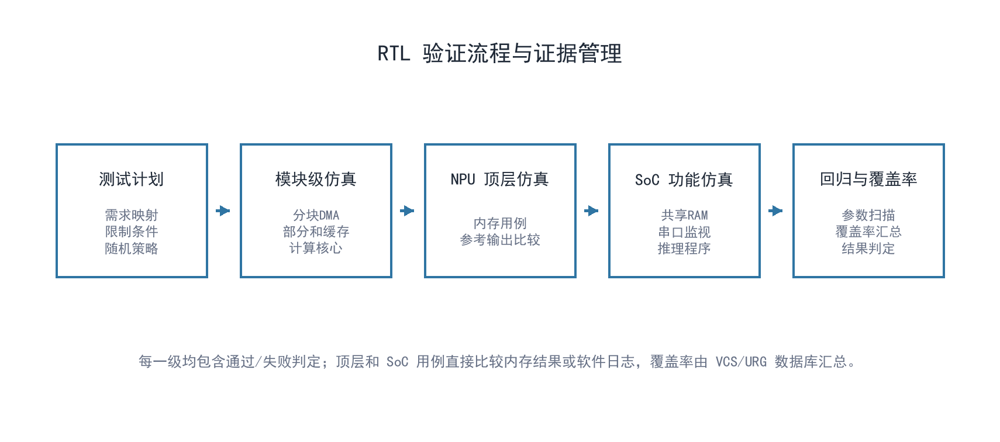


## 2. 被测对象、验证配置与证据范围

### 2.1 被测 RTL 与 SoC 组成

被测对象覆盖 NPU 主体、AXI-Lite 寄存器接口、AXI4 分块DMA、PicoRV32 SoC 集成环境和 FPGA 顶层工程。NPU 通过 AXI-Lite MMIO 接收软件配置，通过 AXI4 master 访问共享 RAM，内部包含 IA cache、kernel loader、bias loader、compute core、partial sum buffer、requant、int8 output FIFO、OA writer 和分块DMA 仲裁器。SoC 集成环境包含 PicoRV32、CPU AXI 桥、AXI interconnect、AXI RAM、UART、SoC 控制寄存器和 NPU AXI-Lite 封装模块。

| 类别 | 主要模块或文件 | 验证重点 |
|---|---|---|
| NPU 顶层 | `npu_top`、`npu_axil_top`、AXI-Lite 寄存器组 | 寄存器配置、启动/完成握手、状态粘滞位、写回状态、错误码 |
| 控制器 | `npu_controller` | `IDLE`、`INIT`、`WEIGHT_START`、`WEIGHT_WAIT`、`IA_START`、`IA_WAIT`、`WAIT_DONE`、`ERROR` 等状态切换 |
| DMA 与仲裁 | `axi_dual_block_dma`、`axi_block_dma_arbiter` | AXI4 读写握手、读请求优先级、写回独立通道、outstanding、非字对齐读写、响应反压 |
| 输入加载 | `ia_loader`、`kernel_loader`、`bias_loader` | IA cache 分块、权重列展开、bias 与量化参数读取、复用组切换、尾块有效元素 |
| 计算核心 | `compute_core`、`ws_systolic_array`、`ws_systolic_cell` | 参数化阵列、WS/IS 数据流、部分和累加、无效元素清零、输出有效时序 |
| 中间缓存 | `ps_buffer`、`ps_buffer_fifo` | partial sum replay、对角输出恢复为行输出、帧缓存切换、FIFO bypass |
| 写回量化 | `vec_requant`、`vec_s8_to_fifo`、`oa_writer` | per-tensor/per-channel 量化、饱和、输出 FIFO 排空、字节写掩码、AXI 写回顺序 |
| SoC 集成 | `soc_top`、PicoRV32、AXI RAM、UART | CPU 配置 NPU、共享 RAM 数据一致性、UART 状态输出、总线锁定、C 程序结果判定 |
| FPGA 顶层 | `fpga_top`、Clocking Wizard、Vivado 工程 | 50 MHz 输入时钟到 150 MHz 核心时钟、前仿、布线/设计规则检查、布线后时序、资源利用率 |

### 2.2 关键参数配置

RTL 回归覆盖多个阵列规模、IA cache 分块数、输入数据位宽、数据流模式和量化模式。FPGA 工程用于验证板级容量、150 MHz 时序和 int8 WS 推理路径，完整功能组合由 RTL/SoC 回归覆盖。

| 配置项 | RTL 回归覆盖 | FPGA 最终工程 |
|---|---|---|
| 阵列规模 | 4x4、8x8、16x16、32x32 等组合 | 4x4 |
| IA cache 分块数 | 2、4、8、16、32、64、256 等组合 | 32 |
| partial sum buffer 帧数 | 与阵列规模和用例配置相关 | 4x4 阵列对应裁剪配置 |
| 输入数据位宽 | int8、int16 | int8 |
| 权重数据位宽 | int8 路径为主要验证对象，int16 参数在 RTL 中保留 | int8 |
| 数据流模式 | WS 与 IS | WS |
| 量化模式 | per-tensor 与 per-channel | per-tensor |
| AXI 数据宽度 | 32 bit | 32 bit |
| NPU 地址宽度 | 参数化覆盖 | 19 bit |
| CPU RAM 深度 | SoC 仿真与 FPGA 工程保持一致 | 65536 word |
| 核心时钟 | RTL 仿真按周期统计 | 150 MHz |

### 2.3 AXI-Lite 寄存器验证范围

NPU 软件配置接口为标准 AXI-Lite MMIO，窗口基地址为 `0x1000_0000`。验证侧通过 C 程序、UVM 监视和覆盖率用例检查寄存器写入、只读状态位、写 1 清除位和启动脉冲行为。

| Byte offset | 寄存器名 | 访问属性 | 验证内容 |
|---:|---|---|---|
| `0x000` | `NPU_REG_CTRL` | RW | `START` 单周期启动、`CFG_16BITS_IA`、`PER_CHANNEL`、`DATAFLOW_IS`、`IRQ_ENABLE` |
| `0x004` | `NPU_REG_STATUS` | RO/WC | `SA_READY`、`BUSY`、`DONE`、`ERR_MASK`、`REG_READY`，其中 `DONE` 写 1 清除 |
| `0x008` | `NPU_REG_WB_DATA` | RO | 最近一次任务完成状态写回 |
| `0x010` 至 `0x018` | `NPU_REG_LHS_BASE`、`NPU_REG_RHS_BASE`、`NPU_REG_DST_BASE` | RW | 输入、权重和输出基地址 |
| `0x01c` | `NPU_REG_BIAS_BASE` | RW | bias 基地址，0 表示不使用 bias |
| `0x020` 至 `0x028` | `NPU_REG_K`、`NPU_REG_N`、`NPU_REG_M` | RW | 矩阵维度配置 |
| `0x02c` 至 `0x034` | stride 寄存器 | RW | LHS、RHS、DST 字节跨度 |
| `0x038` 至 `0x050` | zero point、量化和激活范围寄存器 | RW | 偏置、乘子、移位、激活上下限 |
| `0x054`、`0x058` | `NPU_REG_IA_REUSE`、`NPU_REG_W_REUSE` | RW | IA 和 W 复用参数 |
| `0x05c` | `NPU_REG_DATAFLOW` | RW | WS/IS 模式选择，与 CTRL bit3 保持一致性检查 |
| `0x0fc` | `NPU_REG_ID` | RO | 固定 ID `0x4e50_5531` |

### 2.4 证据纳入原则

本报告只把已归档日志、截图、覆盖率数据库和 Vivado 报告作为结论依据。post-implementation functional 后仿脚本已经完成网表信号名适配，但本次运行未形成通过日志，因此不作为新增通过证据。板卡下载和 UART transcript 未纳入自动化证据集，因此本报告不陈述实物板卡运行结论。

## 3. RTL 仿真验证方法与流程

### 3.1 分层验证流程

RTL 验证按模块级、NPU 顶层、SoC 系统级和覆盖率收集四层执行。模块级测试直接驱动 DUT 端口，并通过 SystemVerilog 断言、记分板检查、内存比较和结束标志检查局部行为。NPU 顶层测试加载由 Python 生成的 `init.mem`、`config.mem` 和 `golden.mem`，在 `sa_ready` 重新拉高后读取输出地址区域并逐字节比较。SoC 系统级测试由 PicoRV32 执行 C 程序，软件通过 AXI-Lite 写入寄存器并轮询 `NPU_REG_STATUS`，UVM 环境同步监视 `soc_finish`、`soc_status`、`cpu_trap`、UART 输出和 UVM error count。覆盖率收集使用 VCS 编译插桩，将多个运行项合并到 VDB 数据库后由 URG 汇总。


### 3.2 激励生成与参考模型

模块级定向测试使用固定尺寸、固定地址和随机反压组合，重点覆盖状态切换、握手保持、计数器递增、FIFO 满空和数据顺序。NPU 顶层随机测试使用 Python 参考模型生成输入矩阵、权重矩阵、bias、量化参数、激活上下限和参考输出，参考模型与硬件采用相同的 int8/int16 输入解释、zero point 扣除、累加、右移、饱和和写回布局。随机用例会选择非整块的 K、N、M 尺寸，使阵列行、阵列列和内积方向均可能产生尾块，从而检查无效元素屏蔽和字节写掩码。

RAM 模型支持命令、写数据和读响应插入随机延时。测试平台通过 `+DDR_RAND_LAT=1`、`+DDR_CMD_MAX_LAT=3`、`+DDR_W_MAX_LAT=2`、`+DDR_RSP_MAX_LAT=8` 等参数增加 AXI 读写反压。通过条件不是单纯等待 `done`，而是同时要求 DUT 未出现超时、AXI 响应无错误、输出 RAM 与参考数据一致、SoC 结束状态为 PASS 且 `UVM_ERROR=0`。

### 3.3 关键检查点

| 检查项 | 检查方法 | 通过条件 |
|---|---|---|
| 复位与启动 | 定向/随机用例观察 `calc_start`、`sa_ready`、`BUSY`、`DONE` | 复位后空闲，启动脉冲仅被采样一次，完成后恢复 ready |
| AXI-Lite 配置 | SoC C 程序写寄存器、覆盖率定向读写、状态寄存器轮询 | 写入字段被硬件采样，只读状态位由硬件更新，写 1 清除位按规则清除 |
| AXI4 读写 | DMA 模块 TB、NPU 顶层 memory compare、RAM 随机响应延时 | `AR/AW/W/R/B` 通道握手符合 AXI 规则，`RLAST/WLAST` 与传输长度一致 |
| DMA 仲裁 | 重叠请求定向测试、NPU 顶层随机用例 | kernel、quant、IA、bias 读请求按优先级获得授权，OA 写回可与读通道并行 |
| IA cache 复用 | 参数回归、固定容量扫描、TFLM 场景计数器 | cache slot 切换正确，复用组切换不覆盖未消费数据 |
| 计算阵列 | Compute Core 随机测试、PS Buffer 定向测试、顶层参考输出比较 | `acc_data_valid`、`tile_calc_over`、部分和输出顺序与参考模型一致 |
| 量化与写回 | per-tensor/per-channel 回归、激活截断用例 | 乘子、移位、zero point 和激活上下限处理与参考模型一致 |
| 尾块处理 | K/N/M 非整块随机矩阵 | 无效行列不参与结果，写回 mask 只覆盖有效输出字节 |
| SoC 协同 | PicoRV32 C 程序仿真 | `soc_status=0x00000001`，`cpu_trap=0`，`UVM_FATAL=0` |
| 覆盖率 | VCS `.vdb` 与 URG 汇总 | NPU RTL 行覆盖率达到 95%，未达到的辅助指标记录原因 |

### 3.4 通过判据与失败定位

模块级 testbench 采用局部结束判据。例如 DMA testbench 要求读写引擎打印 `[AXI_DUAL_DMA] ALL PASS`，仲裁器 testbench 要求重叠请求场景打印 `[AXI_ARB] ALL PASS overlap=1`，Compute Core 随机测试要求多个 seed 的最终矩阵与参考值一致，PS Buffer 测试要求对角输入恢复为行输出并在 bypass 场景中保持顺序。NPU 顶层 testbench 以 `[TB] PASS` 作为最终结果，同时保存每个 case 的配置、随机种子、输出比较范围和完成周期。

SoC 测试由 UVM monitor 和 C 程序共同判定。C 程序写入状态寄存器并输出 PASS 字符串，UVM 环境检查 `soc_finish` 是否在超时前拉高、`soc_status` 是否为 1、`cpu_trap` 是否保持为 0、UVM error count 是否为 0。若出现失败，定位顺序为寄存器配置、NPU 状态、AXI 总线、输出 RAM 比较、UART 输出和 C 程序 trap。该流程使数值错误、死锁、错误响应、启动遗漏和软件轮询超时能够被区分。

## 4. 模块级验证思路与结果

### 4.1 模块级验证总体方法

模块级仿真用于在进入顶层集成前检查局部硬件行为。每个 testbench 均直接连接 DUT 的时钟复位和主要接口，复位释放后执行固定场景和随机场景，测试平台在时钟上升沿采样 `valid/ready`、`req/granted/start/done`、计数器、FIFO 状态和输出数据。对于带状态机的模块，验证重点包括复位初始状态、启动采样条件、等待条件、完成条件和异常返回；对于总线模块，验证重点包括地址稳定性、传输长度、最后一拍标志、写掩码和反压期间数据保持；对于计算模块，验证重点包括数据展开顺序、累加延迟、输出有效信号和尾块清零。

| 模块 | Testbench | 运行入口 | 验证内容 | 结果 |
|---|---|---|---|---|
| AXI dual block DMA | `test/axi_dual_block_dma/tb_axi_dual_block_dma.sv` | `make -C test/axi_dual_block_dma run` | AXI4 读写通道、burst 长度、读写完成、非字对齐访问、异常响应检查 | PASS |
| AXI block DMA arbiter | `test/axi_block_dma_arbiter/tb_axi_block_dma_arbiter.sv` | `make -C test/axi_block_dma_arbiter run` | 多读客户端仲裁、请求重叠、DMA 输出稳定性、写回通道并行性 | PASS |
| PS Buffer | `test/ps_buffer/tb_ps_buffer.sv` | `make -C test/ps_buffer run` | partial sum replay、de-diagonalize、FIFO bypass、有效行列处理 | PASS |
| Compute Core | `test/compute_core/tb_compute_core.sv` | `make -C test/compute_core run_random` | 脉动阵列输出、final row、`tile_calc_over` 与 `acc_data_valid` 时序 | PASS |
| NPU Top | `veri/top_regression/tb_npu_top.sv` | `make -C veri/sim npu_top_regress` | loader/compute/requant/writeback 全部串接，直接比较 RAM | PASS |

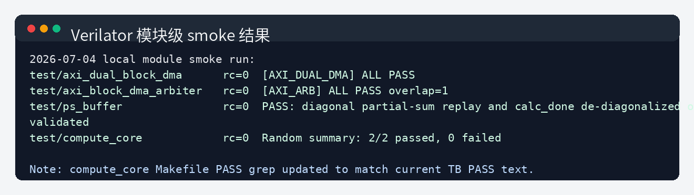

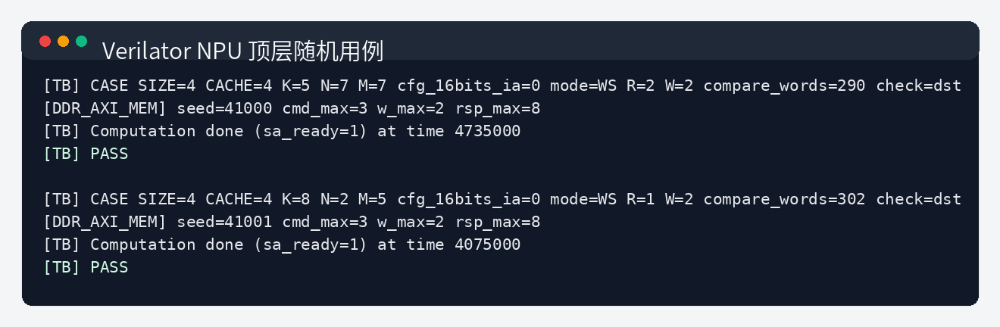

### 4.2 分块DMA 模块验证

`axi_dual_block_dma` 包含独立的读引擎和写引擎。读引擎接收 `rd_start`、`rd_linear_read_mode`、`rd_base_addr`、`rd_row_stride`、`rd_rows_to_read`、`rd_valid_cols`、`rd_burst_len_m1`、`rd_slot_id`、`rd_use_16bits` 和 `rd_lhs_zp`，输出 AXI `m_axi_arvalid`、`m_axi_araddr`、`m_axi_arlen`，并在 `m_axi_rvalid && m_axi_rready` 时解包 `m_axi_rdata`。写引擎接收 `wr_start`、`wr_base_addr`、`wr_row_stride`、`wr_rows_to_write`、`wr_burst_len_m1` 和 `src_wdata/src_wmask/src_wvalid`，输出 AXI `AW/W/B` 通道信号。验证时分别构造线性读取、多行 stride 读取、非字对齐地址、读响应随机延时、写数据反压和写响应延时场景。

DMA testbench 检查 `rd_busy` 在读事务进行期间保持为高，最后一行最后一次读响应握手后产生单周期 `rd_done`。读地址通道在 `m_axi_arvalid=1` 且 `m_axi_arready=0` 时必须保持 `m_axi_araddr`、`m_axi_arlen`、`m_axi_arsize` 和 `m_axi_arburst` 不变。读数据通道在 `m_axi_rvalid && m_axi_rready` 时更新 `wr_row`、`wr_col_base`、`wr_data[]` 和 `wr_valid[]`，当输入为 int16 时只允许有效半字写入对应元素位置，当输入为 int8 时按字节展开。写通道验证 `m_axi_awvalid`、`m_axi_wvalid` 和 `m_axi_bready` 的配合关系，检查 `m_axi_wlast` 与 `wr_burst_len_m1` 一致，`m_axi_wstrb` 与 `src_wmask` 一致，写响应握手后产生 `wr_done`。

非字对齐访问是 DMA 验证的重点之一。读侧在基地址或行跨度低位非零时会产生额外对齐读取，testbench 比较解包后的有效元素，而不是仅比较 AXI 数据字。写侧通过 `src_wmask` 保证尾列和非字对齐输出不会覆盖无效字节。当前模块级冒烟测试通过，说明读写引擎在随机反压、非字对齐和多行访问组合下符合测试平台判据。

### 4.3 DMA 仲裁器验证

`axi_block_dma_arbiter` 将 IA、kernel、bias、quant 四类读客户端复用到一个 DMA 读引擎，并将 OA writer 独占连接到 DMA 写引擎。读客户端请求信号包括 `ia_req`、`kernel_req`、`bias_req`、`quant_req`，授权信号包括 `ia_granted`、`kernel_granted`、`bias_granted`、`quant_granted`。RTL 中读请求优先级为 kernel 优先，其次 quant，再次 IA，最后 bias。仲裁器在选中客户端后保持 `rd_client`，直到该客户端启动并收到 `rd_dma_done`，中途不会因为新的高优先级请求改变已授予客户端。写侧 `oa_req`、`oa_granted`、`oa_start`、`oa_done` 独立于读侧工作，用于验证 AXI 读写通道可以同时活跃。

仲裁器 testbench 构造请求重叠场景，先同时拉高多个读客户端请求，再按不同顺序撤销请求，检查授权信号是否只对一个客户端有效，未获授权客户端的 `busy` 和 `done` 不应被误置位。测试平台还检查被授权客户端的地址、行跨度、传输行数、burst 长度、slot id、数据位宽标志和 zero point 是否被正确送入 DMA。对 OA 写回通道，测试平台在读 DMA 运行期间发起写请求，检查 `oa_src_wready` 只在写引擎可接收时拉高，写数据在反压期间保持稳定。当前重叠请求测试通过，说明仲裁器在优先级选择、授权保持、读写并行和完成信号路由方面满足设计预期。

### 4.4 IA Loader 与 cache 验证

IA loader 由顶层状态机、`ia_loader_ctrl`、cache manager 和 buffer wrapper 构成。外部控制信号包括 `init_cfg`、`load_ia_granted`、`send_ia_trigger`、`ia_calc_done` 和 `partial_sum_calc_over`，输出信号包括 `load_ia_req`、`ia_data_valid`、`ia_row_valid`、`ia_tile_start`、`ia_is_init_data`、`ia_sending_done`、`ia_l1_switch`、`bias_sleep`、`bias_switch` 和 `bias_last_loop`。`ia_loader_ctrl` 内部状态包括 `S_IDLE`、`S_INIT`、`S_LOAD`、`S_SEND` 和 `S_DONE`，用于调度 cache 装载、计算发送和预取。

模块级验证通过 NPU 顶层随机用例和覆盖率用例检查 IA loader 行为。测试平台关注 `load_ia_req` 与 `load_ia_granted` 的请求授权，检查 cache slot 在 `cache_tile_done` 后才退休，检查 `ia_data_valid` 拉高时 `ia_out[]`、`ia_row_valid` 和 `ia_tile_start` 与矩阵维度一致。针对 IA cache 复用，随机用例设置不同 `cfg_ia_reuse_num` 和 `IA_CACHE_BLOCKS`，通过输出参考数据比较间接确认复用组切换未覆盖尚未消费的数据。RAM 随机延时场景还检查预取请求被反压时，已发送给计算阵列的数据保持稳定，`ia_sending_done` 只在当前 tile 有效行全部发送后产生。

### 4.5 Kernel Loader 与 bias loader 验证

Kernel loader 包含顶层 `TOP_IDLE/TOP_INIT/TOP_RUN` 状态和内部控制器 `S_IDLE/S_INIT/S_RUN/S_DONE`。验证关注 `load_weight_req`、`load_weight_granted`、`send_weight_trigger`、`store_weight_req`、`weight_data_valid`、`weight_sending_done` 和 `load_weight_done`。测试平台通过 NPU 顶层随机矩阵覆盖 N 小于阵列列数、K 非整块和 W 侧复用窗口变化，检查权重只在 `store_weight_req` 有效时写入阵列，并在 `weight_sending_done` 后才允许控制器进入下一阶段。

Bias loader 包含 `bias_loader_ctrl` 和 `bias_loader_buffer`，控制状态包括 `S_IDLE`、`S_INIT_GEOM`、`S_INIT_LAST`、`S_INIT_MARK`、`S_INIT_GROUP`、`S_CMD`、`S_REQ`、`S_LOAD`、`S_WAIT`、`S_NEXT_IDX`、`S_NEXT_MARK` 和 `S_NEXT_GROUP`。验证重点为 `load_bias_req`、`load_bias_granted`、`bias_valid`、`bias_group_valid`、`load_bias_done`、`bias_data_out[]`、`bias_sleep` 和 `bias_last_loop`。当 `bias_base=0` 时，测试平台要求 bias 路径保持可预测的零偏置行为；当 per-channel 量化启用时，bias 与量化参数在列方向分组读取，输出结果必须与参考模型一致。该部分主要通过 int8/int16 参数回归和覆盖率新增的 tail per-channel 用例验证。

### 4.6 Compute Core 与 PS Buffer 验证

Compute Core testbench 随机生成输入向量、权重向量、bias 和有效行列标志，检查 `ia_row_valid`、`ia_tile_start`、`ia_is_init_data`、`store_weight_req`、`weight_data_valid`、`bias_valid`、`bias_group_valid` 与输出 `acc_data_valid`、`tile_calc_over`、`acc_data_out[]` 之间的周期关系。对于 final row 场景，测试平台会检查最后一行有效输出是否完整产生，`tile_calc_over` 不得早于最后一个有效输出，也不得在输出完成后长时间不释放。

PS Buffer testbench 重点验证对角输出恢复和 partial sum replay。脉动阵列输出的部分和按对角顺序到达，PS Buffer 需要在帧缓存中保存并重新排列为行向量输出。测试平台输入多组带无效元素的部分和，检查 de-diagonalize 后的行列位置、有效标志和 replay 顺序。对于 FIFO bypass 场景，测试平台检查当无需复用或缓存可直接输出时，数据仍满足 `valid/ready` 语义，反压期间输出保持不变。当前 Compute Core 和 PS Buffer 冒烟测试均通过，说明阵列输出时序、帧缓存读写和部分和复用在归档场景下工作正确。

### 4.7 Requant、输出 FIFO 与 OA Writer 验证

`vec_requant` 状态机包括 `IDLE`、`LOAD` 和 `COMPUTE`，用于在 per-channel 模式下读取量化参数，并对 int32 累加结果执行乘法、移位、zero point 加法、激活上下限裁剪和 int8 饱和。验证用例覆盖 per-tensor 固定乘子、per-channel 参数指针、激活下限命中、激活上限命中、输出零点偏移和尾列有效数。测试平台通过参考输出比较判断 `requant_out_valid`、`requant_out_tile_done` 和 `requant_out[]` 是否正确。

`vec_s8_to_fifo` 将每个 tile 的 int8 向量转换为 32 bit 写回数据，产生 `fifo_output_data`、`fifo_output_mask`、`fifo_output_valid`、`fifo_output_switch_row`、`fifo_vec_valid_num_row` 和 `fifo_vec_valid_num_col`。`oa_writer` 状态机包括 `S_IDLE`、`S_REQ`、`S_START`、`S_WRITE` 和 `S_DONE`，负责向 DMA 写引擎提交输出基地址、行跨度、写行数和 burst 长度，并在 `dma_src_wready` 有效时发送数据。验证重点为 `write_oa_req`、`write_oa_granted`、`dma_start`、`dma_src_wvalid`、`dma_src_wmask`、`dma_done` 和 `write_done` 的配合关系。NPU 顶层随机用例的内存比较直接覆盖写回顺序和字节掩码，若写回地址、掩码或排空时序错误，输出区域会与参考数据发生字节级差异。

## 5. NPU 顶层随机仿真结果

### 5.1 顶层测试平台结构

NPU 顶层 testbench 例化 `npu_top`、AXI RAM 模型和随机延时控制。仿真开始后，RAM 模型加载 `init.mem`，测试平台根据 `config.mem` 驱动 `lhs_base`、`rhs_base`、`dst_base`、`bias_base`、`k`、`n`、`m`、stride、zero point、量化参数、激活上下限、数据流模式和数据位宽配置。`calc_start` 在配置稳定后拉高一个周期，随后 testbench 等待 `sa_ready` 从低恢复为高，并读取输出区域与 `golden.mem` 中的参考输出比较。

该方法直接验证完整 NPU 内部数据通路，包括 IA cache 装载、kernel 装载、bias 装载、阵列计算、partial sum replay、requant、输出 FIFO、OA writer、DMA 读写和仲裁器调度。由于比较对象为最终 RAM 输出，测试结果能覆盖中间模块之间的接口错位、计数器错误、尾块掩码错误和写回地址错误。

顶层回归功能已经从外部仓库迁移到 `aiEngine_integrated/veri/top_regression`。该目录包含 `tb_npu_top.sv`、`gen_mem.py`、`ddr_axi_mem_model.sv` 和独立 Makefile，可直接执行 Verilator 编译与随机回归。为便于与 VCS/UVM、SoC C 回归和覆盖率任务统一管理，`veri/sim/Makefile` 新增 `npu_top_regress` 目标，该目标转发到 `veri/top_regression` 并通过 `TOP_REGRESS_*` 参数传递阵列规模、IA cache 分块数、随机 seed、用例数量和 RAM 响应延时配置。

### 5.2 代表性随机用例

| 日志 | 阵列规模 | IA cache 分块数 | K | N | M | 数据流 | RAM 响应延时 | 完成时间 | 结论 |
|---|---:|---:|---:|---:|---:|---|---|---:|---|
| `veri/top_regression/out/random_20260730.log` | 4x4 | 4 | 6 | 3 | 16 | WS | cmd≤2，w≤1，rsp≤4 | 6675000 | PASS |
| `veri/top_regression/out/random_20260731.log` | 4x4 | 4 | 4 | 4 | 3 | WS | cmd≤2，w≤1，rsp≤4 | 1505000 | PASS |

第一组用例覆盖 int16 LHS 输入、输出列数等于四个阵列 tile 和输出行方向尾块，可检查 IA loader、kernel loader、PS Buffer、requant 和 OA writer 对有效行列的处理。第二组用例覆盖输出列数小于阵列列数的情况，能够检查输出 FIFO 和写掩码是否只写有效字节。两组用例均在 RAM 随机响应延时下通过，说明本次顶层握手、burst 读写、有效元素标志和写回比较在归档条件下成立。另通过 `make -C veri/sim npu_top_regress TOP_REGRESS_COUNT=1 TOP_REGRESS_SEED=20260740 ...` 验证统一入口可调用该回归，seed 20260740 用例为 1/1 PASS。

## 6. SoC 与 TFLM 功能仿真

### 6.1 SoC C 程序仿真方法

SoC 功能仿真使用 PicoRV32 执行 C 程序。软件按寄存器地址写入 LHS、RHS、DST、bias、K、N、M、stride、zero point、量化参数和激活范围，启动前通过 `NPU_REG_STATUS[2]` 写 1 清除历史完成状态，然后向 `NPU_REG_CTRL` 写入 `NPU_CTRL_START`、`NPU_CTRL_IRQ_ENABLE` 和模式位。NPU 执行期间，CPU 通过轮询 `NPU_REG_STATUS` 的 `NPU_STATUS_DONE` 判断任务完成，并读取输出区域进行结果检查。UVM testbench 同时监视 CPU trap、SoC finish、UART 输出和 UVM error count。

| 项目 | 结果 |
|---|---|
| 代表性日志 | `/media/proj_tmp/aiEngine_integrated/veri/sim/runs/uart150m_check_div1300/sim.log` |
| `dsa_execute_cycles` | 2744 |
| SoC finish 周期 | 2025474 |
| 结束状态 | `soc_status=0x00000001` |
| CPU trap | 0 |
| UVM 统计 | `UVM_ERROR=0`，`UVM_FATAL=0` |
| 判定 | PASS |

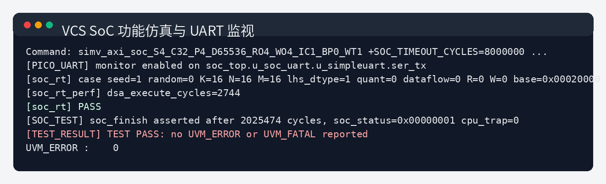

该场景验证了寄存器配置、NPU 启动、共享 RAM 读写、NPU 完成状态、CPU 轮询、UART 监视和 C 程序结果判定。与 NPU 顶层 testbench 相比，SoC 仿真加入了 PicoRV32 指令执行、AXI-Lite 桥、AXI interconnect 和 CPU/NPU 访问竞争，因此可检查软件驱动与硬件寄存器语义是否一致。

### 6.2 TFLM MNIST 软硬件对比仿真

TFLM 功能仿真使用 MNIST MLP 作为代表性推理任务。硬件路径由 NMSIS-NN 调用 NPU 完成矩阵计算，软件路径关闭 NPU 加速宏后使用纯软件实现。两条路径均执行 3 个样本，标签和预测完全一致。

| 路径 | 样本 0 | 样本 1 | 样本 2 | 总周期 | 平均周期 | 结论 |
|---|---|---|---|---:|---:|---|
| NPU 加速 | label=7 pred=7 | label=2 pred=2 | label=1 pred=1 | 479777 | 159925 | PASS |
| 纯软件 | label=7 pred=7 | label=2 pred=2 | label=1 pred=1 | 15343242 | 5114414 | PASS |

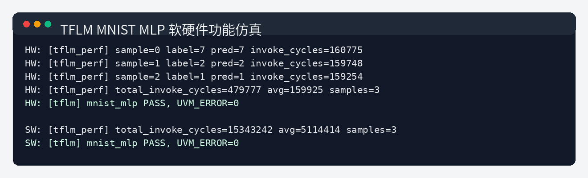

硬件路径日志同时输出 NPU 利用率字段，包括 `active`、`ia_row`、`acc_valid`、`requant_valid`、`fifo_valid`、`dma_busy_ia`、`dma_busy_kernel`、`axi_ar`、`axi_r`、`axi_aw`、`axi_w` 和 `axi_b`。SoC 统计字段记录 `npu_lock=192141`、`cpu_lock_ar_block=192099`，说明 NPU 工作期间总线锁定机制在该用例中生效，CPU 侧读访问被阻塞且系统最终正常结束。

### 6.3 系统级验证结果分析

SoC C 程序仿真和 TFLM MNIST 仿真分别覆盖轻量级运行用例和端侧推理软件栈。前者便于定位寄存器、DMA、共享 RAM 和 NPU 输出比较问题，后者验证软件调用、张量数据布局、量化参数传递和推理结果一致性。两类测试均由 PicoRV32 执行，不依赖测试平台直接修改 NPU 内部信号，因此结果能够反映软件可见接口和硬件执行结果的一致性。

## 7. 回归测试流程与结果

### 7.1 回归测试组织

回归测试按功能回归、参数回归、固定容量扫描、关键 SoC 组合和覆盖率计划组织。功能回归用于确认基础可用性；参数回归用于检查 int8/int16、WS/IS、per-tensor/per-channel、不同 cache 分块数和随机矩阵尺寸；固定容量扫描用于检查阵列规模与 IA cache 块数组合变化后的功能稳定性；关键 SoC 组合用于检查最终 FPGA 裁剪配置和较大阵列参考配置；覆盖率计划用于驱动代码覆盖率。

| 回归集合 | 目标 | 覆盖配置 | 结果 |
|---|---|---|---|
| SoC C 程序基础随机回归 | CPU/NPU 协同与输出检查 | seed 33001/33002/33003 | 3/3 PASS |
| int8 完整参数回归 | int8 输入数据路径 | cache 2/4/8，WS/IS 数据流，复用深度组合，per-tensor/per-channel 量化 | 24/24 PASS |
| int16 完整参数回归 | int16 输入数据路径 | cache 2/4/8，WS/IS 数据流，复用深度组合，per-tensor/per-channel 量化 | 24/24 PASS |
| 固定 IA cache 容量扫描 | 阵列规模与 IA cache 块数参数化 | 4x4/8x8/16x16/32x32，矩阵 128³/256³/512³ | 12/12 PASS |
| 最终关键 SoC 组合 | 资源裁剪配置与 16x16 参考配置 | 4x4 + 32 个 IA cache 分块，16x16 + 4 个 IA cache 分块 | 2/2 PASS |
| 模块级覆盖率计划 | AXI-Lite 定向读写 + SoC 运行用例 | 2 个编译项 + 24 个运行项 | PASS |
| SoC 级覆盖率计划 | SoC 运行用例 | 1 个编译项 + 21 个运行项 | PASS |

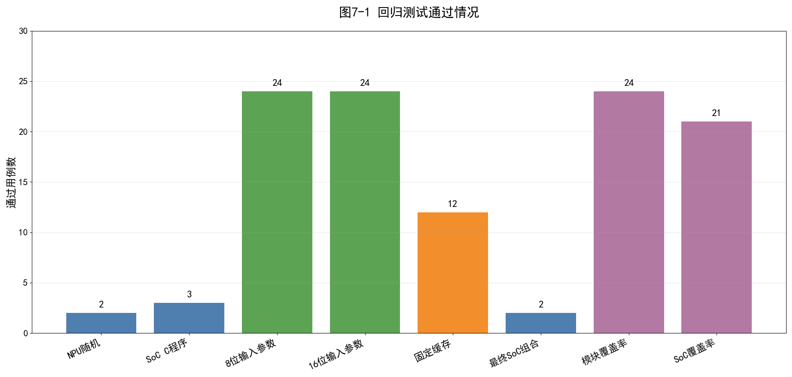

### 7.2 参数化覆盖维度

参数化回归覆盖阵列规模、IA cache 分块数、输入数据位宽、数据流模式、量化模式、矩阵尺寸、RAM 响应延时和总线访问竞争。固定容量扫描中，4x4、8x8、16x16 和 32x32 阵列分别配合不同 IA cache 分块数，在 128³、256³ 和 512³ 矩阵尺寸下执行。该扫描说明在片上缓存容量保持近似不变时，阵列规模和 cache 分块数量同时变化不会破坏功能正确性。

| 维度 | 已覆盖内容 |
|---|---|
| 阵列规模 | 4x4、8x8、16x16、32x32 的功能回归和扫描 |
| IA cache 分块数 | 2、4、8、16、32、64、256 等组合 |
| 输入数据位宽 | int8 与 int16 |
| 数据流模式 | WS 与 IS |
| 量化模式 | per-tensor 与 per-channel |
| 矩阵尺寸 | 最小矩阵、非整块矩阵、尾行、尾列、N 小于阵列列数 |
| RAM 响应 | 命令、写数据和读响应随机延时 |
| 总线行为 | AXI read/write burst、outstanding、NPU lock、CPU/NPU 访问竞争 |

### 7.3 回归失败处理流程

回归脚本在出现失败时保存 seed、配置、日志、波形开关和输出比较信息。数值不一致时优先查看参考输出比较给出的字节偏移、输出行列和写回地址，再定位 requant、FIFO、OA writer 或 DMA 写掩码；超时失败时优先查看 `sa_ready`、`BUSY`、DMA `busy/done`、仲裁器授权、AXI `valid/ready` 和 RAM 延时；SoC 失败时进一步检查寄存器写入顺序、`NPU_REG_STATUS`、CPU trap、UART 输出和 UVM error count。调试阶段生成的失败日志不纳入最终通过统计。

## 8. 覆盖率收集与分析

### 8.1 覆盖率统计范围与目标

覆盖率只统计 NPU 加速器 RTL，不把 PicoRV32、UART 和 SoC RAM 计入行覆盖分母。该处理方式能够避免第三方 CPU 核和通用外设稀释 NPU 覆盖率结果，使覆盖率指标对应被验证的加速器 RTL。模块级计划包含 AXI-Lite 内存镜像生成、RAL 内存镜像生成、寄存器定向读写和 SoC 运行场景；SoC 级计划只运行 SoC 集成场景。覆盖率目标为 NPU RTL line coverage 达到 95%。


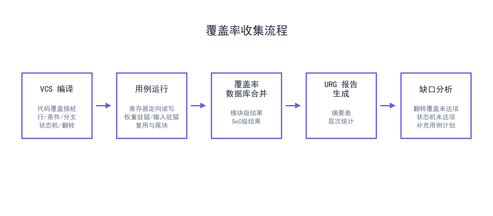

### 8.2 覆盖率执行流程

覆盖率执行分为编译、运行、合并、汇总和结果检查五个阶段。编译阶段打开 VCS code coverage 选项并生成带插桩的仿真可执行文件；运行阶段按 coverage plan 启动 AXI-Lite 定向读写、int8/int16、WS/IS、per-channel、tail、最小矩阵、激活截断和 RAM 随机响应延时用例；合并阶段将各运行项写入统一 VDB；汇总阶段调用 URG 生成 line、condition、branch、FSM 和 toggle 统计；结果检查阶段读取 summary JSON，判断 line coverage 是否达到 95%，并把辅助指标写入报告。

若 URG 在单个数据库上无法导出完整文本报告，脚本会从 VCS VDB testdata bitmap 直接计算 line、condition、branch、FSM 和 toggle 指标，并继续使用 95% line coverage 目标进行判定。覆盖率计划还修正了 `--only` 名称不存在时静默跳过的问题，若计划项名称拼写错误会立即返回失败，避免漏跑用例被误判为通过。

### 8.3 覆盖率结果

| 覆盖率范围 | 编译项 | 运行项 | 行覆盖率 | 条件覆盖率 | 分支覆盖率 | 状态机覆盖率 | 翻转覆盖率 | 综合辅助指标 | 判定结果 |
|---|---:|---:|---:|---:|---:|---:|---:|---:|---|
| 模块级 NPU 覆盖率 | 2 | 24 | 96.71% | 82.78% | 82.35% | 57.10% | 52.67% | 74.32% | PASS |
| SoC 级 NPU 覆盖率 | 1 | 21 | 95.21% | 82.17% | 80.77% | 62.72% | 45.13% | 73.20% | PASS |

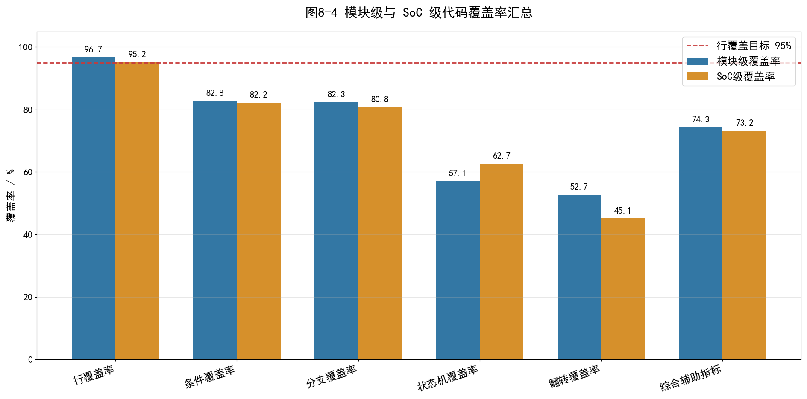

模块级和 SoC 级 line coverage 均达到 95% 目标，说明 NPU 主要 RTL 语句已经被当前测试集触达。新增 per-channel、IS、最小矩阵、tail tile 和 RAM 随机响应延时用例后，toggle coverage 提升到模块级 `52.67%` 和 SoC 级 `45.13%`，说明更多阵列数据位、量化参数位、DMA 反压状态和写回控制状态被驱动。condition、branch、FSM 和 toggle 属于辅助分析指标，未作为本轮行覆盖判定的阻塞项。

### 8.4 未覆盖项与风险分析

辅助指标低于行覆盖的主要原因是 NPU 包含大规模参数化 generate 结构、宽数据总线、保留配置字段和未触发错误响应状态。部分状态只在 AXI 错误响应、运行中复位、极限反压、非法寄存器访问或调试配置下出现，不属于正常推理路径。后续若需要提高辅助指标，可增加 AXI-Lite 非法地址读写、AXI SLVERR/DECERR 响应、DMA outstanding 达上限后的持续反压、OA writer FIFO 满/空条件、IS 模式输出转置排空、per-channel 参数读取被 RAM 响应延时打断、NPU lock 解除瞬间 CPU 访问恢复和运行中复位用例。

## 9. FPGA 工程与仿真验证

### 9.1 FPGA 工程配置

FPGA 最终工程采用 Vivado 2024.2.1，板级输入时钟为 50 MHz，核心时钟由 Clocking Wizard 生成 150 MHz。工程用于验证资源、时序、AXI 访问、NPU int8 WS 推理路径和 UART 状态输出。

| 项目 | 内容 |
|---|---|
| Vivado 工程 | `vivado_export/tflm_ai_dsa_soc_final_150m_size4_cache32_w8_pruned_addr19_6000lut_uart115200/project/tflm_ai_dsa_soc.xpr` |
| 最终报告目录 | `vivado_export/tflm_ai_dsa_soc_final_150m_size4_cache32_w8_pruned_addr19_6000lut_uart115200/reports/` |
| bitstream | `fpga_top.bit` |
| routed checkpoint | `fpga_top_routed.dcp` |
| CPU memory image | `mem/cpu.mem` |
| UART 波特率 | 约 115200 baud |

| 参数 | 数值 |
|---|---:|
| 阵列规模 | 4x4 |
| IA cache 分块数 | 32 |
| NPU 地址宽度 | 19 |
| CPU RAM 深度 | 65536 word |
| PicoRV32 I-cache | 使能 |
| 权重数据位宽 | 8 bit |
| 输入数据位宽 | 8 bit |
| IS 模式 | FPGA 裁剪工程关闭，RTL 回归覆盖 |
| per-channel 量化 | FPGA 裁剪工程关闭，RTL 回归覆盖 |
| CPU AXI 写时序缓冲 | 使能 |
| RAM 写时序缓冲 | 使能 |

`cpu.mem` 已按 FPGA RAM 深度补齐至 `65536` 行。程序区来自 `cpu_firmware_only.mem`，运行用例数据从 word `32768` 开始写入，确保综合、前仿和实现工程使用一致的 RAM 内容。

### 9.2 FPGA 验证顶层设计

FPGA 验证顶层以 `fpga_top` 作为 Vivado 工程顶层模块。该模块只保留板级必须端口，包括 50 MHz 输入时钟 `sys_clk`、低有效复位 `sys_rst_n`、UART 接收/发送端口 `UART_0_rxd/UART_0_txd` 和 4 bit 用户 LED 输出 `user_led_tri_o[3:0]`。NPU、PicoRV32、AXI RAM、UART、SoC 控制寄存器和 AXI 互连均在 `soc_top` 内部完成实例化，`fpga_top` 负责时钟生成、复位同步、SoC 例化和板级状态信号引出。

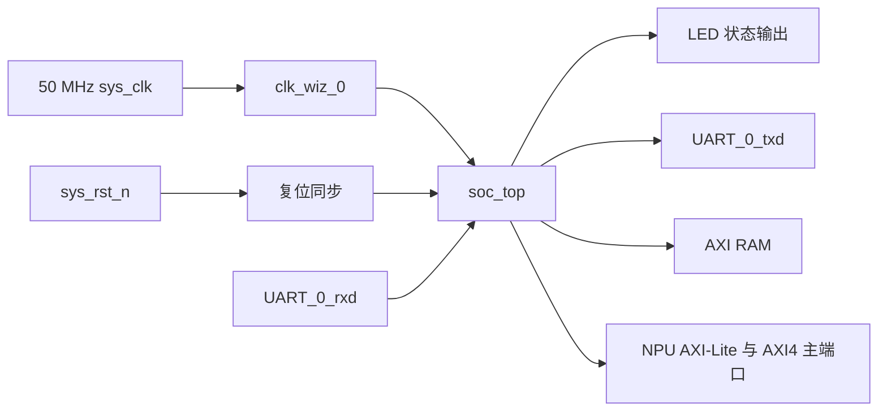

`clk_wiz_0` 将板级 50 MHz 时钟转换为 150 MHz SoC/NPU 核心时钟 `soc_clk`。复位处理采用 `clk_wiz_locked` 和三级同步寄存器共同控制：外部复位释放且 clock wizard 锁定后，`soc_rst_n_sync[2]` 才作为 `soc_top` 的复位输入。XDC 中对异步复位输入和复位同步寄存器输出设置 false path，避免异步复位路径影响同步时序分析。所有 SoC 内部逻辑均工作在 `soc_clk` 域内，前仿和综合实现使用同一套时钟与复位结构。

`soc_top` 的核心组成如下表所示。

| 层级 | 主要实例 | 设计作用 | FPGA 验证关注点 |
|---|---|---|---|
| CPU 子系统 | `u_picorv32`、`u_pico_axi_bridge` | PicoRV32 执行固件，并通过原生访存接口转换为 AXI 访问 | 指令读取、数据读写、trap 状态、I-cache 使能配置 |
| CPU 时序缓冲 | `u_cpu_axi_read_pingpong`、`u_cpu_axi_write_pingpong` | 截断 CPU AXI 读写方向的长组合路径 | 读写握手保持、反压期间地址和数据稳定 |
| AXI 互连 | `u_axi_interconnect` | 仲裁 CPU 与 NPU 对 RAM、NPU 寄存器、UART 和 SoC 控制寄存器的访问 | 地址译码、outstanding、NPU 工作期间 CPU 侧阻塞 |
| NPU 封装 | `u_npu_axil_top` | 提供 AXI-Lite 配置接口和 AXI4 数据访问主端口 | 寄存器配置、启动/完成状态、NPU bus lock、AXI burst |
| NPU 时序缓冲 | `u_npu_axi_pingpong` | 截断 NPU AXI 主端口至互连之间的关键路径 | 吞吐保持、读写响应顺序、`AR/AW/W/R/B` 握手 |
| RAM 时序缓冲 | `u_ram_axi_pingpong` 或写方向缓冲 | 截断互连至 RAM 的长路径 | 保持 RAM 同步一拍读模型，同时改善布线时序 |
| 片上 RAM | `u_axi_sim_ram` | 作为 CPU 指令、数据、NPU 输入输出共享存储 | `cpu.mem` 初始化、字节写掩码、AXI 读写一致性 |
| UART | `u_soc_uart` | 输出软件运行信息，寄存器方式配置波特率 | 150 MHz 下 115200 baud 参数、TX/RX 引脚连接 |
| SoC 控制 | `u_soc_ctrl` | 保存 `soc_finish`、`soc_status` 和进度标记 | 前仿结束判据、状态读取、LED 显示 |

地址分配保持软件驱动、RTL 仿真和 FPGA 工程一致。CPU RAM 从 `0x0000_0000` 开始映射，NPU AXI-Lite 寄存器窗口映射到 `0x1000_0000`，UART 控制窗口映射到 `0x0200_0000`，SoC 控制寄存器映射到 `0x2000_0000`。固件通过 AXI-Lite 写入 NPU 寄存器后启动计算，NPU 通过 AXI4 主端口访问共享 RAM；当 `npu_busy` 为高时，`soc_axi_interconnect` 使用 `npu_bus_lock` 阻塞 CPU 侧访问，使 NPU 在计算阶段获得确定的数据访问优先级。

FPGA 裁剪功能工程使用 `SIZE=4`、`IA_CACHE_BLOCKS=32`、`WEIGHT_WIDTH=8`、`DATA_WIDTH=8`、`CPU_MEM_DP=65536`、`NPU_ADDR_WIDTH=19`、`NPU_ENABLE_CLOCK_GATING=1`。其中 `NPU_ADDR_WIDTH=19` 与 65536 word RAM 容量相匹配，可覆盖 256 KiB 字节地址空间；`CPU_ENABLE_ICACHE=1` 用于降低 PicoRV32 指令读取压力；`CPU_AXI_WRITE_TIMING_BUFFER=1` 和 `RAM_WRITE_TIMING_BUFFER=1` 用于改善写方向时序。裁剪工程关闭 IS 模式和 per-channel 量化，只用于 FPGA 资源及时序验证；完整功能仍由 RTL 回归和 SoC 回归覆盖。

板级管脚约束集中在 `tflm_ai_dsa_soc.xdc`。输入时钟使用 `R4`，复位使用 `U7`，UART 接收和发送分别使用 `E14` 与 `D17`，四个 LED 分别使用 `W7/Y7/Y8/V9`。LED 状态含义直接由 `fpga_top` 输出：`user_led_tri_o[0]` 表示 NPU busy，`user_led_tri_o[1]` 表示 SoC finish，`user_led_tri_o[2]` 表示 CPU trap，`user_led_tri_o[3]` 为 `soc_status` 异或和 NPU 中断的观测位。前仿与后仿 TB 均以 LED1 拉高且 LED2 不拉高作为主要通过条件。

| 板级信号 | RTL 端口 | 管脚 | 电平标准 | 验证含义 |
|---|---|---|---|---|
| 50 MHz 输入时钟 | `sys_clk` | `R4` | LVCMOS15 | Clocking Wizard 输入 |
| 低有效复位 | `sys_rst_n` | `U7` | LVCMOS15 | SoC/NPU 复位源 |
| UART RX | `UART_0_rxd` | `E14` | LVCMOS33 | 外部串口输入 |
| UART TX | `UART_0_txd` | `D17` | LVCMOS33 | 固件打印输出 |
| 用户 LED0 | `user_led_tri_o[0]` | `W7` | LVCMOS15 | NPU busy |
| 用户 LED1 | `user_led_tri_o[1]` | `Y7` | LVCMOS15 | SoC finish |
| 用户 LED2 | `user_led_tri_o[2]` | `Y8` | LVCMOS15 | CPU trap |
| 用户 LED3 | `user_led_tri_o[3]` | `V9` | LVCMOS15 | 状态观测 |

前仿 TB `fpga_top_behav_smoke_tb.sv` 以参数方式接收工程中的 `SIZE`、`IA_CACHE_BLOCKS`、数据位宽、RAM 深度、NPU 裁剪参数和 `CPU_MEM_PATH`，从而保证 XSim 运行配置与 Vivado 工程配置一致。后仿 TB `fpga_top_post_impl_tb.sv` 直接例化实现网表顶层，保留同名 generic 仅用于日志记录和超时设置。两类 TB 均监视 LED 输出，behavioral TB 额外读取 `soc_progress` 和 `soc_status` 以便定位固件启动阶段；post-implementation functional TB 不依赖内部层次信号，避免网表优化后信号名变化造成误判。

### 9.3 Vivado behavioral 前仿

前仿使用 `fpga_top_behav_smoke_tb.sv`。测试平台输入 50 MHz `sys_clk`，通过 Clocking Wizard 仿真模型生成 150 MHz 核心时钟。判据为 `user_led_tri_o[1]` 拉高且 `user_led_tri_o[2]` 不拉高。

| 项目 | 结果 |
|---|---|
| 仿真器 | Vivado XSim 2024.2.1 |
| 进度标记 | `0x5a000001`、`0x5a000002`、`0x5a000003` 均出现 |
| finish 状态 | `status=0x00000001` |
| 完成周期 | 675397 个 50 MHz sys_clk 周期 |
| 判定 | PASS |

### 9.4 Vivado post-implementation functional 后仿

后仿使用 `fpga_top_post_impl_tb.sv` 和实现后的 functional netlist。脚本已适配当前网表中 UART 等待计数器的优化后命名，能够定位并 force UART 等待对象。本次运行在 `run all` 阶段持续 3 分 36 秒未结束，随后人工中止；该项未作为当前裁剪工程新增 PASS 证据。该结果不影响 behavioral 前仿、综合、route/DRC、timing 和 bitstream 归档结论，但若需要把门级 functional 后仿纳入最终验证证据，应继续缩短仿真运行时间或增加直接面向 finish 状态的检查方式。

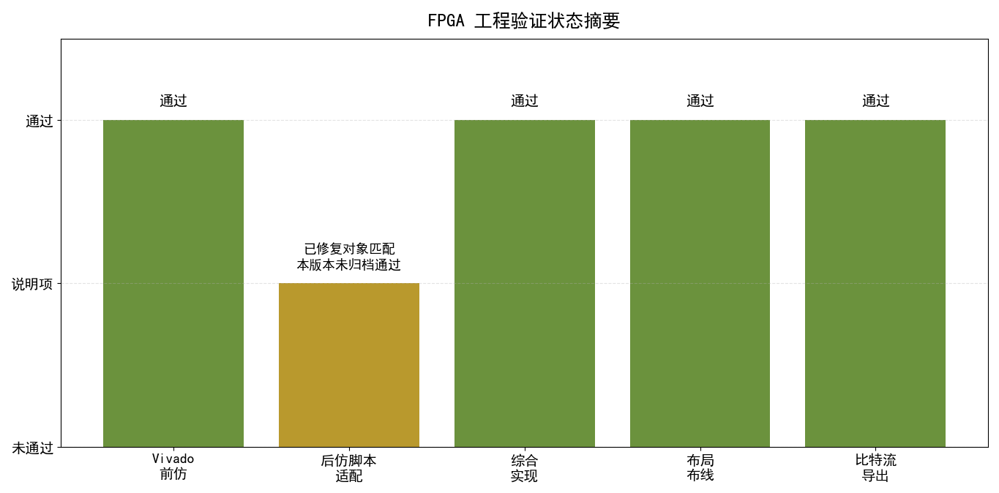

## 10. FPGA 实现、时序与资源结果

### 10.1 Bitstream 与 route/DRC

最终实现使用综合策略 `Flow_AreaOptimized_high`，综合 directive 为 `AreaOptimized_high`，实现策略为 `Performance_Explore`。实现完成后导出 routed checkpoint、bitstream、timing、utilization、route 和 DRC 报告。

| 检查项 | 结果 |
|---|---|
| Bitstream 生成 | PASS，`fpga_top.bit` 已写出 |
| Route status | fully routed |
| Routing error | 0 |
| DRC | 0 error |
| Routed setup timing | PASS |
| Routed hold timing | PASS |


### 10.2 时序结果

150 MHz 核心时钟周期为 `6.667 ns`。Routed timing summary 如下。

| 指标 | 数值 | 判定 |
|---|---:|---|
| WNS | +0.398 ns | PASS |
| TNS | 0.000 ns | PASS |
| setup failing endpoints | 0 | PASS |
| WHS | +0.058 ns | PASS |
| THS | 0.000 ns | PASS |
| hold failing endpoints | 0 | PASS |
| WPWS | +2.283 ns | PASS |


### 10.3 资源利用率

最终工程在 Artix-7 `xc7a200tfbg484-3` 上占用 7.50% LUT、4.01% FF、19.45% BRAM 和 4.32% DSP。

| 资源 | Used | Available | Utilization |
|---|---:|---:|---:|
| Slice LUTs | 10089 | 134600 | 7.50% |
| Slice Registers | 10788 | 269200 | 4.01% |
| Block RAM Tile | 71 | 365 | 19.45% |
| DSPs | 32 | 740 | 4.32% |
| Bonded IOB | 8 | 285 | 2.81% |
| BUFGCTRL | 2 | 32 | 6.25% |
| MMCME2_ADV | 1 | 10 | 10.00% |


主要层次模块资源如下。

| 层次模块 | Total LUTs | FFs | RAMB36 | RAMB18 | DSP |
|---|---:|---:|---:|---:|---:|
| `fpga_top` | 10089 | 10788 | 66 | 10 | 32 |
| `u_soc_top` | 10088 | 10785 | 66 | 10 | 32 |
| `u_npu_axil_top` | 5754 | 6308 | 2 | 9 | 32 |
| `u_npu_top` | 5283 | 5604 | 2 | 9 | 32 |
| `u_picorv32` | 1793 | 1024 | 0 | 0 | 0 |
| `u_axi_sim_ram` | 1242 | 187 | 64 | 0 | 0 |
| `u_pico_axi_bridge` | 637 | 1693 | 0 | 1 | 0 |
| `u_axi_interconnect` | 187 | 94 | 0 | 0 | 0 |
| `u_soc_uart` | 129 | 206 | 0 | 0 | 0 |
| `u_soc_ctrl` | 80 | 140 | 0 | 0 | 0 |

NPU 内部主要模块资源如下。

| NPU 子模块 | Total LUTs | FFs | RAMB36 | RAMB18 | DSP |
|---|---:|---:|---:|---:|---:|
| `u_vec_requant` | 1601 | 1565 | 0 | 0 | 16 |
| `u_ia_loader` | 1124 | 779 | 0 | 4 | 0 |
| `u_kernel_loader` | 643 | 710 | 0 | 4 | 0 |
| `u_block_dma_arbiter` | 485 | 309 | 0 | 0 | 0 |
| `u_bias_loader` | 470 | 497 | 0 | 0 | 0 |
| `u_oa_writer` | 425 | 323 | 0 | 0 | 0 |
| `u_compute_core` | 296 | 521 | 2 | 0 | 16 |


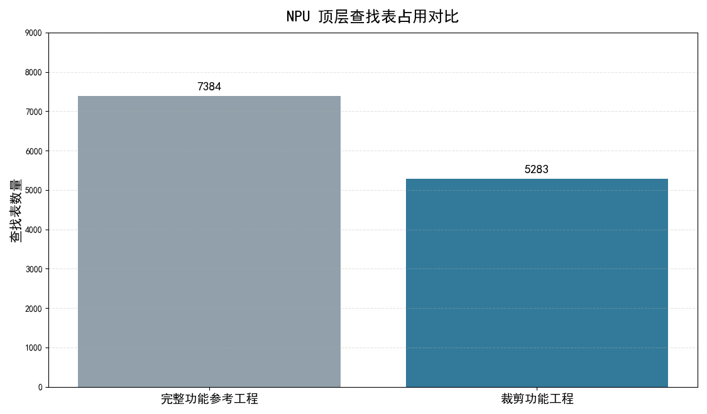

## 11. 验证结果判定与剩余风险

### 11.1 已满足项

| 项目 | 判定 | 证据 |
|---|---|---|
| 模块级仿真入口 | 通过 | DMA、arbiter、PS Buffer、Compute Core、NPU Top 冒烟测试均 PASS |
| NPU 顶层随机功能仿真 | 通过 | `veri/top_regression` seed 20260730/20260731 均 `[TB] PASS`；`veri/sim` 统一入口 seed 20260740 为 1/1 PASS |
| RAM 随机响应延时 | 通过 | NPU 顶层随机用例与 SoC 覆盖率用例均通过 |
| AXI-Lite 寄存器配置 | 通过 | SoC C 程序和覆盖率定向读写覆盖 CTRL/STATUS/地址/维度/量化寄存器 |
| SoC 功能仿真 | 通过 | `soc_status=1`、`cpu_trap=0`、`UVM_ERROR=0` |
| TFLM MNIST 推理仿真 | 通过 | 硬件加速路径与纯软件路径预测一致 |
| int8/int16 参数回归 | 通过 | 两类输入位宽均完成 24/24 参数回归 |
| WS/IS 数据流回归 | 通过 | 两类数据流均纳入参数回归和覆盖率用例 |
| per-tensor/per-channel 量化回归 | 通过 | 两类量化模式均纳入参数回归和覆盖率用例 |
| 覆盖率目标 | 通过 | 模块级 line coverage 96.71%，SoC 级 line coverage 95.21% |
| Vivado behavioral 前仿 | 通过 | `soc_finish` 拉高，trap 未拉高 |
| 150 MHz 时序 | 通过 | WNS +0.398 ns，WHS +0.058 ns |
| bitstream | 通过 | `fpga_top.bit` 已生成 |

### 11.2 剩余风险与补充验证项

| 项目 | 状态 | 影响 | 补充建议 |
|---|---|---|---|
| post-implementation functional 后仿 | 脚本已适配，未归档 PASS | 不能把门级 functional 后仿作为通过证据 | 缩短门级仿真运行时间，或增加直接检查 finish 状态的后仿方式 |
| 非字对齐地址专项验证 | DMA 冒烟测试已覆盖部分场景，复杂多行写回组合仍可加强 | 极端地址布局下写掩码和行跨度组合需要更多定向用例 | 增加 DMA 定向测试，覆盖非字对齐基地址、非字对齐 stride、尾列写掩码组合 |
| AXI 错误响应 | 正常推理路径未主动注入 `SLVERR/DECERR` | 错误码路径覆盖率不足 | 增加 AXI RAM 错误响应注入，并检查 `err_code` 与 `ERROR` 状态 |
| 运行中复位 | 未作为常规回归项 | 无法评价任务执行期间复位后的恢复行为 | 增加运行中复位 directed test，检查状态机、FIFO、DMA outstanding 和状态寄存器 |
| 辅助覆盖指标 | condition/branch/FSM/toggle 未达到 95% | 不影响当前行覆盖目标，但限制结构覆盖分析深度 | 增加极限反压、非法寄存器访问、FIFO 满空和错误响应场景 |
| 实物板卡 transcript | 自动化证据集中未采集 | 不陈述板卡运行结论 | 后续可将下载脚本、UART transcript 和复位流程纳入归档 |

## 12. 归档文件清单

| 类型 | 路径 |
|---|---|
| 综合验证报告 | `veri/doc/original_docx_report_md/rtl_fpga_validation_report_cn.md` |
| NPU 顶层 Verilator 回归 | `veri/top_regression/` |
| RTL 验证图集 | `veri/doc/original_docx_report_md/rtl_verification_figs/` |
| FPGA 验证图集 | `veri/doc/original_docx_report_md/fpga_validation_figs/` |
| RTL 参考验证报告 | `/home/etc/FPGA/tflm_ai_dsa/docs/rtl_verification_report_cn.md` |
| FPGA 参考验证报告 | `/home/etc/FPGA/tflm_ai_dsa/docs/fpga_validation_report_cn.md` |
| 模块级覆盖率 summary | `/media/proj_tmp/aiEngine_integrated/veri/sim/runs/coverage_module/coverage_code_report_summary.json` |
| SoC 覆盖率 summary | `/media/proj_tmp/aiEngine_integrated/veri/sim/runs/coverage_soc/coverage_code_report_summary.json` |
| 覆盖率计划结果 | `/media/proj_tmp/aiEngine_integrated/veri/sim/runs/coverage_module/coverage_plan_results.md`、`/media/proj_tmp/aiEngine_integrated/veri/sim/runs/coverage_soc/coverage_plan_results.md` |
| SoC UART 仿真日志 | `/media/proj_tmp/aiEngine_integrated/veri/sim/runs/uart150m_check_div1300/sim.log` |
| TFLM 硬件路径日志 | `/media/proj_tmp/aiEngine_integrated/veri/sim/runs/tflm_hw_sw_s4_c32_ic1_final_20260704/mnist_mlp_hw/sim.log` |
| TFLM 软件路径日志 | `/media/proj_tmp/aiEngine_integrated/veri/sim/runs/tflm_hw_sw_s4_c32_ic1_final_20260704/mnist_mlp_sw/sim.log` |
| Vivado 工程 | `vivado_export/tflm_ai_dsa_soc_final_150m_size4_cache32_w8_pruned_addr19_6000lut_uart115200/project/tflm_ai_dsa_soc.xpr` |
| bitstream | `vivado_export/tflm_ai_dsa_soc_final_150m_size4_cache32_w8_pruned_addr19_6000lut_uart115200/fpga_top.bit` |
| timing summary | `vivado_export/tflm_ai_dsa_soc_final_150m_size4_cache32_w8_pruned_addr19_6000lut_uart115200/reports/fpga_top_timing_summary_routed.rpt` |
| route status | `vivado_export/tflm_ai_dsa_soc_final_150m_size4_cache32_w8_pruned_addr19_6000lut_uart115200/reports/fpga_top_route_status.rpt` |
| DRC report | `vivado_export/tflm_ai_dsa_soc_final_150m_size4_cache32_w8_pruned_addr19_6000lut_uart115200/reports/fpga_top_drc.rpt` |
| hierarchical utilization | `vivado_export/tflm_ai_dsa_soc_final_150m_size4_cache32_w8_pruned_addr19_6000lut_uart115200/reports/fpga_top_utilization_hier_routed.rpt` |

## 附录 A：关键日志路径

```text
/media/proj_tmp/aiEngine_integrated/veri/top_regression/out/random_20260730.log
/media/proj_tmp/aiEngine_integrated/veri/top_regression/out/random_20260731.log
/tmp/tflm_ai_dsa_rtl_verif/axi_dual_block_dma.log
/tmp/tflm_ai_dsa_rtl_verif/axi_block_dma_arbiter.log
/tmp/tflm_ai_dsa_rtl_verif/ps_buffer.log
/tmp/tflm_ai_dsa_rtl_verif/compute_core_random.log
/media/proj_tmp/aiEngine_integrated/veri/sim/runs/uart150m_check_div1300/sim.log
/media/proj_tmp/aiEngine_integrated/veri/sim/runs/axi_soc_c_regression/summary.txt
/media/proj_tmp/aiEngine_integrated/veri/sim/runs/axi_soc_full_*_final/summary.txt
/media/proj_tmp/aiEngine_integrated/veri/sim/runs/fixed_capacity_size_cache_sweep_burst8_fix/summary.txt
/media/proj_tmp/aiEngine_integrated/veri/sim/runs/final_key_soc_verify_20260704_052000/summary.txt
/media/proj_tmp/aiEngine_integrated/veri/sim/runs/tflm_hw_sw_s4_c32_ic1_final_20260704/mnist_mlp_hw/sim.log
/media/proj_tmp/aiEngine_integrated/veri/sim/runs/tflm_hw_sw_s4_c32_ic1_final_20260704/mnist_mlp_sw/sim.log
/media/proj_tmp/aiEngine_integrated/veri/sim/runs/coverage_module/coverage_plan_results.md
/media/proj_tmp/aiEngine_integrated/veri/sim/runs/coverage_module/coverage_code_report_summary.json
/media/proj_tmp/aiEngine_integrated/veri/sim/runs/coverage_soc/coverage_plan_results.md
/media/proj_tmp/aiEngine_integrated/veri/sim/runs/coverage_soc/coverage_code_report_summary.json
```

## 附录 B：回归命令模板

NPU 顶层随机回归：

```bash
make -C veri/sim npu_top_regress \
  TOP_REGRESS_SIZE=4 \
  TOP_REGRESS_IA_CACHE_BLOCKS=4 \
  TOP_REGRESS_PS_FRAME_COUNT=8 \
  TOP_REGRESS_COUNT=20 \
  TOP_REGRESS_SEED=1000 \
  TOP_REGRESS_RANDOM_GEN_ARGS='--random --random_quant --lhs_dtype 0 --min_dim 1 --max_dim 32' \
  TOP_REGRESS_SIM_ARGS='+DDR_RAND_LAT=1 +DDR_CMD_MAX_LAT=3 +DDR_W_MAX_LAT=2 +DDR_RSP_MAX_LAT=8'
```

NPU 顶层参数随机回归：

```bash
make -C veri/top_regression run_param_random \
  SIZES='4 8 16' CACHE_BLOCKS_LIST='2 4 8' \
  COUNT=20 SEED=20000 TRACE=0 \
  RANDOM_GEN_ARGS='--random --random_quant --lhs_dtype 1 --min_dim 1 --max_dim 64'
```

VCS 覆盖率报告生成：

```bash
make coverage_module COVERAGE_GOAL=95
make coverage_soc COVERAGE_GOAL=95
```
