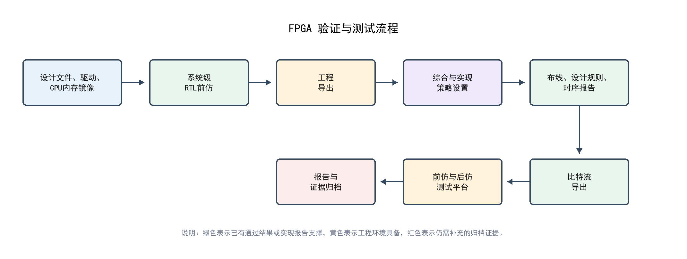

# 基于 PicoRV32 与优化 NPU 的 RTL 仿真及 FPGA 实现验证报告

## 摘要

本报告面向基于 PicoRV32 与优化 NPU 的异构处理器，说明 RTL 功能验证、SoC 集成验证、TensorFlow Lite Micro 推理验证、覆盖率收集和 FPGA 实现检查的方法与结果。验证对象包含 NPU 计算子系统、AXI-Lite 寄存器接口、AXI4 分块DMA、PicoRV32 SoC 集成环境、共享存储、UART 状态输出以及 FPGA 顶层工程。验证工作采用分层组织方式，模块级 testbench 用于确认局部时序和协议行为，NPU 顶层随机测试用于确认完整计算数据通路，SoC 仿真用于确认 CPU 软件配置、共享存储访问和 NPU 执行结果，覆盖率收集用于衡量 RTL 语句触达情况，FPGA 实现检查用于确认综合、布局布线、时序和资源结果。

验证结果表明，NPU 主要功能在已覆盖的配置组合下工作正确。AXI-Lite 寄存器读写、启动控制、完成状态、中断使能、状态写 1 清除、AXI4 读写访问、IA cache 复用、权重装载、bias 装载、WS/IS 数据流、int8/int16 输入解释、per-tensor/per-channel 量化、输出写回和 SoC 软硬件协同均完成验证。模块级 NPU 行覆盖率为 96.71%，SoC 级 NPU 行覆盖率为 95.21%。FPGA 实现检查在 Artix-7 `xc7a200tfbg484-3` 上完成 150 MHz 布局布线，setup WNS 为 +0.398 ns，hold WHS 为 +0.058 ns，设计规则检查为 0 error，比特流已生成。

## 1. 验证对象与目标

### 1.1 验证对象

被验证设计由 PicoRV32 CPU、NPU、AXI 互连、AXI RAM、UART、SoC 控制寄存器和 FPGA 顶层封装组成。CPU 通过 AXI-Lite MMIO 配置 NPU 寄存器，NPU 通过 AXI4 master 端口访问共享 RAM，UART 用于输出软件运行状态，SoC 控制寄存器用于给出仿真结束状态。NPU 内部包含控制器、AXI-Lite 寄存器组、分块DMA、DMA 仲裁器、IA loader、IA cache、kernel loader、bias loader、compute core、partial sum buffer、requant、输出 FIFO 和 OA writer。

本报告的验证范围覆盖 RTL 周期级功能仿真、软件驱动可见接口、NPU 端到端数值结果、SoC 程序运行结果、覆盖率统计和 FPGA 实现结果。门级功能仿真和实物板卡运行不纳入本报告结论，相关内容不作为本报告的通过判据。

| 验证层级 | 被测对象 | 主要验证内容 |
|---|---|---|
| 模块级 | DMA、仲裁器、PS Buffer、Compute Core、寄存器接口 | 局部状态机、握手、计数器、数据排列、反压处理 |
| NPU 顶层 | `npu_top`、`npu_axil_top` | 完整配置、数据搬移、阵列计算、量化、输出写回、完成状态 |
| SoC 级 | PicoRV32、AXI 互连、共享 RAM、UART、NPU | CPU 配置 NPU、共享内存一致性、软件轮询、中断、结束状态 |
| 应用级 | TensorFlow Lite Micro MNIST 推理路径 | 张量布局、量化参数传递、硬件加速路径与软件路径结果一致性 |
| FPGA 实现 | `fpga_top`、Clocking Wizard、SoC/NPU 实现网表 | 综合、布局布线、时序满足、资源占用、设计规则检查 |

### 1.2 验证目标

验证目标首先是确认硬件接口语义与软件驱动一致。AXI-Lite 寄存器组需要支持 CTRL、STATUS、基地址、矩阵维度、stride、zero point、量化参数、激活上下限、复用参数、数据流选择和 ID 寄存器。CTRL 寄存器的启动位必须按单周期脉冲处理，`IRQ_ENABLE` 必须控制中断输出，STATUS 寄存器的 `DONE` 位必须支持写 1 清除，错误码和 ready 状态必须由硬件按任务执行过程更新。

其次，验证目标包括确认 NPU 内部计算数据通路的功能正确性。输入特征、权重、bias 和量化参数由分块DMA 从共享 RAM 读取，IA cache 按分块进行缓存和复用，kernel loader 将权重送入计算阵列，compute core 产生 int32 部分和，PS Buffer 对部分和进行保存与回放，requant 产生 int8 输出，OA writer 通过 DMA 写回共享 RAM。验证需要覆盖整块矩阵、非整块矩阵、尾行、尾列、最小矩阵、不同复用深度、随机内存响应延迟和总线反压。

再次，验证目标包括确认 SoC 运行条件下的软件可见行为。PicoRV32 固件应能够完成 NPU 初始化、寄存器配置、启动、等待完成、读取状态和比较输出。CPU/NPU 共享 RAM 的访问必须保持数据一致性，NPU 工作期间的总线优先级控制不得导致 CPU trap 或系统死锁。TFLM 推理场景需要确认硬件加速路径与纯软件路径在样本预测结果上保持一致。

最后，验证目标包括确认 RTL 覆盖率和 FPGA 可实现性。覆盖率统计以 NPU RTL 为核心对象，行覆盖率目标为 95%。FPGA 实现检查要求 150 MHz 核心时钟下 setup 和 hold 时序满足，设计规则检查无 error，资源占用与实现配置一致，并生成可用比特流。

### 1.3 验证配置

RTL 回归覆盖多个阵列规模、IA cache 分块数、输入数据位宽、数据流模式和量化模式。SoC 级覆盖率配置以阵列规模 16x16、IA cache 总大小为 4 个矩阵分块大小、partial sum buffer 帧数 16 的配置为主，便于同时触达加载、计算、复用和写回控制。FPGA 实现检查采用阵列规模 4x4、IA cache 分块数 32、8 bit 权重、8 bit 输入、NPU 地址宽度 19 bit、CPU RAM 深度 65536 word 的资源裁剪配置，该配置用于确认 FPGA 时序与资源结果，完整功能组合由 RTL 和 SoC 回归覆盖。

| 配置项 | RTL/SoC 验证配置 | FPGA 实现检查配置 |
|---|---|---|
| 阵列规模 | 4x4、8x8、16x16、32x32 等组合 | 4x4 |
| IA cache 分块数 | 2、4、8、16、32、64、256 等组合 | 32 |
| partial sum buffer | 按阵列规模参数化 | 4x4 阵列对应裁剪配置 |
| 输入数据位宽 | int8、int16 | int8 |
| 权重数据位宽 | int8 | int8 |
| 数据流模式 | WS、IS | WS |
| 量化模式 | per-tensor、per-channel | per-tensor |
| AXI 数据宽度 | 32 bit | 32 bit |
| 核心时钟 | 周期级仿真 | 150 MHz |
| 工具 | Verilator、VCS、URG | Vivado |

## 2. 验证平台与检查方法

### 2.1 RTL 验证平台结构

RTL 验证平台按模块级、NPU 顶层和 SoC 级三类环境组织。模块级环境直接驱动 DUT 端口，并在时钟上升沿检查 `valid/ready`、`req/grant`、`start/done`、FIFO 满空、状态机状态、地址计数器、写掩码和输出数据。NPU 顶层环境实例化 NPU、AXI RAM 模型和随机延迟控制，仿真开始前初始化输入内存，仿真结束后对输出区域进行逐字节比较。SoC 级环境实例化 PicoRV32、AXI 互连、共享 RAM、UART 和 NPU，软件通过寄存器配置 NPU，验证平台监视 SoC 完成状态、CPU trap、UART 输出和 UVM 错误计数。


### 2.2 激励与参考模型

模块级定向激励用于覆盖协议端点条件和局部状态切换。DMA 激励包含线性读取、多行 stride 读取、非字对齐地址、随机读响应延迟、写数据反压和写响应延迟；仲裁器激励包含多客户端同时请求、授权保持、请求撤销和读写并行；PS Buffer 激励包含对角输入、行向量恢复、partial sum replay 和 FIFO bypass；Compute Core 激励包含随机输入向量、权重向量、bias、有行列无效标志和 final row 场景。

NPU 顶层随机激励由软件参考模型生成输入矩阵、权重矩阵、bias、zero point、量化乘子、移位、激活上下限和期望输出。参考模型与 RTL 采用相同的数据解释方式，包括 int8/int16 输入扩展、zero point 扣除、int32 累加、乘法、右移、输出 zero point 加法、激活上下限裁剪和 int8 饱和。随机维度覆盖 K、N、M 非整块组合，使阵列行方向、列方向和内积方向均可能出现无效元素。

### 2.3 总线与反压模型

AXI RAM 模型对命令接收、写数据接收和读响应返回插入可配置随机延迟。验证平台在反压期间检查地址、长度、写数据、写掩码、读响应和最后一次传输标志的保持行为。AXI4 写通道要求 `AW`、`W` 和 `B` 通道按协议完成握手，`WLAST` 与突发长度一致，`WSTRB` 与输出有效字节一致。AXI4 读通道要求 `AR` 通道在等待期间保持稳定，`R` 通道在 `RVALID && RREADY` 时完成数据采样，`RLAST` 在最后一次传输时置位。

SoC 总线验证关注 CPU 与 NPU 共享 RAM 访问的互斥关系。NPU 运行期间，互连根据 NPU 工作状态对访问优先级进行控制，防止 CPU 对共享 RAM 的访问干扰 NPU 数据搬移。验证平台检查 CPU 未发生 trap，NPU 能够在超时前完成，输出 RAM 与参考值一致，软件结束状态为正常值。

### 2.4 通过判据

每类验证均采用明确的硬件观察点作为通过判据。模块级验证要求 DUT 在复位释放后进入确定初始状态，启动采样后产生规定状态转移，反压期间输出保持稳定，完成条件满足后产生单周期或粘滞完成标志，输出数据与参考模型一致。NPU 顶层验证要求任务完成、错误码为 0、输出 RAM 与期望结果一致、状态寄存器按规则更新。SoC 验证要求 `soc_finish` 在超时前有效、`soc_status` 表示正常结束、`cpu_trap` 保持无效、UVM 错误和严重错误计数为 0。覆盖率验证要求 NPU RTL 行覆盖率达到 95%。FPGA 实现检查要求时序报告无 setup/hold 违例，设计规则检查无 error，比特流生成完成。

## 3. 寄存器与中断验证

### 3.1 AXI-Lite 访问语义

NPU 配置接口采用 AXI-Lite MMIO 访问方式，软件通过标准读写事务配置寄存器。验证平台对地址译码、写使能、读返回、只读字段、写 1 清除字段和启动脉冲进行检查。寄存器写入在 AXI-Lite 写地址和写数据事务均完成后更新，读数据在读请求被采样后返回。对只读状态位，软件写入不得改变硬件状态；对写 1 清除位，软件写入 1 后状态位在下一个可见周期清除，写入 0 不产生影响。

| 寄存器 | 字段 | 属性 | 验证内容 |
|---|---|---|---|
| `NPU_REG_CTRL` | bit0 `START` | 写触发 | 启动脉冲只被采样一次，任务运行期间重复启动不覆盖当前任务 |
| `NPU_REG_CTRL` | bit1 `CFG_16BITS_IA` | 读写 | 控制输入激活按 int16 或 int8 解释 |
| `NPU_REG_CTRL` | bit2 `PER_CHANNEL` | 读写 | 控制量化参数按 per-channel 或 per-tensor 模式使用 |
| `NPU_REG_CTRL` | bit3 `DATAFLOW_IS` | 读写 | 控制 IS/WS 数据流选择 |
| `NPU_REG_CTRL` | bit4 `IRQ_ENABLE` | 读写 | 完成状态有效且中断使能为 1 时拉高中断输出 |
| `NPU_REG_STATUS` | bit0 `SA_READY` | 只读 | 复位后为 1，任务运行期间为 0，完成后恢复为 1 |
| `NPU_REG_STATUS` | bit1 `BUSY` | 只读 | 控制器非空闲期间为 1 |
| `NPU_REG_STATUS` | bit2 `DONE` | 只读/写 1 清除 | 任务完成后置位，软件写 1 后清除 |
| `NPU_REG_STATUS` | bits4:3 `ERR_MASK` | 只读 | AXI 或控制错误时保存错误码 |
| `NPU_REG_STATUS` | bit5 `REG_READY` | 只读 | 寄存器组可访问状态 |
| 地址与尺寸寄存器 | base、K/N/M、stride | 读写 | 地址、维度和跨度在启动时被硬件采样 |
| 量化寄存器 | zero point、mult、shift、clip | 读写 | 量化参数参与 requant 结果计算 |
| `NPU_REG_ID` | 固定 ID | 只读 | 读值固定为 `0x4e50_5531` |

### 3.2 启动、完成与中断检查

启动验证采用定向寄存器读写和 SoC C 程序两类场景。复位释放后，软件先写入基地址、维度、stride、zero point、量化参数和模式字段，再清除历史 `DONE` 位，最后写入 CTRL 寄存器启动任务。验证平台检查 `START` 只形成单周期内部启动请求，配置寄存器在任务运行期间保持稳定，控制器由空闲状态进入初始化状态，`BUSY` 拉高且 `SA_READY` 拉低。

完成验证检查三类可见行为。第一，NPU 完成后 `DONE` 置位，`BUSY` 清零，`SA_READY` 恢复为高，错误码保持 0。第二，当 `IRQ_ENABLE=1` 且 `DONE` 处于置位状态时，`irq` 输出为高；当软件对 `DONE` 写 1 清除后，`irq` 随完成状态清除而拉低。第三，软件再次启动任务前必须能够读取到清除后的状态，避免历史完成状态影响下一次任务判断。上述行为已经通过 AXI-Lite 寄存器定向测试、NPU 计算测试和 SoC 程序测试共同检查。

## 4. 模块级验证

### 4.1 分块DMA 验证

分块DMA 包含读引擎和写引擎。读引擎接收起始地址、行跨度、读取行数、有效列数、突发长度、slot id、输入位宽和 zero point 参数，产生 AXI4 `AR` 请求并对返回数据进行解包。写引擎接收输出起始地址、行跨度、写回行数、突发长度以及来自输出 FIFO 的数据和字节有效标志，产生 AXI4 `AW/W/B` 写事务。验证时分别构造线性访问、多行访问、非字对齐访问、随机反压和错误响应场景。

读侧检查点包括 `rd_busy` 的保持周期、`rd_done` 的产生时刻、读地址稳定性、读长度与 `RLAST` 的一致性、int8/int16 解包位置、有效元素标志和 zero point 扣除。写侧检查点包括 `wr_busy` 的保持周期、`wr_done` 的产生时刻、写地址与行跨度递增、`WSTRB` 与输出有效字节一致、`WLAST` 与写传输长度一致、反压期间写数据保持不变。非字对齐访问场景重点检查有效字节选择，不以完整 32 bit 数据字作为唯一比较对象。

### 4.2 DMA 仲裁器验证

DMA 仲裁器将 IA、kernel、bias、quant 四类读客户端复用到一个读 DMA，并将 OA writer 独立连接到写 DMA。读请求优先级按 kernel、quant、IA、bias 排列。仲裁器在选择客户端后保持授权，直到被授权客户端完成当前请求；已授权请求不会被新到达的高优先级请求打断。写通道独立处理输出写回请求，可与读通道并行工作。

验证平台构造多客户端同时请求、请求撤销、授权保持和读写并行场景。检查内容包括同一周期只能有一个读客户端获得授权，被授权客户端的地址和传输参数正确送入 DMA，未获授权客户端不得产生误完成，OA 写回在读 DMA 活跃期间仍可被授权。该验证确认仲裁器在请求选择、授权保持、完成回传和读写并行方面满足设计要求。

### 4.3 IA Loader 与 IA Cache 验证

IA loader 负责从共享 RAM 加载输入激活分块，并通过 IA cache 向计算阵列提供输入向量。控制信号包含初始化配置、加载授权、发送触发、计算完成和部分和计算完成标志；输出信号包含加载请求、输入有效、行有效、tile 起始、初始化数据标志、发送完成、cache 切换、bias 休眠和 bias 切换标志。IA cache 验证关注分块写入、slot 分配、复用组切换和未消费数据保护。

验证平台通过随机维度和不同 cache 分块数覆盖整块、尾行、尾列和复用场景。检查点包括 `load_ia_req` 与授权握手、cache slot 在当前分块被消费后释放、`ia_data_valid` 与 `ia_row_valid` 对齐、`ia_tile_start` 只在分块起始周期有效、反压期间输出向量保持稳定、`ia_sending_done` 只在有效行全部发送后产生。输出结果比较可间接发现 cache 覆盖、slot 切换提前、无效元素未清零和复用组选择错误。

### 4.4 Kernel Loader 与 Bias Loader 验证

Kernel loader 负责从共享 RAM 加载权重并送入计算阵列。验证关注权重加载请求、授权握手、权重发送触发、权重存储请求、权重数据有效和发送完成信号。随机用例覆盖 N 小于阵列列数、K 非整块和权重复用窗口变化，要求权重只在阵列允许写入时更新，权重发送完成后控制器才进入后续计算阶段。

Bias loader 负责读取 bias 和 per-channel 参数分组，并向计算和量化单元提供列方向参数。验证关注 `bias_valid`、`bias_group_valid`、`load_bias_req`、`load_bias_done`、bias 输出数组和组切换标志。当 `bias_base=0` 时，硬件应采用确定的零偏置行为；当 per-channel 量化启用时，bias 与量化参数应按输出列分组读取。顶层随机比较和 SoC 覆盖率用例共同检查 bias 读取、参数分组、尾列有效数和量化结果。

### 4.5 Compute Core 与 Partial Sum Buffer 验证

Compute Core 包含输入选择、WS/IS 数据流控制、脉动阵列、bias 选择、尾块有效标志和部分和输出控制。验证平台随机生成输入向量、权重向量、bias 和有效行列标志，检查 `ia_row_valid`、`ia_tile_start`、`ia_is_init_data`、`store_weight_req`、`weight_data_valid`、`bias_valid`、`acc_data_valid`、`tile_calc_over` 和 `acc_data_out` 之间的周期关系。final row 场景要求最后一个有效输出完整产生，`tile_calc_over` 不得提前或遗漏。

Partial Sum Buffer 负责保存计算阵列产生的部分和，并在需要时进行回放。脉动阵列输出按对角顺序到达，PS Buffer 需要恢复为行向量供 requant 使用。验证平台输入带无效元素的部分和，检查行列位置、有效标志、帧切换和 replay 顺序。FIFO bypass 场景要求无需缓存回放时仍满足 `valid/ready` 语义，反压期间输出数据、有效标志和 tile 完成标志保持稳定。

### 4.6 Requant、输出 FIFO 与 OA Writer 验证

Requant 单元对 int32 累加结果执行乘法、移位、输出 zero point 加法、激活上下限裁剪和 int8 饱和。验证用例覆盖 per-tensor 固定参数、per-channel 参数读取、激活下限命中、激活上限命中、输出零点偏移和尾列有效数。检查点包括输入有效采样、参数装载完成、输出有效产生、tile 完成标志和输出数组数值。

输出 FIFO 将 int8 向量打包为 32 bit 写回数据，并生成字节有效标志。OA writer 根据输出基地址、行跨度、有效行数和有效列数发起 DMA 写回。验证平台检查 FIFO 满空、写数据保持、字节有效标志、写回地址递增、输出行切换和 DMA 完成。NPU 顶层内存比较对写回地址、写掩码、排空周期和输出顺序进行最终确认。

## 5. NPU 顶层与 SoC 验证

### 5.1 NPU 顶层随机验证

NPU 顶层验证平台在复位释放后写入矩阵基地址、维度、stride、zero point、量化参数、激活范围、数据流模式和输入位宽配置，然后拉高启动信号一个周期。仿真过程中，RAM 模型响应 NPU 的 AXI4 读写请求，并插入随机命令延迟、写数据延迟和读响应延迟。测试平台等待 NPU 完成后读取输出区域，与参考模型逐字节比较。

该验证覆盖 IA cache 装载、kernel 装载、bias 装载、DMA 仲裁、阵列计算、partial sum replay、requant、输出 FIFO 和 OA writer。由于检查对象为共享 RAM 中的软件可见结果，接口错位、地址递增错误、尾块有效标志错误、量化参数错误和写掩码错误均会表现为输出字节差异。随机用例在不同 K/N/M、int8/int16、WS/IS 和 per-channel 组合下执行，能够确认 NPU 端到端数据通路的功能正确性。

| 验证项目 | 覆盖内容 | 结果 |
|---|---|---|
| 顶层基础随机用例 | 非整块矩阵、RAM 随机延迟、输出 RAM 比较 | 2/2 PASS |
| SoC C 基础回归 | CPU 配置 NPU、共享 RAM 比较、结束状态检查 | 3/3 PASS |
| int8 参数回归 | WS/IS、复用深度、per-tensor/per-channel、随机尺寸 | 24/24 PASS |
| int16 参数回归 | int16 输入解释、WS/IS、复用深度、随机尺寸 | 24/24 PASS |
| 固定 IA cache 容量扫描 | 4x4/8x8/16x16/32x32 阵列与多种矩阵尺寸 | 12/12 PASS |
| 关键 SoC 组合 | 4x4 FPGA 裁剪配置与 16x16 参考配置 | 2/2 PASS |


### 5.2 SoC 程序验证

SoC 程序验证由 PicoRV32 执行 C 程序完成。程序向共享 RAM 写入输入数据和参考数据，通过 AXI-Lite 寄存器配置 NPU，启动任务后轮询 STATUS 寄存器的 `DONE` 位，并在完成后比较输出区域。验证平台同时监视 `soc_finish`、`soc_status`、`cpu_trap`、UART 输出和 UVM 错误计数。

SoC 验证检查了软件驱动和硬件寄存器语义的一致性。CTRL 寄存器中的 `IRQ_ENABLE` 与启动位一起写入，中断输出在 NPU 完成后置位；软件对 STATUS 的 `DONE` 写 1 后，中断输出撤销。共享 RAM 同时承载 CPU 指令、数据、NPU 输入、权重、bias、量化参数和输出，验证结果确认地址映射、字节写掩码、CPU/NPU 访问优先级和软件可见状态满足设计要求。

| 观察项 | 验证要求 | 结果 |
|---|---|---|
| `soc_finish` | 在超时前拉高 | PASS |
| `soc_status` | 正常结束值 | PASS |
| `cpu_trap` | 保持无效 | PASS |
| UVM 错误计数 | `UVM_ERROR=0`、`UVM_FATAL=0` | PASS |
| NPU 中断 | 完成后置位，清除 `DONE` 后撤销 | PASS |
| 输出 RAM | 与参考结果一致 | PASS |

### 5.3 TFLM MNIST 软硬件对比验证

TFLM MNIST 验证采用相同样本分别执行硬件加速路径和纯软件路径。硬件路径由软件栈配置 NPU 完成矩阵计算，纯软件路径在 CPU 上执行同等计算。两条路径均完成 3 个样本的推理，预测标签与参考标签一致。该验证说明张量数据布局、量化参数传递、NPU 输出布局和上层推理流程之间保持一致。

| 路径 | 样本数 | 预测结果 | 总周期 | 平均周期 | 结果 |
|---|---:|---|---:|---:|---|
| NPU 加速路径 | 3 | label/pred 一致 | 479777 | 159925 | PASS |
| 纯软件路径 | 3 | label/pred 一致 | 15343242 | 5114414 | PASS |

TFLM 场景同时记录 NPU 工作周期、IA 行发送、累加有效、requant 有效、FIFO 有效、DMA 忙状态和 AXI 通道活动等计数器。计数器结果用于分析数据供给与计算阵列利用情况，不作为数值正确性的唯一判据。数值正确性仍以推理输出和样本预测一致性为准。

## 6. 覆盖率收集与分析

### 6.1 覆盖率收集方法

覆盖率收集使用 VCS 插桩仿真和 URG 汇总。统计对象限定为 NPU 加速器 RTL，不将 PicoRV32、UART 和通用 RAM 模型计入 NPU 行覆盖率分母。覆盖率用例包含 AXI-Lite 寄存器定向读写、寄存器启动、WS/IS 数据流、int8/int16 输入、per-channel 量化、最小矩阵、尾块矩阵、激活截断、非字对齐访问、RAM 随机响应延迟和 SoC 运行场景。


### 6.2 覆盖率结果

| 覆盖率类别 | 编译项 | 运行项 | 行覆盖率 | 条件覆盖率 | 分支覆盖率 | 状态机覆盖率 | 翻转覆盖率 | 综合辅助指标 |
|---|---:|---:|---:|---:|---:|---:|---:|---:|
| 模块级 NPU 覆盖率 | 2 | 24 | 96.71% | 82.78% | 82.35% | 57.10% | 52.67% | 74.32% |
| SoC 级 NPU 覆盖率 | 1 | 21 | 95.21% | 82.17% | 80.77% | 62.72% | 45.13% | 73.20% |


模块级和 SoC 级 NPU 行覆盖率均达到 95% 目标。条件覆盖率和分支覆盖率低于行覆盖率，主要原因是 RTL 中存在错误响应分支、调试配置分支、可选特性分支和参数化生成结构。状态机覆盖率和翻转覆盖率较低，主要原因是宽数据总线、乘法器输入位、未使用配置组合以及 AXI 错误响应状态没有在正常推理路径中完全触发。上述辅助指标用于定位后续补充用例，不作为本轮行覆盖率目标的阻塞条件。

### 6.3 覆盖缺口分析

覆盖缺口集中在异常响应、运行中复位、极限反压和调试配置。正常推理场景不会主动产生 AXI `SLVERR/DECERR`，因此控制器 `ERROR` 状态、错误码更新和部分错误恢复路径覆盖不足。运行中复位未作为常规回归项，因此任务执行期间 FIFO、DMA outstanding、状态寄存器和中断状态的复位恢复仍需专项验证。极限反压场景已通过随机延迟覆盖部分组合，但持续满 FIFO、持续无读响应和写响应长期延迟仍可继续增加定向用例。

覆盖率补充方向包括 AXI 错误响应注入、非法 AXI-Lite 地址访问、运行中复位、OA writer FIFO 满空交替、IS 模式输出排空、per-channel 参数读取被 RAM 延迟打断、非字对齐基地址与非字对齐 stride 组合、NPU 工作结束后 CPU 访问恢复等。上述补充项不会改变已验证功能结论，但可提高异常和极端时序场景的结构覆盖深度。

## 7. FPGA 实现检查

### 7.1 FPGA 顶层结构

FPGA 顶层 `fpga_top` 保留板级输入时钟、低有效复位、UART 接收/发送和用户 LED 输出。Clocking Wizard 将 50 MHz 输入时钟转换为 150 MHz SoC/NPU 核心时钟，复位逻辑在时钟稳定后释放 SoC 复位。SoC 内部实例化 PicoRV32、CPU AXI 桥、AXI 互连、共享 RAM、UART、SoC 控制寄存器和 NPU AXI-Lite 封装。

#### 7.1.1 FPGA 顶层 LED 功能定义

FPGA 顶层将 SoC 和 NPU 的关键状态直接映射到 4 bit 用户 LED 输出 `user_led_tri_o[3:0]`。该输出用于板级调试、Vivado 前仿观察和实现后功能仿真检查。LED 信号均为高有效，其中 `user_led_tri_o[1]` 和 `user_led_tri_o[2]` 是仿真通过与失败判定的核心观察点，`user_led_tri_o[0]` 和 `user_led_tri_o[3]` 用于辅助判断 NPU 运行阶段和状态变化。

| LED 位 | RTL 连接 | 高有效含义 | 验证用途 |
|---|---|---|---|
| `user_led_tri_o[0]` | `npu_busy` | NPU 控制器处于任务运行状态，正在执行配置采样、DMA 访问、阵列计算、量化或输出写回 | 用于确认 CPU 已成功启动 NPU，并辅助定位任务是否长时间停留在 NPU 执行阶段 |
| `user_led_tri_o[1]` | `soc_finish` | 固件已经向 SoC 控制寄存器写入结束状态，系统测试流程完成 | Vivado 前仿和后仿的主要通过观察点；该位在超时前拉高且 `cpu_trap` 保持低电平时，表示 FPGA 顶层测试完成 |
| `user_led_tri_o[2]` | `cpu_trap` | PicoRV32 进入 trap 状态，可能由非法指令、异常访问或固件异常结束触发 | Vivado 前仿和后仿的失败观察点；该位一旦拉高，测试平台立即判定失败 |
| `user_led_tri_o[3]` | `^soc_status ^ npu_irq` | `soc_status` 的按位异或结果与 NPU 中断状态的异或，用作状态变化辅助指示 | 用于观察结束状态和 NPU 完成中断的组合变化，不作为单独通过或失败判据 |

在当前顶层实现中，LED 映射关系如下：

```systemverilog
assign user_led_tri_o[0] = npu_busy;
assign user_led_tri_o[1] = soc_finish;
assign user_led_tri_o[2] = cpu_trap;
assign user_led_tri_o[3] = ^soc_status ^ npu_irq;
```

Vivado behavioral 前仿 testbench 对上述 LED 采用明确的判定规则：复位释放后持续监视 `user_led_tri_o[3:0]`，若 `user_led_tri_o[2]` 拉高则立即报告 CPU trap 失败；若 `user_led_tri_o[1]` 拉高，则等待若干排空周期后再次确认 `user_led_tri_o[2]` 仍为低电平，并结合 `soc_status` 输出正常结束值后报告通过；若在最大仿真周期内未观察到 `user_led_tri_o[1]` 拉高，则报告超时。`user_led_tri_o[0]` 和 `user_led_tri_o[3]` 会随 NPU 忙状态、NPU 中断和结束状态变化而翻转，可用于分析程序是否已经进入硬件加速计算阶段。



| 层级 | 主要实例 | 检查内容 |
|---|---|---|
| `fpga_top` | Clocking Wizard、复位同步、`soc_top` | 时钟生成、复位释放、板级端口连接 |
| CPU 子系统 | PicoRV32、CPU AXI 桥、指令 cache | 指令读取、数据访问、trap 状态 |
| AXI 互连 | CPU/NPU/RAM/UART/控制寄存器互连 | 地址译码、访问仲裁、NPU 工作期间访问优先级 |
| NPU 封装 | AXI-Lite 寄存器、AXI4 master、NPU 核心 | 配置访问、数据搬移、计算完成、中断 |
| 共享 RAM | AXI RAM | 初始化内容、字节写掩码、读写一致性 |
| UART 与 LED | UART、状态输出 | 软件状态输出、完成状态观测 |

### 7.2 Vivado 前仿与实现检查

FPGA behavioral 前仿以 `fpga_top` 为 DUT，输入 50 MHz `sys_clk`，由 Clocking Wizard 仿真模型产生 150 MHz 核心时钟。测试平台监视用户 LED、SoC 完成状态和 trap 状态。前仿结果显示程序完成，状态值为正常结束，trap 未拉高。该仿真用于确认 FPGA 顶层端口、时钟复位、RAM 初始化和 SoC 状态输出与 RTL 配置一致。

Vivado 实现检查采用综合、布局、布线、时序报告、设计规则检查和比特流生成流程。实现结果在 Artix-7 `xc7a200tfbg484-3` 上满足 150 MHz 时序要求，布线状态为 fully routed，设计规则检查无 error，比特流生成完成。FPGA 实现检查不替代 RTL 功能验证，其作用是确认裁剪配置在目标器件和目标时钟下具备可实现性。

### 7.3 时序结果

150 MHz 核心时钟周期为 6.667 ns。布局布线后的 setup 与 hold 时序均满足要求。

| 指标 | 数值 |
|---|---:|
| WNS | +0.398 ns |
| TNS | 0.000 ns |
| setup failing endpoints | 0 |
| WHS | +0.058 ns |
| THS | 0.000 ns |
| hold failing endpoints | 0 |
| WPWS | +2.283 ns |


### 7.4 资源结果

FPGA 裁剪配置在目标器件上的资源占用如下。资源结果与设计参数匹配，DSP 使用量主要来自 4x4 计算阵列和 requant 乘法，BRAM 使用量主要来自共享 RAM、IA cache、权重缓存和 partial sum buffer。

| 资源 | Used | Available | Utilization |
|---|---:|---:|---:|
| Slice LUTs | 10089 | 134600 | 7.50% |
| Slice Registers | 10788 | 269200 | 4.01% |
| Block RAM Tile | 71 | 365 | 19.45% |
| DSPs | 32 | 740 | 4.32% |
| Bonded IOB | 8 | 285 | 2.81% |
| BUFGCTRL | 2 | 32 | 6.25% |
| MMCME2_ADV | 1 | 10 | 10.00% |


主要层次模块资源如下。

| 层次模块 | Total LUTs | FFs | RAMB36 | RAMB18 | DSP |
|---|---:|---:|---:|---:|---:|
| `fpga_top` | 10089 | 10788 | 66 | 10 | 32 |
| `u_soc_top` | 10088 | 10785 | 66 | 10 | 32 |
| `u_npu_axil_top` | 5754 | 6308 | 2 | 9 | 32 |
| `u_npu_top` | 5283 | 5604 | 2 | 9 | 32 |
| `u_picorv32` | 1793 | 1024 | 0 | 0 | 0 |
| `u_axi_sim_ram` | 1242 | 187 | 64 | 0 | 0 |
| `u_pico_axi_bridge` | 637 | 1693 | 0 | 1 | 0 |
| `u_axi_interconnect` | 187 | 94 | 0 | 0 | 0 |
| `u_soc_uart` | 129 | 206 | 0 | 0 | 0 |
| `u_soc_ctrl` | 80 | 140 | 0 | 0 | 0 |


NPU 内部主要模块资源如下。

| NPU 子模块 | Total LUTs | FFs | RAMB36 | RAMB18 | DSP |
|---|---:|---:|---:|---:|---:|
| `u_vec_requant` | 1601 | 1565 | 0 | 0 | 16 |
| `u_ia_loader` | 1124 | 779 | 0 | 4 | 0 |
| `u_kernel_loader` | 643 | 710 | 0 | 4 | 0 |
| `u_block_dma_arbiter` | 485 | 309 | 0 | 0 | 0 |
| `u_bias_loader` | 470 | 497 | 0 | 0 | 0 |
| `u_oa_writer` | 425 | 323 | 0 | 0 | 0 |
| `u_compute_core` | 296 | 521 | 2 | 0 | 16 |


## 8. 验证结论

本次验证覆盖了 NPU 模块级功能、NPU 顶层端到端计算、PicoRV32 SoC 软件协同、TFLM MNIST 推理、代码覆盖率和 FPGA 实现检查。模块级验证确认 DMA、仲裁器、IA cache、权重装载、bias 装载、计算阵列、PS Buffer、requant、输出 FIFO 和 OA writer 的局部行为满足设计要求。顶层与 SoC 验证确认软件配置、共享 RAM 数据搬移、NPU 计算、状态寄存器、中断和输出写回在已覆盖组合下功能正确。

覆盖率方面，模块级 NPU 行覆盖率为 96.71%，SoC 级 NPU 行覆盖率为 95.21%，达到 95% 的行覆盖目标。FPGA 实现方面，资源裁剪配置在 Artix-7 `xc7a200tfbg484-3` 上完成 150 MHz 布局布线，setup 和 hold 时序满足要求，设计规则检查无 error，比特流生成完成。

剩余验证工作主要集中在异常和极端时序场景，包括 AXI 错误响应注入、运行中复位、持续反压、非法寄存器访问、复杂非字对齐写回组合和门级功能仿真。上述场景不影响本报告对已覆盖功能组合的结论，但属于后续提高结构覆盖深度和异常处理可信度的补充方向。
