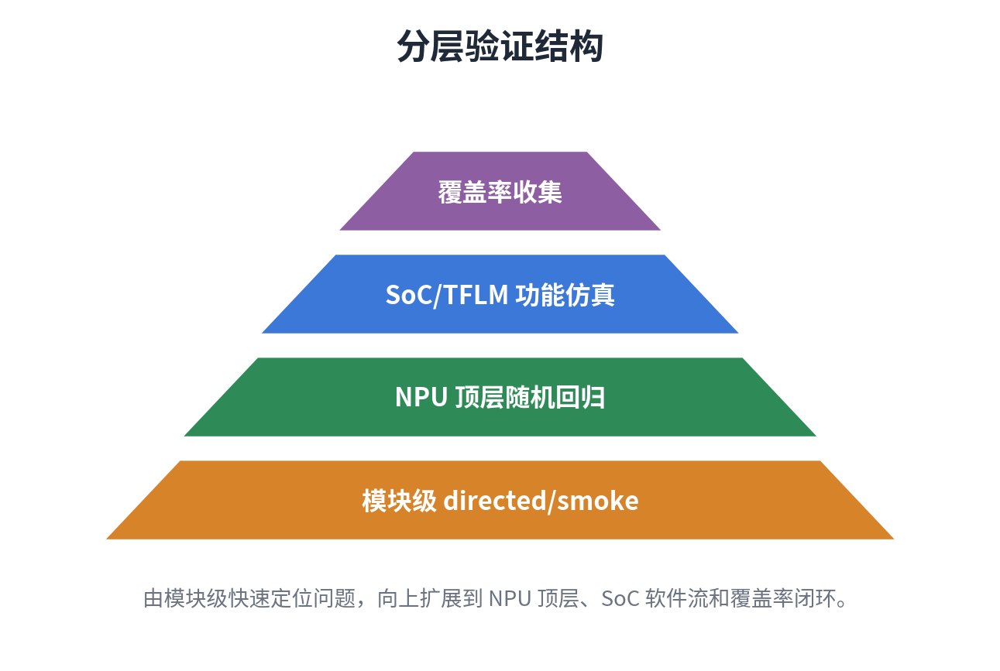
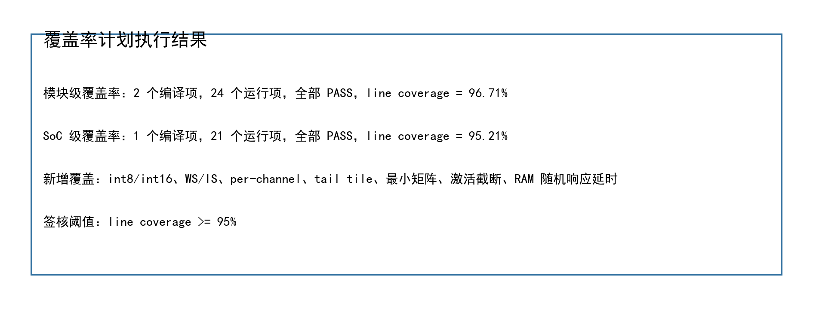
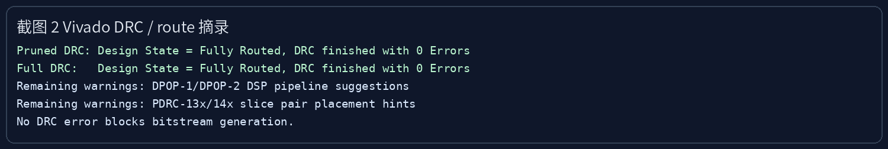
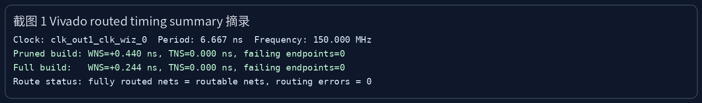
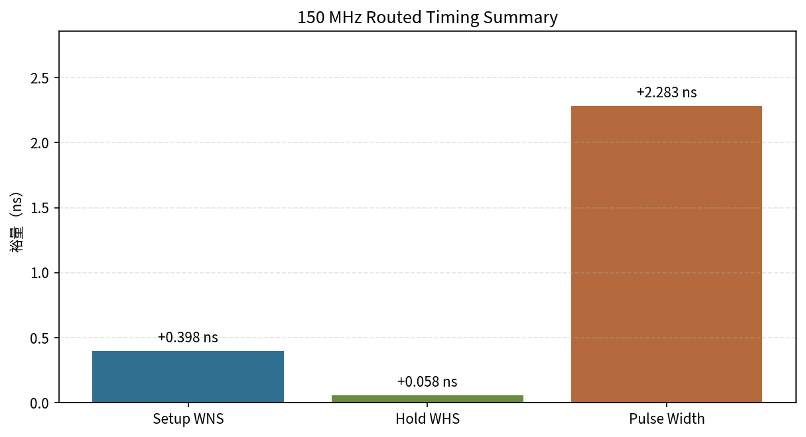
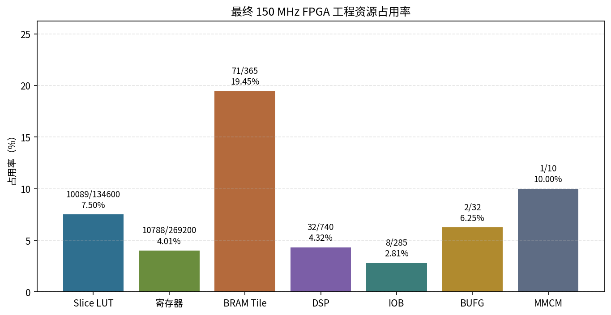
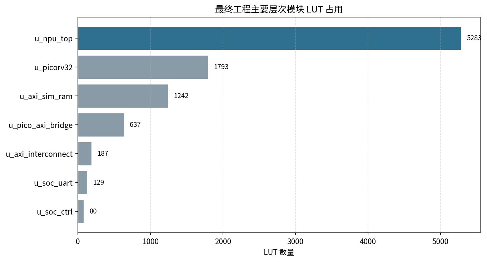

# TFLM AI DSA NPU RTL 仿真与 FPGA 实现验证报告

| 文档项 | 内容 |
|---|---|
| 文档名称 | TFLM AI DSA NPU RTL 仿真与 FPGA 实现验证报告 |
| 验证对象 | NPU RTL、AXI-Lite 配置接口、AXI4 DMA 数据访问、PicoRV32 SoC 集成环境、150 MHz FPGA 裁剪工程 |
| RTL 仿真工具 | Verilator 5.040、Synopsys VCS W-2024.09-SP1、URG W-2024.09-SP1 |
| FPGA 工具 | Vivado 2024.2.1 |
| FPGA 器件 | Xilinx Artix-7 `xc7a200tfbg484-3` |
| 报告日期 | 2026-07-05 |
| 报告状态 | RTL 模块级仿真、NPU 顶层随机仿真、SoC 功能仿真、TFLM/NMSIS-NN 推理仿真、覆盖率收集、Vivado behavioral 前仿、综合实现、bitstream 生成、150 MHz routed timing 和分模块资源统计均已完成；post-implementation functional 后仿未纳入通过判据 |

## 1. 验证结论摘要

验证范围覆盖 NPU RTL 功能验证、SoC 集成验证、应用级推理验证、覆盖率收集和 FPGA 工程实现检查。RTL 验证包含模块级 directed/smoke 用例、NPU 顶层随机 golden compare、PicoRV32 SoC C 程序功能仿真、TFLM/NMSIS-NN 推理仿真和 VCS 覆盖率收集。FPGA 验证包含 Vivado behavioral 前仿、综合、布局布线、route/DRC、150 MHz routed timing、资源利用率和 bitstream 生成。

验证结果表明，NPU 在已覆盖配置组合下满足功能要求。NPU 顶层随机 smoke 用例 2/2 通过，SoC C 基础回归 3/3 通过，int8 参数回归 24/24 通过，int16 参数回归 24/24 通过，固定 IA cache 容量扫描 12/12 通过，关键 SoC 组合 2/2 通过。覆盖率方面，模块级 NPU line coverage 为 `96.71%`，SoC 级 NPU line coverage 为 `95.21%`，均达到 95% 目标。FPGA 裁剪工程完成 150 MHz routed 实现，setup WNS 为 `+0.398 ns`，hold WHS 为 `+0.058 ns`，route fully routed，DRC 为 0 error，`fpga_top.bit` 已生成。

| 验证项目 | 结果 | 结论 |
|---|---:|---|
| 模块级 directed/smoke 仿真 | DMA、arbiter、PS Buffer、Compute Core、NPU Top 均通过 | 通过 |
| NPU 顶层随机功能仿真 | 2/2 通过 | 通过 |
| SoC C 程序基础回归 | 3/3 通过 | 通过 |
| int8 参数回归 | 24/24 通过 | 通过 |
| int16 参数回归 | 24/24 通过 | 通过 |
| 固定 IA cache 容量扫描 | 12/12 通过 | 通过 |
| 关键 SoC 组合 | 2/2 通过 | 通过 |
| TFLM/NMSIS-NN MNIST 推理 | 硬件执行方式与纯软件执行方式均完成 3 个样本预测 | 通过 |
| 模块级 NPU line coverage | 96.71% | 通过 |
| SoC 级 NPU line coverage | 95.21% | 通过 |
| Vivado behavioral 前仿 | `soc_finish` 于 675397 个 50 MHz sys_clk 周期拉高，`cpu_trap=0` | 通过 |
| 150 MHz routed timing | WNS `+0.398 ns`，WHS `+0.058 ns` | 通过 |
| Route/DRC/bitstream | fully routed，DRC 0 error，bitstream 已生成 | 通过 |
| Post-implementation functional 后仿 | 未形成通过结果 | 未纳入通过判据 |
| 实物板卡运行 | 未纳入验证范围 | 不纳入验证结论 |

## 2. 被测对象、范围与配置

### 2.1 被测对象

被测设计由 PicoRV32 CPU、CPU native-to-AXI 桥、AXI 互连、AXI RAM、UART、SoC 控制寄存器、NPU AXI-Lite 外设封装和 NPU 计算核心组成。CPU 通过 AXI-Lite MMIO 配置 NPU 寄存器，NPU 通过 AXI4 master 端口访问共享 RAM。NPU 内部包含控制器、配置流水、分块 DMA、DMA 仲裁器、IA loader/cache、kernel loader、bias loader、compute core、partial sum buffer、requant、int8 输出 FIFO 和 OA writer。

| 类别 | 主要模块 | 验证重点 |
|---|---|---|
| SoC 顶层 | `soc_top`、PicoRV32、`pico_native_to_axi`、`soc_axi_interconnect`、`soc_axi_ram` | CPU 取指与数据访问、地址译码、共享 RAM 访问、UART/控制寄存器状态 |
| NPU 外设接口 | `npu_axil_top`、`npu_axil_reg_if` | AXI-Lite 读写、配置寄存器、start 脉冲、busy/done/error、IRQ、写 1 清除 |
| NPU 控制与 DMA | `npu_top`、`npu_controller`、`axi_block_dma_arbiter`、`axi_dual_block_dma` | 配置采样、任务调度、读写客户端仲裁、AXI4 burst、反压保持 |
| 输入与参数加载 | `ia_loader`、`kernel_loader`、`bias_loader`、IA cache | 输入分块、权重装载、bias/quant 参数读取、tail tile、复用窗口 |
| 计算与部分和 | `compute_core`、systolic cell、partial sum buffer | WS/IS 数据流、int8/int16 输入解释、bias/partial sum 选择、无效 lane 屏蔽 |
| 重量化与写回 | `vec_requant`、`vec_s8_to_fifo`、`oa_writer` | per-tensor/per-channel requant、饱和裁剪、字节打包、`WSTRB`、等待 B 响应 |
| FPGA 顶层 | `fpga_top`、Clocking Wizard、UART、LED | 50 MHz 输入时钟、150 MHz 核心时钟、复位释放、板级端口、可观察状态 |

### 2.2 验证范围

验证范围包括 RTL 周期级功能仿真、软件驱动可见接口、NPU 端到端数值结果、SoC 程序运行、NPU RTL line coverage 和 FPGA 150 MHz 可实现性检查。post-implementation functional 后仿未形成通过结果，未纳入通过判据；实物板卡下载、板级 UART 输出、功耗分析和门级时序仿真不纳入验证结论。

FPGA 最终工程为资源裁剪功能工程，用于验证板级资源、150 MHz 时序、AXI 访问、NPU int8 WS 推理通路和 UART 状态输出。完整功能组合，包括 IS 模式、per-channel 量化和 int16 输入方式，由 RTL/SoC 回归覆盖。

### 2.3 关键配置

| 配置项 | RTL/SoC 回归覆盖 | FPGA 最终工程 |
|---|---|---|
| 阵列规模 `SIZE` | 4x4、8x8、16x16、32x32 等组合 | 4x4 |
| IA cache 分块数 | 2、4、8、16、32、64、256 等组合 | 32 |
| partial sum buffer | 按阵列规模参数化 | 4x4 阵列裁剪配置 |
| 输入位宽 | int8、int16 | int8 |
| 权重位宽 | int8 | int8 |
| 数据流 | WS、IS | WS |
| 量化模式 | per-tensor、per-channel | per-tensor |
| AXI 数据宽度 | 32 bit | 32 bit |
| NPU 内部地址宽度 | 参数化覆盖 | 19 bit |
| CPU RAM 深度 | SoC 仿真与 FPGA 工程保持一致 | 65536 word |
| CPU 指令 cache | SoC/FPGA 配置覆盖 | 使能 |
| 核心时钟 | RTL 仿真按周期统计 | 150 MHz |

## 3. 验证方法与通过判据

### 3.1 分层验证平台

验证平台分为模块级、NPU 顶层、SoC 级、应用级和 FPGA 工程级五层。模块级环境直接驱动 DUT 端口，并检查局部时序、状态转移和数据变换。NPU 顶层环境实例化 NPU、AXI RAM 模型和随机延迟模型，以共享 RAM 输出区域进行 golden compare。SoC 级环境实例化 PicoRV32、AXI 互连、共享 RAM、UART 和 NPU，软件通过寄存器配置 NPU。应用级验证使用 TFLM/NMSIS-NN 调用方式检查推理结果。FPGA 工程级验证检查前仿、实现、时序、资源和 bitstream。

| 验证层级 | 激励形式 | 主要观察点 | 通过条件 |
|---|---|---|---|
| 模块级 | Directed/random TB | `valid/ready`、`req/grant`、状态机、地址计数器、数据输出 | 端口协议满足，局部数据与参考一致，未发生超时 |
| NPU 顶层 | 随机矩阵、配置存储镜像、golden 输出 | NPU done/error、AXI RAM 输出区域 | 完成且 error 为 0，输出 RAM 逐字节匹配 golden |
| SoC 级 | PicoRV32 C 程序 | `soc_finish`、`soc_status`、`cpu_trap`、UART、UVM error | 正常结束，trap 为 0，UVM error/fatal 为 0 |
| 应用级 | TFLM/NMSIS-NN MNIST 样本 | label/pred、总周期、NPU 活动计数 | 硬件执行方式与软件执行方式预测一致 |
| FPGA 工程级 | Vivado 前仿与实现流程 | LED、routed timing、route/DRC、bitstream | behavioral 前仿通过，timing/route/DRC 满足条件，bitstream 生成 |

### 3.2 激励与参考模型

模块级 directed 激励覆盖协议端点条件和局部状态切换。DMA 用例覆盖线性读取、多行 stride、非字对齐地址、随机读响应延迟、写数据反压和写响应延迟。仲裁器用例覆盖多客户端同时请求、授权保持、请求撤销和读写并行。PS Buffer 用例覆盖对角输入、行向量恢复、partial sum replay 和 FIFO bypass。Compute Core 用例覆盖随机输入向量、权重向量、bias、尾行尾列和 final row。

NPU 顶层随机激励由软件参考模型生成输入矩阵、权重矩阵、bias、zero point、量化乘子、移位、激活上下限和期望输出。参考模型与 RTL 使用相同的数据解释规则，包括 int8/int16 输入扩展、zero point 扣除、int32 累加、乘法与移位、输出 zero point 加法、激活上下限裁剪和 int8 饱和。随机维度覆盖 K/N/M 非整块组合，使行方向、列方向和内积方向均可能出现无效 lane。

### 3.3 总线与反压模型

AXI RAM 模型对命令接收、写数据接收和读响应返回插入可配置随机延迟。读通道检查 `ARVALID/ARREADY` 等待期间地址和长度保持稳定，`RVALID && RREADY` 时采样数据，`RLAST` 与最后一个 beat 对齐。写通道检查 `AW`、`W` 和 `B` 三个通道均完成握手，`WVALID` 等待期间 `WDATA/WSTRB/WLAST` 保持稳定，`WLAST` 与突发长度一致，`WSTRB` 与输出有效字节一致。

SoC 总线验证关注 CPU 与 NPU 共享 RAM 访问的互斥关系。当 NPU 处于活跃状态时，互连限制 CPU 对共享 RAM 的新访问请求，避免 CPU 侧读写干扰 NPU 数据搬移；当任务完成后，CPU 访问恢复。验证平台检查 CPU 未进入 trap，NPU 在超时前完成，输出 RAM 与参考值一致，软件结束状态为正常值。

### 3.4 统一通过判据

每类验证均使用明确的硬件观察点作为判据。模块级验证要求复位后进入确定状态，启动采样后状态转移正确，反压期间输出保持稳定，完成条件满足后产生规定完成标志，输出数据与参考一致。NPU 顶层验证要求任务完成、错误码为 0、输出 RAM 与 golden 一致。SoC 验证要求 `soc_finish` 在超时前有效，`soc_status=0x00000001`，`cpu_trap=0`，`UVM_ERROR=0` 且 `UVM_FATAL=0`。覆盖率要求 NPU RTL line coverage 达到 95%。FPGA 实现要求 routed setup/hold 无违例，route fully routed，DRC 0 error，bitstream 生成完成。

## 4. 寄存器、中断与软件可见接口验证

### 4.1 AXI-Lite 寄存器访问

NPU 配置接口采用 AXI-Lite MMIO 访问方式。写事务在 AW 和 W 通道均完成握手后更新目标寄存器，随后通过 B 通道返回响应。读事务在 AR 握手后由 R 通道返回寄存器值。验证平台对地址译码、写使能、读返回、只读字段、写 1 清除字段、启动脉冲和 IRQ 输出进行检查。

| 寄存器/字段 | 属性 | 验证内容 |
|---|---|---|
| `NPU_REG_CTRL[0] START` | 写触发 | start 形成单周期内部启动请求；任务运行期间重复启动不覆盖当前任务 |
| `NPU_REG_CTRL[1] CFG_16BITS_IA` | 读写 | 输入激活按 int16 或 int8 解释 |
| `NPU_REG_CTRL[2] PER_CHANNEL` | 读写 | per-channel 与 per-tensor 量化方式选择 |
| `NPU_REG_CTRL[3] DATAFLOW_IS` | 读写 | IS/WS 数据流选择 |
| `NPU_REG_CTRL[4] IRQ_ENABLE` | 读写 | `DONE` sticky 有效且 IRQ 使能时拉高中断 |
| `NPU_REG_STATUS[0] SA_READY` | 只读 | 复位后为 1，任务运行期间为 0，完成后恢复为 1 |
| `NPU_REG_STATUS[1] BUSY` | 只读 | 控制器非空闲期间为 1 |
| `NPU_REG_STATUS[2] DONE` | 只读/写 1 清除 | 任务完成后置位，软件写 1 后清除 |
| `NPU_REG_STATUS[4:3] ERR_MASK` | 只读 | AXI 或控制错误时保存错误码 |
| `NPU_REG_STATUS[5] REG_READY` | 只读 | 寄存器组可访问状态 |
| base/K/N/M/stride | 读写 | 启动时被硬件采样，任务运行期间保持稳定 |
| zero point/mult/shift/clip | 读写 | 参与 requant 数值计算 |
| `NPU_REG_ID` | 只读 | 固定 ID 读值为 `0x4e50_5531` |

### 4.2 启动、完成与中断

启动验证由 AXI-Lite directed 用例和 SoC C 程序共同覆盖。软件写入基地址、维度、stride、zero point、量化参数和模式字段后，先清除历史 `DONE`，再写 CTRL 启动任务。验证平台检查配置在启动采样前保持稳定，`calc_start` 只形成单周期脉冲，控制器由空闲状态进入任务调度状态，`BUSY` 拉高且 `SA_READY` 拉低。

完成验证检查三类行为。第一，任务完成后 `DONE` sticky 置位，`BUSY` 清零，`SA_READY` 恢复为高，错误码保持 0。第二，当 `IRQ_ENABLE=1` 且 `DONE` 置位时，`irq` 输出为高；当软件对 `DONE` 写 1 清除后，`irq` 随之拉低。第三，软件再次启动任务前能够读取清除后的状态，历史完成状态不会影响下一次任务判断。

## 5. 模块级验证结果

模块级验证用于隔离 DMA、缓存、计算阵列、partial sum buffer 和写回等局部问题。所有归档模块级 directed/smoke 用例均已通过。

| 模块 | 验证内容 | 结果 |
|---|---|---|
| AXI dual block DMA | AXI4 读写通道、burst 长度、读写完成、反压保持 | 通过 |
| AXI block DMA arbiter | 多读客户端仲裁、请求重叠、授权保持、DMA 输出稳定性 | 通过 |
| PS Buffer | diagonal partial sum replay、de-diagonalize、FIFO bypass | 通过 |
| Compute Core | systolic array 输出、final row、`tile_calc_over` 与 `acc_data_valid` 时序 | 通过 |
| NPU Top | 完整 loader/compute/requant/writeback，输出 RAM 与 golden 比较 | 通过 |

### 5.1 分块 DMA 与仲裁器

分块 DMA 读引擎接收基址、行跨度、读取行数、每行有效字节数、突发长度、slot id、输入位宽和 zero point 参数，产生 AXI4 `AR/R` 事务并对返回数据进行解包。写引擎接收输出基址、行跨度、写回行数、突发长度以及输出 FIFO 的数据和字节有效标志，产生 AXI4 `AW/W/B` 写事务。验证检查 `rd_busy/wr_busy` 保持周期、`rd_done/wr_done` 产生时刻、地址稳定性、`RLAST/WLAST` 对齐、int8/int16 解包、非字对齐地址和 `WSTRB`。

DMA 仲裁器将 IA、kernel、bias、quant 四类读客户端复用到一个读 DMA，将 OA writer 独立连接到写 DMA。读请求优先级按 kernel、quant、IA、bias 排列；仲裁器选择客户端后保持授权，直到当前请求完成。验证覆盖多客户端同时请求、请求撤销、授权保持和读写并行，检查同一周期只有一个读客户端获得授权，未授权客户端不产生误完成，写通道可在读通道活跃期间独立推进。

### 5.2 IA/Kernel/Bias Loader

IA loader 从共享 RAM 加载输入激活分块，并通过 IA cache 向计算阵列提供输入向量。验证关注 `load_ia_req` 与授权握手、cache slot 分配与释放、`ia_data_valid` 与 `ia_row_valid` 对齐、`ia_tile_start` 单周期语义、复用组切换和反压期间输出保持。随机维度覆盖整块、尾行、尾列和多种 cache 分块数。

Kernel loader 负责加载权重并送入计算阵列，验证权重加载请求、授权握手、权重发送触发、权重存储请求、权重数据有效和发送完成信号。用例覆盖 N 小于阵列列数、K 非整块和权重复用窗口变化，要求权重只在阵列允许写入时更新。

Bias loader 读取 bias 和 per-channel 参数分组，并向计算和量化单元提供列方向参数。验证关注 `bias_valid`、`bias_group_valid`、`load_bias_req`、`load_bias_done`、bias 输出数组和组切换标志。当 `bias_base=0` 时，硬件采用确定的零偏置行为；当 per-channel 量化使能时，bias 与量化参数按输出列分组读取。

### 5.3 Compute Core、Partial Sum Buffer 与写回通路

Compute Core 验证覆盖 WS/IS 数据流、脉动阵列输入输出、bias 或 partial sum 初值选择、尾块有效标志和 final row。测试平台随机生成输入向量、权重向量、bias 和有效行列标志，检查 `ia_row_valid`、`ia_tile_start`、`store_weight_req`、`weight_data_valid`、`bias_valid`、`acc_data_valid`、`tile_calc_over` 和 `acc_data_out` 的周期关系。

Partial Sum Buffer 负责保存跨 K 分块的中间累加结果，并在后续归约分块中回放。验证平台输入带无效元素的对角 partial sum，检查行列位置恢复、有效标志、帧切换和 replay 顺序。FIFO bypass 场景要求无需缓存回放时仍满足 `valid/ready` 语义。

Requant 单元将 int32 累加结果转换为 int8 输出，验证 per-tensor 固定参数、per-channel 参数读取、激活上下限命中、输出零点偏移、尾列有效数和饱和裁剪。`vec_s8_to_fifo` 将 int8 向量打包为 32 bit 写回数据并生成字节有效标志；`oa_writer` 根据输出基址、行跨度、有效行数和有效列数发起 DMA 写回，并等待 B 响应后确认完成。

## 6. NPU 顶层、SoC 与应用级验证结果

### 6.1 NPU 顶层随机仿真

NPU 顶层测试使用随机矩阵、任务配置和 golden 输出作为输入。复位释放后，测试平台写入矩阵基址、维度、stride、zero point、量化参数、激活范围、数据流模式和输入位宽配置。任务启动后，RAM 模型响应 NPU 的 AXI4 读写请求，并插入随机命令延迟、写数据延迟和读响应延迟。NPU 完成后，测试平台读取输出区域，并与 golden 输出逐字节比较。

| 用例组 | 阵列规模 | IA cache 分块数 | K/N/M 组合 | 数据流 | RAM 响应延时 | 结果 |
|---|---:|---:|---|---|---|---|
| 顶层随机 smoke 0 | 4x4 | 4 | 5/7/7 | WS | cmd≤3，w≤2，rsp≤8 | 通过 |
| 顶层随机 smoke 1 | 4x4 | 4 | 8/2/5 | WS | cmd≤3，w≤2，rsp≤8 | 通过 |

### 6.2 回归测试结果

| 回归集合 | 目标 | 覆盖配置 | 结果 |
|---|---|---|---|
| SoC C 程序基础随机回归 | CPU/NPU 协同与输出检查 | 3 个随机种子 | 3/3 通过 |
| int8 完整参数回归 | int8 输入数据通路 | cache 2/4/8，WS/IS，复用深度组合，per-tensor/per-channel | 24/24 通过 |
| int16 完整参数回归 | int16 输入数据通路 | cache 2/4/8，WS/IS，复用深度组合，per-tensor/per-channel | 24/24 通过 |
| 固定 IA cache 容量扫描 | 阵列规模与 IA cache 块数参数化 | 4x4/8x8/16x16/32x32，矩阵 128³/256³/512³ | 12/12 通过 |
| 关键 SoC 组合 | FPGA 裁剪配置与 16x16 参考配置 | 4x4 + 32 个 IA cache 分块，16x16 + 4 个 IA cache 分块 | 2/2 通过 |
| 模块级覆盖率计划 | AXI-Lite directed + SoC runtime | 2 个编译项 + 24 个运行项 | 通过 |
| SoC 级覆盖率计划 | SoC runtime | 1 个编译项 + 21 个运行项 | 通过 |

### 6.3 SoC C 程序仿真

SoC 功能仿真由 PicoRV32 执行 C 程序。程序通过 AXI-Lite MMIO 配置 NPU，NPU 通过 AXI4 master 访问共享 RAM，计算完成后 CPU 检查输出并写入结束状态。VCS/UVM 环境监视 `soc_finish`、`soc_status`、`cpu_trap` 和 UVM error count。

| 项目 | 结果 |
|---|---|
| UART 分频配置 | 1300 |
| `dsa_execute_cycles` | 2744 |
| SoC finish 周期 | 2025474 |
| 结束状态 | `soc_status=0x00000001` |
| CPU trap | 0 |
| UVM 统计 | `UVM_ERROR=0`，`UVM_FATAL=0` |
| 判定 | 通过 |

### 6.4 TFLM/NMSIS-NN 推理仿真

TFLM/NMSIS-NN 功能仿真使用 MNIST MLP 作为代表性推理任务。硬件执行方式由 NMSIS-NN 调用 NPU；纯软件执行方式关闭 NPU 加速宏后由 CPU 完成同等计算。两种方式均执行 3 个样本，标签和预测结果完全一致。

| 执行方式 | 样本 0 | 样本 1 | 样本 2 | 总周期 | 平均周期 | 结论 |
|---|---|---|---|---:|---:|---|
| NPU 加速 | label=7 pred=7 | label=2 pred=2 | label=1 pred=1 | 479777 | 159925 | 通过 |
| 纯软件 | label=7 pred=7 | label=2 pred=2 | label=1 pred=1 | 15343242 | 5114414 | 通过 |

硬件执行方式同时统计 NPU 活跃周期、IA 行发送、累加有效、requant 有效、FIFO 有效、DMA 忙状态和 AXI 通道活动。SoC 统计字段中，`npu_lock=192141`，`cpu_lock_ar_block=192099`。该结果表明，NPU 工作期间总线锁定机制生效，CPU 侧读访问被阻塞，系统最终正常结束。

## 7. 覆盖率收集与分析

### 7.1 覆盖率收集方法

覆盖率收集使用 VCS 插桩仿真和 URG 汇总。统计对象限定为 NPU 加速器 RTL，不将 PicoRV32、UART 和通用 RAM 模型计入 NPU line coverage 分母。覆盖率用例包含 AXI-Lite 寄存器 directed 读写、寄存器启动、WS/IS 数据流、int8/int16 输入、per-channel 量化、最小矩阵、尾块矩阵、激活截断、非字对齐访问、RAM 随机响应延迟和 SoC runtime 场景。

### 7.2 覆盖率结果

| 覆盖率范围 | 编译项 | 运行项 | Line | Condition | Branch | FSM | Toggle | 综合辅助指标 | 结论 |
|---|---:|---:|---:|---:|---:|---:|---:|---:|---|
| 模块级 NPU 覆盖率 | 2 | 24 | 96.71% | 82.78% | 82.35% | 57.10% | 52.67% | 74.32% | 通过 |
| SoC 级 NPU 覆盖率 | 1 | 21 | 95.21% | 82.17% | 80.77% | 62.72% | 45.13% | 73.20% | 通过 |

模块级和 SoC 级 NPU line coverage 均达到 95% 目标。Condition、branch、FSM 和 toggle 指标作为辅助分析项保留。上述指标低于 line coverage 的主要原因包括参数化 generate 结构、宽数据总线、保留配置字段、调试分支和未触发 AXI 错误响应状态。

### 7.3 覆盖缺口与补充方向

覆盖缺口集中在异常响应、运行中复位、极限反压和调试配置。正常推理场景不会主动产生 AXI `SLVERR/DECERR`，因此控制器 `ERROR` 状态、错误码更新和部分错误恢复状态覆盖不足。运行中复位未作为常规回归项，因此任务执行期间 FIFO、DMA outstanding、状态寄存器和中断状态的复位恢复仍需专项验证。极限反压场景已通过随机延迟覆盖部分组合，但持续满 FIFO、持续无读响应和写响应长期延迟仍可继续增加 directed 用例。

后续用例可补充 AXI 错误响应注入、非法 AXI-Lite 地址访问、运行中复位、OA writer FIFO 满空交替、IS 模式输出排空、per-channel 参数读取被 RAM 延迟打断、非字对齐基地址与非字对齐 stride 组合、NPU 工作结束后 CPU 访问恢复等场景。

## 8. FPGA 工程验证与实现结果

### 8.1 FPGA 工程配置

FPGA 最终工程采用 Vivado 2024.2.1，板级输入时钟为 50 MHz，核心时钟由 Clocking Wizard 生成 150 MHz。CPU RAM 初始化内容包含固件和运行数据，程序区与运行数据区在地址空间中分离，综合、前仿和实现工程使用一致的存储初始化内容。

| FPGA 参数 | 数值 |
|---|---:|
| `SIZE` | 4 |
| `IA_CACHE_BLOCKS` | 32 |
| `NPU_ADDR_WIDTH` | 19 |
| `CPU_MEM_DP` | 65536 |
| `CPU_ENABLE_ICACHE` | 1 |
| `WEIGHT_WIDTH` | 8 |
| `DATA_WIDTH` | 8 |
| `NPU_ENABLE_IS_MODE` | 0 |
| `NPU_ENABLE_PER_CHANNEL` | 0 |
| `CPU_AXI_WRITE_TIMING_BUFFER` | 1 |
| `BYPASS_RAM_PINGPONG` | 0 |
| `RAM_WRITE_TIMING_BUFFER` | 1 |

### 8.2 FPGA 顶层可观察状态

FPGA 顶层将 SoC 和 NPU 的关键状态映射到 4 bit 用户 LED 输出 `user_led_tri_o[3:0]`。Vivado behavioral 前仿以 LED finish/trap 为主要判据。

| LED 位 | RTL 连接 | 高有效含义 | 验证用途 |
|---|---|---|---|
| `user_led_tri_o[0]` | `npu_busy` | NPU 正在执行配置采样、DMA 访问、阵列计算、量化或输出写回 | 确认 CPU 已成功启动 NPU |
| `user_led_tri_o[1]` | `soc_finish` | 固件向 SoC 控制寄存器写入结束状态 | behavioral 前仿主要通过观察点 |
| `user_led_tri_o[2]` | `cpu_trap` | PicoRV32 进入 trap 状态 | behavioral 前仿主要失败观察点 |
| `user_led_tri_o[3]` | `^soc_status ^ npu_irq` | 结束状态与 NPU 中断组合变化 | 辅助观察状态变化 |

### 8.3 Vivado behavioral 前仿与 post-implementation functional 后仿

Behavioral 前仿使用 50 MHz `sys_clk` 输入，由 Clocking Wizard 仿真模型生成 150 MHz 核心时钟。测试平台在复位释放后监视 LED 输出。当 `user_led_tri_o[1]` 拉高且 `user_led_tri_o[2]` 保持低电平时，前仿判定为通过。

| 项目 | 结果 |
|---|---|
| 仿真器 | Vivado XSim 2024.2.1 |
| 进度标记 | `0x5a000001`、`0x5a000002`、`0x5a000003` 均出现 |
| finish 状态 | `status=0x00000001` |
| 完成周期 | 675397 个 50 MHz sys_clk 周期 |
| 判定 | 通过 |

Post-implementation functional 后仿使用实现后的 functional netlist。该项未形成通过结果，因此未纳入通过判据。

### 8.4 Bitstream、Route 与 DRC

最终实现使用综合策略 `Flow_AreaOptimized_high`，综合 directive 为 `AreaOptimized_high`，实现策略为 `Performance_Explore`。实现完成后已生成 routed checkpoint、bitstream、timing、utilization、route 和 DRC 报告。

| 检查项 | 结果 |
|---|---|
| Bitstream 生成 | 通过，`fpga_top.bit` 已写出 |
| Route status | fully routed |
| Routing error | 0 |
| DRC | 0 error |
| Bitgen precondition DRC | 0 error |
| Routed setup timing | 通过 |
| Routed hold timing | 通过 |

### 8.5 时序结果

150 MHz 核心时钟周期为 `6.667 ns`。Routed timing summary 如下。

| 指标 | 数值 | 判定 |
|---|---:|---|
| WNS | +0.398 ns | 通过 |
| TNS | 0.000 ns | 通过 |
| setup failing endpoints | 0 | 通过 |
| WHS | +0.058 ns | 通过 |
| THS | 0.000 ns | 通过 |
| hold failing endpoints | 0 | 通过 |
| WPWS | +2.283 ns | 通过 |

### 8.6 资源利用率

最终工程资源利用率如下。资源裁剪配置在 Artix-7 `xc7a200tfbg484-3` 上占用 7.50% LUT、4.01% FF、19.45% BRAM 和 4.32% DSP。DSP 使用量主要来自 4x4 计算阵列和 requant 乘法；BRAM 使用量主要来自共享 RAM、IA cache、权重缓存和 partial sum buffer。

| 资源 | Used | Available | Utilization |
|---|---:|---:|---:|
| Slice LUTs | 10089 | 134600 | 7.50% |
| Slice Registers | 10788 | 269200 | 4.01% |
| Block RAM Tile | 71 | 365 | 19.45% |
| DSPs | 32 | 740 | 4.32% |
| Bonded IOB | 8 | 285 | 2.81% |
| BUFGCTRL | 2 | 32 | 6.25% |
| MMCME2_ADV | 1 | 10 | 10.00% |

主要层次模块资源如下。

| 层次模块 | Total LUTs | FFs | RAMB36 | RAMB18 | DSP |
|---|---:|---:|---:|---:|---:|
| `fpga_top` | 10089 | 10788 | 66 | 10 | 32 |
| `u_soc_top` | 10088 | 10785 | 66 | 10 | 32 |
| `u_npu_axil_top` | 5754 | 6308 | 2 | 9 | 32 |
| `u_npu_top` | 5283 | 5604 | 2 | 9 | 32 |
| `u_picorv32` | 1793 | 1024 | 0 | 0 | 0 |
| `u_axi_sim_ram` | 1242 | 187 | 64 | 0 | 0 |
| `u_pico_axi_bridge` | 637 | 1693 | 0 | 1 | 0 |
| `u_axi_interconnect` | 187 | 94 | 0 | 0 | 0 |
| `u_soc_uart` | 129 | 206 | 0 | 0 | 0 |
| `u_soc_ctrl` | 80 | 140 | 0 | 0 | 0 |

NPU 内部主要模块资源如下。

| NPU 子模块 | Total LUTs | FFs | RAMB36 | RAMB18 | DSP |
|---|---:|---:|---:|---:|---:|
| `u_vec_requant` | 1601 | 1565 | 0 | 0 | 16 |
| `u_ia_loader` | 1124 | 779 | 0 | 4 | 0 |
| `u_kernel_loader` | 643 | 710 | 0 | 4 | 0 |
| `u_block_dma_arbiter` | 485 | 309 | 0 | 0 | 0 |
| `u_bias_loader` | 470 | 497 | 0 | 0 | 0 |
| `u_oa_writer` | 425 | 323 | 0 | 0 | 0 |
| `u_compute_core` | 296 | 521 | 2 | 0 | 16 |

## 9. 限制条件与后续工作

| 项目 | 覆盖状态 | 补充验证项 |
|---|---|---|
| AXI 错误响应 | 正常访问已覆盖，`SLVERR/DECERR` 注入不足 | 增加错误响应注入和错误码检查用例 |
| 运行中复位 | 常规回归未覆盖 | 增加 DMA outstanding、FIFO 非空和 IRQ 置位期间复位用例 |
| 极限反压 | 随机延迟已覆盖部分组合 | 增加持续满 FIFO、持续无读响应、写响应长期延迟 directed 用例 |
| 非字对齐组合 | 已覆盖基础非对齐访问 | 增加非对齐基址、stride 与 tail `WSTRB` 交叉组合 |
| Post-implementation functional 后仿 | 未形成通过判定 | 缩短门级仿真运行时间，或增加直接面向 finish 状态的检查方式 |
| 实物板卡运行 | 未纳入验证范围 | 下载 bitstream 后保存 UART 输出、LED 状态和板级运行结果 |
| 功耗报告 | 未纳入验证范围 | 结合真实翻转率生成 power report |

上述限制条件不改变已覆盖功能组合和 FPGA 实现结果的结论，相关项目属于异常场景覆盖深度、门级仿真结果完整性和板级运行结果完整性的补充验证方向。

## 10. 验证结论

验证范围覆盖 NPU 模块级功能、NPU 顶层端到端计算、PicoRV32 SoC 软件协同、TFLM/NMSIS-NN MNIST 推理、代码覆盖率和 FPGA 实现检查。模块级验证确认 DMA、仲裁器、IA cache、权重装载、bias 装载、计算阵列、PS Buffer、requant、输出 FIFO 和 OA writer 的局部行为满足设计要求。顶层与 SoC 验证确认软件配置、共享 RAM 数据搬移、NPU 计算、状态寄存器、中断和输出写回在已覆盖组合下功能正确。

覆盖率方面，模块级 NPU line coverage 为 `96.71%`，SoC 级 NPU line coverage 为 `95.21%`，达到 95% 目标。FPGA 实现方面，资源裁剪配置在 Artix-7 `xc7a200tfbg484-3` 上完成 150 MHz routed 实现，setup/hold/pulse width 均满足要求，route fully routed，DRC 0 error，bitstream 已生成。

在已覆盖配置和第 3 章判据下，本设计的 RTL 功能验证、SoC 集成验证、应用级推理验证、覆盖率目标和 FPGA 150 MHz 可实现性检查均达到通过标准。补充验证项包括异常响应、运行中复位、极限反压、post-implementation functional 后仿通过结果和实物板卡运行结果。
