# 基于 PicoRV32 与优化 NPU 的异构处理器设计报告

日期：2026-07-03

本设计面向 PicoRV32 SoC 中的矩阵计算加速场景，系统由 PicoRV32、AXI/AXI-Lite 互连、AXI RAM、NPU 控制寄存器、参数化矩阵乘 NPU、IA cache、部分和缓冲区、分块DMA、重量化输出单元和 TFLite Micro/NMSIS-NN 软件接入层组成。

系统集成 PicoRV32 处理器、AXI/AXI-Lite 互连、AXI RAM、AXI-Lite 控制寄存器、参数化矩阵乘 NPU、权重固定/输入固定数据流、IA cache、权重缓存、分块DMA、量化输出和 TFLite Micro/NMSIS-NN 软件接入。

## 目录

1. 概述（含设计场景、设计目标、内容简述与快速概览）

2. 系统架构设计

3. 模块设计

4. 资源与时序实现约束

5. 设计特色与性能优化

6. 软硬件接口设计

7. 性能分析

8. 实现结果总结

附录


# 正文


## 1. 概述

### 1.1 设计场景及应用背景

本设计面向端侧智能推理场景。PicoRV32 负责软件调度、寄存器配置、地址管理和状态读取，NPU 负责矩阵乘、全连接和卷积 im2col 后端中的高密度整数乘加。系统以共享 AXI RAM 为数据存储，以 AXI-Lite 作为控制接口，以 AXI4 突发传输作为 NPU 数据搬移接口，使 CPU 与 NPU 在同一地址空间内协同执行任务。

计算对象为量化 GEMM：`C[K, M] = A[K, N] x B[N, M]`。其中 LHS 表示左输入矩阵，RHS 表示右输入矩阵或权重矩阵，DST 表示输出矩阵，步长表示相邻行或相邻列在内存中的字节间隔，bias 表示输出通道偏置。软件提交 LHS、RHS、DST、bias、维度、步长、零点、量化参数和数据流模式；硬件完成矩阵分块读取、片上缓存复用、脉动阵列计算、部分和保存、重量化、输出打包和写回。非矩阵乘类算子、不适合提交的小算子以及未覆盖的数据类型保留软件执行路径。

### 1.2 设计目标

本设计目标是在 PicoRV32 SoC 内集成可由软件直接调用的矩阵乘 NPU，形成面向整数神经网络推理的 CPU/NPU 异构处理器。CPU 负责 C 程序执行、TFLite Micro 运行时调度、寄存器配置、地址管理和任务状态读取；NPU 负责矩阵乘、全连接和卷积 im2col 后端中的高密度乘加、部分和保存、重量化和输出写回。硬件功能应覆盖量化 GEMM 的任务级执行过程，使软件能够以一次任务提交完成一个矩阵乘分块序列，而不需要逐元素参与数据搬移。

软硬件接口目标是采用标准 AXI-Lite MMIO 寄存器完成控制和状态访问，采用独立 AXI4 主设备接口完成矩阵数据搬移。软件可配置 LHS、RHS、DST、bias、矩阵维度、行列步长、零点、量化参数、激活范围、复用参数和数据流模式；硬件在 start 被采样后锁存配置，在 busy 期间自主执行 DMA 读取、阵列计算、FIFO 缓冲和写回事务，并通过 ready、busy、done、error 和 writeback valid 状态向软件反馈任务结果。该接口不依赖专用 CPU 指令，驱动层通过普通 32 bit 访存操作即可完成任务提交。

NPU 数据通路目标是支持权重固定和输入固定两类数据流模式，并支持 signed 8 bit 输入激活与 signed 16 bit 输入激活两种位宽配置。权重固定模式用于全连接、常规 GEMM 和卷积 im2col 后端中的主要计算路径；输入固定模式用于在输入复用占优的任务中减少重复搬移。输入激活进入阵列前统一扩展为 signed 16 bit，权重按 signed 16 bit 参与乘法，累加结果以 signed int32 保存，并在输出阶段按按张量或 per-channel 参数完成重量化、偏移、裁剪和 signed 8 bit 写回。

TFLite Micro 接入目标是使 NMSIS-NN 加速函数能够把全连接和卷积 im2col 后端映射为 NPU GEMM 任务，同时保留小尺寸算子、未覆盖数据类型和非矩阵乘算子的 CPU 执行路径。驱动层需要提供寄存器配置、任务启动、状态轮询、错误返回和超时处理接口，使上层 TFLM 算子不依赖 NPU 内部缓存槽位、PE 坐标、DMA 客户端编号或部分和帧编号。

综上，本设计的功能目标是构建一套软硬件职责清晰、寄存器接口稳定、数据搬移由硬件自主完成的矩阵推理加速结构。该结构以 PicoRV32 执行通用控制和模型调度，以 NPU 执行规则矩阵计算，并通过 AXI-Lite、AXI4、分块DMA、片上缓存、双数据流模式和双输入位宽配置支撑 TFLite Micro 推理中的主要整数矩阵运算。

### 1.3 设计内容简述

报告正文围绕硬件结构和软件接口展开。总体架构部分说明 PicoRV32、AXI 互连、共享 RAM、NPU 外设和分块DMA 的连接关系；模块设计部分说明各 RTL 模块的功能、结构、接口、状态机、时序行为和寄存器配置；资源与时序部分说明同步复位、流水插入和 FPGA 约束；设计特色部分说明分块矩阵外积式调度、片上复用、总线调度、输出写回和参数化能力；软硬件接口部分说明寄存器、驱动、协同流程和算子映射；性能分析和实现结果部分给出实测周期、吞吐换算、总线利用率、资源和赛题要求对照。

报告中保留的 PicoRV32、AXI、NPU、DMA、FIFO、PE、GEMM、IA cache、bias 和 per-channel 分别表示处理器软核、片上总线协议、神经网络处理单元、直接存储访问引擎、先进先出队列、处理单元、通用矩阵乘、输入激活缓存、输出通道偏置和按输出通道配置参数。模块名、寄存器名和信号名保持 RTL 标识，常用硬件术语在首次出现处给出含义。

### 1.4 设计快速概览

本小节从系统组成、计算结构、数据搬移、软件接口和实现结果几个方面概括本设计的主要特性，便于读者在进入后文架构和模块章节前建立整体理解。

- **CPU/NPU 异构组织**：系统由 PicoRV32、AXI/AXI-Lite 互连、共享 RAM、NPU AXI-Lite 寄存器组、参数化矩阵乘 NPU、分块DMA 和 TFLite Micro/NMSIS-NN 软件接入层组成。CPU 通过普通 32 bit 访存操作配置矩阵任务，NPU 根据寄存器组锁存的基址、维度、步长、量化参数和数据流模式自主完成 LHS、RHS、bias、per-channel 参数读取、阵列计算、重量化、输出打包和 DST 写回。

- **分块矩阵外积式调度**：NPU 以矩阵分块为基本调度粒度，IA cache 保存可复用的输入激活分块，权重缓存保存当前输出列组的 RHS 分块，部分和缓冲区保存跨归约分块的 int32 中间结果。该结构使输入分块和权重分块能够在多个输出分块之间复用，减少重复外存读取。

- **分块DMA与总线优化**：分块DMA把 IA、权重、bias、per-channel 参数和输出写回请求汇聚到一个 AXI4 主设备接口，并通过客户端编号、读写未完成事务计数、突发传输、非对齐访问处理和写响应等待保证事务完整性。仲裁器按加载单元、参数读取和输出写回的需求调度 DMA 请求，使 32 bit AXI 数据通路集中服务于必要的数据搬移。

- **可配置计算数据通路**：NPU 支持权重固定和输入固定两类数据流模式，支持 signed 8 bit 输入激活与 signed 16 bit 输入激活两种位宽配置，支持按张量和 per-channel 重量化。阵列规模、IA cache 块数和部分和帧数为综合期参数，矩阵维度、步长、零点、量化参数、激活范围、复用参数和数据流模式为运行期寄存器配置。

- **TFLite Micro 软件接入**：驱动层把全连接和卷积 im2col 后端映射为 NPU GEMM 任务，并通过标准 AXI-Lite MMIO 寄存器完成配置、启动、轮询、错误读取和状态清除。小尺寸任务、未覆盖数据类型和非矩阵乘算子保留 CPU 执行路径，使软件运行时能够按算子特征选择硬件或软件执行。

- **实现结果概况**：NPU 可以在完整 SoC 中执行 TFLM 模型推理并减少 CPU 标量计算周期。在 4x4 阵列、32 个 IA cache 分块和 16 个部分和帧的配置下，MNIST MLP、hello_world、micro_speech 和 MNIST CNN 的推理周期加速比分别为 31.98 倍、2.34 倍、22.61 倍和 14.56 倍。SoC 总线压力用例采用 16x16 阵列、4 个 IA cache 分块和 256x256x256 矩阵乘任务，AXI 有效数据拍占比达到 88.49%；模块级扫描显示较大阵列的理想算力上限可以超过 1TOPS@200MHz，但固定 32 bit AXI 数据宽度和有限 IA cache 深度会限制实测任务吞吐，因此报告中的性能数据均采用实测周期换算。

## 2. 系统架构设计

本章说明处理器、总线、存储和 NPU 的系统级组织方式。PicoRV32 负责任务调度和寄存器访问，NPU 负责矩阵乘数据搬移、片上复用、阵列计算、重量化和输出写回；AXI/AXI-Lite 互连在两者之间提供共享地址空间和确定的访问规则。

### 2.1 CPU 与 NPU 异构 SoC 总体架构

SoC 顶层以 PicoRV32 作为控制处理器，以参数化 NPU 作为矩阵计算后端。CPU 负责运行 C 软件、模型调度、寄存器配置、状态读取和异常返回；NPU 负责根据寄存器组配置完成矩阵分块读取、片上复用、脉动阵列乘加、部分和保存、重量化和输出写回。二者通过 AXI-Lite 控制接口和 AXI4 数据访问接口连接到共享地址空间。该架构把复杂控制保留在软件侧，把规则高密度运算放入硬件侧，避免 CPU 逐元素搬移造成的指令开销。

顶层参数以 32 位数据通路为基础。CPU 原生地址宽度为 32 bit，AXI-Lite 控制访问使用 32 bit 数据宽度，NPU AXI 数据总线默认 32 bit，寄存器宽度为 32 bit。NPU 相关综合参数包括阵列边长 `SIZE`、输入数据位宽 `DATA_WIDTH`、权重位宽 `WEIGHT_WIDTH`、总线位宽 `BUS_WIDTH`、IA cache 块数 `IA_CACHE_BLOCKS`、部分和帧数 `PS_FRAME_COUNT` 和 AXI 未完成事务深度。软件运行期只能改变矩阵维度、地址、步长、量化参数和模式位，不能改变阵列物理规模或缓存实际容量。

系统结构如下：

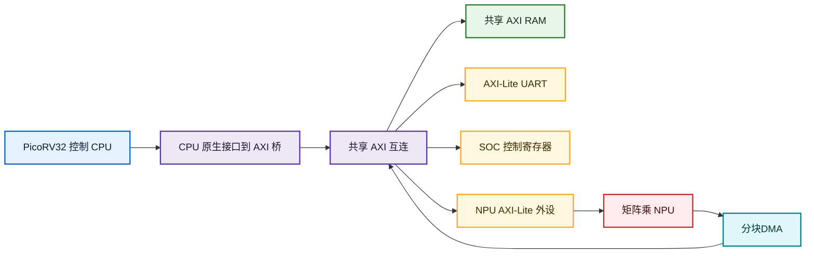

<p align="center">图2-1 PicoRV32 与 NPU 异构 SoC 总体结构</p>

<p align="center">
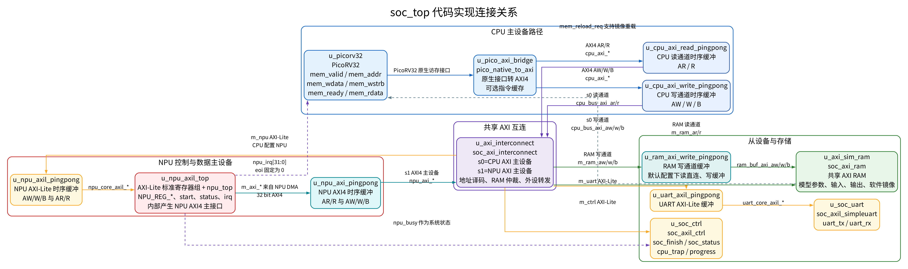
</p>
<p align="center">图2-2 soc_top RTL 实例连接关系</p>

控制数据通路从 CPU 发起。PicoRV32 的 `mem_valid`、`mem_addr`、`mem_wdata` 和 `mem_wstrb` 原生接口进入 `pico_native_to_axi`，桥接模块将 CPU load/store 转换为 AXI 请求。互连根据地址选择 RAM、NPU 外设、UART 或 SOC 控制寄存器。NPU 外设窗口保存控制、状态、写回、复用和矩阵参数寄存器，软件按固定顺序写入配置寄存器后，再写控制寄存器中的 start 位。

NPU 数据通路由 `npu_top` 发起。任务启动后，NPU 不要求 CPU 参与每一个元素的读取和写入，而是根据锁存的基址、K/N/M、步长、数据宽度和量化模式向 DMA 仲裁器提交块读写请求。DMA 将二维分块请求转换为 AXI 突发传输，读取 LHS、RHS、bias 和 per-channel 量化参数，并把最终 int8 输出写回 DST。由于 CPU 与 NPU 共用 RAM，互连需要维护访问归属、活跃标志、未完成事务数量和等待条件，防止任一主设备长时间占用共享资源。

任务状态在系统层按 ready、busy、done、error 和 writeback valid 表示。start 被 NPU 外设采样后，控制器锁存寄存器组配置并置 busy；当加载、计算、重量化、先进先出队列、写回和 DMA 响应均完成后，done sticky 置位并释放 busy。该状态传播规则使 CPU 不需要观察内部流水级，只需要在任务完成点读取 status、writeback 和错误字段。若启用 irq，irq 由 done、error 或 writeback valid 条件保持到软件清除相应 sticky 状态。

SoC 地址空间采用固定分区。RAM 位于低地址区，UART、NPU 和 SOC 控制寄存器位于独立外设窗口。互连在地址译码时把请求归入 RAM、NPU、UART、CTRL 或错误区域。CPU 只能通过 AXI-Lite 访问外设，NPU DMA 只应访问共享 RAM 数据区。非法地址访问需要返回确定响应，避免 CPU 或 NPU 在无响应目标上永久等待。

PicoRV32 的任务粒度与 NPU 的分块粒度相互分离。CPU 只提交一次矩阵乘任务并轮询任务级状态，不向每个 PE 写入输入，也不直接控制 DMA 数据拍。NPU 在任务内部生成行分块、列分块和归约分块序列，并根据缓存与先进先出队列状态调度加载、计算和写回。该分层降低软件控制开销，也使硬件内部微结构可在不改变软件 API 的条件下优化。

NPU 外设不暴露内部队列和物理坐标。软件可见字段包括控制位、状态位、写回信息、输入激活与权重复用参数、矩阵基址、维度、步长、偏移、量化参数和激活范围。缓存槽位、部分和帧、先进先出队列存储体、DMA 客户端编号和 PE 坐标都属于内部实现。该封装使软件只需要遵守 GEMM 任务定义和寄存器访问规则，不依赖内部调度顺序。

中断能力作为外设接口保留。基础软件可以采用轮询方式读取 done 和 error；若系统层启用中断，irq 应由 done、error 或写回有效状态产生，并保持到软件清除相应 sticky 状态。由于 CPU 侧中断配置会影响软件入口和异常处理，NPU 的中断输出需要与系统中断控制策略配合使用。无论使用轮询还是中断，任务完成点和状态清除规则保持一致。

### 2.2 AXI 总线与存储子系统设计

AXI 子系统负责连接 CPU、NPU、RAM 和外设。控制侧采用 AXI-Lite 单拍访问，适用于配置寄存器和状态寄存器；数据侧采用 AXI4 突发传输，适用于矩阵分块的连续或带步长读写。两类事务在互连中分开处理：CPU 可以访问 RAM 与外设，NPU DMA 只发起面向 RAM 的数据搬移。该组织方式减少外设侧协议复杂度，并使大数据搬移集中在分块DMA 中处理。

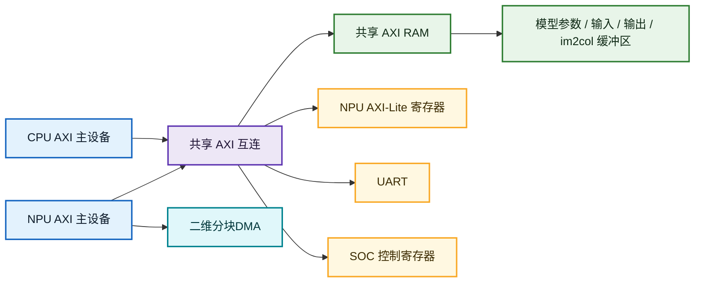

<p align="center">图2-3 AXI 总线与存储子系统结构</p>

`pico_native_to_axi` 是 CPU 原生接口与 AXI 的转换层。写访问转换为单数据拍 AXI 写事务，读访问转换为 AXI 读事务，`mem_ready` 只在读数据返回或写响应完成后对 CPU 有效。对于指令取值路径，若启用指令缓存，桥接层可以按缓存行组织突发传输；未启用时，每次取指按普通读访问处理。桥接层必须保持 CPU 请求的顺序可见性，避免软件 MMIO 写 start 早于前序配置写生效。

`soc_axi_interconnect` 是共享拓扑的仲裁中心。它接收 CPU 主设备和 NPU 主设备请求，向 RAM 发起共享读写，同时将 CPU 外设访问转发到 NPU、UART 或 SOC 控制模块。互连维护读访问归属、写访问归属、活跃标志、未完成事务计数和等待状态。RAM 读写允许 CPU 与 NPU 竞争，外设访问只允许 CPU 发起。该规则避免 NPU DMA 意外修改控制寄存器，也保证 CPU 可以通过固定地址读取外设状态。

<p align="center">图2-4 AXI 地址译码、RAM 访问归属与外设转发关系（图形待补充）</p>

`soc_axi_ram` 提供 AXI RAM 行为，支持读写突发传输、`wstrb` 字节写、`rlast`、`wlast` 和未完成事务。读通道在接受 AR 后按 `arlen` 返回多个数据拍，并在最后一个数据拍拉高 `rlast`。写通道在接受 AW 和全部 W 数据拍后返回 B 响应，`wstrb` 控制每个字节是否写入。RAM 可以配置响应延迟，用于描述非零等待的存储访问行为；无论延迟取值如何，读写顺序、last 标志和响应对应关系都必须保持。

AXI-Lite 控制访问采用地址、数据和响应分离的规则。写事务只有在 AW 和 W 通道都完成握手后才更新目标寄存器，随后通过 B 通道返回响应；读事务在 AR 握手后由 R 通道返回寄存器值。CPU 配置 NPU 时，矩阵参数、复用参数和 control 写入均按该规则进入 `npu_axil_top`，start 被采样前相关配置字段保持稳定。该规则同时用于 status、writeback 和错误字段读取，保证软件观察到的是寄存器边沿更新后的状态。

NPU 侧的块访问由 `axi_dual_block_dma` 执行。读引擎接收基址、行步长、行数、每行字节数、元素宽度、客户端编号和突发传输参数，将二维分块拆分为 AXI 读请求，并把返回数据送给 IA、权重、bias 或量化参数客户端。写引擎接收输出写回单元的地址、数据、字节写掩码和行信息，生成 AW/W，并跟踪 B 响应。读写引擎独立工作，但共享 NPU 主设备端口与互连仲裁资源。

DMA 读写事务通过响应计数保持完整性。读请求发出后，客户端只在 R 通道返回并完成内部握手后获得数据；写请求发出后，写回单元必须等待对应 B 响应返回，才能把该输出范围计入完成条件。若 RAM 或互连暂时不能接收请求，DMA 保持地址、长度、客户端编号、写数据和字节写掩码，直到握手完成。该处理把可变存储延迟限制在 DMA 与客户端之间，不改变上层矩阵任务的数学定义。

非对齐访问由 DMA 和写回单元共同处理。输入读取时，DMA 可能从非 4 字节对齐地址开始取数，加载单元根据元素宽度和地址低位抽取有效 s8 或 s16 元素。输出写回时，`vec_s8_to_fifo` 生成 32 位数据和 4 bit 字节写掩码，`oa_writer` 按 DST 地址低位选择有效字节。尾列和尾数据拍只使目标输出字节有效，不修改同一 32 位字内的其他字节。

突发传输长度需要兼顾效率和仲裁公平。较长突发传输可减少地址通道握手开销，但会延长共享 RAM 被单一主设备占用的时间；较短突发传输有利于 CPU 插入外设访问和取指，但会提高地址开销。DMA 的突发传输长度应与总线宽度、RAM 响应延迟、分块行长度和 CPU 访问需求匹配。互连的让出条件用于在必要时释放通道，防止 CPU 控制访问被长期阻塞。

存储层次由外部共享 RAM、NPU 内部缓存或缓冲区和 PE 寄存器组成。共享 RAM 保存模型参数、输入、输出、im2col 缓冲区和软件栈数据；IA cache 保存输入分块；权重缓存保存权重分块；bias 缓存保存输出通道偏置；部分和缓冲区保存跨归约分块的中间累加结果；输出先进先出队列缓冲 int8 写回数据拍。该层次把大容量持久数据放在 RAM，把短期高复用数据放在 NPU 内部，把最紧密计算数据放在 PE 寄存器。

总线性能设计使用统一公式描述。总线传输上限为 `bus_width_bytes × bus_freq_hz`，任务时间为 `task_cycles / npu_freq_hz`，实际字节带宽为 `(read_bytes + write_bytes) / task_time_s`。计算有效吞吐按 `2 × K × N × M / task_time_s` 计算，尾块无效计算通道不计入有效 MAC。若计数器扩展到读字节数、写字节数、活跃周期和停顿原因，软件可以在任务完成后分析瓶颈属于读、写、计算还是控制。

存储子系统的设计重点不是把所有数据永久留在片上，而是在分块生命周期内保持高复用数据。LHS 在多个输出列组之间复用，权重在一个或多个输入行组之间复用，部分和在多个归约分块之间复用，输出仅在最终重量化后写回。DMA、缓存、缓冲区和阵列之间的速率匹配决定了实际吞吐，单独增加某一级容量并不能保证整体性能提高。

### 2.3 NPU 总体架构

NPU 由 AXI-Lite 外设接口层和 NPU 计算数据通路两部分组成。`npu_axil_top` 连接 SoC 控制接口，处理 AXI-Lite 读写、标准寄存器组保存、start 脉冲、状态寄存器、写回信息和 irq。`npu_top` 连接矩阵计算通路，处理配置检查、分块调度、DMA 请求、加载单元、计算、重量化、FIFO 和写回单元。两者之间通过配置字段、启动脉冲、busy/done/error 状态和写回信息连接。

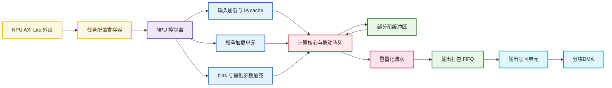

<p align="center">图2-5 NPU 内部功能结构</p>

<p align="center">
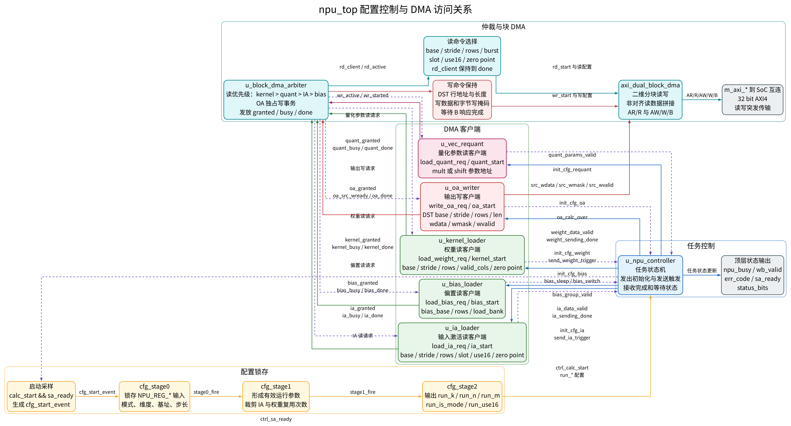
</p>
<p align="center">图2-6 npu_top 配置控制与 DMA 访问关系</p>

<p align="center">
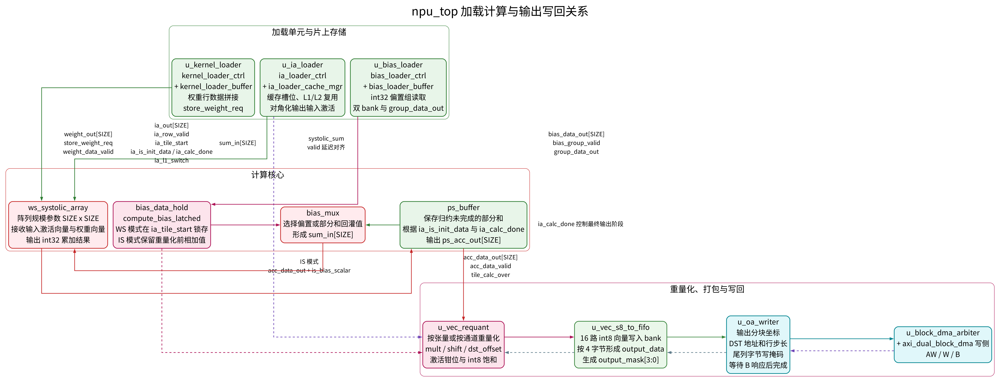
</p>
<p align="center">图2-7 npu_top 加载计算与输出写回关系</p>

`npu_axil_top` 的寄存器组包括控制、状态、写回数据、写回信息、IA 复用、权重复用和矩阵参数字段。控制寄存器 bit0 为 start，bit1 选择输入激活数据宽度，bit2 选择 per-channel 量化，bit3 选择输入固定数据流，bit8 清 done，bit9 清 writeback valid。状态寄存器包含 ready、busy、done sticky、writeback valid、error code 和寄存器访问 ready。所有字段按 32 位访问，保留位写入不应改变有效状态。

`npu_axil_reg_if` 保存矩阵乘任务的参数。地址字段包括 `NPU_REG_LHS_BASE`、`NPU_REG_RHS_BASE`、`NPU_REG_DST_BASE` 和 `NPU_REG_BIAS_BASE`；尺寸字段包括 `NPU_REG_K`、`NPU_REG_N` 和 `NPU_REG_M`；布局字段包括 `NPU_REG_LHS_STRIDE_B`、`NPU_REG_RHS_STRIDE_B` 和 `NPU_REG_DST_STRIDE_B`；数值字段包括零点、量化乘法系数、移位参数、激活下限和激活上限。按张量量化模式下，乘法系数与移位参数作为标量；per-channel 量化模式下，相关字段作为参数数组地址。

`npu_controller` 是 NPU 内部调度核心。控制器在 IDLE 状态等待 start，随后检查配置、计算分块数量、尾块有效计算通道、复用窗口和数据流模式。合法配置进入加载与计算状态，非法配置进入 ERROR 并更新错误码。控制器向 IA 加载单元、权重加载单元、bias 加载单元、重量化参数加载单元、计算核心和输出写回单元发出初始化或触发信号，并等待各阶段 done 或 ready 条件。

控制器推进任务时只以已寄存的握手结果、计数器终止条件和子模块状态作为判断输入。IA 数据、权重数据、bias、量化参数、部分和、输出坐标和有效计算通道标志在各流水级中同步传递；当下游不能接收时，相关数据负载和附带控制字段保持稳定。该组织方式使加载、计算、重量化和写回单元可以分别插入局部寄存器或先进先出队列，而不会改变输出元素对应的 LHS 行、RHS 列、bias、量化参数和 DST 地址。

IA 加载单元包括地址发生器、DMA 请求控制、输入元素抽取、符号扩展、零点加法和 IA cache 管理。它按照行组和归约分块读取 LHS，把 s8 或 s16 输入转换为 signed 16 bit，并保存到缓存槽位。缓存管理单元再按阵列对角化时序输出 IA 向量，使不同行和不同 k 项在正确周期进入 PE。IA cache 槽位的释放由复用计数和发送完成共同决定。

权重加载单元负责 RHS/权重读取与 PE 装载。它根据输出列组、归约分块、RHS 基址和 RHS 步长读取权重，组织为列向量，并通过 `store_weight` 控制送入脉动阵列。权重在 PE 内保持，直到对应输出列组的输入激活计算窗口结束。尾列不足 `SIZE` 时，权重加载单元输出有效列掩码，无效列不参与输出。

bias 加载单元和量化参数加载单元负责输出通道相关参数。bias 加载单元在输出列组粒度读取 int32 bias；per-channel 量化时，重量化流水需要读取每个输出通道的乘法系数和移位参数。控制器保证这些参数在对应输出向量进入计算或重量化前有效。无 bias 场景下，累加初值为 0；按张量量化场景下，所有并行输出通道共享同一缩放参数。

计算核心由权重固定脉动阵列、输入/权重对齐逻辑、部分和输入选择和部分和缓冲区接口组成。首次归约分块使用 bias 或 0 作为初值，中间归约分块使用部分和缓冲区回灌值，最终归约分块输出到重量化流水。阵列内部 PE 在每个时钟边沿执行乘加并传递数据，底行在固定延迟后产生输出向量。控制器需要等待阵列填充和排空周期，不能以输入最后一拍作为输出完成条件。

重量化与输出子系统将 int32 向量转换为内存中的 int8 矩阵。`vec_requant` 执行乘法缩放、舍入、移位、加输出偏移、激活值上下限钳位和 int8 饱和；`vec_s8_to_fifo` 把 int8 并行输出通道打包成 32 位数据拍并生成字节写掩码；`oa_writer` 根据 DST 基址、行步长、输出坐标和有效列数发起 AXI 写请求。写响应全部返回后，写回单元才向控制器报告完成。

NPU 的工作状态按任务粒度对软件可见。ready 表示可接受新任务，busy 表示任务正在执行，done 表示任务完成，error code 表示配置或资源异常，response error 表示 AXI 或内部响应异常。内部的加载状态、缓存状态、部分和帧状态、先进先出队列状态和 DMA 等待状态不直接暴露，但它们共同决定 busy 与 done 的更新时刻。

## 3. 模块设计

本章按照模块级数字 IC 设计说明的格式组织。每个模块小节均说明模块位置、功能范围、接口、内部结构、状态机、时序行为、寄存器配置和配置关系。面积、物理时序余量和物理实现指标不在模块小节中展开。

### 3.1 soc_top模块设计

本模块位于SoC 顶层中，完成 PicoRV32、AXI 桥、共享 AXI 互连、NPU 外设、AXI RAM、UART 与系统控制寄存器的顶层集成。该模块处于系统最上层，向下实例化 CPU、存储、互连和 NPU，向上连接板级顶层约束或外部封装接口。本小节围绕 RTL 已实现的控制、数据搬移、缓存、仲裁、配置和状态维护功能展开，重点说明接口、状态机、寄存器和时序行为。

#### 3.1.1 功能说明

本模块接收的主要输入包括 clk、resetn、uart_rx 等信号，输出的主要结果包括 uart_tx、soc_finish、soc_status 等信号。完成 PicoRV32、AXI 桥、共享 AXI 互连、NPU 外设、AXI RAM、UART 与系统控制寄存器的顶层集成。在系统运行过程中，该模块通过时钟边沿采样输入条件，更新内部寄存器或状态标志，并在满足握手、完成或错误条件后驱动下游接口。

#### 3.1.2 结构组成

内部由 PicoRV32 实例、pico_native_to_axi、soc_axi_interconnect、soc_axi_ram、npu_axil_top、soc_axil_simpleuart、soc_axil_ctrl 和可选乒乓缓冲组成。顶层参数给出 CPU_RAM_BASE、NPU_AXIL_BASE、UART_BASE、SOC_CTRL_BASE、SIZE、BUS_WIDTH、IA_CACHE_BLOCKS 和 AXI 未完成事务深度。这些子单元在同一时钟域内通过寄存器和握手信号协同工作。单一系统时钟域，复位信号为低有效同步或异步进入各子模块，具体复位分支由被实例化模块实现。复位处理的目标是使状态机、计数器、有效标志、请求保持寄存器和输出寄存器进入确定状态，避免复位释放后产生虚假请求或错误完成标志。

#### 3.1.3 接口定义

本模块接口包括时钟复位接口、配置或控制接口、数据输入接口、数据输出接口以及状态反馈接口。下表列出主要信号，位宽按照 RTL 参数化表达；当位宽由参数决定时，表中保留参数名。

| 信号名 | 位宽 | 方向 | 时钟域 | 功能描述 | 备注 |
|---|---:|---|---|---|---|
| clk | 1 | 输入 | 系统时钟域 | SoC 同步逻辑采样时钟 | 所有子模块使用该时钟或由顶层派生 |
| resetn | 1 | 输入 | 系统时钟域 | 低有效复位 | 复位后 CPU 从 RAM 基址取指 |
| uart_rx | 1 | 输入 | 系统时钟域 | UART 接收 | 调试串口输入 |
| uart_tx | 1 | 输出 | 系统时钟域 | UART 发送 | 用于 C 程序运行记录输出 |
| soc_finish | 1 | 输出 | 系统时钟域 | 程序完成标志 | 由软件写 SOC 控制寄存器产生 |
| soc_status | 32 | 输出 | 系统时钟域 | 程序状态码 | 用于顶层状态读取 |

接口时序上，输入控制信号在时钟有效边沿采样，输出控制信号在寄存器更新后保持到下游完成握手或被状态机清除。valid/ready 类接口以双方同周期为高作为一次传输完成条件；req/done 类接口以请求保持和完成反馈作为一次多周期操作的完成条件。地址、数据和掩码信号在对应 valid 或 req 有效期间保持稳定。

#### 3.1.4 工作流程与状态机

复位后，单一系统时钟域，复位信号为低有效同步或异步进入各子模块，具体复位分支由被实例化模块实现。启动或运行条件由上游控制信号给出，模块在配置字段稳定后进入正常工作。本模块不设置独立状态机，控制状态由 CPU、互连、NPU 控制器和 AXI RAM 分别维护。

复位释放后，PicoRV32 从 CPU_RAM_BASE 对应地址取指。CPU 原生访问先被转换为 AXI 请求，再由互连分发到 RAM 或外设。NPU 在软件写入 start 后通过 AXI 主设备访问 RAM。SoC 完成标志由软件写控制寄存器产生，并在顶层输出端口保持到复位或下一次状态更新。异常处理方面，当下游无法接受数据、FIFO 满、DMA 未完成、响应未返回或配置非法时，模块保持当前状态或输出错误信息，不应在未完成握手时推进内部计数器。

#### 3.1.5 时序行为

复位释放后，PicoRV32 从 CPU_RAM_BASE 对应地址取指。CPU 原生访问先被转换为 AXI 请求，再由互连分发到 RAM 或外设。NPU 在软件写入 start 后通过 AXI 主设备访问 RAM。SoC 完成标志由软件写控制寄存器产生，并在顶层输出端口保持到复位或下一次状态更新。多周期操作期间，地址、长度、模式和选择信号在请求被接受前保持不变；数据输出在 valid 有效期间保持稳定；完成信号只在最后一个必要响应或最后一个有效数据被处理后产生。若下游反压，模块保持当前寄存器值并停止推进相关计数器。

关键时序信号包括 clk、resetn、uart_rx、uart_tx、soc_finish、soc_status。这些信号用于描述采样、保持、更新和完成条件。

#### 3.1.6 参数配置说明

顶层自身无软件可见寄存器，软件可见地址空间包括 RAM、NPU AXI-Lite 窗口、UART 和 SOC 控制窗口。`soc_top` 的结构参数在综合或仿真编译时确定，软件运行期不能改变阵列规模、IA cache 物理深度、部分和帧数、总线位宽或 RAM 容量。软件只能通过 NPU 寄存器组写入任务地址、矩阵维度、步长、量化参数、复用请求和数据流模式。

| 名称 | 复位值或参数 | 属性 | 功能含义 |
|---|---|---|---|
| CPU_RAM_BASE | 0x00000000 | 参数 | CPU 复位与 RAM 基址 |
| NPU_AXIL_BASE | 0x10000000 | 参数 | NPU AXI-Lite 寄存器窗口基址 |
| UART_BASE | 0x02000000 | 参数 | UART 外设窗口基址 |
| SOC_CTRL_BASE | 0x20000000 | 参数 | SoC 控制寄存器窗口基址 |
| AXIL_DATA_WIDTH | 32 bit | 参数 | AXI-Lite 配置接口数据宽度 |
| AXIL_ADDR_WIDTH | 16 bit | 参数 | NPU AXI-Lite 局部地址宽度 |
| AXI_ADDR_WIDTH | 32 bit | 参数 | CPU 与 NPU AXI 地址宽度 |
| BUS_WIDTH | 32 bit | 参数 | NPU AXI 数据主接口宽度，单个数据拍为 4 Byte |
| DATA_WIDTH | 16 bit | 参数 | PE 输入激活内部数据宽度，int8 输入在进入阵列前扩展到该宽度 |
| WEIGHT_WIDTH | 16 bit | 参数 | PE 权重内部数据宽度，int8 权重在进入阵列前扩展到该宽度 |
| SIZE | 16 | 参数 | RTL 默认阵列边长，对应 16x16 阵列 |
| IA_CACHE_BLOCKS | 4 | 参数 | RTL 默认 IA cache 分块数，对应 4 个输入激活矩阵分块 |
| PS_FRAME_COUNT | SIZE | 参数 | RTL 默认部分和帧数，默认等于阵列边长 |
| AXI_READ_OUTSTANDING | 4 | 参数 | AXI 读侧未完成事务深度 |
| AXI_WRITE_OUTSTANDING | AXI_READ_OUTSTANDING | 参数 | AXI 写侧未完成事务深度 |
| CPU_MEM_DP | 524288 word | 参数 | 共享 RAM 深度，默认容量为 2 MiB |
| CPU_ENABLE_ICACHE | 0 | 参数 | CPU 指令缓存开关，性能测试中可编译为 1 |
| NPU_ENABLE_IS_MODE | 1 | 参数 | 使能 IS 数据流模式 |
| NPU_ENABLE_PER_CHANNEL | 1 | 参数 | 使能 per-channel 量化参数读取 |

IA cache 物理容量按 `SIZE x SIZE x IA_CACHE_BLOCKS x 4Byte` 计算。RTL 默认参数 `SIZE=16`、`IA_CACHE_BLOCKS=4` 时，IA cache 容量为 `16 x 16 x 4 x 4Byte = 4096Byte`。模型推理对比采用的 4x4 阵列、32 个 IA cache 分块、16 个部分和帧参数下，IA cache 容量为 `4 x 4 x 32 x 4Byte = 2048Byte`。固定 32 个 IA cache 分块的阵列规模扫描中，IA cache 容量随 `SIZE^2` 增长，例如 16x16 阵列为 32768Byte，32x32 阵列为 131072Byte，64x64 阵列为 524288Byte。

本文使用的主要参数组合如下表所示。NPU 的 IA cache 容量按物理存储估算；CPU 指令缓存由 `pico_native_to_axi` 内部参数 `ICACHE_LINES=64`、`ICACHE_LINE_WORDS=4` 决定，打开时容量为 `64 x 4 x 4Byte = 1024Byte`。

| 参数组合 | SIZE | IA_CACHE_BLOCKS | PS_FRAME_COUNT | IA cache 容量 | CPU_MEM_DP | CPU I-cache |
|---|---:|---:|---:|---:|---:|---|
| RTL 默认综合参数 | 16 | 4 | 16 | 4096Byte | 524288 word | 编译参数决定 |
| TFLM 推理对比参数 | 4 | 32 | 16 | 2048Byte | 65536 或 524288 word | 开启 |
| 固定 32 个 IA cache 分块的阵列扫描 | 4/8/16/32/64 | 32 | 按任务设置 | 随 `SIZE^2` 增长 | 按测试平台设置 | 按测试平台设置 |
| 固定 IA cache 存储容量扫描 | 4/8/16/32/64 | 按目标容量反推 | 按任务设置 | 4KiB、16KiB、64KiB | 按测试平台设置 | 按测试平台设置 |

软件不直接访问该模块；运行期配置由上级寄存器组或控制信号传入，内部状态按 RTL 复位分支和时钟逻辑更新。若软件写入的复用请求超过物理缓存能力，`npu_top` 会按综合参数对复用窗口进行裁剪，顶层参数本身不在运行期变化。

### 3.2 pico_native_to_axi模块设计

本模块位于soc_top中，将 PicoRV32 原生存储接口转换为 AXI 主设备读写事务。上级模块为 PicoRV32，下级模块为 soc_axi_interconnect 的 CPU 主设备端口。本小节围绕 RTL 已实现的控制、数据搬移、缓存、仲裁、配置和状态维护功能展开，重点说明接口、状态机、寄存器和时序行为。

#### 3.2.1 功能说明

本模块接收的主要输入包括 mem_valid、mem_instr、mem_addr、mem_wdata、mem_wstrb、m_axi_arready 等信号，输出的主要结果包括 mem_ready、mem_rdata、m_axi_arvalid、m_axi_awvalid、m_axi_wvalid、m_axi_rready 等信号。将 PicoRV32 原生存储接口转换为 AXI 主设备读写事务。在系统运行过程中，该模块通过时钟边沿采样输入条件，更新内部寄存器或状态标志，并在满足握手、完成或错误条件后驱动下游接口。

#### 3.2.2 结构组成

内部包含请求保持单元、读通道控制单元、写地址/写数据控制单元、写响应等待单元和可选指令缓存。写请求被组织为 awlen=0 的单拍传输；指令缓存打开时，取指 miss 可形成多数据拍 INCR 读。这些子单元在同一时钟域内通过寄存器和握手信号协同工作。与 CPU 使用同一 SoC 时钟。复位后内部请求保持寄存器、响应寄存器和可选指令缓存 valid 位被清零。复位处理的目标是使状态机、计数器、有效标志、请求保持寄存器和输出寄存器进入确定状态，避免复位释放后产生虚假请求或错误完成标志。

#### 3.2.3 接口定义

本模块接口包括时钟复位接口、配置或控制接口、数据输入接口、数据输出接口以及状态反馈接口。下表列出主要信号，位宽按照 RTL 参数化表达；当位宽由参数决定时，表中保留参数名。

| 信号名 | 位宽 | 方向 | 时钟域 | 功能描述 | 备注 |
|---|---:|---|---|---|---|
| mem_valid | 1 | 输入 | CPU 时钟域 | CPU 请求有效 | 保持到 mem_ready |
| mem_instr | 1 | 输入 | CPU 时钟域 | 指令访问标志 | 用于可选指令缓存判断 |
| mem_addr | 32 | 输入 | CPU 时钟域 | 访问地址 | 字节地址 |
| mem_wdata | 32 | 输入 | CPU 时钟域 | 写数据 | 与 mem_wstrb 同周期有效 |
| mem_wstrb | 4 | 输入 | CPU 时钟域 | 字节写使能 | 全 0 表示读访问 |
| m_axi_arready | 1 | 输入 | AXI 时钟域 | 读地址接受 | 与 arvalid 握手 |
| m_axi_rvalid | 1 | 输入 | AXI 时钟域 | 读数据有效 | 与 rready 握手 |
| m_axi_bvalid | 1 | 输入 | AXI 时钟域 | 写响应有效 | 与 bready 握手 |
| mem_ready | 1 | 输出 | CPU 时钟域 | CPU 请求完成 | 读数据或写响应完成后置位 |
| mem_rdata | 32 | 输出 | CPU 时钟域 | CPU 读数据 | mem_ready 周期有效 |
| m_axi_arvalid | 1 | 输出 | AXI 时钟域 | AXI 读地址有效 | 保持到 arready |
| m_axi_awvalid | 1 | 输出 | AXI 时钟域 | AXI 写地址有效 | 单拍写请求 |
| m_axi_wvalid | 1 | 输出 | AXI 时钟域 | AXI 写数据有效 | 与 wlast 同步 |
| m_axi_rready | 1 | 输出 | AXI 时钟域 | 读数据接受 | 桥接模块可接收读数据时置位 |

接口时序上，输入控制信号在时钟有效边沿采样，输出控制信号在寄存器更新后保持到下游完成握手或被状态机清除。valid/ready 类接口以双方同周期为高作为一次传输完成条件；req/done 类接口以请求保持和完成反馈作为一次多周期操作的完成条件。地址、数据和掩码信号在对应 valid 或 req 有效期间保持稳定。

#### 3.2.4 工作流程与状态机

复位后，与 CPU 使用同一 SoC 时钟。复位后内部请求保持寄存器、响应寄存器和可选指令缓存 valid 位被清零。启动或运行条件由上游控制信号给出，模块在配置字段稳定后进入正常工作。实现以请求保持和 AXI 五通道握手为主，未暴露命名状态表。读访问等待 AR 握手和 R 数据返回；写访问等待 AW/W 握手和 B 响应。

当 mem_valid 被采样为高时，模块锁存地址、写数据和写使能。读访问在 AR 握手后等待 RVALID，最后一个读数据被采样后更新 mem_rdata 并拉高 mem_ready。写访问在 AW、W 和 B 响应完成后拉高 mem_ready。若下游 ready 拉低，地址和数据保持不变。异常处理方面，当下游无法接受数据、FIFO 满、DMA 未完成、响应未返回或配置非法时，模块保持当前状态或输出错误信息，不应在未完成握手时推进内部计数器。

#### 3.2.5 时序行为

当 mem_valid 被采样为高时，模块锁存地址、写数据和写使能。读访问在 AR 握手后等待 RVALID，最后一个读数据被采样后更新 mem_rdata 并拉高 mem_ready。写访问在 AW、W 和 B 响应完成后拉高 mem_ready。若下游 ready 拉低，地址和数据保持不变。多周期操作期间，地址、长度、模式和选择信号在请求被接受前保持不变；数据输出在 valid 有效期间保持稳定；完成信号只在最后一个必要响应或最后一个有效数据被处理后产生。若下游反压，模块保持当前寄存器值并停止推进相关计数器。

关键时序信号包括 mem_valid、mem_instr、mem_addr、mem_wdata、mem_wstrb、m_axi_arready、m_axi_rvalid、m_axi_bvalid。这些信号用于描述采样、保持、更新和完成条件。

#### 3.2.6 参数配置说明

本模块无软件可见寄存器。内部寄存器包括请求保持寄存器、读数据寄存器、写事务等待标志和可选缓存标签/data/valid。

| 名称 | 复位值或参数 | 属性 | 功能含义 |
|---|---|---|---|
| ENABLE_ICACHE | 顶层默认 0 | 参数 | 决定是否启用指令缓存 |
| ICACHE_LINES | 64 | 参数 | 指令缓存行数 |
| ICACHE_LINE_WORDS | 4 | 参数 | 每行取指字数 |

软件不直接访问该模块；运行期配置由上级寄存器组或控制信号传入，内部状态按 RTL 复位分支和时钟逻辑更新。

### 3.3 soc_axi_interconnect模块设计

本模块位于soc_top中，仲裁 CPU 与 NPU 对共享 RAM 的 AXI 访问，并将 CPU 外设地址译码到 NPU、UART 和 SOC 控制寄存器。上游为 CPU AXI 主设备与 NPU AXI 主设备，下游为 AXI RAM 和多个 AXI-Lite 外设。本小节围绕 RTL 已实现的控制、数据搬移、缓存、仲裁、配置和状态维护功能展开，重点说明接口、状态机、寄存器和时序行为。

#### 3.3.1 功能说明

本模块接收的主要输入包括 s0_axi_arvalid、s1_axi_arvalid、s0_axi_awvalid、s1_axi_awvalid、m_ram_rvalid、m_ram_bvalid 等信号，输出的主要结果包括 m_ram_arvalid、m_ram_awvalid、m_npu_awvalid、s0_axi_rvalid、s1_axi_rvalid、cpu_ar_wait 等信号。仲裁 CPU 与 NPU 对共享 RAM 的 AXI 访问，并将 CPU 外设地址译码到 NPU、UART 和 SOC 控制寄存器。在系统运行过程中，该模块通过时钟边沿采样输入条件，更新内部寄存器或状态标志，并在满足握手、完成或错误条件后驱动下游接口。

#### 3.3.2 结构组成

内部包含地址译码单元、读通道仲裁单元、写通道仲裁单元、RAM 归属保持寄存器、CPU 外设转接单元、错误响应生成单元和等待统计计数器。读写通道分别维护归属，防止多数据拍传输中的响应返回给错误主设备。这些子单元在同一时钟域内通过寄存器和握手信号协同工作。单一 AXI 时钟域。复位后归属、active、未完成事务计数和等待统计清零。复位处理的目标是使状态机、计数器、有效标志、请求保持寄存器和输出寄存器进入确定状态，避免复位释放后产生虚假请求或错误完成标志。

#### 3.3.3 接口定义

本模块接口包括时钟复位接口、配置或控制接口、数据输入接口、数据输出接口以及状态反馈接口。下表列出主要信号，位宽按照 RTL 参数化表达；当位宽由参数决定时，表中保留参数名。

| 信号名 | 位宽 | 方向 | 时钟域 | 功能描述 | 备注 |
|---|---:|---|---|---|---|
| s0_axi_arvalid | 1 | 输入 | AXI 时钟域 | CPU 读地址有效 | CPU 主设备读请求 |
| s1_axi_arvalid | 1 | 输入 | AXI 时钟域 | NPU 读地址有效 | NPU DMA 读请求 |
| s0_axi_awvalid | 1 | 输入 | AXI 时钟域 | CPU 写地址有效 | CPU 写请求 |
| s1_axi_awvalid | 1 | 输入 | AXI 时钟域 | NPU 写地址有效 | NPU DMA 写请求 |
| m_ram_rvalid | 1 | 输入 | AXI 时钟域 | RAM 读数据有效 | 返回给当前读归属 |
| m_ram_bvalid | 1 | 输入 | AXI 时钟域 | RAM 写响应有效 | 返回给当前写访问归属 |
| m_ram_arvalid | 1 | 输出 | AXI 时钟域 | RAM 读地址有效 | 由仲裁结果产生 |
| m_ram_awvalid | 1 | 输出 | AXI 时钟域 | RAM 写地址有效 | 由仲裁结果产生 |
| m_npu_awvalid | 1 | 输出 | AXI-Lite 时钟域 | NPU 外设写地址有效 | 仅 CPU 可访问 |
| s0_axi_rvalid | 1 | 输出 | AXI 时钟域 | CPU 读数据有效 | CPU 读响应 |
| s1_axi_rvalid | 1 | 输出 | AXI 时钟域 | NPU 读数据有效 | NPU 读响应 |
| cpu_ar_wait | 32 | 输出 | AXI 时钟域 | CPU 读等待统计 | 等待计数输出 |

接口时序上，输入控制信号在时钟有效边沿采样，输出控制信号在寄存器更新后保持到下游完成握手或被状态机清除。valid/ready 类接口以双方同周期为高作为一次传输完成条件；req/done 类接口以请求保持和完成反馈作为一次多周期操作的完成条件。地址、数据和掩码信号在对应 valid 或 req 有效期间保持稳定。

#### 3.3.4 工作流程与状态机

复位后，单一 AXI 时钟域。复位后归属、active、未完成事务计数和等待统计清零。启动或运行条件由上游控制信号给出，模块在配置字段稳定后进入正常工作。读写访问归属有 OWNER_CPU 与 OWNER_NPU 两类，地址目标包含 D_RAM、D_NPU、D_UART、D_CTRL、D_ERR。事务接受后 active 位置位，直到相应突发传输或响应结束后清除。

当 CPU 与 NPU 同时请求 RAM 时，仲裁器在时钟边沿选择一个主设备，并将地址通道保持到下游 ready。读突发传输的 R 数据根据 ram_rd_owner_q 返回给 CPU 或 NPU。写事务在 AW/W 和 B 完成后释放写访问归属。外设访问不进入 RAM 归属流程。异常处理方面，当下游无法接受数据、FIFO 满、DMA 未完成、响应未返回或配置非法时，模块保持当前状态或输出错误信息，不应在未完成握手时推进内部计数器。

#### 3.3.5 时序行为

当 CPU 与 NPU 同时请求 RAM 时，仲裁器在时钟边沿选择一个主设备，并将地址通道保持到下游 ready。读突发传输的 R 数据根据 ram_rd_owner_q 返回给 CPU 或 NPU。写事务在 AW/W 和 B 完成后释放写访问归属。外设访问不进入 RAM 归属流程。多周期操作期间，地址、长度、模式和选择信号在请求被接受前保持不变；数据输出在 valid 有效期间保持稳定；完成信号只在最后一个必要响应或最后一个有效数据被处理后产生。若下游反压，模块保持当前寄存器值并停止推进相关计数器。

关键时序信号包括 s0_axi_arvalid、s1_axi_arvalid、s0_axi_awvalid、s1_axi_awvalid、m_ram_rvalid、m_ram_bvalid、m_ram_arvalid、m_ram_awvalid。这些信号用于描述采样、保持、更新和完成条件。

#### 3.3.6 参数配置说明

本模块无软件可见寄存器。内部寄存器包括 ram_rd_owner_q、ram_wr_owner_q、ram_rd_active_q、ram_wr_active_q、ram_rd_outs_q、ram_wr_outs_q、cpu_ar_wait、npu_ar_wait、rd_yield 和 wr_yield。

| 名称 | 复位值或参数 | 属性 | 功能含义 |
|---|---|---|---|
| READ_OUTSTANDING | 顶层参数 | 参数 | 读在途事务数量上限 |
| WRITE_OUTSTANDING | 顶层参数 | 参数 | 写在途事务数量上限 |
| NPU_AXIL_BASE | 0x10000000 | 参数 | NPU 外设译码基址 |

软件不直接访问该模块；运行期配置由上级寄存器组或控制信号传入，内部状态按 RTL 复位分支和时钟逻辑更新。

### 3.4 soc_axi_ram模块设计

本模块位于soc_top中，提供 AXI RAM 行为，从协议上支持读写突发传输、字节写使能和可配置延迟。上级模块为 soc_axi_interconnect，下级对象为存储数组。本小节围绕 RTL 已实现的控制、数据搬移、缓存、仲裁、配置和状态维护功能展开，重点说明接口、状态机、寄存器和时序行为。

#### 3.4.1 功能说明

本模块接收的主要输入包括 s_axi_arvalid、s_axi_arlen、s_axi_awvalid、s_axi_wvalid、s_axi_wstrb、s_axi_bready 等信号，输出的主要结果包括 s_axi_arready、s_axi_rvalid、s_axi_rlast、s_axi_awready、s_axi_wready、s_axi_bvalid 等信号。提供 AXI RAM 行为，从协议上支持读写突发传输、字节写使能和可配置延迟。在系统运行过程中，该模块通过时钟边沿采样输入条件，更新内部寄存器或状态标志，并在满足握手、完成或错误条件后驱动下游接口。

#### 3.4.2 结构组成

内部包含 memory array、读命令寄存器、写命令寄存器、读数据拍计数器、写数据拍计数器、WSTRB 字节写控制和可配置延迟计数逻辑。这些子单元在同一时钟域内通过寄存器和握手信号协同工作。单一 AXI 时钟域。复位后读写命令队列、响应状态、延迟计数器和在途计数清零。复位处理的目标是使状态机、计数器、有效标志、请求保持寄存器和输出寄存器进入确定状态，避免复位释放后产生虚假请求或错误完成标志。

#### 3.4.3 接口定义

本模块接口包括时钟复位接口、配置或控制接口、数据输入接口、数据输出接口以及状态反馈接口。下表列出主要信号，位宽按照 RTL 参数化表达；当位宽由参数决定时，表中保留参数名。

| 信号名 | 位宽 | 方向 | 时钟域 | 功能描述 | 备注 |
|---|---:|---|---|---|---|
| s_axi_arvalid | 1 | 输入 | AXI 时钟域 | 读地址有效 | 保持到 arready |
| s_axi_arlen | 8 | 输入 | AXI 时钟域 | 读突发长度 | 表示数据拍数减一 |
| s_axi_awvalid | 1 | 输入 | AXI 时钟域 | 写地址有效 | 保持到 awready |
| s_axi_wvalid | 1 | 输入 | AXI 时钟域 | 写数据有效 | 与 wstrb 同周期 |
| s_axi_wstrb | 4 | 输入 | AXI 时钟域 | 字节写使能 | 控制每个字节位置 |
| s_axi_bready | 1 | 输入 | AXI 时钟域 | 写响应接受 | 主设备准备接收 B 响应 |
| s_axi_arready | 1 | 输出 | AXI 时钟域 | 读地址接受 | 命令队列可接收时置位 |
| s_axi_rvalid | 1 | 输出 | AXI 时钟域 | 读数据有效 | 保持到 rready |
| s_axi_rlast | 1 | 输出 | AXI 时钟域 | 读突发最后数据拍 | 最后一个读数据周期置位 |
| s_axi_awready | 1 | 输出 | AXI 时钟域 | 写地址接受 | 写命令可接收 |
| s_axi_wready | 1 | 输出 | AXI 时钟域 | 写数据接受 | 写数据队列可接收 |
| s_axi_bvalid | 1 | 输出 | AXI 时钟域 | 写响应有效 | 写事务完成 |

接口时序上，输入控制信号在时钟有效边沿采样，输出控制信号在寄存器更新后保持到下游完成握手或被状态机清除。valid/ready 类接口以双方同周期为高作为一次传输完成条件；req/done 类接口以请求保持和完成反馈作为一次多周期操作的完成条件。地址、数据和掩码信号在对应 valid 或 req 有效期间保持稳定。

#### 3.4.4 工作流程与状态机

复位后，单一 AXI 时钟域。复位后读写命令队列、响应状态、延迟计数器和在途计数清零。启动或运行条件由上游控制信号给出，模块在配置字段稳定后进入正常工作。模块不使用高层业务状态机，使用命令有效、数据有效、响应有效和计数器组合描述读写状态。

读命令握手后，模块按 arlen 逐数据拍返回 rdata，并在最后一个数据拍拉高 rlast。写命令和写数据被采样后，wstrb 控制对应字节更新；写突发传输的最后数据拍被接收后，模块产生 bvalid。可配置延迟参数可推迟 ready 或 valid，但不得改变顺序。异常处理方面，当下游无法接受数据、FIFO 满、DMA 未完成、响应未返回或配置非法时，模块保持当前状态或输出错误信息，不应在未完成握手时推进内部计数器。

#### 3.4.5 时序行为

读命令握手后，模块按 arlen 逐数据拍返回 rdata，并在最后一个数据拍拉高 rlast。写命令和写数据被采样后，wstrb 控制对应字节更新；写突发传输的最后数据拍被接收后，模块产生 bvalid。可配置延迟参数可推迟 ready 或 valid，但不得改变顺序。多周期操作期间，地址、长度、模式和选择信号在请求被接受前保持不变；数据输出在 valid 有效期间保持稳定；完成信号只在最后一个必要响应或最后一个有效数据被处理后产生。若下游反压，模块保持当前寄存器值并停止推进相关计数器。

关键时序信号包括 s_axi_arvalid、s_axi_arlen、s_axi_awvalid、s_axi_wvalid、s_axi_wstrb、s_axi_bready、s_axi_arready、s_axi_rvalid。这些信号用于描述采样、保持、更新和完成条件。

#### 3.4.6 参数配置说明

本模块无软件可见寄存器。内部寄存器包括 RAM 数组、命令保持寄存器、延迟计数器、突发传输数据拍计数和响应有效位。

| 名称 | 复位值或参数 | 属性 | 功能含义 |
|---|---|---|---|
| DDR_RAND_LAT | 延迟模型参数 | 延迟模型参数 | 使能可配置延迟 |
| DDR_CMD_MAX_LAT | 延迟模型参数 | 延迟模型参数 | 命令最大延迟 |
| DDR_W_MAX_LAT | 延迟模型参数 | 延迟模型参数 | 写数据最大延迟 |

软件不直接访问该模块；运行期配置由上级寄存器组或控制信号传入，内部状态按 RTL 复位分支和时钟逻辑更新。

### 3.5 npu_axil_top模块设计

本模块位于 `soc_top` 的 NPU 外设位置，是 CPU 侧 AXI-Lite 控制访问与 NPU 计算核心之间的顶层封装。该模块接收来自 `soc_axi_interconnect` 的 AXI-Lite 读写事务，向下实例化 `npu_axil_reg_if` 和 `npu_top`，并把寄存器组输出的地址、维度、步长、零点、量化参数、复用参数和模式位连接到 NPU 计算核心。该模块同时向 SoC 暴露 NPU AXI4 主设备端口、中断请求和忙状态，使 CPU 可以通过固定 MMIO 窗口启动任务并读取状态。

#### 3.5.1 功能说明

本模块接收 AXI-Lite 写地址、写数据、读地址和响应握手信号，将这些事务交给 `npu_axil_reg_if` 完成寄存器访问。寄存器组产生的 `calc_start`、`cfg_16bits_ia`、`cfg_dataflow_mode`、`use_per_channel`、`cfg_ia_reuse_num`、`cfg_w_reuse_num` 以及矩阵参数直接连接到 `npu_top`。`npu_top` 通过 `sa_ready`、`wb_valid`、`err_code` 向寄存器组返回执行状态，寄存器组据此更新 busy、done、writeback valid 和错误码。该模块还把 `npu_top` 的 AXI4 读写端口引出到 SoC 互连，用于共享 RAM 中的矩阵数据搬移。

#### 3.5.2 结构组成

内部结构由两个主要实例组成。`u_npu_axil_reg_if` 负责 AXI-Lite 协议接收、寄存器组读写、启动脉冲产生、sticky 状态维护和中断请求产生；`u_npu_top` 负责配置锁存、分块调度、DMA 访问、加载、计算、重量化和输出写回。封装层还固定 AXI4 `arcache`、`arprot`、`arlock`、`awcache`、`awprot` 和 `awlock` 属性，并把读写突发控制信号透传给 SoC 互连。所有子单元处于同一 `clk` 时钟域，`rst_n` 为低有效复位，复位后 AXI-Lite 响应寄存器、配置寄存器、sticky 状态、IRQ 请求和 NPU 内部状态均进入确定初值。

#### 3.5.3 接口定义

本模块接口包括时钟复位接口、配置或控制接口、数据输入接口、数据输出接口以及状态反馈接口。下表列出主要信号，位宽按照 RTL 参数化表达；当位宽由参数决定时，表中保留参数名。

| 信号名 | 位宽 | 方向 | 时钟域 | 功能描述 | 备注 |
|---|---:|---|---|---|---|
| clk | 1 | 输入 | SoC 时钟域 | AXI-Lite、寄存器组和 NPU 使用的同步时钟 | 单时钟域 |
| rst_n | 1 | 输入 | SoC 时钟域 | 低有效复位 | 复位 AXI-Lite 状态与 NPU 状态 |
| s_axil_awvalid/s_axil_awready | 1/1 | 输入/输出 | AXI-Lite 时钟域 | 写地址通道握手 | 地址保持到握手完成 |
| s_axil_wvalid/s_axil_wready | 1/1 | 输入/输出 | AXI-Lite 时钟域 | 写数据通道握手 | 数据和写选通保持到握手完成 |
| s_axil_bvalid/s_axil_bready | 1/1 | 输出/输入 | AXI-Lite 时钟域 | 写响应通道握手 | 响应值为 OKAY |
| s_axil_arvalid/s_axil_arready | 1/1 | 输入/输出 | AXI-Lite 时钟域 | 读地址通道握手 | AR 握手后返回寄存器值 |
| s_axil_rvalid/s_axil_rready | 1/1 | 输出/输入 | AXI-Lite 时钟域 | 读数据通道握手 | 响应值为 OKAY |
| m_axi_arvalid/m_axi_arready | 1/1 | 输出/输入 | AXI 时钟域 | NPU AXI4 读地址通道 | 由内部 DMA 产生 |
| m_axi_rvalid/m_axi_rready | 1/1 | 输入/输出 | AXI 时钟域 | NPU AXI4 读数据通道 | 返回输入、权重、偏置或量化参数 |
| m_axi_awvalid/m_axi_awready | 1/1 | 输出/输入 | AXI 时钟域 | NPU AXI4 写地址通道 | 输出矩阵写回 |
| m_axi_wvalid/m_axi_wready | 1/1 | 输出/输入 | AXI 时钟域 | NPU AXI4 写数据通道 | 携带输出数据和字节写选通 |
| m_axi_bvalid/m_axi_bready | 1/1 | 输入/输出 | AXI 时钟域 | NPU AXI4 写响应通道 | 写回完成条件之一 |
| irq | 32 | 输出 | SoC 时钟域 | 中断请求位图 | 由寄存器组 sticky 状态生成 |
| eoi | 32 | 输入 | SoC 时钟域 | 中断清除输入 | 对应位为 1 时清除 irq |
| npu_busy | 1 | 输出 | SoC 时钟域 | NPU 任务忙状态 | 写 start 后置位，完成写回后清零 |

接口时序上，输入控制信号在时钟有效边沿采样，输出控制信号在寄存器更新后保持到下游完成握手或被状态机清除。valid/ready 类接口以双方同周期为高作为一次传输完成条件；req/done 类接口以请求保持和完成反馈作为一次多周期操作的完成条件。地址、数据和掩码信号在对应 valid 或 req 有效期间保持稳定。

#### 3.5.4 工作流程与状态机

复位后，AXI-Lite 接口处于可接收状态，配置寄存器和 sticky 状态清零，`npu_top` 内部控制器处于空闲状态。CPU 通过 AXI-Lite 写入 NPU 寄存器组后，最后写 `NPU_REG_CTRL` 的 start 位。`npu_axil_reg_if` 在写提交周期产生 `calc_start` 单周期脉冲，`npu_top` 在 `sa_ready` 有效时接收该启动事件并进入配置锁存流水。封装层自身不设置额外任务状态机，任务状态由寄存器组的 busy/done sticky 和 `npu_top` 内部控制器共同表达。

NPU 运行期间，`npu_top` 通过 AXI4 主设备端口发起读写事务。读写地址、数据、突发长度和写选通信号在 AXI valid 有效期间保持稳定，直到对应 ready 有效。输出写回完成后，`npu_top` 拉高 `wb_valid` 并给出 `err_code`，寄存器组置位 done sticky、写回有效标志并清除 `npu_busy`。若配置非法或必要指针缺失，`npu_controller` 返回错误码，寄存器组同样通过 status 暴露该结果。

#### 3.5.5 时序行为

AXI-Lite 写事务只有在 AW 和 W 通道均被接受后才更新目标寄存器，随后 B 通道返回 OKAY。读事务在 AR 握手后锁存读数据，并在 R 通道保持到软件接受。`calc_start` 只在控制寄存器写提交周期有效一个时钟，配置字段在该周期前必须已经稳定。AXI4 数据侧遵循 valid/ready 规则，读数据以 R 通道握手为准，写回完成以 B 响应返回为准。下游反压时，封装层不改写 NPU 请求内容，相关保持行为由 `npu_top` 内部 DMA 与各客户端维持。

关键时序信号包括 `s_axil_awvalid`、`s_axil_wvalid`、`s_axil_bvalid`、`s_axil_arvalid`、`s_axil_rvalid`、`calc_start`、`npu_busy`、`wb_valid`、`m_axi_arvalid`、`m_axi_rvalid`、`m_axi_awvalid`、`m_axi_wvalid` 和 `m_axi_bvalid`。这些信号分别描述配置提交、状态读取、任务启动、任务完成和外部数据访问。

#### 3.5.6 参数配置说明

本模块自身不定义独立软件寄存器，软件可见寄存器由 `npu_axil_reg_if` 实现。顶层封装参数决定 AXI-Lite 宽度、AXI4 数据宽度、阵列规模、输入激活缓存块数、部分和帧数、AXI 未完成事务深度和中断触发掩码。运行期可变字段通过寄存器组输入到 `npu_top`，综合期结构参数在 bitstream 生成前确定。

| 名称 | 复位值或参数 | 属性 | 功能含义 |
|---|---|---|---|
| AXIL_DATA_WIDTH | 32 | 综合参数 | AXI-Lite 数据宽度 |
| AXIL_ADDR_WIDTH | 16 | 综合参数 | NPU 外设局部地址宽度 |
| SIZE | 默认 16 | 综合参数 | 脉动阵列行列规模 |
| BUS_WIDTH | 32 | 综合参数 | NPU AXI4 数据宽度 |
| IA_CACHE_BLOCKS | 默认 4 | 综合参数 | 输入激活缓存块数 |
| PS_FRAME_COUNT | 默认 SIZE | 综合参数 | 部分和帧数 |
| IRQ_STATUS_MASK | 0x0000_0004 | 综合参数 | 产生 irq 的 status 位掩码 |

这些参数由上级 `soc_top` 传入。软件不直接修改综合参数，只通过寄存器组写入任务配置字段。

### 3.6 npu_axil_reg_if模块设计

本模块位于 `npu_axil_top` 内部，是 NPU 的标准 AXI-Lite 寄存器组实现。上级接口为 SoC 互连转发的 AXI-Lite 从设备端口，下级接口为 `npu_top` 的配置输入和状态返回信号。该模块负责保存软件可见配置字段，产生任务启动脉冲，维护 busy、done sticky、writeback valid、错误码和中断请求，使软件只需要通过连续 MMIO 寄存器完成 NPU 任务提交和状态读取。

#### 3.6.1 功能说明

本模块接收 AXI-Lite AW、W、B、AR、R 五通道信号，并根据写地址和写选通更新控制、状态清除、地址、维度、步长、零点、量化、激活范围、复用和数据流模式寄存器。输出侧向 `npu_top` 提供 `calc_start`、`cfg_16bits_ia`、`cfg_dataflow_mode`、`use_per_channel`、复用参数和矩阵配置字段。输入侧接收 `npu_sa_ready`、`npu_wb_valid` 和 `npu_err_code`，据此更新 `status_bits`、`npu_busy`、`last_wb_data` 和中断请求位。

#### 3.6.2 结构组成

内部包含写地址保持寄存器、写数据保持寄存器、写响应寄存器、读数据寄存器、地址译码单元、逐字节写选通更新函数、任务配置寄存器组、sticky 状态寄存器和 IRQ 请求寄存器。写地址通道和写数据通道可独立先后到达，模块在两者均有效且写响应通道空闲时提交一次写入。读通道在 AR 握手周期根据 word 地址选择返回数据，并在 R 通道保持到软件接受。所有逻辑处于同一 `clk` 时钟域，`rst_n` 复位后配置字段、busy、done sticky、last writeback valid 和 IRQ 请求均清零。

#### 3.6.3 接口定义

本模块接口包括时钟复位接口、配置或控制接口、数据输入接口、数据输出接口以及状态反馈接口。下表列出主要信号，位宽按照 RTL 参数化表达；当位宽由参数决定时，表中保留参数名。

| 信号名 | 位宽 | 方向 | 时钟域 | 功能描述 | 备注 |
|---|---:|---|---|---|---|
| s_axil_awaddr | AXIL_ADDR_WIDTH | 输入 | AXI-Lite 时钟域 | 写地址 | 取 `addr[13:2]` 作为 word 偏移 |
| s_axil_awvalid/s_axil_awready | 1/1 | 输入/输出 | AXI-Lite 时钟域 | 写地址握手 | 可先于写数据到达 |
| s_axil_wdata | 32 | 输入 | AXI-Lite 时钟域 | 写数据 | 与 `s_axil_wstrb` 一起锁存 |
| s_axil_wstrb | 4 | 输入 | AXI-Lite 时钟域 | 字节写选通 | 对 32 bit 字段逐字节更新 |
| s_axil_wvalid/s_axil_wready | 1/1 | 输入/输出 | AXI-Lite 时钟域 | 写数据握手 | 可先于写地址到达 |
| s_axil_bvalid/s_axil_bready | 1/1 | 输出/输入 | AXI-Lite 时钟域 | 写响应握手 | 写提交后返回 OKAY |
| s_axil_araddr | AXIL_ADDR_WIDTH | 输入 | AXI-Lite 时钟域 | 读地址 | 取 `addr[13:2]` 作为 word 偏移 |
| s_axil_arvalid/s_axil_arready | 1/1 | 输入/输出 | AXI-Lite 时钟域 | 读地址握手 | R 通道空闲时可接受 |
| s_axil_rdata | 32 | 输出 | AXI-Lite 时钟域 | 读数据 | 返回译码寄存器值或 0 |
| calc_start | 1 | 输出 | NPU 时钟域 | 启动脉冲 | 写 `NPU_REG_CTRL[0]` 后单周期有效 |
| lhs_base/rhs_base/dst_base/bias_base | 32 | 输出 | NPU 时钟域 | 矩阵和参数基址 | 供 `npu_top` 锁存 |
| k/n/m | 32 | 输出 | NPU 时钟域 | 矩阵维度 | 供控制器检查和分块调度 |
| npu_sa_ready | 1 | 输入 | NPU 时钟域 | NPU 可接受新任务 | status bit0 |
| npu_wb_valid/npu_wb_ready | 1/1 | 输入/输出 | NPU 时钟域 | NPU 写回状态握手 | ready 固定为 1 |
| npu_err_code | 2 | 输入 | NPU 时钟域 | NPU 错误码 | 写入 status 和 writeback data |
| irq/eoi | 32/32 | 输出/输入 | NPU 时钟域 | 中断请求与清除 | IRQ 由状态上升沿置位 |

接口时序上，输入控制信号在时钟有效边沿采样，输出控制信号在寄存器更新后保持到下游完成握手或被状态机清除。valid/ready 类接口以双方同周期为高作为一次传输完成条件；req/done 类接口以请求保持和完成反馈作为一次多周期操作的完成条件。地址、数据和掩码信号在对应 valid 或 req 有效期间保持稳定。

#### 3.6.4 工作流程与状态机

复位后，AXI-Lite 写地址保持位、写数据保持位、B 响应有效位、R 响应有效位、配置字段、`npu_busy_q`、`done_sticky`、`last_wb_valid` 和 `irq_req_q` 均为 0。CPU 写入配置寄存器时，AW 和 W 通道可以任意先后到达；当两者均有效且没有待返回的 B 响应时，模块在同一时钟边沿提交写入。写 `NPU_REG_CTRL` 且 bit0 为 1 时，状态逻辑置 `npu_busy_q`，清除 done 和 writeback valid sticky，并输出一个周期的 `calc_start`。写 clear 位且 start 位为 0 时，对应 sticky 状态被清除。

NPU 完成任务时，`npu_wb_valid` 与 `npu_wb_ready` 同周期为 1，寄存器组清除 busy、置位 done sticky、置位 writeback valid，并把 `npu_err_code` 写入 `last_wb_data` 低位。`status_bits` 的低 8 bit 由 `REG_READY`、保留位、错误码、writeback valid、done sticky、busy 和 `npu_sa_ready` 组成。`irq_req_q` 根据 `IRQ_STATUS_MASK` 选择的 status 位上升沿置位，并由 `eoi` 对应位清除。

#### 3.6.5 时序行为

写通道中，`s_axil_awready` 在没有已锁存写地址且没有待返回 B 响应时为 1，`s_axil_wready` 在没有已锁存写数据且没有待返回 B 响应时为 1。`write_commit` 在写地址和写数据都可用的周期成立，寄存器更新和 B 响应置位发生在同一个时钟边沿。读通道中，`s_axil_arready` 在 R 通道空闲时为 1，AR 握手后 `rdata_q` 锁存译码结果，`s_axil_rvalid` 保持到软件拉高 `s_axil_rready`。未实现地址读值为 0，读写响应均为 OKAY。

关键时序信号包括 `write_commit`、`ctrl_start_commit`、`s_axil_bvalid`、`s_axil_rvalid`、`calc_start`、`npu_wb_valid`、`npu_busy_q`、`done_sticky` 和 `irq_req_q`。配置字段在写提交周期更新，`calc_start` 只保持一个时钟周期，sticky 状态保持到软件清除或下一次 start 清除。

#### 3.6.6 寄存器与配置说明

寄存器地址使用字节偏移，RTL 内部使用 `addr[13:2]` 作为字偏移。保留地址读值为 0，写入保留地址不改变有效寄存器。`NPU_REG_ID` 固定返回 `0x4e50_5531`。下表按 32 bit 寄存器逐项列出地址，避免把多个寄存器合并到同一表格单元后造成版面显示不稳定。

| 字节偏移 | 字偏移 | 名称 | 属性 | 复位值或读值 | 功能含义 |
|---:|---:|---|---|---|---|
| 0x000 | 0x000 | NPU_REG_CTRL | RW | 0 | 启动、数据宽度、量化模式、数据流模式和 sticky 状态清除 |
| 0x004 | 0x001 | NPU_REG_STATUS | RO | 状态组合 | ready、busy、done、writeback valid 和错误码 |
| 0x008 | 0x002 | NPU_REG_WB_DATA | RO | 0 | 最近一次完成状态写回，低位保存错误码 |
| 0x00c | 0x003 | NPU_REG_WB_INFO | RO | 0 | bit0 表示最近写回数据有效 |
| 0x010 | 0x004 | NPU_REG_LHS_BASE | RW | 0 | LHS/IA 基地址 |
| 0x014 | 0x005 | NPU_REG_RHS_BASE | RW | 0 | RHS/W 基地址 |
| 0x018 | 0x006 | NPU_REG_DST_BASE | RW | 0 | 输出基地址 |
| 0x01c | 0x007 | NPU_REG_BIAS_BASE | RW | 0 | bias 基地址，0 表示不读取 bias |
| 0x020 | 0x008 | NPU_REG_K | RW | 0 | 输出行数，即 LHS 行数 |
| 0x024 | 0x009 | NPU_REG_N | RW | 0 | 归约维度 |
| 0x028 | 0x00a | NPU_REG_M | RW | 0 | 输出列数，即 RHS 列数 |
| 0x02c | 0x00b | NPU_REG_LHS_STRIDE_B | RW | 0 | LHS 行跨度，单位为 Byte |
| 0x030 | 0x00c | NPU_REG_RHS_STRIDE_B | RW | 0 | RHS 列跨度，单位为 Byte |
| 0x034 | 0x00d | NPU_REG_DST_STRIDE_B | RW | 0 | 输出行跨度，单位为 Byte |
| 0x038 | 0x00e | NPU_REG_LHS_ZP | RW | 0 | LHS zero point |
| 0x03c | 0x00f | NPU_REG_RHS_ZP | RW | 0 | RHS zero point |
| 0x040 | 0x010 | NPU_REG_DST_ZP | RW | 0 | 输出 zero point |
| 0x044 | 0x011 | NPU_REG_Q_MULT | RW | 0 | per-tensor multiplier，或 per-channel multiplier 指针 |
| 0x048 | 0x012 | NPU_REG_Q_SHIFT | RW | 0 | per-tensor shift，或 per-channel shift 指针 |
| 0x04c | 0x013 | NPU_REG_ACT_MIN | RW | 0 | int8 激活下限 |
| 0x050 | 0x014 | NPU_REG_ACT_MAX | RW | 0 | int8 激活上限 |
| 0x054 | 0x015 | NPU_REG_IA_REUSE | RW | 0 | IA cache 复用深度请求，0 表示使用硬件裁剪值 |
| 0x058 | 0x016 | NPU_REG_W_REUSE | RW | 0 | W 侧复用窗口请求，0 表示使用硬件裁剪值 |
| 0x05c | 0x017 | NPU_REG_DATAFLOW | RW | 0 | 0 表示 WS，1 表示 IS |
| 0x0fc | 0x03f | NPU_REG_ID | RO | 0x4e50_5531 | 外设身份值 |

`NPU_REG_CTRL` 的有效字段如下表所示。未列出的 bit 为保留位，软件写入时应保持为 0。表中的 W1P 表示写 1 产生单周期脉冲，W1C 表示写 1 清除 sticky 状态。

| bit | 字段 | 访问属性 | 功能含义 |
|---:|---|---|---|
| 0 | NPU_CTRL_START | W1P | 写 1 产生单周期 `calc_start` 脉冲 |
| 1 | NPU_CTRL_CFG_16BITS_IA | RW | 1 表示 LHS/IA 按 int16 输入处理，0 表示按 int8 输入处理 |
| 2 | NPU_CTRL_PER_CHANNEL | RW | 1 表示按输出通道读取乘法系数和移位参数 |
| 3 | NPU_CTRL_DATAFLOW_IS | RW | 1 表示 IS 数据流模式，0 表示 WS 数据流模式 |
| 8 | NPU_CTRL_CLEAR_DONE | W1C | 写 1 清除 done sticky，要求同次写入 start 为 0 |
| 9 | NPU_CTRL_CLEAR_WB_VALID | W1C | 写 1 清除 writeback valid，要求同次写入 start 为 0 |

`NPU_REG_STATUS` 的有效字段如下表所示。状态位由寄存器组和 `npu_top` 返回信号在时钟边沿更新，软件读取时获得已寄存的状态值。

| bit | 字段 | 访问属性 | 功能含义 |
|---:|---|---|---|
| 0 | SA_READY | RO | NPU 可接受新任务 |
| 1 | BUSY | RO | NPU 正在执行任务 |
| 2 | NPU_STATUS_DONE | RO | 任务完成 sticky 状态 |
| 3 | WB_VALID | RO | `NPU_REG_WB_DATA` 有效 |
| 5:4 | NPU_STATUS_ERR_MASK | RO | 00 表示正常，01 表示配置错误，10 表示资源缺失 |
| 7 | REG_READY | RO | AXI-Lite 寄存器通路 ready |

软件应先写入完整任务配置，再写 `NPU_REG_CTRL[0]` 启动。`NPU_REG_CTRL[8]` 和 `NPU_REG_CTRL[9]` 为写 1 清除字段，且同一次写访问中 start 位为 0 时才执行清除。任务运行期间写入配置寄存器不会改变 `npu_top` 已锁存的当前任务参数。

### 3.7 npu_top模块设计

本模块位于 `npu_axil_top` 内部，是矩阵计算、片上缓存、分块DMA、重量化和输出写回的计算顶层。上级模块为 `npu_axil_reg_if`，下级模块包括 `npu_controller`、`axi_block_dma_arbiter`、`ia_loader`、`kernel_loader`、`bias_loader`、`compute_core`、`vec_requant`、`vec_s8_to_fifo` 和 `oa_writer`。本模块接收寄存器组输出的任务配置，并通过 AXI4 主设备接口访问共享 RAM。

#### 3.7.1 功能说明

本模块接收 `calc_start`、数据宽度模式、数据流模式、复用参数、矩阵基址、维度、步长、零点、量化参数和激活范围，并在 `sa_ready` 有效时把启动请求送入三级配置锁存流水。经过裁剪后的运行参数驱动 `npu_controller` 和各加载、计算、写回子模块。模块输出 AXI4 读写地址、数据、突发控制和写响应接受信号，同时向寄存器组返回 `sa_ready`、`wb_valid` 和 `err_code`。

#### 3.7.2 结构组成

内部首先由 `cfg_stage0`、`cfg_stage1` 和 `cfg_stage2` 完成启动事件锁存、矩阵角色选择、流式维度生成、输入激活复用次数裁剪、权重复用窗口裁剪和 IS 模式偏置行数计算。`npu_controller` 产生各子模块初始化脉冲和发送触发。`axi_block_dma_arbiter` 在输入激活、权重、偏置、量化参数读客户端和输出写客户端之间分配 DMA 资源。计算路径由输入激活加载、权重加载、偏置加载、`compute_core`、`vec_requant`、`vec_s8_to_fifo` 和 `oa_writer` 组成。所有子模块使用同一 `clk`，`rst_n` 复位后配置流水 valid 位、运行参数、DMA 状态和 FIFO 状态均清零或回到 RTL 初值。

<p align="center">
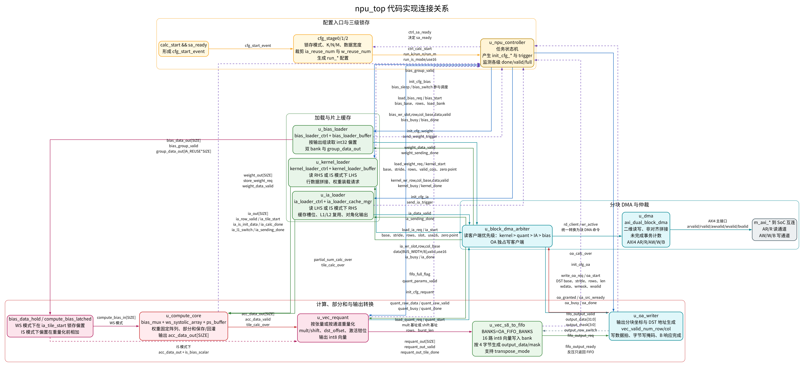
</p>
<p align="center">图3-1 npu_top RTL 完整实例连接关系</p>

#### 3.7.3 接口定义

本模块接口包括时钟复位接口、配置或控制接口、数据输入接口、数据输出接口以及状态反馈接口。下表列出主要信号，位宽按照 RTL 参数化表达；当位宽由参数决定时，表中保留参数名。

| 信号名 | 位宽 | 方向 | 时钟域 | 功能描述 | 备注 |
|---|---:|---|---|---|---|
| calc_start | 1 | 输入 | NPU 时钟域 | 任务启动 | 由 AXI-Lite 控制寄存器产生 |
| cfg_16bits_ia | 1 | 输入 | NPU 时钟域 | IA 位宽模式 | 0 表示 s8，1 表示 s16 |
| cfg_dataflow_mode | 1 | 输入 | NPU 时钟域 | 数据流模式 | 0 WS，1 IS |
| lhs_base/rhs_base/dst_base | 32 | 输入 | NPU 时钟域 | 矩阵基址 | 来自寄存器组 |
| bias_base | 32 | 输入 | NPU 时钟域 | 偏置基地址 | 0 表示无偏置 |
| q_mult_pt/q_shift_pt | 32 | 输入 | NPU 时钟域 | 量化参数或参数数组地址 | 按通道模式下作为地址 |
| k/n/m | 32 | 输入 | NPU 时钟域 | 矩阵维度 | 来自寄存器组 |
| sa_ready | 1 | 输出 | NPU 时钟域 | NPU 可接受启动 | 配置流水和控制器均空闲时为 1 |
| wb_valid | 1 | 输出 | NPU 时钟域 | 任务完成状态有效 | 与寄存器组 ready 握手 |
| wb_ready | 1 | 输入 | NPU 时钟域 | 写回状态可接收 | 当前寄存器组固定为 1 |
| m_axi_rvalid | 1 | 输入 | AXI 时钟域 | DMA 读数据有效 | 来自互连 |
| m_axi_arvalid | 1 | 输出 | AXI 时钟域 | DMA 读地址有效 | 读取 IA/权重/参数 |
| m_axi_awvalid | 1 | 输出 | AXI 时钟域 | DMA 写地址有效 | 输出写回 |
| m_axi_wvalid | 1 | 输出 | AXI 时钟域 | DMA 写数据有效 | 携带输出数据和字节写掩码 |
| err_code | 2 | 输出 | NPU 时钟域 | 错误码 | 配置或资源错误 |

接口时序上，输入控制信号在时钟有效边沿采样，输出控制信号在寄存器更新后保持到下游完成握手或被状态机清除。valid/ready 类接口以双方同周期为高作为一次传输完成条件；req/done 类接口以请求保持和完成反馈作为一次多周期操作的完成条件。地址、数据和掩码信号在对应 valid 或 req 有效期间保持稳定。

#### 3.7.4 工作流程与状态机

复位后，配置流水级 valid 位为 0，运行参数清零或置为最小有效默认值，各子模块处于空闲状态。`calc_start && sa_ready` 形成启动事件，`cfg_stage0` 锁存软件配置，`cfg_stage1` 根据阵列规模和缓存容量计算可用复用次数，`cfg_stage2` 在 `npu_controller` 空闲时提交运行参数。`ctrl_calc_start` 有效后，控制器初始化加载单元、重量化单元和写回单元。

正常任务中，输入激活、权重、偏置和量化参数通过共享 DMA 读侧进入片上缓存或参数缓存。`compute_core` 完成阵列乘加和部分和保存或回灌，最终 int32 输出进入 `vec_requant`。重量化后的 int8 向量进入输出 FIFO，再由 `oa_writer` 生成 AXI 写请求。`oa_calc_over` 表示输出写回已完成，控制器随后通过 `wb_valid` 向寄存器组报告任务结果。若配置检查失败，控制器进入 ERROR 状态并通过 `err_code` 返回错误类型。

#### 3.7.5 时序行为

启动事件进入三级配置流水后至少经过三个时钟周期才向控制器提交运行参数。加载和写回事务通过 DMA valid/ready 握手推进，地址、行步长、行数、突发长度、槽位编号和写数据在请求被接受前保持稳定。阵列计算存在与阵列规模相关的填充和排空延迟，`partial_sum_calc_over` 和 `tile_calc_over` 用于通知控制器当前计算阶段完成。输出 FIFO 满时，控制器不再发出可能产生新输出的 IA 触发；写回单元未收到 B 响应前不报告对应输出完成。

关键时序信号包括 `cfg_start_event`、`cfg_stage0_valid`、`cfg_stage1_valid`、`cfg_stage2_valid`、`ctrl_calc_start`、`send_ia_trigger`、`send_weight_trigger`、`m_axi_arvalid`、`m_axi_rvalid`、`m_axi_awvalid`、`m_axi_wvalid`、`m_axi_bvalid`、`wb_valid` 和 `sa_ready`。

#### 3.7.6 参数配置说明

本模块不包含软件地址寄存器，配置由 `npu_axil_reg_if` 提供。综合期参数决定阵列规模、数据宽度、总线宽度、输入激活缓存块数、部分和帧数和 DMA 未完成事务深度；运行期字段决定矩阵地址、维度、步长、量化、激活范围、复用请求和数据流模式。

| 名称 | 复位值或参数 | 属性 | 功能含义 |
|---|---|---|---|
| SIZE | 综合参数 | 参数 | 阵列规模和基本分块边长 |
| IA_CACHE_BLOCKS | 综合参数 | 参数 | 输入激活缓存块数，决定复用上限 |
| PS_FRAME_COUNT | 综合参数 | 参数 | 部分和帧数量，影响权重复用窗口 |
| cfg_ia_reuse_num | 运行期输入 | 来自寄存器组 | 输入激活复用请求，0 表示采用硬件默认裁剪值 |
| cfg_w_reuse_num | 运行期输入 | 来自寄存器组 | 权重复用请求，0 表示采用硬件默认裁剪值 |
| cfg_dataflow_mode | 运行期输入 | 来自寄存器组 | 0 表示 WS，1 表示 IS |

`npu_top` 对运行期复用值执行二次裁剪，裁剪结果按 2 的幂取值并受缓存容量、部分和帧数和输出分块数量限制。IS 模式下，输入激活侧和权重侧的角色会在内部互换，但软件可见的 LHS、RHS、DST 和输出矩阵排列保持由寄存器字段定义。

### 3.8 npu_controller模块设计

本模块位于 `npu_top` 内部，是 NPU 任务级控制器。该模块接收三级配置流水提交的启动请求和任务参数，检查基地址、维度、步长和量化参数是否合法，并调度输入激活加载、权重加载、偏置加载、重量化、输出 FIFO 和输出写回。控制器不直接搬移矩阵数据，而是通过初始化脉冲、发送触发和等待条件控制各子模块推进。

#### 3.8.1 功能说明

本模块接收 `calc_start`、配置字段、加载单元数据有效标志、发送完成标志、偏置可用标志、量化参数可用标志、FIFO 满标志、阵列拖尾完成标志和输出写回完成标志。输出侧产生 `init_cfg_ia`、`init_cfg_weight`、`init_cfg_bias`、`init_cfg_requant`、`init_cfg_oa`、`send_weight_trigger`、`send_ia_trigger`、`wb_valid` 和 `err_code`。当配置合法且数据供给条件满足时，控制器交替发出权重发送触发和输入激活发送触发；当输出写回完成时，控制器通过 writeback 握手返回任务状态。

#### 3.8.2 结构组成

内部包含配置检查函数、错误类型选择函数、主状态机、配置位锁存寄存器、计算拖尾等待寄存器、初始化脉冲生成逻辑、发送触发生成逻辑和 writeback 状态生成逻辑。`check_config_valid` 检查 LHS/RHS/DST 指针非零、K/N/M 非零、三类步长非零，以及按通道量化时乘法系数地址和移位参数地址非零。状态机处于 NPU 时钟域，`rst_n` 复位后进入 IDLE，所有初始化脉冲和发送触发为 0，错误码为正常。

#### 3.8.3 接口定义

本模块接口包括时钟复位接口、配置或控制接口、数据输入接口、数据输出接口以及状态反馈接口。下表列出主要信号，位宽按照 RTL 参数化表达；当位宽由参数决定时，表中保留参数名。

| 信号名 | 位宽 | 方向 | 时钟域 | 功能描述 | 备注 |
|---|---:|---|---|---|---|
| calc_start | 1 | 输入 | NPU 时钟域 | 启动请求 | IDLE 状态采样 |
| lhs_base/rhs_base/dst_base | 32 | 输入 | NPU 时钟域 | 基地址 | 用于合法性检查 |
| k/n/m | 32 | 输入 | NPU 时钟域 | 维度配置 | 不能为 0 |
| weight_data_valid | 1 | 输入 | NPU 时钟域 | 权重数据有效 | 允许进入计算 |
| ia_data_valid | 1 | 输入 | NPU 时钟域 | IA 数据有效 | 允许发送 IA |
| fifo_full_flag | 1 | 输入 | NPU 时钟域 | 输出 FIFO 满 | 满时暂停推进 |
| oa_calc_over | 1 | 输入 | NPU 时钟域 | 输出写回完成 | 允许任务结束 |
| partial_sum_calc_over | 1 | 输入 | NPU 时钟域 | 阵列拖尾完成 | 清除 compute_tail_pending |
| init_cfg_ia | 1 | 输出 | NPU 时钟域 | 初始化输入激活加载单元 | 单周期脉冲 |
| init_cfg_weight | 1 | 输出 | NPU 时钟域 | 初始化权重加载单元 | 单周期脉冲 |
| init_cfg_bias | 1 | 输出 | NPU 时钟域 | 初始化偏置加载单元 | 单周期脉冲 |
| init_cfg_requant | 1 | 输出 | NPU 时钟域 | 初始化重量化单元 | 单周期脉冲 |
| init_cfg_oa | 1 | 输出 | NPU 时钟域 | 初始化输出写回单元 | 单周期脉冲 |
| send_ia_trigger | 1 | 输出 | NPU 时钟域 | 发送 IA 触发 | 驱动输入激活加载单元 |
| send_weight_trigger | 1 | 输出 | NPU 时钟域 | 发送权重触发 | 驱动权重加载单元 |
| wb_valid/wb_ready | 1/1 | 输出/输入 | NPU 时钟域 | 任务状态写回握手 | 完成或错误时有效 |
| err_code | 2 | 输出 | NPU 时钟域 | 错误码 | 软件通过 status 读取 |

接口时序上，输入控制信号在时钟有效边沿采样，输出控制信号在寄存器更新后保持到下游完成握手或被状态机清除。valid/ready 类接口以双方同周期为高作为一次传输完成条件；req/done 类接口以请求保持和完成反馈作为一次多周期操作的完成条件。地址、数据和掩码信号在对应 valid 或 req 有效期间保持稳定。

#### 3.8.4 工作流程与状态机

复位后，状态机进入 IDLE，`sa_ready` 为 1，初始化脉冲、发送触发和 `wb_valid` 均为 0。状态机包含 IDLE、INIT、WEIGHT_START、WEIGHT_WAIT、IA_START、IA_WAIT、WAIT_WB 和 ERROR。IDLE 等待 `calc_start`；若配置检查失败则进入 ERROR，若配置合法则进入 INIT。INIT 输出各子模块初始化脉冲并锁存 `cfg_16bits_ia`。WEIGHT_START 在权重数据有效、阵列拖尾允许且输出未结束时发出 `send_weight_trigger`，随后进入 WEIGHT_WAIT 等待 `weight_sending_done`。IA_START 在输入激活数据、偏置、量化参数和 FIFO 条件满足时发出 `send_ia_trigger`，随后进入 IA_WAIT 等待 `ia_sending_done`。

控制器使用 `compute_tail_pending` 跟踪上一次输入激活触发后阵列仍需排空的周期。该标志在 `send_ia_trigger` 后置位，在 `partial_sum_calc_over` 有效后清除，权重触发需要等待该条件满足。若输出写回单元报告 `oa_calc_over`，控制器进入 WAIT_WB 或直接回到 IDLE，具体取决于 `wb_ready`。ERROR 状态保持错误码，并在 writeback 握手完成后返回 IDLE。

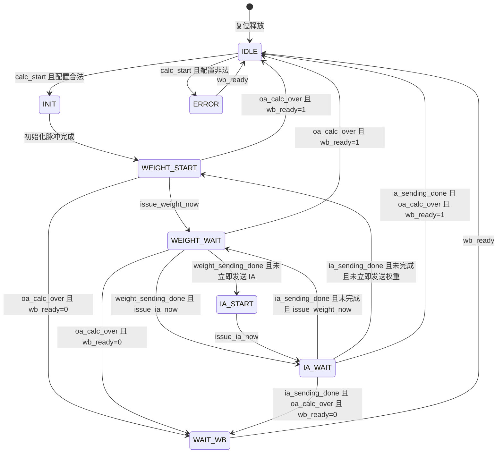
<p align="center">图3-2 npu_controller 状态机关系</p>

#### 3.8.5 时序行为

`calc_start` 只在 IDLE 被采样。INIT 状态的初始化输出均为单周期脉冲。WEIGHT_START 和 IA_START 中的发送触发同样为单周期脉冲，发出后必须进入对应 WAIT 状态等待发送完成反馈。`fifo_full_flag` 为 1 时，IA_START 不发出新的 IA 触发，避免重量化输出继续进入已满 FIFO。`wb_valid` 在 `oa_calc_over`、WAIT_WB 或 ERROR 条件下有效，直到 `wb_ready` 完成握手。错误码在 ERROR 状态写入，IDLE 状态清回正常值。

关键时序信号包括 `calc_start`、`current_state`、`next_state`、`init_cfg_*`、`send_weight_trigger`、`send_ia_trigger`、`weight_sending_done`、`ia_sending_done`、`partial_sum_calc_over`、`fifo_full_flag`、`oa_calc_over`、`wb_valid` 和 `err_code`。

#### 3.8.6 参数配置说明

本模块不包含软件地址寄存器。运行参数由 `npu_top` 的配置锁存级提供，综合参数决定阵列规模、数据位宽、总线位宽和寄存器位宽。控制器内部只保存状态机状态、配置检查结果、错误类型、16 bit 输入模式锁存值和计算拖尾等待标志。

| 名称 | 复位值或参数 | 属性 | 功能含义 |
|---|---|---|---|
| ERR_NONE | 2b00 | 内部编码 | 正常 |
| ERR_CONFIG | 2b01 | 内部编码 | 维度、步长或量化参数配置非法 |
| ERR_RESOURCE | 2b10 | 内部编码 | LHS、RHS 或 DST 必要指针为 0 |

配置检查规则由 RTL 函数 `check_config_valid` 和 `get_error_type` 定义。该规则只检查硬件启动所需的基础条件，不替代软件对算子布局、缓冲区生命周期和数据类型的检查。

### 3.9 ia_loader_ctrl模块设计

本模块位于npu_top / ia_loader中，生成左矩阵输入激活的 DMA 读请求，管理输入激活缓存槽位、复用循环和阵列输入发送。上级控制来自 npu_controller，下级连接 DMA 仲裁器和输入激活缓存管理单元。本小节围绕 RTL 已实现的控制、数据搬移、缓存、仲裁、配置和状态维护功能展开，重点说明接口、状态机、寄存器和时序行为。

#### 3.9.1 功能说明

本模块接收的主要输入包括 init_cfg、send_ia_trigger、lhs_base、lhs_row_stride_b、k/n/m、dma_rd_done 等信号，输出的主要结果包括 dma_rd_req、dma_base_addr、dma_row_stride、dma_rows_to_read、dma_valid_cols、ia_data_valid 等信号。生成左矩阵输入激活的 DMA 读请求，管理输入激活缓存槽位、复用循环和阵列输入发送。在系统运行过程中，该模块通过时钟边沿采样输入条件，更新内部寄存器或状态标志，并在满足握手、完成或错误条件后驱动下游接口。

#### 3.9.2 结构组成

内部包含状态机、分块几何计算单元、L1/L2 复用计数器、槽位分配单元、DMA 请求保持寄存器、tail 行列计算单元和 IA 发送计数器。这些子单元在同一时钟域内通过寄存器和握手信号协同工作。NPU 时钟域，低有效复位。复位后状态机进入 S_IDLE，槽位指针、循环计数和请求保持寄存器清零。复位处理的目标是使状态机、计数器、有效标志、请求保持寄存器和输出寄存器进入确定状态，避免复位释放后产生虚假请求或错误完成标志。

#### 3.9.3 接口定义

本模块接口包括时钟复位接口、配置或控制接口、数据输入接口、数据输出接口以及状态反馈接口。下表列出主要信号，位宽按照 RTL 参数化表达；当位宽由参数决定时，表中保留参数名。

| 信号名 | 位宽 | 方向 | 时钟域 | 功能描述 | 备注 |
|---|---:|---|---|---|---|
| init_cfg | 1 | 输入 | NPU 时钟域 | 初始化配置 | 控制器发出 |
| send_ia_trigger | 1 | 输入 | NPU 时钟域 | 发送触发 | 开始或继续 IA 发送 |
| lhs_base | 32 | 输入 | NPU 时钟域 | 左矩阵基址 | 来自寄存器组 |
| lhs_row_stride_b | 32 | 输入 | NPU 时钟域 | 左矩阵行跨度 | 字节单位 |
| k/n/m | 32 | 输入 | NPU 时钟域 | 矩阵维度 | 用于分块几何计算 |
| dma_rd_done | 1 | 输入 | NPU 时钟域 | DMA 读完成 | 释放加载状态 |
| blk_valid/blk_busy | 若干 | 输入 | NPU 时钟域 | 缓存槽位状态 | 决定是否可加载或释放 |
| dma_rd_req | 1 | 输出 | NPU 时钟域 | DMA 读请求 | 请求输入激活分块 |
| dma_base_addr | 32 | 输出 | NPU 时钟域 | DMA 基地址 | 分块首地址 |
| dma_row_stride | 32 | 输出 | NPU 时钟域 | DMA 行跨度 | 字节单位 |
| dma_rows_to_read | 若干 | 输出 | NPU 时钟域 | 读取行数 | tail 裁剪后 |
| dma_valid_cols | 若干 | 输出 | NPU 时钟域 | 有效列数 | tail 裁剪后 |
| ia_data_valid | 1 | 输出 | NPU 时钟域 | IA 输出有效 | 供控制器判断 |
| ia_sending_done | 1 | 输出 | NPU 时钟域 | IA 发送完成 | 本组发送结束 |

接口时序上，输入控制信号在时钟有效边沿采样，输出控制信号在寄存器更新后保持到下游完成握手或被状态机清除。valid/ready 类接口以双方同周期为高作为一次传输完成条件；req/done 类接口以请求保持和完成反馈作为一次多周期操作的完成条件。地址、数据和掩码信号在对应 valid 或 req 有效期间保持稳定。

#### 3.9.4 工作流程与状态机

复位后，NPU 时钟域，低有效复位。复位后状态机进入 S_IDLE，槽位指针、循环计数和请求保持寄存器清零。启动或运行条件由上游控制信号给出，模块在配置字段稳定后进入正常工作。状态机包含 S_IDLE、S_INIT、S_LOAD、S_SEND 和 S_DONE。S_INIT 计算几何参数；S_LOAD 在缓存有空槽位时发起 DMA；S_SEND 按复用顺序输出 IA；S_DONE 通知控制器本次发送完成。

init_cfg 被采样后进入初始化。dma_rd_req 在命令字段稳定后保持到仲裁器接受。DMA 返回并写入缓存后，blk_valid 置位。发送阶段按时钟推进 ia_idx、w_group_idx、l1_idx 和 l2_idx；当最后一个有效元素发送完成后置 ia_sending_done。异常处理方面，当下游无法接受数据、FIFO 满、DMA 未完成、响应未返回或配置非法时，模块保持当前状态或输出错误信息，不应在未完成握手时推进内部计数器。

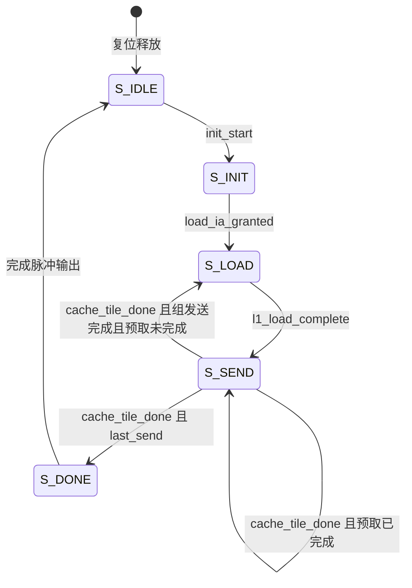
<p align="center">图3-3 ia_loader_ctrl 状态机关系</p>

#### 3.9.5 时序行为

init_cfg 被采样后进入初始化。dma_rd_req 在命令字段稳定后保持到仲裁器接受。DMA 返回并写入缓存后，blk_valid 置位。发送阶段按时钟推进 ia_idx、w_group_idx、l1_idx 和 l2_idx；当最后一个有效元素发送完成后置 ia_sending_done。多周期操作期间，地址、长度、模式和选择信号在请求被接受前保持不变；数据输出在 valid 有效期间保持稳定；完成信号只在最后一个必要响应或最后一个有效数据被处理后产生。若下游反压，模块保持当前寄存器值并停止推进相关计数器。

关键时序信号包括 init_cfg、send_ia_trigger、lhs_base、lhs_row_stride_b、k/n/m、dma_rd_done、blk_valid/blk_busy、dma_rd_req。这些信号用于描述采样、保持、更新和完成条件。

#### 3.9.6 参数配置说明

本模块无软件可见寄存器。内部寄存器包括 l2_idx、l1_idx、w_group_idx、w_cnt、ia_idx、wr_slot_ptr、rd_slot_base、tl_base_addr、tl_valid_cols 和 tl_burst_len_m1。

| 名称 | 复位值或参数 | 属性 | 功能含义 |
|---|---|---|---|
| cfg_ia_reuse_num | 上游寄存器 | 配置输入 | IA 复用次数 |
| cfg_16bits_ia | CTRL bit1 | 配置输入 | IA 数据宽度选择 |

软件不直接访问该模块；运行期配置由上级寄存器组或控制信号传入，内部状态按 RTL 复位分支和时钟逻辑更新。

### 3.10 ia_loader_cache_mgr模块设计

本模块位于ia_loader中，保存 DMA 读回的输入激活，并按脉动阵列要求产生对角化输入流。上级为 ia_loader_ctrl 和 DMA 读数据，下级为 compute_core 的 IA 输入。本小节围绕 RTL 已实现的控制、数据搬移、缓存、仲裁、配置和状态维护功能展开，重点说明接口、状态机、寄存器和时序行为。

#### 3.10.1 功能说明

本模块接收的主要输入包括 wr_valid、wr_data、wr_slot_id、rd_slot_base、rd_en、lhs_zp 等信号，输出的主要结果包括 ia_data_out、ia_data_valid、blk_valid、blk_busy 等信号。保存 DMA 读回的输入激活，并按脉动阵列要求产生对角化输入流。在系统运行过程中，该模块通过时钟边沿采样输入条件，更新内部寄存器或状态标志，并在满足握手、完成或错误条件后驱动下游接口。

#### 3.10.2 结构组成

内部包含多槽位输入激活缓存、槽位 valid/busy 标志、写地址计数器、读地址计数器、col0 leader 选择单元和对角化移位寄存器。这些子单元在同一时钟域内通过寄存器和握手信号协同工作。NPU 时钟域，复位后所有槽位 valid 和 busy 清零，移位寄存器回到无效状态。复位处理的目标是使状态机、计数器、有效标志、请求保持寄存器和输出寄存器进入确定状态，避免复位释放后产生虚假请求或错误完成标志。

#### 3.10.3 接口定义

本模块接口包括时钟复位接口、配置或控制接口、数据输入接口、数据输出接口以及状态反馈接口。下表列出主要信号，位宽按照 RTL 参数化表达；当位宽由参数决定时，表中保留参数名。

| 信号名 | 位宽 | 方向 | 时钟域 | 功能描述 | 备注 |
|---|---:|---|---|---|---|
| wr_valid | 1 | 输入 | NPU 时钟域 | 缓存写有效 | DMA 数据到达 |
| wr_data | BUS_WIDTH | 输入 | NPU 时钟域 | 缓存写数据 | s8/s16 解包后写入 |
| wr_slot_id | 若干 | 输入 | NPU 时钟域 | 写槽位号 | 由加载单元控制 |
| rd_slot_base | 若干 | 输入 | NPU 时钟域 | 读槽位基址 | 发送阶段使用 |
| rd_en | 1 | 输入 | NPU 时钟域 | 读推进 | 阵列可接收时有效 |
| lhs_zp | DATA_WIDTH | 输入 | NPU 时钟域 | 输入零点 | 无效计算通道填充值 |
| ia_data_out | SIZE*DATA_WIDTH | 输出 | NPU 时钟域 | 阵列输入向量 | 按对角相位输出 |
| ia_data_valid | 1 | 输出 | NPU 时钟域 | 输出有效 | 与 ia_data_out 同周期 |
| blk_valid | CACHE_BLOCKS | 输出 | NPU 时钟域 | 槽位有效标志 | 供控制器调度 |
| blk_busy | CACHE_BLOCKS | 输出 | NPU 时钟域 | 槽位忙标志 | 防止覆盖 |

接口时序上，输入控制信号在时钟有效边沿采样，输出控制信号在寄存器更新后保持到下游完成握手或被状态机清除。valid/ready 类接口以双方同周期为高作为一次传输完成条件；req/done 类接口以请求保持和完成反馈作为一次多周期操作的完成条件。地址、数据和掩码信号在对应 valid 或 req 有效期间保持稳定。

#### 3.10.4 工作流程与状态机

复位后，NPU 时钟域，复位后所有槽位 valid 和 busy 清零，移位寄存器回到无效状态。启动或运行条件由上游控制信号给出，模块在配置字段稳定后进入正常工作。模块无命名状态机，状态由槽位 valid/busy、读写指针和移位寄存器内容决定。

wr_valid 有效的时钟边沿写入目标槽位。读阶段在 rd_en 有效时从 rd_slot_base 对应槽位取数，并通过移位寄存器在随后的周期对齐各阵列行。若下游不能接收，rd_en 拉低，读指针和输出相位保持。异常处理方面，当下游无法接受数据、FIFO 满、DMA 未完成、响应未返回或配置非法时，模块保持当前状态或输出错误信息，不应在未完成握手时推进内部计数器。

#### 3.10.5 时序行为

wr_valid 有效的时钟边沿写入目标槽位。读阶段在 rd_en 有效时从 rd_slot_base 对应槽位取数，并通过移位寄存器在随后的周期对齐各阵列行。若下游不能接收，rd_en 拉低，读指针和输出相位保持。多周期操作期间，地址、长度、模式和选择信号在请求被接受前保持不变；数据输出在 valid 有效期间保持稳定；完成信号只在最后一个必要响应或最后一个有效数据被处理后产生。若下游反压，模块保持当前寄存器值并停止推进相关计数器。

关键时序信号包括 wr_valid、wr_data、wr_slot_id、rd_slot_base、rd_en、lhs_zp、ia_data_out、ia_data_valid。这些信号用于描述采样、保持、更新和完成条件。

#### 3.10.6 参数配置说明

无软件可见寄存器。内部寄存器包括缓存存储阵列、blk_valid、blk_busy、写指针、读指针和移位参数 register。

| 名称 | 复位值或参数 | 属性 | 功能含义 |
|---|---|---|---|
| CACHE_BLOCKS | 综合参数 | 参数 | 缓存槽位数量 |
| DATA_WIDTH | 综合参数 | 参数 | IA 元素位宽 |

软件不直接访问该模块；运行期配置由上级寄存器组或控制信号传入，内部状态按 RTL 复位分支和时钟逻辑更新。

### 3.11 kernel_loader_ctrl模块设计

本模块位于npu_top / kernel_loader中，生成右矩阵权重的 DMA 读请求，并控制权重数据进入阵列。上级控制来自 npu_controller，下级连接 DMA 仲裁器和 kernel_loader_buffer。本小节围绕 RTL 已实现的控制、数据搬移、缓存、仲裁、配置和状态维护功能展开，重点说明接口、状态机、寄存器和时序行为。

#### 3.11.1 功能说明

本模块接收的主要输入包括 init_cfg、send_weight_trigger、rhs_base、rhs_col_stride_b、k/n/m、dma_rd_done 等信号，输出的主要结果包括 dma_rd_req、dma_base_addr、dma_rows_to_read、dma_valid_cols、weight_data_valid、weight_sending_done 等信号。生成右矩阵权重的 DMA 读请求，并控制权重数据进入阵列。在系统运行过程中，该模块通过时钟边沿采样输入条件，更新内部寄存器或状态标志，并在满足握手、完成或错误条件后驱动下游接口。

#### 3.11.2 结构组成

内部包含权重分块几何计算、DMA 命令生成、加载计数、发送计数、tail 行列裁剪和重复次数控制。这些子单元在同一时钟域内通过寄存器和握手信号协同工作。NPU 时钟域，复位后状态机进入 S_IDLE，计数器和请求保持寄存器清零。复位处理的目标是使状态机、计数器、有效标志、请求保持寄存器和输出寄存器进入确定状态，避免复位释放后产生虚假请求或错误完成标志。

#### 3.11.3 接口定义

本模块接口包括时钟复位接口、配置或控制接口、数据输入接口、数据输出接口以及状态反馈接口。下表列出主要信号，位宽按照 RTL 参数化表达；当位宽由参数决定时，表中保留参数名。

| 信号名 | 位宽 | 方向 | 时钟域 | 功能描述 | 备注 |
|---|---:|---|---|---|---|
| init_cfg | 1 | 输入 | NPU 时钟域 | 初始化权重加载 | 控制器发出 |
| send_weight_trigger | 1 | 输入 | NPU 时钟域 | 发送权重触发 | 开始权重流 |
| rhs_base | 32 | 输入 | NPU 时钟域 | 右矩阵基址 | 来自寄存器组 |
| rhs_col_stride_b | 32 | 输入 | NPU 时钟域 | 右矩阵列跨度 | 字节单位 |
| k/n/m | 32 | 输入 | NPU 时钟域 | 矩阵维度 | 计算分块几何 |
| dma_rd_done | 1 | 输入 | NPU 时钟域 | DMA 读完成 | 加载完成反馈 |
| dma_rd_req | 1 | 输出 | NPU 时钟域 | DMA 读请求 | 请求权重分块 |
| dma_base_addr | 32 | 输出 | NPU 时钟域 | 权重分块地址 | 按列组计算 |
| dma_rows_to_read | 若干 | 输出 | NPU 时钟域 | 读取行数 | tail 裁剪 |
| dma_valid_cols | 若干 | 输出 | NPU 时钟域 | 有效列数 | tail 裁剪 |
| weight_data_valid | 1 | 输出 | NPU 时钟域 | 权重数据有效 | 控制器观察 |
| weight_sending_done | 1 | 输出 | NPU 时钟域 | 权重发送完成 | 本组权重结束 |

接口时序上，输入控制信号在时钟有效边沿采样，输出控制信号在寄存器更新后保持到下游完成握手或被状态机清除。valid/ready 类接口以双方同周期为高作为一次传输完成条件；req/done 类接口以请求保持和完成反馈作为一次多周期操作的完成条件。地址、数据和掩码信号在对应 valid 或 req 有效期间保持稳定。

#### 3.11.4 工作流程与状态机

复位后，NPU 时钟域，复位后状态机进入 S_IDLE，计数器和请求保持寄存器清零。启动或运行条件由上游控制信号给出，模块在配置字段稳定后进入正常工作。状态机包含 S_IDLE、S_INIT、S_RUN 和 S_DONE。S_INIT 计算 valid_n_rows、valid_m_cols 和 repeat_total；S_RUN 发请求并跟踪 loaded_count/sent_count；S_DONE 返回完成。

send_weight_trigger 被采样后，命令字段稳定并拉高 dma_rd_req。DMA 响应写入 buffer 后，控制器按 sent_count 推进权重发送。当最后一组有效权重被发送到阵列后，weight_sending_done 置位一个周期或保持到控制器采样。异常处理方面，当下游无法接受数据、FIFO 满、DMA 未完成、响应未返回或配置非法时，模块保持当前状态或输出错误信息，不应在未完成握手时推进内部计数器。

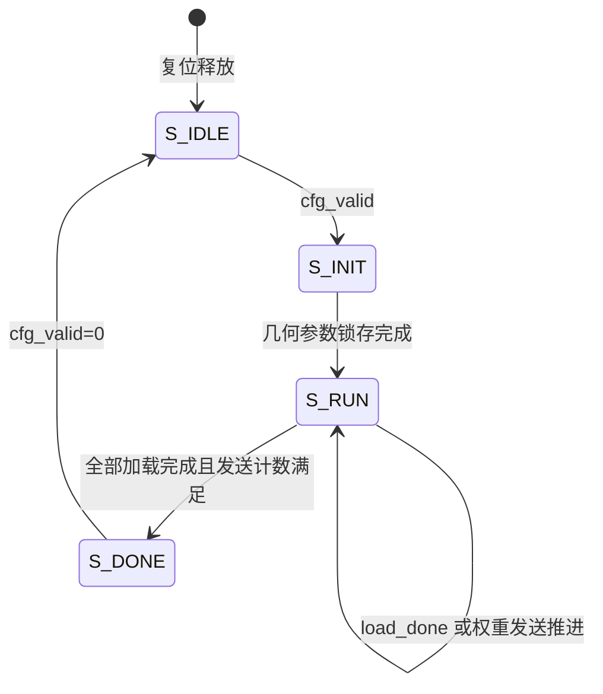
<p align="center">图3-4 kernel_loader_ctrl 状态机关系</p>

#### 3.11.5 时序行为

send_weight_trigger 被采样后，命令字段稳定并拉高 dma_rd_req。DMA 响应写入 buffer 后，控制器按 sent_count 推进权重发送。当最后一组有效权重被发送到阵列后，weight_sending_done 置位一个周期或保持到控制器采样。多周期操作期间，地址、长度、模式和选择信号在请求被接受前保持不变；数据输出在 valid 有效期间保持稳定；完成信号只在最后一个必要响应或最后一个有效数据被处理后产生。若下游反压，模块保持当前寄存器值并停止推进相关计数器。

关键时序信号包括 init_cfg、send_weight_trigger、rhs_base、rhs_col_stride_b、k/n/m、dma_rd_done、dma_rd_req、dma_base_addr。这些信号用于描述采样、保持、更新和完成条件。

#### 3.11.6 参数配置说明

无软件可见寄存器。内部寄存器包括 valid_n_rows、valid_m_cols、repeat_total、loaded_count、sent_count、分块组计数和 DMA 命令保持寄存器。

| 名称 | 复位值或参数 | 属性 | 功能含义 |
|---|---|---|---|
| cfg_w_reuse_num | 上游寄存器 | 配置输入 | 权重复用次数 |
| SIZE | 综合参数 | 参数 | 每组权重列数 |

软件不直接访问该模块；运行期配置由上级寄存器组或控制信号传入，内部状态按 RTL 复位分支和时钟逻辑更新。

### 3.12 kernel_loader_buffer模块设计

本模块位于kernel_loader中，缓存 DMA 读回的权重并按阵列列向量输出。上级为 kernel_loader_ctrl 和 DMA 读数据，下级为 ws_systolic_array。本小节围绕 RTL 已实现的控制、数据搬移、缓存、仲裁、配置和状态维护功能展开，重点说明接口、状态机、寄存器和时序行为。

#### 3.12.1 功能说明

本模块接收的主要输入包括 wr_valid、wr_data、send_weight_trigger、rst_n 等信号，输出的主要结果包括 weight_out、store_weight_req、weight_data_valid、weight_sending_done 等信号。缓存 DMA 读回的权重并按阵列列向量输出。在系统运行过程中，该模块通过时钟边沿采样输入条件，更新内部寄存器或状态标志，并在满足握手、完成或错误条件后驱动下游接口。

#### 3.12.2 结构组成

内部包含权重存储阵列、写指针、读指针、发送计数器、有效标志和输出寄存器。这些子单元在同一时钟域内通过寄存器和握手信号协同工作。NPU 时钟域。复位后读写指针、valid 标志和发送计数清零。复位处理的目标是使状态机、计数器、有效标志、请求保持寄存器和输出寄存器进入确定状态，避免复位释放后产生虚假请求或错误完成标志。

#### 3.12.3 接口定义

本模块接口包括时钟复位接口、配置或控制接口、数据输入接口、数据输出接口以及状态反馈接口。下表列出主要信号，位宽按照 RTL 参数化表达；当位宽由参数决定时，表中保留参数名。

| 信号名 | 位宽 | 方向 | 时钟域 | 功能描述 | 备注 |
|---|---:|---|---|---|---|
| wr_valid | 1 | 输入 | NPU 时钟域 | 写 buffer 有效 | 权重数据到达 |
| wr_data | BUS_WIDTH | 输入 | NPU 时钟域 | 写入权重数据 | 来自 DMA |
| send_weight_trigger | 1 | 输入 | NPU 时钟域 | 发送触发 | 开始输出权重 |
| rst_n | 1 | 输入 | NPU 时钟域 | 低有效复位 | 清空控制寄存器 |
| weight_out | SIZE*WEIGHT_WIDTH | 输出 | NPU 时钟域 | 权重向量 | 送入阵列 |
| store_weight_req | 1 或 SIZE | 输出 | NPU 时钟域 | 权重装载请求 | PE 捕获权重 |
| weight_data_valid | 1 | 输出 | NPU 时钟域 | 权重输出有效 | 供控制器判断 |
| weight_sending_done | 1 | 输出 | NPU 时钟域 | 发送完成 | 本组权重完成 |

接口时序上，输入控制信号在时钟有效边沿采样，输出控制信号在寄存器更新后保持到下游完成握手或被状态机清除。valid/ready 类接口以双方同周期为高作为一次传输完成条件；req/done 类接口以请求保持和完成反馈作为一次多周期操作的完成条件。地址、数据和掩码信号在对应 valid 或 req 有效期间保持稳定。

#### 3.12.4 工作流程与状态机

复位后，NPU 时钟域。复位后读写指针、valid 标志和发送计数清零。启动或运行条件由上游控制信号给出，模块在配置字段稳定后进入正常工作。模块主要由读写指针和发送计数控制，不含复杂枚举状态。

wr_valid 有效时在时钟边沿写入 buffer。发送阶段，读指针按阵列列向量步进，weight_out 在寄存器更新后保持到下游采样。store_weight_req 有效周期内，PE 在同一时钟边沿捕获对应权重。异常处理方面，当下游无法接受数据、FIFO 满、DMA 未完成、响应未返回或配置非法时，模块保持当前状态或输出错误信息，不应在未完成握手时推进内部计数器。

#### 3.12.5 时序行为

wr_valid 有效时在时钟边沿写入 buffer。发送阶段，读指针按阵列列向量步进，weight_out 在寄存器更新后保持到下游采样。store_weight_req 有效周期内，PE 在同一时钟边沿捕获对应权重。多周期操作期间，地址、长度、模式和选择信号在请求被接受前保持不变；数据输出在 valid 有效期间保持稳定；完成信号只在最后一个必要响应或最后一个有效数据被处理后产生。若下游反压，模块保持当前寄存器值并停止推进相关计数器。

关键时序信号包括 wr_valid、wr_data、send_weight_trigger、rst_n、weight_out、store_weight_req、weight_data_valid、weight_sending_done。这些信号用于描述采样、保持、更新和完成条件。

#### 3.12.6 参数配置说明

无软件可见寄存器。内部寄存器包括权重 RAM、写指针、读指针、发送计数和输出有效标志。

| 名称 | 复位值或参数 | 属性 | 功能含义 |
|---|---|---|---|
| WEIGHT_WIDTH | 综合参数 | 参数 | 权重元素位宽 |
| SIZE | 综合参数 | 参数 | 每拍输出权重数量 |

软件不直接访问该模块；运行期配置由上级寄存器组或控制信号传入，内部状态按 RTL 复位分支和时钟逻辑更新。

### 3.13 bias_loader_ctrl模块设计

本模块位于npu_top / bias_loader中，按输出通道组读取偏置，并向计算核心提供初始累加值。上级控制来自 npu_controller，下级连接 DMA 仲裁器和偏置缓存/偏置 mux。本小节围绕 RTL 已实现的控制、数据搬移、缓存、仲裁、配置和状态维护功能展开，重点说明接口、状态机、寄存器和时序行为。

#### 3.13.1 功能说明

本模块接收的主要输入包括 init_cfg_bias、bias_base、bias_switch、m、dma_rd_done 等信号，输出的主要结果包括 dma_rd_req、dma_base_addr、dma_rows_to_read、bias_valid、bias_sleep 等信号。按输出通道组读取偏置，并向计算核心提供初始累加值。在系统运行过程中，该模块通过时钟边沿采样输入条件，更新内部寄存器或状态标志，并在满足握手、完成或错误条件后驱动下游接口。

#### 3.13.2 结构组成

内部包含组几何计算、双 bank 控制、DMA 命令生成、last 组裁剪、bias_valid 标志和 bias_sleep 处理逻辑。这些子单元在同一时钟域内通过寄存器和握手信号协同工作。NPU 时钟域，复位后状态机进入 S_IDLE，bank valid 和组计数清零。复位处理的目标是使状态机、计数器、有效标志、请求保持寄存器和输出寄存器进入确定状态，避免复位释放后产生虚假请求或错误完成标志。

#### 3.13.3 接口定义

本模块接口包括时钟复位接口、配置或控制接口、数据输入接口、数据输出接口以及状态反馈接口。下表列出主要信号，位宽按照 RTL 参数化表达；当位宽由参数决定时，表中保留参数名。

| 信号名 | 位宽 | 方向 | 时钟域 | 功能描述 | 备注 |
|---|---:|---|---|---|---|
| init_cfg_bias | 1 | 输入 | NPU 时钟域 | 初始化偏置加载 | 控制器发出 |
| bias_base | 32 | 输入 | NPU 时钟域 | 偏置基地址 | 0 可表示无偏置 |
| bias_switch | 1 | 输入 | NPU 时钟域 | 切换输出通道组 | 由 IA/输出组推进 |
| m | 32 | 输入 | NPU 时钟域 | 输出通道数 | 计算最后一组 |
| dma_rd_done | 1 | 输入 | NPU 时钟域 | DMA 读完成 | 当前组加载完成 |
| dma_rd_req | 1 | 输出 | NPU 时钟域 | DMA 读请求 | 读取偏置 |
| dma_base_addr | 32 | 输出 | NPU 时钟域 | 偏置组地址 | 按输出组递增 |
| dma_rows_to_read | 若干 | 输出 | NPU 时钟域 | 读取行数 | 按组大小计算 |
| bias_valid | 1 | 输出 | NPU 时钟域 | 偏置有效 | 允许计算使用 |
| bias_sleep | 1 | 输出 | NPU 时钟域 | 无偏置或无需等待 | 控制器可跳过等待 |

接口时序上，输入控制信号在时钟有效边沿采样，输出控制信号在寄存器更新后保持到下游完成握手或被状态机清除。valid/ready 类接口以双方同周期为高作为一次传输完成条件；req/done 类接口以请求保持和完成反馈作为一次多周期操作的完成条件。地址、数据和掩码信号在对应 valid 或 req 有效期间保持稳定。

#### 3.13.4 工作流程与状态机

复位后，NPU 时钟域，复位后状态机进入 S_IDLE，bank valid 和组计数清零。启动或运行条件由上游控制信号给出，模块在配置字段稳定后进入正常工作。状态包括 S_IDLE、S_INIT_GEOM、S_INIT_LAST、S_INIT_MARK、S_INIT_GROUP、S_CMD、S_REQ、S_LOAD、S_WAIT、S_NEXT_IDX、S_NEXT_MARK 和 S_NEXT_GROUP。

init_cfg_bias 后计算本任务所需偏置组数。bias_base 为 0 时置 bias_sleep。正常模式下，DMA 请求保持到被接受，读数据完成后置 bias_valid。bias_switch 到来时切换 bank 或发起下一组读取。异常处理方面，当下游无法接受数据、FIFO 满、DMA 未完成、响应未返回或配置非法时，模块保持当前状态或输出错误信息，不应在未完成握手时推进内部计数器。

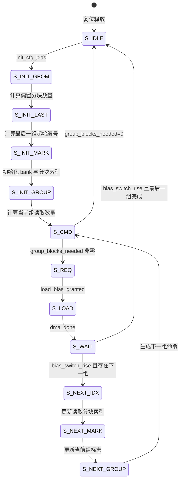
<p align="center">图3-5 bias_loader_ctrl 状态机关系</p>

#### 3.13.5 时序行为

init_cfg_bias 后计算本任务所需偏置组数。bias_base 为 0 时置 bias_sleep。正常模式下，DMA 请求保持到被接受，读数据完成后置 bias_valid。bias_switch 到来时切换 bank 或发起下一组读取。多周期操作期间，地址、长度、模式和选择信号在请求被接受前保持不变；数据输出在 valid 有效期间保持稳定；完成信号只在最后一个必要响应或最后一个有效数据被处理后产生。若下游反压，模块保持当前寄存器值并停止推进相关计数器。

关键时序信号包括 init_cfg_bias、bias_base、bias_switch、m、dma_rd_done、dma_rd_req、dma_base_addr、dma_rows_to_read。这些信号用于描述采样、保持、更新和完成条件。

#### 3.13.6 参数配置说明

无软件可见寄存器。内部寄存器包括 load_block_idx、group_blocks_needed、bank select、last group 标志和 bias_valid。

| 名称 | 复位值或参数 | 属性 | 功能含义 |
|---|---|---|---|
| bias_base | NPU_REG_BIAS_BASE | 经上游输入 | 偏置数组基地址 |
| SIZE | 综合参数 | 参数 | 每组偏置元素数 |

软件不直接访问该模块；运行期配置由上级寄存器组或控制信号传入，内部状态按 RTL 复位分支和时钟逻辑更新。

### 3.14 compute_core模块设计

本模块位于npu_top中，连接偏置、脉动阵列和部分和缓存，完成主要乘加计算。上级调度来自 npu_controller，输入来自输入激活加载单元、权重加载单元和偏置加载单元，输出送往 ps_buffer 或 vec_requant。本小节围绕 RTL 已实现的控制、数据搬移、缓存、仲裁、配置和状态维护功能展开，重点说明接口、状态机、寄存器和时序行为。

#### 3.14.1 功能说明

本模块接收的主要输入包括 ia_data、weight_data、store_weight_req、bias_data、send_ia_trigger 等信号，输出的主要结果包括 acc_data、acc_valid、partial_sum_calc_over、ps_calc_done 等信号。连接偏置、脉动阵列和部分和缓存，完成主要乘加计算。在系统运行过程中，该模块通过时钟边沿采样输入条件，更新内部寄存器或状态标志，并在满足握手、完成或错误条件后驱动下游接口。

#### 3.14.2 结构组成

内部包含 bias_mux、ws_systolic_array、ps_buffer 接口、tail 计数器、分块 start pipeline 和部分和控制逻辑。这些子单元在同一时钟域内通过寄存器和握手信号协同工作。NPU 时钟域，复位后尾部计数、分块 start pipeline 和输出 valid 清零。复位处理的目标是使状态机、计数器、有效标志、请求保持寄存器和输出寄存器进入确定状态，避免复位释放后产生虚假请求或错误完成标志。

<p align="center">图3-6 compute_core 内部阵列、偏置选择与部分和缓冲关系（图形待补充）</p>

#### 3.14.3 接口定义

本模块接口包括时钟复位接口、配置或控制接口、数据输入接口、数据输出接口以及状态反馈接口。下表列出主要信号，位宽按照 RTL 参数化表达；当位宽由参数决定时，表中保留参数名。

| 信号名 | 位宽 | 方向 | 时钟域 | 功能描述 | 备注 |
|---|---:|---|---|---|---|
| ia_data | SIZE*DATA_WIDTH | 输入 | NPU 时钟域 | 输入激活向量 | 来自输入激活缓存 |
| weight_data | SIZE*WEIGHT_WIDTH | 输入 | NPU 时钟域 | 权重向量 | 来自 weight buffer |
| store_weight_req | 1 或 SIZE | 输入 | NPU 时钟域 | 权重装载控制 | 送入阵列 |
| bias_data | SIZE*ACC_WIDTH | 输入 | NPU 时钟域 | 偏置初值 | 来自偏置加载单元 |
| send_ia_trigger | 1 | 输入 | NPU 时钟域 | IA 发送触发 | 控制计算窗口 |
| acc_data | SIZE*ACC_WIDTH | 输出 | NPU 时钟域 | 累加结果向量 | 送往重量化 |
| acc_valid | 1 | 输出 | NPU 时钟域 | 累加结果有效 | 与 acc_data 同周期 |
| partial_sum_calc_over | 1 | 输出 | NPU 时钟域 | 部分和计算完成 | 控制器等待条件 |
| ps_calc_done | 1 | 输出 | NPU 时钟域 | PS 输出完成 | 用于 tail 收尾 |

接口时序上，输入控制信号在时钟有效边沿采样，输出控制信号在寄存器更新后保持到下游完成握手或被状态机清除。valid/ready 类接口以双方同周期为高作为一次传输完成条件；req/done 类接口以请求保持和完成反馈作为一次多周期操作的完成条件。地址、数据和掩码信号在对应 valid 或 req 有效期间保持稳定。

#### 3.14.4 工作流程与状态机

复位后，NPU 时钟域，复位后尾部计数、分块 start pipeline 和输出 valid 清零。启动或运行条件由上游控制信号给出，模块在配置字段稳定后进入正常工作。模块通过 ps_tail_cnt、ia_tile_start_pipe、ps_stream_valid、ps_tile_switch 等寄存器表达计算阶段，无集中枚举状态。

store_weight_req 有效时阵列捕获权重。IA 输入按时钟进入阵列后，部分和需要经过阵列传播延迟。最后一拍 IA 后，ps_tail_cnt 继续计数，直到底部输出全部有效并置 partial_sum_calc_over。异常处理方面，当下游无法接受数据、FIFO 满、DMA 未完成、响应未返回或配置非法时，模块保持当前状态或输出错误信息，不应在未完成握手时推进内部计数器。

#### 3.14.5 时序行为

store_weight_req 有效时阵列捕获权重。IA 输入按时钟进入阵列后，部分和需要经过阵列传播延迟。最后一拍 IA 后，ps_tail_cnt 继续计数，直到底部输出全部有效并置 partial_sum_calc_over。多周期操作期间，地址、长度、模式和选择信号在请求被接受前保持不变；数据输出在 valid 有效期间保持稳定；完成信号只在最后一个必要响应或最后一个有效数据被处理后产生。若下游反压，模块保持当前寄存器值并停止推进相关计数器。

关键时序信号包括 ia_data、weight_data、store_weight_req、bias_data、send_ia_trigger、acc_data、acc_valid、partial_sum_calc_over。这些信号用于描述采样、保持、更新和完成条件。

#### 3.14.6 参数配置说明

无软件可见寄存器。内部寄存器包括 ps_tail_cnt、ia_tile_start_pipe、PS 控制寄存器和输出 valid 寄存器。

| 名称 | 复位值或参数 | 属性 | 功能含义 |
|---|---|---|---|
| cfg_dataflow_mode | CTRL bit3 | 配置输入 | WS 或 IS 模式 |
| PS_FRAME_COUNT | 综合参数 | 参数 | 部分和帧数量 |

软件不直接访问该模块；运行期配置由上级寄存器组或控制信号传入，内部状态按 RTL 复位分支和时钟逻辑更新。

### 3.15 ws_systolic_array模块设计

本模块位于compute_core中，实现参数化权重固定脉动阵列，执行 SIZE×SIZE 并行乘加。上级为 compute_core，下级为部分和输出路径。本小节围绕 RTL 已实现的控制、数据搬移、缓存、仲裁、配置和状态维护功能展开，重点说明接口、状态机、寄存器和时序行为。

#### 3.15.1 功能说明

本模块接收的主要输入包括 data_in、weight_in、sum_in、store_weight_req 等信号，输出的主要结果包括 sum_out、data_pipe、sum_pipe 等信号。实现参数化权重固定脉动阵列，执行 SIZE×SIZE 并行乘加。在系统运行过程中，该模块通过时钟边沿采样输入条件，更新内部寄存器或状态标志，并在满足握手、完成或错误条件后驱动下游接口。

#### 3.15.2 结构组成

阵列由 generate 生成 SIZE×SIZE 个 ws_systolic_cell。每个 PE 包含 data_reg、weight_reg、sum_reg、乘法器和加法器。阵列级逻辑负责 store_weight_req 扇出和行列之间的数据连接。这些子单元在同一时钟域内通过寄存器和握手信号协同工作。NPU 时钟域。复位后 PE 中 data_reg、weight_reg 和 sum_reg 清零或回到 RTL 复位值。复位处理的目标是使状态机、计数器、有效标志、请求保持寄存器和输出寄存器进入确定状态，避免复位释放后产生虚假请求或错误完成标志。

#### 3.15.3 接口定义

本模块接口包括时钟复位接口、配置或控制接口、数据输入接口、数据输出接口以及状态反馈接口。下表列出主要信号，位宽按照 RTL 参数化表达；当位宽由参数决定时，表中保留参数名。

| 信号名 | 位宽 | 方向 | 时钟域 | 功能描述 | 备注 |
|---|---:|---|---|---|---|
| data_in | SIZE*DATA_WIDTH | 输入 | NPU 时钟域 | IA 输入向量 | 按对角相位进入 |
| weight_in | SIZE*WEIGHT_WIDTH | 输入 | NPU 时钟域 | 权重输入向量 | 装载到 PE |
| sum_in | SIZE*ACC_WIDTH | 输入 | NPU 时钟域 | 初始或重放部分和 | 从上方进入 |
| store_weight_req | 1 或 SIZE | 输入 | NPU 时钟域 | 权重装载请求 | 有效时 PE 保存权重 |
| sum_out | SIZE*ACC_WIDTH | 输出 | NPU 时钟域 | 阵列底部输出 | 每列一个累加结果 |
| data_pipe | 内部 | 输出 | NPU 时钟域 | 行向数据传播 | 调试和结构信号 |
| sum_pipe | 内部 | 输出 | NPU 时钟域 | 列向部分和传播 | 调试和结构信号 |

接口时序上，输入控制信号在时钟有效边沿采样，输出控制信号在寄存器更新后保持到下游完成握手或被状态机清除。valid/ready 类接口以双方同周期为高作为一次传输完成条件；req/done 类接口以请求保持和完成反馈作为一次多周期操作的完成条件。地址、数据和掩码信号在对应 valid 或 req 有效期间保持稳定。

#### 3.15.4 工作流程与状态机

复位后，NPU 时钟域。复位后 PE 中 data_reg、weight_reg 和 sum_reg 清零或回到 RTL 复位值。启动或运行条件由上游控制信号给出，模块在配置字段稳定后进入正常工作。阵列无集中状态机。每个 PE 在 store_weight_req 有效时处于权重装载行为，在无效时处于乘加传播行为。

在时钟上升沿，PE 先寄存输入数据和权重或保持权重，然后组合乘积在下一个寄存更新中参与累加。数据沿行传播，部分和沿列传播。阵列输出相对于输入存在与 SIZE 相关的传播延迟。异常处理方面，当下游无法接受数据、FIFO 满、DMA 未完成、响应未返回或配置非法时，模块保持当前状态或输出错误信息，不应在未完成握手时推进内部计数器。

#### 3.15.5 时序行为

在时钟上升沿，PE 先寄存输入数据和权重或保持权重，然后组合乘积在下一个寄存更新中参与累加。数据沿行传播，部分和沿列传播。阵列输出相对于输入存在与 SIZE 相关的传播延迟。多周期操作期间，地址、长度、模式和选择信号在请求被接受前保持不变；数据输出在 valid 有效期间保持稳定；完成信号只在最后一个必要响应或最后一个有效数据被处理后产生。若下游反压，模块保持当前寄存器值并停止推进相关计数器。

关键时序信号包括 data_in、weight_in、sum_in、store_weight_req、sum_out、data_pipe、sum_pipe。这些信号用于描述采样、保持、更新和完成条件。

#### 3.15.6 参数配置说明

无软件可见寄存器。内部寄存器为每个 PE 的 data_reg、weight_reg 和 sum_reg。

| 名称 | 复位值或参数 | 属性 | 功能含义 |
|---|---|---|---|
| SIZE | 综合参数 | 参数 | 阵列行列数 |
| DATA_WIDTH | 综合参数 | 参数 | 输入位宽 |
| WEIGHT_WIDTH | 综合参数 | 参数 | 权重位宽 |

软件不直接访问该模块；运行期配置由上级寄存器组或控制信号传入，内部状态按 RTL 复位分支和时钟逻辑更新。

### 3.16 ps_buffer模块设计

本模块位于compute_core中，保存和重放跨分块的 int32 部分和，避免将中间结果写回外部 RAM。上级为 compute_core 阵列输出，下级为 compute_core replay 输入和 vec_requant。本小节围绕 RTL 已实现的控制、数据搬移、缓存、仲裁、配置和状态维护功能展开，重点说明接口、状态机、寄存器和时序行为。

#### 3.16.1 功能说明

本模块接收的主要输入包括 ps_in、ps_valid、replay_enable、ia_l1_switch、send_ia_trigger 等信号，输出的主要结果包括 ps_out、ps_out_valid、ps_calc_done 等信号。保存和重放跨分块的 int32 部分和，避免将中间结果写回外部 RAM。在系统运行过程中，该模块通过时钟边沿采样输入条件，更新内部寄存器或状态标志，并在满足握手、完成或错误条件后驱动下游接口。

#### 3.16.2 结构组成

内部包含宽 FIFO、帧管理计数器、de-diagonalizer、读写指针、replay 选择逻辑和完成标志生成逻辑。这些子单元在同一时钟域内通过寄存器和握手信号协同工作。NPU 时钟域，复位后 FIFO 指针、帧计数和 valid 标志清零。复位处理的目标是使状态机、计数器、有效标志、请求保持寄存器和输出寄存器进入确定状态，避免复位释放后产生虚假请求或错误完成标志。

#### 3.16.3 接口定义

本模块接口包括时钟复位接口、配置或控制接口、数据输入接口、数据输出接口以及状态反馈接口。下表列出主要信号，位宽按照 RTL 参数化表达；当位宽由参数决定时，表中保留参数名。

| 信号名 | 位宽 | 方向 | 时钟域 | 功能描述 | 备注 |
|---|---:|---|---|---|---|
| ps_in | SIZE*ACC_WIDTH | 输入 | NPU 时钟域 | 写入部分和 | 来自阵列输出 |
| ps_valid | 1 | 输入 | NPU 时钟域 | 写入有效 | 与 ps_in 同周期 |
| replay_enable | 1 | 输入 | NPU 时钟域 | 重放使能 | 跨分块累加时有效 |
| ia_l1_switch | 1 | 输入 | NPU 时钟域 | IA 分组切换 | 更新帧 |
| send_ia_trigger | 1 | 输入 | NPU 时钟域 | 发送触发 | 同步重放时机 |
| ps_out | SIZE*ACC_WIDTH | 输出 | NPU 时钟域 | 重放部分和 | 送回计算路径 |
| ps_out_valid | 1 | 输出 | NPU 时钟域 | 重放数据有效 | 与 ps_out 同周期 |
| ps_calc_done | 1 | 输出 | NPU 时钟域 | 部分和输出完成 | 控制器等待条件 |

接口时序上，输入控制信号在时钟有效边沿采样，输出控制信号在寄存器更新后保持到下游完成握手或被状态机清除。valid/ready 类接口以双方同周期为高作为一次传输完成条件；req/done 类接口以请求保持和完成反馈作为一次多周期操作的完成条件。地址、数据和掩码信号在对应 valid 或 req 有效期间保持稳定。

#### 3.16.4 工作流程与状态机

复位后，NPU 时钟域，复位后 FIFO 指针、帧计数和 valid 标志清零。启动或运行条件由上游控制信号给出，模块在配置字段稳定后进入正常工作。没有集中枚举状态机，状态由 FIFO 读写指针、帧计数器、replay_enable 和 valid 标志定义。

ps_valid 有效时在时钟边沿写入当前帧。replay_enable 有效时，读指针按计算相位读出已保存的部分和。de-diagonalizer 调整输出顺序，使其与新一轮 IA/权重乘积对齐。异常处理方面，当下游无法接受数据、FIFO 满、DMA 未完成、响应未返回或配置非法时，模块保持当前状态或输出错误信息，不应在未完成握手时推进内部计数器。

#### 3.16.5 时序行为

ps_valid 有效时在时钟边沿写入当前帧。replay_enable 有效时，读指针按计算相位读出已保存的部分和。de-diagonalizer 调整输出顺序，使其与新一轮 IA/权重乘积对齐。多周期操作期间，地址、长度、模式和选择信号在请求被接受前保持不变；数据输出在 valid 有效期间保持稳定；完成信号只在最后一个必要响应或最后一个有效数据被处理后产生。若下游反压，模块保持当前寄存器值并停止推进相关计数器。

关键时序信号包括 ps_in、ps_valid、replay_enable、ia_l1_switch、send_ia_trigger、ps_out、ps_out_valid、ps_calc_done。这些信号用于描述采样、保持、更新和完成条件。

#### 3.16.6 参数配置说明

无软件可见寄存器。内部寄存器包括 FIFO 存储、读写指针、帧计数器、输出寄存器和完成标志。

| 名称 | 复位值或参数 | 属性 | 功能含义 |
|---|---|---|---|
| FRAME_COUNT | 综合参数 | 参数 | 部分和帧数量 |
| MAX_IA_REUSE | 综合参数 | 参数 | 最大 IA 复用次数 |

软件不直接访问该模块；运行期配置由上级寄存器组或控制信号传入，内部状态按 RTL 复位分支和时钟逻辑更新。

### 3.17 vec_requant模块设计

本模块位于npu_top中，将 int32 累加结果按 TFLM/NMSIS-NN 量化参数转换为 int8 输出。上级为 compute_core/ps_buffer 输出，下级为 vec_s8_to_fifo。本小节围绕 RTL 已实现的控制、数据搬移、缓存、仲裁、配置和状态维护功能展开，重点说明接口、状态机、寄存器和时序行为。

#### 3.17.1 功能说明

本模块接收的主要输入包括 acc_valid、acc_data、bias_data、use_per_channel、q_mult_pt/q_shift_pt、dma_rd_done 等信号，输出的主要结果包括 dma_rd_req、dma_base_addr、out_valid、out_data、out_tile_done 等信号。将 int32 累加结果按 TFLM/NMSIS-NN 量化参数转换为 int8 输出。在系统运行过程中，该模块通过时钟边沿采样输入条件，更新内部寄存器或状态标志，并在满足握手、完成或错误条件后驱动下游接口。

#### 3.17.2 结构组成

内部包含参数加载状态机、按通道参数缓存、分块/并行通道计数器、十二级左右的重量化流水、乘法拆分、移位、舍入、偏移加法、激活裁剪和饱和单元。这些子单元在同一时钟域内通过寄存器和握手信号协同工作。NPU 时钟域。复位后状态机进入 IDLE，参数缓存、流水 valid 和输出 valid 清零。复位处理的目标是使状态机、计数器、有效标志、请求保持寄存器和输出寄存器进入确定状态，避免复位释放后产生虚假请求或错误完成标志。

#### 3.17.3 接口定义

本模块接口包括时钟复位接口、配置或控制接口、数据输入接口、数据输出接口以及状态反馈接口。下表列出主要信号，位宽按照 RTL 参数化表达；当位宽由参数决定时，表中保留参数名。

| 信号名 | 位宽 | 方向 | 时钟域 | 功能描述 | 备注 |
|---|---:|---|---|---|---|
| acc_valid | 1 | 输入 | NPU 时钟域 | 累加结果有效 | 启动流水 |
| acc_data | SIZE*ACC_WIDTH | 输入 | NPU 时钟域 | int32 累加向量 | 每个并行输出通道一个结果 |
| bias_data | SIZE*ACC_WIDTH | 输入 | NPU 时钟域 | 偏置数据 | 可选参与 |
| use_per_channel | 1 | 输入 | NPU 时钟域 | 按通道选择 | 控制参数选择 |
| q_mult_pt/q_shift_pt | 32 | 输入 | NPU 时钟域 | 按张量参数或指针 | 来自寄存器组 |
| dma_rd_done | 1 | 输入 | NPU 时钟域 | 参数 DMA 完成 | 按通道模式使用 |
| dma_rd_req | 1 | 输出 | NPU 时钟域 | 量化参数读请求 | 按通道模式有效 |
| dma_base_addr | 32 | 输出 | NPU 时钟域 | 参数数组地址 | mult 或移位参数 |
| out_valid | 1 | 输出 | NPU 时钟域 | int8 输出有效 | 与 out_data 同周期 |
| out_data | SIZE*8 | 输出 | NPU 时钟域 | int8 输出向量 | 送入 FIFO |
| out_tile_done | 1 | 输出 | NPU 时钟域 | 分块输出完成 | 控制写回进度 |

接口时序上，输入控制信号在时钟有效边沿采样，输出控制信号在寄存器更新后保持到下游完成握手或被状态机清除。valid/ready 类接口以双方同周期为高作为一次传输完成条件；req/done 类接口以请求保持和完成反馈作为一次多周期操作的完成条件。地址、数据和掩码信号在对应 valid 或 req 有效期间保持稳定。

#### 3.17.4 工作流程与状态机

复位后，NPU 时钟域。复位后状态机进入 IDLE，参数缓存、流水 valid 和输出 valid 清零。启动或运行条件由上游控制信号给出，模块在配置字段稳定后进入正常工作。状态机包含 IDLE、LOAD 和 COMPUTE；按通道参数加载相位包括 PH_MUL 和 PH_SHIFT。IDLE 等待初始化或输入，LOAD 发 DMA 读取参数，COMPUTE 处理累加结果。

acc_valid 被采样后，数据进入 stage0。流水后级每拍推进一级，stage11_valid 有效时 out_data 更新。per-channel 模式下，必须在参数 DMA 完成并写入 ch_multiplier_r、ch_lshift_r、ch_rshift_r 后才允许对应输出通道计算。异常处理方面，当下游无法接受数据、FIFO 满、DMA 未完成、响应未返回或配置非法时，模块保持当前状态或输出错误信息，不应在未完成握手时推进内部计数器。

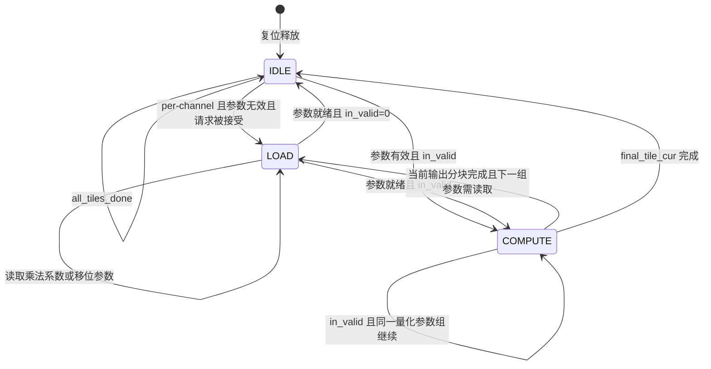
<p align="center">图3-7 vec_requant 状态机关系</p>

#### 3.17.5 时序行为

acc_valid 被采样后，数据进入 stage0。流水后级每拍推进一级，stage11_valid 有效时 out_data 更新。per-channel 模式下，必须在参数 DMA 完成并写入 ch_multiplier_r、ch_lshift_r、ch_rshift_r 后才允许对应输出通道计算。多周期操作期间，地址、长度、模式和选择信号在请求被接受前保持不变；数据输出在 valid 有效期间保持稳定；完成信号只在最后一个必要响应或最后一个有效数据被处理后产生。若下游反压，模块保持当前寄存器值并停止推进相关计数器。

关键时序信号包括 acc_valid、acc_data、bias_data、use_per_channel、q_mult_pt/q_shift_pt、dma_rd_done、dma_rd_req、dma_base_addr。这些信号用于描述采样、保持、更新和完成条件。

#### 3.17.6 参数配置说明

本模块无直接软件地址寄存器，配置来自上级寄存器组输出的 `NPU_REG_Q_MULT`、`NPU_REG_Q_SHIFT`、`NPU_REG_DST_ZP`、`NPU_REG_ACT_MIN` 和 `NPU_REG_ACT_MAX` 字段。内部寄存器包括参数缓存和 stage0 至 stage11 流水寄存器。

| 名称 | 复位值或参数 | 属性 | 功能含义 |
|---|---|---|---|
| NPU_REG_Q_MULT | 0x044 | 经上游输入 | 按张量乘法系数或按通道乘法系数数组地址 |
| NPU_REG_Q_SHIFT | 0x048 | 经上游输入 | 按张量移位参数或按通道移位参数数组地址 |
| NPU_REG_DST_ZP | 0x040 | 经上游输入 | 输出零点 |
| NPU_REG_ACT_MIN/MAX | 0x04c/0x050 | 经上游输入 | 激活裁剪范围 |

软件不直接访问该模块；运行期配置由上级寄存器组或控制信号传入，内部状态按 RTL 复位分支和时钟逻辑更新。

### 3.18 vec_s8_to_fifo模块设计

本模块位于npu_top中，缓存 int8 输出并打包为 32 位写回数据，同时生成字节写掩码。上级为 vec_requant，下级为 oa_writer。本小节围绕 RTL 已实现的控制、数据搬移、缓存、仲裁、配置和状态维护功能展开，重点说明接口、状态机、寄存器和时序行为。

#### 3.18.1 功能说明

本模块接收的主要输入包括 in_valid、in_data、output_ready、transpose_mode、rst_n 等信号，输出的主要结果包括 output_valid、output_data、output_mask、output_row_switch、fifo_full_flag 等信号。缓存 int8 输出并打包为 32 位写回数据，同时生成字节写掩码。在系统运行过程中，该模块通过时钟边沿采样输入条件，更新内部寄存器或状态标志，并在满足握手、完成或错误条件后驱动下游接口。

#### 3.18.2 结构组成

内部包含多 bank FIFO、写 bank 指针、读 bank 指针、bank_count、水位判断、32 位打包单元、字节写掩码生成单元和可选转置读出控制。这些子单元在同一时钟域内通过寄存器和握手信号协同工作。NPU 时钟域。复位后 bank valid、读写 bank、计数器和输出寄存器清零。复位处理的目标是使状态机、计数器、有效标志、请求保持寄存器和输出寄存器进入确定状态，避免复位释放后产生虚假请求或错误完成标志。

#### 3.18.3 接口定义

本模块接口包括时钟复位接口、配置或控制接口、数据输入接口、数据输出接口以及状态反馈接口。下表列出主要信号，位宽按照 RTL 参数化表达；当位宽由参数决定时，表中保留参数名。

| 信号名 | 位宽 | 方向 | 时钟域 | 功能描述 | 备注 |
|---|---:|---|---|---|---|
| in_valid | 1 | 输入 | NPU 时钟域 | int8 输入有效 | 来自重量化 |
| in_data | SIZE*8 | 输入 | NPU 时钟域 | int8 输出向量 | 待打包 |
| output_ready | 1 | 输入 | NPU 时钟域 | 下游可接收 | 来自 OA 写回单元 |
| transpose_mode | 1 | 输入 | NPU 时钟域 | 转置输出模式 | IS 模式相关 |
| rst_n | 1 | 输入 | NPU 时钟域 | 低有效复位 | 清空 FIFO 状态 |
| output_valid | 1 | 输出 | NPU 时钟域 | 打包输出有效 | 与 output_data 同周期 |
| output_data | 32 | 输出 | NPU 时钟域 | 32 位写数据 | 送 DMA 写通道 |
| output_mask | 4 | 输出 | NPU 时钟域 | 字节写掩码 | 尾部字节有效标志 |
| output_row_switch | 1 | 输出 | NPU 时钟域 | 输出行切换 | 供写回单元更新地址 |
| fifo_full_flag | 1 | 输出 | NPU 时钟域 | FIFO 满标志 | 反压控制器 |

接口时序上，输入控制信号在时钟有效边沿采样，输出控制信号在寄存器更新后保持到下游完成握手或被状态机清除。valid/ready 类接口以双方同周期为高作为一次传输完成条件；req/done 类接口以请求保持和完成反馈作为一次多周期操作的完成条件。地址、数据和掩码信号在对应 valid 或 req 有效期间保持稳定。

#### 3.18.4 工作流程与状态机

复位后，NPU 时钟域。复位后 bank valid、读写 bank、计数器和输出寄存器清零。启动或运行条件由上游控制信号给出，模块在配置字段稳定后进入正常工作。模块不使用命名状态机，状态由 write_bank、read_bank、bank_count、stream_active 和 fifo_full_flag 表示。

in_valid 有效时，输入向量被写入当前 bank。output_ready 有效且 FIFO 非空时，模块输出一个 32 位数据拍。最后不足 4 个 int8 时，output_mask 只标记有效字节。若 FIFO 达到保留水位，fifo_full_flag 拉高并反压上游。异常处理方面，当下游无法接受数据、FIFO 满、DMA 未完成、响应未返回或配置非法时，模块保持当前状态或输出错误信息，不应在未完成握手时推进内部计数器。

#### 3.18.5 时序行为

in_valid 有效时，输入向量被写入当前 bank。output_ready 有效且 FIFO 非空时，模块输出一个 32 位数据拍。最后不足 4 个 int8 时，output_mask 只标记有效字节。若 FIFO 达到保留水位，fifo_full_flag 拉高并反压上游。多周期操作期间，地址、长度、模式和选择信号在请求被接受前保持不变；数据输出在 valid 有效期间保持稳定；完成信号只在最后一个必要响应或最后一个有效数据被处理后产生。若下游反压，模块保持当前寄存器值并停止推进相关计数器。

关键时序信号包括 in_valid、in_data、output_ready、transpose_mode、rst_n、output_valid、output_data、output_mask。这些信号用于描述采样、保持、更新和完成条件。

#### 3.18.6 参数配置说明

无软件可见寄存器。内部寄存器包括 bank RAM、读写 bank 指针、计数器、output_data、output_mask 和水位标志。

| 名称 | 复位值或参数 | 属性 | 功能含义 |
|---|---|---|---|
| BANKS | 综合参数 | 参数 | FIFO bank 数量 |
| BUS_WIDTH | 32 默认 | 参数 | 写回数据宽度 |

软件不直接访问该模块；运行期配置由上级寄存器组或控制信号传入，内部状态按 RTL 复位分支和时钟逻辑更新。

### 3.19 oa_writer模块设计

本模块位于npu_top中，根据输出矩阵布局将 FIFO 中的 int8 数据写回系统 RAM。上级为 vec_s8_to_fifo 和 npu_controller，下级为 DMA 仲裁器写客户端。本小节围绕 RTL 已实现的控制、数据搬移、缓存、仲裁、配置和状态维护功能展开，重点说明接口、状态机、寄存器和时序行为。

#### 3.19.1 功能说明

本模块接收的主要输入包括 init_cfg_oa、dst_base、dst_row_stride_b、output_valid、output_data、output_mask 等信号，输出的主要结果包括 write_oa_req、dma_base_addr、dma_row_stride、dma_rows_to_write、dma_burst_len_m1、output_ready 等信号。根据输出矩阵布局将 FIFO 中的 int8 数据写回系统 RAM。在系统运行过程中，该模块通过时钟边沿采样输入条件，更新内部寄存器或状态标志，并在满足握手、完成或错误条件后驱动下游接口。

#### 3.19.2 结构组成

内部包含输出分块几何计算、地址生成单元、DMA 写命令寄存器、FIFO 读取控制、tail 行列裁剪、突发传输长度计算和完成状态机。这些子单元在同一时钟域内通过寄存器和握手信号协同工作。NPU 时钟域。复位后状态机进入 S_IDLE，分块计数、请求寄存器和完成标志清零。复位处理的目标是使状态机、计数器、有效标志、请求保持寄存器和输出寄存器进入确定状态，避免复位释放后产生虚假请求或错误完成标志。

<p align="center">图3-8 oa_writer 输出坐标、字节写掩码与写响应完成关系（图形待补充）</p>

#### 3.19.3 接口定义

本模块接口包括时钟复位接口、配置或控制接口、数据输入接口、数据输出接口以及状态反馈接口。下表列出主要信号，位宽按照 RTL 参数化表达；当位宽由参数决定时，表中保留参数名。

| 信号名 | 位宽 | 方向 | 时钟域 | 功能描述 | 备注 |
|---|---:|---|---|---|---|
| init_cfg_oa | 1 | 输入 | NPU 时钟域 | 输出写回初始化 | 控制器发出 |
| dst_base | 32 | 输入 | NPU 时钟域 | 输出基地址 | 来自寄存器组 |
| dst_row_stride_b | 32 | 输入 | NPU 时钟域 | 输出行跨度 | 字节单位 |
| output_valid | 1 | 输入 | NPU 时钟域 | FIFO 数据有效 | 与 output_data 同周期 |
| output_data | 32 | 输入 | NPU 时钟域 | 打包输出数据 | 写入 RAM |
| output_mask | 4 | 输入 | NPU 时钟域 | 字节写掩码 | 用于生成写 strobe |
| write_done | 1 | 输入 | NPU 时钟域 | DMA 写完成 | 写回结束 |
| write_oa_req | 1 | 输出 | NPU 时钟域 | 写 DMA 请求 | 向仲裁器申请 |
| dma_base_addr | 32 | 输出 | NPU 时钟域 | 写回基地址 | 分块输出首地址 |
| dma_row_stride | 32 | 输出 | NPU 时钟域 | 写回行跨度 | 来自寄存器组 |
| dma_rows_to_write | 若干 | 输出 | NPU 时钟域 | 写回行数 | tail 裁剪 |
| dma_burst_len_m1 | 若干 | 输出 | NPU 时钟域 | 每行突发传输长度 | 数据拍数减一 |
| output_ready | 1 | 输出 | NPU 时钟域 | FIFO 读使能 | 下游可接收时有效 |
| oa_calc_over | 1 | 输出 | NPU 时钟域 | 输出写回完成 | 控制器等待条件 |

接口时序上，输入控制信号在时钟有效边沿采样，输出控制信号在寄存器更新后保持到下游完成握手或被状态机清除。valid/ready 类接口以双方同周期为高作为一次传输完成条件；req/done 类接口以请求保持和完成反馈作为一次多周期操作的完成条件。地址、数据和掩码信号在对应 valid 或 req 有效期间保持稳定。

#### 3.19.4 工作流程与状态机

复位后，NPU 时钟域。复位后状态机进入 S_IDLE，分块计数、请求寄存器和完成标志清零。启动或运行条件由上游控制信号给出，模块在配置字段稳定后进入正常工作。状态机包含 S_IDLE、S_REQ、S_START、S_WRITE 和 S_DONE。S_REQ 申请写通道，S_START 发起 DMA 写，S_WRITE 消费 FIFO 数据，S_DONE 等待写完成并报告。

init_cfg_oa 后计算输出分块总数。进入 S_START 时，dma_base_addr、row_stride、rows_to_write 和 burst_len 保持稳定。S_WRITE 中只有 output_valid 与 DMA 写侧可接收条件同时满足时才拉高 output_ready。write_done 有效后置 oa_calc_over。异常处理方面，当下游无法接受数据、FIFO 满、DMA 未完成、响应未返回或配置非法时，模块保持当前状态或输出错误信息，不应在未完成握手时推进内部计数器。

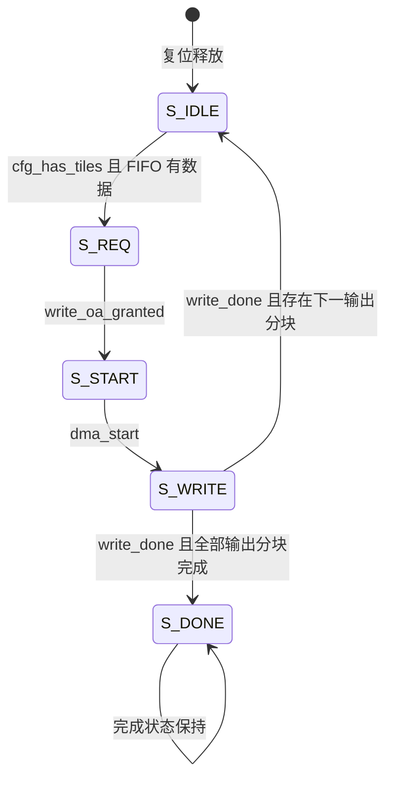
<p align="center">图3-9 oa_writer 状态机关系</p>

#### 3.19.5 时序行为

init_cfg_oa 后计算输出分块总数。进入 S_START 时，dma_base_addr、row_stride、rows_to_write 和 burst_len 保持稳定。S_WRITE 中只有 output_valid 与 DMA 写侧可接收条件同时满足时才拉高 output_ready。write_done 有效后置 oa_calc_over。多周期操作期间，地址、长度、模式和选择信号在请求被接受前保持不变；数据输出在 valid 有效期间保持稳定；完成信号只在最后一个必要响应或最后一个有效数据被处理后产生。若下游反压，模块保持当前寄存器值并停止推进相关计数器。

关键时序信号包括 init_cfg_oa、dst_base、dst_row_stride_b、output_valid、output_data、output_mask、write_done、write_oa_req。这些信号用于描述采样、保持、更新和完成条件。

#### 3.19.6 参数配置说明

本模块无独立软件地址寄存器，配置来自上级寄存器组输出的 `NPU_REG_DST_BASE` 和 `NPU_REG_DST_STRIDE_B` 字段。内部寄存器包括分块行列计数、`rows_valid_cur_tile`、每行数据拍计数、`dma_base_addr` 和状态寄存器。

| 名称 | 复位值或参数 | 属性 | 功能含义 |
|---|---|---|---|
| NPU_REG_DST_BASE | 0x018 | 经上游输入 | 输出矩阵基地址 |
| NPU_REG_DST_STRIDE_B | 0x034 | 经上游输入 | 输出行跨度，单位为字节 |

软件不直接访问该模块；运行期配置由上级寄存器组或控制信号传入，内部状态按 RTL 复位分支和时钟逻辑更新。

### 3.20 axi_block_dma_arbiter模块设计

本模块位于npu_top中，在多个 NPU 读客户端和输出写客户端之间分配共享 DMA 资源。上级请求来自 IA、权重、偏置、quant 和 OA 写回单元，下级为 axi_dual_block_dma。本小节围绕 RTL 已实现的控制、数据搬移、缓存、仲裁、配置和状态维护功能展开，重点说明接口、状态机、寄存器和时序行为。

#### 3.20.1 功能说明

本模块接收的主要输入包括 ia_rd_req、kernel_rd_req、bias_rd_req、quant_rd_req、oa_wr_req、dma_rd_done/dma_wr_done 等信号，输出的主要结果包括 rd_start、wr_start、rd_grant、wr_grant、rd_base_addr、wr_base_addr 等信号。在多个 NPU 读客户端和输出写客户端之间分配共享 DMA 资源。在系统运行过程中，该模块通过时钟边沿采样输入条件，更新内部寄存器或状态标志，并在满足握手、完成或错误条件后驱动下游接口。

#### 3.20.2 结构组成

内部包含读请求仲裁单元、写请求仲裁单元、当前客户端保持寄存器、DMA 命令多路选择器和完成返回解码单元。这些子单元在同一时钟域内通过寄存器和握手信号协同工作。NPU 时钟域。复位后当前 grant、busy 标志和命令保持寄存器清零。复位处理的目标是使状态机、计数器、有效标志、请求保持寄存器和输出寄存器进入确定状态，避免复位释放后产生虚假请求或错误完成标志。

<p align="center">
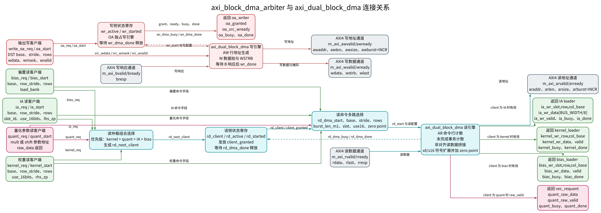
</p>
<p align="center">图3-10 axi_block_dma_arbiter 与 axi_dual_block_dma 连接关系</p>

#### 3.20.3 接口定义

本模块接口包括时钟复位接口、配置或控制接口、数据输入接口、数据输出接口以及状态反馈接口。下表列出主要信号，位宽按照 RTL 参数化表达；当位宽由参数决定时，表中保留参数名。

| 信号名 | 位宽 | 方向 | 时钟域 | 功能描述 | 备注 |
|---|---:|---|---|---|---|
| ia_rd_req | 1 | 输入 | NPU 时钟域 | IA 读请求 | 读取输入分块 |
| kernel_rd_req | 1 | 输入 | NPU 时钟域 | 权重读请求 | 读取权重分块 |
| bias_rd_req | 1 | 输入 | NPU 时钟域 | 偏置读请求 | 读取偏置 |
| quant_rd_req | 1 | 输入 | NPU 时钟域 | 量化参数读请求 | 按通道模式 |
| oa_wr_req | 1 | 输入 | NPU 时钟域 | 输出写请求 | 写回输出 |
| dma_rd_done/dma_wr_done | 1 | 输入 | NPU 时钟域 | DMA 完成 | 释放 grant |
| rd_start | 1 | 输出 | NPU 时钟域 | DMA 读启动 | 发送给双向 DMA |
| wr_start | 1 | 输出 | NPU 时钟域 | DMA 写启动 | 发送给双向 DMA |
| rd_grant | 若干 | 输出 | NPU 时钟域 | 读 grant | 返回对应客户端 |
| wr_grant | 1 | 输出 | NPU 时钟域 | 写 grant | 返回 OA 写回单元 |
| rd_base_addr | 32 | 输出 | NPU 时钟域 | 读基地址 | 来自获选客户端 |
| wr_base_addr | 32 | 输出 | NPU 时钟域 | 写基地址 | 来自 OA 写回单元 |

接口时序上，输入控制信号在时钟有效边沿采样，输出控制信号在寄存器更新后保持到下游完成握手或被状态机清除。valid/ready 类接口以双方同周期为高作为一次传输完成条件；req/done 类接口以请求保持和完成反馈作为一次多周期操作的完成条件。地址、数据和掩码信号在对应 valid 或 req 有效期间保持稳定。

#### 3.20.4 工作流程与状态机

复位后，NPU 时钟域。复位后当前 grant、busy 标志和命令保持寄存器清零。启动或运行条件由上游控制信号给出，模块在配置字段稳定后进入正常工作。状态由读 busy、写 busy、当前读 grant 和当前写 grant 表示。读 grant 保持到 rd_done，写 grant 保持到 wr_done。

当某个读客户端请求有效且读 DMA 空闲时，仲裁器在时钟边沿锁存该客户端命令并拉高 rd_start。DMA 接受后，命令保持到 rd_done。写侧采用独立流程，允许读写引擎并行工作。异常处理方面，当下游无法接受数据、FIFO 满、DMA 未完成、响应未返回或配置非法时，模块保持当前状态或输出错误信息，不应在未完成握手时推进内部计数器。

#### 3.20.5 时序行为

当某个读客户端请求有效且读 DMA 空闲时，仲裁器在时钟边沿锁存该客户端命令并拉高 rd_start。DMA 接受后，命令保持到 rd_done。写侧采用独立流程，允许读写引擎并行工作。多周期操作期间，地址、长度、模式和选择信号在请求被接受前保持不变；数据输出在 valid 有效期间保持稳定；完成信号只在最后一个必要响应或最后一个有效数据被处理后产生。若下游反压，模块保持当前寄存器值并停止推进相关计数器。

关键时序信号包括 ia_rd_req、kernel_rd_req、bias_rd_req、quant_rd_req、oa_wr_req、dma_rd_done/dma_wr_done、rd_start、wr_start。这些信号用于描述采样、保持、更新和完成条件。

#### 3.20.6 参数配置说明

无软件可见寄存器。内部寄存器包括 current_rd_client、current_wr_client、rd_busy、wr_busy 和命令保持字段。

| 名称 | 复位值或参数 | 属性 | 功能含义 |
|---|---|---|---|
| READ_OUTSTANDING | 综合参数 | 参数 | 读侧在途深度传递给 DMA |
| WRITE_OUTSTANDING | 综合参数 | 参数 | 写侧在途深度传递给 DMA |

软件不直接访问该模块；运行期配置由上级寄存器组或控制信号传入，内部状态按 RTL 复位分支和时钟逻辑更新。

### 3.21 axi_dual_block_dma模块设计

本模块位于npu_top中，执行二维分块读写、AXI 突发传输、非对齐处理和读写通道并行。上级为 axi_block_dma_arbiter，下级为 SoC AXI 互连的 NPU 主设备端口。本小节围绕 RTL 已实现的控制、数据搬移、缓存、仲裁、配置和状态维护功能展开，重点说明接口、状态机、寄存器和时序行为。

#### 3.21.1 功能说明

本模块接收的主要输入包括 rd_start、rd_base_addr、rd_row_stride、rd_rows_to_read、wr_start、wr_base_addr 等信号，输出的主要结果包括 m_axi_arvalid、m_axi_arlen、rd_data_valid、m_axi_awvalid、m_axi_wvalid、m_axi_wstrb 等信号。执行二维分块读写、AXI 突发传输、非对齐处理和读写通道并行。在系统运行过程中，该模块通过时钟边沿采样输入条件，更新内部寄存器或状态标志，并在满足握手、完成或错误条件后驱动下游接口。

#### 3.21.2 结构组成

内部包含读地址生成单元、读响应解包单元、写地址生成单元、写数据发送单元、B 响应等待单元、非对齐合并逻辑、未完成事务计数器和行列计数器。这些子单元在同一时钟域内通过寄存器和握手信号协同工作。NPU/AXI 同一时钟域。复位后读写状态、地址寄存器、未完成事务计数、非对齐缓冲和 done 标志清零。复位处理的目标是使状态机、计数器、有效标志、请求保持寄存器和输出寄存器进入确定状态，避免复位释放后产生虚假请求或错误完成标志。

#### 3.21.3 接口定义

本模块接口包括时钟复位接口、配置或控制接口、数据输入接口、数据输出接口以及状态反馈接口。下表列出主要信号，位宽按照 RTL 参数化表达；当位宽由参数决定时，表中保留参数名。

| 信号名 | 位宽 | 方向 | 时钟域 | 功能描述 | 备注 |
|---|---:|---|---|---|---|
| rd_start | 1 | 输入 | NPU 时钟域 | 读启动 | 锁存读命令 |
| rd_base_addr | 32 | 输入 | NPU 时钟域 | 读基地址 | 二维分块首地址 |
| rd_row_stride | 32 | 输入 | NPU 时钟域 | 读行跨度 | 字节单位 |
| rd_rows_to_read | 若干 | 输入 | NPU 时钟域 | 读行数 | tail 裁剪后 |
| wr_start | 1 | 输入 | NPU 时钟域 | 写启动 | 锁存写命令 |
| wr_base_addr | 32 | 输入 | NPU 时钟域 | 写基地址 | 输出分块首地址 |
| src_valid/src_data/src_mask | 若干 | 输入 | NPU 时钟域 | 写数据流 | 来自输出 FIFO |
| m_axi_arready/m_axi_awready/m_axi_wready | 1 | 输入 | AXI 时钟域 | AXI ready | 下游接受 |
| m_axi_arvalid | 1 | 输出 | AXI 时钟域 | 读地址有效 | 保持到 arready |
| m_axi_arlen | 8 | 输出 | AXI 时钟域 | 读突发长度 | 数据拍数减一 |
| rd_data_valid | 1 | 输出 | NPU 时钟域 | 解包读数据有效 | 返回客户端 |
| m_axi_awvalid | 1 | 输出 | AXI 时钟域 | 写地址有效 | 保持到 awready |
| m_axi_wvalid | 1 | 输出 | AXI 时钟域 | 写数据有效 | 与 wstrb 同周期 |
| m_axi_wstrb | 4 | 输出 | AXI 时钟域 | 字节写使能 | 由 output_mask 转换得到 |
| rd_done/wr_done | 1 | 输出 | NPU 时钟域 | 读写完成 | 返回仲裁器 |

接口时序上，输入控制信号在时钟有效边沿采样，输出控制信号在寄存器更新后保持到下游完成握手或被状态机清除。valid/ready 类接口以双方同周期为高作为一次传输完成条件；req/done 类接口以请求保持和完成反馈作为一次多周期操作的完成条件。地址、数据和掩码信号在对应 valid 或 req 有效期间保持稳定。

#### 3.21.4 工作流程与状态机

复位后，NPU/AXI 同一时钟域。复位后读写状态、地址寄存器、未完成事务计数、非对齐缓冲和 done 标志清零。启动或运行条件由上游控制信号给出，模块在配置字段稳定后进入正常工作。读引擎和写引擎分别维护运行状态。读侧在 rd_start 后发起 AR，跟踪 R 数据拍和未完成事务；写侧在 wr_start 后发起 AW/W，等待 B 响应。

rd_start 或 wr_start 被采样后，命令字段被锁存。AR/AW valid 保持到 ready。R 数据拍到达时根据地址偏移解包并输出给客户端。写侧只有 src_valid 且 W 通道可接收时发送 WDATA/WSTRB，最后数据拍拉高 WLAST。所有响应完成后置 rd_done 或 wr_done。异常处理方面，当下游无法接受数据、FIFO 满、DMA 未完成、响应未返回或配置非法时，模块保持当前状态或输出错误信息，不应在未完成握手时推进内部计数器。

#### 3.21.5 时序行为

rd_start 或 wr_start 被采样后，命令字段被锁存。AR/AW valid 保持到 ready。R 数据拍到达时根据地址偏移解包并输出给客户端。写侧只有 src_valid 且 W 通道可接收时发送 WDATA/WSTRB，最后数据拍拉高 WLAST。所有响应完成后置 rd_done 或 wr_done。多周期操作期间，地址、长度、模式和选择信号在请求被接受前保持不变；数据输出在 valid 有效期间保持稳定；完成信号只在最后一个必要响应或最后一个有效数据被处理后产生。若下游反压，模块保持当前寄存器值并停止推进相关计数器。

关键时序信号包括 rd_start、rd_base_addr、rd_row_stride、rd_rows_to_read、wr_start、wr_base_addr、src_valid/src_data/src_mask、m_axi_arready/m_axi_awready/m_axi_wready。这些信号用于描述采样、保持、更新和完成条件。

#### 3.21.6 参数配置说明

无软件可见寄存器。内部寄存器包括 rd_outstanding_cnt、wr_outstanding_cnt、当前行地址、数据拍计数、非对齐前一数据拍缓冲、wr_tail_data、wr_tail_mask 和 done 标志。

| 名称 | 复位值或参数 | 属性 | 功能含义 |
|---|---|---|---|
| READ_OUTSTANDING | 综合参数 | 参数 | 读在途事务上限 |
| WRITE_OUTSTANDING | 综合参数 | 参数 | 写在途事务上限 |
| BUS_WIDTH | 32 默认 | 参数 | AXI 数据位宽 |

软件不直接访问该模块；运行期配置由上级寄存器组或控制信号传入，内部状态按 RTL 复位分支和时钟逻辑更新。

### 3.22 soc_axi_pingpong_buffer模块设计

本模块位于 SoC AXI 数据通路中，负责在 AXI 主从接口之间插入逐通道缓冲寄存器。该模块的功能范围是保持 AXI 五个通道的 valid/ready 握手规则，改善长组合路径的时序分割，并在下游反压时保存已经接受但尚未转发的数据负载。该模块不改变地址、数据、突发长度、响应码或写掩码的含义。

#### 3.22.1 功能说明

本模块接收上游 AXI 从侧信号，包括 s_axi_arvalid、s_axi_awvalid、s_axi_wvalid、s_axi_rready 和 s_axi_bready 等，同时接收下游 AXI 主侧返回的 m_axi_arready、m_axi_awready、m_axi_wready、m_axi_rvalid 和 m_axi_bvalid 等信号。模块对 AR、R、AW、W 和 B 五个通道分别进行缓冲，将数据负载与 valid 状态寄存后再传递到另一侧。

在系统运行过程中，该模块不参与地址译码和仲裁，也不产生新的事务。其作用是在上游和下游 ready 不同时到达时保持传输数据稳定，防止数据负载在握手完成前变化。设计要求每个通道在 ready 为低时保持 valid 和数据负载，传输顺序、last 标志和 response 字段按握手完成次序传递。

#### 3.22.2 结构组成

模块内部由五个 soc_axi_pingpong_chan 实例组成，分别处理 AR、R、AW、W 和 B 通道。每个通道实例包含输入侧握手、输出侧握手、数据负载寄存器和有效标志寄存器。AR 与 AW 数据负载包含地址、cache、prot、lock、突发传输、len 和 size；W 数据负载包含 data、strb 和 last；R 数据负载包含 data、resp 和 last；B 数据负载包含 resp。

所有通道工作在同一 AXI 时钟域内。复位后，各通道 valid 标志清零，数据负载寄存器内容不作为有效数据使用。该结构不跨时钟域，因此不需要异步 FIFO 或双触发器同步。

#### 3.22.3 接口定义

本模块接口为完整 AXI 缓冲接口，包含上游 s_axi_* 端口和下游 m_axi_* 端口。上游端口面向发起侧或返回侧，下游端口面向被缓冲后的目标侧。

| 信号名 | 位宽 | 方向 | 时钟域 | 功能描述 | 备注 |
|---|---:|---|---|---|---|
| s_axi_arvalid | 1 | 输入 | AXI 时钟域 | 上游读地址有效 | 与 s_axi_arready 握手 |
| s_axi_arready | 1 | 输出 | AXI 时钟域 | 可接收上游读地址 | 缓冲空或输出被接受时有效 |
| m_axi_arvalid | 1 | 输出 | AXI 时钟域 | 下游读地址有效 | 数据负载已寄存或直通 |
| m_axi_arready | 1 | 输入 | AXI 时钟域 | 下游读地址接受 | 完成 AR 转发 |
| s_axi_wvalid | 1 | 输入 | AXI 时钟域 | 上游写数据有效 | 与 data、strb、last 同周期 |
| m_axi_wvalid | 1 | 输出 | AXI 时钟域 | 下游写数据有效 | 保持到 m_axi_wready |
| m_axi_rvalid | 1 | 输入 | AXI 时钟域 | 下游读数据有效 | 返回方向被缓冲 |
| s_axi_rvalid | 1 | 输出 | AXI 时钟域 | 上游读数据有效 | 与 rdata、rresp、rlast 同周期 |
| m_axi_bvalid | 1 | 输入 | AXI 时钟域 | 下游写响应有效 | 返回方向被缓冲 |
| s_axi_bvalid | 1 | 输出 | AXI 时钟域 | 上游写响应有效 | 与 bresp 同周期 |

valid/ready 握手完成后，对应数据负载才能被覆盖或释放。对于写数据和读数据通道，last 位作为数据负载的一部分被同步缓冲，不能与 data 分离更新。

#### 3.22.4 工作流程与状态机

复位释放后，每个通道处于空闲状态，有效标志为 0。当上游 valid 为 1 且该通道可接收时，数据负载在时钟边沿写入缓冲寄存器，有效标志置 1。当下游 ready 为 1 且缓冲有效时，数据负载被下游接受，有效标志清除或被同周期新输入替换。

该模块不包含多状态枚举状态机。通道状态由“缓冲为空”和“缓冲有效”两个条件表达。当输出侧持续反压时，模块保持 m_axi_*valid 或 s_axi_*valid 以及数据负载不变；当输出侧恢复 ready 后，缓冲数据继续发送。

#### 3.22.5 时序行为

输入侧数据负载在 valid 与 ready 同时为 1 的时钟边沿被采样。输出侧 valid 在缓冲有效后更新，并保持到输出侧 ready 为 1。若输入侧和输出侧在同一周期均完成握手，通道允许完成一次弹出和一次写入，保持吞吐不被无谓降低。

该模块不改变 AXI 突发传输结束条件。ARLEN、AWLEN、WLAST、RLAST 和响应码均作为数据负载原样传递。上游数据负载在 ready 为 0 时保持稳定，下游接收序列与上游发送序列按握手完成次序一致。

#### 3.22.6 参数配置说明

本模块无软件可见寄存器。配置项为 ADDR_WIDTH 和 DATA_WIDTH 两个综合参数，分别决定地址字段和数据字段宽度。内部寄存器包括每个通道的数据负载寄存器和 valid 标志寄存器。

| 名称 | 复位值或参数 | 属性 | 功能含义 |
|---|---|---|---|
| ADDR_WIDTH | 32 默认 | 参数 | AXI 地址位宽 |
| DATA_WIDTH | 32 默认 | 参数 | AXI 数据位宽 |
| 通道 valid 标志 | 复位为 0 | 内部寄存器 | 指示对应通道缓冲是否有效 |

软件不直接访问该模块。当 AXI 数据位宽改变时，需要同步更新 W/R 数据负载宽度和 wstrb 宽度。

## 4. 资源与时序实现约束

资源与时序实现约束围绕 FPGA 资源映射、同步复位、数据存储组织和长路径隔离展开。矩阵乘 NPU 的主要资源来自脉动阵列乘加单元、输入激活缓存、权重缓存、部分和缓冲区、输出 FIFO、AXI DMA 和控制状态机。设计在综合期通过阵列规模、输入激活缓存块数、部分和帧数、AXI 未完成事务深度和 CPU RAM 深度选择具体硬件参数；运行期通过寄存器组配置矩阵维度、步长、量化参数、数据流模式和复用参数。该划分使软件配置不改变硬件拓扑，从而保持可综合实现的稳定性。

### 4.1 FPGA 资源映射原则

阵列计算单元按 `SIZE x SIZE` 参数生成，乘法与累加路径优先映射到 FPGA 乘加资源和局部寄存器。输入激活缓存、权重缓存、部分和缓冲区和输出 FIFO 优先采用同步 RAM、BRAM 或适合综合器推断的存储结构，避免把大容量数据阵列展开为寄存器阵列。控制状态、valid 标志、标签、读写指针和未完成事务计数使用触发器保存，并在复位后进入确定状态。

<p align="center">图4-1 FPGA 资源映射与主要 RTL 模块对应关系（图形待补充）</p>

缓存容量与阵列规模需要联合配置。阵列规模增大时，单周期计算需求按平方增长，若输入激活缓存、权重装载、部分和缓冲区和输出 FIFO 没有同步扩大，阵列会等待数据或等待写回。设计规格中将输入激活缓存块数描述为可保存的输入矩阵分块数量，将部分和帧数描述为可保存的输出帧窗口，便于在不同综合参数之间比较资源占用和数据供给能力。

### 4.2 同步复位与状态保持

系统采用单一核心时钟域和同步复位组织。复位后，控制状态机、ready/busy/done 标志、错误码、FIFO 指针、DMA 未完成事务计数、缓存有效位、标签和写回 valid 均进入确定状态。大型数据 RAM 不要求在复位期间全量写零；其内容必须由 valid、标签、帧状态和读写指针保护，复位释放后未标记为有效的数据不会被下游消费。

寄存器更新采用条件更新方式。状态寄存器、地址寄存器、计数器和 sideband 字段仅在启动、握手完成、计数推进、任务结束或清除条件成立时更新；当下游 ready 为 0 或请求未被接受时，源端保持 valid、地址、数据和控制字段稳定。该规则适用于 AXI 通道、DMA 客户端接口、加载单元输出、计算输入、重量化输出、FIFO 输入和写回单元数据输入。

### 4.3 长路径隔离与流水组织

SoC 互连、AXI RAM、DMA 仲裁器和 NPU 计算数据通路之间存在跨模块 ready/valid 路径。设计通过乒乓缓冲、一级时序缓冲、局部寄存器切分和状态机预计算隔离长组合路径。AXI 读写请求、响应计数、缓存写入、阵列输入和输出写回均按时钟边沿推进，反压只通过握手信号向上游传播，不通过组合反馈直接改变已提交事务。

<p align="center">图4-2 长组合路径隔离、乒乓缓冲与局部寄存器切分关系（图形待补充）</p>

流水级插入需要保持功能时序一致。输入加载单元的输出、权重加载单元的权重装载、计算核心的累加、重量化的输出和 OA 写回单元的写回之间均有确定延迟。控制器根据 valid/done 信号推进任务，而不是假设固定的存储响应周期。当 RAM 实现、DMA 缓冲或 AXI 数据宽度发生调整时，需要同步更新握手保持条件、输出延迟补偿和状态完成条件。

### 4.4 参数扩展约束

阵列规模、输入激活缓存块数和部分和帧数为综合期参数。运行期软件能够改变矩阵尺寸、数据类型、量化方式、数据流模式和复用窗口，但不能改变 PE 数量、缓存物理深度或 AXI 数据宽度。参数扩展时需要同时确认 RTL elaboration、驱动宏、能力寄存器、TFLM/NMSIS-NN 适配层和仿真用例的配置一致。

更大阵列需要更高的数据供给能力。若仅增大阵列规模而保持 32 bit AXI 数据宽度和较小缓存，瞬时并行计算能力会提高，但实际任务可能受装载和写回限制。设计扩展时应同时评估 AXI 数据拍利用、读写未完成事务、IA 复用、W 复用、部分和帧数以及输出 FIFO 占用，并结合综合结果确认资源和时序可接受。

## 5. 设计特色与性能优化

本章集中说明本设计中与计算吞吐、片上复用、总线带宽利用率和可配置能力相关的结构特性。优化目标不是单独扩大脉动阵列规模，而是在矩阵分块调度、IA cache 复用、分块DMA、总线仲裁、输出写回和参数化配置之间建立匹配关系。矩阵乘 NPU 在任务启动后自主完成数据读取、计算、部分和保存、重量化、输出打包和写回，CPU 只承担任务级配置、状态读取和软件调度。该分工使硬件能够在规则矩阵乘场景中连续使用片上数据，并减少 CPU 逐元素参与造成的控制开销。

本设计包含五项关键结构。第一，矩阵乘采用基于分块矩阵外积思想的数据流调度，使一个输入矩阵分块和一组权重分块在多个输出分块上复用。第二，IA cache、权重驻留和部分和缓冲区共同减少重复外存访问，使总线主要承担必要的输入、权重、参数和最终输出传输。第三，分块DMA 与仲裁器把多个加载单元和写回单元的访问汇聚到一个 AXI4 主设备接口，支持二维突发传输、未完成事务、非对齐访问和写掩码。第四，参数化阵列、缓存深度、部分和帧数以及 WS/IS 数据流为不同任务规模和 FPGA 资源条件提供参数选择。第五，反压局部化、乒乓缓冲、BRAM 前寄存和输出 FIFO 使高并行计算通路能够保持明确的握手规则。

<p align="center">表5-1 设计特色与硬件结构对应关系</p>

| 设计特色 | 相关模块 | 硬件作用 | 性能影响 |
|---|---|---|---|
| 分块矩阵外积式调度 | `npu_controller`、输入激活加载单元、权重加载单元 | 将输入激活行组与权重列组组成调度窗口 | 减少同一输入分块和权重分块的重复读取 |
| IA cache 复用 | `ia_loader_cache_mgr`、`ia_loader_ctrl` | 保存多个输入矩阵分块并按对角化时序输出 | 降低 LHS 读数据拍和阵列输入等待 |
| 权重驻留与部分和缓冲区 | `kernel_loader_buffer`、`ws_systolic_array`、`ps_buffer` | 权重在 PE 中保持，中间和在片上部分和帧中保存 | 减少 RHS 重复加载和 int32 中间和外存访问 |
| 分块DMA 与仲裁器 | `axi_block_dma_arbiter`、`axi_dual_block_dma` | 汇聚多个读写客户端并转换为 AXI4 突发传输 | 提高共享总线连续访问能力，降低 CPU 逐元素搬移开销 |
| 输出打包与写掩码 | `vec_s8_to_fifo`、`oa_writer` | 将 int8 输出打包为 32 bit 数据拍并生成 `wstrb` | 保持固定 AXI 写口宽度，同时支持尾列逐字节有效 |
| 参数化与双数据流 | `npu_top`、加载单元、写回单元、驱动配置 | 支持阵列规模、缓存容量、WS/IS 模式选择 | 适配不同 FPGA 资源和算子数据布局 |

### 5.1 分块矩阵外积式数据流调度

本设计面向的基本计算为 `C[K, M] = A[K, N] × B[N, M]`。硬件以 `SIZE × SIZE` 为基本分块，把输出行方向、输出列方向和归约方向分别拆分为行分块、列分块和归约分块。传统逐分块调度通常围绕单个输出分块完成全部归约，然后再切换到下一个输出分块；这种方式在输出列较多或输出行较多时容易重复读取同一输入激活分块或同一权重分块。NPU 控制器采用分块矩阵外积式调度，把一组输入激活行分块与一组权重列分块组合成一个调度窗口，使一次读入的输入激活分块能够服务多个输出列组，一次装载的权重分块能够服务多个输出行组。

<p align="center">
</p>
<p align="center">图5-1 分块矩阵乘数据通路与片上复用结构</p>

调度窗口由 `ia_reuse_num` 和 `w_reuse_num` 描述。`ia_reuse_num` 表示一个归约分块下同时驻留或连续处理的输入激活行分块数，`w_reuse_num` 表示同一输入激活组覆盖的输出列分块数。硬件在启动阶段根据矩阵规模、IA cache 块数、部分和帧数以及软件配置裁剪这两个参数，并把裁剪结果用于加载单元、计算和写回单元的计数器。写 0 表示使用硬件派生值，写非 0 表示软件给出期望值，硬件仍会限制到容量允许的 2 的幂范围。该规则避免在运行时引入除法和复杂取模，同时防止缓存槽位或输出帧被非法覆盖。

<p align="center">表5-2 复用参数与分块调度作用</p>

| 参数或状态 | 硬件含义 | 作用模块 | 对数据访问的影响 |
|---|---|---|---|
| `ia_reuse_num` | 同一归约分块下的输入激活行分块复用深度 | 输入激活加载单元、控制器 | 增加同一 LHS 分块服务的输出列组数 |
| `w_reuse_num` | 同一输入激活组覆盖的输出列分块数 | 权重加载单元、控制器 | 增加同一权重分块服务的输出行组数 |
| IA cache valid/标签 | 缓存槽位中数据与矩阵坐标的有效关系 | `ia_loader_cache_mgr` | 防止错误复用不匹配的输入分块 |
| 部分和帧标签 | 部分和与输出分块、归约次序的对应关系 | `ps_buffer`、计算核心 | 保证跨归约分块的 int32 中间和正确回灌 |
| 有效计算通道标志 | 尾行、尾列和尾归约位置的有效性 | 加载单元、计算、重量化、写回单元 | 防止无效通道参与输出写回 |

分块外积式调度的核心收益来自外存读取次数下降。对于一个归约分块，若同一输入激活分块能够覆盖多个输出列组，则 LHS 读取量不再随输出列分块数线性增长；若同一权重分块能够覆盖多个输出行组，则 RHS 读取量也不再随输出行分块数线性增长。输出部分和不写回外存，而是在片上部分和缓冲区中跨归约分块保存。只有最终归约分块完成后，结果才进入重量化和 int8 写回阶段。该组织方式把外部总线访问集中在输入、权重、bias、量化参数和最终输出上，避免中间和反复进出共享 RAM。

调度顺序仍保持 GEMM 数学定义不变。K 表示输出行数，N 表示归约维度，M 表示输出列数；每个输出元素只由同一行 LHS、同一列 RHS、对应 bias 和对应量化参数形成。内部行组、列组和归约组只改变硬件访问和复用顺序，不改变软件可见的输出矩阵布局。尾行、尾列和尾归约分块通过有效计算通道标志处理，无效通道不会写入有效输出字节。

### 5.2 IA cache 与矩阵分块复用

IA cache 是分块复用结构中的主要片上存储。IA 加载单元把 LHS 分块读入多个缓存槽位，每个槽位保存一个输入矩阵分块，并配套保存 valid、busy、标签、行组索引、归约分块索引和发送状态。valid 表示数据已经装入并可被发送，busy 表示该槽位仍在被当前调度窗口使用，标签表示该槽位对应的矩阵坐标。控制器只有在标签与当前任务坐标匹配、valid 为 1 且发送条件满足时，才允许缓存管理单元输出该槽位的数据。

缓存管理单元不是简单地按存储顺序读出数据，而是按照脉动阵列要求生成对角化输入流。对于 `SIZE × SIZE` 阵列，不同行的输入元素需要错开若干周期进入 PE，使相同归约索引的 IA 和权重在正确周期相遇。缓存管理单元使用读指针、列延迟寄存器和输出 valid 标志生成这种输入节奏。尾行或尾归约位置无效时，输出通道使用零贡献或无效标志处理，保证无效位置不影响累加结果。

IA cache 支持连续组输出。一个输入激活组中的多个输入分块全部有效后，缓存管理单元可以在一个分块发送结束后的下一周期切换到下一个分块，减少分块切换空拍。若每个分块之间都插入等待周期，脉动阵列需要重新经历填充和排空过程，短矩阵和小批次场景中损失尤其明显。连续输出把多个输入分块视为同一调度窗口内的顺序数据流，使计算核心能够在更长时间内接收有效 IA 数据。

缓存槽位的释放采用发送完成与复用计数共同控制。某个槽位在最后一次服务输出列组后即可释放给下一组预取，而不必等待整个矩阵任务结束。释放条件由缓存管理单元、IA 加载控制器和上级控制器共同形成：该槽位已完成全部必要发送，相关输出列组不再需要该输入分块，且没有下游反压导致的未完成传输。该策略允许当前组仍在计算时预取下一组数据，从而减少下一组输入等待。

预取数据需要遵守容量和坐标约束。IA 加载单元只有在待写槽位不会覆盖仍需复用的数据、DMA 仲裁器可接受请求、当前任务配置稳定且缓存组次序确定时，才发起下一组读请求。预取命令包含 LHS 基址、行步长、归约分块偏移、有效行数、有效列数和数据宽度，DMA 返回后写入指定缓存槽位。预取不会改变当前正在发送的 IA 数据，也不会越过调度窗口中尚未完成的复用需求。

<p align="center">图5-2 IA cache 槽位状态、标签匹配与预取时序关系（图形待补充）</p>

### 5.3 权重驻留、部分和缓存与计算数据通路

计算阵列采用权重固定模式作为主要数据流。权重加载单元按输出列组和归约分块读取 RHS/权重分块，把权重组织为阵列列方向向量，并通过 `store_weight_req` 装入 PE。权重在 PE 内保持，随后多个输入激活行分块进入阵列并与该权重分块相乘累加。权重驻留减少了同一 RHS 分块在多个输出行上的重复读取，也使 PE 乘法输入在计算窗口内保持稳定。

权重固定模式与分块外积调度相互配合。一个权重组可以覆盖多个输入激活行组，一个输入激活组也可以覆盖多个权重列组。控制器在每次切换输出列组时检查权重是否需要重新装载，在切换输出行组时检查输入激活缓存组是否可复用。尾列不足阵列规模时，权重加载单元只对有效输出列产生真实权重，计算核心、重量化和写回单元使用同一有效列信息处理输出，避免尾列产生不可见写入。

部分和缓冲区保存跨归约分块的 int32 中间和。矩阵乘的 N 维通常被拆成多个归约分块，同一个输出元素需要多次累加。如果每个归约分块后把 int32 中间和写回外存，再由下一归约分块读回，外部总线会承担大量非最终数据传输。部分和缓冲区在片上按部分和帧保存中间和，下一归约分块到来时回灌给计算核心。首次归约分块的初值来自偏置或 0，中间归约分块的初值来自部分和缓冲区，最终归约分块的结果进入重量化。

部分和帧与输出分块坐标绑定。帧信息至少包含输出行组、输出列组、归约分块次序和有效计算通道。写入时，控制器确认当前结果属于中间归约分块；读取时，控制器确认对应输出分块的上一轮中间和已经有效。若帧未就绪，计算核心等待；若帧空间不足，上游停止提交新的中间和。该机制保证跨分块累加顺序与 GEMM 定义一致，并防止偏置重复加入。

计算核心的输出不直接写回外存。最终归约分块产生的 int32 向量进入 `vec_requant`，完成乘法缩放、舍入、移位、加输出偏移、激活值上下限钳位和 int8 饱和。PE 内部只承担 signed 16 bit 乘法、signed 32 bit 累加和寄存传递，最终数值范围限制集中在重量化阶段。这种分工减少 PE 阵列中重复比较器和 mux，并使按张量与按通道量化共享同一输出处理单元。

<p align="center">图5-3 权重驻留、部分和保存与重量化输入关系（图形待补充）</p>

### 5.4 DMA仲裁器调度与总线带宽优化设计

NPU 计算数据通路中的输入激活加载单元、权重加载单元、偏置加载单元、量化参数加载和 OA 写回单元共用一套分块DMA。各客户端不直接驱动 AXI，而是向 `axi_block_dma_arbiter` 提交请求，由仲裁器选择请求并转交给 `axi_dual_block_dma`。读请求描述 base、行数、每行有效字节数、行步长、元素宽度和客户端编号；写请求描述 base、行步长、写数据拍、字节写掩码和输出坐标。分块DMA 负责把二维分块访问拆分为 AXI 突发传输，并处理非对齐首地址、尾数据拍、未完成事务和响应等待。

仲裁器调度需要兼顾计算供给和写回完成。IA 数据、权重数据、偏置和量化参数直接影响计算是否可以启动；OA 写回单元的写请求直接影响输出 FIFO 是否可以释放。仲裁器在运行时根据客户端请求、DMA 忙状态、读写未完成事务和任务阶段选择请求源。读 DMA 与写 DMA 在内部独立跟踪，但共享 AXI 主设备端口；当写响应长时间未返回时，写回单元维持 pending 计数，控制器不会提前置 done。

总线优化采用多项结构配合实现。NPU 优先仲裁减少 NPU 活跃窗口内被 CPU 取指或外设访问打断的次数；RAM 流水化和指令缓存减少 CPU 对共享 RAM 的瞬时干扰；DMA 未完成事务用于覆盖存储响应延迟；乒乓时序缓冲用于切断跨互连和 RAM 的长 ready 路径；输入激活缓存复用减少同一 LHS 分块重复读取。上述结构共同作用，形成面向矩阵分块访问的总线优化设计。

读侧调度采用客户端请求保持和命令多路选择结构。权重、量化参数、输入激活和偏置读请求进入仲裁器后，仲裁器锁存当前读客户端，并将对应的基址、行步长、行数、每行突发长度、数据宽度、槽位编号和零点字段送入双向块 DMA。读事务开始后，当前客户端标识保持到 DMA 返回 done，返回数据再按客户端分发到对应加载单元。该结构使多个加载单元共用一套 AXI 读通道，同时避免每个加载单元重复实现地址通道、响应通道和非对齐处理逻辑。

写侧调度由输出写回单元独占。`oa_writer` 在输出 FIFO 有数据且 DMA 写侧可接收时提交写请求，并把 DST 基址、行步长、输出行列坐标、写数据和字节写掩码传递给 DMA。写 DMA 发起 AW/W 后继续等待 B 响应，写回单元只有在响应返回后才释放对应输出范围。该规则把输出矩阵完成点绑定到 AXI 写响应，而不是绑定到写地址或写数据握手，保证软件读取 done 时输出数据已经完成写回。

DMA 命令字段按二维分块访问组织。加载单元不直接生成每一个 AXI 地址，而是提供分块首地址、行步长、有效行数和每行有效字节数；DMA 在内部按行生成递增突发传输，并在尾行、尾列和非对齐首地址情况下保持有效字节选择。该方式使输入激活、权重、偏置、量化参数和输出写回共享同一类地址生成规则，降低模块间接口复杂度，也便于在总线宽度参数变化时同步调整数据拍拆分与打包逻辑。

<p align="center">图5-4 分块DMA 读写客户端调度与 AXI 通道分配关系（图形待补充）</p>

### 5.5 预取、未完成事务与反压局部化

预取机制围绕加载单元与缓存状态展开。IA 加载单元在当前缓存组可以继续输出且下一批槽位可安全写入时，提前发起下一组 LHS 读请求；权重加载单元在输出列组即将切换时准备下一组权重；bias 加载单元和量化参数加载在输出列组粒度上准备相关 int32 参数。预取不会改变任务可见顺序，所有预取数据在被计算使用前仍要经过标签、valid 和坐标匹配。

AXI 未完成事务用于覆盖 RAM 响应延迟。读引擎可以在前一笔读数据尚未完全返回时继续发出下一笔读请求，并通过客户端编号、行列计数和返回顺序把数据送到目标加载单元；写引擎可以在多个写请求等待 B 响应时继续处理已允许的写数据。未完成事务深度增加会提高计数器、标签和仲裁资源开销，因此需要与 FPGA 资源、RAM 行为和总线宽度一起选择。对 32 bit AXI 数据总线而言，过大的未完成事务不能替代片上复用，只能减少部分响应等待。

反压局部化用于控制 ready/valid 组合路径长度。FIFO 满只暂停直接上游，DMA 未完成事务满只阻止新的 DMA 请求，写回单元等待 B 响应不直接形成跨越阵列的组合 ready 返回。`vec_s8_to_fifo`、乒乓缓冲、DMA 客户端缓冲和 BRAM 写口寄存把长路径切分为相邻模块之间的握手。传输未完成时，源端保持 valid、payload、地址、掩码、last、坐标和标签不变；只有 valid 与 ready 同周期为高时，计数器才推进。

反压不会改变任务坐标。若重量化输出被 FIFO 反压，int8 数据、输出行列、有效列标志和通道索引保持在输出级；若写回单元被 AXI 写通道反压，写地址、写数据和字节写掩码保持到握手完成；若缓存管理单元被计算反压，当前 IA 发送坐标和数据保持，不提前释放槽位。该规则使各级可以独立停顿，同时保证输出元素与输入矩阵坐标的一一对应关系。

<p align="center">
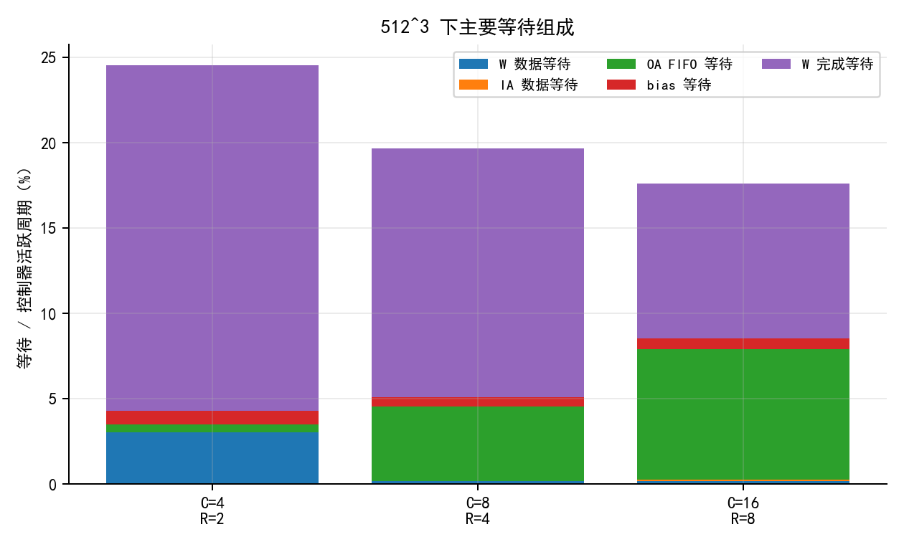
</p>
<p align="center">图5-5 512×512×512 任务主要等待组成</p>

<p align="center">
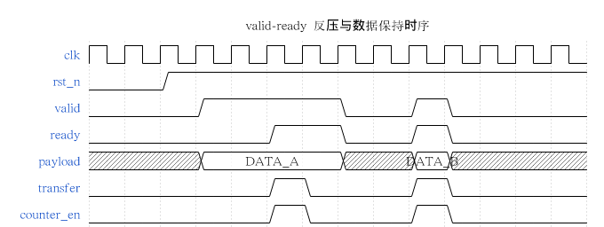
</p>
<p align="center">图5-6 valid/ready 握手与反压保持时序</p>

### 5.6 输出打包、字节写掩码与写回完成条件

输出阶段以 int8 为最终存储格式，而 AXI 数据总线为 32 bit。`vec_s8_to_fifo` 将多个 int8 输出通道打包为 32 位写数据，并生成 4 bit 字节写掩码。对于输出列数不是 4 的整数倍、输出基址非 4 字节对齐或尾列不足的情况，写掩码只使目标输出字节有效。该设计保持 AXI 写口宽度固定，同时保证同一个 32 位 word 中不属于当前输出矩阵范围的字节不被修改。

输出 FIFO 同时承担速率匹配和坐标保存功能。重量化以向量形式产生 int8 输出，写回单元以 AXI 数据拍为单位写回内存，二者速率并不总是相同。FIFO 写入时保存数据、字节写掩码、输出行、输出列、最后数据拍标志和有效通道信息；FIFO 读出时，写回单元根据 DST 基址、行步长和坐标生成 AW/W 请求。对于阵列规模大于 4 的参数配置，一个输出向量会拆成多个 32 bit 数据拍；对于尾列，最后一个数据拍可能只有部分字节有效。

写回完成必须等待 AXI B 响应。AW 握手只表示写地址被接受，W 握手只表示写数据拍被接受，B 响应返回才表示对应写事务完成。写回单元内部保存 pending 计数，只有所有输出数据拍的响应返回后，才向控制器报告写回完成。控制器据此更新 done sticky 和 busy。该规则防止 CPU 在写响应尚未返回时读取未完成输出，也避免下一任务过早覆盖仍在写回的数据区域。

<p align="center">
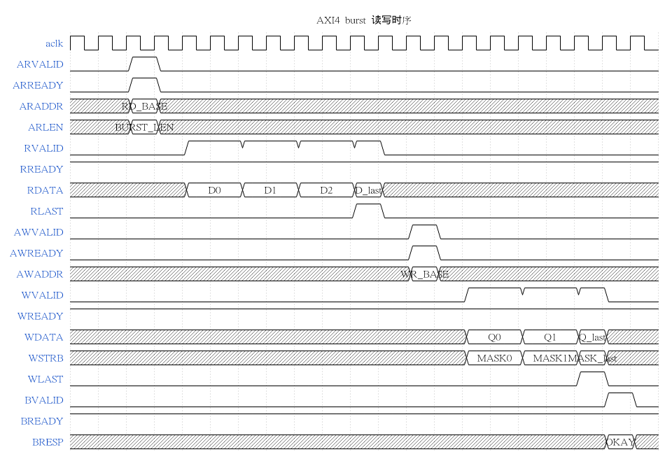
</p>
<p align="center">图5-7 AXI4 递增突发读写与响应时序</p>

<p align="center">图5-8 int8 输出打包、尾列字节写掩码与非对齐写回关系（图形待补充）</p>

### 5.7 WS/IS 双数据流支持

本设计支持 WS 和 IS 两类数据流模式。WS 模式即权重固定模式，RHS/权重分块装入 PE 后保持，IA/LHS 以对角化形式从阵列左侧进入，部分和沿列方向累加。WS 适合全连接、常规 GEMM 和 im2col 后卷积，因为权重通常可以作用于多个输出行，输入激活缓存也可以在多个输出列组之间复用。主要性能数据和 FPGA 综合配置以 WS、s8 输入和按张量或按通道量化为核心路径。

IS 模式用于输入固定或矩阵角色交换的场景。`cfg_dataflow_mode` 在 `npu_top`、加载单元、重量化和写回单元中传递，使内部地址生成、输入输出顺序和写回坐标可按模式调整。IS 模式下，IA 和 W 的内部角色发生变化，输出产生顺序与最终行主序写回之间可能需要重排。输出 FIFO 和写回单元因此需要保存更多坐标信息，确保最终 DST 仍按软件定义的 K×M 行主序排列。

双数据流支持不改变软件可见 GEMM 公式。软件仍按 LHS、RHS、DST、K、N、M、步长、偏移和量化参数提交任务；模式位只影响硬件内部驻留数据、流式数据和写回次序。对于软件层，WS 和 IS 的结果矩阵含义一致。该设计使 TFLM/NMSIS-NN 接入层不需要为内部阵列方向重写上层算子，只需要在满足条件时选择对应模式。

<p align="center">图5-9 WS 与 IS 模式下阵列输入角色、输出坐标和写回次序关系（图形待补充）</p>

WS/IS 模式共享大部分基础模块。AXI-Lite 寄存器组、分块DMA、偏置加载单元、重量化、状态寄存器和软件驱动结构保持一致；差异主要集中在加载单元输出顺序、阵列输入角色、输出坐标展开和 FIFO 排列上。共享模块减少了接口数量，也使同一组状态位、错误码和完成条件能够覆盖两类模式。模式相关字段在 start 时锁存，busy 期间软件写入不会改变当前任务行为。

性能优化以阵列计算供给和外部存储访问匹配为核心。`SIZE x SIZE` 权重固定脉动阵列每周期最多完成 `SIZE x SIZE` 次 MAC，而 32 bit AXI 数据总线每个数据拍只携带 4 byte。若输入、权重和中间和都逐元素从外部 RAM 读写，阵列会受到访存供给限制。设计通过权重驻留、输入激活缓存复用、部分和缓冲区、二维突发传输、读写通道分离、输出打包和反压局部化来提高有效计算比例。

## 6. 软硬件接口设计

本章集中说明 CPU 与 NPU 之间的软件可见接口、任务提交规则、驱动接入方式、应用算子映射和系统规格。硬件通过 AXI-Lite 寄存器接受配置，通过 AXI4 数据主接口访问共享 RAM；软件通过固定 MMIO 访问顺序提交矩阵乘任务，并在 TFLite Micro/NMSIS-NN 后端中选择硬件或软件执行路径。

### 6.1 寄存器与软件接口

本设计采用标准 AXI-Lite MMIO 寄存器访问方式。PicoRV32 发出的普通访存操作经 `pico_native_to_axi` 转换为 AXI 请求，`soc_axi_interconnect` 将 NPU 外设窗口转发到 `npu_axil_top` 的 AXI-Lite 从接口。NPU 外设基址为 `0x1000_0000`，软件驱动使用字节偏移访问寄存器，寄存器前端按 `s_axil_*` 五通道协议接收读写事务。大块矩阵数据不经过 AXI-Lite 寄存器口搬移，而是由 `npu_top` 内部的分块DMA 通过独立 AXI4 主设备接口访问共享 RAM。

`npu_axil_top` 内部由 `npu_axil_reg_if` 和 `npu_top` 组成。`npu_axil_reg_if` 保存控制、状态、地址、维度、步长、零点、量化、复用和数据流模式寄存器，并把寄存器字段直接输出给 `npu_top`。矩阵任务参数以连续 AXI-Lite 寄存器组形式保存，软件可见配置字段在该寄存器组内统一展开。`npu_top` 接收 `calc_start` 单周期脉冲后锁存运行参数，矩阵数据读取、计算、重量化和写回均由 NPU 内部控制器和 DMA 完成。

AXI-Lite 写事务中，AW 与 W 通道可以先后到达。`npu_axil_reg_if` 分别锁存写地址和写数据，在两者均有效且写响应通道空闲时提交一次寄存器写入；写入时按 `WSTRB` 对 32 bit 字段进行逐字节更新。读事务在 AR 握手后返回地址译码对应的寄存器值，未实现地址读返回 0。AXI-Lite 读写响应均返回 OKAY。`NPU_REG_CTRL` 的 start 位在写提交周期形成 `calc_start` 脉冲，clear 位用于清除 done sticky 和 writeback valid sticky 状态。

<p align="center">
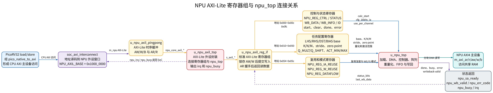
</p>
<p align="center">图6-1 NPU AXI-Lite 寄存器组与 npu_top 连接关系</p>

<p align="center">表6-1 NPU AXI-Lite 寄存器窗口</p>

| 字节偏移 | Word 偏移 | 名称 | 访问属性 | 功能说明 |
|---:|---:|---|---|---|
| `0x000` | `0x000` | `NPU_REG_CTRL` | RW | 启动、数据位宽、量化模式和数据流控制 |
| `0x004` | `0x001` | `NPU_REG_STATUS` | RO | ready、busy、done 和错误状态 |
| `0x008` | `0x002` | `NPU_REG_WB_DATA` | RO | 最近一次完成状态写回 |
| `0x00c` | `0x003` | `NPU_REG_WB_INFO` | RO | bit0 表示写回数据有效 |
| `0x010` | `0x004` | `NPU_REG_LHS_BASE` | RW | LHS/输入激活基地址 |
| `0x014` | `0x005` | `NPU_REG_RHS_BASE` | RW | RHS/权重基地址 |
| `0x018` | `0x006` | `NPU_REG_DST_BASE` | RW | 输出基地址 |
| `0x01c` | `0x007` | `NPU_REG_BIAS_BASE` | RW | 偏置基地址，写 0 表示无偏置 |
| `0x020` | `0x008` | `NPU_REG_K` | RW | 输出行数 |
| `0x024` | `0x009` | `NPU_REG_N` | RW | 归约维度 |
| `0x028` | `0x00a` | `NPU_REG_M` | RW | 输出列数 |
| `0x02c` | `0x00b` | `NPU_REG_LHS_STRIDE_B` | RW | LHS 行跨度，单位字节 |
| `0x030` | `0x00c` | `NPU_REG_RHS_STRIDE_B` | RW | RHS 列跨度，单位字节 |
| `0x034` | `0x00d` | `NPU_REG_DST_STRIDE_B` | RW | 输出行跨度，单位字节 |
| `0x038` | `0x00e` | `NPU_REG_LHS_ZP` | RW | LHS 零点 |
| `0x03c` | `0x00f` | `NPU_REG_RHS_ZP` | RW | RHS 零点 |
| `0x040` | `0x010` | `NPU_REG_DST_ZP` | RW | 输出零点 |
| `0x044` | `0x011` | `NPU_REG_Q_MULT` | RW | 按张量乘法系数或按通道乘法系数数组地址 |
| `0x048` | `0x012` | `NPU_REG_Q_SHIFT` | RW | 按张量移位参数或按通道移位参数数组地址 |
| `0x04c` | `0x013` | `NPU_REG_ACT_MIN` | RW | 输出激活下限 |
| `0x050` | `0x014` | `NPU_REG_ACT_MAX` | RW | 输出激活上限 |
| `0x054` | `0x015` | `NPU_REG_IA_REUSE` | RW | 输入激活复用深度 |
| `0x058` | `0x016` | `NPU_REG_W_REUSE` | RW | 权重复用窗口 |
| `0x05c` | `0x017` | `NPU_REG_DATAFLOW` | RW | bit0 表示数据流模式，0 为 WS，1 为 IS |
| `0x0fc` | `0x03f` | `NPU_REG_ID` | RO | 固定返回 `0x4e50_5531` |

`NPU_REG_CTRL` 是任务启动和 sticky 状态清除入口。写 bit0 为 1 时，`calc_start` 产生一个时钟周期启动脉冲，`npu_busy` 置位，`done_sticky` 和 `last_wb_valid` 清零。bit1 写入 `cfg_16bits_ia`，用于选择输入激活 s16 模式；bit2 写入 `use_per_channel`，用于选择按通道量化；bit3 写入 `cfg_dataflow_mode`，用于选择 IS 数据流。bit8 为 clear done，bit9 为 clear writeback valid；当同一次写访问中 bit0 为 0 时，bit8 和 bit9 分别清除对应 sticky 标志。软件应使用 32 bit 写访问更新控制寄存器，使低字节写使能有效并保证模式位、启动位和清除位在同一次控制写中被 RTL 采样。

<p align="center">表6-2 NPU_REG_CTRL 字段定义</p>

| 位域 | 名称 | 访问属性 | 复位值 | 功能说明 |
|---:|---|---|---:|---|
| `[0]` | `NPU_CTRL_START` | W | 0 | 写 1 产生单周期启动脉冲 |
| `[1]` | `NPU_CTRL_CFG_16BITS_IA` | RW | 0 | 1 表示输入激活按 s16 读取；0 表示按 s8 读取 |
| `[2]` | `NPU_CTRL_PER_CHANNEL` | RW | 0 | 1 表示重量化使用按通道参数 |
| `[3]` | `NPU_CTRL_DATAFLOW_IS` | RW | 0 | 0 表示 WS，1 表示 IS |
| `[8]` | `NPU_CTRL_CLEAR_DONE` | W1C | 0 | 当 START 为 0 时清除 done sticky |
| `[9]` | `NPU_CTRL_CLEAR_WB_VALID` | W1C | 0 | 当 START 为 0 时清除最近写回有效标志 |

`NPU_REG_STATUS` 只读返回低 8 bit 状态。bit0 为 `SA_READY`，表示 `npu_top` 可接受新启动；bit1 为 `BUSY`，表示任务已经启动且尚未完成；bit2 为 `NPU_STATUS_DONE`，在 NPU 完成写回后置位并保持到软件清除；bit3 为 `WB_VALID`；bit5:4 为 `NPU_STATUS_ERR_MASK` 对应的错误码；bit6 保留为 0；bit7 为 `REG_READY`，表示 AXI-Lite 寄存器通路可访问。软件通常在写 start 后轮询 done，并在 done 置位后读取错误码和写回信息。

<p align="center">表6-3 NPU_REG_STATUS 字段定义</p>

| 位域 | 名称 | 访问属性 | 功能说明 |
|---:|---|---|---|
| `[0]` | `SA_READY` | RO | NPU 顶层可接受新任务 |
| `[1]` | `BUSY` | RO | 任务运行状态 |
| `[2]` | `NPU_STATUS_DONE` | RO | 任务完成 sticky 标志 |
| `[3]` | `WB_VALID` | RO | 最近写回数据有效 |
| `[5:4]` | `ERR_CODE` | RO | NPU 错误码，00 正常，01 配置错误，10 资源缺失 |
| `[6]` | `RESERVED` | RO | 保留，读值为 0 |
| `[7]` | `REG_READY` | RO | AXI-Lite 寄存器通路 ready |

配置寄存器按任务字段直接展开。软件提交任务时先写 `NPU_REG_LHS_BASE`、`NPU_REG_RHS_BASE`、`NPU_REG_DST_BASE`、`NPU_REG_BIAS_BASE`、`NPU_REG_K`、`NPU_REG_N`、`NPU_REG_M`、步长、零点、量化参数、激活范围、复用参数和数据流模式，最后写 `NPU_REG_CTRL`。写 start 后，NPU 在配置锁存级保存地址、维度、步长、量化、复用和模式字段；busy 有效期间，新的寄存器写入不改变正在运行的任务，只对下一次 start 生效。任务完成后，`npu_wb_valid` 更新 `NPU_REG_WB_DATA` 和 `NPU_REG_WB_INFO`，`done_sticky` 置位，`npu_busy` 清零。

<p align="center">
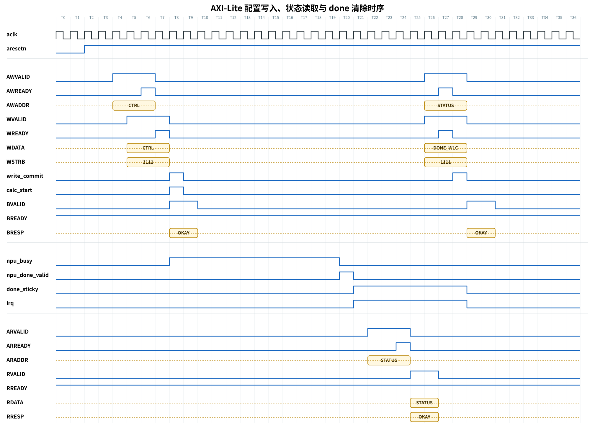
</p>
<p align="center">图6-2 AXI-Lite 寄存器写读时序</p>

软件通过普通 32 bit 访存操作完成配置和状态读取。极小矩阵任务会受到多次寄存器写和轮询开销影响，因此软件适配层需要按算子尺寸选择硬件执行或软件执行。固定寄存器组使一个任务的配置步骤保持确定；`NPU_REG_ID` 用于软件确认外设身份。软件侧硬件参数宏需要与 RTL 综合参数一致，阵列规模、缓存数量、部分和帧数和支持的数据类型在驱动构建时确定。

### 6.2 CPU/NPU 协同执行流程

一次协同执行从软件算子入口开始。TFLite Micro 或 NMSIS-NN 调用矩阵乘、全连接或卷积函数，适配层判断矩阵形状、数据类型、量化参数和内存布局是否满足 NPU 任务条件。满足条件时，软件构造 `dsa_matmul_config_t`；不满足条件时，软件选择软件执行路径。配置结构包含 LHS、RHS、DST、BIAS、K、N、M、步长、零点、输出偏移、乘法系数、移位参数、activation min/max、按通道标志和数据流模式。

<p align="center">
</p>
<p align="center">图6-3 CPU 与 NPU 协同执行流程</p>

CPU 写寄存器时先写矩阵基址和维度，再写步长与量化字段，然后写复用参数和控制字。这个顺序保证 start 被采样时所有必要配置已经稳定。若输入矩阵或 im2col 缓冲区刚由 CPU 写入共享 RAM，软件需要在 start 前保证内存写与 MMIO 写的顺序。该 SoC 不包含复杂数据缓存一致性硬件，因此软件访问顺序是 CPU 与 NPU 共享 RAM 的主要一致性机制。

NPU 收到 start 后，`npu_controller` 进入初始化状态，检查指针、维度、步长和模式字段。配置合法时，控制器计算分块数、尾块有效行列、IA/W 复用窗口和归约分块顺序，并触发加载单元与 DMA 仲裁器。配置非法时，控制器设置错误码并结束任务，不发起新的数据读写。该处理使错误状态通过 status 暴露给软件，而不会把无效配置转换为不确定的外部访问。

计算阶段中，权重加载单元读取 RHS 并装入 PE，输入激活加载单元读取 LHS 并通过缓存管理单元输出对角化输入，偏置加载单元在输出列组粒度上提供 int32 初值。计算核心驱动权重固定阵列执行乘加，并根据归约分块次序选择偏置、部分和缓冲区回灌或 0 作为 sum 初值。对于中间归约分块，结果写入部分和缓冲区；对于最终归约分块，结果进入重量化。

输出阶段由重量化、FIFO、写回单元和写 DMA 组成。重量化根据按张量或按通道参数完成缩放、舍入、偏移、激活值上下限钳位和 int8 饱和。FIFO 将 int8 并行输出通道打包为 32 位数据拍，并保存输出坐标和字节写掩码。写回单元根据 DST 基址、行步长、输出行列和有效列数生成 AXI 写请求。写响应全部返回后，对应输出区域才算完成。

任务完成条件覆盖所有内部流水和外部响应。控制器需要确认加载单元不再有未完成读请求，阵列拖尾已经排空，部分和缓冲区不再有待处理中间和，重量化输出已经进入 FIFO，FIFO 数据已由写回单元消费，写 DMA 的 B 响应已经返回。满足这些条件后，done sticky 置位，busy 清零，ready 可重新拉高。CPU 轮询到 done 后读取 status 与 writeback 信息，再清除 sticky 状态并进入下一算子。

### 6.3 软件驱动与 TFLM 接入

软件驱动定义 NPU MMIO 基址、寄存器偏移、控制位和状态位，并提供配置初始化、复用参数选择、控制字构造和任务执行函数。该层把硬件寄存器细节从上层算子中隔离出来，使矩阵乘、全连接和卷积后端通过统一结构提交任务。驱动函数只描述任务级接口，不暴露缓存槽位、PE 坐标、DMA 客户端编号和部分和帧等内部信息。

`dsa_matmul_execute` 按固定顺序写入配置寄存器、复用字段和控制字。控制字包含 start、clear done、clear writeback valid、16bit IA、按通道和 IS 数据流等模式位。写 start 后，驱动轮询 status，直到 done 或错误状态出现；若轮询次数超过软件阈值，驱动返回超时错误。超时阈值属于软件恢复策略，不改变硬件内部完成条件。

复用参数选择由矩阵形状和硬件参数共同决定。`dsa_matmul_select_reuse` 根据 `DSA_TILE_SIZE`、`DSA_IA_CACHE_BLOCKS`、`DSA_PS_FRAME_COUNT`、K、N 和 M 估算可用复用值，并裁剪为硬件支持的 2 的幂。软件写 0 表示使用硬件默认派生值，写非 0 表示给出期望窗口。硬件需要再次裁剪或拒绝非法值，防止缓存覆盖、部分和帧溢出或输出 FIFO 容量不足。

TFLM/NMSIS-NN 接入层覆盖普通 int8 矩阵乘、s16 LHS 与 s8 RHS 的 kernel 矩阵乘、带 row 偏移的 kernel 矩阵乘、全连接、按通道全连接和卷积 im2col 后端。全连接映射相对直接，输入批次对应 K，输入通道对应 N，输出通道对应 M。卷积映射需要先把滑窗输入整理为矩阵行，批量行数由软件宏控制；批量过小会增加启动开销占比，批量过大会增加 im2col 缓冲区占用。

按通道量化通过参数数组基址传递。每个输出通道拥有独立乘法系数和移位参数，重量化按输出列索引读取对应参数。按张量模式下，所有并行输出通道共享同一乘法系数和移位参数，DMA 参数读取量较小。驱动需要保证参数数组长度覆盖输出通道数，并确保偏置、乘法系数和移位参数的索引与最终输出通道一致。IS 模式或输出重排不能改变软件可见的通道顺序。

软件接口还负责内存生命周期管理。输入、权重、偏置和量化参数在 start 前必须保持稳定，输出缓冲区在 done 前不能被 CPU 或其他任务覆盖。对于分批 im2col，软件需要保证某个批次的输入展开缓冲在对应 NPU 读完成前不被复用。硬件只按基址、步长和尺寸访问内存，不解析上层张量对象，也不自动检测所有输入输出重叠关系。

<p align="center">图6-4 软件驱动、TFLM/NMSIS-NN 接入层与 NPU MMIO 接口关系（图形待补充）</p>

### 6.4 应用算子映射

本设计面向 int8 端侧推理中的高密度矩阵计算。硬件加速对象集中在 GEMM、全连接和卷积 im2col 后端，非矩阵乘算子保留软件执行路径。该划分使 NPU 控制器只需要处理规则二维矩阵、固定量化参数和有限的数据流模式，避免为低占比或不规则算子引入复杂索引硬件。应用层通过统一任务结构提交矩阵乘，使不同算子共享同一 NPU 计算数据通路。

#### 6.4.1 全连接算子映射

全连接层可直接表示为 `C[K, M] = A[K, N] x B[N, M]`。批次或输入向量组映射为 K，输入通道映射为 N，输出通道映射为 M。LHS 基址指向输入矩阵，RHS 基址指向权重矩阵，DST 基址指向输出缓冲，偏置基址指向 int32 偏置数组。输出行步长由批次输出布局决定，RHS 列步长由权重存储布局决定。对于单批次全连接，K 可以为 1，此时阵列尾行较多，软件可通过合并多个输入行降低尾行损失。

全连接按通道量化需要输出通道索引稳定。硬件按照输出列组读取乘法系数和移位参数，并将同一列的偏置、权重和量化参数对齐。若输出列组尾部不足 `SIZE`，只有有效列读取对应参数，无效计算通道不应访问参数数组之外的地址。输出写回仍按行主序排列，软件不需要根据 WS 或 IS 模式改变张量解释。

#### 6.4.2 卷积 im2col 映射

卷积层的滑窗访问由软件整理为 im2col 矩阵。每个输出空间位置对应 LHS 的一行，卷积卷积核的展开通道对应 N，输出通道对应 M。硬件仍执行矩阵乘，不直接实现填充、步长、膨胀和输入边缘填充控制。该方式复用了 GEMM 数据通路，降低硬件控制复杂度，但会在软件侧增加输入展开缓冲和内存写入。

im2col 批次行数决定硬件任务粒度。较小批次降低缓冲占用，但会增加任务启动次数和尾行比例；较大批次提高阵列行方向利用率，但需要更多 RAM 保存展开结果。软件应根据输出空间大小、可用 RAM、`SIZE` 和输入通道数选择批次行数。硬件只接收整理后的 LHS 基址、K、N、M 和步长，不关心原始卷积窗口位置。

#### 6.4.3 小算子与软件回退

并非所有算子都适合硬件提交。若 K、N 或 M 很小，寄存器写入、DMA 启动、加载单元初始化和写回响应所占周期可能超过阵列计算收益；若数据类型不是 int8/s16 与 int8 权重组合，硬件没有直接运算路径；若参数布局不满足 DMA 可访问的连续或带步长二维分块，地址发生器无法用固定字段表达。软件在这些情况下选择软件函数路径，避免硬件任务造成额外开销。

软件回退不改变算子数值定义。硬件路径和软件路径都按照同一量化公式解释输入偏移、权重偏移、bias、乘法系数、移位参数、输出偏移和激活值上下限钳位。硬件路径只改变执行单元和数据搬移方式，不改变上层张量形状、输出顺序和错误返回规则。这样，算子调度可以按层或按任务选择执行单元，而不影响下一网络层的数据解释。

#### 6.4.4 任务粒度设计

任务粒度以一个矩阵乘配置为单位。一个任务包含固定的 LHS、RHS、DST、BIAS、K、N、M、步长、量化参数和数据流模式。任务内部分解为多个行分块、列分块和归约分块，分块次序由 `npu_controller` 生成。软件不需要逐分块写寄存器，也不需要为每个 PE 提供控制位。该粒度降低 MMIO 访问次数，并让硬件可以在任务内部自行安排缓存复用和 DMA 顺序。

任务粒度也决定错误恢复点。任务启动后，硬件在 busy 期间拥有输出缓冲的写权限；若配置错误在启动阶段发现，任务结束时不会写入输出；若运行中出现响应错误，硬件需要在已发事务全部完成后设置错误状态。软件以任务为单位处理 done、error 和 writeback valid，不以内部分块为单位插入控制。

#### 6.4.5 数据布局与对齐约束

LHS、RHS 和 DST 的地址字段均为字节地址。LHS 行步长、RHS col 步长和 DST 行步长也以字节为单位，使同一寄存器定义可以覆盖 s8 与 s16 输入。DMA 支持非 4 字节对齐基址，但非对齐访问可能产生额外数据拍。输出写回使用字节写掩码保证只修改有效 int8 字节，输入读取则由加载单元对返回数据拍进行元素抽取和符号扩展。

矩阵布局需要满足硬件地址发生器可表达的二维模式。LHS 行内元素按归约维度连续或等效连续排列；RHS 按输出列组织，每列在归约维度上连续；DST 按输出行主序写回。若上层张量采用更复杂的分块化、稀疏或压缩布局，需要在软件侧转换为硬件可访问布局，或继续由软件执行。

#### 6.4.6 量化参数组织

按张量量化将乘法系数和移位参数作为标量配置，适合所有输出通道共享同一缩放参数的算子。按通道量化将乘法系数和移位参数作为数组，重量化按输出列索引读取。偏置同样以输出通道为索引。硬件需要保证偏置、乘法系数和移位参数的读取顺序与输出列组一致，且尾列只对有效通道执行参数读取和输出写回。

重量化流水的输入为 int32 累加向量，输出为 int8 向量。流水阶段包括加偏置、乘以乘法系数、按移位参数舍入移位、加输出偏移、激活值上下限钳位和 int8 饱和。各阶段的 valid、通道索引、行/列坐标和有效通道标志必须同步移动。若按通道参数未就绪，重量化输入需要等待，不能用上一输出列的参数继续计算。

<p align="center">图6-5 按张量与按通道量化参数组织及重量化流水对应关系（图形待补充）</p>

### 6.5 设计规格汇总

| 设计项 | 规格内容 | 设计说明 |
|---|---|---|
| 处理器集成 | PicoRV32 + AXI/AXI-Lite SoC | CPU 负责软件调度、寄存器访问和状态轮询。 |
| NPU 控制接口 | 32 bit AXI-Lite MMIO | 控制、状态、写回、复用和矩阵参数寄存器 均按 32 位访问。 |
| 数据主接口 | 32 bit AXI4 主设备接口 | NPU 通过分块DMA 访问共享 RAM。 |
| 基础阵列 | `SIZE=4` 可配置 | 形成 4x4 权重固定脉动阵列。 |
| 优化阵列 | `SIZE=16` 主要配置 | 形成 16x16 权重固定脉动阵列。 |
| 数据类型 | s8/s16 输入、s8 权重、int32 累加、s8 输出 | IA 内部为 signed 16 bit，累加为 signed 32 bit。 |
| 量化模式 | 按张量与按通道 | 乘法系数、移位参数、偏移、钳位在重量化阶段处理。 |
| 数据流模式 | WS 与 IS | 控制位选择内部输入和权重角色，软件可见 GEMM 定义不变。 |
| 片上缓存 | 输入激活缓存、权重缓存、部分和缓冲区、输出先进先出队列 | 减少外部访问并提供速率匹配。 |
| DMA 能力 | 二维分块读写、突发传输、非对齐、字节写掩码 | 统一处理加载单元和写回单元的数据搬移。 |
| 完成状态 | ready、busy、done、error、writeback valid | 软件按任务粒度读取和清除。 |
| 复位与状态保持 | 控制状态、有效标志、FIFO 指针和标签复位，数据 RAM 由有效位约束 | 保持复位后状态确定并控制资源规模。 |

规格表中的条目构成系统可见设计范围。CPU、互连、NPU、DMA 和软件驱动共同完成任务提交与执行；各模块之间通过 AXI、AXI-Lite、valid/ready、req/done 和状态寄存器连接。阵列规模、缓存深度和未完成事务深度为综合期参数，矩阵维度、步长、量化参数和数据流模式为运行期配置。

本设计的数值计算规则固定为整数推理。输入和权重在进入 PE 前转换为 signed 16 bit，乘加使用 signed int32 累加，最终通过重量化输出 signed int8。PE 内不执行浮点运算，也不在每次 MAC 后进行饱和。偏置、零点、乘法系数、移位参数、偏移和钳位的处理位置需要与软件算子定义一致，确保硬件路径和软件路径对同一配置具有同一数值含义。

系统接口规格保持 32 位访问粒度。AXI-Lite 控制寄存器按 32 位读写，AXI 数据主接口按 32 位数据拍搬移，输出 int8 通过字节写掩码写入。该选择与 PicoRV32 的普通 load/store 访问匹配，也使 DMA 和写回单元的宽度控制较为简单。当 AXI 数据宽度扩展时，软件可见寄存器宽度不需要改变，但 DMA 数据拍拆分、输出打包和字节写掩码生成需要按新数据宽度重写。

## 7. 性能分析

本节从模块级吞吐、SoC 级总线利用率和 TFLM 模型推理三个层次分析 NPU 性能。模块级实验直接统计矩阵乘核心在不同 `SIZE` 和 `IA_CACHE_BLOCKS` 下的执行周期，用于观察阵列规模、IA cache 深度和分块数据流之间的匹配关系。SoC 级实验加载完整程序并统计推理周期、NPU 活跃周期和 AXI 有效数据拍，用于评价 CPU、驱动、总线、共享 RAM 与 NPU 共同运行时的端到端性能。

模块级主扫描条件为 WS 数据流、s8 LHS、per-tensor 量化、`K=N=M=256`、`PS_FRAME_COUNT=ceil(M/SIZE)`。`cfg_ia_reuse_num=0`、`cfg_w_reuse_num=0` 表示 RTL 按 `SIZE`、`IA_CACHE_BLOCKS` 和 `PS_FRAME_COUNT` 自动选择可用复用窗口。一次乘加按 2 个操作计，吞吐率计算式如下：

```text
OPS = 2 x K x N x M
GOPS@200MHz = OPS x 200MHz / cycles / 1e9
理想上限 GOPS@200MHz = 2 x SIZE x SIZE x 200MHz / 1e9
阵列利用率 = 实测 GOPS / 理想上限 GOPS
IA cache 容量 = SIZE x SIZE x IA_CACHE_BLOCKS x 4Byte
```

其中 IA cache 容量按每个 cache 元素 32bit 存储估算。硬件要求 `IA_CACHE_BLOCKS` 为 2 的幂且不小于 2，因此目标容量小于单个大尺寸 cache 块时，实验采用最小可综合配置 `IA_CACHE_BLOCKS=2`，并在表中标记为非精确容量。

### 7.1 系统吞吐量分析

#### 7.1.1 阵列规模参数与算力关系

第一组实验固定 `IA_CACHE_BLOCKS=32`，用较深 IA cache 块数让每种阵列都有足够的复用机会，观察 `SIZE=4/8/16/32/64` 的实测吞吐与理想上限之间的差距。该实验不是固定容量实验，实际 IA cache 容量会随 `SIZE^2` 增长，用于分析阵列规模变大时分块数据流对 PE 阵列的供给能力。

<p align="center">
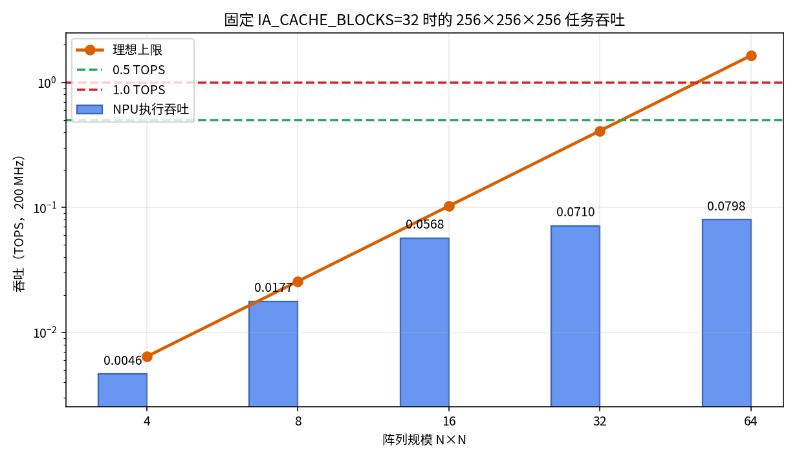
</p>
<p align="center">图7-1 固定 IA_CACHE_BLOCKS=32 时的阵列规模扫描</p>

<p align="center">表7-1 固定 IA_CACHE_BLOCKS=32、256x256x256 模块级吞吐扫描</p>

| SIZE | IA_CACHE_BLOCKS | 实际 IA cache(B) | 周期 | 实测GOPS | 理想GOPS | 阵列利用率 | 总线数据拍利用率 | 读数据拍 | 写数据拍 |
|---:|---:|---:|---:|---:|---:|---:|---:|---:|---:|
| 4 | 32 | 2,048 | 1,447,156 | 4.64 | 6.40 | 72.46% | 6.86% | 82,944 | 16,384 |
| 8 | 32 | 8,192 | 378,210 | 17.74 | 25.60 | 69.31% | 17.46% | 49,664 | 16,384 |
| 16 | 32 | 32,768 | 118,183 | 56.78 | 102.40 | 55.45% | 41.81% | 33,024 | 16,384 |
| 32 | 32 | 131,072 | 94,491 | 71.02 | 409.60 | 17.34% | 52.29% | 33,024 | 16,384 |
| 64 | 32 | 524,288 | 84,099 | 79.80 | 1,638.40 | 4.87% | 58.75% | 33,024 | 16,384 |

从绝对吞吐看，`SIZE` 从 4 增加到 16 时收益明显，4.64 GOPS 提升到 56.78 GOPS；继续增大到 32 和 64 后，吞吐只提升到 71.02 GOPS 和 79.80 GOPS。理想上限从 `SIZE=16` 的 102.40 GOPS 增加到 `SIZE=64` 的 1638.40 GOPS，但实测只增长 1.41 倍，阵列利用率从 55.45% 降到 4.87%。这说明在 32bit AXI、单组 DMA 读写和既有 loader/写回组织方式下，`SIZE=64` 的主要限制因素已经转为总线带宽。

从读写数据拍数量看，`SIZE=16`、`SIZE=32` 和 `SIZE=64` 的读数据拍均为 33,024，写数据拍均为 16,384，说明在 `IA_CACHE_BLOCKS=32`、复用窗口足够时，外部搬运数据量已经接近下界；但 `SIZE=32` 和 `SIZE=64` 的计算窗口变短，总线数据拍利用率反而升高，阵列利用率下降。这类结果的含义不是“总线更好”，而是“阵列太大以后，同样的数据搬运和阶段开销占据了更高比例”。因此，仅扩大阵列不能线性换算成算力，必须同步提高内部供数并行度、预取深度和写回排空能力。

#### 7.1.2 固定 IA cache 存储容量、扫描阵列 SIZE 的实验

第二组实验固定目标 IA cache 存储容量，扫描 `SIZE=4/8/16/32/64`。这里“固定容量”指固定 `SIZE x SIZE x IA_CACHE_BLOCKS x 4Byte` 的目标值，而“扫描 SIZE”指在同一目标容量下改变阵列边长，并按容量公式反向选择 `IA_CACHE_BLOCKS`。容量组选择 4KiB、16KiB 和 64KiB，其中 4KiB 对应 `SIZE=16`、`IA_CACHE_BLOCKS=4`，即 `16 x 16 x 4 x 4Byte`。该实验用于比较同等片上存储预算下小阵列配合较深 IA cache 与大阵列配合较少 IA cache 分块时的性能差异。

<p align="center">
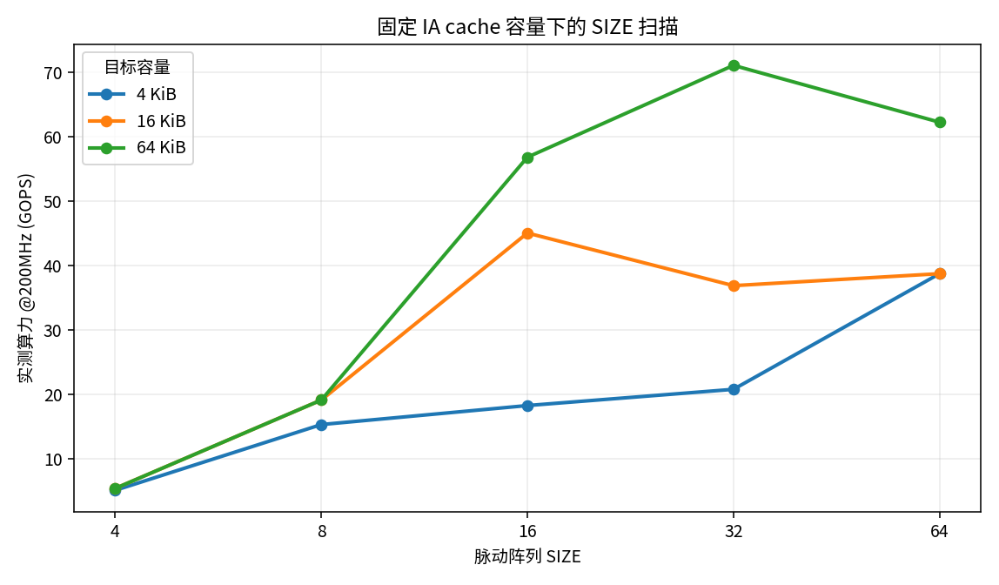
</p>
<p align="center">图7-2 固定 IA cache 存储容量时的实测算力</p>

<p align="center">
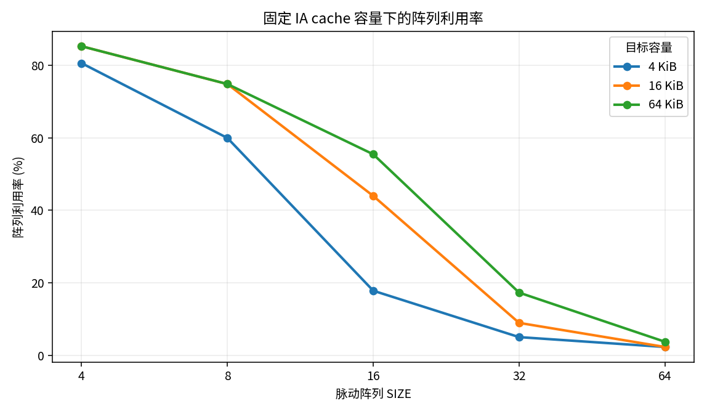
</p>
<p align="center">图7-3 固定 IA cache 存储容量时的阵列利用率</p>

<p align="center">表7-2 固定 IA cache 存储容量下的 256x256x256 吞吐扫描</p>

| 目标容量 | SIZE | IA_CACHE_BLOCKS | 实际容量(B) | 精确容量 | 周期 | 实测GOPS | 阵列利用率 | 总线数据拍利用率 |
|---:|---:|---:|---:|---|---:|---:|---:|---:|
| 4KiB | 4 | 64 | 4,096 | 是 | 1,301,686 | 5.16 | 80.56% | 5.07% |
| 4KiB | 8 | 16 | 4,096 | 是 | 437,316 | 15.35 | 59.94% | 22.71% |
| 4KiB | 16 | 4 | 4,096 | 是 | 366,878 | 18.29 | 17.86% | 45.22% |
| 4KiB | 32 | 2 | 8,192 | 否 | 322,566 | 20.80 | 5.08% | 51.43% |
| 4KiB | 64 | 2 | 32,768 | 否 | 173,270 | 38.73 | 2.36% | 57.33% |
| 16KiB | 4 | 256 | 16,384 | 是 | 1,230,439 | 5.45 | 85.22% | 4.02% |
| 16KiB | 8 | 64 | 16,384 | 是 | 350,439 | 19.15 | 74.80% | 14.10% |
| 16KiB | 16 | 16 | 16,384 | 是 | 149,026 | 45.03 | 43.98% | 44.32% |
| 16KiB | 32 | 4 | 16,384 | 是 | 181,996 | 36.87 | 9.00% | 54.58% |
| 16KiB | 64 | 2 | 32,768 | 否 | 173,270 | 38.73 | 2.36% | 57.33% |
| 64KiB | 4 | 1024 | 65,536 | 是 | 1,230,439 | 5.45 | 85.22% | 4.02% |
| 64KiB | 8 | 256 | 65,536 | 是 | 350,439 | 19.15 | 74.80% | 14.10% |
| 64KiB | 16 | 64 | 65,536 | 是 | 118,183 | 56.78 | 55.45% | 41.81% |
| 64KiB | 32 | 16 | 65,536 | 是 | 94,491 | 71.02 | 17.34% | 52.29% |
| 64KiB | 64 | 4 | 65,536 | 是 | 107,877 | 62.21 | 3.80% | 61.23% |

固定 IA cache 容量约束下，阵列规模和 cache 分块数之间存在明确的供给匹配关系，而不是单调的“阵列越大，吞吐越高”。

第一，较小阵列更容易获得较高阵列利用率，但其绝对吞吐受 PE 数量上限限制。以 16KiB 和 64KiB 容量组为例，`SIZE=4` 的阵列利用率均为 85.22%，说明 32bit AXI 数据通路和分块数据流能够较充分地供给 4x4 阵列；但该配置只有 16 个 PE，实测吞吐仅为 5.45 GOPS。因此，阵列利用率高并不等价于系统吞吐最优，必须同时考察 PE 规模和有效计算周期。

第二，在有限片上存储预算下，保留足够的 IA cache 分块数比单纯扩大阵列更关键。4KiB 容量组中，`SIZE=16`、`IA_CACHE_BLOCKS=4` 的实测吞吐为 18.29 GOPS；当容量提高到 16KiB 时，`SIZE=16`、`IA_CACHE_BLOCKS=16` 的吞吐提升到 45.03 GOPS，并高于同容量下 `SIZE=32`、`IA_CACHE_BLOCKS=4` 的 36.87 GOPS。该结果表明，在分块外积数据流调度下，IA cache 分块数直接影响可覆盖的复用窗口和 DMA 重读次数；若分块数过少，较大的阵列会更频繁地等待 loader、DMA 或写回路径，实际有效工作比例下降。

第三，当 IA cache 容量提高到 64KiB 后，最高实测吞吐转移到 `SIZE=32`、`IA_CACHE_BLOCKS=16`，达到 71.02 GOPS；而 `SIZE=64`、`IA_CACHE_BLOCKS=4` 下降到 62.21 GOPS。该现象说明较大阵列只有在 cache 深度、预取、写回排空和片上 bank 调度同步增强时才能转化为有效吞吐。对于 `SIZE=64`，虽然理论 PE 数量最大，但 IA 复用窗口和 OA writer 周转能力不足以持续供给 4096 个 PE，阶段切换和写回排空开销占比上升，导致阵列利用率降至 3.80%。

综合上述结果，在 32bit AXI、单组 DMA 读写和 200MHz 折算条件下，若优先考虑阵列利用率，`SIZE=4` 和 `SIZE=8` 更容易获得较高有效工作比例；若同时考虑绝对吞吐、可综合面积和时序收敛，`SIZE=16`、`IA_CACHE_BLOCKS=16` 是较均衡的配置；在允许约 64KiB IA cache 容量且面积预算更宽松时，`SIZE=32`、`IA_CACHE_BLOCKS=16` 是本轮模块级扫描中吞吐最高的精确容量配置。继续扩大到 `SIZE=64` 需要配套更宽外部总线、多 bank 片上缓存、更强预取以及更高写回并行度，否则新增 PE 主要表现为空转资源。

若以合理阵列规模估算 ASIC 实现达到 1TOPS 所需频率，可以选取 32x32 阵列、16 个 IA cache 分块、约 64KiB IA cache 的配置作为参考点。该配置在 200MHz 折算下实测吞吐为 71.02 GOPS；在微结构不变、片上存储和总线随核心时钟同步提升且访存效率不下降的理想比例缩放条件下，达到 1TOPS 需要的频率约为 `200MHz x 1000 / 71.02 = 2.82GHz`。若选取面积更保守的 16x16 阵列、64 个 IA cache 分块、约 64KiB IA cache 配置，200MHz 折算下实测吞吐为 56.78 GOPS，对应频率约为 3.52GHz；若使用 16x16 阵列、16 个 IA cache 分块、约 16KiB IA cache 配置，200MHz 折算下实测吞吐为 45.03 GOPS，对应频率约为 4.44GHz。因此，在不采用过大阵列的前提下，1TOPS 需要数 GHz 级 ASIC 主频，并且要求总线频率、片上RAM访问能力同步提高，才能实现目标算力。

#### 7.1.3 SIZE=4 时的 IA cache 深度影响

第三组实验切换到 SoC 级测试平台，固定板级部署阵列规模 `SIZE=4`，扫描 `IA_CACHE_BLOCKS=4/32/64/256`。该实验固定 `K=N=M=256`、`PS_FRAME_COUNT=16`、AXI 读写 outstanding 均为 4、CPU I-cache 打开、RAM 随机响应延时关闭，用于观察小阵列配置下增加 IA cache 分块数对系统周期、NPU 活跃周期和外部总线流量的影响。

<p align="center">
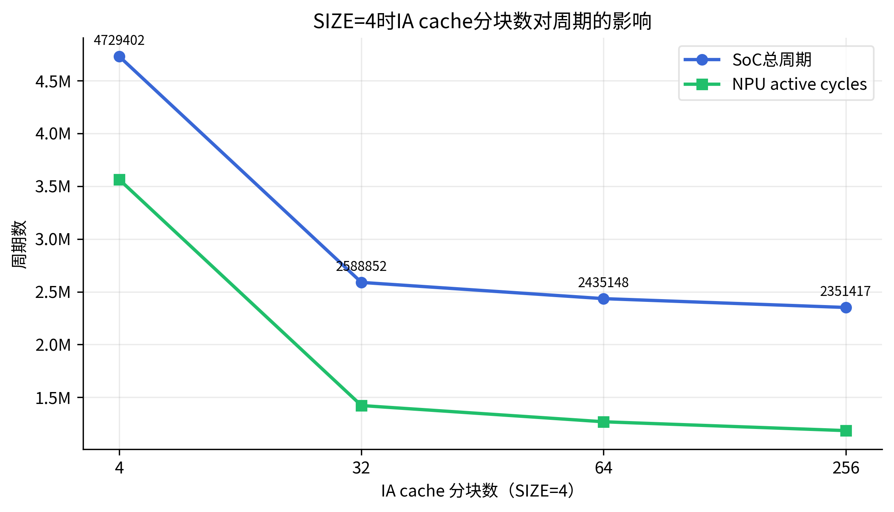
</p>
<p align="center">图7-4 SIZE=4 时 IA cache 分块数对执行周期的影响</p>

<p align="center">
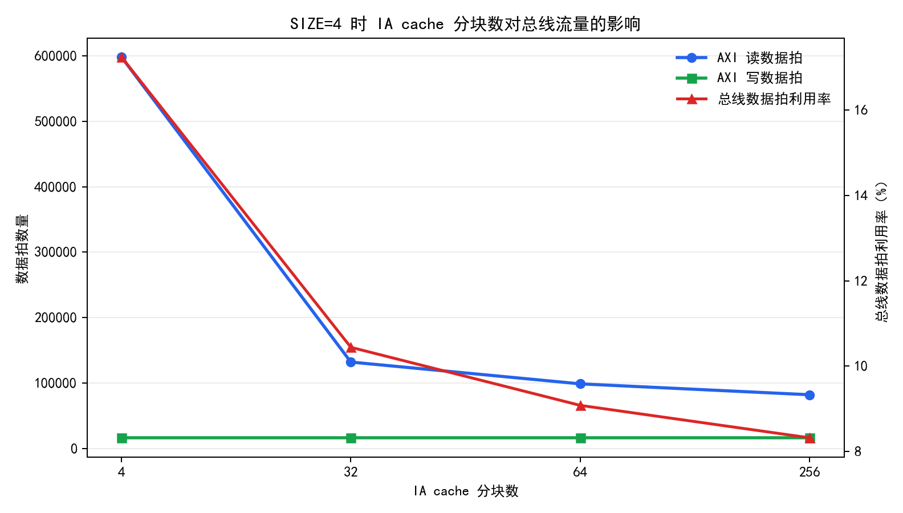
</p>
<p align="center">图7-5 SIZE=4 时 IA cache 分块数对总线流量和利用率的影响</p>

<p align="center">表7-3 SIZE=4、256x256x256 SoC 级 IA cache 分块数扫描</p>

| SIZE | IA_CACHE_BLOCKS | K=N=M | SoC 总周期 | NPU 活跃周期 | AXI 读数据拍 | AXI 写数据拍 | 总数据拍 | 总线数据拍利用率 |
|---:|---:|---:|---:|---:|---:|---:|---:|---:|
| 4 | 4 | 256 | 4,729,402 | 3,563,083 | 598,016 | 16,384 | 614,400 | 17.24% |
| 4 | 32 | 256 | 2,588,852 | 1,422,485 | 132,096 | 16,384 | 148,480 | 10.44% |
| 4 | 64 | 256 | 2,435,148 | 1,268,765 | 98,816 | 16,384 | 115,200 | 9.08% |
| 4 | 256 | 256 | 2,351,417 | 1,185,029 | 82,176 | 16,384 | 98,560 | 8.32% |

表7-3表明，在 `SIZE=4` 固定时，IA cache 分块数从 4 增加到 32 的收益最明显：SoC 总周期从 4,729,402 降到 2,588,852，减少 45.26%；NPU 活跃周期从 3,563,083 降到 1,422,485，减少 60.08%；AXI 总数据拍从 614,400 降到 148,480，减少 75.83%。这是因为较深 IA cache 覆盖了更多输入分块复用窗口，显著减少 IA 数据重读。

继续从 `IA_CACHE_BLOCKS=32` 增加到 64 和 256 后，周期仍有改善，但收益明显变小。`IA_CACHE_BLOCKS=256` 相对 32 的 SoC 总周期只再减少 9.17%，而 IA cache 容量增加 8 倍。对板级部署配置而言，`SIZE=4`、`IA_CACHE_BLOCKS=32` 是更均衡的点：它已经消除了大部分重读流量，同时避免过深 cache 带来的片上存储资源和综合压力。总线数据拍利用率从 17.24% 降到 10.44% 不是退化，而是 cache 复用减少了外部搬运需求，小阵列已经从“总线压力受限”转向“计算规模和控制开销受限”。

#### 7.1.4 硬件加速推理性能提升分析

本小节使用 `SIZE=4`、`IA_CACHE_BLOCKS=32`、`PS_FRAME_COUNT=16` 的小阵列参数，对 TFLM MNIST MLP、hello_world、micro_speech 和 MNIST CNN 进行 SoC 级软硬件对比。硬件版本启用 NMSIS NN 加速函数并由软件通过 AXI-Lite 寄存器提交 NPU 任务；纯软件版本关闭 NPU 加速路径和 NMSIS NN 加速路径。同一模型的软硬件成对使用相同 RAM 容量、相同 CPU、相同 UART 输出路径和相同 CPU I-cache 设置。MNIST MLP 和 hello_world 使用 65536 word RAM，micro_speech 与 MNIST CNN 使用 524288 word RAM。周期只统计模型推理阶段，不包含模型初始化和 tensor arena 分配。

MNIST CNN 模型结构为 Conv(8)、MaxPool、Conv(16)、MaxPool、FC(64) 和 FC(10)，全模型采用 int8 TFLite 数据。卷积层通过 im2col 形成矩阵乘任务后调用 NPU，全连接层直接映射到矩阵乘任务，池化、softmax、张量形状处理和 TFLM 调度仍由 CPU 执行。CNN 对比测试限制为 1 个 MNIST 样本，样本 0 的标签和预测值均为 7。硬件路径推理周期为 5,534,554，纯软件路径推理周期为 80,563,979，加速比为 14.56 倍；按完整 SoC 运行周期计算，硬件路径为 8,922,010 周期，纯软件路径为 83,951,418 周期，对应 9.41 倍。

<p align="center">
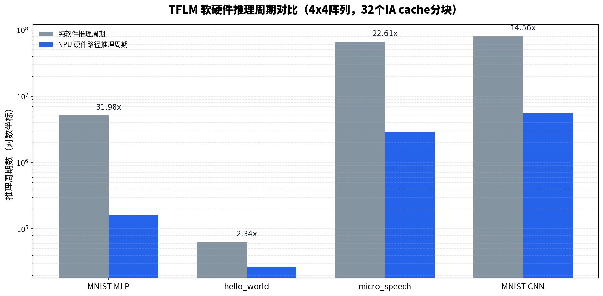
</p>
<p align="center">图7-6 SIZE=4、IA_CACHE_BLOCKS=32 的 TFLM 推理周期对比</p>

<p align="center">
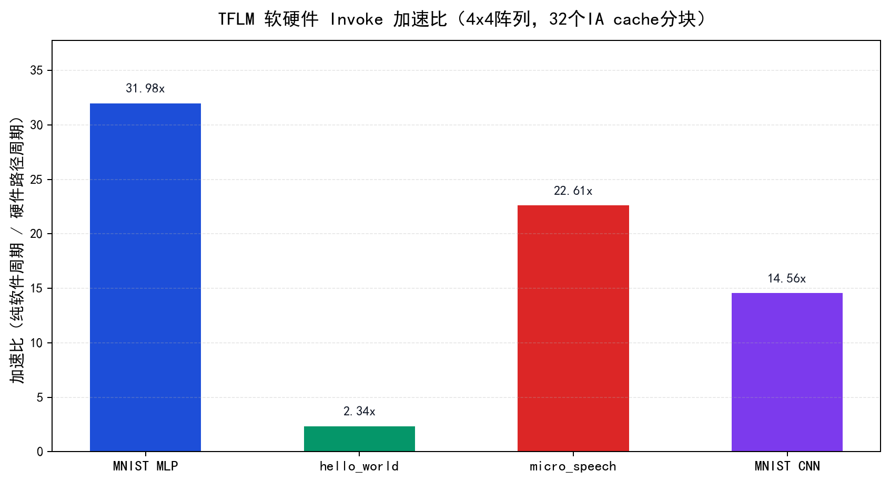
</p>
<p align="center">图7-7 SIZE=4、IA_CACHE_BLOCKS=32 的 TFLM 推理加速比</p>

<p align="center">表7-4 SIZE=4、IA_CACHE_BLOCKS=32 的 TFLM 软硬件推理对比</p>

| 模型 | 测试样本数 | 软件平均推理周期 | 硬件平均推理周期 | 加速比 | NPU调用数 | NPU 活跃周期累计 | NPU总线数据拍利用率 |
|---|---:|---:|---:|---:|---:|---:|---:|
| MNIST MLP | 3 | 5,114,414 | 159,925 | 31.98x | 6 | 192,105 | 20.34% |
| hello_world | 4 | 63,161 | 27,035 | 2.34x | 12 | 3,288 | 17.88% |
| micro_speech | 1 | 66,383,752 | 2,936,028 | 22.61x | 17 | 79,278 | 24.13% |
| MNIST CNN | 1 | 80,563,979 | 5,534,554 | 14.56x | 34 | 118,395 | 21.46% |

MNIST MLP 的两层全连接均由 NPU 执行，3 个样本共触发 6 次 NPU 调用，平均推理周期从 5,114,414 降到 159,925，加速 31.98 倍。该结果表明 AXI-Lite 寄存器配置、NMSIS NN 调用路径、NPU 总线访问和输出写回能够在真实 TFLM 程序中形成完整执行过程。由于 MLP 的主要运算集中在全连接层，矩阵乘占比较高，硬件路径能够显著减少 PicoRV32 标量乘加循环和数据访问次数。

hello_world 的模型规模很小，单次推理中 NPU 活跃周期约为 822 cycle，TFLM 调度、输入输出张量访问和固定软件开销占比很高，因此加速比为 2.34 倍。该用例反映了短矩阵、频繁 NPU 启停和任务配置开销对端到端时间的影响，不用于评价峰值算力。

micro_speech 同时包含 depthwise convolution、reshape、fully connected 和 softmax。硬件版本在 1 次推理中触发 17 次 NPU 调用，周期从 66,383,752 降到 2,936,028，加速 22.61 倍。其 NPU 活跃周期只占硬件推理周期的一小部分，说明 TFLM 调度、非矩阵算子和数据准备仍占据较多时间。对该类模型，端到端性能改善需要同时减少 depthwise wrapper、im2col batch 和小矩阵重复提交开销，单纯提高阵列峰值吞吐不能直接转化为同等比例的推理周期下降。

MNIST CNN 在 1 次推理中触发 34 次 NPU 调用，NPU 活跃周期累计为 118,395，NPU 活跃窗口内的等效吞吐约为 1.13 GOPS@200MHz。该数值高于按完整推理周期折算的 0.024 GOPS，说明卷积 im2col、池化、softmax、TFLM 算子调度、MMIO 任务提交和 CPU 内存访问对端到端时间影响较大。硬件路径的 CPU 指令请求为 1,095,934，纯软件路径为 8,328,183；硬件路径的 CPU 数据请求为 226,981，纯软件路径为 3,035,402。该对比说明 NPU 覆盖矩阵乘后显著减少了 CPU 标量指令和数据访问，但 CNN 的非矩阵部分仍需要由软件执行。


为隔离外部 RAM 响应延时对 IA cache 深度的影响，本节补充一个 Verilator 模块级对照实验。实验固定 `SIZE=4`、`PS_FRAME_COUNT=16`、WS 数据流、s8 LHS、per-tensor 量化、`K=128`、`N=128`、`M=64`，分别测试 `IA_CACHE_BLOCKS=4` 和 `IA_CACHE_BLOCKS=32`。RAM 延时模型采用更接近突发访问的语义：每个 AXI burst 内部连续返回数据，只在 burst 起始响应前插入等待；固定大延时用例将该等待设置为 50 周期。

<p align="center">
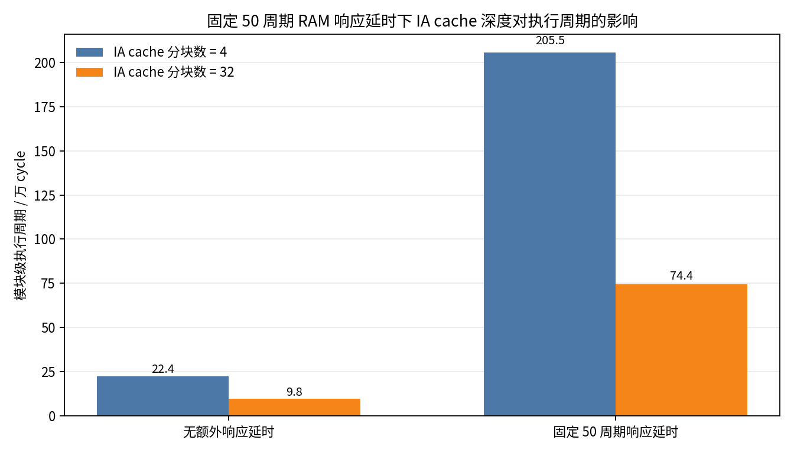
</p>
<p align="center">图7-8 固定 50 周期 RAM 响应延时下 IA cache 深度对执行周期的影响</p>

<p align="center">表7-5 固定 50 周期 RAM 响应延时下 IA cache 深度对模块级执行周期的影响</p>

| 延时模型 | SIZE | IA_CACHE_BLOCKS | K | N | M | 执行周期 |
|---|---:|---:|---:|---:|---:|---:|
| 无额外 RAM 响应延时 | 4 | 4 | 128 | 128 | 64 | 224,432 |
| 无额外 RAM 响应延时 | 4 | 32 | 128 | 128 | 64 | 98,054 |
| 固定 50 周期 RAM 响应延时 | 4 | 4 | 128 | 128 | 64 | 2,054,684 |
| 固定 50 周期 RAM 响应延时 | 4 | 32 | 128 | 128 | 64 | 743,902 |

该实验说明，IA cache 的收益会随外部 RAM 首拍响应延时增大而更加明显。在无额外响应延时时，`IA_CACHE_BLOCKS=32` 相对 `IA_CACHE_BLOCKS=4` 的周期减少 56.31%；在固定 50 周期响应延时时，周期减少 63.80%。原因是较深 IA cache 可以让同一批 IA 分块在更多输出列 tile 上复用，减少需要重新发起的读 burst 数；当每个 burst 起始都要付出较大固定等待时，减少 burst 数带来的收益会被放大。该结果与 TFLM 推理章节中选择 `SIZE=4`、`IA_CACHE_BLOCKS=32` 作为小阵列基线参数的结论一致。

### 7.2 总线利用与数据供给匹配分析

本节使用 NPU 顶层 `NPU_UTIL` 统计 AXI 有效数据拍。总线利用率定义为：

```text
总线数据拍利用率 = (axi_r + axi_w) / NPU 活跃周期
读利用率 = axi_r / NPU 活跃周期
写利用率 = axi_w / NPU 活跃周期
```

该指标描述 NPU 活跃窗口中有多少周期发生有效 AXI 数据传输。它不是 AXI 全双工理论带宽，也不是越高越好的单一性能指标。对于给定矩阵规模，IA cache 分块数增加后，输入激活分块可以在更多输出列组之间复用，外部 RAM 读数据拍数会下降；当读写数据拍的下降幅度大于活跃周期的下降幅度时，总线数据拍利用率会降低，但 SoC 总周期和 NPU 活跃周期仍可能同步减少。因此，较低的总线数据拍利用率可能表示片上复用更充分、外部访存需求更低，而不能直接解释为总线供给能力下降。阵列规模增大时，活跃周期缩短，同样的读写数据拍又会表现为更高总线利用率，但阵列利用率可能下降。因此需要同时观察周期、读写数据拍、每次运算外部访问量、阵列利用率和 FIFO/loader stall。

需要区分两类统计范围：模块级仿真用来分析阵列、cache 和数据流的匹配关系；85% 以上的总线利用率指标采用 SoC 级总线压力实验验收。两者的活跃窗口和软件/总线环境不同，因此不能直接把模块级或小阵列 SoC 用例中的低总线利用率解释为总线优化退化。除压力验收外，本节的固定 SIZE cache 深度扫描采用板级部署参数 `SIZE=4`，用于评价小阵列配置下 IA cache 深度对读流量、执行周期和数据供给匹配关系的影响。

#### 7.2.1 SoC 级总线利用率

本小节列出 RTL、驱动和仿真环境下的 SoC 级统计结果。总线利用率指标按压力用例验收，实验条件为 `SIZE=16`、`IA_CACHE_BLOCKS=4`、`PS_FRAME_COUNT=16`、`K=N=M=256`、WS 数据流、s8 LHS、per-tensor 量化、AXI 读写 outstanding 均为 4、RAM 随机响应延时关闭。该压力用例使用较浅 IA cache，外部读流量压力较高，适合观察 AXI interconnect、RAM full-pipe、NPU 总线锁和写回排空路径是否能够持续供给数据。

<p align="center">表7-6 SoC 总线利用率压力验收数据</p>

| 用例 | SIZE | IA_CACHE_BLOCKS | PS_FRAME_COUNT | K=N=M | CPU_MEM_DP | SoC 总周期 | NPU 活跃周期 | AXI 读数据拍 | AXI 写数据拍 | 总线数据拍利用率 | 指标结论 |
|---|---:|---:|---:|---:|---:|---:|---:|---:|---:|---:|---|
| 总线压力验收 | 16 | 4 | 16 | 256 | 524288 word | 1,353,561 | 187,476 | 149,504 | 16,384 | 88.49% | 达标，接近 90% |

压力用例中的总线利用率计算为：

```text
总线数据拍利用率 = (149,504 + 16,384) / 187,476 = 88.49%
```

由表7-6可见，在相同矩阵规模和相同 32bit AXI 数据宽度下，SoC 总线通路达到 85% 以上有效数据拍占用，并接近 90% 的压力水平，满足总线利用率指标要求。写回 FIFO 在浅 cache 压力测试下仍保留 32 个可排空 bank，`fifo_stall` 和 `fifo_full` 在该压力用例中均为 0。`SOC_AXI_STATS` 记录的 NPU 读写请求等待也为 0，说明总线请求一旦发出即可被 RAM 侧连续接收，interconnect 和 RAM 通路没有形成主要气泡。剩余约 11.51% 的非数据拍周期主要来自 AXI 地址/响应阶段、loader 切 tile、tail 处理和二维写回每行发起一次写 burst 的结构性开销；这些开销不属于 RAM 仲裁堵塞。

为观察小阵列参数下的 cache 深度影响，本文同步测试固定 `SIZE=4`、`K=N=M=256`、`PS_FRAME_COUNT=16` 时不同 `IA_CACHE_BLOCKS` 的 SoC 级总线利用率，结果如表7-7所示。该扫描与 TFLM 推理对比所使用的硬件参数一致。

<p align="center">表7-7 固定 SIZE=4 下不同 IA cache 分块数的 SoC 总线利用率</p>

| SIZE | IA_CACHE_BLOCKS | K=N=M | SoC 总周期 | NPU 活跃周期 | AXI 读数据拍 | AXI 写数据拍 | 总线数据拍利用率 | 读利用率 | 写利用率 | FIFO full | FIFO stall |
|---:|---:|---:|---:|---:|---:|---:|---:|---:|---:|---:|---:|
| 4 | 4 | 256 | 4,729,402 | 3,563,083 | 598,016 | 16,384 | 17.24% | 16.78% | 0.46% | 0 | 0 |
| 4 | 32 | 256 | 2,588,852 | 1,422,485 | 132,096 | 16,384 | 10.44% | 9.29% | 1.15% | 72,464 | 55,232 |
| 4 | 64 | 256 | 2,435,148 | 1,268,765 | 98,816 | 16,384 | 9.08% | 7.79% | 1.29% | 75,928 | 57,736 |
| 4 | 256 | 256 | 2,351,417 | 1,185,029 | 82,176 | 16,384 | 8.32% | 6.93% | 1.38% | 64,404 | 48,256 |

表7-7说明，4x4 阵列扫描属于小阵列低外部带宽压力场景，其总线数据拍利用率不应与表7-6的压力用例指标作一一对照。`SIZE=4` 只有 16 个 PE，计算消耗数据的速度显著低于 `SIZE=16`，因此即使总线供给充分，也不会形成高外部总线压力。随着 `IA_CACHE_BLOCKS` 从 4 增加到 256，AXI 总数据拍从 614,400 降到 98,560，减少 83.96%；SoC 总周期从 4,729,402 降到 2,351,417，减少 50.28%。总线数据拍利用率从 17.24% 降到 8.32%，其原因是 IA cache 复用窗口扩大后，LHS 分块重读次数显著减少，外部 RAM 访问需求下降。该现象表示片上复用降低了总线压力，并不表示总线优化退化。

#### 7.2.2 固定 IA cache 存储容量、扫描阵列 SIZE 实验中的总线压力

本小节复用 7.1.2 的固定 IA cache 存储容量实验，观察在同一容量预算下改变 `SIZE` 时的总线压力变化。

<p align="center">
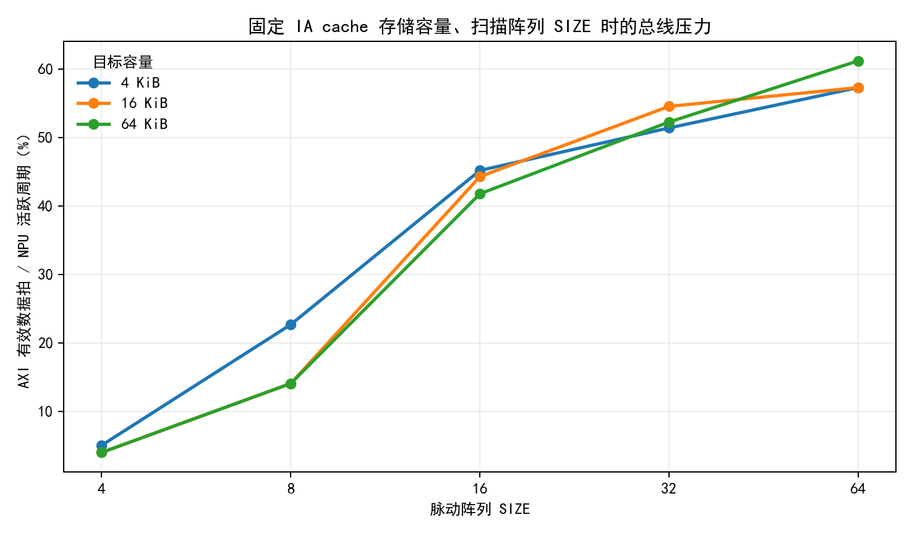
</p>
<p align="center">图7-9 固定 IA cache 存储容量扫描中的总线数据拍利用率</p>

固定 IA cache 存储容量扫描中，总线数据拍利用率随 `SIZE` 增大整体上升。其根本原因是阵列变大后活跃周期缩短，但权重、IA、偏置、输出写回仍需要通过同一 32bit AXI 口搬运。`SIZE=64`、`IA_CACHE_BLOCKS=4` 在 64KiB 目标容量下的总线数据拍利用率达到 61.23%，但阵列利用率只有 3.80%；这说明它更接近数据供给不匹配的大阵列，不是本设计的均衡参数点。

对比 `SIZE=16`、`IA_CACHE_BLOCKS=16` 和 `SIZE=32`、`IA_CACHE_BLOCKS=4` 可以看到容量分配的重要性：两者目标容量同为 16KiB，前者有 16 个 IA cache 块，吞吐为 45.03 GOPS；后者只有 4 个 IA cache 块，吞吐降到 36.87 GOPS，阵列利用率仅 9.00%。这说明在本数据流中，IA cache 块数不仅是容量问题，也是复用窗口问题；当块数过少时，DMA 必须更频繁地重读或等待，阵列虽然更大但有效工作比例下降。

## 8. 实现结果总结

本章汇总 PicoRV32 与优化 NPU 异构处理器的实现结果，并按照赛题要求给出功能点和指标结果。表中不单独设置结论列，处理器选择、NPU 集成、AXI 通信、实测吞吐、总线利用率和资源结果直接写入“本设计实现结果”字段。功能确认过程、波形记录、运行日志和板级运行记录不在本章展开，相关内容由独立记录给出。

### 8.1 赛题基础要求对照

| 赛题条目 | 要求内容 | 本设计实现结果 |
|---|---|---|
| 处理器选择 | Cortex-M0 或 RISC-V CPU | 采用 PicoRV32 RISC-V 软核作为控制 CPU，SoC 顶层包含 CPU native-to-AXI 桥、共享 AXI 互连、AXI RAM、UART、SOC 控制寄存器和 NPU 外设。 |
| NPU 集成 | 在 CPU 系统中集成 32 位 NPU 计算单元 | `npu_axil_top` 作为 AXI-Lite 外设接收 32 bit MMIO 配置，`npu_top` 通过 32 bit AXI4 主设备接口访问共享 RAM，NPU 内部包含控制器、加载单元、计算核心、脉动阵列、部分和缓冲区、重量化、输出 FIFO、写回单元和 DMA。 |
| 基础阵列 | 4×4 脉动阵列 | `ws_systolic_array` 由 `SIZE` 参数生成，`SIZE=4` 对应 4×4 阵列；主要综合配置采用阵列规模 16x16、输入激活缓存块数为 4、部分和帧数为 16。 |
| AXI 通信 | 支持 AXI-Lite 单拍访问和 AXI 突发传输数据搬移 | CPU 通过 AXI-Lite 配置 NPU，NPU 通过 AXI4 突发传输 DMA 访问共享 RAM；DMA 支持二维分块读写、未完成事务、非对齐访问和字节写掩码。 |
| CPU/NPU 协同 | CPU 负责控制，NPU 执行矩阵运算 | 驱动以任务粒度写入配置寄存器、启动 NPU 并轮询状态，NPU 自主完成 GEMM 数据搬移、分块计算、部分和保存、重量化和输出写回。 |
| 0.5TOPS@INT8 峰值 | 200 MHz 下 NPU 峰值不低于 0.5TOPS | TOPS 数据采用实测周期换算，输入激活缓存块数固定为 4，部分和帧数固定为 16。64x64x64 任务中，阵列规模 4x4、8x8、16x16、32x32 和 64x64 的 DSA 吞吐分别为 0.001793TOPS、0.007045TOPS、0.016758TOPS、0.019841TOPS 和 0.020476TOPS@200MHz。阵列规模 64x64 的理想上限为 1.638400TOPS@200MHz，但实测结果未达到 0.5TOPS。 |
| 突发传输带宽利用 | 突发传输场景下达到 60% 基础目标 | 阵列规模 16x16、输入激活缓存块数为 4、部分和帧数为 16 的 512x512x512 任务中，SoC 周期为 5221137，NPU 活跃周期为 1456458，读数据拍/活跃周期为 81.56%，写数据拍/活跃周期为 4.50%。 |

### 8.2 赛题优化要求对照

| 优化条目 | 要求内容 | 本设计实现结果 |
|---|---|---|
| NPU 算力提升 | 接近或超过 1TOPS@INT8 | 阵列规模 64x64 在 200MHz 下理想上限为 1.638400TOPS，但固定输入激活缓存块数为 4、部分和帧数为 16 的 64x64x64 任务中，DSA 执行周期为 5121，对应 0.020476TOPS@200MHz；完整 SoC 周期为 158689，对应 0.000661TOPS@200MHz。理想上限超过 1TOPS，实测任务吞吐未达到 1TOPS。 |
| 总线利用提升 | 突发传输场景目标 80% | 512x512x512 任务中，读数据拍/活跃周期为 81.56%，写数据拍/活跃周期为 4.50%；该结果对应阵列规模 16x16、输入激活缓存块数为 4、部分和帧数为 16。 |
| 动态可调阵列 | 按任务调整 PE 连接关系 | RTL 支持综合期 `SIZE` 参数选择阵列规模，运行期通过有效通道标志处理尾行、尾列和尾归约位置；本设计未实现运行期改变 PE 连接关系。 |
| AXI 共享互连 | 支持主从设备共享访问 | `soc_axi_interconnect` 仲裁 CPU 主设备与 NPU 主设备，并译码 RAM、NPU、UART 和 SOC 控制寄存器；NPU 读写请求与 CPU 取指、数据访问共享同一 AXI RAM。 |
| DMA 控制器 | 减少 CPU 数据搬移参与 | `axi_block_dma_arbiter` 与 `axi_dual_block_dma` 完成二维分块读写、突发传输、非对齐访问、未完成事务计数和字节写掩码，CPU 不参与逐元素搬移。 |
| AXI 接口标准化 | 采用标准 AXI 接口 | CPU 控制接口和 NPU 数据访问接口均使用 AXI/AXI-Lite 风格接口，AXI-Lite 用于寄存器访问，AXI4 主设备接口用于共享 RAM 数据传输。 |

### 8.3 主要实现结果

本设计已经形成以 PicoRV32 为控制核心、以参数化矩阵乘 NPU 为计算后端的异构处理器。系统具备 32 bit AXI-Lite 控制接口、32 bit AXI4 数据主接口、共享 RAM、AXI 互连、DMA 控制器、阵列规模 4x4 基础参数配置、阵列规模 16x16 主要综合配置、输入激活缓存、部分和缓冲区、重量化、输出打包和 TFLM/NMSIS-NN 接入。功能结构与赛题基础功能要求具有明确对应关系。

主要综合配置为阵列规模 16x16、输入激活缓存块数为 4、部分和帧数为 16，目标器件为 Artix-7 `xc7a200tfbg484-3`。该配置的实现频率为 150MHz 核心时钟，WNS/TNS 为 +0.055ns/0ns，资源结果为 Slice LUT 27755、Slice FF 31339、BRAM 分块 173、DSP 320。

实测 TOPS 数据表明，固定输入激活缓存块数为 4 和 32 bit AXI 总线条件下，阵列规模 4x4、8x8、16x16、32x32 和 64x64 在 64x64x64 任务中的 DSA 吞吐分别为 0.001793TOPS、0.007045TOPS、0.016758TOPS、0.019841TOPS 和 0.020476TOPS@200MHz。阵列规模 64x64 的理想上限为 1.638400TOPS@200MHz，但该上限与实测任务吞吐之间存在明显差距。本设计已经完成 CPU/NPU 异构 SoC、AXI 互连、DMA 与参数化 NPU 的主体实现，但实测 TOPS 结果未达到 0.5TOPS 或 1TOPS 要求。

# 附录

## 附录 A：寄存器地址摘要

| 名称 | 字节偏移 | 属性 | 说明 |
|---|---:|---|---|
| NPU_REG_CTRL | 0x000 | RW | 启动、输入数据位宽、量化模式、数据流模式和 sticky 状态清除。 |
| NPU_REG_STATUS | 0x004 | RO | ready、busy、done、writeback valid 和错误码。 |
| NPU_REG_WB_DATA | 0x008 | RO | 最近一次完成状态写回，低位保存错误码。 |
| NPU_REG_WB_INFO | 0x00c | RO | bit0 表示最近写回数据有效。 |
| NPU_REG_LHS_BASE | 0x010 | RW | LHS 输入激活基地址。 |
| NPU_REG_RHS_BASE | 0x014 | RW | RHS 权重基地址。 |
| NPU_REG_DST_BASE | 0x018 | RW | 输出基地址。 |
| NPU_REG_BIAS_BASE | 0x01c | RW | 偏置基地址，写 0 表示无偏置。 |
| NPU_REG_K | 0x020 | RW | 输出行数或批次行数。 |
| NPU_REG_N | 0x024 | RW | 归约维度。 |
| NPU_REG_M | 0x028 | RW | 输出列数或输出通道数。 |
| NPU_REG_LHS_STRIDE_B | 0x02c | RW | LHS 行步长，单位为字节。 |
| NPU_REG_RHS_STRIDE_B | 0x030 | RW | RHS 列步长，单位为字节。 |
| NPU_REG_DST_STRIDE_B | 0x034 | RW | DST 行步长，单位为字节。 |
| NPU_REG_LHS_ZP | 0x038 | RW | LHS 输入零点。 |
| NPU_REG_RHS_ZP | 0x03c | RW | RHS 权重零点。 |
| NPU_REG_DST_ZP | 0x040 | RW | DST 输出零点。 |
| NPU_REG_Q_MULT | 0x044 | RW | 按张量量化乘法系数，或按通道量化乘法系数数组地址。 |
| NPU_REG_Q_SHIFT | 0x048 | RW | 按张量量化移位参数，或按通道量化移位参数数组地址。 |
| NPU_REG_ACT_MIN | 0x04c | RW | 激活裁剪下限。 |
| NPU_REG_ACT_MAX | 0x050 | RW | 激活裁剪上限。 |
| NPU_REG_IA_REUSE | 0x054 | RW | 输入激活复用配置。 |
| NPU_REG_W_REUSE | 0x058 | RW | 权重复用配置。 |
| NPU_REG_DATAFLOW | 0x05c | RW | 数据流模式配置，0 表示 WS，1 表示 IS。 |
| NPU_REG_ID | 0x0fc | RO | 固定外设身份值 `0x4e50_5531`。 |

## 附录 B：主要参数符号

| 符号 | 含义 |
|---|---|
| K | 输出行数或批次行数。 |
| N | 归约维度。 |
| M | 输出列数或输出通道数。 |
| SIZE | 脉动阵列边长和基本分块尺寸。 |
| IA_CACHE_BLOCKS | 输入激活缓存槽位数量。 |
| PS_FRAME_COUNT | 部分和与输出窗口数量。 |
| DATA_WIDTH | PE 输入激活内部计算位宽，设计中为 signed 16 bit；signed 8 bit 输入进入阵列前符号扩展到该位宽。 |
| WEIGHT_WIDTH | PE 权重内部计算位宽，设计中为 signed 16 bit。 |
| ACC_WIDTH | PE 累加器和部分和位宽，设计中为 signed int32。 |
| OUT_WIDTH | 输出元素位宽，重量化后写回 signed 8 bit 结果。 |
| BUS_WIDTH | NPU AXI4 数据主接口位宽，当前设计为 32 bit。 |

## 参考文献

[1] RISC-V International. The RISC-V Instruction Set Manual, Volume I: Unprivileged Architecture: Version 20260120[S/OL]. 2026-01-20[2026-07-04]. https://docs.riscv.org/reference/isa/v20260120/unpriv/unpriv-index.html.
[2] YosysHQ. PicoRV32: A Size-Optimized RISC-V CPU[CP/OL]. 2019-03-02[2026-07-04]. https://github.com/YosysHQ/picorv32.
[3] Arm Limited. AMBA AXI and ACE Protocol Specification: ARM IHI 0022H[S/OL]. 2020-03-31[2026-07-04]. https://developer.arm.com/-/media/Arm%20Developer%20Community/PDF/IHI0022H_amba_axi_protocol_spec.pdf.
[4] TensorFlow. TensorFlow Lite for Microcontrollers[CP/OL]. [2026-07-04]. https://github.com/tensorflow/tflite-micro.
[5] Google. LiteRT 8-bit quantization specification[EB/OL]. 2026-05-28[2026-07-04]. https://developers.google.com/edge/litert/conversion/tensorflow/quantization/quantization_spec.
[6] Nuclei. NMSIS NN Overview: NMSIS 1.6.0 documentation[EB/OL]. 2026-06-15[2026-07-04]. https://doc.nucleisys.com/nmsis/nn/overview.html.
