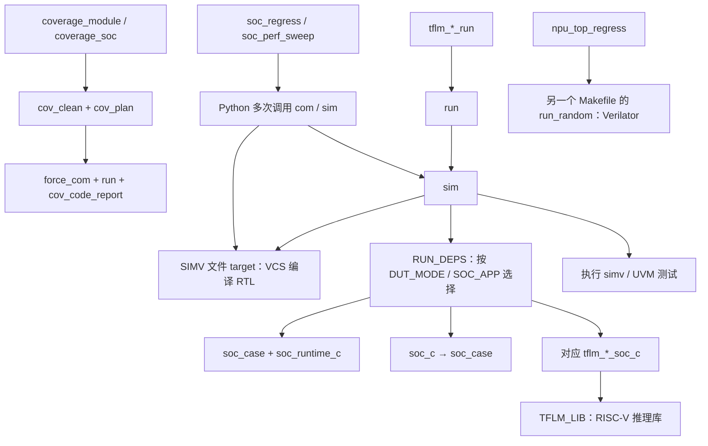
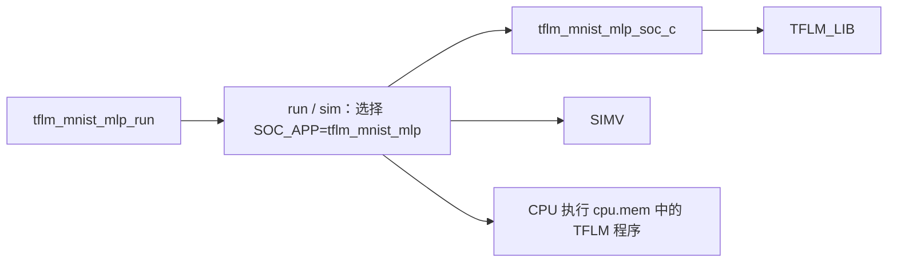
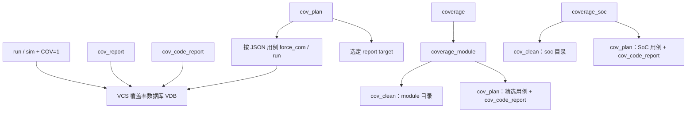

# 仿真 Makefile target 详解

本文对应本目录的 [Makefile](Makefile)，按 2026-11-14 的源码整理，覆盖 **47 个具名 target 和 7 个以变量表示路径的文件 target**。同一 target 的 `DUMPOPTS = 0` 行是变量设置，不重复计数。

本文解释入口的用途、内部执行过程、产物和相互关系；最短运行命令见根目录 [how2run](../../how2run.md)。以下行为来自 Makefile 及其调用脚本的源码分析，不代表本次执行过所有仿真。

## 1. 先理解这份 Makefile 怎样工作

### 1.1 执行位置和工具

除特别说明外，命令都在 `aiEngine_integrated/veri/sim` 下执行：

```bash
make <target> 变量=值
```

Git Bash + GNU Make 3.81 已能解析当前 Makefile 并执行 `make help`。实际仿真主要面向 Linux 工具环境：VCS/UVM 负责外设与 SoC 仿真；Verilator/g++ 负责 NPU 本体回归；RISC-V GCC/G++/objcopy 负责 firmware；URG 负责覆盖率报告；Verdi 负责波形。生成 SoC 数据还需要 Python/NumPy。

`make` 只组织任务，不自带这些工具。执行 TFLM 已有模型的 C++ 推理也不等于调用 Python TensorFlow 训练模型。

### 1.2 target、依赖和命令

```make
run: sim
sim: $(SIMV) $(RUN_DEPS)
```

意思是：完成 `run` 前先完成 `sim`；执行 `sim` 的命令前，准备好 RTL 仿真器文件 `$(SIMV)` 和当前软件模式要求的 `$(RUN_DEPS)`。

箭头 `A → B` 在本文表示“调用 A 时会依赖或调用 B”，不是文件数据流方向。冒号依赖由 make 调度；配方里的 `$(MAKE)` 是递归调用子 make；Python 脚本还可以再次调用 make。三种关系都要看，才能理解完整流程。

`.PHONY` target 表示动作，每次请求都执行；文件 target 通常仅在文件缺失或依赖文件较新时执行。变量 `?=` 提供可覆盖默认值；命令行参数通常优先于 Makefile 内的普通赋值。

### 1.3 整体调用图



图中 `RUN_DEPS` 的几个分支是按配置选一个；`DUT_MODE=axil` 不设置这组 CPU firmware 依赖。`sim` 的配方在其依赖都完成后才启动仿真。

### 1.4 几个容易混淆的名字

| 名称 | 含义 | 例子 |
|---|---|---|
| make target | 要做的动作 | `run`、`soc_case`、`tflm_mnist_mlp_run` |
| `case` | UVM 测试类名 | `ai_axi_soc_c_test`；还参与默认日志路径 |
| `SOC_CASE` | 数据/firmware 用例目录名 | `axi_soc_case`；不是 UVM 类名 |
| `SOC_APP` | CPU 软件类型，决定准备哪个 firmware | `runtime`、`case`、`tflm_mnist_mlp` |
| `DUT_MODE` | 选择被仿真的 RTL 封装 | `axil` 或 `axi_soc` |
| `seed` / `SOC_SEED` | 前者传给 UVM 随机种子；后者传给 SoC 数据生成器 | 单次运行时仅改 `seed` 不等于改变 C 用例数据 |

默认 `DUT_MODE=axil`、`case=ai_mem_gen_smoke_test`、`SOC_APP=runtime`。第一个普通 target 是 `run`，所以直接输入 `make` 会进入仿真流程。

## 2. 编译、运行、调试和清理

### 2.1 `run`：统一运行入口

**用途**：平时运行一次 UVM 测试。自身没有配方，仅依赖 `sim`，因此与同参数下的 `make sim` 走同一条链。

```bash
make run DUT_MODE=axil case=ai_mem_gen_smoke_test DUMPOPTS=0
```

在 SoC 模式，先准备 firmware/数据再启动 CPU；在 AXI-Lite 模式，由 UVM sequence 配置 NPU 并生成/装入测试数据。`run` 本身不实现数值比较，具体检查由 UVM、scoreboard 和 firmware 完成。

### 2.2 `sim`：准备依赖后执行仿真器

**原理**：依赖 `$(SIMV)` 和 `$(RUN_DEPS)`，创建日志目录，随后执行 `$(SIM_RUNNER)`，传入 UVM 类名、种子、内存镜像路径、超时、覆盖率和波形参数。

它**可能编译 RTL，也可能重建 firmware**，不是强制只运行现成二进制。若 RTL 文件 target 已是最新，则复用该二进制；软件是否重建取决于所选 target。

默认 `SIM_RUNNER=$(SIM_LAUNCHER) ./$(SIMV)`，launcher 为 `run_simv_lxc.sh`。脚本检测到本地 ELF VCS 时直接执行；否则走预设 LXC 环境。直接本机运行可用：

```bash
make sim DUT_MODE=axi_soc case=ai_axi_soc_c_test DUMPOPTS=0 SIM_LAUNCHER=
```

默认产物是 `runs/<case>/seed_<seed>/sim.log` 和可选 `tb_top.fsdb`。不同模型包装入口常共用 `case=ai_axi_soc_c_test`，同 seed 下默认日志路径也相同；需要同时保留时指定不同 `seed` 或 `OUT_DIR`。

### 2.3 `com`：确保 RTL 仿真器已编译

**原理**：仅依赖 `$(SIMV)`。文件不存在或 Makefile/已识别 RTL 依赖更新时，调用 VCS；否则不重复编译。

**用途**：先确认 RTL 能编译，或提前为多轮运行准备仿真器。它不生成 SoC case、不编译 CPU firmware、不运行测试，所以成功只证明编译步骤完成。

```bash
make com DUT_MODE=axi_soc MMA_SIZE=4 DUMPOPTS=0
```

### 2.4 `force_com`：强制重新编译当前配置

**原理**：删除当前 `$(SIMV)` 和其 `.daidir/.vcs.timestamp`，再递归调用 `com`。若开启 `COV`，还删除该配置的 `.daidir`、`.csrc` 和覆盖率编译数据库，再重新构建。

**用途**：修改未体现在二进制名称中的编译开关、覆盖率配置，或怀疑依赖漏检时重新编译。它不运行测试，也不会强制重编 runtime firmware 或所有 TFLM 库。

```bash
make force_com DUT_MODE=axi_soc MMA_SIZE=4 DUMPOPTS=0
# 后续 run/sim 需保持同一硬件配置
make run DUT_MODE=axi_soc MMA_SIZE=4 case=ai_axi_soc_c_test DUMPOPTS=0
```

### 2.5 `vd`：打开已有 FSDB

**原理**：先检查 `$(FSDB)` 是否存在，再按当前 filelist/宏加载设计，后台启动 Verdi 打开波形。它不依赖 `run`，不会自动生成缺失波形。

**用途**：查看某个失败 seed 的握手、状态机和计算过程。

```bash
make run DUT_MODE=axil case=ai_mem_gen_smoke_test seed=1 DUMPOPTS=1
make vd  DUT_MODE=axil case=ai_mem_gen_smoke_test seed=1
```

需要 Verdi/FSDB PLI 环境；运行时的 `case/seed/OUT_DIR` 和打开时要对应。`DUMPOPTS=0` 不生成新波形。

### 2.6 `clean`：清理本仿真目录生成物

删除 `$(SIMV)`、`simv_*`、`csrc`、`*.csrc`、相关 `.daidir`、本目录日志/工具临时文件及整个 `runs`。

**用途**：需要从较干净的 VCS 构建状态开始时使用。它也会删除 `runs` 下的回归结果、性能 CSV 和覆盖率，使用前应保留需要的结果。不会清理 `../tb` 的 firmware、TFLM 构建库或 `../top_regression` 的 Verilator 产物，因此它不是整个工程的彻底重建开关。

### 2.7 `help`：打印常用入口

仅打印 target 示例和默认日志布局，不进行 RTL 编译或测试。Makefile 在解析时仍会探测工具链并解析 filelist，因此 `help` 成功只说明当前 make 能读懂这份文件，不说明 VCS/交叉工具链已全部可用。

## 3. 裸机 SoC 数据与 firmware

这组 target 负责给 CPU 准备程序和输入，单独执行它们不启动 RTL 仿真。

### 3.1 `soc_case`：生成一次矩阵测试的数据包

调用 `../tb/generate_axi_soc_case.py`，将 `SOC_K/N/M`、dtype、量化模式、WS/IS、reuse、offset、激活范围、随机种子、非对齐配置等转成 `SOC_GEN_ARGS`。

输出到 `$(SOC_CASE_DIR)`，默认 `../tb/axi_soc_case`：包括输入/配置、golden、供 case firmware 编译的 `soc_case.c/.h`、供 runtime 装载的 `runtime_data.mem` 等。

**用途**：检查输入布局和 golden，或在不编译 CPU/RTL 时准备复现数据。该 target 是 `.PHONY`，每次调用都会重新执行生成器。

```bash
make soc_case SOC_CASE=debug_tail SOC_K=17 SOC_N=31 SOC_M=19
```

### 3.2 `soc_c`：数据编入程序的裸机镜像

依赖 `soc_case`。使用 RISC-V GCC 将启动代码、BSP、MMIO 驱动、刚生成的 `soc_case.c` 和 `$(SOC_C_SRC)` 链接成 `cpu.elf`；objcopy 转成 `cpu.bin`；`elf_to_mem.py` 转成 RAM 初始化用的 `cpu.mem`。

**用途**：单个固定 case、定向复现、导出含程序和数据的镜像。默认 C 主程序为 `../soc_csrc/soc_main.c`，可覆盖成寄存器测试等其他 C 程序。

```bash
make soc_c SOC_CASE=debug_case SOC_K=32 SOC_N=32 SOC_M=32
```

本 target 为 `.PHONY`，请求它就会重新生成数据并编译程序。通常由 `DUT_MODE=axi_soc SOC_APP=case` 的 `run/sim` 自动调用。

### 3.3 `soc_runtime_c`：可复用的裸机执行程序

仅依赖文件 target `$(SOC_RUNTIME_CPU_MEM)`。该程序运行时读取 RAM 中的配置、输入和 golden，调用驱动执行 NPU，再由 C 程序比较实际输出与期望结果。

**用途**：随机回归或参数扫描时复用同一段 CPU 程序，只替换数据，减少重复编译。入口是 `.PHONY`，底层镜像文件可按时间戳复用；它不依赖 `soc_case`，单独调用只准备程序。

```bash
make soc_runtime_c MMA_SIZE=4 MMA_IA_CACHE_BLOCKS=32 MMA_PS_FRAME_COUNT=16
```

### 3.4 `runtime` 与 `case` 在 `sim` 中的关系

| 配置 | `RUN_DEPS` | 仿真装入内容 | 适合 |
|---|---|---|---|
| `DUT_MODE=axil` | 无这组 CPU 依赖 | UVM 自己准备数据并控制外设 | 排查外设/NPU |
| `DUT_MODE=axi_soc SOC_APP=runtime` | `soc_case soc_runtime_c` | 公共 `cpu.mem` + 用例的 `runtime_data.mem` | 多次换输入、随机回归 |
| `DUT_MODE=axi_soc SOC_APP=case` | `soc_c`，进而依赖 `soc_case` | 用例目录的 `cpu.mem` | 固定 case、镜像导出 |
| `DUT_MODE=axi_soc SOC_APP=tflm_*` | 对应的 TFLM firmware target | 用例目录的 `cpu.mem` | 整网推理 |

当前条件分支中，未识别的 `SOC_APP` 也会落入 `soc_c` 分支，不会单独报告“未知应用”；应使用明确列出的名称。

runtime 默认把数据放在 RAM 的后半区：`SOC_RUNTIME_BASE_WORD=SOC_CPU_MEM_DP/2`，字节地址为该 word 地址乘 4。改 RAM 深度时，程序中配置基址和 testbench 的装载基址必须一致。

SoC 通用 UVM 测试等待 `soc_finish`、检查 `soc_status=1`、`cpu_trap=0` 和超时；矩阵输出比较实际由 C firmware 完成。测试类内虽然定义了 RAM 比较辅助任务，当前 main_phase 没有调用它。

## 4. TFLM：先理解 `*_soc_c` 与 `*_run` 的配对

### 4.1 共用执行原理

所有本节 `*_soc_c` 都是“**只构建 firmware**”：先确保 RISC-V 的 `$(TFLM_LIB)` 存在，再用 RISC-V G++ 链接启动代码、SoC runtime、对应主程序、模型/测试数据和 TFLM 静态库，生成 `$(SOC_CASE_DIR)/cpu.elf`、`cpu.map`、`cpu.bin`、`cpu.mem`。

它们都声明为 `.PHONY`，每次请求会重新链接 firmware；静态库仍是可复用的文件 target。构建成功不能代替模型运行结果。

相应 `*_run` 是方便入口：递归调用 `run DUT_MODE=axi_soc case=ai_axi_soc_c_test SOC_APP=... SOC_CASE=...`，并设置该模型的默认超时。因此不必手工先调用 `*_soc_c` 再 `*_run`。



以下每个名称都是本 Makefile 中独立定义的 target；表格把用途相同的一对放在一起，内部构建步骤遵循上述共用流程。

### 4.2 通用示例模型

| target | 用途、内部选择及结果检查 |
|---|---|
| `tflm_soc_c` | 构建 `my_model` 手势分类 firmware；链接 `my_model` 接口、模型以及 Z/W 测试图像。它没有 `my_model` 字样，但对应的确是这一模型。 |
| `tflm_my_model_run` | 设 `SOC_APP=tflm`、`SOC_CASE=axi_soc_tflm` 并运行；默认超时 120,000,000 周期。firmware 检查 Z/W 分类。 |
| `tflm_micro_speech_soc_c` | 构建语音分类 firmware；额外依赖 `$(TFLM_MICRO_SPEECH_FEATURES_CC)`，需要时先在 host 生成 yes/no 特征，再编入 RISC-V 程序。 |
| `tflm_micro_speech_run` | 设 `SOC_APP=tflm_micro_speech`、`SOC_CASE=axi_soc_tflm_micro_speech`；默认超时 50,000,000 周期，检查 yes/no 分类。 |
| `tflm_hello_world_soc_c` | 构建小型正弦近似模型，适合先确认 TFLM 基础运行栈。 |
| `tflm_hello_world_run` | 设 `SOC_APP=tflm_hello_world`、`SOC_CASE=axi_soc_tflm_hello_world`；默认超时 5,000,000 周期，检查若干输入的正弦输出范围及大小关系。 |
| `tflm_person_detection_soc_c` | 构建 person detection firmware，编入模型、模型设置和有人/无人图像。 |
| `tflm_person_detection_run` | 设 `SOC_APP=tflm_person_detection`、`SOC_CASE=axi_soc_tflm_person_detection`；默认超时 320,000,000 周期，检查两类样本判别，默认关波形。 |
| `tflm_run` | 仅依赖 `tflm_hello_world_run`，是其别名；不会遍历所有 TFLM 模型，也不对应 `tflm_soc_c` 的 my_model。 |

例子：`make tflm_hello_world_run DUMPOPTS=0`。前面三个具名模型的 `*_run` 未设置目标专属 `DUMPOPTS=0`，全局默认仍为 1，需要时显式关闭。

### 4.3 MNIST 模型

| target | 用途、内部选择及结果检查 |
|---|---|
| `tflm_mnist_mlp_soc_c` | 构建 int8 MLP，链接 `mnist_mlp_model_data.cc` 和内置 MNIST 测试数据。 |
| `tflm_mnist_mlp_run` | `SOC_APP=tflm_mnist_mlp`；默认目录 `axi_soc_tflm_mnist_mlp_<tag>`，超时 320,000,000 周期，默认关波形；检查内置样本分类，记录 Invoke 周期。 |
| `tflm_mnist_mlp_int16x8_soc_c` | 同一个 MLP 主程序，增加 `TFLM_MNIST_MLP_INT16X8=1`，链接 int16×int8 模型及 golden；arena 默认 12,288 字节，由 `TFLM_MNIST_MLP_INT16X8_ARENA_SIZE` 控制。 |
| `tflm_mnist_mlp_int16x8_run` | `SOC_APP=tflm_mnist_mlp_int16x8`；默认目录 `axi_soc_tflm_mnist_mlp_int16x8_<tag>`，超时同 MLP；除了标签，还逐值比较 hidden、logits、softmax，当前 softmax 容差为 0，默认关波形。 |
| `tflm_mnist_cnn_soc_c` | 构建 int8 CNN，链接 `mnist_cnn_model_data.cc` 和测试数据，用于覆盖整网卷积等软件/硬件调用路径。 |
| `tflm_mnist_cnn_run` | `SOC_APP=tflm_mnist_cnn`；默认目录 `axi_soc_tflm_mnist_cnn_<tag>`，超时 320,000,000 周期，检查内置样本分类并记录 Invoke 周期，默认关波形。 |

普通 int8 MLP/CNN 检查标签，不保证所有中间张量逐值一致；int16×int8 MLP 的 golden 检查更细。它们与后面的 host 全测试集精度入口用途不同。

### 4.4 传感器校准模型

| target | 用途、内部选择及结果检查 |
|---|---|
| `tflm_sensor_calibration_int16x8_soc_c` | 构建仓库内的 int16×int8 校准模型；arena 默认 16,384 字节，由 `TFLM_SENSOR_CALIBRATION_ARENA_SIZE` 控制。 |
| `tflm_sensor_calibration_int16x8_run` | `SOC_APP=tflm_sensor_calibration_int16x8`；目录 `axi_soc_tflm_sensor_calibration_int16x8_<tag>`，超时 320,000,000 周期；中间 FC 和最终 int16 输出与 golden 逐值一致，默认关波形。 |
| `tflm_sensor_calibration_release_20261015_soc_c` | 构建 release 版本，编入 base/adapter 模型、校准数据和 SoC 样本；用于验证组合推理及后处理。 |
| `tflm_sensor_calibration_release_20261015_run` | `SOC_APP=tflm_sensor_calibration_release_20261015`；目录 `axi_soc_tflm_sensor_calibration_release_20261015_<tag>`，超时 640,000,000 周期；所得 V4 与 PC TFLite 参考差值要求 ≤2500 µV，另记录校准误差，默认关波形。可按镜像容量设置 `SOC_CPU_MEM_DP=131072`。 |
| `tflm_sensor_calibrator_20261016_soc_c` | 通过汇编 `.incbin "sensor_calibrator_int16.tflite"` 编入外部模型。`TFLM_SENSOR_CALIBRATOR_20261016_MODEL` 的目录经 `-Wa,-I` 传给汇编器，并列为构建依赖。 |
| `tflm_sensor_calibrator_20261016_run` | `SOC_APP=tflm_sensor_calibrator_20261016`；目录 `axi_soc_tflm_sensor_calibrator_20261016_<tag>`；超时 2,000,000,000 周期；RAM 深度特别取 `TFLM_SENSOR_CALIBRATOR_20261016_MEM_DP`，默认 3,112,960 words；检查张量约定和量化输出，容差 16 LSB，默认关波形。 |
| `tflm_sensor_calibration_20261019_soc_c` | 同样通过 `.incbin "sensor_calibrator_complete_int16.tflite"` 编入外部模型，模型路径由 `TFLM_SENSOR_CALIBRATION_20261019_MODEL` 提供；另编入 golden 数据，arena 默认 262,144 字节。 |
| `tflm_sensor_calibration_20261019_run` | `SOC_APP=tflm_sensor_calibration_20261019`；目录 `axi_soc_tflm_sensor_calibration_20261019_<tag>`；超时 2,000,000,000 周期，使用普通 `SOC_CPU_MEM_DP`，int16 输出与 golden 容差 8 LSB，默认关波形。 |

两种外部模型变量的默认值指向原开发机 `/home/etc/...`。需改为实际路径；由于汇编中固定了 `.incbin` 文件名，替换路径时目录内也需具有上述对应文件名。只随意改变变量中的 basename，不会自动修改 `.incbin`。

### 4.5 硬件、NMSIS 和软件模式

| `TFLM_NMSIS_NN_ENABLE` | `TFLM_SOC_MMA_ENABLE` | `<tag>` | 原理 |
|---:|---:|---|---|
| 1 | 1 | `hw` | 启用 NMSIS-NN 以及 SoC NPU 定制路径；适用算子可通过 MMIO 使用 NPU |
| 1 | 0 | `nmsis` | 使用 NMSIS-NN 软件内核，不启用 NPU 定制宏 |
| 0 | 0 或 1 | `sw` | 不启用 NMSIS-NN 和 NPU 定制宏，走 TFLM 软件路径 |

`TFLM_NMSIS_NN_ENABLE` 默认跟随 `TFLM_SOC_MMA_ENABLE`。硬件开关不保证每个算子都在 NPU 上执行，算子支持及回退由内核代码决定。

```bash
make tflm_mnist_mlp_run TFLM_SOC_MMA_ENABLE=1 TFLM_NMSIS_NN_ENABLE=1
make tflm_mnist_mlp_run TFLM_SOC_MMA_ENABLE=0 TFLM_NMSIS_NN_ENABLE=0
# 只导出 firmware，不启动 SoC：
make tflm_mnist_mlp_soc_c SOC_CASE=export_mnist
```

直接调用 `*_soc_c` 不会自动选取对应 `*_run` 的模型专属 `SOC_CASE`；不指定时仍写入全局默认 `../tb/axi_soc_case`。各 `*_run` 才设置其默认用例目录。普通 `SOC_TIMEOUT_CYCLES` 可覆盖运行包装入口的模型默认超时。

## 5. Host 侧分析 target

这组任务在开发机 CPU 上执行 TFLM，不启动 PicoRV32 或 NPU RTL；可用于准备数据、评估模型精度或建立软件参考。

### 5.1 `tflm_mnist_accuracy`

仅依赖 `$(TFLM_MNIST_ACCURACY_BIN)`，确保 host 版 MNIST 推理工具编好。生成的默认程序是 `../../drivers/tflm/my_tflm/build-host/tflm_mnist_accuracy`。不执行数据集评估。

### 5.2 `tflm_mnist_accuracy_run`

确保上述工具存在，然后调用 `../tools/analyze_mnist_quant_accuracy.py`，读取默认 `~/.keras/datasets/mnist.npz`，分别运行 `mnist_mlp_int8.tflite` 和 `mnist_mlp_int16x8.tflite`。

**用途**：比较两种量化模型的测试集精度、预测变化、各自独有的正确样本，判断量化本身造成的精度变化。默认最多 10,000 个样本，NumPy 读取数据集，不会自动训练或下载缺失的数据集。

输出 `runs/tflm_mnist_accuracy/summary.json`、两份 `*_outputs.csv` 和供 runner 读取的 images/labels 二进制。`TFLM_MNIST_ACCURACY_COUNT` 和 `TFLM_MNIST_ACCURACY_OUT` 控制规模与目录。报告数值用于分析，没有在此 target 设置分类准确率必须达到多少的签核门槛。

```bash
make tflm_mnist_accuracy_run TFLM_MNIST_ACCURACY_COUNT=1000
```

### 5.3 `tflm_sensor_calibration_release_20261015_host`

依赖 host 测试源码/模型数据和 `$(TFLM_HOST_LIB)`，使用本机 `$(CXX)` 链接 release 校准工具，默认输出到 `build-host/tflm_sensor_calibration_release_host`。该入口为 `.PHONY`，每次请求会重新链接。只构建，不评估。

### 5.4 `tflm_sensor_calibration_release_20261015_host_run`

先调用上一个 target，再执行 host 程序。使用 host 样本运行 base/adapter，输出 MAE、RMSE、5 mV 内占比、最大误差、相对于打包 TFLite 参考的差值，并打印 SoC 选中样本的参考信息。

**用途**：建立 SoC 对照的数值参考并评估校准效果。主机程序在初始化/Invoke 等错误时返回失败；最后打印 PASS 不代表所有报告中的误差指标都通过了额外阈值签核，不能将其等同于 SoC 版本的 2500 µV 断言。

## 6. 七个文件 target：真正实现可复用构建的部分

这些 target 以 `$(变量)` 展开成文件路径，通常由具名入口自动请求，不必直接手写路径运行 make。

| 文件 target | 如何生成、依赖关系 | 有什么用、复用边界 |
|---|---|---|
| `$(SIMV)` | VCS 编译 `$(FILELIST)`，设置 top、宏、RTL 参数和可选 coverage/FSDB PLI；依赖 Makefile、主 filelist、向下解析最多三层 `-f` 的 filelist 和已提取源文件 | 真正可执行的 RTL 仿真器。`com/sim` 共同依赖它；默认名称编码模式、SIZE、CACHE、PS、RAM 深度、outstanding、icache 和 RAM buffer 参数 |
| `$(SOC_RUNTIME_CPU_MEM)` | 依赖 runtime C、启动代码、BSP、MMIO 驱动、link.ld 和 Makefile；交叉编译→objcopy→mem | `soc_runtime_c` 的实际产物。目录名编码 SIZE/CACHE/PS/RAM 深度，复用同配置的通用 firmware；RAM 深度参与命名可避免复用错误的 runtime 配置基址 |
| `$(TFLM_LIB)` | 依赖 `TFLM_RV32_REBUILD_DEPS` 中列出的内核、NMSIS 源码及子 Makefile；递归进入 `drivers/tflm/my_tflm`，指定 RISC-V 工具、宏和构建目录 | 所有 TFLM SoC firmware 共用的 RV32 静态库。默认目录 `build-rv32im-<tag>-S<SIZE>-C<CACHE>-P<PS>`，区分硬件/软件及阵列配置 |
| `$(TFLM_HOST_LIB)` | 无显式前置文件依赖；文件缺失时调用 TFLM 子 Makefile 构建 host 库 | 供 MNIST 精度、语音特征提取、校准 host 工具链接。与 RV32 库的体系结构不同，不能互换；本层发现文件已存在时不主动追踪所有 host 库源码修改 |
| `$(TFLM_MNIST_ACCURACY_BIN)` | 依赖 `../tools/tflm_mnist_accuracy.cc` 和 host 库，以 host C++ 编译链接 | 供精度 Python 脚本反复加载两种 `.tflite` 并输出预测/统计，不是 CPU firmware |
| `$(TFLM_MICRO_SPEECH_FEATURE_DUMP)` | 依赖 host 特征提取工具、host 库、分类模型和预处理模型/音频数据 | 构建 `build-host/dump_micro_speech_features`，在 host 执行音频预处理以生成 SoC 用的特征 |
| `$(TFLM_MICRO_SPEECH_FEATURES_CC)` | 依赖 feature dump 工具，执行 `$< > $@`，将工具 stdout 重定向到 `.cc` | 默认生成/更新 `../soc_csrc/tflm_micro_speech_features.cc`，由 `tflm_micro_speech_soc_c` 编入 firmware；它是中间数据生成步骤，可能更新该源码文件 |

`$@` 表示当前输出文件；`$<` 表示第一个依赖；`$(@D)` 表示输出文件的目录。这些自动变量让同一条规则能跟随用户覆盖的文件路径工作。

## 7. 自动回归与性能扫描

### 7.1 `soc_regress`：批量随机正确性验证

调用 `run_axi_soc_c_regression.py`。脚本遍历 SIZE、CACHE、PS、WS/IS、dtype、quant 的参数组合；对每个组合运行 `SOC_REGRESS_ITERS` 次，设置种子和随机数据，先准备/复用 VCS 仿真器，再多次 `make sim`。

默认使用 runtime firmware，失败时保存输入与日志到 `exception_cases` 并停止。成功要求子进程返回正常、输出含 TEST PASS，且 UVM 错误计数满足脚本检查。输出到 `SOC_REGRESS_LOG_ROOT`，默认 `runs/axi_soc_c_regression/summary.txt` 及每轮日志。

**用途**：验证参数组合、内存背压、非对齐布局下的端到端正确性。这里的 `pass_rate` 是用例通过率，不是模型分类准确率。

```bash
make soc_regress SOC_REGRESS_ITERS=5 SOC_SIZE_LIST='4' \
  SOC_CACHE_BLOCKS_LIST='32' SOC_PS_FRAME_COUNT_LIST='16' \
  SOC_DATAFLOW_MODE_LIST='0 1' SOC_REGRESS_LHS_DTYPE_LIST='1 2' \
  SOC_REGRESS_QUANT_MODE_LIST='0 1' SOC_REGRESS_DDR_RAND_LAT=1 \
  SOC_REGRESS_UNALIGNED_LAYOUT=1 SOC_REGRESS_SOC_TIMEOUT_CYCLES=120000000
```

本例为 8 组合 × 5 次 = 40 次。dtype/quant 列表留空时由生成器随机选择；PS 列表留空时跟随当前 SIZE。`SOC_REGRESS_TIMEOUT` 是每次子进程的墙钟秒数；`SOC_REGRESS_SOC_TIMEOUT_CYCLES` 是 RTL 内部周期超时，二者不能互换。

`SOC_REGRESS_DIM_MULTIPLE=0` 在脚本中解释为当前 SIZE，不是任意整数尺寸；测尾块可设置明确的倍数或使用单 case 的非整除尺寸。

### 7.2 `soc_perf_sweep`：固定任务扫描架构与复用参数

调用 `run_axi_soc_perf_sweep.py`。遍历固定 `KxNxM`、SIZE/CACHE/PS、数据流、dtype/量化和 IA/W reuse，按硬件配置调用 `com`（或 `force_com`），再运行多次 `sim`。

脚本解析 `soc_finish` 周期、NPU 控制/计算利用率、CPU/NPU AXI 统计。输出默认在 `runs/axi_soc_perf_sweep/perf.csv`、`summary.txt`，失败 case 另行保存。

**用途**：在正确性通过前提下找参数对周期与总线利用的影响。它不是综合面积或 FPGA 实测；`soc_finish` 周期包含 CPU 与软件开销，也不是裸 NPU 的 start-to-ready 周期。

```bash
make soc_perf_sweep SOC_PERF_DIMS='32x32x32' SOC_PERF_SIZE_LIST='4' \
  SOC_PERF_CACHE_BLOCKS_LIST='4 8' SOC_PERF_PS_FRAME_COUNT_LIST='16' \
  SOC_PERF_DATAFLOW_MODE_LIST='0 1' SOC_PERF_IA_REUSE_LIST='1 2' \
  SOC_PERF_W_REUSE_LIST='1' SOC_PERF_SOC_TIMEOUT_CYCLES=120000000
```

reuse 列表留空时按资源限制枚举；`SOC_PERF_INCLUDE_AUTO=1` 额外测驱动自动选择。`SOC_PERF_JOBS` 控制脚本并行运行的仿真数量；`SOC_PERF_RAM_FIXED_LAT`/`SOC_PERF_DDR_RAND_LAT` 控制 RAM 延迟；`SOC_PERF_FORCE_COMPILE=1` 强制编译。`SOC_PERF_KEEP_GOING=1` 用于继续收集失败之后的结果，评估时仍需查看每行状态，不能只凭总命令返回成功认定所有点通过。

### 7.3 `npu_top_regress`：转到 Verilator 的 NPU 本体回归

递归执行 `make -C ../top_regression run_random`，将 `TOP_REGRESS_SIZE/IA_CACHE_BLOCKS/PS_FRAME_COUNT/AXI_READ_OUTSTANDING/COUNT/SEED/TRACE` 映射成子 Makefile 的参数，并传入生成器参数与 RAM plusargs。

**用途**：绕过 CPU 和 AXI-Lite shell，更快定位 NPU loader、计算、量化、写回错误。它不依赖本目录 `com/sim`，也不使用 VCS `$(SIMV)`。

```bash
make npu_top_regress TOP_REGRESS_COUNT=20 TOP_REGRESS_TRACE=0
```

默认硬件为 SIZE=4、CACHE=4、PS=8，20 个 case，从 seed=1000 开始；默认生成随机尺寸、随机量化和 s8/s16 输入，数据流仍是 WS，RAM 开随机延迟。随机 WS/IS 需给 `TOP_REGRESS_RANDOM_GEN_ARGS` 增加 `--random_dataflow`，或指定 `--dataflow_mode 1` 测 IS。

子 Makefile 负责 Verilator 构建、Python 生成 init/config/golden、运行及输出结果检查；看 `[TB] PASS`、`[run_random] PASS=N FAIL=0` 和 `../top_regression/out/random_summary.{md,csv,jsonl}`。不是 SoC/TFLM 全链路证明。

## 8. 覆盖率 target：采集、组织、报告是三件事



本图中的报告 target 是读取 VDB；它们不会自己补跑缺失测试。

### 8.1 `cov_report`：已有 VDB 的合并与功能覆盖率汇总

查找 `$(COV_VDB_ROOT)/*.vdb`；没有数据库则失败。调用 URG 合并数据库，默认 `URG_METRICS=group`，报告目录为 `$(COV_REPORT_DIR)`；再调用 `coverage_summary.py`，默认签核 `functional,group`，目标值 `COVERAGE_GOAL=95`。

**用途**：检查已有采集结果中的功能覆盖率及 group 指标。输出 `$(COV_ROOT)/coverage_report_summary.md/.json`、URG 日志/报告。这里 `functional` 来源于日志中的功能覆盖率统计，与“测试打印 TEST PASS”不是同一个含义。

`COV_ALLOW_URG_FAIL=1` 默认允许 URG 失败后继续汇总，保留 fallback 证据；summary 还可能读取 VDB。最终是否通过取决于所要求指标是否有证据且达到门槛，而不是 URG 命令被忽略后自动通过。

### 8.2 `cov_code_report`：按编译设计汇总代码覆盖率

读取已有 VDB，逐个调用 URG，默认处理 line/cond/tgl/branch/fsm；再用 `coverage_summary.py` 按 `COV_VDB_MERGE_MODE` 汇总并签核，默认 **只要求 line ≥95**。

**用途**：评估 RTL 代码被测试执行的程度。产物为 `$(COV_ROOT)/urg_code_by_design/` 和 `coverage_code_report_summary.md/.json`。

默认传入 `coverage_line_exclude.json` 的排除规则；当使用排除规则或 URG 证据不完整时，summary 会使用 VCS VDB 直接解析路径。应同时看指标来源、原始/排除后统计和排除原因。`line=95%` 不等于五类代码指标都 ≥95%，更不等于设计已无 bug。

### 8.3 `cov_plan`：按 JSON 测试计划运行并报告

调用 `run_coverage_plan.py --plan coverage_plan.json`。脚本对选中条目按仿真器名称缓存编译，每个需要的仿真器先 `force_com`，再执行条目 target（默认 `run`），设置 coverage/VDB/日志路径；最后调用 `COV_REPORT_TARGET`（默认 `cov_report`）。

**用途**：使覆盖率测试集可复现、可选择、可汇总。输出 `$(COV_ROOT)/coverage_plan_results.md/.json` 和 `plan_logs/`，除 report 签核外还检查编译返回值、测试 PASS 与 UVM 错误。

`COV_PLAN_ARGS` 可传 `--only <条目名>`、`--keep-going`、`--skip-report` 和 `--make-var VAR=VALUE`。脚本识别的根目录来自 `--make-var COV_ROOT=...`；自定义计划参数时显式传它更清楚。

```bash
make cov_plan COV_REPORT_TARGET=cov_code_report \
  COV_PLAN_ARGS='--only axil_reg_directed --make-var COV_ROOT=runs/coverage_one'
```

当前完整 JSON 的首项引用 `ai_coverage_test`，但当前 `veri/test/ai_test_pkg.sv` 未定义该类；所以直接无筛选 `make cov_plan` 可能在此项失败。下述两个精选套件通过 `--only` 选择已有入口，不能把它们与完整 JSON 计划等同。

### 8.4 `coverage_module`：NPU 外设范围的精选覆盖率套件

先调用 `cov_clean COV_ROOT=$(COV_MODULE_ROOT)`，默认清理 `runs/coverage_module`；随后调用 `cov_plan`，用 `COV_MODULE_PLAN_ARGS` 选择 AXI-Lite smoke、RAL、寄存器以及 SoC 端到端定向 case，最终用 `cov_code_report`。

**用途**：集中提高加速器模块的代码覆盖率。默认强制加速器 scope，按模块定义 `definition` 方式汇总不同设计实例；当前签核指标仍为 line。测试激励含 SoC 用例，不代表覆盖率统计范围包含整个 SoC。

### 8.5 `coverage_soc`：用 SoC 激励覆盖 NPU 集成路径

先清理 `$(COV_SOC_ROOT)`，默认 `runs/coverage_soc`，再运行 `COV_SOC_PLAN_ARGS` 选中的 SoC 定向用例，最后调用 `cov_code_report`，同样采用 `definition` 合并。

**用途**：看 CPU/驱动真实发起配置与运算时，NPU 外设子树的覆盖情况。默认 `COV_SOC_HIER_FILE=coverage_accel_axi_soc.hier`，文件内容只选择 `tb_top.u_soc_top.u_npu_axil_top`；因此默认并未统计整个 CPU、互连、RAM。

若要扩展到整个 SoC，已有 `coverage_soc_axi_soc.hier` 选择 `tb_top.u_soc_top`，可明确覆盖参数：

```bash
make coverage_soc COV_SOC_HIER_FILE=./coverage_soc_axi_soc.hier COVERAGE_GOAL=95
```

这会改变统计分母，原精选用例不保证能达到整个 SoC 的同一门槛。`make help` 中的 “soc_top scoped” 描述比当前默认范围更宽，应以层级文件为准。

### 8.6 `coverage`：`coverage_module` 的别名

仅依赖 `coverage_module`。所以 `make coverage` 不会顺便跑 `coverage_soc`，也不等于 `cov_plan` 默认的完整 JSON 套件。需要两套时分开执行。

### 8.7 `cov_clean`：只删除所选覆盖率根目录

直接删除 `$(COV_ROOT)`，默认 `runs/coverage`。用于清掉旧 VDB/报告，避免混入历史证据；不运行仿真，不删除所有 firmware 或其他覆盖率根目录。

```bash
make cov_clean COV_ROOT=runs/coverage_module
```

`coverage_module/coverage_soc` 已自行先调用它，无需再额外清理一次。

## 9. 参数变化、缓存与结果判断

### 9.1 为什么有时不用重编，有时要强制重编

| 修改 | 当前机制 | 建议 |
|---|---|---|
| 改 UVM `case/seed`、SIM_ARGS | 通常保持同一个 RTL 二进制，改变运行参数 | 用 `run/sim` 即可；数据种子还要看 `SOC_SEED` |
| 改 SIZE/CACHE/PS、RAM 深度、outstanding、icache/buffer | 默认 `SIMV` 名称变化 | 自动请求另一配置文件；运行/打开波形时参数保持一致 |
| 改已列入依赖的 RTL/filelist | 时间戳触发 `$(SIMV)` 重编 | 常规 `run/com`；filelist 解析不是完整的任意 include 依赖扫描 |
| 改 COV、DEFINES、部分 VCS 编译选项 | 这些值不都体现在 `SIMV` 名字中，make 不比较上次命令行 | 用同参数 `force_com`，覆盖率采集尤其如此 |
| 改 runtime 编译选项，例如 UART 分频/优化参数 | runtime 目录只编码部分参数，变量值本身不是时间戳依赖 | 使用新的 `SOC_RUNTIME_BUILD_DIR` 或有针对性地重建该镜像；`force_com` 只管 RTL |
| 改 TFLM hw/nmsis/sw 或 SIZE/CACHE/PS | 默认 TFLM 库目录名区分配置 | 通常使用各自库；额外编译宏/未显式跟踪源码仍需保证库重建 |

不要将“make 判断文件已最新”理解为“当前所有参数与这个二进制完全一致”。尤其自行覆盖 `SIMV`、`TFLM_LIB` 或构建目录名时，应负责保持配置一致。

### 9.2 `-j` 和多 target 的关系

`make run` 会等待所有依赖完成再运行，因此普通入口不需要手工串联准备命令。若写成 `make -j clean run` 或 `make -j force_com run`，两者没有表达先后依赖，可能相互删除/竞争产物；需要顺序操作时分成两条命令。

`coverage_module/coverage_soc` 的配方已经顺序执行清理和计划。性能扫描需要并行时优先使用 `SOC_PERF_JOBS`，让脚本分配用例目录和日志。

### 9.3 如何判断完成的是哪一步

| 完成入口 | 能说明什么 | 继续看什么 |
|---|---|---|
| `com/force_com` | VCS 编译命令成功 | 还需 `run/sim` 检查行为 |
| `soc_c/soc_runtime_c/*_soc_c` | CPU 镜像构建完成 | 还需 SoC 执行和 firmware 检查 |
| `run/sim/*_run`（SoC） | 执行了相应测试 | TEST PASS、UVM 错误计数、status=1、trap=0、未超时；模型还看对应 firmware PASS |
| `npu_top_regress` | NPU 本体批量比对完成 | 每 case `[TB] PASS`，总计 FAIL=0 |
| `cov_report/cov_code_report` | 对已有证据生成并签核覆盖率 | summary 的 signoff 指标、证据来源、范围及排除规则 |
| host 分析入口 | 开发机上的模型分析完成 | 精度/误差数值；不能据此认定 SoC RTL 通过 |

普通 `sim` 直接执行仿真器，不额外解析整份日志转换测试失败状态；某些测试打印 FAIL 后进程仍可能正常退出。自动回归/覆盖率脚本会进一步解析 PASS 和错误计数，单次手工运行也应查看这些字段。

### 9.4 当前 `.PHONY` 的小细节

当前具名入口中，`coverage`、`soc_perf_sweep`、`npu_top_regress` 没有列入 `.PHONY`，其余本文列出的具名动作都已声明。若当前目录恰好出现同名普通文件，后两个没有依赖的动作可能被 make 当作“已最新”而跳过；`coverage` 因依赖 phony 的 `coverage_module`，仍会触发该依赖。本文记录现状，不修改这些构建规则。

## 10. 按目的选入口

| 当前要做的事 | 优先入口 | 与其他入口的关系 |
|---|---|---|
| 列命令、确认 make 能解析 | `help` | 不验证 EDA 环境 |
| 看 RTL 是否能编译 | `com` | `run/sim` 也会按需执行同一编译文件规则 |
| 排查 NPU 本体 | `npu_top_regress` | 独立 Verilator 链，不启动 CPU |
| 排查 AXI-Lite 配置 | `run DUT_MODE=axil case=ai_axil_reg_directed_test` | UVM 直接访问外设 |
| 跑 CPU→NPU 单次矩阵 | `run DUT_MODE=axi_soc SOC_APP=runtime case=ai_axi_soc_c_test` | 自动组合数据、firmware、RTL |
| 大量换数据找错误 | `soc_regress` | Python 多次组织 `com/sim` |
| 找较好的架构/reuse 参数 | `soc_perf_sweep` | 同一 SoC 链，额外汇总周期/利用率 |
| 验证整网硬件与软件路径 | 相应 `tflm_*_run` | 自动准备模型 firmware 后调用 `run` |
| 只导出 firmware | 相应 `*_soc_c`、`soc_c` 或 `soc_runtime_c` | 不必启动 VCS |
| 看模型量化精度 | `tflm_mnist_accuracy_run`、release host 入口 | host 参考与精度分析 |
| 看加速器代码覆盖率 | `coverage_module` 或 `coverage_soc` | 自动清理、跑精选测试和报告 |
| 只对已有 VDB 重算报告 | `cov_report` / `cov_code_report` | 不自动补跑仿真 |
| 调试失败信号 | `vd` | 先用对应运行入口生成 FSDB |

源码入口：[Makefile](Makefile)、[SoC 随机脚本](run_axi_soc_c_regression.py)、[性能脚本](run_axi_soc_perf_sweep.py)、[覆盖率计划脚本](run_coverage_plan.py)、[覆盖率汇总](coverage_summary.py)、[NPU 子 Makefile](../top_regression/Makefile)。
